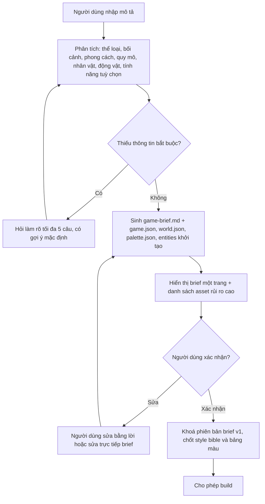

# BRD-01: Tạo game từ mô tả

| Mục | Nội dung |
|---|---|
| Mã tài liệu | BRD-01 |
| Phiên bản | 1.1 |
| Trạng thái | **Đã duyệt** v1.1 (Huy, 23/11/2026) |
| Ngày | 22/11/2026 |
| Tài liệu cha | BRD-00 `BRD-TONG-QUAN.md` v1.1 |
| Yêu cầu tổng quan được chi tiết hoá | BR-01…05, BR-73, BR-75, BR-93, BR-94 |
| Quyết định liên quan | QĐ-03, QĐ-11, QĐ-13, QĐ-14, QĐ-15 |
| Pha | E1 (Claude Code `/new-game`), W1 (chat trên Web Studio), W3 (sửa bằng lời) |

## Quy ước mã trong các BRD chi tiết

| Loại | Mẫu | Ví dụ |
|---|---|---|
| Yêu cầu chi tiết | `BR-<số gốc>.<n>` | BR-01.3 là yêu cầu chi tiết thứ 3 của BR-01 |
| Quy tắc nghiệp vụ | `QT-<mã BRD>-<n>` | QT-01-04 |
| Kịch bản chấp nhận | `AC-<mã BRD>-<n>` (Cho / Khi / Thì) | AC-01-02 |
| Câu hỏi mở riêng | `CH-<mã BRD>-<n>` | CH-01-01 |

---

## 1. Mục đích

Biến mô tả bằng lời của người dùng thành một bộ khởi tạo game **đúng ý, đúng phong cách, xác nhận được** trước khi tốn công build. Đây là cửa vào duy nhất để tạo game, dùng chung logic cho Claude Code (`/new-game`) và Web Studio (chat).

## 2. Phạm vi

**Trong phạm vi:** tiếp nhận mô tả, hỏi làm rõ, sinh `game-brief.md` và dữ liệu khởi tạo, xác nhận, sửa brief, chốt style bible và bảng màu, sửa game bằng lời sau khi đã tạo.

**Ngoài phạm vi:** build cảnh (BRD-02, BRD-03), giao diện chat chi tiết (BRD-08), đặc tả schema JSON (để ở SRS/TSD).

## 3. Tác nhân

| Tác nhân | Vai trò |
|---|---|
| Người tạo game | Đưa mô tả, trả lời câu hỏi làm rõ, xác nhận brief, duyệt thay đổi |
| Bộ tiếp nhận (`game-intake`) | Phân tích mô tả, sinh brief và dữ liệu (chạy trong Claude Code hoặc qua cổng AI của Web Studio) |
| Quản trị / Huy | Duyệt style bible, cổng chất lượng |

## 4. Quy trình nghiệp vụ

## 5. Yêu cầu chi tiết

### 5.1 Tiếp nhận mô tả (BR-01)

| Mã | Yêu cầu | Ưu tiên |
|---|---|---|
| BR-01.1 | Nhận mô tả dạng văn bản tự do, tiếng Việt hoặc tiếng Anh, độ dài từ một câu tới vài trang | M |
| BR-01.2 | Cho phép đính kèm ảnh tham chiếu (concept, ảnh chụp bối cảnh) để bổ sung phong cách; ảnh chỉ dùng làm tham chiếu, không dựng lại nguyên mẫu | S |
| BR-01.3 | Trích xuất các trường bắt buộc của brief (bảng 6.1); trường nào không suy ra được thì hỏi làm rõ | M |
| BR-01.4 | Câu hỏi làm rõ tối đa 5 câu mỗi vòng, mỗi câu có phương án mặc định để người dùng chỉ cần bấm đồng ý | M |
| BR-01.5 | Cho phép người dùng bỏ qua hỏi làm rõ; khi đó dùng mặc định và đánh dấu "giả định" trong brief | S |
| BR-01.6 | Nhận diện mô tả có địa danh thật để đề xuất nguồn địa hình thật (OSM/DEM) hay thủ tục (QĐ-05) | M |

### 5.2 Sinh brief và dữ liệu khởi tạo (BR-01, BR-04, BR-73, BR-75)

| Mã | Yêu cầu | Ưu tiên |
|---|---|---|
| BR-01.7 | Sinh `game-brief.md` **một trang** theo mẫu cố định (bảng 6.1) | M |
| BR-01.8 | Sinh `game.json`, `world.json`, `palette.json`, `budgets.json` (lấy mặc định A56), và khung `entities/` (người chơi, NPC, động vật được nhắc trong mô tả) | M |
| BR-01.9 | Mọi file sinh ra hợp lệ theo schema; lỗi schema thì tự sửa trước khi trình người dùng | M |
| BR-04.1 | Brief có mục "Asset rủi ro cao": liệt kê nhân vật, tượng, động vật, vật thể hữu cơ chi tiết, kèm mức rủi ro (cao/vừa) và hướng xử lý (CC0, generator chuyên biệt, thêm vòng duyệt) | M |
| BR-73.1 | Danh sách loài động vật và kiểu NPC trong brief lấy đúng theo mô tả, không tự thêm loài | M |
| BR-75.1 | Cờ tính năng tuỳ chọn: `combat`, `hunting`, `dialogueMode` (static/ai/hybrid) ghi trong `game.json` và hiện rõ trong brief | M |
| BR-01.10 | Ước lượng sơ bộ: số zone, mức tải hình học so với ngân sách A56, cảnh báo nếu mô tả có khả năng vượt ngân sách | S |

### 5.3 Bám đúng mô tả (BR-03, QĐ-11)

| Mã | Yêu cầu | Ưu tiên |
|---|---|---|
| BR-03.1 | Không đổi thể loại, bối cảnh, thời đại, phong cách mỹ thuật, giọng điệu so với mô tả | M |
| BR-03.2 | Mọi ý tưởng thêm của AI chỉ ghi ở mục "Gợi ý (chưa áp dụng)" trong brief; chỉ áp dụng khi người dùng chọn | M |
| BR-03.3 | Khi mô tả mâu thuẫn (ví dụ "hiện thực" nhưng "nhân vật chibi"), hỏi lại thay vì tự chọn | M |
| BR-03.4 | Lưu nguyên văn mô tả gốc cùng brief để đối chiếu về sau | M |

### 5.4 Xác nhận và khoá brief (BR-02)

| Mã | Yêu cầu | Ưu tiên |
|---|---|---|
| BR-02.1 | Không job build nào chạy khi brief chưa ở trạng thái "Đã xác nhận" | M |
| BR-02.2 | Xác nhận tạo phiên bản brief có số (v1, v2…), ghi người xác nhận và thời điểm | M |
| BR-02.3 | Sửa brief sau khi đã xác nhận tạo phiên bản mới; hệ thống liệt kê phần nào đã build bị ảnh hưởng và cần build lại | M |

### 5.5 Style bible và bảng màu (BR-05)

| Mã | Yêu cầu | Ưu tiên |
|---|---|---|
| BR-05.1 | Sinh style bible từ brief: phong cách hình khối, chất liệu chủ đạo, ánh sáng, mức chi tiết, tham chiếu; có 3–6 ảnh tham chiếu sinh bằng Gemini (QĐ-09) | M |
| BR-05.2 | Sinh `palette.json`: 8–16 màu chính, có vai trò (nền, nhấn, UI, ánh sáng) | M |
| BR-05.3 | Style bible và bảng màu phải được duyệt trước khi sinh asset hàng loạt; sau khi duyệt, đổi phong cách là thay đổi lớn cần xác nhận lại và báo phạm vi làm lại | M |

### 5.6 Sửa game bằng lời (BR-94)

| Mã | Yêu cầu | Ưu tiên |
|---|---|---|
| BR-94.1 | Người dùng yêu cầu thay đổi bằng lời; hệ thống chuyển thành thay đổi dữ liệu cụ thể | M |
| BR-94.2 | Hiển thị diff dễ đọc (thêm, sửa, xoá theo đối tượng, không phải diff JSON thô) và ảnh hưởng (cần build lại gì, ước lượng thời gian) | M |
| BR-94.3 | Chỉ áp dụng sau khi người dùng bấm duyệt; có thể duyệt từng phần | M |
| BR-94.4 | Yêu cầu làm đổi phong cách hoặc thể loại được cảnh báo là thay đổi lớn (QT-01-05) | M |

## 6. Dữ liệu nghiệp vụ

### 6.1 Mẫu `game-brief.md` (một trang)

| Trường | Bắt buộc | Ghi chú |
|---|---|---|
| Tên game (tạm) | Có | |
| Mô tả gốc (liên kết) | Có | Nguyên văn |
| Thể loại, góc nhìn | Có | Ví dụ: khám phá, ngôi thứ ba |
| Bối cảnh: địa điểm, thời đại, mùa, thời điểm trong ngày | Có | Ghi rõ địa danh thật hay hư cấu |
| Phong cách mỹ thuật | Có | Một câu + tham chiếu |
| Vòng chơi tối thiểu | Có | 3–5 bước |
| Nhân vật người chơi | Có | |
| NPC và động vật | Nếu có | Loài, số lượng ước lượng |
| Tính năng tuỳ chọn | Có | Chiến đấu, săn bắt, hội thoại AI: bật/tắt |
| Quy mô: số zone, kích thước vùng chơi | Có | |
| Asset rủi ro cao | Nếu có | |
| Giả định | Nếu có | Những gì dùng mặc định |
| Gợi ý (chưa áp dụng) | Không | |

### 6.2 Trạng thái brief

Nháp → Chờ xác nhận → Đã xác nhận (vN) → (sửa) → Chờ xác nhận → Đã xác nhận (vN+1). Có thể Huỷ ở trạng thái Nháp hoặc Chờ xác nhận.

## 7. Quy tắc nghiệp vụ

| Mã | Quy tắc |
|---|---|
| QT-01-01 | Brief phải có đủ các trường bắt buộc ở 6.1 thì mới chuyển sang "Chờ xác nhận" |
| QT-01-02 | Brief tối đa một trang (khoảng 400 từ); phần dài hơn đưa vào phụ lục |
| QT-01-03 | Không trường nào trong brief được mâu thuẫn với mô tả gốc; nếu phải giả định thì ghi ở mục "Giả định" |
| QT-01-04 | Tính năng tuỳ chọn mặc định tắt; chỉ bật khi mô tả nhắc rõ hoặc người dùng chọn khi được hỏi |
| QT-01-05 | Thay đổi lớn = đổi thể loại, phong cách, góc nhìn, thời đại, hoặc bật/tắt tính năng tuỳ chọn; luôn cần xác nhận lại brief |
| QT-01-06 | Mỗi lần sinh bằng AI ghi provenance: mô hình, ngày, prompt rút gọn, phiên bản `game-intake` |
| QT-01-07 | Cùng mô tả, cùng câu trả lời làm rõ và cùng seed thì dữ liệu khởi tạo giống nhau (trừ phần văn bản do AI viết) |

## 8. Kịch bản chấp nhận

| Mã | Cho | Khi | Thì |
|---|---|---|---|
| AC-01-01 | Mô tả "game khám phá làng quê Bắc Bộ, có trâu, gà, chó, phong cách low-poly ấm áp" | Chạy `/new-game` hoặc gửi trên chat | Brief có đủ trường bắt buộc; phong cách ghi low-poly ấm áp; động vật đúng 3 loài; chiến đấu tắt |
| AC-01-02 | Mô tả không nêu góc nhìn | Sinh brief | Có câu hỏi làm rõ về góc nhìn kèm mặc định ngôi thứ ba |
| AC-01-03 | Mô tả có "săn hươu trong rừng" | Sinh brief | `hunting` bật, `combat` hỏi lại; brief nêu rõ |
| AC-01-04 | Brief đang ở "Chờ xác nhận" | Người dùng bấm Build | Hệ thống từ chối và nhắc xác nhận brief |
| AC-01-05 | Brief v1 đã build xong zone 1 | Người dùng đổi thời điểm từ sáng sang hoàng hôn | Tạo brief v2; báo cần bake lại ánh sáng zone 1 |
| AC-01-06 | Mô tả "hiện thực" nhưng có "nhân vật hoạt hình" | Sinh brief | Hệ thống hỏi lại, không tự chọn |
| AC-01-07 | Mô tả nhắc tượng Phật chi tiết | Sinh brief | Mục "Asset rủi ro cao" liệt kê tượng, mức Cao, hướng xử lý CC0 trước |

## 9. Yêu cầu phi chức năng liên quan

| Mã | Yêu cầu |
|---|---|
| NFR-01-01 | Sinh brief lần đầu ≤ 2 phút (đề xuất), không tính thời gian người dùng trả lời |
| NFR-01-02 | Chi phí token mỗi lần sinh brief được ghi lại và nằm trong hạn mức người dùng (BR-92) |
| NFR-01-03 | Logic `game-intake` là một module dùng chung cho Claude Code và Web Studio, không viết hai lần |

## 10. Câu hỏi mở

| Mã | Câu hỏi | Đề xuất |
|---|---|---|
| CH-01-01 | Có cần hỗ trợ mô tả bằng giọng nói không? | Không ở bản đầu |
| CH-01-02 | Có cho chọn từ mẫu game có sẵn (template) thay vì mô tả từ đầu không? | Có ở W4, sau khi có game mẫu |
| CH-01-03 | Giới hạn số vòng hỏi làm rõ? | Tối đa 2 vòng, sau đó dùng mặc định |

## 11. Truy vết

| BR tổng quan | Yêu cầu chi tiết | Kịch bản |
|---|---|---|
| BR-01 | BR-01.1…10 | AC-01-01, 02 |
| BR-02 | BR-02.1…3 | AC-01-04, 05 |
| BR-03 | BR-03.1…4 | AC-01-01, 06 |
| BR-04 | BR-04.1 | AC-01-07 |
| BR-05 | BR-05.1…3 | — (duyệt ở G-E2) |
| BR-73, BR-75 | BR-73.1, BR-75.1 | AC-01-01, 03 |
| BR-94 | BR-94.1…4 | AC-01-05 |

## Bổ sung v1.1 (CR-01)

Luồng làm tiếp, cập nhật và nhập game đã có được mô tả ở **BRD-10** (BR-119…126). Phần liên quan đến tài liệu này: tiếp phiên mô tả bỏ dở (BR-120.1), cập nhật brief thành phiên bản mới khi mở rộng game (BR-121.1), sinh brief nháp từ dữ liệu cho game nhập từ ngoài và bắt xác nhận (BR-122.2), tóm tắt tiến độ khi mở lại (BR-119.3).
