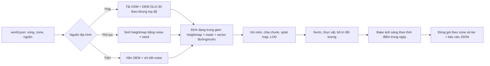

# BRD-02: Thế giới, địa hình và môi trường

| Mục | Nội dung |
|---|---|
| Mã tài liệu | BRD-02 |
| Phiên bản | 1.0 |
| Trạng thái | **Đã duyệt** (Huy, 22/11/2026) |
| Ngày | 22/11/2026 |
| Tài liệu cha | BRD-00 `BRD-TONG-QUAN.md` v1.0 |
| Yêu cầu tổng quan được chi tiết hoá | BR-10…14, BR-24, BR-45, BR-69, BR-104 |
| Quyết định liên quan | QĐ-04, QĐ-05, QĐ-06, QĐ-10 |
| Module | `world`, `terrain`, `water`, `vegetation`, `placement`, `lighting`, `fx` |
| Pha | E1 (thế giới, địa hình), E3 (nước, thực vật, hiệu ứng), E4 (bố trí), E5 (ánh sáng) |

Quy ước mã: xem BRD-01.

---

## 1. Mục đích

Dựng được không gian chơi đẹp, đúng bối cảnh mô tả và chạy trong ngân sách A56, **chỉ bằng dữ liệu và tham số**. Đây là phần mang lại "bước nhảy chất lượng" lớn nhất ở dự án trước (địa hình từ DEM, bake ánh sáng, vật liệu scan).

## 2. Phạm vi

**Trong phạm vi:** hệ toạ độ, vùng chơi và zone; địa hình từ dữ liệu thật và thủ tục; nước; thực vật; bố trí đối tượng theo luật; ánh sáng bake và thời điểm trong ngày; bầu trời, sương, thời tiết, hậu kỳ.

**Ngoài phạm vi:** công trình và đồ vật cụ thể (BRD-03), nhân vật và động vật (BRD-05), sửa địa hình trực tiếp bằng cọ trên web (CH-29, mặc định không làm).

## 3. Tác nhân

| Tác nhân | Vai trò |
|---|---|
| Người tạo game | Chọn vùng/nguồn địa hình, chỉnh tham số, duyệt ảnh góc chuẩn |
| Agent `world-builder`, `tech-artist` | Viết và vận hành generator, bake |
| Worker build | Chạy pipeline Python + Blender headless |
| QA | Chụp góc chuẩn, đo ngân sách |

## 4. Quy trình nghiệp vụ

## 5. Yêu cầu chi tiết

### 5.1 Hệ toạ độ, vùng chơi, zone (BR-24)

| Mã | Yêu cầu | Ưu tiên |
|---|---|---|
| BR-24.1 | Một hệ toạ độ thống nhất (mét, trục Y lên); toạ độ địa lý thật được quy đổi về gốc cục bộ của game | M |
| BR-24.2 | Vùng chơi khai báo bằng đa giác; người chơi không ra khỏi vùng chơi | M |
| BR-24.3 | Thế giới chia zone; mỗi zone có ranh giới, tâm, ngân sách riêng; zone lân cận được nạp trước khi người chơi tới | M |
| BR-24.4 | Kích thước zone mặc định do `budgets.json` quy định theo tier | M |

### 5.2 Địa hình từ dữ liệu thật (BR-10)

| Mã | Yêu cầu | Ưu tiên |
|---|---|---|
| BR-10.1 | Nhập khung toạ độ (bbox) hoặc tên địa danh; tải DEM Copernicus GLO-30 và dữ liệu OSM (đường, sông, hồ, ruộng, rừng, công trình) | M |
| BR-10.2 | Dữ liệu tải về được lưu cache cục bộ kèm ngày tải và license; không tải lại khi bbox không đổi | M |
| BR-10.3 | Cho phép phóng đại độ cao và làm mượt có tham số | S |
| BR-10.4 | Vector OSM chuyển thành mask (đường, nước, ruộng, rừng) và đường cong để module khác dùng | M |

### 5.3 Địa hình thủ tục và trộn (BR-11)

| Mã | Yêu cầu | Ưu tiên |
|---|---|---|
| BR-11.1 | Sinh địa hình từ tham số: kiểu (đồng bằng, đồi, núi, ven biển, thung lũng), độ cao tối đa, độ gồ ghề, seed | M |
| BR-11.2 | Có thể vẽ hoặc khai báo các yếu tố chính (sông, đường, hồ, đồi) để generator bám theo | S |
| BR-11.3 | Trộn: nền DEM thật, chi tiết noise; vùng trộn có mặt nạ | M |
| BR-11.4 | Xói mòn thuỷ lực/nhiệt có tham số, theo vùng | M |
| BR-11.5 | Có thể dùng A.N.T. Landscape trong Blender làm một generator (QĐ-06) | S |

### 5.4 Mesh địa hình và vật liệu bề mặt

| Mã | Yêu cầu | Ưu tiên |
|---|---|---|
| BR-10.5 | Chia chunk, LOD theo khoảng cách, không nứt mép giữa các LOD | M |
| BR-10.6 | Splat map tự sinh từ độ dốc, độ cao, mask OSM; tối đa số lớp vật liệu theo tier | M |
| BR-10.7 | Loại bề mặt (đất, cỏ, đá, cát, bùn, nước nông) ghi vào dữ liệu để dùng cho âm bước chân và hành vi động vật | M |

### 5.5 Nước (BR-12)

| Mã | Yêu cầu | Ưu tiên |
|---|---|---|
| BR-12.1 | Sông, hồ, ao, ruộng ngập, biển từ mask OSM hoặc khai báo | M |
| BR-12.2 | Shader nước theo tier: phản chiếu, khúc xạ, bọt bờ, gợn sóng; tier Thấp dùng bản rẻ | M |
| BR-12.3 | Vùng nước khai báo độ sâu để dùng cho va chạm, bơi (nếu bật) và vùng sống của cá | M |
| BR-12.4 | Đối tượng trên mặt nước (thuyền, bèo, sen) đặt qua `placement` | S |

### 5.6 Thực vật (BR-12)

| Mã | Yêu cầu | Ưu tiên |
|---|---|---|
| BR-12.5 | Thư viện loài cây có tham số (Sapling Tree Gen + code bổ sung): hình tán, chiều cao, mùa, màu lá, seed | M |
| BR-12.6 | Rải rừng, cây rải rác, bụi, cỏ theo mask và luật mật độ; instancing | M |
| BR-12.7 | Impostor cho cây ở xa; cỏ chỉ hiện trong bán kính theo tier | M |
| BR-12.8 | Gió lay cây, cỏ bằng shader (tắt ở tier Thấp) | S |

### 5.7 Bố trí đối tượng (BR-69)

| Mã | Yêu cầu | Ưu tiên |
|---|---|---|
| BR-69.1 | Luật bố trí khai báo bằng dữ liệu: mật độ, khoảng cách tối thiểu, tránh đường/nước, độ dốc cho phép, bám mặt đất, xoay ngẫu nhiên | M |
| BR-69.2 | Đối tượng đặt tay (từ editor) và đặt theo luật cùng tồn tại; đặt tay luôn ưu tiên | M |
| BR-69.3 | Kết quả bố trí tất định theo seed | M |

### 5.8 Ánh sáng và thời điểm trong ngày (BR-13)

| Mã | Yêu cầu | Ưu tiên |
|---|---|---|
| BR-13.1 | Bake lightmap và AO cho hình học tĩnh theo zone | M |
| BR-13.2 | Các mốc thời điểm khai báo được (ví dụ sáng, trưa, chiều, đêm); mỗi mốc một bộ bake hoặc bộ tham số | M |
| BR-13.3 | Chuyển giữa các mốc trong game (nếu mô tả có chu kỳ ngày đêm) bằng nội suy ánh sáng động + lightmap | S |
| BR-13.4 | Nguồn sáng động hạn chế theo tier (đèn lồng, đuốc…) | S |
| BR-13.5 | Thời gian bake được báo cáo; chỉ bake lại zone có đầu vào thay đổi | M |

### 5.9 Bầu trời, khí quyển, hiệu ứng (BR-14)

| Mã | Yêu cầu | Ưu tiên |
|---|---|---|
| BR-14.1 | Bầu trời từ HDRI CC0 hoặc mô hình bầu trời thủ tục, khớp thời điểm | M |
| BR-14.2 | Sương theo độ cao/khoảng cách, mây, mưa, gió, sương mù sáng sớm; bật theo dữ liệu | S |
| BR-14.3 | Hậu kỳ (tone mapping, bloom, màu) theo style bible; tier Thấp tối giản | M |

### 5.10 Chỉnh trên Web Studio (BR-104)

| Mã | Yêu cầu | Ưu tiên |
|---|---|---|
| BR-104.1 | Form tham số cho địa hình, nước, thực vật, bầu trời, thời điểm; có giá trị mặc định và giới hạn | S |
| BR-104.2 | Vẽ vùng (vùng chơi, vùng rừng, vùng spawn) trên bản đồ nhìn từ trên | S |
| BR-104.3 | Thay đổi cần build lại tạo job và báo ước lượng thời gian; thay đổi runtime hiện ngay | S |

### 5.11 License dữ liệu (BR-45)

| Mã | Yêu cầu | Ưu tiên |
|---|---|---|
| BR-45.1 | Ghi công OSM (ODbL) và Copernicus trong provenance và màn hình credit | M |
| BR-45.2 | HDRI và vật liệu CC0 ghi nguồn dù không bắt buộc | M |

## 6. Dữ liệu nghiệp vụ

| Đối tượng | Trường chính |
|---|---|
| `world.json` | hệ toạ độ, gốc, bbox thật (nếu có), nguồn địa hình (real/procedural/mixed), seed, vùng chơi, danh sách zone |
| Zone | id, đa giác, tier được hỗ trợ, ngân sách riêng, danh sách lớp (terrain, water, vegetation, placement) |
| Lớp thực vật | loài, mask, mật độ, khoảng cách, impostor distance |
| Luật bố trí | asset/tập asset, mask, mật độ, khoảng cách, độ dốc, xoay, seed |
| Mốc thời điểm | tên, góc mặt trời, màu, HDRI, có bake hay không |

## 7. Quy tắc nghiệp vụ

| Mã | Quy tắc |
|---|---|
| QT-02-01 | Mọi bước sinh dùng seed; seed ghi trong báo cáo build |
| QT-02-02 | Không hằng số riêng của một cảnh trong code generator; tất cả qua tham số |
| QT-02-03 | Một zone build xong phải đạt ngân sách tier Vừa trên A56, nếu không thì build báo Fail |
| QT-02-04 | Dữ liệu thật tải về không được dùng khi thiếu thông tin license |
| QT-02-05 | Đặt tay luôn thắng đặt theo luật ở cùng vị trí |
| QT-02-06 | Đổi tham số chỉ build lại các bước phía sau bước bị đổi (cache theo hash) |

## 8. Kịch bản chấp nhận

| Mã | Cho | Khi | Thì |
|---|---|---|---|
| AC-02-01 | bbox 2×2 km một vùng nông thôn thật | Build zone | Có địa hình, đường, sông khớp OSM; báo cáo JSON Pass trên tier Vừa |
| AC-02-02 | Tham số thủ tục "đồi thấp", seed 42 | Build hai lần | Hai kết quả giống hệt (cùng hash) |
| AC-02-03 | Zone đã build | Đổi mật độ cỏ | Chỉ lớp thực vật build lại; thời gian thấp hơn build đầy đủ |
| AC-02-04 | Zone có rừng 10.000 cây | Mở trên A56 tier Vừa | Đạt ngân sách draw call và fps mục tiêu; cây xa là impostor |
| AC-02-05 | Mốc sáng và hoàng hôn đã bake | Chuyển mốc trong game | Ánh sáng đổi không giật, không lỗi lightmap |
| AC-02-06 | Bản xuất bản | Mở màn credit | Có ghi công OSM và Copernicus |

## 9. Yêu cầu phi chức năng liên quan

| Mã | Yêu cầu |
|---|---|
| NFR-02-01 | Build một zone 1 km² từ đầu (không bake) ≤ 15 phút trên worker không GPU (đề xuất, xem CH-02-01) |
| NFR-02-02 | Bake một zone một mốc thời điểm ≤ 2 giờ trên CPU (đề xuất) |
| NFR-02-03 | Dung lượng tải một zone tier Vừa ≤ 50 MB (CH-03 BRD-00) |

## 10. Câu hỏi mở

| Mã | Câu hỏi | Đề xuất |
|---|---|---|
| CH-02-01 | Mục tiêu thời gian build và bake (NFR-02-01, 02) có chấp nhận được không? | Chốt sau khi đo ở E1, E5 |
| CH-02-02 | Kích thước vùng chơi tối đa cho một game? | 4 km² ở bản đầu |
| CH-02-03 | Có cần chu kỳ ngày đêm liên tục, hay chỉ các mốc cố định? | Các mốc cố định; chu kỳ liên tục là tuỳ chọn S |
| CH-02-04 | Có cần thời tiết thay đổi trong lúc chơi không? | Tuỳ chọn theo mô tả |

## 11. Truy vết

| BR tổng quan | Yêu cầu chi tiết | Kịch bản |
|---|---|---|
| BR-10 | BR-10.1…7 | AC-02-01 |
| BR-11 | BR-11.1…5 | AC-02-02 |
| BR-12 | BR-12.1…8 | AC-02-04 |
| BR-13 | BR-13.1…5 | AC-02-05 |
| BR-14 | BR-14.1…3 | — |
| BR-24 | BR-24.1…4 | AC-02-04 |
| BR-45 | BR-45.1…2 | AC-02-06 |
| BR-69 | BR-69.1…3 | AC-02-03 |
| BR-104 | BR-104.1…3 | AC-02-03 |
