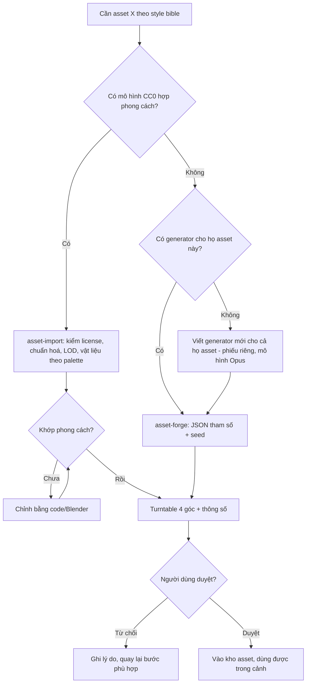

# BRD-03: Asset 3D, vật liệu và âm thanh

| Mục | Nội dung |
|---|---|
| Mã tài liệu | BRD-03 |
| Phiên bản | 1.0 |
| Trạng thái | **Đã duyệt** (Huy, 22/11/2026) |
| Ngày | 22/11/2026 |
| Tài liệu cha | BRD-00 `BRD-TONG-QUAN.md` v1.0 |
| Yêu cầu tổng quan được chi tiết hoá | BR-15…21, BR-62 (phần nguồn asset), BR-67, BR-96, BR-109, BR-113 |
| Quyết định liên quan | QĐ-06, QĐ-08, QĐ-09, QĐ-10, QĐ-11, QĐ-12 |
| Module | `asset-import`, `asset-forge`, `kit-builder`, `materials`, `ui-audio` (phần âm thanh), skill `engine-cc0`, `engine-texture-proc`, `threejs-image-generator`, `threejs-audio-generator` |
| Pha | E2 (vật liệu), E4 (asset 3D), E6 (âm thanh), W3–W4 (duyệt và kho asset trên web) |

Quy ước mã: xem BRD-01.

---

## 1. Mục đích

Có đủ asset đẹp, đúng phong cách, hợp pháp và nằm trong ngân sách A56 mà **không dùng AI sinh 3D** (QĐ-08) và **không để Claude vẽ từng asset** (tiết kiệm token). Mỗi asset có nguồn gốc rõ ràng.

## 2. Phạm vi

**Trong phạm vi:** asset 3D tĩnh (công trình, đồ vật, đá, đạo cụ), mô hình nhân vật/động vật ở mức nguồn và nhập (hành vi ở BRD-05), vật liệu và texture, HDRI, âm thanh môi trường và hiệu ứng, provenance, cổng duyệt asset, kho asset dùng chung.

**Ngoài phạm vi:** Meshy, Tripo hay dịch vụ AI 3D khác; chỉnh sửa mô hình chi tiết trên web.

## 3. Thứ tự chọn nguồn asset 3D (QĐ-12)

## 4. Yêu cầu chi tiết

### 4.1 Nhập mô hình CC0 (BR-15, BR-16)

| Mã | Yêu cầu | Ưu tiên |
|---|---|---|
| BR-16.1 | Nguồn CC0 được phép khai báo trong danh sách trắng (ví dụ Poly Haven, các kho CC0 khác do Huy duyệt) | M |
| BR-16.2 | Kiểm license khi nhập: chỉ nhận CC0 (hoặc license khác được Huy cho phép rõ ràng); lưu bằng chứng (URL trang, ảnh chụp trang license, ngày tải) | M |
| BR-16.3 | Chuẩn hoá: đơn vị mét, trục Y lên, pivot ở đáy, scale đúng thực tế, tên chuẩn | M |
| BR-16.4 | Giảm lưới và sinh LOD theo ngân sách tri của tier; sinh UV2 cho lightmap nếu là vật tĩnh | M |
| BR-16.5 | Đồng bộ vật liệu với bảng màu và style bible (đổi màu, độ nhám, gộp vật liệu) | M |
| BR-16.6 | Nhân vật/động vật: retarget về khung xương dùng chung của họ (chi tiết ở BRD-05) | M |

### 4.2 Sinh asset bằng code (BR-17)

| Mã | Yêu cầu | Ưu tiên |
|---|---|---|
| BR-17.1 | Thư viện primitive tham số: cột, dầm, mái, tường, cửa, bậc, hàng rào, đá tảng, thùng, chum, bàn ghế… | M |
| BR-17.2 | Generator theo **họ asset** (ví dụ "nhà một gian", "mái ngói", "cây lá kim", "đá tảng"); biến thể chỉ là JSON tham số + seed (`assets/recipes/*.json`) | M |
| BR-17.3 | Mesh hữu cơ bằng SDF, metaball hoặc script sculpt Blender cho vật thể không quá chi tiết | S |
| BR-17.4 | Generator tự sinh UV, LOD, collider đơn giản, provenance | M |
| BR-17.5 | `kit-builder`: lắp công trình từ bộ kit module theo spec tham số (số gian, số tầng, kiểu mái) | M |
| BR-17.6 | Ảnh tham chiếu Gemini (chính diện, bên, sau) dùng để generator bám tỷ lệ cho asset rủi ro cao | S |

### 4.3 Vật liệu và texture (BR-18)

| Mã | Yêu cầu | Ưu tiên |
|---|---|---|
| BR-18.1 | Ba nguồn vật liệu: thủ tục (`engine-texture-proc`), scan CC0, texture sinh bằng Gemini | M |
| BR-18.2 | Bộ map chuẩn PBR: màu, normal, nhám, kim loại, AO (height khi cần) | M |
| BR-18.3 | Chuẩn hoá độ phân giải theo tier: 2048² (Thấp/Vừa), 4096² (Cao/Tối đa); nén KTX2 (UASTC cho vật liệu cần nét, ETC1S cho phần còn lại), có fallback | M |
| BR-18.4 | Texture Gemini dùng cho vải, da, hoa văn, chạm khắc (normal/height), decal, UI; phải tileable khi là vật liệu lặp | M |
| BR-18.5 | HDRI bầu trời CC0, chuẩn hoá độ phân giải theo tier | M |
| BR-18.6 | Số vật liệu mỗi zone ≤ ngân sách (32 ở tier Vừa); `packager` gộp và atlas khi cần | M |

### 4.4 Âm thanh (BR-19, BR-67)

| Mã | Yêu cầu | Ưu tiên |
|---|---|---|
| BR-19.1 | Âm môi trường theo vùng và thời điểm (gió, nước, côn trùng, chim, chợ…) | S |
| BR-19.2 | Hiệu ứng: bước chân theo bề mặt, tương tác, UI | S |
| BR-67.1 | Tiếng động vật theo loài và hành vi (BRD-05) | S |
| BR-19.3 | Nguồn: ElevenLabs (QĐ-09) hoặc âm thanh CC0; cùng quy tắc provenance | M |
| BR-19.4 | Nén (định dạng web phổ biến), chuẩn hoá âm lượng, cắt lặp mượt cho âm nền | M |
| BR-19.5 | Nhạc nền: theo mô tả; nguồn CC0 hoặc sinh bằng dịch vụ được phép (xem CH-03-02) | C |

### 4.5 Provenance (BR-21)

| Mã | Yêu cầu | Ưu tiên |
|---|---|---|
| BR-21.1 | Mỗi asset (mesh, texture, âm thanh, HDRI) có file sidecar `*.provenance.json` | M |
| BR-21.2 | Trường theo loại nguồn: **generator** (công thức, tham số, seed, phiên bản generator, commit); **CC0** (URL, tác giả, license, ngày tải, bằng chứng); **AI** (dịch vụ, mô hình, prompt, ngày, chi phí) | M |
| BR-21.3 | Asset chỉnh sửa từ asset khác ghi asset gốc (chuỗi nguồn) | M |
| BR-21.4 | Build Fail khi asset trong cảnh thiếu provenance hoặc license không hợp lệ | M |
| BR-113.1 | Màn hình credit tự sinh từ provenance khi xuất bản | M |

### 4.6 Cổng duyệt asset (BR-20, BR-96)

| Mã | Yêu cầu | Ưu tiên |
|---|---|---|
| BR-20.1 | Mỗi asset mới hoặc biến thể lớn sinh turntable 4 góc dưới ánh sáng chuẩn + ảnh trong cảnh | M |
| BR-20.2 | Kèm thông số: tri theo từng LOD, số vật liệu, kích thước texture, dung lượng; so với ngân sách | M |
| BR-20.3 | Asset rủi ro cao (BRD-01, BR-04.1) có ít nhất 2 vòng duyệt | M |
| BR-96.1 | Trên Web Studio: màn hình duyệt có Duyệt / Từ chối kèm lý do; lịch sử duyệt | M |
| BR-20.4 | Biến thể nhỏ của một generator đã duyệt (chỉ đổi seed trong giới hạn) không cần duyệt lại từng cái; duyệt theo lưới ảnh | S |

### 4.7 Kho asset dùng chung (BR-109)

| Mã | Yêu cầu | Ưu tiên |
|---|---|---|
| BR-109.1 | Asset đã duyệt vào kho chung, tìm theo loại, phong cách, nguồn, license, ngân sách | S |
| BR-109.2 | Game khác dùng lại asset mà không nhân bản file | S |
| BR-109.3 | Asset được nhiều game dùng thì không xoá được; chỉ đánh dấu ngừng dùng | S |

## 5. Dữ liệu nghiệp vụ

| Đối tượng | Trường chính |
|---|---|
| Công thức asset (`recipes/*.json`) | họ asset, generator, phiên bản, tham số, seed, tag phong cách |
| Asset | id, loại, nguồn (cc0/generator/ai/edited), trạng thái duyệt, LOD, vật liệu, ngân sách, provenance |
| Vật liệu | id, nguồn, map, độ phân giải theo tier, định dạng nén, bảng màu áp dụng |
| Âm thanh | id, loại (nền/hiệu ứng/động vật/nhạc), vòng lặp, âm lượng chuẩn, provenance |

Trạng thái asset: Nháp → Chờ duyệt → Đã duyệt / Bị từ chối → (Ngừng dùng).

## 6. Quy tắc nghiệp vụ

| Mã | Quy tắc |
|---|---|
| QT-03-01 | Không dùng Meshy, Tripo hay dịch vụ AI sinh 3D |
| QT-03-02 | Thứ tự nguồn asset 3D: CC0 → generator → chỉnh CC0 (QĐ-12) |
| QT-03-03 | Asset không provenance coi như chưa có license và không được vào bản build |
| QT-03-04 | Không viết code "vẽ" một asset đơn lẻ; luôn viết generator cho cả họ |
| QT-03-05 | Asset phải khớp style bible đã duyệt; asset lệch phong cách không được duyệt dù đẹp |
| QT-03-06 | Mọi lần gọi dịch vụ AI tốn phí được ghi chi phí; lô vượt ngưỡng phải hỏi xác nhận (CH-06 BRD-00) |
| QT-03-07 | Khi dịch vụ AI lỗi tạm thời thì khôi phục job cũ, không gửi job mới; khi hết credit thì chuyển sang texture/âm thanh thủ tục |

## 7. Kịch bản chấp nhận

| Mã | Cho | Khi | Thì |
|---|---|---|---|
| AC-03-01 | Mô hình CC0 một chiếc chum | Nhập | Chuẩn hoá đúng scale/pivot, có 3 LOD, provenance có URL và license |
| AC-03-02 | Mô hình có license CC-BY-NC | Nhập | Bị từ chối, báo lý do |
| AC-03-03 | Generator "nhà một gian" | Tạo 10 biến thể từ 10 seed | Không cần viết code; mỗi biến thể có provenance |
| AC-03-04 | Asset thiếu provenance trong cảnh | Build | Build Fail, chỉ rõ asset |
| AC-03-05 | Vật liệu 4096² | Đóng gói tier Vừa | Tự hạ về 2048², nén KTX2 |
| AC-03-06 | Asset rủi ro cao (tượng) | Gửi duyệt | Phải qua 2 vòng; có turntable và thông số |
| AC-03-07 | Bản xuất bản | Mở credit | Liệt kê đủ nguồn CC0, OSM, MIT, dịch vụ AI |

## 8. Yêu cầu phi chức năng liên quan

| Mã | Yêu cầu |
|---|---|
| NFR-03-01 | Sinh một biến thể từ generator có sẵn ≤ 1 phút (đề xuất) |
| NFR-03-02 | Turntable và thông số sinh tự động, Claude không cần xem ảnh trừ khi qua cổng |
| NFR-03-03 | Generator tất định theo seed |

## 9. Câu hỏi mở

| Mã | Câu hỏi | Đề xuất |
|---|---|---|
| CH-03-01 | Danh sách trắng nguồn CC0 gồm những trang nào? | Poly Haven + 2–3 kho CC0 khác do Huy duyệt ở E2 |
| CH-03-02 | Nhạc nền lấy từ đâu (CC0, ElevenLabs music, tự sáng tác)? | CC0 trước, sinh bằng dịch vụ nếu được phép |
| CH-03-03 | Ai được duyệt asset trên Web Studio: chỉ chủ game hay cả người được chia sẻ quyền sửa? | Chủ game và người có quyền sửa |

## 10. Truy vết

| BR tổng quan | Yêu cầu chi tiết | Kịch bản |
|---|---|---|
| BR-15, BR-16 | BR-16.1…6 | AC-03-01, 02 |
| BR-17 | BR-17.1…6 | AC-03-03 |
| BR-18 | BR-18.1…6 | AC-03-05 |
| BR-19, BR-67 | BR-19.1…5, BR-67.1 | — |
| BR-20, BR-96 | BR-20.1…4, BR-96.1 | AC-03-06 |
| BR-21, BR-113 | BR-21.1…4, BR-113.1 | AC-03-04, 07 |
| BR-109 | BR-109.1…3 | — |
