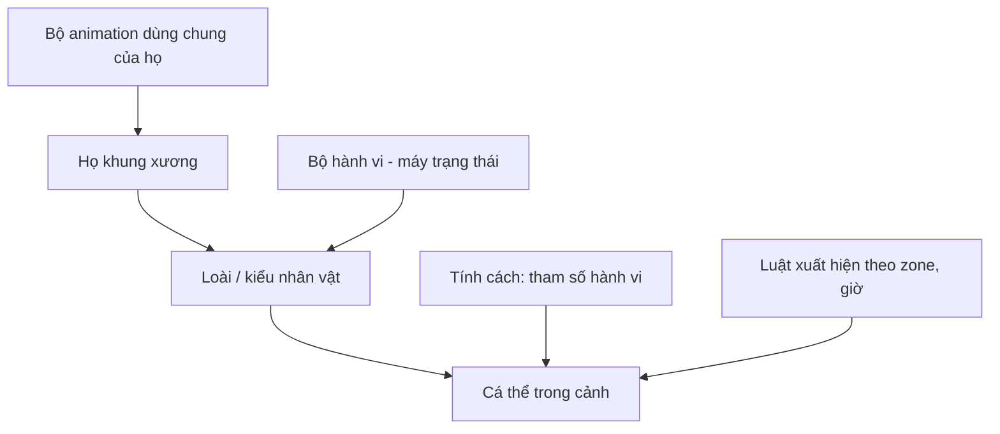

# BRD-05: Nhân vật người chơi, NPC và động vật

| Mục | Nội dung |
|---|---|
| Mã tài liệu | BRD-05 |
| Phiên bản | 1.0 |
| Trạng thái | **Đã duyệt** (Huy, 22/11/2026) |
| Ngày | 22/11/2026 |
| Tài liệu cha | BRD-00 `BRD-TONG-QUAN.md` v1.0, mục 7.10.1–7.10.4 |
| Yêu cầu tổng quan được chi tiết hoá | BR-47…74, BR-102, BR-103 |
| Quyết định liên quan | QĐ-03, QĐ-04, QĐ-08, QĐ-11, QĐ-12 |
| Module | `characters`, `npc-ai` (GD-11), `camera-player`, `asset-import`, `asset-forge`, `placement` |
| Pha | E2 (người chơi cơ bản), E4 (khung xương, mô hình, animation), E6 (hành vi, tìm đường), W3 (editor NPC, động vật) |

Quy ước mã: xem BRD-01. Chiến đấu ở BRD-06, hội thoại ở BRD-07.

---

## 1. Mục đích

Làm thế giới **sống động** (BO-08): có người chơi điều khiển mượt trên điện thoại, NPC người làm việc và phản ứng tự nhiên, động vật đúng tập tính. Thêm loài hay NPC mới **chỉ bằng dữ liệu**.

## 2. Mô hình khái niệm

| Họ | Khung xương | Loài/kiểu ví dụ | Bộ animation tối thiểu |
|---|---|---|---|
| Người | Người hai chân | Người chơi, nông dân, sư, trẻ em, người bán hàng | đứng, đi, chạy, xoay, cúi, ngồi, vẫy, nói, làm việc tại chỗ |
| Thú bốn chân nhỏ | Bốn chân nhỏ | Chó, mèo, lợn, dê | đứng, đi, chạy, nằm, ngồi, đánh hơi, ăn |
| Thú bốn chân lớn | Bốn chân lớn | Trâu, bò, ngựa | đứng, đi chậm, gặm cỏ, nằm, quẫy đuôi, (kéo cày) |
| Gia cầm | Hai chân có cánh | Gà, vịt, ngan | đứng, đi, mổ, vỗ cánh, chạy, (bơi với vịt) |
| Chim bay | Chim | Sẻ, cò, quạ, én | bay, lượn, hạ cánh, đậu, cất cánh |
| Cá | Cá | Cá chép, rô, cá vàng | bơi, quẫy, ngoi lên |

## 3. Yêu cầu chi tiết

### 3.1 Nhân vật người chơi (BR-47…53)

| Mã | Yêu cầu | Ưu tiên |
|---|---|---|
| BR-47.1 | `entities/player.json`: mô hình/kiểu ngoại hình, chiều cao, tốc độ đi/chạy, bán kính va chạm, góc nhìn, khả năng tuỳ chọn (nhảy, ngồi, bơi, leo) | M |
| BR-48.1 | Ngôi ba: camera bám sau vai, tự kéo gần khi bị che, xoay bằng vuốt; ngôi một: camera ở mắt, có lắc nhẹ khi đi (tắt được) | M |
| BR-49.1 | Joystick ảo trái, vuốt phải để xoay, nút hành động ngữ cảnh (tương tác, nói chuyện, nhặt) chỉ hiện khi có điểm tương tác gần | M |
| BR-49.2 | Chạy bằng đẩy joystick hết cỡ hoặc nút chạy (cấu hình) | M |
| BR-50.1 | Đi được trên dốc ≤ giới hạn (đề xuất 40°); bậc thang thấp tự bước lên | M |
| BR-50.2 | Nước sâu: chặn hoặc chuyển sang bơi nếu `player.swim` bật | M |
| BR-51.1 | Chuyển trạng thái animation có blend; tốc độ chân khớp tốc độ di chuyển; chân bám mặt dốc (IK đơn giản, tắt ở tier Thấp) | M |
| BR-52.1 | Âm bước chân theo loại bề mặt từ `terrain` (BR-10.7) hoặc vật liệu | S |
| BR-53.1 | Tuỳ biến ngoại hình (trang phục, màu) khi mô tả yêu cầu | C |

### 3.2 NPC người (BR-54…60)

| Mã | Yêu cầu | Ưu tiên |
|---|---|---|
| BR-54.1 | `entities/npc/<id>.json`: tên, vai trò, ngoại hình (bộ khối tham số hoặc mô hình CC0 + biến thể trang phục, màu), hành vi, lịch trình, hội thoại, tính cách, có tương tác được hay không | M |
| BR-54.2 | NPC "đám đông" sinh từ mẫu + seed (tạo biến thể ngoại hình) thay vì khai báo từng người | M |
| BR-55.1 | Bộ hành vi cơ bản: `idle` (đứng/ngồi/làm việc), `patrol` (theo đường), `wander` (trong vùng), `goto` (tới điểm), `follow` (đi theo người chơi), `react` (quay mặt, chào, tránh) | M |
| BR-55.2 | Máy trạng thái khai báo trong dữ liệu: trạng thái, điều kiện chuyển (khoảng cách người chơi, giờ, sự kiện, biến game), hành động | M |
| BR-55.3 | NPC nhìn về phía người chơi khi ở gần (xoay đầu trong giới hạn) | S |
| BR-56.1 | Tìm đường trên lưới điều hướng sinh tự động từ địa hình và vật cản lúc build | M |
| BR-56.2 | Tránh va chạm cục bộ giữa NPC, động vật và người chơi | M |
| BR-56.3 | NPC kẹt quá 5 s thì dịch chuyển nhẹ về điểm hợp lệ gần nhất và ghi log | M |
| BR-58.1 | Lịch trình: danh sách (khung giờ → hành vi + vị trí) gắn với giờ trong game | S |
| BR-59.1 | Đám đông xa: LOD thấp, animation instancing hoặc impostor | S |
| BR-60.1 | Giọng nói NPC (chi tiết ở BRD-07) | C |

### 3.3 Động vật (BR-61…68)

| Mã | Yêu cầu | Ưu tiên |
|---|---|---|
| BR-61.1 | `entities/animals/<loài>.json`: họ, kích thước, tỷ lệ, bộ lông/màu, tốc độ, âm thanh, tập tính mặc định, tính cách mặc định | M |
| BR-61.2 | Thêm loài mới trong họ có sẵn chỉ bằng dữ liệu + mô hình (CC0 hoặc generator của họ) | M |
| BR-62.1 | Mô hình động vật theo thứ tự nguồn của BRD-03; retarget về khung xương họ; duyệt turntable + clip animation chính | M |
| BR-63.1 | Thú nuôi: `wander`, `graze/eat`, `rest`, `herd` (theo đàn, có con đầu đàn), `flee`, `follow` | M |
| BR-63.2 | Tính cách: thân thiện (lại gần, đi theo), nhút nhát (bỏ chạy khi người chơi tới gần bán kính X), thờ ơ, hung dữ (chỉ có ý nghĩa khi bật chiến đấu, BRD-06) | M |
| BR-63.3 | Chó/mèo có thể "nhận" người chơi làm chủ và đi theo nếu dữ liệu cho phép | C |
| BR-64.1 | Gia cầm theo nhóm: kiếm ăn, mổ, tán loạn khi người chơi chạy tới, tụ lại sau vài giây; về chuồng theo giờ | S |
| BR-65.1 | Chim: đàn bay theo boids, điểm đậu khai báo hoặc tự tìm (ngọn cây, mái, dây); cất cánh khi người chơi tới gần; ở xa thành hạt có animation | S |
| BR-66.1 | Cá: bơi theo đàn trong vùng nước có độ sâu đủ; không ra ngoài mask nước; né khi người chơi tới mép nước | S |
| BR-67.1 | Tiếng kêu theo loài và hành vi, phát theo khoảng cách, giới hạn số nguồn âm đồng thời | S |
| BR-68.1 | Tương tác với động vật qua điểm tương tác: vuốt ve, cho ăn, dắt, thả (theo mô tả) | C |

### 3.4 Yêu cầu chung (BR-69…74)

| Mã | Yêu cầu | Ưu tiên |
|---|---|---|
| BR-69.4 | Luật xuất hiện: loài/mẫu NPC, vùng, số lượng min–max, giờ hoạt động, nhóm/đàn | M |
| BR-70.1 | Ngân sách nhân vật theo tier trong `budgets.json`: cận cảnh chi tiết, skinning đồng thời, cá thể trong đàn, tri mỗi LOD | M |
| BR-71.1 | LOD hình 3 mức + impostor/hạt; LOD hành vi: gần cập nhật mỗi khung, vừa 5–10 Hz, xa 1–2 Hz, ngoài tầm nhìn tạm dừng (có thể "nhảy cóc" vị trí khi quay lại) | M |
| BR-72.1 | Mọi lựa chọn ngẫu nhiên của hành vi dùng RNG có seed theo cá thể | M |
| BR-73.2 | Kiểu dáng mọi nhân vật/động vật theo style bible | M |
| BR-74.1 | Không cấp phát trong vòng lặp hành vi/animation | M |

### 3.5 Editor trên Web Studio (BR-102, BR-103)

| Mã | Yêu cầu | Ưu tiên |
|---|---|---|
| BR-102.1 | Tạo/sửa NPC bằng form: ngoại hình (chọn + chỉnh màu), vai trò, hành vi (chọn từ mẫu hoặc sửa máy trạng thái dạng sơ đồ), vẽ đường tuần tra, lịch trình | M |
| BR-103.1 | Thêm đàn động vật: chọn loài, vẽ vùng, số lượng, tính cách, giờ | M |
| BR-102.2 | Xem thử hành vi ngay trong khung xem trước (cập nhật nóng) | M |

## 4. Dữ liệu nghiệp vụ

| Đối tượng | Trường chính |
|---|---|
| Họ khung xương | id, danh sách xương, bộ animation, tốc độ chuẩn |
| Loài / mẫu NPC | id, họ, mô hình, biến thể, tham số, âm thanh, tập tính, tính cách mặc định |
| Cá thể | id, loài/mẫu, vị trí, seed, tính cách, lịch trình, trạng thái |
| Máy trạng thái | trạng thái, chuyển, điều kiện, hành động, tham số |
| Luật xuất hiện | zone, vùng, loài, min–max, giờ, nhóm |

## 5. Quy tắc nghiệp vụ

| Mã | Quy tắc |
|---|---|
| QT-05-01 | Mỗi loài thuộc đúng một họ; loài mới cần họ mới thì phải có phiếu viết họ mới (khung xương + animation + hành vi) |
| QT-05-02 | Loài và NPC chỉ xuất hiện khi mô tả hoặc người dùng thêm; engine không tự thêm |
| QT-05-03 | Không vượt ngân sách nhân vật của tier; khi vượt thì giảm cá thể xa trước, không giảm cận cảnh |
| QT-05-04 | Động vật không bị chết hoặc bị hại khi chiến đấu/săn bắt tắt |
| QT-05-05 | NPC không đi ra ngoài vùng chơi và vùng được gán |
| QT-05-06 | Hành vi theo giờ dùng giờ trong game, không dùng giờ thật |

## 6. Kịch bản chấp nhận

| Mã | Cho | Khi | Thì |
|---|---|---|---|
| AC-05-01 | Người chơi ngôi ba trên A56 | Đi lên dốc 30°, qua bậc thấp, tới mép ao sâu | Đi mượt, bước bậc, dừng ở mép ao (bơi tắt) |
| AC-05-02 | Loài "chó" đã có | Thêm loài "chó vàng" chỉ bằng JSON + đổi màu | Xuất hiện trong cảnh không cần viết code |
| AC-05-03 | Đàn 8 con trâu tính cách thờ ơ | Người chơi đi qua | Trâu tiếp tục gặm cỏ, tránh người chơi, không xuyên nhau |
| AC-05-04 | 12 con gà tính cách nhút nhát | Người chơi chạy tới | Gà tán loạn, vỗ cánh, sau vài giây tụ lại |
| AC-05-05 | NPC nông dân lịch trình 6h ra đồng, 18h về nhà | Tua giờ trong game | NPC di chuyển đúng giờ, tìm đường không kẹt |
| AC-05-06 | Đàn 60 chim | Người chơi tới gần cây | Chim cất cánh theo đàn; tier Vừa vẫn đạt fps mục tiêu |
| AC-05-07 | Ao cá có mask nước | Chạy 10 phút với seed cố định | Không cá nào ra ngoài mask |
| AC-05-08 | Tối đa NPC và động vật theo ngân sách | Profiler 2 phút | Không có GC giật; CPU hành vi trong ngân sách |

## 7. Yêu cầu phi chức năng

| Mã | Yêu cầu |
|---|---|
| NFR-05-01 | Ngân sách đề xuất tier Vừa: ≤ 4 nhân vật cận cảnh chi tiết, ≤ 20 NPC người và ≤ 30 động vật có skinning, đàn chim/cá instancing tới khoảng 200 (CH-15 BRD-00) |
| NFR-05-02 | Thời gian CPU cho hành vi và animation ≤ 4 ms mỗi khung trên A56 (đề xuất) |

## 8. Câu hỏi mở

| Mã | Câu hỏi | Đề xuất |
|---|---|---|
| CH-05-01 | Có cần biểu cảm khuôn mặt / khẩu hình khi nói không? | Không; chỉ cử chỉ tay, đầu |
| CH-05-02 | Có cần hệ nhu cầu (đói, mệt) cho NPC/động vật không? | Không ở bản đầu; lịch trình đủ dùng |
| CH-05-03 | Có cần động vật sinh sản, lớn lên không? | Không |
| CH-05-04 | Họ động vật nào cần thêm sau 6 họ ban đầu (bò sát, côn trùng lớn…)? | Theo mô tả game, mỗi họ mới là một phiếu riêng |

## 9. Truy vết

| BR tổng quan | Yêu cầu chi tiết | Kịch bản |
|---|---|---|
| BR-47…53 | BR-47.1…53.1 | AC-05-01 |
| BR-54…60 | BR-54.1…60.1 | AC-05-05 |
| BR-61…68 | BR-61.1…68.1 | AC-05-02, 03, 04, 06, 07 |
| BR-69…74 | BR-69.4, 70.1, 71.1, 72.1, 73.2, 74.1 | AC-05-08 |
| BR-102, BR-103 | BR-102.1…2, BR-103.1 | — |
