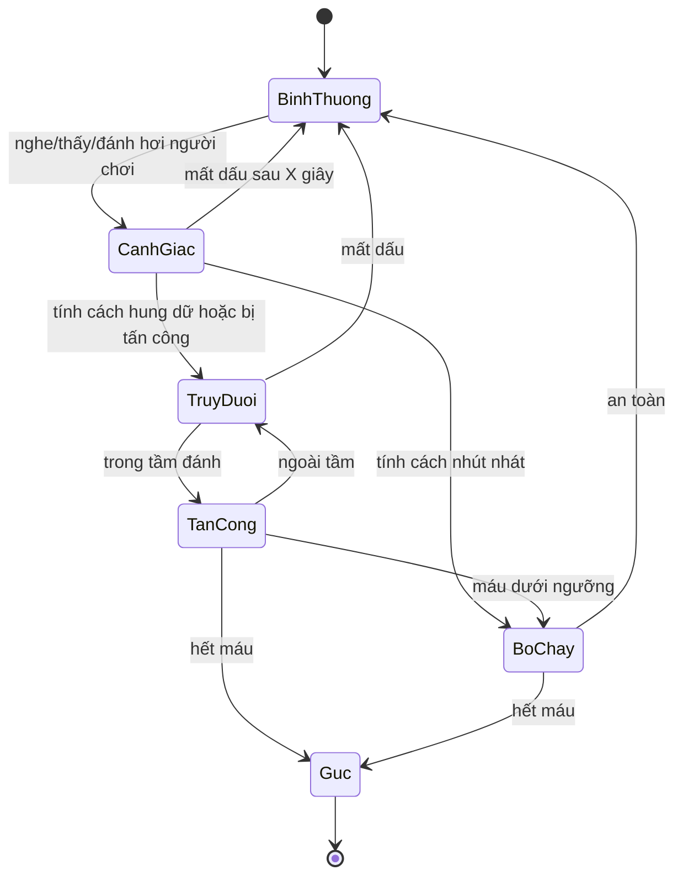

# BRD-06: Chiến đấu và săn bắt (tuỳ chọn)

| Mục | Nội dung |
|---|---|
| Mã tài liệu | BRD-06 |
| Phiên bản | 1.0 |
| Trạng thái | **Đã duyệt** (Huy, 22/11/2026) |
| Ngày | 22/11/2026 |
| Tài liệu cha | BRD-00 `BRD-TONG-QUAN.md` v1.0, mục 7.10.5 |
| Yêu cầu tổng quan được chi tiết hoá | BR-75…83, BR-102 (phần chỉ số chiến đấu) |
| Quyết định liên quan | QĐ-04, QĐ-11, **QĐ-13** |
| Module | `combat` (tuỳ chọn, GD-11), `npc-ai`, `characters`, `ui-audio` |
| Pha | Khi game cần, sớm nhất E6 |

Quy ước mã: xem BRD-01.

---

## 1. Mục đích

Cho phép game có chiến đấu và/hoặc săn bắt **khi người dùng mô tả như vậy** (QĐ-13), mà không làm nặng các game không cần. Toàn bộ cân bằng làm bằng dữ liệu.

## 2. Phạm vi

**Trong phạm vi:** bật/tắt theo game; chỉ số; vũ khí và công cụ; hành động chiến đấu của người chơi; AI chiến đấu của NPC và động vật; săn bắt; hồi sinh; phản hồi hình ảnh và âm thanh; ngân sách.

**Ngoài phạm vi:** chiến đấu nhiều người chơi, PvP; hệ kỹ năng/cấp độ phức tạp (RPG đầy đủ) ở bản đầu (CH-06-02); vật lý ragdoll đầy đủ.

## 3. Cấu hình bật/tắt

| Cờ trong `game.json` | Giá trị | Ý nghĩa |
|---|---|---|
| `combat.enabled` | true/false | Có chiến đấu không |
| `combat.style` | `melee` / `ranged` / `mixed` | Kiểu chiến đấu |
| `combat.targets` | danh sách loài/mẫu NPC | Ai có thể bị tấn công |
| `hunting.enabled` | true/false | Có săn bắt không |
| `hunting.species` | danh sách loài | Loài săn được |
| `violence.level` | `minimal` / `standard` | Mức thể hiện (không máu / có hiệu ứng) |

Mặc định tất cả tắt (QT-01-04). Chỉ `/new-game` hoặc người dùng (xác nhận brief) mới bật.

## 4. Quy trình nghiệp vụ

## 5. Yêu cầu chi tiết

### 5.1 Bật/tắt và đóng gói (BR-75, BR-76)

| Mã | Yêu cầu | Ưu tiên |
|---|---|---|
| BR-75.2 | Brief hiển thị rõ chiến đấu/săn bắt bật hay tắt và kiểu nào; người dùng xác nhận | M |
| BR-76.1 | Module `combat` chỉ được đóng gói khi bật; game tắt không có mã, asset, UI chiến đấu | M |
| BR-76.2 | Bật chiến đấu sau khi game đã có là thay đổi lớn (QT-01-05) | M |

### 5.2 Chỉ số và vật phẩm (BR-77)

| Mã | Yêu cầu | Ưu tiên |
|---|---|---|
| BR-77.1 | Chỉ số mỗi thực thể: máu, sát thương, phòng thủ, tầm đánh, tốc độ đánh, tốc độ di chuyển khi chiến đấu, hồi máu | M |
| BR-77.2 | Vũ khí/công cụ là entity dữ liệu: loại (cận chiến, tầm xa, bẫy, lưới), sát thương, tầm, tốc độ, đạn (nếu có), mô hình, âm thanh | M |
| BR-77.3 | Công thức sát thương đơn giản khai báo được (ví dụ sát thương − phòng thủ, tối thiểu 1) | M |
| BR-77.4 | Bảng cân bằng xuất ra CSV/JSON để chỉnh hàng loạt | S |

### 5.3 Hành động người chơi (BR-78)

| Mã | Yêu cầu | Ưu tiên |
|---|---|---|
| BR-78.1 | Nút tấn công, né/đỡ trên cảm ứng; tự ngắm mềm (aim assist) vào mục tiêu gần nhất trước mặt | M |
| BR-78.2 | Tầm xa: ngắm bằng vuốt hoặc khoá mục tiêu | S |
| BR-78.3 | Trúng đòn có phản ứng (giật lùi), khoảng bất tử ngắn sau khi trúng | M |

### 5.4 AI chiến đấu (BR-79)

| Mã | Yêu cầu | Ưu tiên |
|---|---|---|
| BR-79.1 | Thêm các trạng thái Cảnh giác, Truy đuổi, Tấn công, Bỏ chạy, Gục vào máy trạng thái của BRD-05 | M |
| BR-79.2 | Giác quan: tầm nhìn (góc, khoảng cách), nghe (bán kính theo tốc độ người chơi), đánh hơi (động vật, theo gió nếu có) | M |
| BR-79.3 | Giới hạn số kẻ tấn công cùng lúc (token tấn công) để công bằng và đỡ tốn CPU | M |
| BR-79.4 | Đàn bỏ chạy cùng nhau khi một con bị tấn công | S |

### 5.5 Săn bắt (BR-80)

| Mã | Yêu cầu | Ưu tiên |
|---|---|---|
| BR-80.1 | Dấu vết (dấu chân, tiếng động) hiển thị theo dữ liệu loài | S |
| BR-80.2 | Mức cảnh giác loài: nhạy, vừa, chậm; ngồi xuống/đi chậm làm giảm bị phát hiện | S |
| BR-80.3 | Săn được thì nhận vật phẩm theo bảng rơi khai báo | S |
| BR-80.4 | Bẫy, lưới (bắt sống) là tuỳ chọn theo mô tả | C |

### 5.6 Kết quả và hồi sinh (BR-81)

| Mã | Yêu cầu | Ưu tiên |
|---|---|---|
| BR-81.1 | Người chơi gục: hồi sinh ở điểm hồi sinh gần nhất, giữ hoặc mất vật phẩm theo dữ liệu | M |
| BR-81.2 | NPC/động vật gục: biến mất sau X giây (không ragdoll đầy đủ), tái xuất hiện theo luật xuất hiện và thời gian chờ | M |
| BR-81.3 | NPC quan trọng cho cốt truyện có thể đặt "không thể bị hại" | M |
| BR-81.4 | `violence.level = minimal`: không máu, gục là ngã/biến mất mềm | M |

### 5.7 Phản hồi và ngân sách (BR-82, BR-83)

| Mã | Yêu cầu | Ưu tiên |
|---|---|---|
| BR-82.1 | Hiệu ứng trúng đòn, âm thanh, rung thiết bị (nếu được phép), số sát thương (tuỳ chọn) | S |
| BR-82.2 | HUD máu người chơi, thanh máu mục tiêu khi đang giao tranh | M |
| BR-83.1 | Ngân sách theo tier: kẻ tấn công cùng lúc, đạn bay cùng lúc, hạt hiệu ứng | M |

## 6. Quy tắc nghiệp vụ

| Mã | Quy tắc |
|---|---|
| QT-06-01 | Chiến đấu/săn bắt chỉ tồn tại khi mô tả yêu cầu hoặc người dùng bật; mặc định tắt |
| QT-06-02 | Chỉ loài/mẫu trong `combat.targets` hoặc `hunting.species` mới bị tấn công/săn |
| QT-06-03 | Mức thể hiện bạo lực theo mô tả; không tăng quá mô tả (QĐ-11) |
| QT-06-04 | Mọi chỉ số và luật nằm trong dữ liệu; code không chứa con số cân bằng |
| QT-06-05 | Kết quả giao tranh tất định với seed để bot playtest lặp lại được |

## 7. Kịch bản chấp nhận

| Mã | Cho | Khi | Thì |
|---|---|---|---|
| AC-06-01 | Game không bật chiến đấu | Build | Bản build không chứa module `combat` (kiểm tra danh sách gói) |
| AC-06-02 | Săn hươu bật, hươu nhạy | Người chơi chạy tới | Hươu phát hiện ở bán kính lớn, bỏ chạy theo đàn |
| AC-06-03 | Người chơi ngồi, đi chậm | Tiếp cận hươu | Bán kính phát hiện giảm theo dữ liệu |
| AC-06-04 | 6 sói hung dữ | Giao tranh trên A56 | Tối đa N con tấn công cùng lúc; fps đạt mục tiêu |
| AC-06-05 | Đổi sát thương kiếm từ 10 lên 15 | Chạy lại | Hiệu lực ngay không cần sửa code |
| AC-06-06 | `violence.level = minimal` | Hạ một con thú | Không có hiệu ứng máu |
| AC-06-07 | NPC sư trụ trì đặt "không thể bị hại" | Người chơi tấn công | Không gây sát thương |

## 8. Câu hỏi mở

| Mã | Câu hỏi | Đề xuất |
|---|---|---|
| CH-06-01 | Có cần vật lý ragdoll khi gục không? | Không; animation gục + mờ dần |
| CH-06-02 | Có cần hệ cấp độ, kỹ năng, trang bị nâng cấp không? | Không ở bản đầu |
| CH-06-03 | Có cần cưỡi thú chiến đấu không? | Không (liên quan CH-19 BRD-00) |

## 9. Truy vết

| BR tổng quan | Yêu cầu chi tiết | Kịch bản |
|---|---|---|
| BR-75, BR-76 | BR-75.2, BR-76.1…2 | AC-06-01 |
| BR-77 | BR-77.1…4 | AC-06-05 |
| BR-78 | BR-78.1…3 | — |
| BR-79 | BR-79.1…4 | AC-06-04 |
| BR-80 | BR-80.1…4 | AC-06-02, 03 |
| BR-81 | BR-81.1…4 | AC-06-06, 07 |
| BR-82, BR-83 | BR-82.1…2, BR-83.1 | AC-06-04 |
