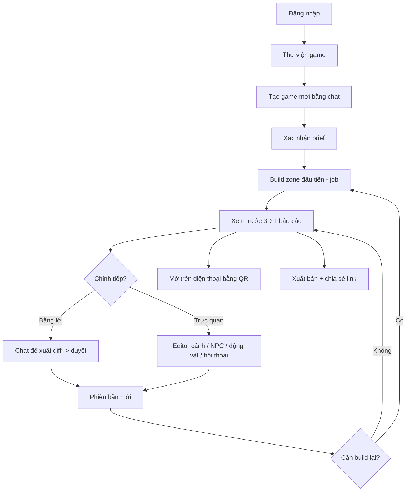

# BRD-08: Web Studio

| Mục | Nội dung |
|---|---|
| Mã tài liệu | BRD-08 |
| Phiên bản | 1.1 |
| Trạng thái | **Đã duyệt** v1.1 (Huy, 23/11/2026) |
| Ngày | 22/11/2026 |
| Tài liệu cha | BRD-00 `BRD-TONG-QUAN.md` v1.1, mục 4.1b, 7.11 |
| Yêu cầu tổng quan được chi tiết hoá | BR-90…118 |
| Quyết định liên quan | QĐ-07, QĐ-11, **QĐ-15**; CH-23 đã chốt: chỉ nhóm nội bộ được mời |
| Pha | W1…W4 (song song với engine, bắt đầu sau G-E1) |

Quy ước mã: xem BRD-01. Nội dung nghiệp vụ của từng loại chỉnh sửa (thế giới, asset, NPC, hội thoại) nằm ở BRD-02, 03, 05, 07; tài liệu này mô tả **trải nghiệm và vận hành của Web Studio**.

---

## 1. Mục đích

Để người trong nhóm tạo, chỉnh, chơi thử và chia sẻ game **trên trình duyệt**, không cần Claude Code, dòng lệnh hay biết cấu trúc file (BO-09).

## 2. Tác nhân và quyền

| Vai trò | Quyền chính |
|---|---|
| Quản trị | Mời/khoá người dùng, đặt hạn mức, xem chi phí và job toàn hệ thống, cấu hình nguồn CC0 và dịch vụ AI |
| Người tạo game | Tạo game, sửa game của mình hoặc được chia sẻ quyền sửa, chạy build/QA, xuất bản, chia sẻ |
| Người xem | Xem và chơi thử game được chia sẻ, bình luận (tuỳ chọn) |
| Khách có link | Chơi bản xuất bản qua link chia sẻ (không đăng nhập, nếu link cho phép) |

Ma trận quyền theo game:

| Hành động | Chủ game | Được sửa | Chỉ xem | Khách có link |
|---|---|---|---|---|
| Xem, chơi thử | Có | Có | Có | Chỉ bản xuất bản |
| Sửa bằng chat/editor | Có | Có | Không | Không |
| Duyệt asset, xác nhận brief | Có | Có | Không | Không |
| Build, QA | Có | Có | Không | Không |
| Xuất bản, tạo/thu hồi link | Có | Không (đề xuất) | Không | Không |
| Chia sẻ quyền, xoá game | Có | Không | Không | Không |

## 3. Bản đồ màn hình

| Màn hình | Nội dung chính |
|---|---|
| Đăng nhập | Đăng nhập Google (CH-24), chỉ email trong danh sách mời |
| Thư viện game | Danh sách game: ảnh đại diện, trạng thái, lần sửa cuối; tạo mới, nhân bản, lưu trữ |
| Tạo game mới | Chat mô tả → hỏi làm rõ → brief một trang → Xác nhận (BRD-01) |
| Không gian làm việc game | Bố cục ba vùng: chat bên trái, xem trước 3D ở giữa, bảng thuộc tính bên phải; thanh trên có Build, QA, Xuất bản, Chia sẻ, Phiên bản |
| Editor cảnh | Cây đối tượng, gizmo di chuyển/xoay/co, thư viện asset kéo thả, vẽ vùng |
| Editor NPC / động vật | Danh sách, form, sơ đồ hành vi, đường tuần tra, lịch trình (BRD-05) |
| Editor hội thoại | Sơ đồ cây thoại, hồ sơ nhân vật AI, thử nói chuyện (BRD-07) |
| Duyệt asset | Lưới turntable, thông số, Duyệt/Từ chối (BRD-03) |
| Job và báo cáo | Hàng đợi, tiến độ, báo cáo ngân sách, ảnh QA, so sánh baseline |
| Phiên bản | Dòng thời gian, xem khác biệt, khôi phục |
| Chia sẻ và xuất bản | Người được chia sẻ, link chơi thử, mã QR, hạn dùng, thu hồi |
| Quản trị | Người dùng, hạn mức, chi phí, job, cấu hình |

## 4. Luồng chính

## 5. Yêu cầu chi tiết

### 5.1 Tài khoản, phân quyền, hạn mức (BR-90…92)

| Mã | Yêu cầu | Ưu tiên |
|---|---|---|
| BR-90.1 | Quản trị thêm email vào danh sách mời; người dùng đăng nhập lần đầu bằng email đó | M |
| BR-90.2 | Khoá/mở khoá tài khoản; tài khoản bị khoá mất quyền ngay | M |
| BR-91.1 | Phân quyền theo ma trận mục 2; kiểm tra quyền ở backend, không chỉ ở giao diện | M |
| BR-92.1 | Hạn mức mỗi người: chi phí AI/ngày, số job build đồng thời, dung lượng lưu trữ, số game | M |
| BR-92.2 | Cảnh báo khi dùng 80% hạn mức; chặn khi 100%; quản trị nâng hạn mức được | M |

### 5.2 Chat (BR-93, BR-94, BR-95)

| Mã | Yêu cầu | Ưu tiên |
|---|---|---|
| BR-93.1 | Chat gắn với từng game, lưu lịch sử | M |
| BR-93.2 | Dùng chung logic `game-intake` với Claude Code (NFR-01-03) | M |
| BR-94.5 | Mỗi đề xuất thay đổi hiện dạng thẻ: tóm tắt, danh sách thay đổi theo đối tượng, ảnh hưởng build, nút Duyệt / Duyệt một phần / Bỏ | M |
| BR-94.6 | Chat có thể trả lời câu hỏi về game (ví dụ "zone 2 có bao nhiêu NPC?") từ dữ liệu, không cần sửa gì | S |
| BR-95.1 | Tiến độ job hiện ngay trong chat và trong thanh trên | M |

### 5.3 Xem trước 3D (BR-97…100)

| Mã | Yêu cầu | Ưu tiên |
|---|---|---|
| BR-97.1 | Khung xem trước dùng đúng engine runtime của bản xuất bản | M |
| BR-97.2 | Chế độ: bay tự do, người chơi, góc chuẩn QA; chọn zone; tua giờ trong game | M |
| BR-98.1 | Thay đổi dữ liệu runtime (vị trí, tham số NPC, hội thoại, ánh sáng động) áp dụng nóng | M |
| BR-98.2 | Thay đổi cần build lại hiện nhãn "cần build" trên đối tượng bị ảnh hưởng | M |
| BR-99.1 | Lớp phủ chỉ số: fps, draw call, tri, bộ nhớ; so với ngân sách tier đang giả lập | S |
| BR-100.1 | QR mở bản xem trước trên điện thoại; số đo từ điện thoại gửi về báo cáo (CH-04-03) | S |

### 5.4 Editor (BR-101…106)

| Mã | Yêu cầu | Ưu tiên |
|---|---|---|
| BR-101.1 | Chọn đối tượng bằng chạm/nhấp trong khung xem trước hoặc cây đối tượng | M |
| BR-101.2 | Gizmo di chuyển, xoay, co giãn; bám mặt đất; bám lưới tuỳ chọn | M |
| BR-101.3 | Kéo thả asset đã duyệt từ thư viện vào cảnh | M |
| BR-101.4 | Vẽ vùng đa giác trên bản đồ nhìn từ trên | M |
| BR-105.1 | Hoàn tác/làm lại tối thiểu 50 bước trong phiên | M |
| BR-105.2 | Lưu tự động; mỗi lần lưu có ý nghĩa tạo một mốc phiên bản (gộp các thao tác nhỏ liên tiếp) | M |
| BR-105.3 | Một người sửa một game tại một thời điểm; người khác thấy "đang được sửa bởi X" (CH-30) | M |
| BR-106.1 | Chế độ JSON thô cho người dùng nâng cao | C |

### 5.5 Phiên bản, lưu trữ, kho asset (BR-107…109, BR-112)

| Mã | Yêu cầu | Ưu tiên |
|---|---|---|
| BR-107.1 | Game có trạng thái: Đang làm, Lưu trữ, Đã xoá (thùng rác 30 ngày) | M |
| BR-108.1 | Mốc phiên bản ghi: ai, khi nào, bằng chat hay editor, tóm tắt thay đổi | M |
| BR-108.2 | Khôi phục tạo mốc mới (không xoá lịch sử) | M |
| BR-108.3 | Đặt tên/đánh dấu mốc quan trọng (ví dụ "bản demo cho cả nhóm") | S |
| BR-112.1 | Xuất gói game (zip) gồm dữ liệu, asset, provenance; nhập gói thành game mới | S |

### 5.6 Chia sẻ, xuất bản (BR-110, BR-111, BR-113)

| Mã | Yêu cầu | Ưu tiên |
|---|---|---|
| BR-110.1 | Chia sẻ game cho người trong danh sách với quyền Sửa hoặc Xem | M |
| BR-110.2 | Link chơi thử: chọn bản xuất bản, hạn dùng, yêu cầu đăng nhập hay không (CH-26), thu hồi | M |
| BR-111.3 | Xuất bản chạy QA mức nhẹ trước; Fail ngân sách thì cảnh báo, chủ game vẫn có thể xuất bản bản thử có nhãn "chưa đạt" | M |
| BR-113.2 | Credit tự sinh, không xuất bản được khi thiếu provenance | M |

### 5.7 Backend và vận hành (BR-114…118)

| Mã | Yêu cầu | Ưu tiên |
|---|---|---|
| BR-114.1 | Hàng đợi job có ưu tiên (job nhỏ trước), giới hạn đồng thời mỗi người, huỷ, thử lại | M |
| BR-114.2 | Worker chạy Blender đúng phiên bản cố định; `engine doctor` chạy khi worker khởi động | M |
| BR-115.1 | Cổng AI dùng chung cho sinh game, sửa game, ảnh, âm thanh, hội thoại NPC; ghi chi phí theo người, game, loại việc | M |
| BR-116.1 | Sao lưu CSDL hằng ngày, kho asset hằng tuần (đề xuất); diễn tập khôi phục mỗi pha | M |
| BR-117.1 | HTTPS; phiên đăng nhập có hạn; chống CSRF/XSS/SSRF; cách ly dữ liệu theo quyền | M |
| BR-117.2 | Mã do AI sinh (generator mới, script) không chạy trên server sản xuất ngoài sandbox; generator mới đi qua quy trình phiếu với Claude Code | M |
| BR-118.1 | Trang quản trị: số người dùng, job, thời gian job, chi phí AI, dung lượng | S |

## 6. Quy tắc nghiệp vụ

| Mã | Quy tắc |
|---|---|
| QT-08-01 | Chỉ email trong danh sách mời mới đăng nhập được (CH-23 đã chốt) |
| QT-08-02 | Mọi thay đổi dữ liệu game đều thành một mốc phiên bản có tác giả |
| QT-08-03 | Không thay đổi nào từ AI được áp dụng khi người dùng chưa duyệt |
| QT-08-04 | Dữ liệu JSON là nguồn sự thật duy nhất; editor không giữ trạng thái riêng |
| QT-08-05 | Khoá API chỉ ở backend |
| QT-08-06 | Xoá game đang được game khác dùng asset thì chỉ xoá dữ liệu game, không xoá asset dùng chung |

## 7. Kịch bản chấp nhận

| Mã | Cho | Khi | Thì |
|---|---|---|---|
| AC-08-01 | Email chưa được mời | Đăng nhập | Bị từ chối, có hướng dẫn liên hệ quản trị |
| AC-08-02 | Người dùng mới được mời | Mô tả game nhỏ và xác nhận brief | Có bản xem trước một zone chơi được ≤ 30 phút (BO-09, không tính bake) |
| AC-08-03 | Game đang mở | Gõ "thêm 5 con gà ở sân" | Thẻ đề xuất hiện; chỉ sau khi Duyệt gà mới xuất hiện; có mốc phiên bản |
| AC-08-04 | Người A đang sửa | Người B mở cùng game | B thấy "đang được sửa bởi A", chỉ xem |
| AC-08-05 | Người có quyền Xem | Gọi API sửa trực tiếp | Backend từ chối |
| AC-08-06 | Link chơi thử có hạn 7 ngày | Mở sau 8 ngày | Không mở được |
| AC-08-07 | Người dùng vượt hạn mức AI | Gửi chat | Bị chặn, thông báo rõ, quản trị thấy sự kiện |
| AC-08-08 | Khôi phục mốc cũ | Bấm Khôi phục | Tạo mốc mới, lịch sử giữ nguyên |

## 8. Yêu cầu phi chức năng

| Mã | Yêu cầu |
|---|---|
| NFR-08-01 | Trang Web Studio tải ≤ 3 s trên máy tính văn phòng (đề xuất) |
| NFR-08-02 | Phản hồi thao tác editor ≤ 100 ms; cập nhật nóng ≤ 2 s |
| NFR-08-03 | Hỗ trợ tối thiểu 20 người dùng, 5 job build đồng thời (đề xuất, GD-15) |
| NFR-08-04 | Giao diện tiếng Việt; editor tối ưu màn hình ≥ 1366 px; xem trước và chơi thử dùng được trên điện thoại |
| NFR-08-05 | Sẵn sàng giờ làm việc; không yêu cầu 24/7 (đề xuất) |

## 9. Câu hỏi mở

| Mã | Câu hỏi | Đề xuất |
|---|---|---|
| CH-08-01 | Người có quyền Sửa có được xuất bản không? | Không; chỉ chủ game |
| CH-08-02 | Có cần bình luận/ghim góp ý trên cảnh không? | Có ở W4, mức S |
| CH-08-03 | Thời hạn giữ game trong thùng rác? | 30 ngày |
| CH-08-04 | Có cần thông báo qua email (job xong, được chia sẻ) không? | Chỉ thông báo trong web ở bản đầu |

## 10. Truy vết

| BR tổng quan | Yêu cầu chi tiết | Kịch bản |
|---|---|---|
| BR-90…92 | BR-90.1…2, BR-91.1, BR-92.1…2 | AC-08-01, 05, 07 |
| BR-93…96 | BR-93.1…2, BR-94.5…6, BR-95.1 (BR-96 ở BRD-03) | AC-08-02, 03 |
| BR-97…100 | BR-97.1…2, BR-98.1…2, BR-99.1, BR-100.1 | AC-08-02 |
| BR-101…106 | BR-101.1…4, BR-105.1…3, BR-106.1 | AC-08-04 |
| BR-107…109, BR-112 | BR-107.1, BR-108.1…3, BR-112.1 (BR-109 ở BRD-03) | AC-08-08 |
| BR-110, 111, 113 | BR-110.1…2, BR-111.3, BR-113.2 | AC-08-06 |
| BR-114…118 | BR-114.1…2, BR-115.1, BR-116.1, BR-117.1…2, BR-118.1 | AC-08-07 |

## Bổ sung v1.1 (CR-01)

Luồng làm tiếp, cập nhật và nhập game đã có được mô tả ở **BRD-10** (BR-119…126). Phần liên quan đến tài liệu này: thẻ game hiện giai đoạn và nút "Làm tiếp", bảng Tiến độ, "Build phần thay đổi", nhập game và nhập gói vào game đã có, nút Nâng cấp, xuất bản bản mới kèm tóm tắt thay đổi, link chơi thử chế độ cố định/mới nhất (BR-119…125).
