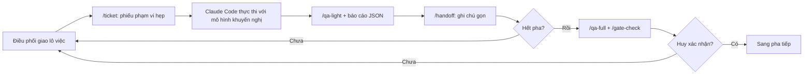

# BRD-09: Studio AI, quy trình làm việc, tiết kiệm token và bảo mật

| Mục | Nội dung |
|---|---|
| Mã tài liệu | BRD-09 |
| Phiên bản | 1.2 |
| Trạng thái | Đã duyệt v1.1 (Huy, 23/11/2026); **v1.2 cập nhật theo CR-02** (Huy duyệt phân tích 25/11/2026), chờ Huy xem lại |
| Ngày | 22/11/2026 |
| Tài liệu cha | BRD-00 `BRD-TONG-QUAN.md` v1.1, mục 7.7–7.9 |
| Yêu cầu tổng quan được chi tiết hoá | BR-32…46 |
| Quyết định liên quan | QĐ-01, QĐ-02, QĐ-06, QĐ-07, QĐ-09 |
| Phạm vi áp dụng | Quy trình **phát triển** engine và Web Studio bằng Claude Code (không phải trải nghiệm người dùng Web Studio) |
| Pha | E0 (thiết lập), áp dụng suốt dự án |

Quy ước mã: xem BRD-01.

---

## 1. Mục đích

Mọi phiên Claude Code làm việc theo **cùng một quy trình gọn**, có kiểm soát bằng phiếu và cổng, **tốn ít token**, không lộ bí mật, và giữ được quan hệ sạch với bộ gốc threejs-game-skills.

## 2. Thành phần `.claude/`

### 2.1 Agent (6–8)

| Agent | Mô hình | Phụ trách |
|---|---|---|
| `director` | Opus | Phạm vi, cổng, kiến trúc, giao việc |
| `engine-dev` | Sonnet | Code runtime và build |
| `tech-artist` | Sonnet | Vật liệu, ánh sáng, shader, ngân sách |
| `world-builder` | Sonnet | Địa hình, nước, thực vật, bố trí |
| `asset-designer` | Opus khi viết generator mới, Sonnet khi chỉnh tham số | Asset bằng code, Blender, nén, provenance |
| `gameplay-ui` | Sonnet | Tương tác, UI, âm thanh, NPC, hội thoại |
| `qa` | Sonnet/Haiku | Test, chụp, đo, báo cáo |
| `docs` | Haiku | Tài liệu, ADR, changelog |

Ghi chú: phát triển Web Studio (frontend, backend) do `engine-dev` và `gameplay-ui` đảm nhận ở bản đầu; chỉ tách agent `web-dev` khi khối lượng đòi hỏi (CH-09-01), vẫn trong giới hạn 8 agent.

### 2.2 Skill

| Nhóm | Skill |
|---|---|
| Giữ từ bộ gốc (2, sau CR-02) | `threejs-image-generator`, `threejs-audio-generator` (không phụ thuộc Three.js). Sáu skill gốc gắn Three.js (`threejs-game-director`, `threejs-gameplay-systems`, `threejs-aaa-graphics-builder`, `threejs-game-ui-designer`, `threejs-debug-profiler`, `threejs-qa-release`) được thay bằng skill `engine-unity-*` (QĐ-16) |
| Bỏ | `threejs-3d-generator` (QĐ-08) |
| Skill engine | `engine-intake`, `engine-world`, `engine-asset-forge`, `engine-cc0`, `engine-texture-proc`, `engine-materials`, `engine-lighting-bake`, `engine-packager`, `engine-blender` |
| Lệnh | `/start`, `/new-game`, `/ticket`, `/build-zone`, `/qa-light`, `/qa-full`, `/perf-snapshot`, `/visual-diff`, `/gate-check`, `/asset-recipe`, `/adr`, `/publish-poc`, `/handoff` |

### 2.3 Rule theo đường dẫn

| Đường dẫn | Rule |
|---|---|
| `engine/runtime/**` | Không cấp phát trong vòng lặp nóng; dùng API công khai |
| `engine/build/**` | Tất định, có seed, trả báo cáo JSON |
| `games/**/data/**` | Không giá trị cứng ngoài dữ liệu; hợp lệ schema |
| `web/**` | Không khoá API phía client; kiểm quyền ở backend |
| `prototypes/**` | Nới lỏng |

### 2.4 Hook (ít, ưu tiên cảnh báo)

| Hook | Loại | Hành vi |
|---|---|---|
| Đọc file .md > khoảng 40 KB | Chặn | Trả danh sách heading |
| Đọc `.glb`, `.ktx2`, ảnh lớn, log dài | Chặn | Gợi ý dùng báo cáo JSON, `grep`, `tail` |
| Ghi file JSON dữ liệu | Cảnh báo | Kiểm schema |
| Đọc `.env`, file bí mật; lệnh phá huỷ | Chặn | — |
| Sửa thư mục đồ hoạ | Cảnh báo | Nhắc chạy `/perf-snapshot` |

## 3. Quy trình phiếu và cổng

## 4. Yêu cầu chi tiết

### 4.1 Cấu trúc và quy trình (BR-32…37)

| Mã | Yêu cầu | Ưu tiên |
|---|---|---|
| BR-32.1 | Số agent ≤ 8, số skill engine thêm 10–15; mỗi agent/skill có mô tả một đoạn | M |
| BR-33.1 | `project.yaml`: `rigor: minimal\|standard\|full`, ghi đè theo hệ thống; mặc định `minimal` đến G-E6 | M |
| BR-33.2 | Hệ thống được nâng `standard` sớm: backend Web Studio, bảo mật, cổng AI (RR-24) | M |
| BR-34.1 | Mẫu phiếu: mục tiêu, phạm vi, file/module được đọc, file được sửa, tiêu chí xong, "Mô hình khuyến nghị" (mô hình + effort), bằng chứng cần nộp | M |
| BR-34.2 | Hướng dẫn chọn mô hình: Opus (high/xhigh) cho kiến trúc, thuật toán mới, cổng; Sonnet (medium) cho chỉnh tham số, script lặp, sửa nhỏ, test; Haiku cho đổi tên, tài liệu, việc cơ học | M |
| BR-35.1 | Mẫu báo cáo cổng: kết quả đạt/chưa theo điều kiện cổng, số đo A56, 2–4 ảnh, rủi ro mở, đề xuất | M |
| BR-35.2 | `/gate-check` tự kiểm điều kiện đo được và liệt kê điều kiện cần Huy xác nhận | M |
| BR-36.1 | ADR theo mẫu ngắn; ADR-001…015 tương ứng QĐ-01…15 ở E0 (GD-10) | M |
| BR-37.1 | `UPSTREAM.md`: phiên bản gốc đã fork, danh sách thay đổi theo file, cách lấy bản mới | M |
| BR-37.2 | Giữ nguyên LICENSE và ghi công tác giả gốc | M |

### 4.2 Tiết kiệm token (BR-38…42)

| Mã | Yêu cầu | Ưu tiên |
|---|---|---|
| BR-39.1 | `CLAUDE.md` < khoảng 150 dòng: luật, cấu trúc thư mục, lệnh CLI, chỉ dẫn tới ADR | M |
| BR-41.1 | Ghi chú dự án gọn (ràng buộc, việc đã xong, asset đang chờ, bước tiếp) cập nhật bằng `/handoff` cuối mỗi phiếu | M |
| BR-41.2 | `/clear` giữa các phiếu; phiếu sau đọc ghi chú thay vì lịch sử | M |
| BR-42.1 | MCP xem cảnh (Unity, Blender) chỉ bật khi gỡ lỗi | S |
| BR-38.2 | Đo token mỗi phiếu và ghi vào báo cáo để tính BO-02 | M |
| BR-38.3 | Ảnh: Claude chỉ xem 2–4 ảnh khác biệt nhất khi qua cổng; ngoài ra đọc số liệu | M |

### 4.3 Bảo mật và tuân thủ (BR-43…46)

| Mã | Yêu cầu | Ưu tiên |
|---|---|---|
| BR-43.2 | Khoá Gemini, ElevenLabs, Claude API để trong biến môi trường; script probe kiểm có khoá mà không in giá trị | M |
| BR-43.3 | Không commit file bí mật; có `.gitignore` và quét bí mật trước commit | M |
| BR-44.1 | LICENSE MIT gốc và thông báo bản quyền giữ trong repo | M |
| BR-45.3 | Tài liệu license tổng hợp (`LICENSES.md`) liệt kê nguồn dữ liệu, thư viện, dịch vụ | M |
| BR-46.1 | `engine doctor` kiểm: phiên bản Node, Python, Blender, add-on, khoá API có mặt, công cụ nén | M |

## 5. Quy tắc nghiệp vụ

| Mã | Quy tắc |
|---|---|
| QT-09-01 | Không viết tài liệu thiết kế dài trước khi có prototype chạy được (rigor minimal) |
| QT-09-02 | Mỗi phiếu có phạm vi hẹp và danh sách file được đọc |
| QT-09-03 | Cổng chỉ qua khi Huy xác nhận; publish không phải là duyệt |
| QT-09-04 | Mọi thay đổi so với bộ gốc ghi vào `UPSTREAM.md` trong cùng phiếu |
| QT-09-05 | Không đọc nguyên file lớn và file nhị phân; dùng báo cáo, tóm tắt |
| QT-09-06 | Bí mật không bao giờ in ra log, không ghi vào tài liệu hoặc bộ nhớ dự án |

## 6. Kịch bản chấp nhận

| Mã | Cho | Khi | Thì |
|---|---|---|---|
| AC-09-01 | Repo sau E0 | Đếm agent, skill | ≤ 8 agent; bộ gốc 8 skill + 10–15 skill engine |
| AC-09-02 | File .md 60 KB | Claude Code đọc nguyên file | Hook chặn, trả heading |
| AC-09-03 | Claude Code đọc `.env` | Gọi lệnh | Bị chặn |
| AC-09-04 | Phiếu mới | Tạo bằng `/ticket` | Có dòng "Mô hình khuyến nghị" và danh sách file |
| AC-09-05 | Cuối pha | Chạy `/gate-check` | Báo cáo cổng theo mẫu, có số đo A56 |
| AC-09-06 | Máy mới | Chạy `engine doctor` | Báo đủ/thiếu từng thành phần, không in khoá |

## 7. Câu hỏi mở

| Mã | Câu hỏi | Đề xuất |
|---|---|---|
| CH-09-01 | Có tách agent `web-dev` riêng cho Web Studio không? | Có khi bắt đầu W2, thay `docs` bằng việc giao `docs` cho Haiku qua skill |
| CH-09-02 | Repo engine và repo Web Studio chung hay tách? | Chung một monorepo (`engine/`, `web/`, `games/`) đến E8 |
| CH-09-03 | Có dùng CI (chạy QA nhẹ khi push) không? | Có, chạy smoke + kiểm schema; QA đầy đủ chạy trên worker |

## 8. Truy vết

| BR tổng quan | Yêu cầu chi tiết | Kịch bản |
|---|---|---|
| BR-32…37 | BR-32.1, 33.1…2, 34.1…2, 35.1…2, 36.1, 37.1…2 | AC-09-01, 04, 05 |
| BR-38…42 | BR-38.2…3, 39.1, 41.1…2, 42.1 | AC-09-02 |
| BR-43…46 | BR-43.2…3, 44.1, 45.3, 46.1 | AC-09-03, 06 |

## Bổ sung v1.1 (CR-01)

Luồng làm tiếp, cập nhật và nhập game đã có được mô tả ở **BRD-10** (BR-119…126). Phần liên quan đến tài liệu này: lệnh `/resume-game`, `/import-game` và ghi chú handoff theo từng game (BR-126).

## Bổ sung v1.2 (CR-02)

Ngày 25/11/2026 Huy đổi runtime sang Unity (QĐ-16, ADR-036). Sửa trong tài liệu này: bảng skill giữ từ bộ gốc còn hai skill sinh ảnh và âm thanh, sáu skill gắn Three.js thay bằng skill `engine-unity-*`; BR-42.1 dùng MCP Unity thay Three.js. Mục tiêu và BR khác không đổi.
