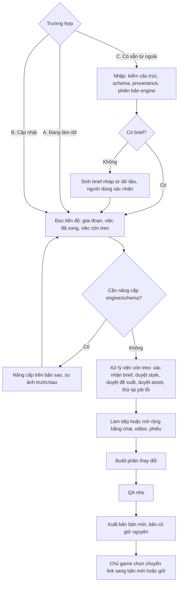

# BRD-10: Làm tiếp, cập nhật và nhập game đã có

| Mục | Nội dung |
|---|---|
| Mã tài liệu | BRD-10 |
| Phiên bản | 1.1 |
| Trạng thái | **Đã duyệt** v1.1 (Huy, 23/11/2026) |
| Ngày | 23/11/2026 |
| Tài liệu cha | BRD-00 `BRD-TONG-QUAN.md` v1.1, mục 7.12 |
| Yêu cầu tổng quan được chi tiết hoá | BR-119…126 |
| Nguồn | CR-01 (Huy yêu cầu 23/11/2026: bổ sung luồng xây dựng cho game đang làm dở hoặc đã có để làm tiếp hoặc cập nhật); căn theo SRS-00 v1.2 mục 4.4, SRS-01 v1.1, SRS-04 v1.1, SRS-08 v1.2, SRS-09 v1.1 |
| Quyết định liên quan | QĐ-03, QĐ-11, QĐ-15 |
| Pha | E1 (`engine status`, làm tiếp trong Claude Code), E3 (nâng cấp), W2 (làm tiếp trên web), W4 (cập nhật đã xuất bản, nhập game) |

Quy ước mã: xem BRD-01. Ghi chú: phiên bản 1.1 dùng để khớp với đợt bổ sung CR-01 của bộ BRD; đây là bản đầu tiên của BRD-10.

---

## 1. Mục đích

Bộ BRD v1.0 mô tả kỹ luồng **tạo game mới từ mô tả**. Thực tế phần lớn thời gian là **làm tiếp** game đang dở và **cập nhật** game đã có. Tài liệu này đảm bảo người dùng mở lại bất kỳ game nào cũng biết ngay nó đang ở đâu, việc gì còn lại, làm tiếp mà **không làm lại việc đã xong** và **không phá bản đang được người khác chơi**.

Giá trị kinh doanh: hỗ trợ trực tiếp BO-01 (dùng lại), BO-02 (token), BO-03 (thời gian build) và BO-09 (Web Studio).

## 2. Ba trường hợp

| Trường hợp | Ví dụ | Claude Code | Web Studio |
|---|---|---|---|
| **A. Đang làm dở** | Bỏ giữa chừng lúc trả lời câu hỏi làm rõ; brief đã xác nhận nhưng mới build 1/3 zone; job lỗi chưa xử lý | `/resume-game <id>` | Thư viện → "Làm tiếp" |
| **B. Đã có, cần cập nhật** | Game đã xuất bản, muốn thêm zone, NPC, loài, nhiệm vụ, sửa cảnh, bật tính năng tuỳ chọn | `/resume-game <id> <yêu cầu>` | Chat/editor rồi xuất bản bản mới |
| **C. Có sẵn từ ngoài** | Thư mục game làm bằng Claude Code, gói zip, game làm tay chưa có brief | `/import-game` | "Nhập game" |

**Nguyên tắc chung:** cả ba trường hợp đi qua **cùng một cơ chế** với game mới: brief, đề xuất thay đổi có duyệt, build tăng dần, QA, xuất bản. Không có luồng build riêng cho game cũ.

## 3. Tác nhân

| Tác nhân | Vai trò |
|---|---|
| Người tạo game (chủ game, người có quyền Sửa) | Mở lại game, làm tiếp, cập nhật, nhập, xuất bản bản mới |
| Agent trong Claude Code | Đọc tiến độ, đề xuất phiếu tiếp theo, nhập và nâng cấp game |
| Người chơi có link | Tiếp tục chơi bản cũ cho tới khi chủ game chuyển link |

## 4. Quy trình nghiệp vụ

## 5. Giai đoạn tiến độ

Tiến độ là **giá trị suy ra** mỗi lần mở game, không phải trường người dùng tự đánh dấu (tránh lệch giữa tiến độ ghi và thực tế). Hệ thống xét từ trên xuống, lấy giai đoạn đầu tiên đúng:

| Giai đoạn | Điều kiện (mức nghiệp vụ) | Việc tiếp theo gợi ý |
|---|---|---|
| Đang tạo | Phiên mô tả còn dở, chưa có brief | Trả lời câu hỏi làm rõ đang chờ |
| Chờ xác nhận brief | Brief mới nhất chưa xác nhận | Xác nhận brief |
| Chờ duyệt style | Style bible chưa duyệt | Duyệt style bible và bảng màu |
| Chưa build | Còn zone chưa từng build thành công | Build zone tiếp theo |
| Cần build | Có phần đã build nhưng đầu vào đã đổi | Build phần thay đổi |
| Chưa QA | Bản build hiện tại chưa qua QA nhẹ | Chạy QA nhẹ |
| Sẵn sàng xuất bản | Đã QA, chưa có bản xuất bản cho dữ liệu hiện tại | Xuất bản (bản số mới nếu đã có bản cũ) |
| Đã xuất bản | Bản xuất bản mới nhất khớp dữ liệu hiện tại | Không có; chỉnh tiếp khi muốn |

**Việc còn treo** hiển thị kèm, không thay giai đoạn: đề xuất chờ duyệt, asset chờ duyệt, job lỗi, cần nâng cấp engine, asset thiếu provenance, thay đổi chưa xuất bản, game đang bị người khác giữ khoá sửa.

Chi tiết điều kiện và mã: SRS-00 mục 4.4, SRS-04 mục 6.6.

## 6. Yêu cầu chi tiết

### 6.1 Xem tiến độ (BR-119)

| Mã | Yêu cầu | Ưu tiên | SRS |
|---|---|---|---|
| BR-119.1 | Mở lại một game thì thấy ngay: giai đoạn, việc đã xong, việc còn treo, một nút/việc "tiếp theo" | M | FR-WEB-61, SCR-WEB-19 |
| BR-119.2 | Thư viện game hiện giai đoạn và số việc treo trên từng thẻ; bộ lọc "Đang dở" | M | FR-WEB-60 |
| BR-119.3 | Tóm tắt tiến độ bằng lời khi mở lại (ngắn, đọc trong vài giây) | M | FR-INT-34 |
| BR-119.4 | Claude Code và CLI đọc cùng báo cáo tiến độ với Web Studio | M | FR-CLI-08 |
| BR-119.5 | Nhắc khi có thay đổi chưa xuất bản | S | MSG-WEB-06 |

### 6.2 Làm tiếp game đang dở (BR-120, trường hợp A)

| Mã | Yêu cầu | Ưu tiên | SRS |
|---|---|---|---|
| BR-120.1 | Phiên mô tả bỏ dở được lưu sau mỗi lượt; mở lại tiếp đúng chỗ, không hỏi lại câu đã trả lời | M | FR-INT-31 |
| BR-120.2 | Phiên bỏ dở quá 30 ngày (đề xuất) thì tự huỷ, có nhắc trước 3 ngày | S | QT-INT-10 |
| BR-120.3 | Mở lại giữ ngữ cảnh: lịch sử chat, đề xuất còn hiệu lực; đề xuất đã cũ so với dữ liệu hiện tại được đánh dấu hết hạn, có nút tạo lại | M | FR-WEB-62 |
| BR-120.4 | Job lỗi chưa xử lý hiện rõ, thử lại được | M | SRS-00 4.4 (cờ `jobLoi`) |

### 6.3 Cập nhật game đã có (BR-121, trường hợp B)

| Mã | Yêu cầu | Ưu tiên | SRS |
|---|---|---|---|
| BR-121.1 | Yêu cầu mở rộng (thêm zone, loài, NPC, nhiệm vụ, tính năng tuỳ chọn) được ghi vào brief thành phiên bản mới qua đề xuất có duyệt | M | FR-INT-33 |
| BR-121.2 | Thay đổi lớn (thể loại, phong cách, góc nhìn, thời đại, bật/tắt tính năng tuỳ chọn) bắt buộc xác nhận lại brief (QT-01-05) | M | QT-INT-05 |
| BR-121.3 | Cập nhật vẫn bám đúng mô tả gốc và style bible đã duyệt (QĐ-11) | M | — |

### 6.4 Nhập game có sẵn (BR-122, trường hợp C)

| Mã | Yêu cầu | Ưu tiên | SRS |
|---|---|---|---|
| BR-122.1 | Nhập từ thư mục game (Claude Code) hoặc gói zip; kiểm cấu trúc, schema, provenance, phiên bản engine; trả kết quả: nhập được / cần nâng cấp / bị chặn kèm lý do | M | FR-CLI-11, FR-WEB-66 |
| BR-122.2 | Game chưa có brief: sinh brief nháp từ dữ liệu, ghi rõ trường nào suy ra, trường nào thiếu; bắt buộc xác nhận trước khi build | M | FR-INT-32, QT-INT-09, FR-WEB-67 |
| BR-122.3 | Nhập gói vào game đã có trên Web Studio (ví dụ bản vừa sửa bằng Claude Code): hiện khác biệt theo đối tượng trước khi áp, cần quyền Sửa và giữ khoá | S | FR-WEB-69 |
| BR-122.4 | Asset thiếu provenance khi nhập được giữ nhưng không vào bản xuất bản cho tới khi bổ sung (QT-03-03) | M | QT-GEN-05 |

### 6.5 Build lại phần thay đổi (BR-123)

| Mã | Yêu cầu | Ưu tiên | SRS |
|---|---|---|---|
| BR-123.1 | Một thao tác "Build phần thay đổi" chỉ build các bước có đầu vào đổi hoặc chưa từng build | M | FR-CLI-09, FR-WEB-63 |
| BR-123.2 | Trước khi chạy, hiện danh sách bước, zone, ước lượng thời gian; không có gì cần build thì báo rõ | M | FR-WEB-63 |
| BR-123.3 | Không làm lại việc đã xong: câu trả lời làm rõ, brief đã xác nhận, style đã duyệt, asset đã duyệt, cache build đều được giữ, trừ khi thay đổi lớn buộc xác nhận lại | M | QT-GEN-11 |

### 6.6 Nâng cấp engine và schema (BR-124)

| Mã | Yêu cầu | Ưu tiên | SRS |
|---|---|---|---|
| BR-124.1 | Game dùng engine/schema cũ được gắn cờ "Cần nâng cấp" | S | FR-WEB-68 |
| BR-124.2 | Nâng cấp chạy trên bản sao: chuyển dữ liệu, build lại phần ảnh hưởng, QA nhẹ, so ảnh trước/sau; chỉ thay bản chính khi người dùng chấp nhận | S | FR-CLI-10, FR-WEB-68 |
| BR-124.3 | Nâng cấp lỗi thì dữ liệu, cache và bản xuất bản giữ nguyên | M | QT-RTM-08 |

### 6.7 Xuất bản bản mới (BR-125)

| Mã | Yêu cầu | Ưu tiên | SRS |
|---|---|---|---|
| BR-125.1 | Xuất bản game đã có bản cũ luôn tạo bản số mới, không ghi đè bản cũ | M | FR-CLI-12, FR-WEB-64, QT-WEB-10 |
| BR-125.2 | Bản mới kèm tóm tắt thay đổi so với bản trước | M | FR-CLI-12, FR-WEB-64 |
| BR-125.3 | Link chơi thử có hai chế độ: cố định (gắn một bản, mặc định) và mới nhất (luôn mở bản mới nhất đạt chuẩn); chủ game chuyển link khi muốn | M | FR-WEB-65, OI-WEB-10 |
| BR-125.4 | Bản cũ chỉ mất khi chủ game gỡ; nhắc gỡ bớt khi giữ quá 10 bản (đề xuất) | S | OI-WEB-11 |

### 6.8 Lệnh Claude Code (BR-126)

| Mã | Yêu cầu | Ưu tiên | SRS |
|---|---|---|---|
| BR-126.1 | `/resume-game <id> [yêu cầu]`: đọc tiến độ và ghi chú handoff, tóm tắt ≤ 15 dòng, đề xuất phiếu tiếp theo | M | FR-DEV-26 |
| BR-126.2 | `/import-game <thư mục\|gói.zip>`: chạy kiểm nhập, trình brief nháp nếu thiếu, đề xuất phiếu nâng cấp nếu cần | M | FR-DEV-27 |
| BR-126.3 | Ghi chú handoff gắn với từng game để phiên sau làm tiếp mà không phải đọc lại lịch sử dài (tiết kiệm token, BO-02) | M | FR-DEV-03 |

## 7. Quy tắc nghiệp vụ

| Mã | Quy tắc |
|---|---|
| QT-10-01 | Làm tiếp, cập nhật, nhập dùng chung brief, đề xuất, build, QA, xuất bản với game mới; không có luồng riêng |
| QT-10-02 | Không làm lại việc đã xong (SRS QT-GEN-11) |
| QT-10-03 | Cập nhật không phá bản đã có: xuất bản luôn tạo bản mới, link cố định giữ nguyên đích, nâng cấp làm trên bản sao (SRS QT-GEN-12) |
| QT-10-04 | Tiến độ luôn tính lại từ dữ liệu thật (SRS QT-WEB-11) |
| QT-10-05 | Brief suy ngược từ dữ liệu phải được người dùng xác nhận trước khi build |
| QT-10-06 | Đề xuất thay đổi tạo trên phiên bản dữ liệu cũ hơn hiện tại thì hết hạn, không áp dụng chồng |

## 8. Kịch bản chấp nhận

| Mã | Cho | Khi | Thì | Kịch bản SRS |
|---|---|---|---|---|
| AC-10-01 | Người dùng bỏ dở sau khi trả lời 2/4 câu hỏi làm rõ | Mở lại game hôm sau | Tiếp ở câu 3, không hỏi lại câu 1–2 | AC-CR01-01…03 |
| AC-10-02 | Game có 3 zone, mới build zone 1 | Bấm "Làm tiếp" | Bảng tiến độ ở "Chưa build", việc tiếp theo là build zone 2 | AC-CR01-07…11 |
| AC-10-03 | Game đã xuất bản bản 1, người chơi đang dùng link cố định | Thêm đàn trâu, build, xuất bản | Có bản 2 kèm tóm tắt thay đổi; link cố định vẫn mở bản 1 cho tới khi chủ game chuyển | AC-CR01-07…11 |
| AC-10-04 | Thư mục game làm tay, không có brief | Nhập | Báo cáo kiểm; brief nháp ở chờ xác nhận; build bị chặn tới khi xác nhận | AC-CR01-04…06 |
| AC-10-05 | Game dùng schema cũ | Nâng cấp, QA Fail, người dùng không chấp nhận | Bản chính, cache và bản xuất bản giữ nguyên | AC-CR01-04…06 |
| AC-10-06 | Chỉ đổi mật độ cỏ zone 2 | Build phần thay đổi | Chỉ lớp thực vật zone 2 build lại; zone 1 và 3 dùng cache | AC-CR01-04…06 |
| AC-10-07 | Phiên Claude Code mới | `/resume-game g01` | Tóm tắt ≤ 15 dòng và đề xuất phiếu tiếp theo | AC-CR01-12 |

## 9. Yêu cầu phi chức năng

| Mã | Yêu cầu |
|---|---|
| NFR-10-01 | Đọc tiến độ một game ≤ 2 s (đề xuất); không cần chạy build |
| NFR-10-02 | Tóm tắt tiến độ trong Claude Code ≤ 15 dòng để tiết kiệm token |

## 10. Câu hỏi mở

| Mã | Câu hỏi | Đề xuất | Liên quan SRS |
|---|---|---|---|
| CH-10-01 | Link chơi thử mặc định cố định hay mới nhất khi có bản mới? | Cố định; chủ game chủ động chuyển | OI-WEB-10 |
| CH-10-02 | Giới hạn số bản xuất bản giữ lại mỗi game? | Không giới hạn; nhắc khi > 10 bản | OI-WEB-11 |
| CH-10-03 | Thời hạn giữ phiên mô tả bỏ dở? | 30 ngày, nhắc trước 3 ngày | QT-INT-10 |

## 11. Truy vết

| BR tổng quan | Yêu cầu chi tiết | SRS chính |
|---|---|---|
| BR-119 | BR-119.1…5 | SRS-00 4.4, FR-INT-34, FR-CLI-08, FR-WEB-60, 61, SCR-WEB-19 |
| BR-120 | BR-120.1…4 | FR-INT-31, QT-INT-10, FR-WEB-62, UC-WEB-10 |
| BR-121 | BR-121.1…3 | FR-INT-33, UC-INT-07, UC-WEB-11 |
| BR-122 | BR-122.1…4 | FR-INT-32, FR-CLI-11, FR-WEB-66, 67, 69, UC-WEB-12, QT-INT-09 |
| BR-123 | BR-123.1…3 | FR-CLI-09, FR-WEB-63, QT-GEN-11 |
| BR-124 | BR-124.1…3 | FR-CLI-10, FR-WEB-68, UC-CLI-04, QT-RTM-08 |
| BR-125 | BR-125.1…4 | FR-CLI-12, FR-WEB-64, 65, QT-WEB-10, QT-GEN-12 |
| BR-126 | BR-126.1…3 | FR-DEV-03, 26, 27, UC-CLI-03 |

## 12. Lịch sử thay đổi

| Phiên bản | Ngày | Người | Nội dung |
|---|---|---|---|
| 1.1 | 23/11/2026 | Claude | Bản đầu theo CR-01, căn theo SRS v1.1/v1.2 |
| 1.1 | 23/11/2026 | Huy | Duyệt |
