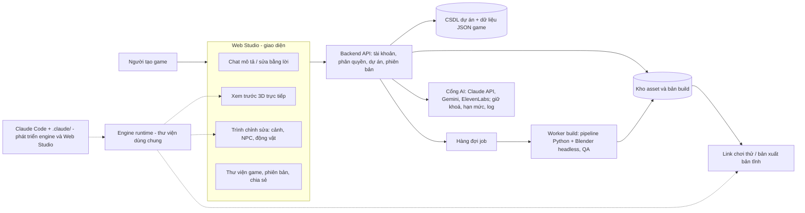
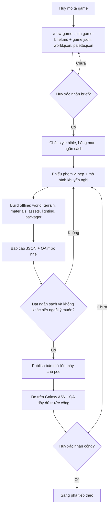

# BRD tổng quan: Engine web game 3D dùng lại được (GameStudio)

| Mục | Nội dung |
|---|---|
| Mã tài liệu | BRD-00 |
| Phiên bản | 1.2 |
| Ngày | 22/11/2026 |
| Chủ sở hữu / người quyết định | Huy |
| Người soạn | Claude |
| Nguồn | `GAME-ENGINE-WEB3D-BRIEF.md` bản 6 (22/11/2026 18:04), các quyết định QĐ-01…12 |
| Trạng thái | Đã duyệt v1.1 (Huy, 23/11/2026); **cập nhật theo CR-02** (Huy duyệt phân tích 25/11/2026), chờ Huy xem lại |

> Tài liệu này cố ý gọn. Brief đã chỉ ra (mục 3.1, 5) rằng viết nhiều tài liệu trước khi có prototype không làm game hay hơn. BRD chỉ chốt **vì sao làm, làm cho ai, thế nào là thành công, phạm vi đến đâu**. Chi tiết kỹ thuật để ở TSD/ADR, chi tiết chức năng để ở SRS khi tới pha tương ứng.

### Danh mục BRD chi tiết

| Mã | Tài liệu | Chi tiết hoá |
|---|---|---|
| BRD-01 | [Tạo game từ mô tả](BRD-01-TAO-GAME-TU-MO-TA.md) | BR-01…05, 73, 75, 93, 94 |
| BRD-02 | [Thế giới, địa hình và môi trường](BRD-02-THE-GIOI-DIA-HINH-MOI-TRUONG.md) | BR-10…14, 24, 45, 69, 104 |
| BRD-03 | [Asset 3D, vật liệu và âm thanh](BRD-03-ASSET-VAT-LIEU-AM-THANH.md) | BR-15…21, 62, 67, 96, 109, 113 |
| BRD-04 | [Runtime, hiệu năng và QA](BRD-04-RUNTIME-HIEU-NANG-QA.md) | BR-06…09, 22…31, 40, 111 |
| BRD-05 | [Nhân vật người chơi, NPC và động vật](BRD-05-NHAN-VAT-NPC-DONG-VAT.md) | BR-47…74, 102, 103 |
| BRD-06 | [Chiến đấu và săn bắt (tuỳ chọn)](BRD-06-CHIEN-DAU-SAN-BAT.md) | BR-75…83 |
| BRD-07 | [Hội thoại NPC (tĩnh và AI)](BRD-07-HOI-THOAI-NPC.md) | BR-57, 60, 84…89 |
| BRD-08 | [Web Studio](BRD-08-WEB-STUDIO.md) | BR-90…118 |
| BRD-09 | [Studio AI, quy trình, tiết kiệm token và bảo mật](BRD-09-STUDIO-AI-QUY-TRINH-BAO-MAT.md) | BR-32…46 |
| BRD-10 | [Làm tiếp, cập nhật và nhập game đã có](BRD-10-LAM-TIEP-CAP-NHAT-GAME.md) (v1.1, CR-01) | BR-119…126 |

Mỗi BRD chi tiết dùng mã `BR-<số gốc>.<n>` cho yêu cầu chi tiết, `QT-` cho quy tắc nghiệp vụ, `AC-` cho kịch bản chấp nhận, `CH-<BRD>-` cho câu hỏi mở riêng.

---

## 1. Tóm tắt điều hành

GameStudio xây một **engine web 3D theo hướng dữ liệu** trên nền Unity (player Web chung, QĐ-16; trước CR-02 là Three.js), một **Web Studio** (giao diện web riêng: chat mô tả, xem trước 3D, trình chỉnh sửa trực quan, lưu trữ và chia sẻ game), đi kèm một **"studio AI" gọn cho Claude Code** dùng để phát triển engine, để từ **mô tả bằng lời của người dùng** tạo ra web game 3D chạy được trên điện thoại tầm trung (Samsung Galaxy A56). Engine được kiểm chứng bằng một game mẫu (E7) và một game thứ hai cỡ nhỏ (E8).

Giá trị kinh doanh chính:
1. **Dùng lại**: game mới chủ yếu là dữ liệu và asset, không phải viết lại công cụ như ở dự án Thiền viện online (v1 → v2).
2. **Chi phí thấp**: giảm token và thời gian build mỗi phiếu nhờ công cụ viết một lần, script và kiểm tra tự động.
3. **Chất lượng ổn định**: ngân sách hiệu năng theo tier, đo tự động trên thiết bị thật, bằng chứng rẻ ở mỗi cổng.
4. **Dễ dùng**: người tạo game làm việc trên Web Studio, không cần biết Claude Code, dòng lệnh hay cấu trúc file (QĐ-15).

Sản phẩm **dùng nội bộ** (QĐ-07), không phát hành thương mại.

---

## 2. Bối cảnh và vấn đề

### 2.1 Hiện trạng (As-Is), rút từ dự án Thiền viện online

| # | Vấn đề đã gặp | Tác động kinh doanh |
|---|---|---|
| P-01 | Công cụ gắn chặt với một cảnh cụ thể; dựng lại cảnh v2 phải viết lại gần hết công cụ | Chi phí làm lại lớn, không tái sử dụng được cho game khác |
| P-02 | Ngân sách hiệu năng phải chỉnh nhiều lần sau khi đo trên máy thật | Trễ tiến độ, làm lại asset |
| P-03 | Build mỗi phiếu chậm; máy dev không có GPU | Vòng phản hồi dài |
| P-04 | Cho Claude xem nhiều ảnh chụp là khoản tốn token lớn nhất | Chi phí vận hành AI cao |
| P-05 | Đổi phong cách mỹ thuật giữa chừng buộc làm lại toàn bộ | Lãng phí công sức asset |
| P-06 | Địa hình do AI 3D sinh xấu; tượng/nhân vật dựng tay chưa đạt | Chất lượng không đều |
| P-07 | Cân nhắc đổi runtime khi đã làm sâu thì rất tốn | Rủi ro kiến trúc |

### 2.2 Điều đã chứng minh hiệu quả (giữ lại)
- Địa hình sinh bằng code từ DEM cộng xói mòn.
- Baked lighting cùng vật liệu scan CC0: bước nhảy chất lượng lớn nhất.
- Quy trình phiếu, cổng "xác nhận", ADR; phân vai chat điều phối và Claude Code thực thi.

### 2.3 Mong muốn (To-Be)
Một engine và quy trình mà ở đó: người dùng mô tả game → engine sinh brief và dữ liệu → người dùng xác nhận → pipeline build tự động dựng cảnh → QA tự đo và so ảnh → người dùng duyệt ở cổng → publish bản thử lên máy chủ poc để mở trên điện thoại.

---

## 3. Mục tiêu kinh doanh và chỉ số thành công

Cột "Mục tiêu" ghi **(đề xuất)** khi brief chưa có con số; các con số này cần Huy chốt (xem mục 13).

| Mã | Mục tiêu | Chỉ số đo | Mục tiêu | Thời điểm đo |
|---|---|---|---|---|
| BO-01 | Engine dùng lại được cho game mới | Tạo được một cảnh chơi được cho game thứ hai chủ yếu bằng dữ liệu; tỷ lệ thay đổi nằm ở file dữ liệu/asset so với code | Đạt; ≥ 80% thay đổi là dữ liệu/asset, không sửa code engine **(đề xuất)** | G-E8 |
| BO-02 | Giảm chi phí token | Token trung bình mỗi phiếu so với Thiền viện online | Thấp hơn rõ rệt; giảm ≥ 50% **(đề xuất)** | G-E8 |
| BO-03 | Giảm thời gian build | Thời gian build lại một zone khi chỉ đổi tham số (build tăng dần, cache theo hash) | Thấp hơn rõ rệt so với Thiền viện online; con số cụ thể **cần chốt** | G-E5, G-E8 |
| BO-04 | Chạy tốt trên điện thoại tầm trung | Đo trên Galaxy A56: draw call, số vật liệu, tri, fps, bộ nhớ | ≤ 120 draw call, ≤ 32 vật liệu, khoảng 450k tri tĩnh / 650k mặc định; fps **cần chốt** (đề xuất ≥ 30 fps ổn định ở tier Vừa) | Mọi cổng có đo hiệu năng |
| BO-05 | Chất lượng hình ảnh cao trên trình duyệt | Người dùng duyệt ảnh turntable/ảnh góc chuẩn ở cổng; visual regression không có khác biệt ngoài ý muốn | Huy "xác nhận" ở cổng | G-E2 trở đi |
| BO-08 | Thế giới sống động: có người chơi, NPC và động vật hành xử tự nhiên | Số loài/NPC tạo được chỉ bằng dữ liệu; bot playtest không ghi nhận kẹt, xuyên vật thể; Huy duyệt ảnh chuỗi/clip hành vi | Đạt ở cổng; vẫn trong ngân sách A56 | G-E4, G-E6, G-E7 |
| BO-09 | Người dùng tự tạo, chỉnh, chơi thử và chia sẻ game trên Web Studio mà không cần Claude Code | Thời gian từ mô tả đầu tiên tới bản chơi được trong khung xem trước; tỷ lệ chỉnh sửa làm được bằng chat/trình chỉnh sửa mà không cần lập trình viên | ≤ 30 phút tới bản chơi được đầu tiên cho game cỡ nhỏ (không tính bake ánh sáng); ≥ 90% chỉnh sửa thường gặp làm được trên web **(đề xuất)** | G-W3, G-W4 |
| BO-06 | Bám đúng mô tả của người dùng | Thể loại và phong cách trong `game-brief.md` khớp mô tả; người dùng xác nhận trước khi dựng | 100% | Mỗi lần `/new-game` |
| BO-07 | Tuân thủ license và nguồn gốc asset | Tỷ lệ asset có provenance sidecar hợp lệ | 100%; asset không provenance coi như chưa có license | Mỗi build, G-E4 |

---

## 4. Phạm vi

### 4.1 Trong phạm vi
1. **Repo engine** fork từ `majidmanzarpour/threejs-game-skills` (MIT) (QĐ-01); runtime là **Unity player chung** nạp dữ liệu game (QĐ-16, ADR-036, CR-02), pipeline build TS/Python giữ nguyên.
2. **Pipeline build offline**: tiếp nhận mô tả, thế giới/địa hình hai nguồn, nước, thực vật, bố trí, lắp công trình, nhập mô hình CC0, sinh asset bằng code, vật liệu, bake ánh sáng, đóng gói theo zone/tier.
3. **Runtime web**: nạp manifest, stream theo zone, chọn tier tự động, camera/người chơi, hiệu ứng, tương tác, UI và âm thanh.
   - **Nhân vật và NPC**: nhân vật người chơi, NPC người, động vật theo họ (thú bốn chân, gia cầm, chim, cá); khung xương và animation dùng chung, hành vi khai báo bằng dữ liệu (mục 7.10).
   - **Tính năng tuỳ chọn bật theo mô tả game**: chiến đấu và săn bắt (QĐ-13), hội thoại NPC do AI sinh khi chạy (QĐ-14).
4. **QA tự động**: smoke test, chụp góc chuẩn, visual regression, đo hiệu năng, bot playtest, kiểm ngân sách.
5. **CLI**: `engine new-game`, `build --zone`, `qa --level`, `publish`, `doctor`.
6. **Studio AI cho Claude Code** trong `.claude/`: 6–8 agent, 9 skill gốc (bỏ 1) cộng 10–15 skill engine, rule theo đường dẫn, hook bảo vệ token, template (QĐ-02).
7. **Game mẫu đầu tiên** sinh từ mô tả của người dùng, hoàn chỉnh một zone (E7).
8. **Game thứ hai cỡ nhỏ** để chứng minh khả năng dùng lại (E8).
9. Phát hành bản thử lên **máy chủ poc** để mở trên điện thoại.
10. **Web Studio** (QĐ-15, mục 7.11): giao diện web riêng gồm chat mô tả để sinh và sửa game, xem trước 3D trực tiếp, trình chỉnh sửa trực quan cảnh/NPC/động vật, tài khoản và phân quyền, lưu trữ có phiên bản, chia sẻ và xuất bản link chơi thử.
11. **Backend Web Studio**: API, cơ sở dữ liệu dự án, kho asset và bản build, hàng đợi job build (worker chạy pipeline Python/Blender headless), cổng gọi AI (Claude API, Gemini, ElevenLabs) giữ khoá và hạn mức.
12. **Làm tiếp, cập nhật và nhập game** (v1.1, CR-01, mục 7.12): mở lại game đang dở hoặc đã xuất bản để làm tiếp hoặc cập nhật, nhập game có sẵn từ ngoài; dùng chung cơ chế brief, đề xuất, build tăng dần, xuất bản với game mới.

### 4.1b Kiến trúc tổng thể ở mức nghiệp vụ (QĐ-15)

Nguyên tắc:
1. **Một nguồn sự thật**: bộ dữ liệu JSON của game (`game.json`, `world.json`, `entities/*.json`…). Chat, trình chỉnh sửa, CLI và Claude Code đều đọc/ghi cùng bộ dữ liệu này qua schema chung; không có định dạng riêng cho web.
2. **Engine runtime là thư viện độc lập**, dùng chung cho khung xem trước, trình chỉnh sửa và bản chơi xuất bản. Game xuất bản vẫn chạy hoàn toàn phía trình duyệt.
3. **Việc nặng chạy trên worker** (sinh địa hình, Blender, bake, nén, QA); web chỉ gửi job và hiển thị tiến độ, báo cáo JSON, ảnh.
4. **Khâu sinh game bằng AI** dùng lại logic `game-intake` và skill hiện có, nhưng gọi qua Claude API ở backend; khoá API không bao giờ xuống trình duyệt.
5. **Claude Code giữ vai trò công cụ phát triển** (QĐ-02); generator mới hay sửa engine vẫn làm qua phiếu và cổng như trước.

### 4.2 Ngoài phạm vi
1. Tự viết renderer cấp thấp.
2. Sao chép code, asset hay cảnh từ Thiền viện online.
3. Sao nguyên framework studio AI cỡ lớn (40–50 agent).
4. Hỗ trợ harness khác Claude Code (Codex, Cursor…) (QĐ-02).
5. Dịch vụ AI 3D như Meshy, Tripo (QĐ-08).
6. Runtime khác: Babylon.js, PlayCanvas, Three.js (bỏ theo CR-02), Unreal; build Unity riêng cho từng game.
7. Phát hành ra ngoài / thương mại hoá (QĐ-07).
8. **Giả định ngoài phạm vi** (cần xác nhận, xem GD-05): multiplayer trong game, tài khoản người chơi bên trong game (khác tài khoản Web Studio), thanh toán, chợ asset, đa ngôn ngữ giao diện.
9. Mở Web Studio cho công chúng / đăng ký tự do (giữ QĐ-07, xem CH-23).
10. Cộng tác sửa đồng thời theo thời gian thực nhiều người trên một game (xem CH-30).
11. Trình chỉnh sửa mô hình 3D chi tiết kiểu Blender trên web (sculpt, rig tay): asset vẫn sinh qua pipeline.

---

## 5. Bên liên quan và người dùng

| Vai trò | Ai | Trách nhiệm / nhu cầu |
|---|---|---|
| Chủ dự án, người quyết định, người duyệt cổng | Huy | Đưa mô tả game, chốt quyết định (QĐ), "xác nhận" ở mỗi cổng, duyệt asset rủi ro cao |
| Điều phối | Phiên chat điều phối (Claude) | Giao việc theo lô, đánh giá kết quả, chuẩn bị báo cáo cổng |
| Thực thi | Claude Code với các agent `director`, `engine-dev`, `tech-artist`, `world-builder`, `asset-designer`, `gameplay-ui`, `qa`, `docs` | Viết engine, công cụ, generator; chạy build và QA theo phiếu |
| Quản trị Web Studio | Huy (ban đầu) | Mời người dùng, phân quyền, đặt hạn mức AI và lưu trữ, xem chi phí |
| Người tạo game | Người dùng nội bộ được mời (kể cả Huy) | Mô tả game bằng chat, chỉnh trên trình chỉnh sửa, xem trước, lưu, chia sẻ; không cần biết lập trình hay Claude Code |
| Người chơi thử | Nội bộ (Huy và người được mời), người nhận link chia sẻ | Mở bản chơi thử trên điện thoại hoặc máy tính, chơi, phản hồi |
| Bên thứ ba cung cấp | Tác giả threejs-game-skills; Google Gemini; ElevenLabs; Poly Haven và thư viện CC0 khác; OpenStreetMap; Copernicus GLO-30; Blender và add-on | Mã nguồn upstream, dịch vụ sinh ảnh/âm thanh, asset CC0, dữ liệu địa hình |

---

## 6. Quyết định đã chốt (tham chiếu)

Toàn văn ở brief. Tóm tắt để truy vết:

| Mã | Nội dung ngắn |
|---|---|
| QĐ-01 | Xuất phát từ threejs-game-skills; Three.js + Vite + TypeScript (phần runtime bị QĐ-16 thay) |
| QĐ-16 | Runtime là Unity: một player Web chung (Unity 6 LTS, URP) đọc dữ liệu game; Web Studio nhúng cùng player (CR-02, 25/11/2026) |
| QĐ-02 | Chỉ hỗ trợ Claude Code |
| QĐ-03 | Game do người dùng mô tả; engine không gắn thể loại; có bước `/new-game` |
| QĐ-04 | Thiết bị tối thiểu Galaxy A56 |
| QĐ-05 | Địa hình hai nguồn: thật (OSM/DEM) và thủ tục, trộn được |
| QĐ-06 | Blender headless với Sapling, A.N.T. cộng code bổ sung |
| QĐ-07 | Dùng nội bộ; giữ LICENSE MIT, ghi công trong `UPSTREAM.md` |
| QĐ-08 | Không Meshy/Tripo; asset 3D sinh bằng code |
| QĐ-09 | Được dùng Gemini (ảnh) và ElevenLabs (âm thanh) |
| QĐ-10 | Được dùng thư viện CC0 (vật liệu scan, HDRI) |
| QĐ-11 | Bám đúng mô tả; không tự đổi phong cách |
| QĐ-12 | Được dùng mô hình 3D CC0, ưu tiên trước generator, nhất là nhân vật và tượng |
| QĐ-13 | **Chiến đấu và săn bắt động vật do người dùng lựa chọn** trong mô tả game; engine hỗ trợ dưới dạng tính năng tuỳ chọn, mặc định tắt (Huy chốt 22/11/2026, ghi trong BRD v0.3) |
| QĐ-14 | **Hội thoại NPC là kịch bản tĩnh, và có thể do AI sinh khi chạy tuỳ theo nhu cầu** của từng game/NPC (Huy chốt 22/11/2026, ghi trong BRD v0.3) |
| QĐ-15 | **GameStudio có giao diện web riêng (Web Studio)**, không chỉ là skill trong Claude: chat/mô tả để sinh game, xem trước 3D trực tiếp, trình chỉnh sửa trực quan (cảnh, NPC, động vật), quản lý người dùng, lưu trữ và chia sẻ game (Huy chốt 22/11/2026, ghi trong BRD v0.4) |

QĐ-13, QĐ-14, QĐ-15 được chốt khi soạn BRD, chưa có trong brief bản 6; cần cập nhật brief và ghi ADR tương ứng.

Tác động của QĐ-15 lên các quyết định cũ (diễn giải, cần Huy xác nhận):
- **QĐ-02 (chỉ Claude Code)** từ nay áp dụng cho **quy trình phát triển engine và Web Studio**. Bản thân Web Studio gọi **Claude API** qua backend để sinh và sửa game cho người dùng; người dùng không cần Claude Code.
- **QĐ-07 (dùng nội bộ)** vẫn giữ: Web Studio chỉ cho nhóm nội bộ được mời (Huy chốt 22/11/2026, CH-23); chia sẻ game là chia sẻ trong phạm vi đó hoặc qua link chơi thử (xem CH-26).
- **GD-05 (không backend)** không còn đúng: Web Studio cần backend, cơ sở dữ liệu, kho lưu trữ và máy chạy build. Game khi chơi vẫn chạy phía trình duyệt.

Ghi chú diễn giải: QĐ-12 **bổ sung và nới** QĐ-08. Thứ tự ưu tiên khi cần asset 3D là (1) mô hình CC0 hợp phong cách, (2) generator code, (3) chỉnh mô hình CC0 bằng code/Blender.

---

## 7. Yêu cầu nghiệp vụ

Ưu tiên theo MoSCoW: **M** bắt buộc, **S** nên có, **C** có thì tốt. Cột "Pha" là pha đầu tiên cần đáp ứng.

### 7.1 Tạo game từ mô tả

| Mã | Yêu cầu | Ưu tiên | Nguồn | Pha | Tiêu chí chấp nhận |
|---|---|---|---|---|---|
| BR-01 | Người dùng tạo game mới bằng cách mô tả bằng lời qua `/new-game` | M | QĐ-03 | E1 | Sinh được `game-brief.md` một trang cùng `game.json`, `world.json`, `palette.json` |
| BR-02 | Engine hỏi người dùng xác nhận brief trước khi dựng | M | QĐ-03 | E1 | Không bước build nào chạy khi brief chưa được xác nhận |
| BR-03 | Engine giữ nguyên thể loại và phong cách người dùng mô tả | M | QĐ-11 | E1 | Brief không thêm, bớt hay đổi phong cách; mọi đề xuất khác chỉ ghi là ghi chú, không áp dụng |
| BR-04 | Brief nêu rõ asset rủi ro cao về chất lượng (nhân vật, tượng chi tiết…) và cách đầu tư thêm | M | QĐ-11, mục 4.5 | E1 | Brief có mục "Asset rủi ro cao" khi mô tả có loại asset này |
| BR-05 | Style bible và bảng màu được chốt từ brief trước khi sản xuất asset | M | Bài học #8 | E2 | Có style bible và `palette.json` được duyệt trước khi bắt đầu sinh asset hàng loạt |

### 7.2 Engine hướng dữ liệu và dùng lại

| Mã | Yêu cầu | Ưu tiên | Nguồn | Pha | Tiêu chí chấp nhận |
|---|---|---|---|---|---|
| BR-06 | Game được điều khiển bằng file dữ liệu (`game.json`, `world.json`, `palette.json`, `budgets.json`, `entities/*.json`) | M | Mục 4.1 | E1 | Gameplay và cảnh đọc từ dữ liệu; rule chặn giá trị cứng trong `games/**/data/**` |
| BR-07 | Engine tách khỏi game; mỗi game chỉ chứa dữ liệu, asset và ít script gameplay | M | Mục 4.1 | E1 | Cấu trúc `games/<tên>/` hoặc repo riêng; không sửa engine khi thêm game |
| BR-08 | Công cụ theo tham số, không chứa giá trị cứng của cảnh | M | Bài học #1 | E1 | Review code không phát hiện hằng số riêng của một cảnh trong engine |
| BR-09 | Mọi bước sinh thủ tục là tất định (RNG có seed) | M | Mục 4.1 | E1 | Cùng dữ liệu và seed cho cùng kết quả (so hash đầu ra) |

### 7.3 Thế giới, địa hình, môi trường

| Mã | Yêu cầu | Ưu tiên | Nguồn | Pha | Tiêu chí chấp nhận |
|---|---|---|---|---|---|
| BR-10 | Địa hình từ dữ liệu thật (OSM, DEM Copernicus GLO-30) | M | QĐ-05 | E1 | Nạp được vùng thật ra heightmap + mask + vector đường/nước |
| BR-11 | Địa hình sinh thủ tục và trộn với dữ liệu thật | M | QĐ-05 | E1 | Hai bộ nạp xuất cùng định dạng trung gian; trộn được nền DEM với chi tiết noise |
| BR-12 | Nước, thực vật (rừng, cây rải rác, cỏ), bố trí đối tượng theo luật | M | Mục 4.2, QĐ-06 | E3–E4 | Cảnh có nước và thực vật trong ngân sách A56; impostor ở xa |
| BR-13 | Bake ánh sáng và thời điểm trong ngày là tính năng lõi | M | Bài học #4 | E5 | Cảnh mẫu có lightmap/AO bake, đổi được thời điểm trong ngày |
| BR-14 | Hiệu ứng môi trường: sương, hậu kỳ, hạt, thời tiết, bầu trời | S | Mục 4.2 | E3 | Bật/tắt theo tier |

### 7.4 Asset và vật liệu

| Mã | Yêu cầu | Ưu tiên | Nguồn | Pha | Tiêu chí chấp nhận |
|---|---|---|---|---|---|
| BR-15 | Asset 3D theo thứ tự ưu tiên: mô hình CC0 → generator code → chỉnh CC0 | M | QĐ-08, QĐ-12 | E4 | Mỗi asset ghi rõ đường nào được dùng trong provenance |
| BR-16 | Nhập mô hình CC0: kiểm license, chuẩn hoá scale/pivot/trục, decimate, LOD, đồng bộ vật liệu, gắn khung xương dùng chung | M | QĐ-12 | E4 | Mô hình nhập qua `asset-import` đạt ngân sách A56 và có provenance |
| BR-17 | Generator tham số viết một lần cho mỗi họ asset; biến thể chỉ là JSON tham số + seed | M | Mục 4.5 | E4 | Tạo biến thể mới không cần viết code |
| BR-18 | Vật liệu ba nguồn: thủ tục, scan CC0, texture sinh bằng Gemini; HDRI CC0 | M | QĐ-09, QĐ-10 | E2 | Vật liệu chuẩn hoá theo tier, nén KTX2 |
| BR-19 | Âm thanh môi trường và hiệu ứng sinh bằng ElevenLabs | S | QĐ-09 | E6 | Âm thanh nén, có provenance |
| BR-20 | Cổng duyệt asset: ảnh turntable 4 góc cộng thông số (tri, vật liệu, texture) | M | Mục 4.5 | E4 | Asset chỉ vào cảnh sau khi Huy duyệt |
| BR-21 | Mọi asset có provenance sidecar (nguồn/công thức, tham số, seed, phiên bản generator; hoặc URL, tác giả, license, ngày tải; hoặc prompt, model, ngày) | M | QĐ-09, 10, 12 | E2 | Build báo lỗi khi asset thiếu provenance |

### 7.5 Runtime và hiệu năng

| Mã | Yêu cầu | Ưu tiên | Nguồn | Pha | Tiêu chí chấp nhận |
|---|---|---|---|---|---|
| BR-22 | Hệ tier chất lượng Thấp / Vừa / Cao / Tối đa, chọn tự động | M | Bài học #5 | E1 | Texture 2048² (Thấp/Vừa), 4096² (Cao/Tối đa); chọn tier theo thiết bị |
| BR-23 | Ngân sách hiệu năng trong `budgets.json` theo số đã kiểm chứng trên A56 | M | QĐ-04 | E0 | Mọi build báo pass/fail theo ngân sách |
| BR-24 | Stream theo zone; đóng gói theo zone và tier | M | Mục 4.2 | E2 | Chỉ nạp zone cần thiết |
| BR-25 | Điều khiển cảm ứng và safe area cho mobile; flycam/orbit cho dev | M | Mục 4.2 | E2 | Chơi được trên A56 bằng cảm ứng |
| BR-26 | Tương tác, sự kiện, hội thoại điều khiển bằng dữ liệu; HUD, menu | M | Mục 4.2 | E6 | Vòng chơi tối thiểu chạy được |

### 7.6 QA và bằng chứng

| Mã | Yêu cầu | Ưu tiên | Nguồn | Pha | Tiêu chí chấp nhận |
|---|---|---|---|---|---|
| BR-27 | Mọi bước build trả báo cáo JSON (tri, draw, vật liệu, dung lượng, thời gian, pass/fail) | M | Mục 4.1 | E1 | Có báo cáo cho mỗi lần build |
| BR-28 | QA hai mức: nhẹ (mặc định) và đầy đủ (trước cổng lớn) | M | Bài học #6 | E1 | `engine qa --level=nhe\|day-du` chạy được |
| BR-29 | Bằng chứng rẻ: ảnh từ game đang chạy, báo cáo hiệu năng JSON, visual regression so baseline | M | Mục 3.2 | E1–E3 | Claude đọc số trước, chỉ xem 2–4 ảnh khác biệt nhất khi qua cổng |
| BR-30 | Đo hiệu năng trên Galaxy A56 thật ở mọi cổng có đo hiệu năng | M | QĐ-04 | E0 | Báo cáo cổng có số đo từ A56 |
| BR-31 | Bot playtest tự động | S | Mục 4.2 | E6 | Bot chạy hết vòng chơi tối thiểu không lỗi |

### 7.7 Studio AI và quy trình làm việc

| Mã | Yêu cầu | Ưu tiên | Nguồn | Pha | Tiêu chí chấp nhận |
|---|---|---|---|---|---|
| BR-32 | `.claude/` gọn: 6–8 agent, 10–15 skill engine trên nền bộ gốc, rule theo đường dẫn, ít hook | M | Mục 3.2, 4.4 | E0 | Số agent/skill trong giới hạn; hook "cảnh báo" nhiều hơn "chặn" |
| BR-33 | Quy trình nhẹ mặc định (`rigor: minimal`) đến khi có vòng chơi; nâng độ chặt theo từng hệ thống | M | Mục 3.2, 5 | E0 | `project.yaml` có `rigor` và ghi đè theo hệ thống |
| BR-34 | Làm việc qua phiếu phạm vi hẹp, mỗi phiếu có dòng "Mô hình khuyến nghị" | M | Mục 5 | E0 | Template phiếu có trường này |
| BR-35 | Cổng duyệt theo pha (G-E0…G-E8); cổng là lời "xác nhận" của Huy; publish không đồng nghĩa với duyệt | M | Mục 2, 6 | E0 | Có báo cáo cổng theo template |
| BR-36 | Ghi ADR cho các quyết định kiến trúc | M | Mục 6 | E0 | ADR tương ứng QĐ đã chốt |
| BR-37 | Ghi mọi thay đổi so với bộ gốc vào `UPSTREAM.md` | M | QĐ-01, 07 | E0 | Lấy được bản mới của upstream mà không mất phần đã sửa |

### 7.8 Tiết kiệm token

| Mã | Yêu cầu | Ưu tiên | Nguồn | Pha | Tiêu chí chấp nhận |
|---|---|---|---|---|---|
| BR-38 | Hook chặn đọc nguyên file .md lớn (> khoảng 40 KB, trả heading) và file nhị phân/log dài | M | Mục 4.4 | E0 | Hook hoạt động, có thông báo thay thế |
| BR-39 | `CLAUDE.md` ngắn (< khoảng 150 dòng) | M | Mục 5 | E0 | Kiểm số dòng |
| BR-40 | Build tăng dần, cache theo hash | M | Bài học #6 | E2 | Đổi một tham số chỉ build lại module liên quan |
| BR-41 | `/handoff` lưu ghi chú dự án gọn; `/clear` giữa các phiếu | S | Mục 5 | E0 | Có ghi chú dự án cập nhật sau mỗi phiếu |
| BR-42 | MCP xem cảnh chỉ dùng khi debug | S | Mục 5 | Mọi pha | Không nằm trong luồng sản xuất |

### 7.9 Bảo mật và tuân thủ

| Mã | Yêu cầu | Ưu tiên | Nguồn | Pha | Tiêu chí chấp nhận |
|---|---|---|---|---|---|
| BR-43 | Khoá API (Gemini, ElevenLabs) để trong biến môi trường; không in giá trị; hook chặn đọc `.env` | M | QĐ-09 | E0 | Probe khoá không in giá trị; hook chặn |
| BR-44 | Giữ LICENSE và thông báo bản quyền MIT của bộ gốc; ghi công | M | QĐ-01, 07 | E0 | Có LICENSE gốc và `UPSTREAM.md` |
| BR-45 | Tuân thủ license dữ liệu địa hình (OSM ODbL, Copernicus) và CC0 | M | Mục 2 | E1 | Ghi nguồn trong provenance và màn hình credit |
| BR-46 | Cố định phiên bản Blender và add-on; `engine doctor` kiểm tra môi trường | M | QĐ-06 | E0 | `doctor` báo lệch phiên bản |

### 7.10 Nhân vật người chơi và NPC

Phạm vi mục này: nhân vật do người chơi điều khiển, NPC là con người, và động vật (chó, mèo, trâu, bò, lợn, gà, chim trời, cá dưới nước…). Engine không gắn với một danh sách loài cố định: loài nào xuất hiện, bao nhiêu, phong cách ra sao là do mô tả của người dùng quyết định (QĐ-03, QĐ-11). Engine cung cấp **họ khung xương, họ hành vi và dữ liệu khai báo** để thêm loài mới chủ yếu bằng dữ liệu.

Mục này là bổ sung theo yêu cầu của Huy (22/11/2026); brief bản 6 chỉ nhắc nhân vật ở mức asset (mục 4.5) và module `camera-player`, `interaction`, chưa có module riêng cho hành vi NPC và động vật (xem GD-11).

#### 7.10.1 Nhân vật người chơi

| Mã | Yêu cầu | Ưu tiên | Nguồn | Pha | Tiêu chí chấp nhận |
|---|---|---|---|---|---|
| BR-47 | Nhân vật người chơi khai báo bằng dữ liệu (`entities/player.json`): ngoại hình, tỷ lệ, trang phục, tốc độ đi/chạy, góc nhìn | M | QĐ-03, mục 4.1 | E2 | Đổi ngoại hình, tốc độ, góc nhìn chỉ bằng sửa dữ liệu |
| BR-48 | Góc nhìn ngôi thứ nhất hoặc ngôi thứ ba, chọn theo `game.json`; camera ngôi ba tránh xuyên tường và địa hình | M | Mục 4.2 `camera-player` | E2 | Chuyển được hai chế độ bằng dữ liệu; camera không xuyên vật thể trong bot playtest |
| BR-49 | Điều khiển: joystick ảo và chạm trên mobile; bàn phím, chuột trên desktop. Hành động cơ bản: đứng, đi, chạy, xoay, tương tác. Nhảy, ngồi, leo là tuỳ chọn bật theo dữ liệu | M | BR-25 | E2 | Chơi được trên A56 bằng một tay cầm máy dọc hoặc hai tay cầm ngang (theo `game.json`) |
| BR-50 | Va chạm và bám địa hình: không xuyên công trình, cây lớn, NPC; đi được trên dốc trong giới hạn; không rơi khỏi vùng chơi; xử lý nước (không đi vào nước sâu, hoặc bơi nếu game bật) | M | Mục 4.2 | E2 | Bot playtest đi ngẫu nhiên 10 phút không kẹt, không xuyên, không rơi |
| BR-51 | Animation người chơi dùng **khung xương người dùng chung**; chuyển trạng thái mượt (blend đứng → đi → chạy); bước chân khớp mặt đất | M | Mục 4.5 (3) | E4 | Không trượt chân thấy rõ trong ảnh chụp chuỗi; cùng bộ animation dùng được cho NPC người |
| BR-52 | Âm thanh bước chân theo loại bề mặt (đất, cỏ, đá, gỗ, nước) | S | QĐ-09 | E6 | Bề mặt lấy từ splat map hoặc vật liệu; mỗi loại có âm riêng |
| BR-53 | Tuỳ biến ngoại hình người chơi trong game (chọn trang phục, màu…) | C | — | Sau E7 | Chỉ làm khi mô tả game yêu cầu |

#### 7.10.2 NPC con người

| Mã | Yêu cầu | Ưu tiên | Nguồn | Pha | Tiêu chí chấp nhận |
|---|---|---|---|---|---|
| BR-54 | NPC người khai báo bằng dữ liệu (`entities/npc/*.json`): ngoại hình (từ bộ khối tham số hoặc mô hình CC0), vai trò, vị trí xuất hiện, hành vi, hội thoại, lịch trình | M | QĐ-03, mục 4.1 | E6 | Thêm NPC mới không cần viết code |
| BR-55 | Hành vi NPC theo mô hình trạng thái khai báo trong dữ liệu, tối thiểu: đứng yên/làm việc tại chỗ, đi tuần theo đường, đi lang thang trong vùng, đi tới điểm hẹn, phản ứng khi người chơi lại gần (quay mặt, chào, tránh đường) | M | Mục 4.2 `interaction` | E6 | Mỗi hành vi có test tất định với seed |
| BR-56 | NPC tìm đường trên mặt đất đi được, tránh vật cản, tránh nhau và tránh người chơi; không đi xuyên công trình | M | — | E6 | Bot playtest không ghi nhận NPC kẹt hoặc xuyên vật thể quá ngưỡng (đề xuất 0 lần kẹt > 5 s) |
| BR-57 | Hội thoại với NPC theo kịch bản dữ liệu: lời thoại, lựa chọn, điều kiện, sự kiện kích hoạt; hiển thị bằng UI mobile-friendly. Kịch bản tĩnh là chế độ mặc định và là đường dự phòng của hội thoại AI (mục 7.10.6) | M | BR-26, QĐ-14 | E6 | Một cuộc hội thoại nhiều nhánh chạy được từ dữ liệu |
| BR-58 | Lịch trình theo thời điểm trong ngày (đi làm, về nhà, ngủ) gắn với hệ thời gian của `lighting` | S | BR-13 | E6 | Vị trí NPC thay đổi theo giờ trong game |
| BR-59 | Đám đông ở xa (ví dụ người đi lễ, người ở chợ) dùng LOD thấp, animation instancing hoặc impostor | S | Mục 4.5 | E7 | Đạt ngân sách ở BR-70 |
| BR-60 | Giọng nói NPC (sinh bằng ElevenLabs) cho lời thoại chính | C | QĐ-09 | Sau E6 | Có provenance; bật/tắt theo dữ liệu |

#### 7.10.3 Động vật

Động vật được chia thành **họ** theo khung xương và kiểu di chuyển. Mỗi họ có một khung xương, một bộ animation thủ tục và một bộ hành vi dùng chung; mỗi loài chỉ là tham số (kích thước, tỷ lệ, bộ lông/màu, âm thanh, tốc độ, tính cách).

| Họ | Ví dụ loài | Kiểu di chuyển chính |
|---|---|---|
| Thú bốn chân nhỏ | chó, mèo, lợn, dê | Đi, chạy, nằm, ngồi, đánh hơi |
| Thú bốn chân lớn | trâu, bò, ngựa | Đi chậm, gặm cỏ, nằm, theo đàn, kéo cày (tuỳ chọn) |
| Gia cầm (hai chân, bay ngắn) | gà, vịt, ngan | Đi, mổ, vỗ cánh, chạy tán loạn |
| Chim bay | chim sẻ, cò, quạ, chim én | Bay theo đàn, lượn, đậu |
| Cá và động vật dưới nước | cá chép, cá rô, cá vàng | Bơi theo đàn, quẫy, nổi lên mặt nước |

| Mã | Yêu cầu | Ưu tiên | Nguồn | Pha | Tiêu chí chấp nhận |
|---|---|---|---|---|---|
| BR-61 | Thư viện họ động vật như bảng trên; mỗi họ một khung xương và bộ animation dùng chung; thêm loài mới trong họ có sẵn chỉ bằng dữ liệu (`entities/animals/*.json`) | M | QĐ-03, mục 4.5 | E4 | Tạo được ít nhất 2 loài khác nhau cho mỗi họ chỉ bằng dữ liệu |
| BR-62 | Nguồn asset động vật theo QĐ-12: mô hình CC0 hợp phong cách trước, generator code sau; retarget về khung xương của họ; qua cổng turntable và duyệt animation | M | QĐ-08, QĐ-12, BR-20 | E4 | Mỗi loài có turntable 4 góc cộng ảnh chuỗi hoặc clip ngắn các animation chính; có provenance |
| BR-63 | Hành vi thú nuôi (chó, mèo, lợn, trâu, bò…): lang thang trong vùng, ăn, nằm nghỉ, đi theo đàn; phản ứng với người chơi theo tính cách khai báo (thân thiện đi theo, nhút nhát bỏ chạy, thờ ơ) | M | — | E6 | Mỗi tính cách có test tất định |
| BR-64 | Gia cầm (gà, vịt): đi kiếm ăn theo nhóm, mổ đất, chạy tán loạn và vỗ cánh khi người chơi chạy tới; về chuồng theo giờ (nếu bật) | S | — | E6 | Hành vi nhìn thấy được trong ảnh chụp chuỗi |
| BR-65 | Chim trời: bay theo đàn (luật boids), đậu trên cây, mái, dây; bay lên khi người chơi lại gần; ở xa chuyển sang hạt/billboard có animation | S | Mục 4.2 `fx` | E6 | Đàn ≥ 50 chim trong ngân sách tier Vừa (đề xuất, xem CH-15) |
| BR-66 | Cá: bơi theo đàn trong vùng nước do module `water` khai báo, không ra khỏi nước; né khi người chơi tới gần mép nước; nhìn thấy qua mặt nước tuỳ tier | S | Mục 4.2 `water` | E6 | Cá không bơi ra ngoài mask nước trong test tất định |
| BR-67 | Âm thanh động vật (chó sủa, mèo kêu, gà gáy, bò rống, lợn ủn ỉn, chim hót…) phát theo khoảng cách và hành vi, sinh bằng ElevenLabs hoặc CC0 | S | QĐ-09, QĐ-10 | E6 | Mỗi loài có ít nhất một âm kêu, có provenance |
| BR-68 | Người chơi tương tác với động vật qua điểm tương tác dữ liệu (vuốt ve, cho ăn, dắt trâu, thả cá…) | C | BR-26 | Sau E6 | Chỉ làm khi mô tả game yêu cầu |

#### 7.10.4 Yêu cầu chung cho nhân vật và NPC

| Mã | Yêu cầu | Ưu tiên | Nguồn | Pha | Tiêu chí chấp nhận |
|---|---|---|---|---|---|
| BR-69 | Mật độ và vị trí xuất hiện (spawn) của NPC, động vật khai báo bằng dữ liệu theo zone, vùng, thời điểm trong ngày; bám địa hình qua module `placement` | M | Mục 4.2 | E6 | Đổi mật độ chỉ bằng dữ liệu |
| BR-70 | Ngân sách nhân vật theo tier trong `budgets.json`: số nhân vật cận cảnh chi tiết, số nhân vật có skinning cùng lúc, số con trong đàn, tri mỗi nhân vật theo LOD | M | QĐ-04, mục 4.5 (3) | E4 | Build và QA báo pass/fail theo các ngân sách này trên A56 |
| BR-71 | LOD nhân vật 3 mức (cận, vừa, xa) cộng impostor/hạt cho đàn ở xa; **LOD hành vi**: NPC và động vật ngoài tầm nhìn hoặc ở xa cập nhật thưa hơn hoặc tạm dừng | M | Mục 4.1, 4.5 | E6 | Thời gian CPU cho hành vi nằm trong ngân sách khung hình |
| BR-72 | Hành vi dùng RNG có seed để bot playtest và visual regression lặp lại được | M | BR-09 | E6 | Cùng seed cho cùng vị trí nhân vật tại cùng thời điểm |
| BR-73 | Phong cách tất cả nhân vật và động vật bám đúng mô tả người dùng; brief ghi rõ loài và nhân vật nào rủi ro cao về chất lượng | M | QĐ-11, BR-04 | E1 | Mục "Asset rủi ro cao" trong brief liệt kê nhân vật/động vật khi có |
| BR-74 | Không cấp phát bộ nhớ trong vòng lặp hành vi và animation (theo rule `engine/runtime/**`) | M | Mục 4.4 | E6 | Profiler không ghi nhận GC giật khi có đủ số NPC tối đa |

#### 7.10.5 Chiến đấu và săn bắt (tuỳ chọn, QĐ-13)

Chiến đấu và săn bắt **không mặc định có**. `/new-game` chỉ bật khi mô tả của người dùng có yêu cầu, và giữ đúng mức độ, phong cách mô tả (QĐ-11). Khi tắt, toàn bộ phần này không được nạp vào bản build.

| Mã | Yêu cầu | Ưu tiên | Nguồn | Pha | Tiêu chí chấp nhận |
|---|---|---|---|---|---|
| BR-75 | `/new-game` nhận diện yêu cầu chiến đấu/săn bắt trong mô tả và ghi vào `game.json` (bật/tắt, kiểu chiến đấu, đối tượng có thể bị tấn công/săn); brief nêu rõ để người dùng xác nhận | M | QĐ-03, QĐ-13 | E1 | Mô tả không nhắc chiến đấu thì cờ tắt; mô tả có nhắc thì brief liệt kê rõ |
| BR-76 | Module chiến đấu tuỳ chọn, tách riêng, chỉ đóng gói khi bật; game không bật không chịu chi phí tải hay hiệu năng | M | QĐ-13, mục 4.1 | Khi game cần (sớm nhất E6) | Build game không chiến đấu không chứa mã/asset chiến đấu |
| BR-77 | Chỉ số khai báo bằng dữ liệu cho người chơi, NPC, động vật: máu, sát thương, phòng thủ, tầm đánh, tốc độ đánh, hồi máu; vũ khí/công cụ săn là entity dữ liệu | M | QĐ-13, BR-06 | Khi game cần | Cân bằng lại chỉ bằng sửa dữ liệu |
| BR-78 | Hành động chiến đấu cơ bản: tấn công cận chiến và/hoặc tầm xa, né/đỡ, trúng đòn, ngã/gục; điều khiển dùng được trên cảm ứng | M | QĐ-13, BR-49 | Khi game cần | Chơi được trên A56 bằng cảm ứng |
| BR-79 | Hành vi chiến đấu của NPC và động vật thêm vào máy trạng thái: tuần tra, phát hiện, truy đuổi, tấn công, bỏ chạy khi yếu, mất dấu; động vật hoang có thể hung dữ hoặc chạy trốn theo tính cách | M | QĐ-13, BR-55, BR-63 | Khi game cần | Mỗi trạng thái có test tất định với seed |
| BR-80 | Săn bắt: theo dấu, động vật cảnh giác (nghe, nhìn, đánh hơi), bỏ chạy theo đàn, thu chiến lợi phẩm/vật phẩm khi săn được | S | QĐ-13 | Khi game cần | Một vòng săn hoàn chỉnh chạy được từ dữ liệu |
| BR-81 | Kết quả chiến đấu và săn bắt: hồi sinh người chơi, hồi sinh/tái xuất hiện NPC và động vật theo luật dữ liệu; mức thể hiện (máu, xác) theo mô tả và có tuỳ chọn giảm nhẹ | S | QĐ-11, QĐ-13 | Khi game cần | Đổi mức thể hiện bằng dữ liệu |
| BR-82 | Phản hồi chiến đấu: hiệu ứng trúng đòn, âm thanh, rung (nếu thiết bị hỗ trợ), HUD máu | S | BR-26 | Khi game cần | Hiển thị đúng safe area mobile |
| BR-83 | Ngân sách chiến đấu theo tier: số đối thủ tấn công cùng lúc, số đạn/hiệu ứng cùng lúc | M | QĐ-04, BR-70 | Khi game cần | Vẫn đạt mục tiêu fps trên A56 khi giao tranh đông nhất |

#### 7.10.6 Hội thoại NPC sinh bằng AI khi chạy (tuỳ chọn, QĐ-14)

Mỗi game, và từng NPC, chọn một trong ba chế độ: **tĩnh** (chỉ kịch bản, mặc định), **AI** (lời thoại sinh khi chạy), **lai** (kịch bản cho các mốc cốt truyện, AI cho trò chuyện tự do).

| Mã | Yêu cầu | Ưu tiên | Nguồn | Pha | Tiêu chí chấp nhận |
|---|---|---|---|---|---|
| BR-84 | Chế độ hội thoại khai báo theo game và theo NPC trong dữ liệu (`static` / `ai` / `hybrid`) | M | QĐ-14 | E6 | Đổi chế độ không cần viết code |
| BR-85 | Mỗi NPC dùng AI có hồ sơ nhân vật trong dữ liệu: tính cách, giọng văn, kiến thức được biết, điều không được nói, ngôn ngữ, độ dài câu tối đa; lời thoại không được làm lệch cốt truyện, trạng thái nhiệm vụ do kịch bản quyết định | M | QĐ-11, QĐ-14 | E6 | Bộ test hội thoại mẫu không cho thấy NPC nói sai hồ sơ hoặc làm hỏng nhiệm vụ |
| BR-86 | Khoá API của dịch vụ AI không bao giờ nằm trong mã phía trình duyệt; gọi qua một proxy mỏng giữ khoá, giới hạn tần suất, ghi log tối thiểu | M | BR-43 | E6 | Quét bản build không có khoá; proxy từ chối khi vượt hạn mức |
| BR-87 | Dự phòng: khi mất mạng, lỗi, chậm quá ngưỡng (đề xuất 3 s) hoặc hết hạn mức thì NPC chuyển sang câu kịch bản tĩnh, không làm treo game | M | QĐ-14 | E6 | Test ngắt mạng: hội thoại vẫn tiếp tục bằng kịch bản |
| BR-88 | Kiểm soát nội dung và chi phí: lọc nội dung không phù hợp, giới hạn token mỗi lượt và mỗi phiên chơi, hạn mức chi phí theo ngày; có thể cache câu trả lời phổ biến | M | QĐ-14, CH-06 | E6 | Báo cáo chi phí theo ngày; không vượt hạn mức đã đặt |
| BR-89 | Lời thoại AI có thể đọc bằng giọng nói sinh khi chạy (ElevenLabs) | C | QĐ-09, BR-60 | Sau E6 | Bật/tắt theo NPC; dùng chung proxy và hạn mức |

### 7.11 Web Studio (QĐ-15)

Giao diện tiếng Việt. Trình chỉnh sửa tối ưu cho máy tính; xem trước và chơi thử dùng được trên điện thoại.

#### 7.11.1 Tài khoản và phân quyền

| Mã | Yêu cầu | Ưu tiên | Nguồn | Pha | Tiêu chí chấp nhận |
|---|---|---|---|---|---|
| BR-90 | Đăng nhập bằng tài khoản được mời (không đăng ký tự do) | M | QĐ-07, QĐ-15 | W1 | Người chưa được mời không vào được |
| BR-91 | Vai trò: quản trị, người tạo game, người xem/chơi; quyền theo từng game (chủ sở hữu, được sửa, chỉ xem) | M | QĐ-15 | W1 | Kiểm thử phân quyền theo ma trận vai trò |
| BR-92 | Hạn mức theo người dùng: token AI, số job build, dung lượng lưu trữ; quản trị xem được mức dùng và chi phí | M | CH-06, BR-88 | W2 | Vượt hạn mức thì chặn và báo rõ |

#### 7.11.2 Tạo và sửa game bằng chat

| Mã | Yêu cầu | Ưu tiên | Nguồn | Pha | Tiêu chí chấp nhận |
|---|---|---|---|---|---|
| BR-93 | Người dùng mô tả game bằng chat; hệ thống sinh `game-brief.md` và bộ dữ liệu khởi tạo như `/new-game`, hiển thị brief một trang để xác nhận | M | QĐ-03, QĐ-11, BR-01…04 | W1 | Cùng mô tả cho kết quả tương đương `/new-game` trong Claude Code |
| BR-94 | Sửa game bằng lời ("thêm đàn trâu ở bờ ruộng", "đổi trời sang hoàng hôn"); AI đề xuất thay đổi dữ liệu dưới dạng diff dễ đọc, người dùng duyệt trước khi áp dụng | M | QĐ-11 | W3 | Không thay đổi nào áp dụng khi chưa duyệt; mọi thay đổi ghi vào lịch sử phiên bản |
| BR-95 | Hiển thị tiến độ job (sinh dữ liệu, build zone, QA) và kết quả: báo cáo ngân sách, ảnh chụp, cảnh báo | M | BR-27 | W2 | Người dùng thấy trạng thái từng bước, không cần xem log |
| BR-96 | Asset rủi ro cao và cổng duyệt (turntable, animation) hiện thành màn hình duyệt trên web | M | BR-20, BR-62 | W3 | Duyệt/từ chối asset ngay trên web, có ghi lại người duyệt |

#### 7.11.3 Xem trước 3D trực tiếp

| Mã | Yêu cầu | Ưu tiên | Nguồn | Pha | Tiêu chí chấp nhận |
|---|---|---|---|---|---|
| BR-97 | Khung xem trước nhúng engine runtime, mở bản build mới nhất của game; chế độ bay tự do và chế độ người chơi | M | QĐ-15 | W2 | Mở được trong ≤ 10 s với zone đã build (đề xuất) |
| BR-98 | Cập nhật nóng: thay đổi dữ liệu không cần build lại (vị trí, thông số NPC, hội thoại, ánh sáng runtime) hiển thị ngay mà không tải lại trang | M | QĐ-15 | W3 | Thay đổi hiện trong ≤ 2 s (đề xuất) |
| BR-99 | Giả lập tier và khung điện thoại; hiển thị chỉ số hiệu năng (fps, draw call, tri) so với ngân sách A56 | S | QĐ-04, BR-23 | W2 | Cảnh báo khi vượt ngân sách |
| BR-100 | Mã QR / link để mở bản xem trước trên điện thoại thật | S | BR-30 | W2 | Quét QR mở đúng phiên bản đang xem |

#### 7.11.4 Trình chỉnh sửa trực quan

| Mã | Yêu cầu | Ưu tiên | Nguồn | Pha | Tiêu chí chấp nhận |
|---|---|---|---|---|---|
| BR-101 | Chỉnh cảnh: chọn, di chuyển, xoay, co giãn đối tượng; đặt đối tượng từ thư viện asset; bám địa hình; vẽ vùng (vùng chơi, vùng spawn, vùng nước) | M | QĐ-15, BR-69 | W3 | Mọi thao tác ghi về JSON dữ liệu, không có trạng thái riêng của editor |
| BR-102 | Chỉnh NPC người: ngoại hình, vai trò, hành vi (máy trạng thái dạng form hoặc sơ đồ), đường đi tuần, lịch trình, hội thoại (cây kịch bản), chế độ hội thoại tĩnh/AI/lai, chỉ số chiến đấu nếu bật | M | BR-54…60, BR-77, BR-84…85 | W3 | Tạo một NPC hoàn chỉnh không cần sửa file tay |
| BR-103 | Chỉnh động vật: chọn họ và loài, kích thước/màu, tính cách, đàn (số lượng, vùng), lịch theo giờ | M | BR-61…68 | W3 | Thêm một đàn động vật không cần sửa file tay |
| BR-104 | Chỉnh môi trường mức tham số: địa hình (nguồn DEM/thủ tục, tham số noise), thực vật (mật độ, loài cây), nước, bầu trời, thời điểm trong ngày, bảng màu | S | BR-10…14 | W4 | Thay đổi cần build lại thì tạo job và báo rõ |
| BR-105 | Hoàn tác/làm lại, kiểm hợp lệ theo schema khi lưu, cảnh báo vượt ngân sách | M | BR-23 | W3 | Không lưu được dữ liệu sai schema |
| BR-106 | Chế độ xem dữ liệu thô (JSON) cho người dùng nâng cao, có kiểm schema | C | BR-06 | W4 | Sửa JSON và editor đồng bộ hai chiều |

#### 7.11.5 Lưu trữ, phiên bản và chia sẻ

| Mã | Yêu cầu | Ưu tiên | Nguồn | Pha | Tiêu chí chấp nhận |
|---|---|---|---|---|---|
| BR-107 | Thư viện game của người dùng: tạo, nhân bản, đổi tên, lưu trữ (archive), xoá | M | QĐ-15 | W1 | Thao tác được trên danh sách game |
| BR-108 | Lịch sử phiên bản cho dữ liệu game; xem khác biệt, khôi phục phiên bản cũ; mỗi lần sửa bằng chat hoặc editor tạo một mốc | M | QĐ-15 | W2 | Khôi phục được bất kỳ phiên bản nào |
| BR-109 | Kho asset dùng chung giữa các game, giữ provenance; asset của game này dùng lại được cho game khác | S | BR-21, BO-01 | W4 | Tìm kiếm asset theo loại, phong cách, license |
| BR-110 | Chia sẻ: mời người khác sửa hoặc chỉ xem một game; tạo link chơi thử (có thể đặt hạn, thu hồi) | M | QĐ-07, QĐ-15 | W4 | Thu hồi link thì không mở được nữa |
| BR-111 | Xuất bản bản build tĩnh của game (một zone hoặc toàn bộ) ra link cố định để chơi trên điện thoại; publish không đồng nghĩa với duyệt | M | BR-35 | W4 | Bản xuất bản chạy không cần đăng nhập Web Studio (nếu link cho phép) |
| BR-112 | Xuất/nhập gói game (dữ liệu + asset + provenance) để dùng với Claude Code/CLI hoặc sao lưu | S | BR-07 | W4 | Gói xuất ra build được bằng CLI cho cùng kết quả |
| BR-113 | Màn hình credit/ghi công tự sinh từ provenance (OSM, CC0, MIT…) trong bản xuất bản | M | BR-44, BR-45 | W4 | Không xuất bản được khi thiếu provenance |

#### 7.11.6 Backend, job và vận hành

| Mã | Yêu cầu | Ưu tiên | Nguồn | Pha | Tiêu chí chấp nhận |
|---|---|---|---|---|---|
| BR-114 | Hàng đợi job build chạy pipeline trên worker có Blender headless cố định phiên bản; tận dụng cache theo hash; huỷ được job | M | BR-40, BR-46 | W2 | Job lặp lại với cùng đầu vào dùng cache |
| BR-115 | Cổng AI dùng chung: Claude API (sinh/sửa game, hội thoại NPC), Gemini, ElevenLabs; khoá chỉ ở server; giới hạn tần suất; log chi phí theo người dùng và game | M | BR-43, BR-86, BR-88 | W1 | Quét mã frontend không có khoá; báo cáo chi phí theo ngày |
| BR-116 | Sao lưu định kỳ CSDL và kho asset; khôi phục được | M | — | W2 | Diễn tập khôi phục thành công |
| BR-117 | Bảo mật web cơ bản: HTTPS, chống các lỗi phổ biến (OWASP Top 10), cách ly dữ liệu giữa người dùng, không thực thi mã do người dùng/AI sinh ở server ngoài sandbox | M | — | W1 | Rà soát bảo mật trước G-W4 |
| BR-118 | Đo và báo thời gian phản hồi của web và thời gian job | S | BO-03, BO-09 | W2 | Có bảng theo dõi đơn giản cho quản trị |

### 7.12 Làm tiếp, cập nhật và nhập game (v1.1, CR-01)

Ba trường hợp: **A** game đang làm dở, **B** game đã có cần cập nhật, **C** game có sẵn từ ngoài cần nhập. Cả ba dùng chung cơ chế với game mới. Chi tiết ở BRD-10; đặc tả ở SRS-00 mục 4.4.

| Mã | Yêu cầu | Ưu tiên | Nguồn | Pha | Tiêu chí chấp nhận |
|---|---|---|---|---|---|
| BR-119 | Mở lại game thấy ngay giai đoạn tiến độ, việc đã xong, việc còn treo và việc tiếp theo; tiến độ tính lại từ dữ liệu thật; Claude Code, CLI và Web Studio dùng cùng báo cáo tiến độ | M | CR-01, BO-09 | E1, W2 | Bảng tiến độ đúng với trạng thái thật ở mọi giai đoạn |
| BR-120 | Làm tiếp game đang dở: phiên mô tả bỏ dở tiếp đúng chỗ; ngữ cảnh chat và đề xuất còn hiệu lực được giữ; job lỗi hiện rõ và thử lại được | M | CR-01 | E1, W2 | Không hỏi lại câu đã trả lời |
| BR-121 | Cập nhật game đã có (thêm zone, NPC, loài, nhiệm vụ, tính năng tuỳ chọn) qua đề xuất có duyệt, ghi thành brief phiên bản mới; thay đổi lớn phải xác nhận lại | M | CR-01, QĐ-11 | W3, W4 | Brief vN+1 có đủ thay đổi đã duyệt |
| BR-122 | Nhập game có sẵn (thư mục Claude Code, gói zip, game làm tay): kiểm cấu trúc, schema, provenance, phiên bản engine; thiếu brief thì sinh brief nháp từ dữ liệu và bắt xác nhận trước khi build | M | CR-01, BR-07 | E1, W4 | Báo cáo kiểm rõ: nhập được / cần nâng cấp / bị chặn |
| BR-123 | Build lại phần thay đổi bằng một thao tác; không làm lại việc đã xong (brief, style, asset đã duyệt, cache build) | M | CR-01, BO-03 | E1, W2 | Chỉ bước có đầu vào đổi được build lại |
| BR-124 | Nâng cấp game lên engine/schema mới trên bản sao, so ảnh trước/sau; lỗi thì giữ nguyên bản cũ | S | CR-01, BR-06 | E3, W4 | Nâng cấp lỗi không làm hỏng bản chính |
| BR-125 | Xuất bản bản mới không ghi đè bản cũ, kèm tóm tắt thay đổi; link chơi thử chọn cố định (mặc định) hoặc mới nhất | M | CR-01, BR-111 | W4 | Người đang chơi link cố định không bị đổi bản ngoài ý muốn |
| BR-126 | Claude Code có `/resume-game` và `/import-game`; ghi chú handoff theo từng game để phiên sau làm tiếp với ít token | M | CR-01, BO-02 | E1 | Tóm tắt tiến độ ≤ 15 dòng và đề xuất phiếu tiếp theo |

---

## 8. Quy trình nghiệp vụ tổng quan (To-Be)

Trên Web Studio, luồng trên chạy qua giao diện: chat thay cho `/new-game`, nút Build/QA thay cho CLI, khung xem trước thay cho mở bản poc, nút "Xác nhận" thay cho lời xác nhận trong chat. Sửa bằng chat hoặc editor đều tạo một phiên bản mới của dữ liệu.

Luồng làm tiếp và cập nhật (v1.1, CR-01): mở lại game → đọc tiến độ → (nâng cấp nếu cần) → xử lý việc còn treo → làm tiếp hoặc mở rộng → build phần thay đổi → QA nhẹ → xuất bản bản mới, bản cũ giữ nguyên. Game có sẵn từ ngoài đi qua bước nhập và brief suy ngược trước. Xem BRD-10 mục 4.

Luồng con cho asset 3D: tìm mô hình CC0 hợp phong cách → nếu không có thì generator code → chỉnh bằng code/Blender khi cần → turntable 4 góc + thông số → Huy duyệt → đưa vào cảnh.

---

## 9. Lộ trình và cổng

| Pha | Kết quả nghiệp vụ | Cổng | Điều kiện qua cổng (tóm tắt) |
|---|---|---|---|
| E0 | Repo engine từ fork, `.claude/` tối giản, baseline hiệu năng A56, ADR | G-E0 | Scaffold gốc chạy trên A56 có số baseline; ADR theo QĐ; hook, template, `project.yaml`, `CLAUDE.md` sẵn sàng |
| E1 | Tiếp nhận mô tả, core, thế giới hai nguồn, địa hình, QA khung, CLI cơ bản | G-E1 | `/new-game` sinh brief + dữ liệu; địa hình thật và thủ tục chạy được; báo cáo JSON |
| E2 | Vật liệu ba nguồn, packager, camera/người chơi; style bible, bảng màu | G-E2 | Đi lại được trong một zone trên A56 trong ngân sách |
| E3 | Thực vật, nước, hiệu ứng; baseline visual regression | G-E3 | Cảnh môi trường đầy đủ trong ngân sách; có baseline |
| E4 | Nhập CC0, asset bằng code, lắp công trình, bố trí; khung xương người và các họ động vật, animation thủ tục | G-E4 | Asset, nhân vật, động vật qua cổng turntable và duyệt animation, có provenance |
| E5 | Bake ánh sáng, thời điểm trong ngày | G-E5 | Bước nhảy chất lượng được Huy xác nhận; vẫn trong ngân sách |
| E6 | Tương tác, UI, âm thanh: vòng chơi tối thiểu; hành vi NPC và động vật, tìm đường, hội thoại tĩnh và AI (tuỳ chọn); chiến đấu/săn bắt nếu game mẫu có; bot playtest | G-E6 | Chơi được từ đầu đến cuối vòng chơi tối thiểu; NPC và động vật hoạt động trong ngân sách; hội thoại AI có dự phòng khi ngắt mạng |
| E7 | Game mẫu hoàn chỉnh một zone, tối ưu theo tier | G-E7 | Đạt BO-04, BO-05 trên A56 |
| E8 | Tài liệu, mẫu `new-game`, game thứ hai cỡ nhỏ (tạo trên Web Studio) | G-E8 | Đạt BO-01, BO-02, BO-03, BO-09 |

**Nhánh Web Studio (W)** chạy song song với nhánh engine, bắt đầu sau khi định dạng dữ liệu đã ổn định ở G-E1:

| Pha | Kết quả nghiệp vụ | Bắt đầu sau | Cổng | Điều kiện qua cổng (tóm tắt) |
|---|---|---|---|---|
| W1 | Khung web, đăng nhập bằng lời mời, phân quyền, thư viện game, chat mô tả → brief → xác nhận, cổng AI | G-E1 | G-W1 | Tạo được game mới từ chat; khoá API không lộ |
| W2 | Hàng đợi job và worker build, khung xem trước 3D, tiến độ job, phiên bản dữ liệu, hạn mức, sao lưu | G-E2 | G-W2 | Mô tả → bản xem trước một zone chạy được trên web và điện thoại |
| W3 | Trình chỉnh sửa cảnh, NPC, động vật; sửa bằng chat có diff và duyệt; màn hình duyệt asset; cập nhật nóng | G-E4 (NPC/động vật cần G-E6) | G-W3 | Tạo và chỉnh một zone có NPC, động vật chỉ trên web; đạt BO-09 phần thời gian |
| W4 | Chỉnh môi trường, kho asset dùng chung, chia sẻ, xuất bản link, credit tự sinh, xuất/nhập gói; rà soát bảo mật | G-E7 | G-W4 | Game mẫu tạo, chỉnh, xuất bản hoàn toàn trên web; đạt BO-09 |

E8 dùng Web Studio để tạo game thứ hai, qua đó chứng minh cả BO-01 và BO-09.

Brief chưa nêu mốc thời gian hay ước lượng công sức cho từng pha (xem CH-08). Thêm nhánh W làm tổng khối lượng tăng đáng kể (xem RR-19).

---

## 10. Ràng buộc

| Mã | Ràng buộc |
|---|---|
| RB-01 | Runtime cố định Unity (player Web chung, C#) theo QĐ-16; không xem xét runtime khác; không build Unity riêng cho từng game |
| RB-02 | Phát triển chỉ bằng Claude Code (`.claude/agents`, `.claude/skills`, hook, subagent, slash command). Web Studio dùng Claude API qua backend cho người dùng cuối (QĐ-15) |
| RB-03 | Thiết bị tối thiểu Galaxy A56 (web mobile) |
| RB-04 | Máy dev Windows, không có GPU; Blender chạy headless qua script |
| RB-05 | Không dùng AI sinh 3D (Meshy, Tripo) |
| RB-06 | Nén: KTX2 (UASTC cho vật liệu cần nét, ETC1S cho phần còn lại) có fallback; mesh Meshopt hoặc Draco |
| RB-07 | Module ≤ khoảng 300 dòng mỗi file, có interface rõ, README ngắn, có test |
| RB-08 | Không chuyển code, asset, cảnh từ Thiền viện online; chỉ đọc tài liệu tham khảo tại `C:\Thien-vien-online` |
| RB-09 | Dùng nội bộ; Web Studio chỉ cho người được mời; không phát hành thương mại |

---

## 11. Giả định

| Mã | Giả định | Ảnh hưởng nếu sai |
|---|---|---|
| GD-01 | Trình duyệt mục tiêu là Chrome trên Android (A56) và Chrome/Edge trên desktop Windows | Phải thêm kiểm thử Safari/iOS, hỗ trợ KTX2/WebGL khác |
| GD-02 | Đồ hoạ dùng nền Web của Unity (WebGL2); WebGPU không bắt buộc | Thay đổi pipeline shader và ngân sách |
| GD-03 | Máy chủ poc hiện có (như ở Thiền viện online) tiếp tục dùng được để publish bản thử | Cần dựng máy chủ mới ở E0 |
| GD-04 | Huy có sẵn Galaxy A56 thật để đo ở mọi cổng | Không đo được BO-04 |
| GD-05 | **(Sửa ở v0.4)** Có backend cho Web Studio (tài khoản, dự án, lưu trữ, job, cổng AI). Game khi chơi là một người chơi, chạy phía trình duyệt; không multiplayer, không tài khoản người chơi trong game | Nếu cần multiplayer hoặc lưu tiến trình người chơi trên server thì phạm vi tăng lớn |
| GD-06 | Giao diện và nội dung game theo ngôn ngữ của mô tả người dùng; mặc định tiếng Việt; không yêu cầu đa ngôn ngữ | Cần module i18n |
| GD-07 | Repo engine đặt trên GitHub ở chế độ private; game mẫu ở `games/<tên>/` trong cùng repo cho tới E8 | Cần quy trình đồng bộ nhiều repo sớm hơn |
| GD-08 | Trong E1–E5, dùng một **mô tả thử nghiệm** do Huy đưa (hoặc Claude soạn rồi Huy duyệt) để kiểm tra pipeline; mô tả chính thức cho game mẫu đưa ra ở E6–E7 | Dữ liệu kiểm thử không đại diện, phát hiện lỗi muộn |
| GD-09 | Chi phí Gemini và ElevenLabs nằm trong tài khoản hiện có của Huy; chưa có hạn mức | Có thể vượt chi phí ngoài ý muốn |
| GD-10 | ADR cho QĐ-09…12 cũng được ghi (ADR-009…012), dù lộ trình E0 chỉ nêu ADR-001…008 | Thiếu truy vết quyết định |
| GD-11 | Thêm các module runtime vào kiến trúc của brief: `characters` (khung xương, animation thủ tục, LOD, retarget), `npc-ai` (máy trạng thái hành vi, tìm đường, đàn/boids, LOD hành vi, lịch trình), và hai module tuỳ chọn `combat` (QĐ-13) và `dialogue-ai` (QĐ-14). Brief cần cập nhật mục 4.2 | Hành vi bị dồn vào `interaction`, khó dùng lại |
| GD-12 | ~~Game không có chiến đấu~~ Đã thay bằng QĐ-13: chiến đấu/săn bắt là tuỳ chọn theo mô tả | — |
| GD-13 | ~~Chỉ kịch bản tĩnh~~ Đã thay bằng QĐ-14: kịch bản tĩnh, và AI khi chạy tuỳ nhu cầu | — |
| GD-14 | **(Sửa ở v0.4)** Proxy hội thoại AI là một phần của cổng AI trong backend Web Studio (BR-115); dịch vụ AI mặc định là Claude API | Cần chọn dịch vụ khác (CH-21) |
| GD-15 | Người dùng Web Studio là nhóm nội bộ được mời (**Huy chốt 22/11/2026**), không phải công chúng; quy mô đề xuất ≤ 20 người (chưa chốt) | Cần đăng ký tự do, chống lạm dụng, điều khoản, mở rộng hạ tầng, rà license phân phối |
| GD-16 | Backend và worker chạy trên một máy chủ Linux có Blender headless (có thể nâng cấp từ máy chủ poc); máy dev Windows chỉ để phát triển | Cần đóng gói pipeline cho Windows server hoặc dịch vụ cloud |
| GD-17 | Stack web dùng TypeScript cho frontend (dùng chung engine runtime) và backend Node/TypeScript hoặc Python (cùng ngôn ngữ pipeline); chọn cụ thể ở TSD/ADR | — |

---

## 12. Rủi ro

| Mã | Rủi ro | Khả năng | Tác động | Cách giảm |
|---|---|---|---|---|
| RR-01 | Asset hữu cơ chi tiết (nhân vật, tượng, động vật) sinh bằng code không đạt chất lượng | Cao | Cao | Ưu tiên mô hình CC0 (QĐ-12); ảnh tham chiếu Gemini; generator chuyên biệt; nhiều vòng turntable; vật liệu và ánh sáng gánh chất lượng; giữ ít nhân vật cận cảnh |
| RR-02 | Không tìm được mô hình CC0 đúng phong cách người dùng mô tả | Trung bình | Cao | Chỉnh CC0 bằng Blender/code; báo rõ mức rủi ro trong brief (QĐ-11) |
| RR-03 | Vượt ngân sách hiệu năng trên A56 khi thêm thực vật, nước, hiệu ứng | Trung bình | Cao | Kiểm ngân sách mỗi build; tier; impostor; đo A56 mỗi cổng |
| RR-04 | Bake ánh sáng chậm trên máy dev không GPU | Cao | Trung bình | Build tăng dần, cache theo hash; bake theo zone; cân nhắc máy bake riêng (CH-07) |
| RR-05 | Upstream threejs-game-skills thay đổi mạnh, khó gộp | Trung bình | Thấp | `UPSTREAM.md`; tách phần bổ sung thành skill riêng |
| RR-06 | Hook hoặc quy trình làm phiên Claude Code bị kẹt hoặc nặng dần | Trung bình | Trung bình | Ít hook, ưu tiên cảnh báo; `rigor: minimal` mặc định |
| RR-07 | Chi phí token vẫn cao do xem ảnh, đọc file lớn | Trung bình | Trung bình | Hook chặn; QA tự đo; Claude chỉ xem 2–4 ảnh khi qua cổng |
| RR-08 | Asset thiếu hoặc sai provenance/license (CC0 giả, ODbL thiếu ghi công) | Thấp | Cao | Kiểm license trong `asset-import`; build fail khi thiếu provenance |
| RR-09 | Mô tả người dùng mơ hồ dẫn tới brief không đúng ý | Trung bình | Trung bình | Bước xác nhận bắt buộc; brief một trang dễ duyệt |
| RR-10 | Phụ thuộc dịch vụ ngoài (Gemini, ElevenLabs) gián đoạn hoặc hết credit | Trung bình | Thấp | Chuyển sang texture/âm thanh thủ tục; khôi phục job cũ thay vì gửi job mới |
| RR-11 | Lệch phiên bản Blender/add-on làm kết quả không lặp lại | Trung bình | Trung bình | Cố định phiên bản; `engine doctor` |
| RR-12 | Animation thủ tục của người và động vật trông cứng, máy móc | Cao | Cao | Ưu tiên mô hình CC0 có sẵn animation hoặc retarget animation CC0; duyệt clip ngắn ở cổng; giữ ít nhân vật cận cảnh |
| RR-13 | Nhiều mesh có skinning và tính hành vi vượt ngân sách CPU/GPU trên A56 | Trung bình | Cao | Ngân sách nhân vật theo tier (BR-70); animation instancing; LOD hình và LOD hành vi (BR-71); đàn ở xa dùng hạt/impostor |
| RR-14 | Khó tìm mô hình CC0 cho động vật đặc thù (trâu, gà ta…) đúng phong cách | Trung bình | Trung bình | Generator theo họ khung xương; chỉnh mô hình CC0 gần giống; ảnh tham chiếu Gemini |
| RR-15 | Hội thoại AI nói sai vai, sai cốt truyện, nội dung không phù hợp | Trung bình | Cao | Hồ sơ nhân vật chặt (BR-85); nhiệm vụ do kịch bản quyết định; lọc nội dung; chế độ lai |
| RR-16 | Hội thoại AI chậm, mất mạng hoặc tốn chi phí ngoài dự kiến | Trung bình | Trung bình | Dự phòng kịch bản tĩnh (BR-87); hạn mức token và chi phí (BR-88); cache |
| RR-17 | Lộ khoá API khi gọi AI từ trình duyệt | Thấp | Cao | Chỉ gọi qua proxy (BR-86); quét bản build |
| RR-18 | Chiến đấu/săn bắt làm phạm vi một game tăng mạnh (AI chiến đấu, cân bằng, animation) | Trung bình | Trung bình | Module tuỳ chọn tách riêng; chỉ bật khi mô tả yêu cầu; dùng chung khung xương và máy trạng thái |
| RR-19 | Phạm vi và khối lượng tăng mạnh khi thêm Web Studio (frontend, backend, editor, bảo mật), làm chậm engine | Cao | Cao | Nhánh W bắt đầu sau G-E1; ưu tiên W1–W2; giữ editor ở mức tham số và đặt đối tượng; dùng lại runtime và `game-intake` |
| RR-20 | Trình chỉnh sửa và chat sửa cùng dữ liệu gây xung đột hoặc mất thay đổi | Trung bình | Cao | Một nguồn sự thật JSON + schema; mọi thay đổi qua phiên bản; diff và duyệt trước khi áp dụng |
| RR-21 | Chi phí Claude API, Gemini, ElevenLabs tăng theo số người dùng | Trung bình | Cao | Hạn mức theo người dùng (BR-92); cache; mô hình nhỏ cho việc đơn giản; báo cáo chi phí |
| RR-22 | Lỗ hổng bảo mật web (lộ khoá, truy cập chéo dữ liệu, chạy mã do AI sinh) | Trung bình | Cao | Khoá chỉ ở server; cách ly dữ liệu; sandbox cho mã sinh ra; rà soát bảo mật trước G-W4 |
| RR-23 | Job build nặng (Blender, bake) làm hàng đợi chậm khi nhiều người dùng | Trung bình | Trung bình | Cache theo hash; ưu tiên job nhỏ; giới hạn job đồng thời mỗi người; thêm worker khi cần |
| RR-24 | Quy trình "nhẹ" (`rigor: minimal`) bị phá vỡ do sản phẩm web cần tài liệu và kiểm thử nhiều hơn | Trung bình | Trung bình | Chỉ nâng rigor cho backend/bảo mật; giữ minimal cho engine đến khi có vòng chơi |

---

## 13. Câu hỏi mở

Brief ghi "không còn câu hỏi mở" ở mức quyết định chiến lược. Các câu dưới đây phát sinh khi chuyển brief thành yêu cầu đo được. Mỗi câu có phương án đề xuất để không chặn E0; Huy chỉ cần xác nhận hoặc sửa.

| Mã | Câu hỏi | Đề xuất mặc định | Cần trước |
|---|---|---|---|
| CH-01 | Mục tiêu fps trên A56 là bao nhiêu, ở tier nào? | ≥ 30 fps ổn định ở tier Vừa; tier Thấp làm dự phòng | G-E0 |
| CH-02 | "Khoảng 450k tri tĩnh, 650k mặc định" nghĩa chính xác là gì (tĩnh so với tổng khung hình? theo tier nào)? | 450k tri hình học tĩnh, 650k tổng mỗi khung hình ở tier Vừa | G-E0 |
| CH-03 | Ngân sách thời gian tải lần đầu và dung lượng tải mỗi zone? | ≤ 10 s tải lần đầu trên 4G, ≤ 50 MB mỗi zone ở tier Vừa | G-E2 |
| CH-04 | Số liệu nền token mỗi phiếu và thời gian build của Thiền viện online để so sánh BO-02, BO-03? | Lấy từ lịch sử phiếu của Thiền viện online; nếu không có, đo ở E0–E1 làm mốc | G-E1 |
| CH-05 | Ngưỡng "dùng lại được" cho BO-01? | ≥ 80% thay đổi là dữ liệu/asset; không sửa code engine | G-E7 |
| CH-06 | Hạn mức chi phí sinh ảnh/âm thanh, và ngưỡng phải hỏi xác nhận? | Hỏi xác nhận khi một lô sinh vượt ngưỡng do Huy đặt | G-E2 |
| CH-07 | Có máy có GPU để bake ánh sáng không, hay chỉ bake bằng CPU? | Bake bằng CPU trên máy dev, theo zone, chạy qua đêm khi cần | G-E4 |
| CH-08 | Mốc thời gian hoặc giới hạn công sức cho từng pha? | Không cố định ngày; mỗi pha kết thúc khi qua cổng | G-E0 |
| CH-09 | Trình duyệt và hệ điều hành cần hỗ trợ ngoài Chrome Android? (GD-01) | Chỉ Chrome Android + Chrome/Edge desktop | G-E0 |
| CH-10 | Thông tin máy chủ poc (địa chỉ, cách deploy, ai được truy cập)? (GD-03) | Dùng lại máy chủ poc hiện có | G-E0 |
| CH-11 | Có cần multiplayer hoặc lưu tiến trình người chơi trên server không? (GD-05; backend cho Web Studio đã chốt ở QĐ-15) | Không | G-E0 |
| CH-12 | Mô tả game dùng để thử pipeline trong E1–E5 là gì? (GD-08) | Claude soạn một mô tả thử nhỏ, khác hẳn Thiền viện online, Huy duyệt | G-E1 |
| CH-13 | Cấu trúc thư mục `docs/` hiện có (BRD, SRS, TSD, DDD, UIUX, POC, TEST) có cần lấp đầy hết trong khi `rigor: minimal`? | Chỉ viết khi pha cần; SRS theo từng module khi bắt đầu module đó | G-E0 |
| CH-14 | Góc nhìn mặc định của người chơi: ngôi thứ nhất hay ngôi thứ ba? | Ngôi thứ ba mặc định, đổi được bằng `game.json` | G-E2 |
| CH-15 | Số nhân vật tối đa hiển thị cùng lúc trên A56 ở tier Vừa? | ≤ 4 nhân vật cận cảnh chi tiết; ≤ 20 NPC người và ≤ 30 động vật có skinning; đàn chim/cá dạng instancing tới khoảng 200 con | G-E4 |
| CH-16 | ~~Có chiến đấu, sát thương hoặc săn bắt động vật không?~~ **Đã trả lời (22/11/2026):** do người dùng chọn trong mô tả game → QĐ-13 | — | — |
| CH-17 | ~~Hội thoại NPC là kịch bản tĩnh hay sinh bằng AI khi chạy?~~ **Đã trả lời (22/11/2026):** kịch bản tĩnh, và AI khi chạy tuỳ nhu cầu → QĐ-14 | — | — |
| CH-18 | Danh sách loài động vật cho game mẫu đầu tiên? | Theo mô tả game ở E6–E7; để kiểm tra pipeline ở E4 dùng chó, trâu, gà, chim sẻ, cá chép (đại diện đủ 5 họ) | G-E4 |
| CH-19 | Có cần cưỡi hoặc điều khiển động vật (cưỡi trâu, dắt bò) hay phương tiện không? | Không ở bản đầu; ghi là C khi mô tả yêu cầu | G-E6 |
| CH-20 | ~~Proxy hội thoại AI chạy ở đâu?~~ Gộp vào CH-25 (nơi chạy backend Web Studio) | — | — |
| CH-21 | Dịch vụ AI nào cho hội thoại khi chạy, và hạn mức chi phí theo ngày? | Claude API (mô hình nhỏ, nhanh cho trò chuyện); hạn mức do Huy đặt | Trước khi bật hội thoại AI (E6) |
| CH-22 | Game mẫu đầu tiên có bật chiến đấu/săn bắt và hội thoại AI không? | Theo mô tả game mẫu ở E6–E7 | G-E6 |
| CH-23 | ~~Người dùng Web Studio là ai?~~ **Đã trả lời (22/11/2026):** chỉ nhóm nội bộ được mời | — | — |
| CH-24 | Đăng nhập bằng gì: email + mật khẩu, đăng nhập Google, hay cả hai? | Đăng nhập Google, kèm danh sách mời | G-W1 |
| CH-25 | Backend và worker chạy ở đâu, ngân sách hạ tầng bao nhiêu? (GD-16) | Một máy chủ Linux (nâng cấp máy chủ poc), thêm worker khi cần | G-W1 |
| CH-26 | Link chơi thử có cho người không có tài khoản mở không? | Có, link có hạn và thu hồi được | G-W4 |
| CH-27 | Ai chịu chi phí AI và hạn mức mỗi người dùng bao nhiêu? | Huy chịu; quản trị đặt hạn mức theo người | G-W2 |
| CH-28 | Nhánh Web Studio làm song song với engine (bắt đầu sau G-E1) hay đợi engine xong (sau G-E7)? | Song song từ sau G-E1, ưu tiên W1–W2 | G-E1 |
| CH-29 | Trình chỉnh sửa có cần sửa địa hình trực tiếp (nắn, đào, đắp) không, hay chỉ chỉnh tham số? | Chỉ tham số và vẽ vùng ở bản đầu | G-W3 |
| CH-30 | Có cần nhiều người cùng sửa một game đồng thời không? | Không; một người sửa tại một thời điểm, có khoá chỉnh sửa | G-W3 |

---

## 14. Phụ thuộc

| Mã | Phụ thuộc | Dùng cho |
|---|---|---|
| PT-01 | `majidmanzarpour/threejs-game-skills` (MIT) | Điểm xuất phát, 8 skill giữ lại |
| PT-02 | Unity (Personal, Huy chốt 25/11/2026), glTFast, KTX for Unity; TypeScript, Playwright | Runtime (Unity); pipeline, Web Studio và QA (TS) |
| PT-03 | Blender headless + Sapling Tree Gen + A.N.T. Landscape | Thực vật, địa hình, asset hữu cơ, bake |
| PT-04 | Google Gemini (API) | Texture, decal, ảnh tham chiếu, UI |
| PT-05 | ElevenLabs (API) | Âm thanh môi trường, hiệu ứng |
| PT-06 | Poly Haven và thư viện CC0 khác | Vật liệu scan, HDRI, mô hình 3D |
| PT-07 | OpenStreetMap (ODbL), Copernicus GLO-30 | Địa hình và vector thật |
| PT-08 | Galaxy A56 thật, máy chủ poc | Đo hiệu năng, chơi thử |

---

## 15. Ma trận truy vết rút gọn

| Mục tiêu | Yêu cầu chính | Quyết định | Cổng kiểm |
|---|---|---|---|
| BO-01 Dùng lại | BR-06…09, BR-17 | QĐ-03 | G-E8 |
| BO-02 Token | BR-29, BR-32…34, BR-38…42 | QĐ-02 | G-E8 |
| BO-03 Build | BR-27, BR-40, BR-46 | QĐ-06 | G-E5, G-E8 |
| BO-04 Hiệu năng A56 | BR-22…25, BR-30, BR-70, BR-71 | QĐ-04 | Mọi cổng |
| BO-05 Chất lượng | BR-05, BR-13, BR-15…18, BR-20 | QĐ-08…10, QĐ-12 | G-E2…G-E7 |
| BO-08 Thế giới sống động | BR-47…89 | QĐ-03, 04, 08, 09, 11, 12, 13, 14 | G-E4, G-E6, G-E7 |
| BO-09 Web Studio | BR-90…118 | QĐ-07, 11, 15 | G-W1…G-W4, G-E8 |
| BO-01, BO-02, BO-03, BO-09 (làm tiếp/cập nhật) | BR-119…126 | QĐ-03, 11, 15; CR-01 | G-E1, G-W2, G-W4 |
| BO-06 Bám mô tả | BR-01…04, BR-75 | QĐ-03, QĐ-11 | Mỗi `/new-game` |
| BO-07 License và bảo mật | BR-21, BR-43…45, BR-86, BR-113, BR-115, BR-117 | QĐ-07, 09, 10, 12 | Mỗi build, G-E4 |

---

## 16. Thuật ngữ

| Thuật ngữ | Nghĩa |
|---|---|
| Engine | Bộ công cụ build offline cộng runtime web dùng chung cho nhiều game |
| Studio AI | Cấu hình `.claude/` (agent, skill, rule, hook, template) giúp mọi phiên Claude Code làm cùng quy trình |
| Tier | Mức chất lượng đồ hoạ: Thấp, Vừa, Cao, Tối đa |
| Zone | Một vùng của thế giới được đóng gói và stream riêng |
| Cổng (G-Ex) | Điểm duyệt cuối mỗi pha, qua cổng khi Huy "xác nhận" |
| Phiếu | Một đơn vị việc phạm vi hẹp giao cho Claude Code |
| Rigor | Mức độ nặng của quy trình: minimal, standard, full |
| Provenance | File đi kèm asset ghi nguồn gốc, license, tham số, seed, phiên bản công cụ |
| Generator | Code sinh một họ asset từ tham số và seed |
| Turntable | Ảnh chụp asset xoay 4 góc để duyệt |
| Impostor | Ảnh 2D thay mô hình 3D khi ở xa để giảm chi phí vẽ |
| Bake | Tính trước ánh sáng/AO vào texture để runtime nhẹ |
| CC0 | Giấy phép từ bỏ bản quyền, dùng tự do không cần ghi công |
| ADR | Bản ghi quyết định kiến trúc |
| NPC | Nhân vật không do người chơi điều khiển, gồm cả người và động vật |
| Khung xương (rig) | Bộ xương dùng để làm chuyển động mô hình; dùng chung cho cả một họ nhân vật/động vật |
| Retarget | Gắn mô hình hoặc animation từ nguồn khác vào khung xương dùng chung |
| Boids | Luật mô phỏng chuyển động theo đàn (chim, cá) |
| LOD hành vi | Giảm tần suất tính hành vi cho nhân vật ở xa hoặc ngoài tầm nhìn |
| Proxy AI | Dịch vụ trung gian giữ khoá API, nhận yêu cầu hội thoại từ game và gọi dịch vụ AI |
| Web Studio | Giao diện web riêng của GameStudio để tạo, chỉnh, xem trước, lưu và chia sẻ game |
| Worker | Máy chạy job nặng (sinh địa hình, Blender, bake, nén, QA) nhận việc từ hàng đợi |
| Cổng AI | Thành phần backend giữ khoá và hạn mức, gọi Claude API, Gemini, ElevenLabs |
| Cập nhật nóng | Thay đổi hiện ngay trong khung xem trước mà không tải lại trang hay build lại |
| Cổng G-Wx | Cổng duyệt cuối mỗi pha của nhánh Web Studio |

---

## 17. Lịch sử thay đổi

| Phiên bản | Ngày | Người | Nội dung |
|---|---|---|---|
| 0.1 | 22/11/2026 | Claude | Bản đầu, soạn từ brief bản 6 |
| 0.2 | 22/11/2026 | Claude | Theo yêu cầu của Huy: thêm mục 7.10 nhân vật người chơi và NPC (người, động vật), BR-47…74, BO-08, GD-11…13, RR-12…14, CH-14…19; cập nhật phạm vi, lộ trình E4/E6, truy vết, thuật ngữ |
| 0.3 | 22/11/2026 | Claude | Theo trả lời của Huy cho CH-16, CH-17: thêm QĐ-13 (chiến đấu/săn bắt tuỳ chọn theo mô tả), QĐ-14 (hội thoại tĩnh và AI khi chạy); thêm mục 7.10.5, 7.10.6 (BR-75…89); sửa GD-05, GD-11…14; thêm RR-15…18, CH-20…22; cập nhật phạm vi, lộ trình E6, truy vết |
| 0.4 | 22/11/2026 | Claude | Theo yêu cầu của Huy làm giao diện web riêng: thêm QĐ-15 và tác động lên QĐ-02, QĐ-07, GD-05; BO-09; phạm vi và kiến trúc tổng thể (mục 4.1b); mục 7.11 Web Studio (BR-90…118); nhánh lộ trình W1–W4; sửa RB-02, RB-09, GD-05, GD-14; thêm GD-15…17, RR-19…24, CH-23…30 |
| 0.4.1 | 22/11/2026 | Claude | Huy chốt CH-23: Web Studio chỉ cho nhóm nội bộ được mời |
| 0.5 | 22/11/2026 | Claude | Thêm danh mục 9 BRD chi tiết (BRD-01…09) |
| 1.0 | 22/11/2026 | Huy | Duyệt bộ tài liệu BRD (BRD-00…09) |
| 1.1 | 23/11/2026 | Claude | CR-01 (Huy yêu cầu 23/11/2026: bổ sung luồng xây dựng cho game đang làm dở hoặc đã có để làm tiếp hoặc cập nhật), căn theo SRS-00 v1.2: thêm mục 7.12 (BR-119…126), phạm vi mục 4.1 mục 12, luồng ở mục 8, truy vết, BRD-10 mới; dẫn chiếu trong BRD-01, 04, 08, 09 |
| 1.1 | 23/11/2026 | Huy | Duyệt bộ BRD v1.1 (BRD-00…10) |
| 1.2 | 25/11/2026 | Claude | CR-02 (Huy yêu cầu 25/11/2026: chỉ dùng Unity thay Three.js; Huy duyệt phân tích tác động, chọn "player chung + dữ liệu"): thêm QĐ-16; sửa mục 2, mục 4 (ngoài phạm vi), RB-01, GD-02, PT-02 |
