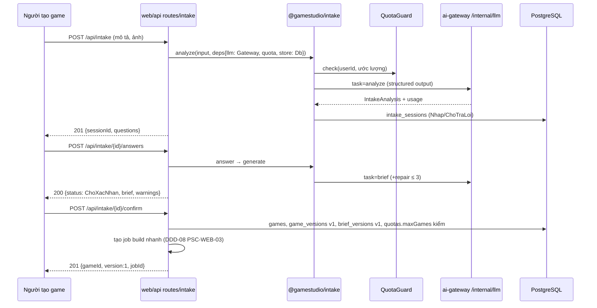
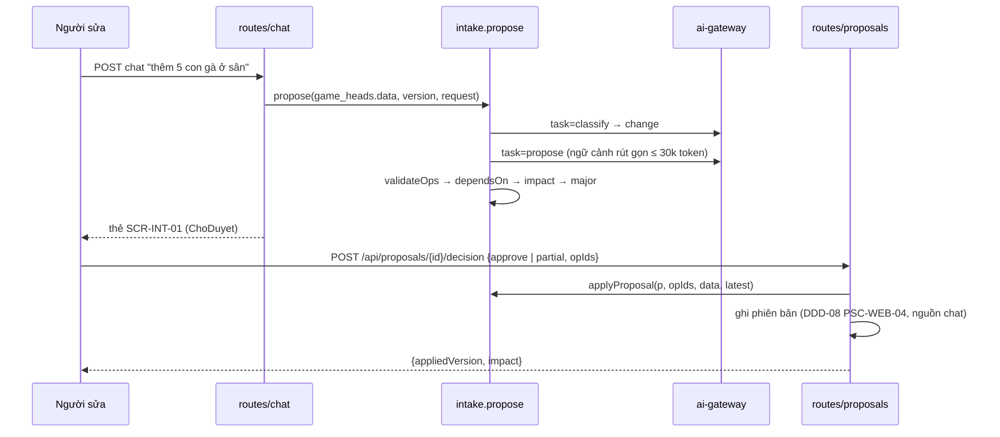
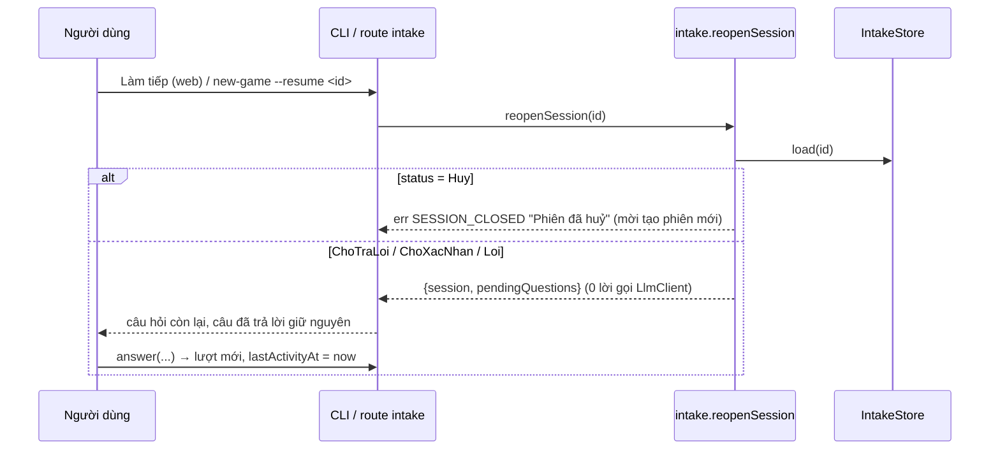
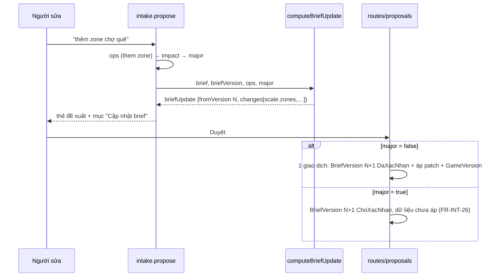

# DDD-01: Tạo game từ mô tả

| Mục | Nội dung |
|---|---|
| Mã tài liệu | DDD-01 |
| Phiên bản | 1.0 |
| Ngày | 23/11/2026 |
| Tài liệu cha | DDD-00 `DDD-00-TONG-QUAN.md` |
| TSD nguồn | TSD-01 v1.2 (IF-INT-01…06, SCH-INT-01…09, ALG-INT-01…13, TST-INT-01…15) |
| SRS nguồn | SRS-01 v1.1 (FR-INT-01…34, NFR-INT-01…04; CR-01 làm tiếp/cập nhật game) |
| Gói | `@gamestudio/intake` (`engine/intake`), lệnh `engine new-game` (`engine/cli`), skill `.claude/skills/engine-intake`; endpoint web ở DDD-08 (EP-WEB-04…12) |
| Pha | E1 (CLI), W1 (web), W3 (sửa bằng lời) |
| Trạng thái | Đã duyệt (Huy, 23/11/2026) |

---

## 1. Giới thiệu
Thiết kế chi tiết thư viện tiếp nhận: biến mô tả thành `IntakeAnalysis` → câu hỏi làm rõ → `brief.json` + dữ liệu khởi tạo hợp lệ schema; style bible; `ChangeProposal` và áp đề xuất. Một mã nguồn cho cả Claude Code (CLI, `HandoffLlmClient`) và Web Studio (`GatewayLlmClient`) (FR-INT-29). Thư viện **không** đọc biến môi trường, không gọi mạng trực tiếp, không ghi tệp ngoài `IntakeStore` được tiêm.

---

## 2. Bố trí mã nguồn

| Mã | Tệp | Trách nhiệm | Xuất |
|---|---|---|---|
| MOD-INT-01 | `engine/intake/src/index.ts` | API công khai | `analyze, answer, generate, generateStyle, propose, applyProposal, impact`, kiểu ở mục 4 |
| MOD-INT-02 | `src/analyze/analyze.ts`, `src/analyze/post-rules.ts`, `src/analyze/evidence.ts` | Gọi mô hình `task='analyze'`; luật hậu kiểm xung đột, từ khoá tính năng; luật bằng chứng (QT-INT-03) | `analyze()`, `applyPostRules()`, `enforceEvidence()` |
| MOD-INT-03 | `src/clarify/select.ts`, `src/clarify/defaults.ts`, `src/clarify/answer.ts` | Chọn ≤ 5 câu/vòng, ≤ 2 vòng; mặc định bằng luật; gộp câu trả lời vào phân tích | `selectQuestions()`, `defaultFor()`, `answer()` |
| MOD-INT-04 | `src/generate/generate.ts` | Điều phối sinh: brief (mô hình) → kiểm → dữ liệu tất định + văn bản mô hình → kiểm toàn bộ | `generate()` |
| MOD-INT-05 | `src/generate/deterministic.ts`, `src/generate/zones.ts`, `src/generate/skeleton-entities.ts` | Phần cấu trúc không qua mô hình: id, seed, zone, budgets, khung NPC/loài (FR-INT-28) | `buildDeterministic()` |
| MOD-INT-06 | `src/generate/brief-render.ts`, `templates/brief.md.hbs`, `templates/brief-phu-luc.md.hbs` | Render Markdown, tách phụ lục khi > 400 từ | `renderBrief()` |
| MOD-INT-07 | `src/generate/repair.ts` | Vòng tự sửa ≤ 3 lần | `repairLoop()` |
| MOD-INT-08 | `src/generate/scale.ts`, `rules/tri-estimates.json` | Ước lượng quy mô, cảnh báo 80% `trisStatic` | `estimateScale()` |
| MOD-INT-09 | `src/style/generate-style.ts` | Style bible + ảnh tham chiếu + `palette.json` | `generateStyle()` |
| MOD-INT-10 | `src/propose/classify.ts`, `context.ts`, `propose.ts`, `validate-ops.ts`, `depends.ts`, `major.ts` | Sinh `ChangeProposal` hoặc câu trả lời dữ liệu | `propose()` |
| MOD-INT-11 | `src/propose/apply.ts` | Áp đề xuất (một phần hoặc toàn bộ) có bao đóng phụ thuộc | `applyProposal()` |
| MOD-INT-12 | `src/impact/index.ts` | Bao gói `impact` của `@gamestudio/schema` (DDD-00 MOD-GEN-08) với `impactMap` của engine | `impact()` |
| MOD-INT-13 | `src/llm/types.ts`, `handoff.ts`, `gateway.ts`, `fake.ts`, `image.ts` | `LlmClient`, `ImageClient` và các cài đặt | `HandoffLlmClient, GatewayLlmClient, FakeLlmClient, HandoffImageClient, GatewayImageClient` |
| MOD-INT-14 | `src/store/types.ts`, `src/store/file-store.ts` | `IntakeStore` + cài đặt tệp cho CLI; cài đặt CSDL nằm ở `web/api/src/services/intake-store.ts` (DDD-08) | `FileIntakeStore` |
| MOD-INT-15 | `src/schemas/{analysis,brief,proposal,classify,answer}.schema.json` | Schema đầu ra mô hình (structured outputs) | — |
| MOD-INT-16 | `prompts/{analyze,clarify,brief,repair,propose,answer,style,dialogue_draft}.md`, `rules/{conflicts,keywords,defaults,field-order}.json` | Prompt có phiên bản (frontmatter `version`), luật dữ liệu | — |
| MOD-INT-17 | `engine/cli/src/commands/new-game.ts` | Lệnh `engine new-game` | `registerNewGame(program)` |
| MOD-INT-18 | `.claude/skills/engine-intake/SKILL.md` | Hướng dẫn phiên Claude Code trả lời yêu cầu handoff | — |
| MOD-INT-22 | `src/session/reopen.ts`, `src/session/expire.ts` | Mở lại phiên dở không gọi mô hình; hết hạn 30 ngày, nhắc ngày 27 (ALG-INT-10, CR-01) | `reopenSession()`, `expireSessions()` |
| MOD-INT-23 | `src/reverse/reverse-brief.ts`, `src/reverse/derive.ts`, `src/reverse/summary.ts`, `src/schemas/reverse_brief.schema.json`, `prompts/reverse_brief.md` | Suy brief nháp từ dữ liệu game có sẵn (IF-INT-06, ALG-INT-11) | `reverseBrief()`, `deriveFields()`, `summarizeData()` |
| MOD-INT-24 | `src/propose/brief-update.ts` | Sinh `briefUpdate` khi đề xuất mở rộng phạm vi; áp brief vN+1 cùng đề xuất (ALG-INT-12) | `computeBriefUpdate()`, `applyBriefUpdate()` |

Phụ thuộc: `@gamestudio/schema` (kiểm, `applyPatch`, `canonicalize`, `impact`), `@gamestudio/rng` (`deriveSeed`), `handlebars` (render), không phụ thuộc `node:*` ngoài `src/store/file-store.ts` và `src/llm/handoff.ts` (tách bằng `exports` điều kiện `"node"` để web/app không kéo vào).

---

## 3. Thiết kế lớp và giao diện

### 3.1 LLM và ảnh (IF-INT-01…04)

```ts
// src/llm/types.ts
export type LlmTask = 'analyze' | 'clarify' | 'brief' | 'repair' | 'propose' | 'answer' | 'style' | 'dialogue_draft' | 'classify';
export interface Msg { role: 'user' | 'assistant'; content: string | ContentPart[] }
export type ContentPart = { type: 'text'; text: string } | { type: 'image'; mime: string; bytes: Uint8Array };
export interface LlmRequest<T> {
  task: LlmTask; system: string; messages: Msg[];
  outputSchema: JSONSchema; maxOutputTokens: number;
  cacheBreakAfterSystem?: boolean;            // mặc định true: system là tiền tố cache
  tools?: ReadOnlyTool[];                      // chỉ dùng cho 'answer' (read_game_data)
  meta: { sessionId: string; gameId?: string; userId?: string; promptHash: string };
}
export interface LlmResult<T> {
  data: T; model: string; service: 'anthropic';
  usage: { inputTokens: number; outputTokens: number; cacheReadTokens: number; cacheWriteTokens: number; costUsd: number };
  latencyMs: number; stopReason: 'end_turn' | 'max_tokens' | 'refusal' | 'tool_use';
}
export interface LlmClient { complete<T>(req: LlmRequest<T>): Promise<Result<LlmResult<T>>> }
export interface ImageClient {
  generate(r: { prompt: string; aspect: '1:1' | '16:9' | '4:3'; n: number; styleRefs: Uint8Array[] }): Promise<Result<{ images: Uint8Array[]; provenance: AiProvenance }>>;
}
export interface QuotaGuard { check(userId: string, estimateUsd: number): Promise<Result<void>> }   // IF-INT-05
export interface Deps { llm: LlmClient; image?: ImageClient; quota?: QuotaGuard; store: IntakeStore; clock: Clock; logger: Logger; seedSource?: () => number }
```

| Mã | Lớp | Hành vi chính |
|---|---|---|
| MOD-INT-19 | `HandoffLlmClient implements LlmClient` | `constructor(dir: string /* games/<id>/.intake/<sessionId> */)`. `complete(req)`: n = số `req-*.json` hiện có + 1; nếu `res-<n>.json` tồn tại và hợp lệ `req.outputSchema` → trả `data`, usage = 0 (chi phí tính vào phiên Claude Code); nếu chưa → ghi `req-<n>.json` (DTO-INT-09) rồi trả `err('HANDOFF_PENDING', {n})`. Tầng lệnh bắt mã này → thoát 3 kèm hướng dẫn. Không bao giờ cần khoá API |
| MOD-INT-20 | `GatewayLlmClient implements LlmClient` | `constructor({url, token, fetch})`. Gửi EP-WEB-40 (`POST /internal/llm`), timeout 120 s qua `AbortSignal.timeout`, thử lại 1 lần sau 5 s khi mạng lỗi/5xx/timeout (ERR-INT-04); 429 hạn mức → `err('ERR-INT-03')`; `stopReason` ∈ {`refusal`, `max_tokens`} → lỗi trước khi đọc `data` |
| MOD-INT-21 | `FakeLlmClient` | Đọc đáp án ghi sẵn `fixtures/<case>/<task>-<n>.json`; ghi lại yêu cầu để test so khớp |

### 3.2 Hàm công khai (khớp API-INT-01…05)

```ts
analyze(input: IntakeInput, deps: Deps): Promise<Result<{ session: IntakeSessionState; questions: ClarifyQuestion[] }>>
answer(sessionId: string, answers: Answers, deps: Deps): Promise<Result<{ session: IntakeSessionState; questions: ClarifyQuestion[] }>>
generate(sessionId: string, deps: Deps): Promise<Result<GeneratedBundle>>            // trạng thái → ChoXacNhan
confirm(sessionId: string, deps: Deps): Promise<Result<{ briefVersion: number; hash: string }>>   // ChoXacNhan → DaXacNhan
generateStyle(brief: BriefJson, deps: Deps): Promise<Result<StyleBundle>>
propose(data: GameDataFiles, baseVersion: number, request: string, deps: Deps): Promise<Result<ProposalOrAnswer>>
applyProposal(p: ChangeProposal, opIds: string[] | 'all', data: GameDataFiles, latestVersion: number): Result<ApplyOutcome>
impact(changed: JsonPointer[], ctx: ImpactContext): ImpactResult
// CR-01 (v0.2)
reopenSession(sessionId: string, deps: Deps): Promise<Result<{ session: IntakeSessionState; pendingQuestions: ClarifyQuestion[] }>>   // không gọi LlmClient
expireSessions(now: Date, deps: Deps): Promise<{ expired: string[]; reminded: string[] }>
reverseBrief(gameData: GameDataFiles, ctx: Deps & { gameId: GameId; ownerId?: string }): Promise<Result<ReverseBriefResult>>   // IF-INT-06, API-INT-06
computeBriefUpdate(brief: BriefJson, briefVersion: number, ops: ProposalOp[], major: boolean): BriefUpdate | undefined
applyBriefUpdate(brief: BriefJson, u: BriefUpdate): BriefJson   // thuần, dùng trong giao dịch áp đề xuất
```
`summarizeVi` (FR-INT-34, ALG-INT-13) **không** nằm ở gói này mà ở `@gamestudio/status` (DDD-00 MOD-GEN-20); intake chỉ gọi lại khi cần đưa câu tóm tắt vào lượt chat đầu.

### 3.3 Kho phiên (`IntakeStore`)

```ts
export interface IntakeStore {
  load(sessionId: string): Promise<IntakeSessionState | null>;
  save(s: IntakeSessionState): Promise<void>;                     // ghi nguyên tử (tệp tạm + rename) hoặc UPDATE có version
  appendCall(sessionId: string, rec: IntakeCallRecord): Promise<void>;   // SCH-INT-07
  putBlob(sessionId: string, name: string, bytes: Uint8Array): Promise<string>;  // ảnh mô tả, ảnh style
}
```
`FileIntakeStore` (CLI) dùng `games/<id>/.intake/<sessionId>/{session.json, intake-calls.jsonl, images/*}`; trước khi có `gameId` dùng `games/_pending/<sessionId>/` rồi chuyển thư mục khi xác nhận.

Từ v0.2 (CR-01, SCH-INT-08) bản ghi phiên được tóm thành tệp chỉ mục `games/<id>/.intake/<sessionId>.json` (hoặc `games/.intake/pending/<sessionId>.json` khi chưa có game) chứa DTO-INT-14; `FileIntakeStore.save` ghi tệp tạm rồi `rename` sau **mỗi lượt**. Thêm hai hàm vào `IntakeStore`:

```ts
  listOpen(filter: { ownerId?: string; gameId?: GameId }): Promise<IntakeSessionState[]>;   // status ∈ {ChoTraLoi, ChoXacNhan, Loi}
  listIdleSince(cutoff: Date): Promise<IntakeSessionState[]>;                             // cho expireSessions
```

---

## 4. Dữ liệu

| Mã | Kiểu | Định nghĩa (TS) |
|---|---|---|
| DTO-INT-01 | `IntakeInput` (SCH-INT-01) | `{description: string /*10..20000 ký tự sau trim*/, images: {name: string, mime: 'image/jpeg'\|'image/png'\|'image/webp', bytes: Uint8Array /*≤10 MB*/}[] /*≤5*/, answers?: Answers, seed?: number /*uint32*/, language?: 'vi'\|'en'}` |
| DTO-INT-02 | `FieldKey` | `'title'\|'genre'\|'camera'\|'setting.place'\|'setting.era'\|'setting.season'\|'setting.timeOfDay'\|'setting.realPlace'\|'artStyle'\|'coreLoop'\|'player'\|'npcs'\|'animals'\|'features.combat'\|'features.hunting'\|'features.dialogueMode'\|'scale'\|'highRiskAssets'`; bắt buộc: mọi khoá trừ `npcs`, `animals`, `highRiskAssets` (SRS-01 mục 6.1) |
| DTO-INT-03 | `IntakeAnalysis` (SCH-INT-02) | `{fields: Partial<Record<FieldKey, FieldState>>, round: 0\|1\|2, realPlace?: {name, center:{lat,lon}, sizeKm:[number,number]}}`; `FieldState = {value: unknown, status: 'tu_mo_ta'\|'gia_dinh'\|'thieu'\|'mau_thuan', evidence: string[] /*trích nguyên văn từ mô tả*/, conflictsWith?: FieldKey, reason?: string}` |
| DTO-INT-04 | `ClarifyQuestion` (SCH-INT-03) | `{id: string /*q-<field>-<round>*/, field: FieldKey, text: string, choices: {id, label, value}[] /*2..4*/, defaultChoiceId?: string, mandatory: boolean}`; `Answers = Record<string, string /*choiceId*/ \| {text: string}>` |
| DTO-INT-05 | `IntakeSessionState` | `{id: Ulid, ownerId?: string, gameId?: GameId, status: IntakeStatus /*STM-INT-01*/, input: {description, imageRefs: string[], seed?}, analysis: IntakeAnalysis, questions: ClarifyQuestion[], answers: Answers, assumptions: Assumption[], bundle?: GeneratedBundle, version: number /*khoá lạc quan*/, createdAt, updatedAt}` |
| DTO-INT-06 | `BriefJson` (SCH-INT-04) | Khoá SRS-01 mục 6.1: `{title, sourceRef: 'intake:<sessionId>', genre, camera, setting:{place, era, season, timeOfDay[], realPlace}, artStyle:{summary, refs[]}, coreLoop[3..5], player, npcs[{name, role, count}], animals[{species, count, temperament?}], features, scale:{zones, areaKm2}, highRiskAssets[{asset, level:'Cao'\|'Vua', approach:'cc0_truoc'\|'generator'\|'duyet_2_vong'}], assumptions[{field, value, reason}], suggestions[string]}` |
| DTO-INT-07 | `GeneratedBundle` | `{files: Record<string /*đường dẫn tương đối games/<id>/*/, string \| object>, schemaReport: {ok: boolean, errors: {file, instancePath, message}[]}, warnings: string[] /*vd quy mô > 80%*/, estimate: ScaleEstimate, briefWordCount: number}` |
| DTO-INT-08 | `ChangeProposal` (SCH-INT-06) | `{id: Ulid, gameId, baseVersion, request, summary /*≤200*/, ops: ProposalOp[], impact: ImpactResult, major: boolean, status: 'ChoDuyet'\|'DaDuyet'\|'DuyetMotPhan'\|'DaBo'\|'HetHan', rejectedOps: {opId, reason}[], decidedBy?, decidedAt?, appliedOps?: string[], appliedVersion?: number}`; `ProposalOp = {opId: 'op1'.., kind: 'them'\|'sua'\|'xoa', target: {file: string, objectId?: string}, label: string, patch: JsonPatchOp[] /*tương đối gốc data/*/, dependsOn: string[]}` |
| DTO-INT-09 | Tệp handoff | `req-<n>.json = {schema:'intake-handoff/1', n, task, system, messages /*ảnh thay bằng đường dẫn images/…*/, outputSchema, maxOutputTokens, promptVersion}`; `res-<n>.json = {schema:'intake-handoff/1', n, data, answeredBy: 'claude-code', at}` |
| DTO-INT-10 | `IntakeCallRecord` (SCH-INT-07) | `{at, service, model, task, promptHash: 'sha256:…', promptExcerpt /*≤500 ký tự, đã che email/SĐT*/, intakeVersion, inputTokens, outputTokens, cacheReadTokens, cacheWriteTokens, costUsd, latencyMs, stopReason}` |
| DTO-INT-11 | `ProposalOrAnswer` | `{kind: 'proposal', proposal: ChangeProposal} \| {kind: 'answer', text: string, refs: JsonPointer[]} \| {kind: 'other', text: string}` |
| DTO-INT-12 | `StyleBundle` | `{styleBibleMd: string, refs: {name, bytes, provenance}[] /*3..6 ảnh*/, palette: PaletteJson /*SCH-GEN-03*/}` |
| DTO-INT-13 | `game.json` phần intake (SCH-INT-05) | Khoá SRS-01 mục 6.2; `features: {combat:{enabled, style, targets[], formula}, hunting:{enabled, species[]}, violence:{level}, dialogueMode}` (DDD-06, DDD-07) |
| DTO-INT-14 | `IntakeSession` v1.1 (SCH-INT-08) | DTO-INT-05 thêm: `{kind: 'moi'\|'suy_nguoc', turns: {at, kind: 'mo_ta'\|'anh'\|'cau_hoi'\|'tra_loi', payload: unknown}[], pendingQuestions: ClarifyQuestion[], seed: number, lastActivityAt: string, remindedAt?: string}`; `lastActivityAt` chỉ đổi khi có lượt mới (mở lại để xem không tính) |
| DTO-INT-15 | `BriefUpdate` (SCH-INT-09) | `{fromVersion: number, changes: {field: FieldKey \| string /*vd 'scale.zones'*/, old: unknown, new: unknown}[] /*≥1*/, major: boolean}`; gắn vào `ChangeProposal.briefUpdate?` (DTO-INT-08) |
| DTO-INT-16 | `ReverseBriefResult` (IF-INT-06) | `{brief: BriefJson /*sourceRef 'reverse:<gameId>'*/, briefStatus: 'ChoXacNhan', fieldSources: Record<FieldKey, 'suy_tu_du_lieu'\|'thieu'>, sourcePaths: Partial<Record<FieldKey, JsonPointer[]>>, questions: ClarifyQuestion[], sessionId: Ulid /*kind suy_nguoc*/}` |

Bảng CSDL trên web (DDD-08): `intake_sessions` (TBL-WEB-09), `brief_versions` (TBL-WEB-10), `change_proposals` (TBL-WEB-11), `llm_calls` (TBL-WEB-22). Trên CLI: `games/<id>/.intake/**` và `games/<id>/brief/v<n>/{brief.json, game-brief.md, game-brief-phu-luc.md?, hash.txt}`.

---

## 5. API / giao thức

| Mã | Giao thức | Đặc tả |
|---|---|---|
| EP-INT-01 | `engine new-game` | Tham số: `--from <file.md\|txt>` (mô tả), `--image <f>` (lặp ≤ 5), `--seed <uint32>`, `--resume <sessionId>`, `--answers <file.json>` (Answers), `--use-defaults` (chấp nhận mặc định vòng hiện tại), `--confirm`, `--llm handoff\|gateway` (mặc định `handoff`; `gateway` cần `GS_GATEWAY_URL` + `GS_GATEWAY_TOKEN`, OIT-INT-02), `--json`. Đầu ra `--json`: `{ok, sessionId, status, questions?, handoff?: {reqFile}, files?: string[], warnings[]}`. Mã thoát: 0 xong bước; 3 chờ câu trả lời / chờ handoff / chờ xác nhận; 4 ERR-INT-01, 02, 05; 6 ERR-INT-04 |
| EP-INT-02 | Handoff Claude Code | Skill `engine-intake`: (1) đọc `req-<n>.json`; (2) viết `res-<n>.json` có `data` đúng `outputSchema` (skill chạy `engine validate --schema <tmp> res-<n>.json` trước khi ghi); (3) chạy `engine new-game --resume <sessionId>`. Mỗi lần dừng chỉ có **một** yêu cầu đang chờ |
| EP-INT-03 | Web | Các route `POST /api/intake`, `…/answers`, `…/confirm`, `PUT …/brief`, `POST …/brief/confirm`, `POST …/style/approve`, `POST …/chat`, `POST /api/proposals/{id}/decision` ở DDD-08 EP-WEB-04…12; route gọi đúng các hàm mục 3.2 |
| EP-INT-04 | Điểm gọi CR-01 | `reopenSession`: CLI `engine new-game --resume <sessionId>` (không còn lượt mới thì in lại câu hỏi đang chờ, thoát 3), web `GET /api/intake/{id}` (DDD-08 EP-WEB-56). `reverseBrief`: CLI `engine import` khi gói không có brief và `engine brief confirm --game <id>` (DDD-04 EP-CLI-03); web job `import` (DDD-08 PSC-WEB-22). `expireSessions`: web cron 02:15 (DDD-08 CFG-WEB-08), CLI trong `engine status` (DDD-04 PSC-CLI-04) |

---

## 6. Luồng xử lý

### SEQ-INT-01 Tạo game trên CLI với handoff
```mermaid
sequenceDiagram
    participant H as Huy
    participant CC as Claude Code
    participant CLI as engine new-game
    participant I as @gamestudio/intake
    participant FS as games/<id>/.intake
    H->>CC: /new-game "mô tả…"
    CC->>CLI: engine new-game --from mo-ta.md --json
    CLI->>I: analyze(input, deps{llm: Handoff})
    I->>FS: req-1.json (task=analyze)
    CLI-->>CC: exit 3 {handoff: req-1.json}
    CC->>FS: đọc req-1, viết res-1 (skill engine-intake)
    CC->>CLI: engine new-game --resume s1
    CLI->>I: analyze (đọc res-1) → applyPostRules → selectQuestions
    CLI-->>CC: exit 3 {questions[≤5]}
    CC->>H: hỏi lại (AskUserQuestion)
    H-->>CC: trả lời
    CC->>CLI: --resume s1 --answers a.json
    CLI->>I: answer → generate (req-2 brief, req-3 repair nếu cần)
    CLI-->>CC: exit 3 {status: ChoXacNhan, files}
    H->>CC: xác nhận
    CC->>CLI: --resume s1 --confirm
    CLI->>FS: brief/v1 + data/** ; exit 0
```

### SEQ-INT-02 Tạo game trên web


### SEQ-INT-03 Sửa game bằng lời


### SEQ-INT-04 Mở lại phiên tạo game bỏ dở (FR-INT-31)


### SEQ-INT-05 Mở rộng game kèm cập nhật brief (FR-INT-33)


---

## 7. Máy trạng thái

### STM-INT-01 Phiên tiếp nhận
| Từ | Sự kiện | Điều kiện | Tới | Hành động |
|---|---|---|---|---|
| — | `analyze` | đầu vào hợp lệ | `ChoTraLoi` | lưu phân tích, câu hỏi vòng 1 |
| — | `analyze` | không còn `thieu`/`mau_thuan` | `DangSinh` | gọi `generate` ngay |
| `ChoTraLoi` | `answer` | còn `mau_thuan` hoặc thiếu bắt buộc và `round < 2` | `ChoTraLoi` | vòng mới |
| `ChoTraLoi` | `answer` / `--use-defaults` | `round = 2` hoặc hết thiếu; không còn `mau_thuan` | `DangSinh` | điền mặc định `gia_dinh` (trừ `mau_thuan`) |
| `DangSinh` | `generate` thành công | schema đạt | `ChoXacNhan` | brief vN nháp (STM-INT-02) |
| `DangSinh` | lỗi mô hình / ERR-INT-05 | — | `Loi` | giữ dữ liệu phân tích; cho `--resume` thử lại |
| `ChoXacNhan` | `confirm` | không còn câu hỏi `mandatory` mở | `DaXacNhan` | tạo game, brief v1 (`DaXacNhan`) |
| `ChoXacNhan` | `confirm` | còn `mandatory` | `ChoXacNhan` | ERR-INT-08 |
| bất kỳ trừ `DaXacNhan` | `cancel` | — | `Huy` | — |

### STM-INT-02 Brief (theo SRS-01 mục 6.3)
`Nhap → ChoXacNhan` (đủ trường, QT-INT-01); `ChoXacNhan → Nhap` (sửa còn thiếu); `ChoXacNhan → DaXacNhan` (xác nhận, tạo vN, `hash` = PSC-INT-09); `ChoXacNhan → Huy` (chỉ khi chưa có vN nào); `DaXacNhan → ChoXacNhan` (sửa brief: tạo nháp vN+1, vN giữ hiệu lực cho xem trước). Bất biến kiểm ở tầng dữ liệu: mỗi game tối đa **một** brief `ChoXacNhan`; `game.json.briefVersion` luôn trỏ bản `DaXacNhan` mới nhất. Lệnh build/job kiểm `briefState`: tồn tại nháp `ChoXacNhan` → ERR-INT-06 (FR-INT-17).

### STM-INT-03 Đề xuất thay đổi
| Từ | Sự kiện | Điều kiện | Tới |
|---|---|---|---|
| — | tạo | ≥ 1 op hợp lệ | `ChoDuyet` |
| `ChoDuyet` | duyệt toàn bộ | `baseVersion = latest` | `DaDuyet` |
| `ChoDuyet` | duyệt một phần | `baseVersion = latest`, bao đóng `dependsOn` ⊂ op chọn ∪ phụ thuộc | `DuyetMotPhan` |
| `ChoDuyet` | bỏ | — | `DaBo` |
| `ChoDuyet` | duyệt bất kỳ | `baseVersion ≠ latest` | `HetHan` (ERR-INT-07) |
| `ChoDuyet` | có phiên bản mới của game (sự kiện `data.version`) | — | giữ `ChoDuyet`, gắn cờ `stale=true` để SPA hiện "Tạo lại?" |

### STM-INT-04 Vòng đời phiên dở và hết hạn (CR-01, QT-INT-10)
| Từ | Sự kiện | Điều kiện | Tới | Hành động |
|---|---|---|---|---|
| `ChoTraLoi`/`ChoXacNhan`/`Loi` | lượt mới (mô tả, ảnh, trả lời) | — | theo STM-INT-01 | `lastActivityAt = now`, xoá `remindedAt` |
| `ChoTraLoi`/`ChoXacNhan`/`Loi` | mở lại (`reopenSession`) | — | giữ nguyên | không gọi mô hình, không đổi `lastActivityAt` |
| `ChoTraLoi`/`ChoXacNhan`/`Loi` | việc hằng ngày | `now − lastActivityAt ≥ 27 ngày` và chưa `remindedAt` | giữ nguyên | thông báo trong web một lần, `remindedAt = now` |
| `ChoTraLoi`/`ChoXacNhan`/`Loi` | việc hằng ngày | `now − lastActivityAt > 30 ngày` | `Huy` | ghi log; brief nháp `ChoXacNhan` của phiên `suy_nguoc` **không** xoá (game vẫn bị chặn build tới khi xác nhận) |

---

## 8. Thuật toán chi tiết

### PSC-INT-01 Pipeline tiếp nhận (ALG-INT-01)
```
analyze(input, deps):
  e = validateInput(input)                       # trim; 10..20000 ký tự → ERR-INT-01; ảnh sai → bỏ ảnh + cảnh báo ERR-INT-02
  if e.fatal: return err(e)
  await deps.quota?.check(userId, EST_USD.analyze)      # 0,08 USD (DDD đề xuất) → ERR-INT-03
  s = newSession(input)
  r = await deps.llm.complete({task:'analyze', system: P.analyze, messages:[desc, ảnh], outputSchema: S.analysis, maxOutputTokens: 4000})
  a = r.data
  a = applyPostRules(a, input.description)        # PSC-INT-10
  a = enforceEvidence(a, input.description)        # PSC-INT-11
  s.analysis = a; s.questions = selectQuestions(a, round=1)
  s.status = s.questions.length ? 'ChoTraLoi' : 'DangSinh'
  store.save(s); store.appendCall(callRecord(r))
  if s.status == 'DangSinh': return generate(s.id, deps)
```

### PSC-INT-02 Chọn câu hỏi (ALG-INT-02)
```
FIELD_ORDER = ['genre','camera','setting.place','setting.era','setting.season','setting.timeOfDay','artStyle','coreLoop','player','features.combat','features.hunting','features.dialogueMode','scale','title']
selectQuestions(a, round):
  conflicts = [k for k in FIELD_ORDER if a.fields[k]?.status == 'mau_thuan']
  missing   = [k for k in FIELD_ORDER if REQUIRED(k) and (a.fields[k] missing or status == 'thieu')]
  cand = conflicts + missing  (giữ thứ tự, không trùng)
  if round > 2: return []
  picked = cand[0:5]
  qs = llm.complete(task='clarify', fields=picked) → chỉ văn bản câu hỏi + 2..4 lựa chọn mỗi trường
  for q in qs: q.mandatory = (a.fields[q.field].status == 'mau_thuan')
               q.defaultChoiceId = q.mandatory ? undefined : choiceMatching(defaultFor(q.field), q.choices)
  return qs
defaultFor(field): đọc rules/defaults.json: camera → 'third_person' (QT-INT-06), features.* → false/'static', setting.season → 'he', setting.timeOfDay → ['sang'], scale → {zones: 1, areaKm2: 0.25}
answer(sid, answers):
  s = load(sid); áp answers vào a.fields[field] (status 'tu_mo_ta' nếu chọn, giữ evidence = ['traloi:' + qid])
  s.analysis.round += 1
  qs = selectQuestions(s.analysis, s.analysis.round + 1)
  if qs.length == 0 or s.analysis.round >= 2:
     for k thiếu bắt buộc (không mau_thuan): a.fields[k] = {value: defaultFor(k), status:'gia_dinh', evidence: []}; assumptions.push({field:k, value, reason:'mặc định vòng 2'})
     nếu còn mau_thuan → giữ ChoTraLoi với câu mandatory (không mặc định)
     ngược lại → DangSinh → generate
```

### PSC-INT-03 Sinh tất định (ALG-INT-03)
```
buildDeterministic(brief, s):
  id = uniqueSlug(slugify(brief.title))           # bỏ dấu, a-z0-9-; trùng → '-2', '-3'… (tra store.listGameIds())
  seed = s.input.seed ?? deriveSeed(sha256Hex(s.input.description), sha256Hex(canonicalize(s.answers)))
  game = {id, schemaVersion: CURRENT.game, engineVersion: ENGINE_VERSION, seed, language, camera:{mode: brief.camera},
          orientation:'landscape', features: brief.features, briefVersion: 1, styleBibleVersion: null, state:{flags:[], counters:[], quests:[]}}
  world.seed = deriveSeed(seed, 'world')
  world.playArea = rect(sqrt(areaKm2)*1000 m) tâm (0,0) hoặc bbox realPlace
  world.zones = grid500(playArea) → [{id:'z1'..'zN', polygon, seed: deriveSeed(world.seed, 'zone', zid)}] sắp theo hàng rồi cột
  budgets = copy(games/_template/data/budgets.json); palette = placeholder (thay ở generateStyle)
  entities: mỗi brief.npcs[i] → entities/npc/<slug>.json khung {id, name, role, appearance:{model: null}, behavior:'graph:dan-lang'}
            mỗi brief.animals[i] → entities/animals/<slug>.json {id, species, family: FAMILY_BY_SPECIES[species] ?? 'dong_vat_4_chan_nho'}
  return files (giá trị số và id không phụ thuộc mô hình)
```
Phần do mô hình viết: văn bản brief, tên hiển thị, mô tả. Hai lần `generate` cùng mô tả + đáp án + seed cho cùng byte phần cấu trúc (TST-INT-09).

### PSC-INT-04 Vòng tự sửa (ALG-INT-04)
```
repairLoop(files):
  for attempt in 1..3:
     errs = validateFiles(files)
     if errs empty: return ok(files)
     for file in filesWithErrors(errs):
        sub = schemaForFile(file); list = errs[file].map(e => e.instancePath + ': ' + e.message)
        r = llm.complete(task='repair', messages=[json(file), list], outputSchema=sub, maxOutputTokens=8000)
        files[file] = r.data
  log.error({schemaReport: errs}); return err('ERR-INT-05')
```
Chỉ phần do mô hình sinh được gửi sửa; phần tất định sai schema là lỗi lập trình (ném lỗi, test bắt).

### PSC-INT-05 Độ dài brief (ALG-INT-05)
`words = mainText.split(/\s+/u).filter(Boolean).length` (phần chính = mọi mục trừ `assumptions`, `suggestions`); `> 400` → chuyển `suggestions` và chi tiết `assumptions` (giữ bảng tóm tắt 1 dòng/mục) sang `game-brief-phu-luc.md`, thêm liên kết cuối brief (QT-INT-02).

### PSC-INT-06 Ước lượng quy mô (ALG-INT-06)
```
estimateScale(brief):
  zones = ceil(areaKm2 / 0.25)
  tris = Σ_{kind in brief.objects} count(kind) × TRI[kind] + densityDefault.vegetation × areaKm2 × TRI.tree_lod1
  pct = tris / zones / budgets.vua.trisStatic
  warn nếu pct > 0.8 → 'Quy mô ước lượng dùng <pct>% ngân sách tam giác tier Vừa' (FR-INT-14)
```

### PSC-INT-07 Sinh đề xuất (ALG-INT-07)
```
propose(data, base, request):
  c = llm.complete(task='classify', request) → {kind: question|change|other}
  if question: return answerFromData(data, request)          # DDD-08 PSC-WEB-08: bảng dữ kiện + read_game_data ≤ 3 lần
  ctx = selectContext(data, request)    # chỉ mục tên: id/name/species của mọi đối tượng; khớp từ khoá (bỏ dấu, so tiền tố) + file luôn có (game.json, world.json phần zones/playArea)
                                        # cắt tới ≤ 30k token (ước lượng 1 token ≈ 3 ký tự tiếng Việt)
  r = llm.complete(task='propose', ctx, request, outputSchema=S.proposal, maxOutputTokens=6000)
  ops = []; rejected = []
  for op in r.data.ops:
     if not every(op.patch.path startsWith allowedPrefix) → reject('path')   # chỉ /game.json, /world.json, /entities~1…, /dialogue~1…, /behaviors~1… ; cấm /scripts (FR-WEB-47)
     tmp = applyPatch(clone(data), op.patch); if err → reject('patch')
     if validateFiles(tmp.touchedFiles) has errors → reject('schema')
     if refsMissing(tmp, op) → reject('ref')                               # id NPC/asset/graph tham chiếu phải tồn tại sau op hoặc sau op khác
     ops.push(op)
  computeDependsOn(ops)     # op B tham chiếu id do op A thêm → B.dependsOn += A.opId
  imp = impact(pointersOf(ops))
  major = ops.some(o => o.patch.some(p => p.path matches '/game.json/features/**' or '/game.json/camera/**')) or briefKeysTouched(['genre','artStyle','era'])
  return {kind:'proposal', proposal:{…, ops, rejectedOps: rejected, impact: imp, major, status:'ChoDuyet'}}
```

### PSC-INT-08 Áp đề xuất (ALG-INT-08)
```
applyProposal(p, opIds, data, latest):
  if p.status != 'ChoDuyet': err('ERR-WEB-07')    # đã xử lý
  if p.baseVersion != latest: p.status = 'HetHan'; return err('ERR-INT-07')
  chosen = opIds == 'all' ? p.ops : closure(opIds, dependsOn)        # thêm op phụ thuộc còn thiếu, báo lại UI
  doc = data
  for op in topo(chosen): doc = applyPatch(doc, op.patch).doc
  errs = validateFiles(all touched); if errs: return err('ERR-INT-05', errs)
  status = chosen.length == p.ops.length ? 'DaDuyet' : 'DuyetMotPhan'
  return ok({doc, patch: concat(chosen.patch), appliedOps: ids(chosen), status, briefDraft: p.major})
```
Tầng web ghi phiên bản trong giao dịch (DDD-08 PSC-WEB-04, nguồn `chat`) và, khi `major`, tạo brief vN+1 `ChoXacNhan` (STM-INT-02).

### PSC-INT-09 Băm brief (ALG-INT-09)
`hash = 'sha256:' + sha256Hex(canonicalize({brief: briefJson, initData: files['data/**'] đã sắp}))`; ghi `brief/v<n>/hash.txt` và `brief_versions.hash`.

### PSC-INT-10 Luật hậu kiểm
```
applyPostRules(a, desc):
  for (k1, k2, pairs) in rules/conflicts.json:   # vd ['artStyle', 'artStyle', [['hien_thuc','hoat_hinh']]], ['camera','camera',[['first_person','third_person']]]
     if valuesOf(a, k1, desc) giao pairs ở cả hai vế → a.fields[k1].status = 'mau_thuan', conflictsWith = k2
  kw = rules/keywords.json        # {"hunting": ["săn","bẫy","bắn thú"], "combat": ["đánh","chiến đấu","giết","quái"]} so khớp sau bỏ dấu, ranh giới từ
  if kw.hunting khớp: a.fields['features.hunting'] = {value:true, status:'tu_mo_ta', evidence:[câu chứa]}; thêm câu hỏi mandatory=false về 'features.combat' (QT-INT-07)
  if kw.combat khớp và không phủ định ("không đánh nhau"): đặt combat=true status 'tu_mo_ta'
  else nếu không khớp: combat=false, hunting=false status 'gia_dinh' (QT-INT-04)
  if 'tượng'|'chùa'|'đình' + 'chi tiết' → highRiskAssets thêm {level:'Cao', approach:'cc0_truoc'} (FR-INT-11)
```

### PSC-INT-11 Luật bằng chứng (QT-INT-03)
Với mỗi trường `status='tu_mo_ta'`: mọi chuỗi `evidence` phải là chuỗi con (sau chuẩn hoá NFC, gộp khoảng trắng) của mô tả hoặc của câu trả lời; không có bằng chứng hợp lệ và không nằm trong `assumptions` → chuyển giá trị sang `suggestions[]`, trường thành `thieu` (để hỏi) hoặc `gia_dinh` (nếu đã vòng 2).

### PSC-INT-12 Lưu và mở lại phiên (ALG-INT-10)
```text
saveTurn(s, turn):
  s.turns.push(turn); s.lastActivityAt = now; s.remindedAt = undefined
  s.version += 1
  store.save(s)                      # CLI: tmp + rename; web: UPDATE … WHERE version = s.version-1
reopenSession(id):
  s = store.load(id) ?? return err(NOT_FOUND)
  if s.status in {Huy, DaXacNhan}: return err(SESSION_CLOSED)
  return ok({session: s, pendingQuestions: s.pendingQuestions})   # assert llm.calls == 0
expireSessions(now):
  for s in store.listIdleSince(now - 27d):
    idle = now - s.lastActivityAt
    if idle > 30d: s.status = Huy; store.save(s); expired += s.id
    elif !s.remindedAt: notify(s.ownerId, 'phien_sap_huy', s.id); s.remindedAt = now; store.save(s); reminded += s.id
```

### PSC-INT-13 Suy brief từ dữ liệu (ALG-INT-11)
```text
reverseBrief(data, ctx):
  for f in ['game.json','world.json']: if !data.has(f): return err(ERR-INT-09, {file: f})   # trước mọi lời gọi
  brief, src = deriveFields(data)        # tất định: title, genre, camera, setting.place/realPlace (nguồn địa hình, bbox),
                                         # scale.zones/areaKm2, animals (entities/animals), npcs, features.*, tier
  for k in derived: fieldSources[k] = 'suy_tu_du_lieu'; sourcePaths[k] = src[k]
  summary = summarizeData(data, maxBytes = 6*1024)   # game.json rút gọn, tên zone, đếm entity, 20 dòng thoại đầu
  prose = llm.complete({task: 'reverse_brief', schema: reverse_brief.schema.json, input: summary})
  for (k, {value, sources}) in prose:    # artStyle, coreLoop, player, tone
    if sources.length == 0 or any(p not in summary.paths): fieldSources[k] = 'thieu'
    else brief[k] = value; fieldSources[k] = 'suy_tu_du_lieu'; sourcePaths[k] = sources
  questions = selectQuestions(fields where fieldSources = 'thieu' and required)   # PSC-INT-02
  s = new IntakeSession{kind: 'suy_nguoc', gameId: ctx.gameId, status: questions? 'ChoTraLoi' : 'ChoXacNhan'}
  saveBriefVersion(brief, status = 'ChoXacNhan')                                 # QT-INT-09: không bao giờ tự xác nhận
  return ok({brief, briefStatus: 'ChoXacNhan', fieldSources, sourcePaths, questions, sessionId: s.id})
```
`confirm` của phiên `suy_nguoc` từ chối (ERR-INT-08) khi còn trường bắt buộc `thieu` chưa được điền hoặc chấp nhận mặc định.

### PSC-INT-14 Cập nhật brief theo yêu cầu mở rộng (ALG-INT-12)
```text
computeBriefUpdate(brief, N, ops, major):
  changes = []
  if ops add/remove /world.json/zones/*:     changes += {field:'scale.zones', old, new}
  if ops add entities/animals/<species>:     changes += {field:'animals', old, new (+species,count)}
  if ops add entities/npcs/*:                changes += {field:'npcs', …}
  if ops add quests/*:                       changes += {field:'coreLoop' | 'suggestions', …}
  if ops set /game.json/features/*/enabled:  changes += {field:'features.<x>', …}
  return changes.empty ? undefined : {fromVersion: N, changes, major}
applyProposalWithBrief(p, opIds):          # trong MỘT giao dịch (DDD-08 PSC-WEB-04 / CLI ghi tạm + rename)
  if p.briefUpdate and p.briefUpdate.fromVersion != latestBriefVersion: return err(ERR-INT-07)
  if !p.briefUpdate.major:
     createBriefVersion(N+1, applyBriefUpdate(brief, u), status = DaXacNhan, confirmedBy = decidedBy)
     applyProposal(p, opIds, …)            # PSC-INT-08
  else:
     createBriefVersion(N+1, …, status = ChoXacNhan); proposal giữ dữ liệu chưa áp (FR-INT-26)
```

### PSC-INT-15 Tóm tắt tiến độ (ALG-INT-13)
Cài đặt ở DDD-00 PSC-GEN-05 (`summarizeVi`). Intake chỉ dùng khi mở lại game có chat: lượt đầu của phiên chat là câu `summarizeVi(report)` (≤ 6 dòng, mẫu cố định), `kind='he_thong'`, không ghi `IntakeCallRecord` vì không gọi mô hình.

---

## 9. Xử lý lỗi

| Mã | Phát hiện tại | CLI | Web | Phục hồi |
|---|---|---|---|---|
| ERR-INT-01 | `validateInput` | thoát 4 | 422 | Không gọi mô hình |
| ERR-INT-02 | `validateInput` (từng ảnh) | cảnh báo, tiếp tục | 200 + `warnings[]` (lỗi chỉ khi mọi ảnh hỏng **và** mô tả rỗng) | Bỏ ảnh lỗi |
| ERR-INT-03 | `QuotaGuard.check` | thoát 3 | 429 | Ghi `audit_log action=quota_block` |
| ERR-INT-04 | `GatewayLlmClient` | thoát 6 | 502 | Thử lại 1 lần sau 5 s, giữ phiên `Loi`→`--resume` |
| ERR-INT-05 | `repairLoop`, `applyProposal` | thoát 4 | 422 | Lưu `schemaReport` vào log |
| ERR-INT-06 | `engine build`, EP-WEB-16 | thoát 3 | 409 | Hướng dẫn xác nhận brief |
| ERR-INT-07 | `applyProposal` | thoát 3 | 409 | Đề xuất `HetHan`, SPA đề nghị tạo lại |
| ERR-INT-08 | `confirm` | thoát 3 | 422 | Giữ `ChoXacNhan` |
| ERR-INT-09 | `reverseBrief` | thoát 4 | 422 | Không gọi mô hình; thông báo "Không đủ dữ liệu để tạo brief: thiếu <file>.", mời tạo game mới (CR-01) |

---

## 10. Cấu hình

| Mã | Khoá | Mặc định | Nơi đặt |
|---|---|---|---|
| CFG-INT-01 | Mô hình theo `task` | `analyze`, `brief`, `repair`, `propose`, `style`, `classify`, `answer`, `dialogue_draft` → `claude-opus-5-5`; effort `analyze`/`propose`/`classify`/`answer` = `medium`, `brief` = `high`, `repair` = `low` (TSD đề xuất) | Bảng `ai_config` (DDD-08 TBL-WEB-24); CLI handoff không dùng |
| CFG-INT-02 | `maxOutputTokens` | analyze 4.000; clarify 1.500; brief 8.000; repair 8.000; propose 6.000; answer 1.500; classify 200 (DDD đề xuất) | `src/config.ts` |
| CFG-INT-03 | Thời gian | timeout 120 s/lời gọi; thử lại 1 lần sau 5 s | `src/config.ts` |
| CFG-INT-04 | Giới hạn đầu vào | mô tả 10…20.000 ký tự; ≤ 5 ảnh, ≤ 10 MB/ảnh (OI-INT-01) | `src/config.ts`, đồng bộ route schema DDD-08 |
| CFG-INT-05 | Ước lượng chi phí trước gọi | `EST_USD = {analyze: 0,08, brief: 0,25, repair: 0,10, propose: 0,15, classify: 0,01, answer: 0,05}` (DDD đề xuất, chỉ để chặn trước; chi phí thật tính từ `usage`) | `src/config.ts` |
| CFG-INT-06 | Vòng hỏi | ≤ 5 câu/vòng, ≤ 2 vòng; brief ≤ 400 từ phần chính | `src/config.ts` |
| CFG-INT-07 | CR-01 | Phiên dở hết hạn 30 ngày, nhắc ở ngày 27 (QT-INT-10); tóm tắt dữ liệu cho `reverse_brief` ≤ 6 KB; `task='reverse_brief'` → mô hình như `brief`, `maxOutputTokens` 4.000, `EST_USD` 0,10 (DDD đề xuất) | `src/config.ts`; bảng `ai_config` |

Prompt: `system` = `prompts/<task>.md` (thân sau frontmatter) + luật bám mô tả (QT-GEN-03); điểm cache đặt sau `system`; mô tả gốc và dữ liệu game đặt trong `messages`. `promptHash` = SHA-256 của (`system` + `promptVersion`).

---

## 11. Thiết kế kiểm thử

| Mã | Ca | Dữ liệu / bước | Kỳ vọng | TSD |
|---|---|---|---|---|
| TC-INT-01 | Bộ 10 mô tả mẫu (golden) | `fixtures/desc-01…10` + `FakeLlmClient` | `brief.json` khớp kỳ vọng; mẫu 1 có "low-poly ấm áp", 3 loài, `combat=false` | TST-INT-01 |
| TC-INT-02 | Thiếu góc nhìn | Mô tả không nhắc camera | Câu hỏi `camera`, `defaultChoiceId` = `third_person` | TST-INT-02 |
| TC-INT-03 | Từ khoá săn | "săn hươu trong rừng" | `hunting.enabled=true`; có câu hỏi `features.combat` | TST-INT-03 |
| TC-INT-04 | Build khi brief chưa xác nhận | Brief vN+1 `ChoXacNhan` | CLI thoát 3; web 409 ERR-INT-06 | TST-INT-04 |
| TC-INT-05 | Ảnh hưởng đổi giờ | Đổi `/world.json/timeOfDay/0/hour` sau build z1 | Phiên bản mới; `impact.buildSteps` chứa `lighting.bake`, `zones` = ['z1'] | TST-INT-05 |
| TC-INT-06 | Mâu thuẫn phong cách | "hiện thực" + "hoạt hình" | Câu hỏi `mandatory=true`, không mặc định; `confirm` → ERR-INT-08 | TST-INT-06 |
| TC-INT-07 | Asset rủi ro | "tượng Phật chi tiết" | `highRiskAssets[0].level='Cao'`, `approach='cc0_truoc'` | TST-INT-07 |
| TC-INT-08 | Đề xuất thêm gà | "thêm 5 con gà ở sân" (web, Testcontainers) | Op `them` spawn gà; `game_heads` không đổi trước duyệt; duyệt → phiên bản mới nguồn `chat` | TST-INT-08 |
| TC-INT-09 | Tất định | `generate` hai lần cùng đầu vào + seed | Byte trùng ở `game.json` (trừ văn bản), `world.json.zones`, `budgets.json` | TST-INT-09 |
| TC-INT-10 | Không sao chép logic | `depcruise` luật DDD-00 mục 4.2 (5) | Không vi phạm | TST-INT-10 |
| TC-INT-11 | Hiệu năng | 10 mô tả thật (W1), 20 yêu cầu sửa (W3) | P90 brief ≤ 2 phút; P90 đề xuất ≤ 20 s | TST-INT-11 |
| TC-INT-12 | Handoff | Thư mục rỗng → chạy; viết `res-1` sai schema → chạy lại | Lần 1 thoát 3 có `req-1.json`; lần 2 thoát 4 báo lỗi schema `res-1` | IF-INT-02 |
| TC-INT-13 | Bằng chứng | Phân tích giả có `artStyle` không có trong mô tả | Giá trị chuyển `suggestions`, trường `thieu` | ALG-INT-01 |
| TC-INT-14 | Op chạm `scripts/` | Proposal giả có `path: /scripts~1x.ts` | Op bị loại lý do `path` | ALG-INT-07 |
| TC-INT-15 | Áp một phần có phụ thuộc | Op2 dùng id do Op1 thêm; chọn chỉ Op2 | Tự thêm Op1, trạng thái `DuyetMotPhan` | ALG-INT-08 |
| TC-INT-16 | Phiên dở | Trả lời 1/3 câu, đóng, `reopenSession`; đồng hồ giả +27 ngày, +31 ngày | Trả đúng 2 câu còn lại, `FakeLlmClient` 0 lời gọi mới; ngày 27 một thông báo; ngày 31 `Huy` | TST-INT-12 |
| TC-INT-17 | Suy brief | `fixtures/import-no-brief/` (mô hình giả); bản thiếu `world.json` | Brief `ChoXacNhan`, mọi trường có `fieldSources`; `engine build` thoát 3 ERR-INT-06; thiếu `world.json` → ERR-INT-09 và không có lời gọi mô hình | TST-INT-13 |
| TC-INT-18 | Mở rộng có brief | "thêm zone chợ" (Testcontainers); biến thể `major=true` | `briefUpdate.changes` có `scale.zones`; Duyệt → brief vN+1 `DaXacNhan` và `GameVersion` mới trong cùng giao dịch; `major` → brief `ChoXacNhan`, dữ liệu không đổi | TST-INT-14 |
| TC-INT-19 | `summarizeVi` | 8 báo cáo mẫu DTO-GEN-08 (mỗi `stage` một) | Golden đúng giai đoạn, ≤ 6 dòng; chặn mạng không lỗi | TST-INT-15 |

---

## 12. Open item

| Mã | Câu hỏi | Đề xuất |
|---|---|---|
| OID-INT-01 | Ước lượng token tiếng Việt 1 token ≈ 3 ký tự để cắt ngữ cảnh | Đo bằng API đếm token trên 20 game mẫu ở W3; chỉnh hằng số |
| OID-INT-02 | `EST_USD` trước gọi | Hiệu chỉnh theo trung vị `usage_records` sau 2 tuần W1 |

---

## 13. Truy vết

| FR / NFR | Thành phần TSD | Thành phần DDD |
|---|---|---|
| FR-INT-01, 02 | SCH-INT-01, ALG-INT-01 | DTO-INT-01, PSC-INT-01, CFG-INT-04 |
| FR-INT-03 | SCH-INT-02, ALG-INT-01 | DTO-INT-02, DTO-INT-03, MOD-INT-02 |
| FR-INT-04, 05 | SCH-INT-03, ALG-INT-02 | DTO-INT-04, MOD-INT-03, PSC-INT-02 |
| FR-INT-06 | ALG-INT-01, SCH-INT-03 | PSC-INT-10, STM-INT-01, TC-INT-06 |
| FR-INT-07 | SCH-INT-02, ALG-INT-01 | DTO-INT-03 (`realPlace`), PSC-INT-03 |
| FR-INT-08 | SCH-INT-04, ALG-INT-05 | MOD-INT-04, MOD-INT-06, DTO-INT-06, PSC-INT-05 |
| FR-INT-09 | ALG-INT-03 | MOD-INT-05, PSC-INT-03 |
| FR-INT-10 | ALG-INT-04 | MOD-INT-07, PSC-INT-04 |
| FR-INT-11, 12 | SCH-INT-04 | DTO-INT-06 (`highRiskAssets`, `npcs`, `animals`), PSC-INT-10 |
| FR-INT-13 | SCH-INT-05, ALG-INT-01 | DTO-INT-13, PSC-INT-10 |
| FR-INT-14 | ALG-INT-06 | MOD-INT-08, PSC-INT-06 |
| FR-INT-15, 16 | SCH-INT-01 | PSC-INT-11, DTO-INT-05 (`input` nguyên văn), mục 10 (prompt) |
| FR-INT-17 | TSD-04 IF-CLI-01 | STM-INT-02, TC-INT-04 |
| FR-INT-18 | ALG-INT-09 | PSC-INT-09 |
| FR-INT-19 | ALG-GEN-04 | MOD-INT-12, TC-INT-05 |
| FR-INT-20…22 | IF-INT-04 | MOD-INT-09, DTO-INT-12; DDD-03 PSC-AST-08 |
| FR-INT-23…26 | ALG-INT-07, ALG-INT-08, SCH-INT-06 | MOD-INT-10, MOD-INT-11, DTO-INT-08, STM-INT-03, PSC-INT-07, PSC-INT-08, SEQ-INT-03 |
| FR-INT-27 | SCH-INT-07 | DTO-INT-10, MOD-INT-14 |
| FR-INT-28 | ALG-INT-03, TST-INT-09 | PSC-INT-03, TC-INT-09 |
| FR-INT-29 | IF-INT-01, IF-INT-02, IF-INT-03 | MOD-INT-13, MOD-INT-19, MOD-INT-20, EP-INT-01, EP-INT-02, SEQ-INT-01, SEQ-INT-02 |
| FR-INT-30 | IF-INT-05 | Mục 3.1 (`QuotaGuard`), PSC-INT-01 |
| NFR-INT-01…04 | TST-INT-10, TST-INT-11 | CFG-INT-02, CFG-INT-03, TC-INT-10, TC-INT-11 |
| FR-INT-31 | ALG-INT-10, SCH-INT-08, TST-INT-12 | MOD-INT-22, DTO-INT-14, PSC-INT-12, STM-INT-04, SEQ-INT-04, EP-INT-04, CFG-INT-07, TC-INT-16 |
| FR-INT-32 | IF-INT-06, ALG-INT-11, TST-INT-13 | MOD-INT-23, DTO-INT-16, PSC-INT-13, ERR-INT-09 (mục 9), TC-INT-17 |
| FR-INT-33 | ALG-INT-12, SCH-INT-09, TST-INT-14 | MOD-INT-24, DTO-INT-15, PSC-INT-14, SEQ-INT-05, TC-INT-18 |
| FR-INT-34 | ALG-INT-13, TST-INT-15; TSD-00 ALG-GEN-05 | PSC-INT-15, DDD-00 PSC-GEN-05, TC-INT-19 |
| — | TST-INT-01…08 | TC-INT-01…08 |

---

## 14. Lịch sử thay đổi

| Phiên bản | Ngày | Người | Nội dung |
|---|---|---|---|
| 0.1 | 22/11/2026 | Claude | Bản đầu từ TSD-01 v1.1 |
| 0.2 | 23/11/2026 | Claude | CR-01 theo TSD-01 v1.2 / SRS-01 v1.1: MOD-INT-22…24, DTO-INT-14…16, EP-INT-04, SEQ-INT-04, 05, STM-INT-04, PSC-INT-12…15 (ALG-INT-10…13), ERR-INT-09, CFG-INT-07, TC-INT-16…19 |
| 1.0 | 23/11/2026 | Huy | Duyệt bộ DDD; thay đổi sau đây theo change request |
