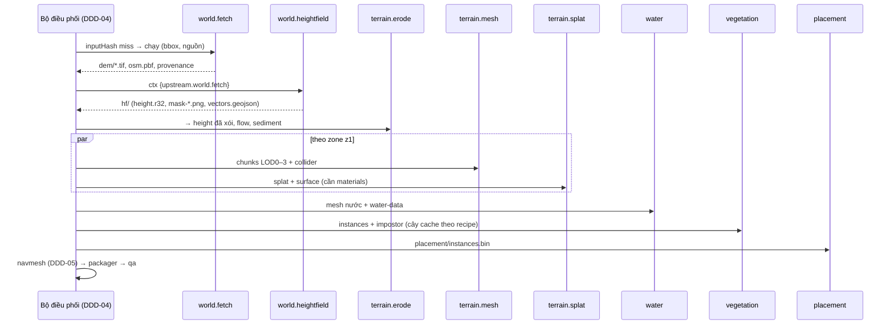
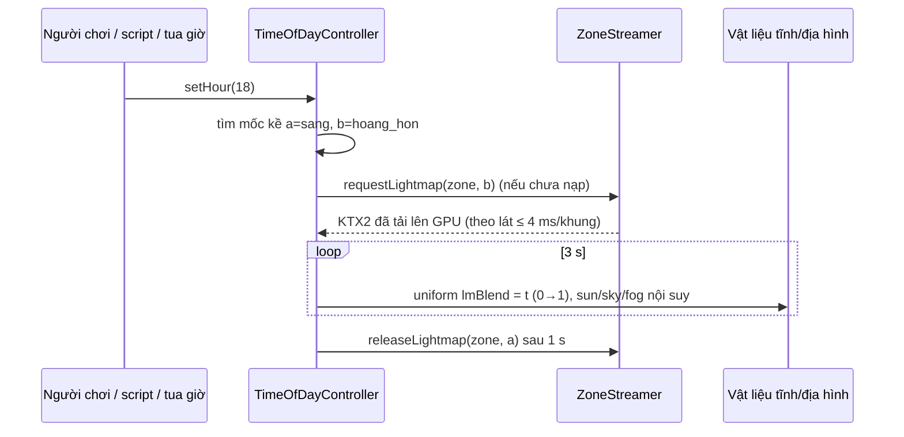

# DDD-02: Thế giới, địa hình và môi trường

| Mục | Nội dung |
|---|---|
| Mã tài liệu | DDD-02 |
| Phiên bản | 1.1 |
| Ngày | 26/11/2026 |
| Tài liệu cha | DDD-00 `DDD-00-TONG-QUAN.md` |
| TSD nguồn | TSD-02 v1.2 (SCH-WLD-01…05, ALG-WLD-01…16, TST-WLD-01…08) |
| SRS nguồn | SRS-02 v1.0 (FR-WLD-01…40, NFR-WLD-01…05) |
| Gói | Bước build `engine/build/steps/{world-fetch, world-heightfield, terrain-erode, terrain-mesh, terrain-splat, water, vegetation, placement, lighting-bake}`; Python `engine/build/py/{heightfield, geo}`; Blender `engine/build/blender/{ant, sapling, impostor, bake}`; runtime trong Unity player `engine/unity/Assets/GameStudio/{World/Terrain, World/Water, World/Vegetation, Fx}` (C#, CR-02); panel web `web/app/src/features/world` |
| Pha | E1 (địa hình), E3 (nước, thực vật, fx), E4 (bố trí), E5 (bake); W3–W4 |
| Trạng thái | Đã duyệt (Huy, 23/11/2026); **v1.1 runtime Unity theo CR-02 và POC-U1**, chờ Huy xem lại |

---

## 1. Giới thiệu
Thiết kế chi tiết các bước build dựng không gian chơi và phần runtime hiển thị môi trường. Mọi bước tuân giao thức bước build (DDD-04 DTO-CLI-01, EP-CLI-02), băm theo DDD-00 PSC-GEN-02, seed theo QT-WLD-01: `seed_bước = deriveSeed(world.seed, stepId, zoneId, localSeed)`. Toạ độ cục bộ: mét, x = Đông, y = lên, z = −Bắc.

---

## 2. Bố trí mã nguồn

| Mã | Tệp | Trách nhiệm |
|---|---|---|
| MOD-WLD-01 | `engine/build/py/geo.py`, `engine/shared/geo/src/geo.ts` | `utm_epsg(lat, lon)`, `geo_to_local(lat, lon, origin)`, `local_to_geo(x, z, origin)`; bản TS dùng `proj4` với cùng chuỗi CRS; vector chuẩn 20 điểm kiểm chéo |
| MOD-WLD-02 | `engine/build/py/heightfield/io.py` | `read_hf(dir) -> (np.ndarray[float32], Meta)`, `write_hf(dir, H, meta)`, `sample_bilinear(H, meta, x, z)`; định dạng DTO-WLD-02 |
| MOD-WLD-03 | `steps/world-fetch/{step.json, main.py, dem.py, osm.py, cache.py, sources.py}` | Tải DEM Copernicus (COG theo cửa sổ), OSM (Overpass → Geofabrik dự phòng), cache theo khoá nội dung, provenance |
| MOD-WLD-04 | `steps/world-heightfield/{step.json, main.py, reproject.py, vector_mask.py, carve.py, procedural.py, noise.py, mixed.py, ant_bridge.py}` | Chiếu UTM, raster hoá vector, khắc đường/sông, địa hình thủ tục 5 preset + `ant`, trộn `mixed`, xuất heightfield bundle + `preview/top.png` |
| MOD-WLD-05 | `engine/build/blender/ant/ant_generate.py` | A.N.T. Landscape headless theo seed → lưới → lấy mẫu lại |
| MOD-WLD-06 | `steps/terrain-erode/{step.json, main.py, droplet.py, thermal.py}` | Xói mòn thuỷ lực dạng hạt + nhiệt, `numba` một luồng |
| MOD-WLD-07 | `steps/terrain-mesh/{step.json, index.ts, chunker.ts, lod.ts, skirt.ts, uv.ts, collider.ts}` | Chunk 64 m, LOD0–3, skirt, UV0/UV2, collider heightfield (player dựng `MeshCollider` từ LOD1 lúc nạp, CR-02; bỏ `bvh.bin`) |
| MOD-WLD-08 | `steps/terrain-splat/{step.json, main.py, rules.py, surface.py}` | Trọng số lớp, giữ 4/8 lớp, `surface.png` |
| MOD-WLD-09 | `steps/water/{step.json, index.ts, triangulate.ts, sdf.ts}` | Mesh nước, SDF bờ + độ sâu, `water-mask.png` |
| MOD-WLD-10 | `steps/vegetation/{step.json, index.ts, poisson.ts, species.ts, tree-recipes.ts}`, `engine/build/blender/sapling/tree_gen.py`, `engine/build/blender/impostor/octa_bake.py` | Rải cây/bụi, sinh cây Sapling theo recipe, nướng impostor |
| MOD-WLD-11 | `steps/placement/{step.json, index.ts, rules.ts, occupancy.ts, align.ts}` | Bố trí theo luật, lưới chiếm chỗ dùng chung |
| MOD-WLD-12 | `steps/lighting-bake/{step.json}`, `engine/build/blender/bake/{bake_zone.py, rgbm.py, atlas.py}` | Bake lightmap + AO, mã RGBM, KTX2 |
| MOD-WLD-13 | `engine/unity/Assets/GameStudio/World/Terrain/{TerrainSystem.cs, ChunkPool.cs, TerrainMaterial.cs, TerrainCollider.cs}`, `Shaders/TerrainSplat.shadergraph` | Quản lý chunk/LOD, vật liệu splat URP, triplanar (tier ≥ Cao), `MeshCollider` LOD1 |
| MOD-WLD-14 | `engine/unity/Assets/GameStudio/World/Water/{WaterSystem.cs, WaterMaterial.cs, Reflection.cs}`, `Shaders/Water.shadergraph` | Shader nước URP theo tier, phản chiếu (planar/reflection probe) tier Cao |
| MOD-WLD-15 | `engine/unity/Assets/GameStudio/World/Vegetation/{VegetationSystem.cs, InstancedSpecies.cs, ImpostorMaterial.cs, GrassField.cs}`, `Shaders/{Impostor, Grass, Wind}.shadergraph` | Instancing (`Graphics.RenderMeshInstanced`) theo (loài, LOD, chunk), impostor cross-fade, cỏ GPU, gió |
| MOD-WLD-16 | `engine/unity/Assets/GameStudio/Fx/{FxSystem.cs, Sky.cs, Fog.cs, Weather.cs, TimeOfDay.cs, DynamicLights.cs, PostFx.cs}` | Hệ thống `fx` (order 70): trời, sương, mưa, mây, chuyển mốc thời điểm, đèn động, hậu kỳ |
| MOD-WLD-17 | `web/app/src/features/world/{world-form-panel.tsx, region-editor-panel.tsx, polygon-tools.ts}` | SCR-WLD-01 (form sinh từ `world-fields.json`), SCR-WLD-02 (vẽ đa giác) |
| MOD-WLD-18 | `engine/schema/editor/world-fields.json`, `engine/schema/surface-types.json`, `engine/build/steps/world-heightfield/road-widths.json`, `engine/build/data-sources.json` | Dữ liệu cấu hình tĩnh (DTO-WLD-05…08) |

---

## 3. Thiết kế lớp và giao diện

```ts
// Bước Node: steps/<id>/index.ts
export async function run(ctx: StepCtx): Promise<StepResult>     // StepCtx, StepResult: DDD-04 DTO-CLI-01, DTO-CLI-02
```

Runtime trong Unity player (C#, CR-02; giao diện hệ thống theo DDD-04 mục 3.1):
```csharp
// World/Terrain/TerrainSystem.cs
public sealed class TerrainSystem : ISystem {   // Id "terrain", Order 80 (thuộc render), init theo zone
  public void OnZoneLoaded(LoadedZone z);       // tạo ChunkEntry cho mọi chunk (glTFast), gắn lightmap mốc hiện tại, dựng MeshCollider LOD1
  public void OnZoneUnloaded(LoadedZone z);     // trả Mesh về ChunkPool, huỷ collider
  public void Tick(float dt, float t);          // mỗi 0,25 s: chọn LOD theo khoảng cách camera (CFG-WLD-02), frustum theo AABB chunk
  public float HeightAt(float x, float z);      // O(1) từ NativeArray<float> của height-lod1.r32 (người chơi, NPC, đặt tạm)
  public SurfaceId SurfaceAt(float x, float z); // tra surface.png 1 m/px
}
// Fx/TimeOfDay.cs
public sealed class TimeOfDayController {
  public TimeOfDayController(EngineContext ctx, TimeOfDayStop[] stops);
  public void SetHour(float h, bool immediate = false);
  public void Tick(float dt, float t);          // STM-WLD-01
  public (string a, string b, float t) Blend { get; }   // mốc lightmap đang trộn (đọc bởi shader LitRgbmLightmap)
}
// Fx/DynamicLights.cs
public sealed class DynamicLightManager { public void Register(LightDef l); public void Tick(float dt, Camera cam); }
```

Python bước build dùng mẫu chung:
```python
# steps/<id>/main.py
def main(ctx_path: str) -> int:           # đọc ctx.json, ghi outDir/*, report.json; in "PROGRESS n msg"
    ctx = gsio.load_ctx(ctx_path); rng = gsrng.Pcg32(ctx.seed)
    ...
    gsio.write_report(ctx, metrics, checks, artifacts); return 0
```

---

## 4. Dữ liệu

| Mã | Cấu trúc | Đặc tả |
|---|---|---|
| DTO-WLD-01 | `world.json` (SCH-WLD-01) | `{schemaVersion, seed, source: 'real'\|'procedural'\|'mixed', bbox?: {south, west, north, east}, playArea: Polygon, zones: Zone[], procedural?: {preset: 'dong_bang'\|'doi'\|'nui'\|'ven_bien'\|'thung_lung'\|'ant', maxHeight, roughness: 0..1, features[]}, blendMask?: AssetPath, heightScale: 1, smoothing: 0, erosion: {iterations, strength, mask?}, water: Water[], vegetation: VegLayer[], placementRules: PlacementRule[], placedObjects: PlacedObject[], regions: Region[], timeOfDay: TimeOfDayStop[], dayNightCycle: {enabled, minutesPerDay}, atmosphere: {fog, clouds, rain, mist}, postFx: {toneMapping: 'aces'\|'agx', bloom, lut?}, weather: {wind: 0..1}, spawns: Spawn[] /*DDD-05*/, ambience: Ambience[] /*DDD-03*/}`; `Polygon = [number, number][] /*≥3, không tự cắt*/`; `Zone = {id, polygon, seed, budgetOverride?}`; `TimeOfDayStop = {id, hour, baked: boolean, sun: {elevation, azimuth, color, intensity}, sky: {hdri?: AssetRef, color}, fogColor}` |
| DTO-WLD-02 | Heightfield bundle (SCH-WLD-02) | Thư mục `hf/`: `height.r32` (float32 LE, hàng trước cột, gốc góc Tây Bắc), `height.meta.json {width, height, cellM, originLocal:[x0,z0], minH, maxH, crs:'EPSG:326xx', origin:{lat,lon}}`, `mask-road.png`, `mask-water.png`, `mask-farm.png`, `mask-forest.png`, `mask-building.png` (8 bit, cùng lưới), `vectors.geojson` (toạ độ cục bộ), `preview/top.png` (1 m/px, tô bóng + mask) |
| DTO-WLD-03 | `layers.json` (SCH-WLD-03) | `{layers: [{id, materialRef: AssetRef, tiling: number}], rules: [{layer, slope:[a,b] /*độ*/, height:[a,b] /*m*/, mask?: 'road'\|'water'\|'farm'\|'forest', noise?: {scale, amp, seedKey}, weight}]}` |
| DTO-WLD-04 | Instance nhị phân (SCH-WLD-04) | Header 16 byte: `magic 'GSIN'` (4), `ver uint16=1`, `flags uint16`, `count uint32`, `assetIdx uint32`; thân `count × float32[8]` = `x, y, z, yaw, pitch, roll, scale, variant`; sắp theo `(chunkX, chunkZ, x, z)`; tệp phụ `*.index.json` = `{chunks: {"cx_cz": [start, count]}}` để nạp theo chunk |
| DTO-WLD-05 | `world-fields.json` (SCH-WLD-05) | `[{pointer: '/world.json/vegetation/0/densityPerHa', label, type: 'number'\|'int'\|'enum'\|'color'\|'bool'\|'hour', min?, max?, step?, unit?, options?, default, impact: 'runtime'\|'build:<stepId>', group}]`; là nguồn form SCR-WLD-01 và `impactMap` |
| DTO-WLD-06 | `surface-types.json` | `[{id: 0..255, key: 'co'\|'dat'\|'da'\|'cat'\|'go'\|'nuoc_nong'\|'nuoc_sau'\|'bun'\|'duong', footstepSet, walkable: bool}]` (SRS-02 mục 6.4) |
| DTO-WLD-07 | `fetch.provenance.json` | `{type:'map', sources: [{name:'Copernicus GLO-30', url, tiles[], version, license, attribution}, {name:'OpenStreetMap', url, query, timestamp, license:'ODbL-1.0', attribution:'© OpenStreetMap contributors'}], fetchedAt, cacheKey}` |
| DTO-WLD-08 | `data-sources.json` | `{allowHosts: ['overpass-api.de', 'download.geofabrik.de', 'copernicus-dem-30m.s3.amazonaws.com', 'api.polyhaven.com', 'dl.polyhaven.org'], overpass: {url, timeoutS: 300}, geofabrik: {region: 'asia/vietnam'}}` |
| DTO-WLD-09 | `VegLayer`, `PlacementRule` | `VegLayer = {id, mask: Polygon[] \| 'forest'\|'farm', species: [{ref: AssetRef, weight}], densityPerHa, minSpacing, maxSlope, scale:[a,b], seed, impostorDistance, grass?: {densityPerM2, heightM, colorJitter}}`; `PlacementRule = {id, ref: AssetRef, region: Polygon \| regionId, count?: [a,b], densityPerHa?, minSpacing, maxSlope, alignToNormal: bool, onWater: bool, avoidRoadM, avoidWaterM, seed}` |
| DTO-WLD-10 | Đầu ra bước | `terrain.mesh`: `chunks/<cx>_<cz>/lod{0..3}.glb`, `collider/height-lod1.r32`; `terrain.splat`: `splat-0.png` (`splat-1.png` khi 8 lớp), `surface.png`, `layers.json`; `water`: `water/<id>.glb`, `water-mask.png`, `water-data.png` (R = SDF bờ, G = độ sâu × 10); `vegetation`: `veg/instances-<layer>.bin`, `veg/impostors/<species>.ktx2`; `placement`: `placement/instances.bin`, `placement/report.json`; `lighting.bake`: `lightmaps/<tod>/<atlas>.ktx2`, `ao/<atlas>.ktx2`, `lightmaps/uv2-atlas.json` |

---

## 5. API / giao thức (`step.json` từng bước)

| Mã | Bước | `deps` | `inputs.dataPointers` | `runner`, `perZone` | Công cụ trong `toolVersions` |
|---|---|---|---|---|---|
| EP-WLD-01 | `world.fetch` | — | `/world.json/source`, `/world.json/bbox` | python, false | python, rasterio, osmium |
| EP-WLD-02 | `world.heightfield` | `world.fetch` | `/world.json/procedural`, `/world.json/blendMask`, `/world.json/seed`, `/world.json/heightScale`, `/world.json/smoothing` | python (+ blender khi `ant`), false | python, numpy, blender, ant_landscape |
| EP-WLD-03 | `terrain.erode` | `world.heightfield` | `/world.json/erosion` | python, false | python, numba |
| EP-WLD-04 | `terrain.mesh` | `terrain.erode` | cấu hình `params.chunkM=64`, `params.lodSteps` | node, true | node, meshoptimizer |
| EP-WLD-05 | `terrain.splat` | `terrain.erode`, `materials` | `/world.json/splat`, `/palette.json` | python, true | python |
| EP-WLD-06 | `water` | `terrain.mesh` | `/world.json/water` | node, true | node |
| EP-WLD-07 | `vegetation` | `terrain.splat`, `assets` | `/world.json/vegetation` (trừ `*/grass`: thuộc runtime) | node (+ blender cây), true | node, blender, sapling |
| EP-WLD-08 | `placement` | `terrain.mesh`, `water`, `vegetation`, `assets` | `/world.json/placementRules`, `/world.json/placedObjects`, `/world.json/regions` | node, true | node |
| EP-WLD-09 | `lighting.bake` | `placement` | `/world.json/timeOfDay/*` (chỉ phần tử `baked=true`) | blender, true | blender, oidn, ktx |

Thời gian chờ tối đa mỗi bước (DDD đề xuất): `world.fetch` 10 phút; `lighting.bake` 4 giờ (ERR-WLD-06); còn lại 30 phút.

---

## 6. Luồng xử lý

### SEQ-WLD-01 Build một zone (không bake)


### SEQ-WLD-02 Chuyển mốc thời điểm khi chạy


### SEQ-WLD-03 Sửa vùng trên Web Studio
Người dùng vẽ đa giác ở SCR-WLD-02 → `polygon-tools.validate()` (tự cắt, nằm trong thế giới, diện tích `playArea` ≤ 4 km²) → lỗi hiện tại chỗ (ERR-WLD-03, ERR-WLD-04) → hợp lệ: tạo op `replace /world.json/regions/<i>/polygon` → store editor (DDD-08 MOD-WEB-21) → lưu tự động EP-WEB-14 → server kiểm lại bằng cùng hàm (gói `@gamestudio/schema/geo-validate`) → `impact` → nhãn "Cần build: placement, navmesh…".

---

## 7. Máy trạng thái

### STM-WLD-01 Bộ chuyển mốc thời điểm
| Trạng thái | Sự kiện | Tới | Hành động |
|---|---|---|---|
| `Dung` | `setHour(h)` khác khoảng mốc hiện tại | `ChoNap` | Xin lightmap mốc đích cho zone đang nạp |
| `ChoNap` | mọi lightmap đích sẵn sàng | `Tron` | `t=0` |
| `ChoNap` | quá 10 s | `Tron` | Dùng ánh sáng động tạm cho zone thiếu (ghi log) |
| `Tron` | `t` đạt 1 (3 s) | `Dung` | Đổi mốc hiện tại, hẹn giải phóng mốc cũ |
| `Tron` | `setHour` mới | `ChoNap` | Mốc đích mới, bắt đầu từ trạng thái trộn hiện tại |
| bất kỳ | mốc đích `baked=false` | `Tron` | Không cần lightmap; trộn về ánh sáng động + đèn (PSC-WLD-15) |

### STM-WLD-02 Bake một (zone, mốc)
`ChoXep → DangBake` (worker nhận) → `MaHoa` (RGBM + KTX2) → `Xong`; `DangBake --quá 4 giờ--> DaHuy` (giữ lightmap cũ, ERR-WLD-06); `DangBake --Blender lệch bản--> Loi` (ERR-WLD-07). Chỉ cặp có `inputHash` đổi mới vào `ChoXep`.

---

## 8. Thuật toán chi tiết

### PSC-WLD-01 Hệ toạ độ (ALG-WLD-01)
```
utm_epsg(lat, lon) = 32600 + floor((lon + 180) / 6) + 1          # Bắc bán cầu
origin = tâm bbox (lat0, lon0); (E0, N0) = proj(lat0, lon0)
geo_to_local(lat, lon): (E, N) = proj(lat, lon); return (x = E - E0, z = -(N - N0))
local_to_geo(x, z): (E, N) = (x + E0, -z + N0); return inverse(E, N)
thủ tục: origin = (0,0) ảo, crs = 'LOCAL'
```

### PSC-WLD-02 Nạp dữ liệu thật (ALG-WLD-02)
```
fetch(ctx):
  bb = buffer(bbox, 200 m); key = sha256(canonical({src, bb, demVersion, osmDate}))
  if cache[key] and not ctx.params.refresh: return cache
  tiles = [f'Copernicus_DSM_COG_10_N{lat:02}_00_E{lon:03}_00_DEM' for lat,lon in degreeTilesIntersecting(bb)]
  for t in tiles: window-read COG (rasterio, bounds=bb) với timeout 60 s/tile, 3 lần thử
  dem = merge(windows); dem = reproject(dem, utm, cellM, Resampling.cubic)
  osm = overpass(query(bb, TAGS), timeout=300) ; nếu lỗi/429/quá 5 phút → geofabrik: osmium extract --bbox → osmium tags-filter
       nếu cả hai lỗi → cache cũ (ERR-WLD-01, cảnh báo) hoặc dừng
  for s in sources: if not s.license or not s.url → ERR-WLD-02 (dừng)
  H = dem * heightScale; repeat smoothing lần: H = gauss3x3(H)
  ghi cache/dem/*.tif, cache/osm/*.pbf, fetch.provenance.json
```

### PSC-WLD-03 Vector → mask và khắc (ALG-WLD-03)
```
for way in osm.highway: w = ROAD_WIDTH[way.tag] (primary 8, secondary 6, tertiary 5, residential 4, track 3, path 1.5)
    poly = buffer(line_local(way), w/2); rasterize_aa(mask_road, poly)
for rel in waterway river|stream: w = tag width or (river 12, stream 3) → buffer → mask_water
for a in natural=water, landuse=farmland|forest, building: polygon → mask tương ứng
carve: for mỗi đường/sông: d = khoảng cách tới tâm tuyến (EDT)
    target = mean(H trong đệm 2w) - (sông ? depth=1.5 : 0)
    k = smoothstep(w/2 + 3 m, w/2, d); H = lerp(H, target, k)
```

### PSC-WLD-04 Địa hình thủ tục (ALG-WLD-04)
```
PRESET = {dong_bang:(amp=0.05, oct=3), doi:(0.35, 5), nui:(1.0, 7, ridged), ven_bien:(0.3, 5, gradient+sea), thung_lung:(0.6, 5, valley)}
persistence = lerp(0.35, 0.65, roughness); lacunarity = 2.0; baseFreq = 1/800 m
fbm(x,z) = Σ_{i<oct} persistence^i · n(x·f_i, z·f_i), n = OpenSimplex2 numpy với bảng hoán vị từ Pcg32(seed)
ridged: n' = 1 - |n|; n'² ; nui: H = maxHeight · amp · fbm_ridged
ven_bien: H = maxHeight·amp·fbm + maxHeight·(x_norm - 0.3); H[H<0] = -2 (biển)
thung_lung: d = khoảng cách tới trục (polyline features hoặc trục giữa); H = maxHeight·amp·(fbm + smoothstep(0, W, d))
features: đồi = cộng Gauss(σ = sqrt(area)/3) trong đa giác; đường/sông khắc như PSC-WLD-03
ant: ant_bridge chạy blender -b --factory-startup -P ant_generate.py -- --seed s --preset p --size … → OBJ lưới → lấy mẫu lại lưới cellM
```

### PSC-WLD-05 Trộn `mixed` (ALG-WLD-05)
`m = blendMask/255` (lấy mẫu lại lưới); `detail = fbm(x,z) · procedural.maxHeight · roughness`; `H = (1 − m)·H_real + m·(H_real + detail)`.

### PSC-WLD-06 Xói mòn (ALG-WLD-06)
```
@njit(parallel=False, cache=True)
erode(H, iterations, strength, mask, seed):
  N = int(iterations * strength * W*Hh / 64)      # số hạt
  rng = pcg32(seed)
  for k in range(N):
     x, z = rng.float()*W, rng.float()*Hh ; if mask[x,z]==0: continue
     dir=(0,0); speed=1; water=1; sed=0
     for step in range(64):
        g = gradient_bilinear(H, x, z)
        dir = dir*0.05 - g*(1-0.05); normalize; nx, nz = x+dir.x, z+dir.z
        if out_of_bounds: break
        dh = h(nx,nz) - h(x,z)
        cap = max(-dh, 0.01) * speed * water * 4
        if sed > cap or dh > 0: dep = (dh>0) ? min(dh, sed) : (sed-cap)*0.3 ; deposit_bilinear(H, x, z, dep); sed -= dep
        else: ero = min((cap-sed)*0.3, -dh); erode_radius(H, x, z, ero, r=3); sed += ero
        speed = sqrt(max(speed² + dh*4, 0)); water *= (1-0.01); x,z = nx,nz
  thermal: lặp 10 lần: với mỗi ô, nếu chênh với láng giềng > tan(35°)*cellM → chuyển 0.5*(chênh - ngưỡng) xuống ô thấp
  flow.r8 = chuẩn hoá số hạt đi qua; sediment.r8 = chuẩn hoá lượng lắng
```

### PSC-WLD-07 Mesh chunk, LOD, skirt (ALG-WLD-07)
```
for (cx, cz) in chunks(playArea, 64 m):
  for lod in 0..3:
    step = cellM * 2^lod  (hoặc simplify với sai số 0.1/0.4/1.5 m, khoá biên)
    grid = (64/step + 1)² đỉnh; y = H(x,z); normal từ sai phân trung tâm
    skirt: nhân đôi đỉnh biên, y -= 2 m, nối thành dải tam giác hướng xuống
    uv0 = (x, z) / tiling; uv2 = atlasRect(cx,cz) ánh xạ [0,1]² chunk vào ô atlas lightmap (lightmaps/uv2-atlas.json)
    ghi chunks/cx_cz/lod.glb (Meshopt, quantize 14 bit vị trí)
collider: height-lod1.r32 (lưới LOD1); player dựng MeshCollider từ lod1.glb lúc nạp chunk (Physics.BakeMesh chia lát theo khung), không còn bvh.bin (CR-02)
runtime: lod = d < 80 ? 0 : d < 200 ? 1 : d < 450 ? 2 : 3 (tier Vừa, TSD đề xuất, CFG-WLD-02); đổi LOD có trễ ±5 m để không nhấp nháy
```

### PSC-WLD-08 Splat và bề mặt (ALG-WLD-08)
```
for texel (0.5 m/px):
  slope = deg(atan(|∇H|)); h = H
  w[l] = Σ_rule(rule.layer==l) rule.weight · inRange(slope, rule.slope) · inRange(h, rule.height) · mask(rule) · (1 + noise(rule))
  w = w / Σw ; giữ K lớn nhất (K = 4 tier Thấp/Vừa, 8 tier ≥ Cao), chuẩn hoá lại
  splat-0.rgba = w[0..3], splat-1.rgba = w[4..7]
surface (1 m/px) = SURFACE_OF[argmax w]; ghi đè: mask_water và depth < 1.2 → nuoc_nong; ≥ 1.2 → nuoc_sau; mask_road → duong
inRange(v, [a,b]) = smoothstep(a-2, a, v)·(1 - smoothstep(b, b+2, v))
```

### PSC-WLD-09 Nước (ALG-WLD-09)
```
for water in world.water:
  poly = water.polygon or polygons(mask_water) (marching squares + simplify 0.5 m)
  tris = earcut(poly); tier Cao: chia lưới 4 m
  y = water.level
  sdf = EDT tới mép (m), clamp 0..10; depth = max(0, level - H)
  water-data.png: R = sdf/10·255, G = min(depth·10, 255)
va chạm: depth > 1.2 → surface nuoc_sau (chặn hoặc bơi, DDD-05 PSC-CHR-02)
placement onWater: lấy mẫu trong mask, y = level
```
Shader theo tier: Thấp = màu + fresnel giả; Vừa = + normal map cuộn 2 lớp + bọt từ SDF + màu theo độ sâu; Cao = + phản chiếu RTT ½ độ phân giải cập nhật 1 lần/2 khung.

### PSC-WLD-10 Rải thực vật (ALG-WLD-10)
```
for layer in world.vegetation:
  rng = Pcg32(deriveSeed(world.seed, 'vegetation', zone, layer.seed))
  pts = bridsonPoisson(maskPolygon ∩ zone, r = layer.minSpacing, k = 30, rng)
  keepP = layer.densityPerHa / (10000 / (π·r²·0.7))         # mật độ Poisson tối đa xấp xỉ
  for p in pts: if slope(p) > maxSlope or onRoad(p) or inWater(p): skip
                if rng.float() > keepP: skip
                sp = weightedPick(layer.species, rng); yaw = rng.float()·2π; s = lerp(scale, rng.float())
                emit (p.x, H(p), p.z, yaw, 0, 0, s, variantIdx(sp, rng))
  sort theo chunk → instances-<layer>.bin + index
cỏ (runtime): ô 4 m quanh camera bán kính R(tier) (Thấp 20, Vừa 35, Cao 60 m); mỗi ô seed = deriveSeed(world.seed,'grass',cellX,cellZ)
  số ngọn = densityPerM2·16·splatGrassWeight; vị trí sinh trong vertex shader từ gl_InstanceID + hash(seed)
```

### PSC-WLD-11 Cây, impostor, gió (ALG-WLD-11)
```
tree(recipe): key = sha256(recipe + versions.blender + versions.sapling); cache hit → dùng lại
  blender -b --factory-startup -P sapling/tree_gen.py -- --recipe r.json --seed s → tree_lod0.glb (thân + thẻ lá), tree_lod1.glb
  impostor: octa_bake.py: 8×8 hướng trên bán cầu octahedral, khung 256 px, albedo+alpha và normal → atlas 2048² → ktx create ETC1S
runtime: d > impostorDistance → impostor; vùng [D-5, D] cross-fade bằng dither (bayer 4×4) 0,5 s
  một lô Graphics.RenderMeshInstanced mỗi (loài, LOD, chunk); impostor gộp mọi loài của chunk vào một lô với Texture2DArray (CR-02)
gió (vertex): w = weather.wind; phase = dot(instancePos.xz, (0.13, 0.07)); sway = sin(time·1.7 + phase)·w·heightFactor²
  heightFactor = vertex.y / treeHeight (thân), màu đỉnh G cho lá (rung thêm sin(time·4 + phase·3)·0.05·w); tier Thấp: tắt
```

### PSC-WLD-12 Bố trí theo luật (ALG-WLD-12)
```
occ = OccupancyGrid(cell = 0.5 m) ; đánh dấu footprint placedObjects (bán kính footprintRadius của asset), đường (avoidRoadM), nước (avoidWaterM), regions kind=no_place
for rule in sort(placementRules, by order):
  rng = Pcg32(deriveSeed(world.seed, 'placement', zone, rule.seed))
  target = rule.count ? rng.int(a,b) : densityPerHa·area/10000
  cands = bridsonPoisson(region ∩ zone, rule.minSpacing, rng)
  for p in cands until placed == target:
     if slope(p) > rule.maxSlope or occ.blocked(p, asset.footprintRadius): continue
     y = rule.onWater ? water.level : H(p); rot = rule.alignToNormal ? alignQuat(normal(p), yaw) : yaw
     emit; occ.mark(p, asset.footprintRadius)
report.json: {rule, target, placed, rejected: {slope, occupied, outside}}
```

### PSC-WLD-13 Bake ánh sáng (ALG-WLD-13)
```
bake_zone.py --ctx: (chạy trong blender -b --factory-startup --disable-autoexec --python-exit-code 1)
  import zone static glTF (đã gộp, có UV2 'uv2'); bỏ nhân vật/động
  for tod in timeOfDay where baked:
     sun = Light(SUN, rotation từ (elevation, azimuth), color, strength); world = HDRI(tod.sky.hdri) hoặc màu
     scene.cycles: device CPU, samples 128 (CFG-WLD-05), denoiser OIDN, bake_type COMBINED, pass_filter {INDIRECT, DIRECT}, margin 4
     image = new(atlasSize(tier): Vừa 2048, Cao 2048, Thấp 1024; float)
     bake() ; rgbm.encode(image, M = 8) → PNG RGBA8 → ktx create --encode uastc --uastc-quality 2 --zstd 18
  AO: bake_type AO một lần cho mọi mốc → ao/<atlas>.ktx2 (R8 → ETC1S)
  watchdog: tiến trình cha đếm thời gian; > 4 giờ → kill, giữ thư mục lightmap cũ, ERR-WLD-06
rgbm.encode(c): m = clamp(max(c.r,c.g,c.b)/8, 1e-6, 1); m = ceil(m·255)/255; rgb = c/(m·8); a = m
runtime decode: c = rgbm.rgb · rgbm.a · 8
```

### PSC-WLD-14 Chuyển mốc (ALG-WLD-14)
```
setHour(h): (a, b) = hai mốc kề h trong timeOfDay đã sắp theo hour (vòng 24 h); u = (h - a.hour)/(b.hour - a.hour)
  nếu dayNightCycle.enabled: gọi mỗi khung với h += dt·24/(minutesPerDay·60)
  shader tĩnh: lm = mix(decode(lmA), decode(lmB), lmBlend) · ao
  sun.color/intensity, sky, fog = lerp theo u (màu trong không gian tuyến tính)
  b.baked = false: lmB = lmA; lmBlend dùng làm hệ số tắt dần lightmap (đêm: ánh sáng động + đèn)
```

### PSC-WLD-15 Đèn động (ALG-WLD-15)
```
mỗi 0,25 s: cands = lights trong frustum, sắp theo khoảng cách² tới camera
  bật N = budgets.dynamicLights[tier] gần nhất (Thấp 0, Vừa 2, Cao 4, Tối đa 8)
  đèn rời danh sách: intensity → 0 trong 0,3 s rồi visible=false; đèn mới: 0 → giá trị trong 0,3 s
  dùng pool `Light` (Point) cố định N cái (không tạo mới, tránh biên dịch lại shader)
```

### PSC-WLD-16 Trời, khí quyển, hậu kỳ (ALG-WLD-16)
| Hiệu ứng | Cài đặt | Thấp | Vừa | Cao/Tối đa |
|---|---|---|---|---|
| IBL | Cubemap KTX2 tiền lọc + hệ số SH tính sẵn ở build (DDD-03 PSC-AST-10, CR-02), gán `RenderSettings.customReflectionTexture` + ambient SH | Có | Có | Có |
| Trời thủ tục | Shader Graph trời Preetham khi không HDRI (CR-02) | Có | Có | Có |
| Sương | `RenderSettings.fog` Exp2 + sương theo độ cao trong sub-graph dùng chung `FogHeight` | Exp2 | + độ cao | + độ cao |
| Mây | Dome texture cuộn UV | Tắt | Có | Có |
| Mưa | Hạt instanced trong hộp 30 m quanh camera, pool theo `particles` | 300 | 1.500 | 4.000 |
| Sương sớm | Lớp quad bán trong suốt theo độ cao | Tắt | Có | Có |
| Hậu kỳ | URP Volume: tone mapping, bloom, LUT (style bible), FXAA | Tone mapping | + FXAA + LUT | + bloom |

---

## 9. Xử lý lỗi

| Mã | Nơi phát hiện | Xử lý |
|---|---|---|
| ERR-WLD-01 | `world.fetch` (timeout 300 s Overpass, lỗi tải tile) | Dùng cache gần nhất (cảnh báo trong report); không có cache → bước lỗi, thoát 6 |
| ERR-WLD-02 | `world.fetch` kiểm nguồn | Dừng build, thoát 4 |
| ERR-WLD-03 | `polygon-tools.validate`, `geo-validate` server | Không lưu; 422 |
| ERR-WLD-04 | Như trên + `shapely.is_valid` ở `world.heightfield` | Không lưu; build thoát 4 |
| ERR-WLD-05 | Packager (DDD-04 PSC-CLI-02) | `report.result=fail`, `checks[].source` chỉ lớp gây vượt (veg layer, rule, asset) |
| ERR-WLD-06 | Watchdog bake | Huỷ, giữ lightmap cũ, job `fail_data` |
| ERR-WLD-07 | Bước so `toolVersions` với `engine doctor` | Từ chối, thoát 5 |

---

## 10. Cấu hình

| Mã | Khoá | Mặc định | Nơi |
|---|---|---|---|
| CFG-WLD-01 | `cellM` heightfield | 2 m (≤ 4 km²); 1 m cho zone ≤ 0,25 km² khi `world.highRes=true` (OIT-WLD-01) | `world.json` / `step.json params` |
| CFG-WLD-02 | Khoảng LOD địa hình theo tier | Thấp 60/150/350; Vừa 80/200/450; Cao 120/300/700 m (TSD đề xuất cho Vừa; Thấp/Cao DDD đề xuất) | `engine/unity/Assets/GameStudio/World/Terrain/lod-table.json` |
| CFG-WLD-03 | Bán kính cỏ | Thấp 20, Vừa 35, Cao 60 m (TSD đề xuất); Tối đa 80 m (DDD đề xuất) | `fx`/`vegetation` tier table |
| CFG-WLD-04 | Xói mòn | quán tính 0,05; sức mang 4; lắng 0,3; bốc hơi 0,01; bán kính 3; talus 35° | `steps/terrain-erode/params.json` |
| CFG-WLD-05 | Bake | 128 mẫu, OIDN, atlas Vừa 2048 (OIT-WLD-02), timeout 4 giờ | `steps/lighting-bake/step.json params` |
| CFG-WLD-06 | Chuyển mốc | 3 s trộn; giải phóng mốc cũ sau 1 s; chờ lightmap tối đa 10 s | `Fx/TimeOfDay.cs` |
| CFG-WLD-07 | Impostor | 8×8 khung, 256 px, cross-fade 0,5 s, trễ 5 m | `steps/vegetation/params.json` |

---

## 11. Thiết kế kiểm thử

| Mã | Ca | Dữ liệu / bước | Kỳ vọng | TSD |
|---|---|---|---|---|
| TC-WLD-01 | bbox thật 2×2 km | Cache DEM/OSM cố định `fixtures/hue-2x2/` | Đường/sông khớp vector lệch ≤ 1 ô; báo cáo tier Vừa Pass | TST-WLD-01 |
| TC-WLD-02 | Tất định thủ tục | Preset `doi`, seed 42, build 2 lần sạch cache | `outputHash` mọi bước bằng nhau | TST-WLD-02 |
| TC-WLD-03 | Tăng dần | Đổi mật độ cỏ; đổi `vegetation[0].densityPerHa` | Lần 1 chỉ `packager`(+`qa`); lần 2 `vegetation`, `placement`, `navmesh`, `packager` | TST-WLD-03 |
| TC-WLD-04 | 10.000 cây A56 | Zone mẫu, route QA | Draw call ≤ 120, fps ≥ 30; cây > `impostorDistance` là impostor | TST-WLD-04 |
| TC-WLD-05 | Chuyển sáng → hoàng hôn | `?perf=1`, `setHour` | Không khung > 50 ms; không mẫu lightmap đen | TST-WLD-05 |
| TC-WLD-06 | Credit bản đồ | Bản build zone thật | `manifest.credits` có chuỗi OSM và Copernicus đúng nguyên văn | TST-WLD-06 |
| TC-WLD-07 | Đa giác sai | Tự cắt; ngoài `playArea`; `playArea` 5 km² | Web và CLI cùng ERR-WLD-04 / ERR-WLD-03 | TST-WLD-07 |
| TC-WLD-08 | Lệch bản Blender | `versions.json` khác bản cài | Bước từ chối, ERR-WLD-07, thoát 5 | TST-WLD-08 |
| TC-WLD-09 | Toạ độ | 20 điểm chuẩn | `geo_to_local`/`local_to_geo` Python và TS lệch ≤ 1 mm | ALG-WLD-01 |
| TC-WLD-10 | Instance nhị phân | Ghi rồi đọc 10.000 instance | Header đúng; index chunk phủ đủ `count` | SCH-WLD-04 |
| TC-WLD-11 | RGBM | 1.000 màu HDR ngẫu nhiên ≤ 8 | Sai số tương đối ≤ 2% sau mã/giải mã | ALG-WLD-13 |
| TC-WLD-12 | Form sinh từ trường | `world-fields.json` mẫu | Mỗi trường hiện nhãn "Áp ngay"/"Cần build" đúng `impact` | SCH-WLD-05 |

---

## 12. Open item

| Mã | Câu hỏi | Đề xuất |
|---|---|---|
| OID-WLD-01 | Khoảng LOD địa hình tier Thấp/Cao | Đo E2 trên A56 và máy desktop tham chiếu |
| OID-WLD-02 | Số hạt mưa theo tier | Chốt theo `particles` khi đo E3 |

---

## 13. Truy vết

| FR / NFR | Thành phần TSD | Thành phần DDD |
|---|---|---|
| FR-WLD-01 | ALG-WLD-01 | MOD-WLD-01, PSC-WLD-01, TC-WLD-09 |
| FR-WLD-02…04 | SCH-WLD-01; ALG-INT-03; ALG-CHR-08 | DTO-WLD-01 (`playArea`, `zones`), DDD-01 PSC-INT-03, DDD-05 PSC-CHR-08 |
| FR-WLD-05…08 | ALG-WLD-02, ALG-WLD-03 | MOD-WLD-03, MOD-WLD-04, DTO-WLD-02, DTO-WLD-07, DTO-WLD-08, PSC-WLD-02, PSC-WLD-03, EP-WLD-01 |
| FR-WLD-09…13 | ALG-WLD-04, ALG-WLD-05, ALG-WLD-06 | MOD-WLD-04…06, PSC-WLD-04…06, EP-WLD-02, EP-WLD-03, CFG-WLD-04 |
| FR-WLD-14 | ALG-WLD-07 | MOD-WLD-07, MOD-WLD-13, PSC-WLD-07, EP-WLD-04, CFG-WLD-02 |
| FR-WLD-15, 16 | ALG-WLD-08, SCH-WLD-03 | MOD-WLD-08, DTO-WLD-03, DTO-WLD-06, PSC-WLD-08, EP-WLD-05 |
| FR-WLD-17…20 | ALG-WLD-09 | MOD-WLD-09, MOD-WLD-14, PSC-WLD-09, EP-WLD-06 |
| FR-WLD-21…24 | ALG-WLD-10, ALG-WLD-11 | MOD-WLD-10, MOD-WLD-15, DTO-WLD-09, PSC-WLD-10, PSC-WLD-11, EP-WLD-07, CFG-WLD-03, CFG-WLD-07 |
| FR-WLD-25…27 | ALG-WLD-12 | MOD-WLD-11, PSC-WLD-12, EP-WLD-08 |
| FR-WLD-28…30 | ALG-WLD-13; ALG-CLI-01 | MOD-WLD-12, PSC-WLD-13, STM-WLD-02, EP-WLD-09, CFG-WLD-05 |
| FR-WLD-31 | ALG-WLD-14 | PSC-WLD-14, STM-WLD-01, SEQ-WLD-02, CFG-WLD-06 |
| FR-WLD-32 | ALG-WLD-15 | PSC-WLD-15 |
| FR-WLD-33…35 | ALG-WLD-16 | MOD-WLD-16, PSC-WLD-16 |
| FR-WLD-36…38 | SCH-WLD-05; TSD-02 mục 5 | MOD-WLD-17, DTO-WLD-05, SEQ-WLD-03, TC-WLD-12 |
| FR-WLD-39, 40 | TSD-02 mục 7 | DTO-WLD-07; DDD-03 PSC-AST-07 (gom credit) |
| NFR-WLD-01…05 | TST-WLD-03, TST-WLD-04 | Mục 5 (thời gian chờ), CFG-WLD-02, CFG-WLD-03, TC-WLD-03, TC-WLD-04 |
| — | SCH-WLD-02, SCH-WLD-04 | DTO-WLD-02, DTO-WLD-04, TC-WLD-10 |
| — | TST-WLD-01…08 | TC-WLD-01…08 |

---

## 14. Lịch sử thay đổi

| Phiên bản | Ngày | Người | Nội dung |
|---|---|---|---|
| 0.1 | 22/11/2026 | Claude | Bản đầu từ TSD-02 v1.1 |
| 1.0 | 23/11/2026 | Huy | Duyệt bộ DDD; thay đổi sau đây theo change request |
| 1.1 | 26/11/2026 | Claude | CR-02 (ADR-036) và POC-U1: MOD-WLD-07 bỏ `bvh.bin` (MeshCollider LOD1 trong player), MOD-WLD-13…16 sang C# `engine/unity`, mục 3 giao diện C#, PSC-WLD-07, 11, 16 (instancing Unity, IBL cubemap + SH, trời Shader Graph, URP Volume), DTO-WLD-10, CFG-WLD-02 |
