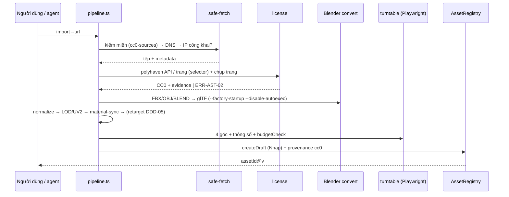

# DDD-03: Asset 3D, vật liệu và âm thanh

| Mục | Nội dung |
|---|---|
| Mã tài liệu | DDD-03 |
| Phiên bản | 1.1 |
| Ngày | 26/11/2026 |
| Tài liệu cha | DDD-00 `DDD-00-TONG-QUAN.md` |
| TSD nguồn | TSD-03 v1.2 (IF-AST-01…06, SCH-AST-01…06, ALG-AST-01…15, TST-AST-01…10) |
| SRS nguồn | SRS-03 v1.1 (FR-AST-01…40, NFR-AST-01…04) |
| Gói | `engine/build/{asset-import, asset-forge, kit-builder, materials, audio}`, `engine/build/blender/{convert, forge}`, lệnh `engine asset …`; `web/api/src/services/{asset-registry, asset-review, asset-search}.ts`; panel `web/app/src/features/assets` |
| Pha | E2 (vật liệu), E4 (asset 3D), E6 (âm thanh), W3–W4 |
| Trạng thái | Đã duyệt (Huy, 23/11/2026); **v1.1 theo CR-02 (Unity), POC-U1 và ADR-037 (AAC)**, chờ Huy xem lại |

---

## 1. Giới thiệu
Thiết kế chi tiết pipeline asset: nhập CC0 có kiểm license và chống SSRF, sinh bằng code theo họ (không dùng AI 3D, QT-AST-01), vật liệu ba nguồn, HDRI, âm thanh, provenance bắt buộc, turntable và cổng duyệt, kho dùng chung. Một bản ghi asset được định danh `(id, version)`; tệp của phiên bản `DaDuyet` bất biến.

---

## 2. Bố trí mã nguồn

| Mã | Tệp | Trách nhiệm |
|---|---|---|
| MOD-AST-01 | `asset-import/src/safe-fetch.ts` | Tải URL an toàn: HTTPS, miền trong danh sách, phân giải DNS rồi chặn IP riêng, nối đúng IP đã kiểm, không theo chuyển hướng khác miền, ≤ 500 MB, 60 s; giải nén zip có kiểm zip-slip |
| MOD-AST-02 | `asset-import/src/license/{index.ts, polyhaven.ts, page.ts}` | Kiểm license theo nguồn (PSC-AST-01), lưu bằng chứng |
| MOD-AST-03 | `asset-import/src/normalize.ts`, `engine/build/blender/convert/to_gltf.py` | Đổi định dạng (FBX/OBJ/BLEND → glTF), đơn vị, trục, pivot, scale, tên |
| MOD-AST-04 | `asset-import/src/lod-uv2.ts` | LOD0–2 bằng `meshoptimizer.simplify`, UV2 bằng `xatlas-wasm` |
| MOD-AST-05 | `asset-import/src/material-sync.ts`, `src/color/{lab.ts, de2000.ts}` | Đồng bộ màu theo `palette`, gộp vật liệu, atlas khi > 4 |
| MOD-AST-06 | `asset-import/src/pipeline.ts` | Điều phối `import`: fetch → license → normalize → LOD → material → (retarget DDD-05) → turntable → ghi bản ghi `Nhap` |
| MOD-AST-07 | `asset-forge/src/{registry.ts, run-recipe.ts, collider.ts}`, `asset-forge/families/<family>/index.ts` | Đăng ký generator, chạy recipe, sinh collider |
| MOD-AST-08 | `engine/build/blender/forge/forge_entry.py`, `blender/forge/families/<family>.py` | Cầu nối generator Blender (hữu cơ: SDF/metaball/remesh) |
| MOD-AST-09 | `kit-builder/src/{kit-builder.ts, kits/<kit>.json}` | Ghép công trình từ module kit theo lưới gian |
| MOD-AST-10 | `asset-import/src/turntable/{turntable.ts, page/index.html}` | Playwright mở trang nhúng Unity player cùng `engineVersion` ở chế độ `?turntable=` (CR-02), chụp 4 góc + ảnh trong cảnh, đo thông số; worker không cần Unity Editor |
| MOD-AST-11 | `materials/src/{index.ts, cc0-scan.ts, ai-texture.ts, tileable.ts, orm.ts}`, `engine/build/py/texproc/{graph.py, nodes.py}` (texture thủ tục numpy, CR-02) | Vật liệu ba nguồn → bộ map PBR chuẩn + `material.json` |
| MOD-AST-12 | `materials/src/hdri.ts`, `engine/build/py/hdri/{prefilter.py, sh.py}` | Tải HDRI, tiền lọc cubemap GGX theo mip + 9 hệ số SH bằng Python/numpy → KTX2 RGBM (CR-02) |
| MOD-AST-13 | `audio/src/{index.ts, loudnorm.ts, loop.ts, encode.ts, ambience.ts}` | Chuẩn hoá, vòng lặp, mã hoá AAC/M4A (ADR-037), gán âm nền |
| MOD-AST-14 | `engine/build/packager/src/credits.ts` | Gom provenance → `manifest.credits` (PSC-AST-07) |
| MOD-AST-15 | `asset-import/src/ai-media-client.ts` | `AiMediaClient` (gateway / handoff skill), `estimateCost` |
| MOD-AST-16 | `asset-import/src/batch-guard.ts` | Chặn sinh hàng loạt khi style bible chưa duyệt; ngưỡng xác nhận chi phí |
| MOD-AST-17 | `asset-import/src/registry/{types.ts, file-registry.ts}` | `AssetRegistry` CLI (`assets/registry.json`); bản CSDL ở `web/api/src/services/asset-registry.ts` |
| MOD-AST-18 | `engine/cli/src/commands/asset.ts` | `engine asset import\|forge\|turntable\|check` |
| MOD-AST-19 | `web/api/src/services/{asset-review.ts, asset-search.ts}` | Duyệt nhiều vòng, tìm kiếm full-text, `usedBy`, ngừng dùng |
| MOD-AST-20 | `web/app/src/features/assets/{asset-library-panel.tsx, asset-review-panel.tsx, turntable-viewer.tsx}` | SCR-AST-01 (kho), SCR-AST-02 (duyệt) |

---

## 3. Thiết kế lớp và giao diện

```ts
// asset-forge/src/registry.ts  (IF-AST-01)
export interface Generator<P = unknown> {
  family: string; version: string;               // semver; đổi major khi đầu ra đổi
  paramsSchema: JSONSchema;
  runner: 'node' | 'blender';
  build(params: P, rng: Pcg32): Promise<GeneratedAsset>;      // runner 'node'
}
export interface GeneratedAsset {
  meshes: { name: string; geometry: GeometryData; material: string }[];
  materials: MaterialSpec[]; colliders: ColliderSpec[];
  lods: { level: 0 | 1 | 2; tris: number }[]; meta: { realSize: [number, number, number]; tags: string[] };
}
export function registerGenerator(g: Generator): void; export function getGenerator(family: string): Generator;

// materials/src/index.ts  (IF-AST-05)
export type MaterialSourceKind = 'procedural' | 'cc0_scan' | 'ai_texture';
export interface MaterialSource { kind: MaterialSourceKind; produce(spec: MaterialRecipe, ctx: StepCtx): Promise<MaterialOutput> }
export interface MaterialOutput { maps: { baseColor: string; normal: string; orm: string; height?: string }; material: MaterialJson; provenance: Provenance }

// asset-import/src/ai-media-client.ts  (IF-AST-06)
export interface AiMediaClient {
  generateImage(r: { task: 'texture' | 'style_ref' | 'concept'; prompt: string; size: 1024 | 2048; refs?: Uint8Array[] }): Promise<Result<{ bytes: Uint8Array; provenance: AiProvenance }>>;
  generateAudio(r: { task: 'sfx' | 'ambience' | 'voice'; prompt?: string; text?: string; voiceId?: string; durationS?: number }): Promise<Result<{ bytes: Uint8Array; mime: string; provenance: AiProvenance }>>;
  estimateCost(batch: { kind: 'image' | 'audio'; count: number; size?: number; seconds?: number }[]): number;   // USD
}

// asset-import/src/registry/types.ts
export interface AssetRegistry {
  get(id: string, version?: number): Promise<AssetRecord | null>;
  createDraft(rec: Omit<AssetRecord, 'version' | 'status'>): Promise<AssetRecord>;   // version = max + 1, status Nhap
  setStatus(id: string, version: number, to: AssetStatus, by: string, reason?: ReviewReason): Promise<Result<void>>;
  usages(id: string): Promise<{ gameId: string; count: number }[]>;
}
```

---

## 4. Dữ liệu

| Mã | Cấu trúc | Đặc tả |
|---|---|---|
| DTO-AST-01 | `AssetRecord` (SCH-AST-01) | `{id: string /*<loai>-<ten>-<bien-the>*/, version: int, kind: 'model'\|'character'\|'animal'\|'material'\|'hdri'\|'audio'\|'texture', name, tags: string[], source: 'cc0'\|'generator'\|'edited'\|'ai', license: 'CC0-1.0'\|'own'\|string, family?, recipeRef?, status: AssetStatus, highRisk: bool, files: {lod0, lod1?, lod2?, collider?, thumb, turntable: string[4], inScene?, maps?, audio?: {aac}}, stats: {lod0Tris, lod1Tris?, lod2Tris?, materials, maxTexture, sizeMB}, budgetCheck: {result, checks[]}, provenanceRef, createdBy, createdAt, ownerGameId?}`; `AssetStatus = 'Nhap'\|'ChoDuyet'\|'DaDuyet'\|'BiTuChoi'\|'NgungDung'` |
| DTO-AST-02 | Recipe (SCH-AST-02) | `{schemaVersion, id, family, generatorVersion: '^1', seed, params: object /*kiểm bằng paramsSchema*/, variants?: {count, seedFrom, safeRanges: {[param]: [min, max]}}, materialRefs: AssetRef[], realSize?: [x,y,z], tags}` |
| DTO-AST-03 | Provenance (SCH-AST-03) | `oneOf` theo `type`: `generator {family, generatorVersion, recipeHash, seed, engineCommit}`; `cc0 {url, author, title, license:'CC0-1.0', retrievedAt, evidence: {file, sha256}, sourceName}`; `edited {derivedFrom: AssetRef[], changes, by}`; `ai {service:'gemini'\|'elevenlabs', model, prompt, requestId, at, terms, fallback?: bool}`; chung `{schema:'provenance/1', assetId, version, createdAt}` |
| DTO-AST-04 | `cc0-sources.json` (SCH-AST-04) | `[{name, domain, contentKinds: ('model'\|'material'\|'hdri'\|'audio')[], approvedBy, approvedAt, apiKind:'polyhaven'\|'page', licenseSelector?: string /*CSS selector cho trang*/, licensePattern?: string}]`; `license-exceptions.json = [{assetUrl, license, approvedBy, approvedAt, reason}]` |
| DTO-AST-05 | Âm thanh (SCH-AST-05) | `{id, kind:'sfx'\|'ambience'\|'music'\|'voice', loop: bool, loopPoints?: {startS, endS}, lufs: -16, durationS, files: {aac:'x.m4a'} /*ADR-037: bỏ Opus*/, tags, surface?: SurfaceKey /*bước chân*/}` |
| DTO-AST-06 | `material.json` | `{id, maps: {baseColor, normal, orm, height?}, tiling: [u,v], sharp: ('baseColor'\|'normal'\|'orm')[] /*map dùng UASTC*/, paletteRole?: string, roughnessRange?: [a,b], source: MaterialSourceKind}` |
| DTO-AST-07 | Thông số turntable | `{views: ['0.png','90.png','180.png','270.png'], inScene?: 'scene.png', stats: {lod0Tris, lod1Tris, lod2Tris, materials, maxTexture, sizeMB}, budgetCheck: Report1['checks'], hdri: 'studio_small_09', fov: 35}` |
| DTO-AST-08 | Yêu cầu duyệt | `{decision: 'approve'\|'reject', reasonCode?: 'lech_phong_cach'\|'vuot_ngan_sach'\|'loi_hinh'\|'khac', reason?: string, scope?: 'one'\|'batch'}` |

### 4.1 Bảng CSDL (web)

#### TBL-AST-01 `assets`
| Cột | Kiểu | Ràng buộc |
|---|---|---|
| `id` | `text` | PK phần 1 |
| `version` | `int` | PK phần 2 |
| `kind`, `source`, `license`, `status` | `text` | `CHECK` theo DTO-AST-01 |
| `name` | `text` | not null |
| `tags` | `text[]` | default `{}` |
| `family`, `recipe_ref` | `text` | null |
| `high_risk` | `bool` | default false |
| `files`, `stats`, `budget_check`, `provenance` | `jsonb` | not null |
| `lod0_tris` | `int` | sinh từ `stats` (cột tạo sẵn để lọc) |
| `owner_game_id` | `text` | FK `games(id)` null |
| `created_by`, `created_at` | `text`, `timestamptz` | |
| `tsv` | `tsvector` | `GENERATED ALWAYS AS (to_tsvector('simple', unaccent(name) \|\| ' ' \|\| array_to_string(tags,' ')))` |

Chỉ mục: `GIN(tsv)`, `GIN(tags)`, B-tree `(kind, status)`, `(source)`, `(license)`, `(lod0_tris)`. Trigger: chặn `UPDATE` cột `files`, `provenance` khi `status='DaDuyet'` (bất biến, FR-AST-37).

#### TBL-AST-02 `asset_reviews` (SCH-AST-06)
`id ulid PK, asset_id, version, round int, by text, at timestamptz, decision text CHECK (approve, reject), reason_code text null, reason text null`; unique `(asset_id, version, round)`; FK `(asset_id, version)` → `assets`.

#### TBL-AST-03 `asset_usages`
`game_id text, asset_id text, version int, count int, updated_at`; PK `(game_id, asset_id, version)`; cập nhật bởi `api` sau mỗi lần ghi dữ liệu game (quét `asset:` trong patch) và job `purge`.

---

## 5. API / giao thức

| Mã | Lệnh / endpoint | Đặc tả |
|---|---|---|
| EP-AST-01 | `engine asset import --url <u> [--kind model\|material\|hdri\|audio] [--game <id>] [--real-size x,y,z] [--family <f>] --json` (API-AST-01) | Đầu ra `{ok, assetId, version, status:'Nhap', budgetCheck, files}`; thoát 4 ERR-AST-01/02/04/06; 6 lỗi mạng |
| EP-AST-02 | `engine asset forge --recipe <file> [--variants n] [--yes] --json` (API-AST-02) | Đầu ra `{ok, assets:[{id, version, seed}], costUsd}`; thoát 3 khi style bible chưa duyệt (> 1 recipe) hoặc chi phí > ngưỡng mà không `--yes` |
| EP-AST-03 | `engine asset turntable --id <assetId>[@v] --json` (API-AST-03) | Sinh lại ảnh + thông số |
| EP-AST-04 | `engine asset check [--provenance] [--game <id>] --json` (API-AST-04) | Quét mọi `asset:`/`audio:` trong `games/<id>/data/**`: có provenance hợp lệ schema, license trong danh sách, `DaDuyet` (trừ `prototypes/**`); đầu ra `report/1` `kind:'build'`, `step:'asset.check'` |
| EP-AST-05 | Web | API-WEB-40…44 ở DDD-08 EP-WEB-21…25; job `asset` gọi EP-AST-01/02 trên worker |

---

## 6. Luồng xử lý

### SEQ-AST-01 Nhập mô hình CC0


### SEQ-AST-02 Duyệt asset (web)
Người duyệt mở SCR-AST-02 → EP-WEB-24 `POST /api/assets/{id}/review` → `asset-review.decide()` (PSC-AST-14) trong giao dịch: chèn `asset_reviews` vòng mới → tính trạng thái → `assets.status` → sự kiện `asset.pending`/`notify` → nếu `DaDuyet` và có `variants` cùng recipe trong `safeRanges` thì duyệt theo lưới cả lô khi `scope='batch'`.

### SEQ-AST-03 Sinh hàng loạt có xác nhận chi phí
`forge` nhiều recipe → `batch-guard.checkStyle(game)` (PSC-AST-08) → `estimateCost` (PSC-AST-12) → vượt 2 USD: CLI hỏi `y/N` (hoặc `--yes`), web trả 409 `needsConfirm` với số tiền, SPA hiện hộp thoại, gửi lại `confirmCostUsd` → chạy từng recipe; lỗi dịch vụ AI → PSC-AST-13.

---

## 7. Máy trạng thái

### STM-AST-01 Vòng đời asset (SRS-03 mục 2.2)
| Từ | Sự kiện | Điều kiện | Tới | Hành động |
|---|---|---|---|---|
| — | tạo bản ghi | — | `Nhap` | Lưu tệp vào `assets/<id>/<v>/` |
| `Nhap` | gửi duyệt | có turntable + `budgetCheck.result ≠ fail` (ngược lại ERR-AST-04) | `ChoDuyet` | Thông báo người có quyền duyệt |
| `ChoDuyet` | duyệt | số vòng `approve` ≥ (`highRisk` ? 2 : 1) | `DaDuyet` | Khoá tệp (trigger), cho đặt vào cảnh |
| `ChoDuyet` | duyệt | `highRisk` và mới 1 vòng | `ChoDuyet` | Ghi vòng 1, chờ vòng 2 ở phiên bản sau chỉnh hoặc xác nhận lại |
| `ChoDuyet` | từ chối | có `reasonCode` (ngược lại ERR-AST-08) | `BiTuChoi` | Lưu lý do |
| `BiTuChoi` | sửa / sinh lại | — | `Nhap` | Tạo phiên bản mới |
| `DaDuyet` | ngừng dùng | — | `NgungDung` | Ẩn khỏi tìm kiếm mặc định |
| `NgungDung` | dùng lại | — | `DaDuyet` | — |
| bất kỳ | xoá | `usages` từ game khác > 0 | (giữ) | ERR-AST-07 |

---

## 8. Thuật toán chi tiết

### PSC-AST-01 Kiểm license (ALG-AST-01)
```
checkLicense(url, srcList, exceptions):
  host = new URL(url).hostname; src = srcList.find(s => host == s.domain or host.endsWith('.' + s.domain))
  if !src: return err('ERR-AST-01', {domain: host})                          # trước khi tải
  if src.apiKind == 'polyhaven': meta = GET api.polyhaven.com/info/<slug>; license = 'CC0-1.0'; evidence = json(meta)
  else: page = playwright.goto(url, {timeout: 30 s}); txt = page.$eval(src.licenseSelector, el => el.textContent)
        license = normalizeLicense(txt, src.licensePattern)       # 'CC0', 'CC0 1.0', 'Public Domain Dedication' → 'CC0-1.0'
        evidence = page.screenshot({fullPage:false}) → evidence/<sha256>.png
  if license != 'CC0-1.0' and !exceptions.some(e => e.assetUrl == url): return err('ERR-AST-02', {license})
  return ok({license, evidence: {file, sha256}, author, title})
```

### PSC-AST-02 Chuẩn hoá (ALG-AST-02)
```
normalize(gltf, opts):
  applyUnitScale(gltf → mét); rotateToYUp nếu nguồn Z-up
  aabb = bounds(scene); pivot = (center.x, aabb.min.y, center.z); translate(-pivot)
  if opts.realSize: s = max(realSize) / max(aabb.size); scale(s)
  rename root = `${kind}-${slug(name)}-${variant ?? 'a'}`; meshes `${root}-m${i}`; materials `${root}-mat${i}`
```

### PSC-AST-03 LOD và UV2 (ALG-AST-03)
```
cap = budgets.assetCaps[kind].lod0Tris      # vd prop nhỏ 3k, nhà 15k, cây 8k, nhân vật 12k (DDD đề xuất, CFG-AST-02)
lod0 = tris(src) <= cap ? src : simplify(src, targetRatio = cap/tris, lockBorder, error ≤ 0.01)
if tris(lod0) > cap · 1.05: return err('ERR-AST-04')
lod1 = simplify(lod0, 0.40); lod2 = simplify(lod0, 0.15)
if kind là vật tĩnh: uv2 = xatlas.generate(lod0, {resolution: 1024, padding: 4}); ghi thuộc tính TEXCOORD_1
```

### PSC-AST-04 Đồng bộ vật liệu (ALG-AST-04)
```
for mat in materials:
  avg = meanLab(baseColorTexture or factor)
  target = argmin_{c in palette.roles['vat_lieu']} ΔE2000(avg, c)
  shift: for pixel: lab = toLab(px); lab.a,b = lerp(lab.a,b, lab.a,b + (target.a,b - avg.a,b), 0.7); L giữ tương đối
  roughness = clamp(roughness, styleBible.roughnessRange)
dedup: gộp vật liệu có cùng hash(maps + factor)
if count > 4: atlas(baseColor, normal, orm) bằng sharp, padding 8 px, chỉnh UV0
chỉ áp cho mô hình CC0 (OIT-AST-01); vật liệu scan giữ nguyên
```

### PSC-AST-05 Generator theo họ (ALG-AST-05)
```
runRecipe(recipe):
  g = getGenerator(recipe.family); assertSemver(g.version, recipe.generatorVersion)
  errs = ajv.validate(g.paramsSchema, recipe.params); if errs → ERR-CLI-01 (thoát 4)
  rng = new Pcg32(deriveSeed(recipe.seed, g.family, g.version))
  out = g.runner == 'node' ? await g.build(recipe.params, rng)
                           : spawnBlender('forge_entry.py', {family, params, seed})   # đọc glTF + meta.json
  colliders = out.colliders.length ? out.colliders : autoCollider(out)  # dạng hộp: AABB; thuôn (tỉ lệ cạnh > 3): capsule; khác: quickhull3d ≤ 64 đỉnh
  → PSC-AST-03 (LOD), PSC-AST-04 (vật liệu từ materialRefs), turntable, provenance generator {recipeHash = sha256(canonicalize(recipe))}
variants: for i in 0..count-1: seed_i = deriveSeed(recipe.seed, 'variant', i); params_i = sampleWithin(safeRanges, Pcg32(seed_i))
kit-builder: spec {bays, floors, roof, wallMaterial, doors} → lưới gian khẩu độ kit.bayM; đặt module wall/door/window theo spec, mái theo kiểu, merge theo vật liệu
```
Generator không đọc tệp, mạng, thời gian; xuất glTF với thứ tự node/thuộc tính ổn định, không `asset.generator` có timestamp (NFR-AST-03).

### PSC-AST-06 Turntable và thông số (ALG-AST-06)
```
browser = chromium.launch(--use-gl=angle --use-angle=swiftshader) (dùng chung cho cả lô)
page.goto(file://turntable/page/index.html?player=<engineVersion>&turntable=<asset>&hdri=studio_small_09)
player (CR-02): canvas 512², IBL cubemap + SH của HDRI (PSC-AST-10), camera FOV 35°, khoảng cách = radius(aabb)/sin(17.5°)·1.1, cao 25% chiều cao
for yaw in [0, 90, 180, 270]: SendMessage('GameStudio','TurntableYaw', yaw) → chờ sự kiện gs:frame → canvas.toDataURL → PNG
inScene: nếu có placedObjects dùng asset trong zone đầu → góc chuẩn đầu tiên của zone; không → cảnh mẫu `_template`
stats = {lod*Tris, materials, maxTexture, sizeMB (sau Meshopt + KTX2 thử)} (đọc từ glb ở Node, không phụ thuộc player); budgetCheck = evaluate(stats, assetCaps[kind]) (DDD-00 PSC-GEN-04)
```

### PSC-AST-07 Credit (ALG-AST-07)
```
credits(build):
  prov = ∪ provenance của mọi asset/audio dùng trong zone đã đóng gói + fetch.provenance.json + LICENSES.md (thư viện)
  groups = {ban_do, mo_hinh_cc0, vat_lieu_hdri, am_thanh, dich_vu_ai, ma_nguon}
  for p in prov: g = groupOf(p); key = (p.author ?? p.service, p.sourceName ?? p.url host); groups[g][key] ∪= p.title
  ghi manifest.credits = [{group, items:[{author, source, titles[], license}]}] sắp theo group rồi author
```

### PSC-AST-08 Chặn sinh hàng loạt (ALG-AST-08)
`isBatch = recipes.length > 1 or (variants.count > 1) or aiTextureBatch`; nếu `isBatch` và (`game.styleBibleVersion == null` hoặc style bible bản đó chưa `DaDuyet`) → CLI thoát 3, web 409 với mã nội bộ `BLOCKED_STYLE_BIBLE` và thông điệp "Hãy duyệt style bible trước khi sinh hàng loạt" (FR-INT-22). SRS chưa có mã ERR riêng cho trường hợp này (OID-AST-03).

### PSC-AST-09 Vật liệu ba nguồn (ALG-AST-09)
```
procedural: đồ thị JSON {nodes: noise|voronoi|brick|wood|cloth|blend|levels, seed} → numpy (engine/build/py/texproc, RNG Pcg32 theo seed) → PNG 2048/4096 (CR-02: bỏ shader GLSL trong Playwright)
cc0_scan:   tải Poly Haven 4K (diff, nor_gl, rough, metal, ao) → đổi tên chuẩn → ORM = (R=ao, G=rough, B=metal) bằng sharp
ai_texture: AiMediaClient.generateImage(task 'texture', size 2048)
  tileable(img): for 4 mép: d = meanΔE(Lab(strip 8 px mép trái), Lab(strip 8 px mép phải)) ; ok nếu max d ≤ 3 (OIT-AST-02)
  không ok: img = offset(w/2, h/2); blend chéo dải 64 px qua đường nối; kiểm lại; vẫn lỗi → cảnh báo, giữ
normal từ height (Sobel) khi nguồn không có normal
```

### PSC-AST-10 HDRI (ALG-AST-10)
Tải `.hdr`/`.exr` 4K; tier Thấp/Vừa giảm 2K; ở build (CR-02) Python/numpy chiếu equirect → cubemap 6 mặt, tiền lọc GGX theo mip (độ nhám 0…1, 6 mip, lấy mẫu quan trọng 256 mẫu/texel, seed cố định) → mã RGBM → KTX2 UASTC; tính 9 hệ số SH bậc 2 cho ánh sáng môi trường → `hdri/<id>.sh.json`. Runtime gán cubemap cho `RenderSettings.customReflectionTexture` và SH cho `RenderSettings.ambientProbe` (không tính lọc lúc chạy).

### PSC-AST-11 Âm thanh (ALG-AST-11)
```
loudnorm 2 lượt: ffmpeg -i in -af loudnorm=I=-16:TP=-1.5:LRA=11:print_format=json -f null -  → đọc measured_*
                 ffmpeg -i in -af loudnorm=I=-16:...:measured_I=..:linear=true out.wav
loop: tìm zero-crossing gần startS/endS nhất (±20 ms); crossfade 50 ms (acrossfade) phần cuối vào đầu
encode (ADR-037): ffmpeg -c:a aac -b:a 128k x.m4a (ambience, voice: 96k mono -ac 1); loopPoints trừ độ trễ priming của AAC (đọc từ ffprobe start_time) rồi kiểm mép không click
ambience: world.ambience[] {regionId|zoneId, todIds[], ref, volume} → runtime chọn theo vùng + mốc (DDD-04 audio)
bước chân: surface tại chân → footstepSet của surface (DTO-WLD-06)
```

### PSC-AST-12 Ngưỡng chi phí lô (ALG-AST-12)
`estimate = Σ unitPrice(service, kind) × count` với đơn giá từ `ai_config` (web) hoặc `tools/ai-prices.json` (CLI); `estimate > batchConfirmThreshold` (2 USD, OI-AST-04) → yêu cầu xác nhận (CLI `y/N` hoặc `--yes`; web 409 `needsConfirm`).

### PSC-AST-13 Dịch vụ AI lỗi (ALG-AST-13)
```
callWithRetry(fn, jobRef):
  for attempt in 1..3:
     r = fn({requestId: jobRef})        # giữ id yêu cầu/id job của dịch vụ để không tính tiền hai lần
     if ok: return r
     if r.status in [429, 500..599] or timeout: sleep(30 s); continue
     if r.status == 402 or r.code == 'quota': break
  fallback: texture → procedural (đồ thị mặc định theo paletteRole); âm thanh → bộ âm CC0 thủ tục có sẵn
  provenance.fallback = true; cảnh báo ERR-AST-05
```

### PSC-AST-14 Duyệt (ALG-AST-14)
```
decide(assetId, v, by, d):
  tx: a = SELECT … FOR UPDATE assets(id, v); require a.status == 'ChoDuyet'
      if d.decision == 'reject' and !d.reasonCode: return err('ERR-AST-08')
      round = 1 + count(asset_reviews where id,v)
      insert asset_reviews(round, by, decision, reasonCode, reason)
      if reject: a.status = 'BiTuChoi'
      else: approvals = count(decision='approve'); need = a.high_risk ? 2 : 1
            a.status = approvals >= need ? 'DaDuyet' : 'ChoDuyet'
      if d.scope == 'batch' and a.status == 'DaDuyet': áp cùng quyết định cho mọi asset cùng recipeRef có params trong safeRanges và đang ChoDuyet
```
Vòng 2 của `highRisk` phải do người khác vòng 1 hoặc ở phiên bản sau chỉnh sửa (kiểm `by` khác hoặc `version` khác).

### PSC-AST-15 Kho chung (ALG-AST-15)
```sql
SELECT id, version, name, kind, files->>'thumb' AS thumb, stats
FROM assets
WHERE ($q = '' OR tsv @@ plainto_tsquery('simple', unaccent($q)))
  AND ($kind IS NULL OR kind = $kind) AND ($source IS NULL OR source = $source)
  AND ($license IS NULL OR license = $license) AND status <> 'NgungDung' -- trừ khi includeDeprecated
  AND (id, version) IN (SELECT id, max(version) FROM assets GROUP BY id)
ORDER BY ts_rank(tsv, plainto_tsquery('simple', unaccent($q))) DESC, created_at DESC
LIMIT 48 OFFSET $page*48;
```
`usedBy` = `asset_usages` nhóm theo `game_id`; xoá → nếu tồn tại `game_id ≠ ownerGameId` → ERR-AST-07, chỉ cho `NgungDung`.

---

## 9. Xử lý lỗi

| Mã | Nơi | Mã thoát / HTTP | Xử lý |
|---|---|---|---|
| ERR-AST-01 | PSC-AST-01 | 4 / 422 | Không tải |
| ERR-AST-02 | PSC-AST-01 | 4 / 422 | Không nhập, ghi lý do |
| ERR-AST-03 | Packager, EP-AST-04 | 4 / build Fail | Liệt kê asset |
| ERR-AST-04 | PSC-AST-03 | 4 / 422 | Giữ `Nhap` |
| ERR-AST-05 | PSC-AST-13 | 0 + cảnh báo | Phương án thủ tục |
| ERR-AST-06 | Retarget (DDD-05 PSC-CHR-01) | 4 / 422 | Giữ `Nhap` |
| ERR-AST-07 | PSC-AST-15 | — / 409 | Chỉ ngừng dùng |
| ERR-AST-08 | PSC-AST-14 | — / 422 | Không lưu |

---

## 10. Cấu hình

| Mã | Khoá | Mặc định | Nơi |
|---|---|---|---|
| CFG-AST-01 | `cc0-sources.json`, `license-exceptions.json` | Poly Haven; nguồn khác Huy duyệt ở E2 (OIT-GEN-06) | `engine/build/asset-import/config/` (CLI), bảng `cc0_sources` (web) |
| CFG-AST-02 | `assetCaps` trong `budgets.json` | prop nhỏ 3k, prop vừa 8k, nhà 15k, cây 8k, nhân vật 12k, động vật 8k tri LOD0 (DDD đề xuất) | `games/<id>/data/budgets.json` |
| CFG-AST-03 | Tải | 500 MB, 60 s, chỉ HTTPS | `safe-fetch.ts` |
| CFG-AST-04 | `batchConfirmThreshold` | 2 USD (OI-AST-04) | `ai_config` / `tools/ai-prices.json` |
| CFG-AST-05 | Âm thanh | −16 LUFS, AAC/M4A 128 kbps stereo, nền và giọng 96 kbps mono (ADR-037) | `audio/src/encode.ts` |
| CFG-AST-06 | Đồng bộ màu | hệ số pha 0,7 (TSD đề xuất), tileable ΔE ≤ 3 | `material-sync.ts`, `tileable.ts` |

---

## 11. Thiết kế kiểm thử

| Mã | Ca | Dữ liệu / bước | Kỳ vọng | TSD |
|---|---|---|---|---|
| TC-AST-01 | Nhập chum CC0 | `fixtures/polyhaven-jar/` (mock HTTP) | Pivot giữa đáy, scale đúng `realSize`, 3 LOD, provenance có URL + license | TST-AST-01 |
| TC-AST-02 | License sai | Trang mock CC-BY-NC | ERR-AST-02, không ghi bản ghi | TST-AST-02 |
| TC-AST-03 | 10 biến thể | Recipe "nhà một gian", `variants.count=10` | 10 asset, mỗi cái có provenance generator, không sửa code | TST-AST-03 |
| TC-AST-04 | Thiếu provenance | Xoá `*.provenance.json` một asset | `engine build` Fail chỉ rõ asset (ERR-AST-03) | TST-AST-04 |
| TC-AST-05 | Hạ texture | Vật liệu 4096² | Bản tier Vừa KTX2 2048² | TST-AST-05 |
| TC-AST-06 | Duyệt 2 vòng | Asset `highRisk` | Sau vòng 1 vẫn `ChoDuyet`; vòng 2 → `DaDuyet` | TST-AST-06 |
| TC-AST-07 | Credit đủ nhóm | Bản build có CC0, OSM, MIT, AI | `credits` có đủ 4 nhóm, không trùng tác giả | TST-AST-07 |
| TC-AST-08 | Tất định generator | Cùng recipe 2 lần | Cùng SHA-256 tệp glTF | TST-AST-08 |
| TC-AST-09 | Không AI 3D | grep CI | Không có `meshy`/`tripo` trong `web/ai-gateway/**`, `.claude/**`, `ai_config` seed | TST-AST-09 |
| TC-AST-10 | SSRF | URL `https://127.0.0.1/x`, `169.254.169.254`, chuyển hướng sang miền khác, DNS rebinding (DNS trả IP nội bộ lần 2) | Đều bị chặn trước khi gửi byte nào | TST-AST-10 |
| TC-AST-11 | Từ chối không lý do | `decision=reject` thiếu `reasonCode` | ERR-AST-08 | ALG-AST-14 |
| TC-AST-12 | Xoá asset đang dùng | Asset dùng ở 2 game | ERR-AST-07 | ALG-AST-15 |
| TC-AST-13 | Tìm kho | 5.000 asset giả | Truy vấn ≤ 1 s, 48 kết quả/trang | ALG-AST-15 |
| TC-AST-14 | Lô vượt ngưỡng | 30 texture AI ước lượng 3 USD | CLI hỏi xác nhận; web 409 `needsConfirm` | ALG-AST-12 |
| TC-AST-15 | Hết credit | Mock 402 | Texture thủ tục, `fallback: true`, ERR-AST-05 | ALG-AST-13 |

---

## 12. Open item

| Mã | Câu hỏi | Đề xuất |
|---|---|---|
| OID-AST-01 | Trần tri LOD0 theo loại asset (CFG-AST-02) | Đo trên 20 asset mẫu E4; chỉnh theo ngân sách `trisStatic` zone |
| OID-AST-02 | Bộ âm CC0 thủ tục dự phòng | Chuẩn bị 20 âm cơ bản ở E6 |
| OID-AST-03 | Mã lỗi khi sinh hàng loạt mà style bible chưa duyệt | Đề xuất thêm mã ERR ở lần cập nhật SRS-01/03 tới; tạm dùng `BLOCKED_STYLE_BIBLE` |

---

## 13. Truy vết

| FR / NFR | Thành phần TSD | Thành phần DDD |
|---|---|---|
| FR-AST-01, 02 | SCH-AST-04, ALG-AST-01 | MOD-AST-01, MOD-AST-02, DTO-AST-04, PSC-AST-01, CFG-AST-01 |
| FR-AST-03 | ALG-AST-02 | MOD-AST-03, PSC-AST-02 |
| FR-AST-04 | ALG-AST-03 | MOD-AST-04, PSC-AST-03, CFG-AST-02 |
| FR-AST-05 | ALG-AST-04 | MOD-AST-05, PSC-AST-04 |
| FR-AST-06 | ALG-CHR-01 | DDD-05 PSC-CHR-01; MOD-AST-06 |
| FR-AST-07…11 | IF-AST-01, ALG-AST-05, SCH-AST-02 | MOD-AST-07…09, DTO-AST-02, PSC-AST-05, EP-AST-02 |
| FR-AST-12 | IF-AST-06 | MOD-AST-15 |
| FR-AST-13 | ALG-AST-05 | PSC-AST-05 (generator họ mới qua phiếu, DDD-09) |
| FR-AST-14…17 | IF-AST-05, ALG-AST-09 | MOD-AST-11, DTO-AST-06, PSC-AST-09 |
| FR-AST-18 | ALG-AST-10 | MOD-AST-12, PSC-AST-10 |
| FR-AST-19 | ALG-CLI-02 | DDD-04 PSC-CLI-02 |
| FR-AST-20…25 | ALG-AST-11, SCH-AST-05 | MOD-AST-13, DTO-AST-05, PSC-AST-11, CFG-AST-05 |
| FR-AST-26…28 | SCH-AST-03 | DTO-AST-03 |
| FR-AST-29 | ALG-CLI-02, IF-AST-04 | EP-AST-04, DDD-04 PSC-CLI-02 |
| FR-AST-30 | ALG-AST-07 | MOD-AST-14, PSC-AST-07 |
| FR-AST-31…35 | ALG-AST-06, ALG-AST-14, SCH-AST-06 | MOD-AST-10, MOD-AST-19, MOD-AST-20, DTO-AST-07, DTO-AST-08, TBL-AST-02, STM-AST-01, PSC-AST-06, PSC-AST-14, SEQ-AST-02 |
| FR-AST-36…38 | ALG-AST-15, SCH-AST-01 | DTO-AST-01, TBL-AST-01, TBL-AST-03, PSC-AST-15 |
| FR-AST-39 | ALG-AST-12 | MOD-AST-16, PSC-AST-12, SEQ-AST-03, CFG-AST-04 |
| FR-AST-40 | ALG-AST-13 | PSC-AST-13 |
| NFR-AST-01…04 | TST-AST-08 | PSC-AST-05, PSC-AST-06, TC-AST-08, TC-AST-13 |
| — | IF-AST-02, IF-AST-03 | EP-AST-01, EP-AST-02, MOD-AST-18, SEQ-AST-01 |
| — | ALG-AST-08 | MOD-AST-16, PSC-AST-08 |
| — | TST-AST-01…10 | TC-AST-01…10 |

---

## 14. Lịch sử thay đổi

| Phiên bản | Ngày | Người | Nội dung |
|---|---|---|---|
| 0.1 | 22/11/2026 | Claude | Bản đầu từ TSD-03 v1.1 |
| 1.0 | 23/11/2026 | Huy | Duyệt bộ DDD; thay đổi sau đây theo change request |
| 1.1 | 26/11/2026 | Claude | CR-02 (ADR-036), POC-U1, ADR-037: MOD-AST-10 và PSC-AST-06 turntable bằng Unity player `?turntable=`; MOD-AST-11, PSC-AST-09 texture thủ tục bằng numpy; MOD-AST-12, PSC-AST-10 HDRI cubemap + SH bằng Python; MOD-AST-13, PSC-AST-11, DTO-AST-01, 05, CFG-AST-05 âm thanh chỉ AAC/M4A |
