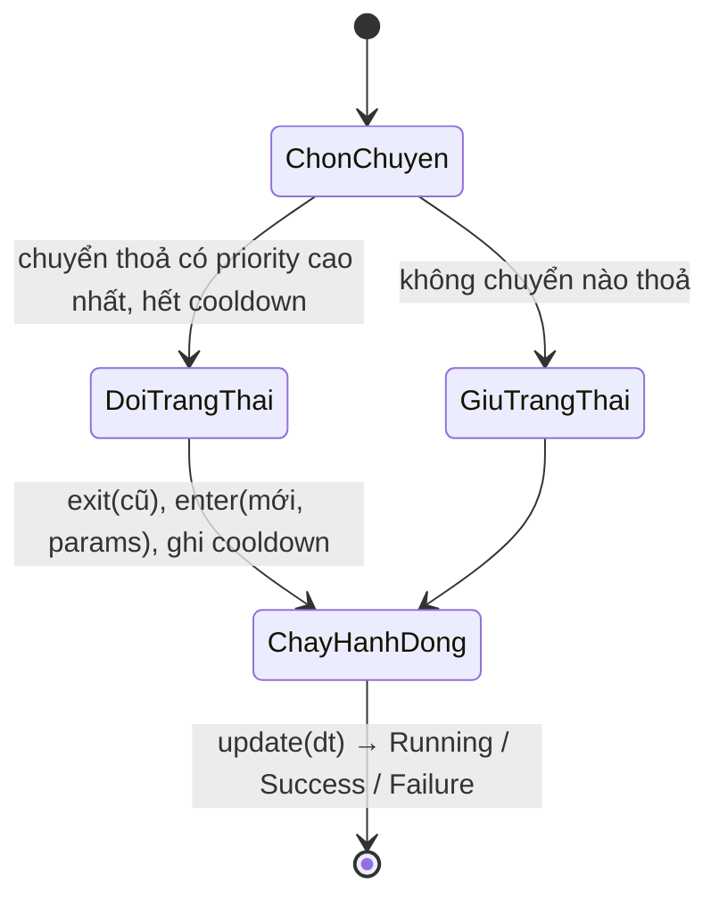

# DDD-05: Nhân vật người chơi, NPC và động vật

| Mục | Nội dung |
|---|---|
| Mã tài liệu | DDD-05 |
| Phiên bản | 1.2 |
| Ngày | 28/11/2026 |
| Tài liệu cha | DDD-00 `DDD-00-TONG-QUAN.md` |
| TSD nguồn | TSD-05 v1.2 (IF-CHR-01…04, SCH-CHR-01…06, ALG-CHR-01…16, TST-CHR-01…10) |
| SRS nguồn | SRS-05 v1.1 (FR-CHR-01…44, NFR-CHR-01…04) |
| Gói | Runtime trong Unity player `engine/unity/Assets/GameStudio/{CameraPlayer, Characters, NpcAi}` (C#, CR-02; dưới đây viết tắt bỏ tiền tố `engine/unity/Assets/GameStudio/`); bước build `engine/build/steps/{navmesh, characters-bake}`; `engine/families/<family>/`; retarget `engine/build/asset-import/src/retarget` + `engine/build/blender/retarget`; panel `web/app/src/features/{npc, animals, behavior}` |
| Pha | E2 (người chơi), E4 (họ, retarget), E6 (NPC, động vật), E7 (đám đông VAT); W3 |
| Trạng thái | Đã duyệt (Huy, 23/11/2026); **v1.1 runtime Unity theo CR-02 và POC-U1**, chờ Huy xem lại |

> Số còn mở: ngưỡng LOD hành vi gần/vừa/xa **30/80 m** là giá trị khởi tạo của cấu hình CFG-CHR-01, chờ đo ở E6 (OI-CHR-07). Mã không viết cứng hai số này.

---

## 1. Giới thiệu
Thiết kế chi tiết người chơi (controller viên nang, camera), khung xương 6 họ và retarget, animation + LOD, hành vi khai báo bằng graph, scheduler LOD hành vi, navmesh và tránh nhau, đàn/gia cầm/chim/cá, lịch trình, luật xuất hiện, đám đông VAT, âm động vật; trong ngân sách CPU ≤ 4 ms/khung trên A56 và không cấp phát trong vòng nóng.

---

## 2. Bố trí mã nguồn

| Mã | Tệp | Trách nhiệm |
|---|---|---|
| MOD-CHR-01 | `CameraPlayer/PlayerController.cs`, `CameraPlayer/PlayerSystem.cs` | Hệ thống `cameraPlayer` (order 20): controller viên nang trên `CharacterController` của Unity Physics, trạng thái di chuyển STM-CHR-01 |
| MOD-CHR-02 | `CameraPlayer/ThirdPersonCamera.cs`, `CameraPlayer/FirstPersonCamera.cs` | Camera ngôi ba (sphere cast, kéo gần), ngôi một (head-bob) |
| MOD-CHR-03 | `Characters/FamilyRegistry.cs`, `Characters/FamilyLoader.cs` (glTFast) | Nạp `family.json`, khung xương, clip của họ |
| MOD-CHR-04 | `Characters/CharactersSystem.cs`, `Characters/AnimatorPool.cs` (Playables `AnimationMixerPlayable`), `Characters/FootIk.cs`, `Characters/HeadLook.cs`, `Characters/CharacterLod.cs` | Hệ thống `characters` (order 40): pool đồ thị Playables, IK chân, xoay đầu, LOD hình |
| MOD-CHR-05 | `Characters/CrowdInstancing.cs`, `Shaders/Vat.shadergraph` | Đám đông xa bằng VAT trên GPU |
| MOD-CHR-06 | `NpcAi/AgentStore.cs` | `AgentStore` SoA bằng `NativeArray` (DTO-CHR-08) |
| MOD-CHR-07 | `NpcAi/Graph/{GraphLoader.cs, GraphCompile.cs}`; kiểm tĩnh và gộp `extends` chạy ở build/Web Studio (`engine/shared/behavior/src/{check.ts, extends.ts}`) | Nạp graph đã gộp, biên dịch điều kiện bằng `Shared/Expr` C# |
| MOD-CHR-08 | `NpcAi/Actions/{Idle, Patrol, Wander, Goto, Follow, React, Graze, Rest, Herd, Flee, AnimalAction}.cs`, `NpcAi/Actions/ActionRegistry.cs` | Thư viện hành động (`ActionImpl`) |
| MOD-CHR-09 | `NpcAi/Scheduler.cs` | Phân nhóm LOD hành vi, xoay vòng, nhảy cóc |
| MOD-CHR-10 | `NpcAi/Nav/NavService.cs`, `NpcAi/Nav/NavMeshZoneBuilder.cs` | `NavService` bọc Unity AI Navigation (`NavMesh.CalculatePath`, `NavMeshAgent`); dựng `NavMeshData` theo ô bất đồng bộ lúc nạp zone, giữ trong phiên (CR-02, POC-U1) |
| MOD-CHR-11 | `NpcAi/Perception.cs`, `NpcAi/Personality.cs` | Nhận thức người chơi, tham số tính cách |
| MOD-CHR-12 | `NpcAi/Herd.cs`, `NpcAi/Poultry.cs` | Đàn thú, gia cầm tán loạn/tụ lại |
| MOD-CHR-13 | `NpcAi/FlockBirds.cs`, `NpcAi/SpatialHash.cs` | Boids chim 3D, đậu/cất cánh, sprite xa |
| MOD-CHR-14 | `NpcAi/SchoolFish.cs` | Boids cá 2,5D trong mask nước |
| MOD-CHR-15 | `NpcAi/Schedule.cs` | Lịch trình theo giờ game |
| MOD-CHR-16 | `NpcAi/Spawn.cs` | Luật xuất hiện khi zone nạp |
| MOD-CHR-17 | `NpcAi/NpcAiSystem.cs`, `NpcAi/AnimalAudio.cs` | Hệ thống `npcAi` (order 30) điều phối; pool âm động vật |
| MOD-CHR-18 | `engine/build/steps/navmesh/{step.json, index.ts, agent-types.ts}` | Gom hình nguồn (collider địa hình, vật đặt, vùng nước sâu) và thông số tác nhân thành `nav/sources.json` cho player; không dựng navmesh ở build (CR-02) |
| MOD-CHR-19 | `engine/build/steps/characters-bake/{step.json, index.ts, vat-bake.ts}` | Nướng clip thành texture VAT |
| MOD-CHR-20 | `engine/families/<family>/{family.json, skeleton.glb, clips/*.glb, default.graph.json}` | 6 họ: `nguoi`, `dong_vat_4_chan_nho`, `dong_vat_4_chan_lon`, `gia_cam`, `chim`, `ca` |
| MOD-CHR-21 | `engine/build/asset-import/src/retarget/{bone-map.ts, retarget.ts}`, `engine/build/blender/retarget/retarget.py` | Retarget mô hình và clip về họ |
| MOD-CHR-22 | `web/app/src/features/npc/npc-editor-panel.tsx`, `features/animals/animal-editor-panel.tsx`, `features/behavior/behavior-graph-panel.tsx`, `features/behavior/condition-builder.tsx` | SCR-CHR-01, SCR-CHR-02, SCR-CHR-03 |

---

## 3. Thiết kế lớp và giao diện

```ts
// NpcAi/Actions/ActionRegistry.cs  (IF-CHR-01; C# từ CR-02)
public enum Status : byte { Running = 0, Success = 1, Failure = 2 }
public interface IActionImpl {
  ActionId Id { get; }                                     // Idle, Patrol, ...
  void Enter(int a, in ActionParams p);                    // ghi trạng thái riêng vào store.Scratch[a*16 ...]
  Status Tick(int a, float dt);                            // không cấp phát
  void Exit(int a);
}
// a = AgentRef: chỉ số trong AgentStore

// NpcAi/Nav/NavService.cs  (IF-CHR-02)
public sealed class NavService {
  public bool FindPath(Vector3 from, Vector3 to, AgentType t, PathBuffer outPath);  // NavMesh.CalculatePath; PathBuffer cấp sẵn 64 điểm
  public bool NearestValid(Vector3 p, AgentType t, out Vector3 q);                   // NavMesh.SamplePosition
  public int CrowdAdd(int a, AgentType t, Vector3 pos, in CrowdParams prm);          // NavMeshAgent từ pool, trả crowd idx
  public void CrowdRemove(int idx); public void CrowdSetTarget(int idx, Vector3 target);
  public void CrowdRead(int idx, out Vector3 pos, out Vector3 vel);
  public bool ZoneReady(int zoneIdx);                                                 // NavMesh của zone đã dựng xong (PSC-CHR-07)
}
public enum AgentType : byte { Nguoi, Thu4Nho, Thu4Lon, GiaCam }                      // mỗi loại một agentTypeID của NavMesh

// CameraPlayer/PlayerController.cs
public sealed class PlayerController {
  public PlayerController(EngineContext ctx, PlayerJson cfg);  // tạo CharacterController (radius, height, slopeLimit, stepOffset)
  public void Tick(float dt, in InputState input);             // PSC-CHR-02
  public Vector3 Pos { get; } public Vector3 Vel { get; } public PlayerMoveState State { get; }  // STM-CHR-01
  public void Teleport(Vector3 p, float yaw);
}

// Characters/AnimatorPool.cs
public sealed class AnimatorPool {
  public AnimatorPool(int max /* = 12 cá thể gần */);
  public int Acquire(int owner /* -1 = người chơi */, FamilyId family, Transform root);  // -1 khi hết
  public void Release(int slot);
  public void Play(int slot, ClipName clip, float fadeS = 0.2f, float timeScale = 1f);
}
```

Sự kiện runtime (IF-CHR-04) dùng `EventBus` (DDD-04): `EVT_AGENT_STUCK (a = agentRef, b = zoneIdx)`, `EVT_AGENT_STATE (a = agentRef, b = stateIdx)`, `EVT_PERCEPTION_PLAYER (a = agentRef, b = 1 thấy / 0 mất)`, `EVT_FOOTSTEP (a = agentRef hoặc −1 người chơi, b = surfaceId)`.

---

## 4. Dữ liệu

| Mã | Cấu trúc | Đặc tả |
|---|---|---|
| DTO-CHR-01 | `player.json` (SCH-CHR-01) | `{model: AssetRef, family:'nguoi', heightM: 1.7, radiusM: 0.3, speed: {walk: 1.4, run: 4.0}, abilities: {jump: bool, sit: bool, swim: bool, climb: bool}, runInput: 'hold'\|'toggle', maxSlopeDeg: 40, stepHeightM: 0.35, customization?: {outfits: string[], colors: {[slot]: string[]}}}` |
| DTO-CHR-02 | `npc.json` / `npc-template` (SCH-CHR-02) | `{id, name, role, template?: bool, appearance: {model: AssetRef, outfitVariant?, colors: {[slot]: hex}}, behavior: 'graph:<id>' \| BehaviorGraph, patrol?: [x,y,z][], schedule: ScheduleEntry[], dialogue?: NpcDialogue /*DDD-07*/, personality: Personality, interactable: bool, invulnerable: bool, essential: bool, homeRegion?: regionId, combat?: CombatBlock /*DDD-06*/}`; template thêm `variation: {outfits[], colors[], heightJitter: 0.05}` |
| DTO-CHR-03 | `animal.json` (SCH-CHR-03) | `{id, species, family, model: AssetRef, behavior: 'graph:<id>', personality, speed: {walk, run}, sounds: {[behaviorState]: AudioRef[]}, minDepth? /*cá*/, adoptable?: bool, perchTags?: string[] /*chim*/, fleeRadius?, combat?}` |
| DTO-CHR-04 | Graph hành vi (SCH-CHR-04) | `{id, extends?: graphId, initial: stateId, states: [{id, action: ActionId, params: object}], transitions: [{from: stateId \| '*', to, when: string /*biểu thức*/, priority: int, cooldownS?: number}]}` |
| DTO-CHR-05 | Luật xuất hiện (SCH-CHR-05) | `{id, zone, region, ref: 'animal:<id>' \| 'npc:template:<id>', min, max, hours: [[from,to]], group?: {size: [a,b], leader: bool}, seed}` |
| DTO-CHR-06 | Nguồn navmesh (SCH-CHR-06, CR-02) | `build/<id>/<zone>/nav/sources.json` (schema `nav-sources/1`, CR-05) = `{schema: 'nav-sources/1', zone, agentTypes: [{agentType, radius, height, maxSlope, maxClimb}], voxelSize: 0.2, tileSize: 64, bounds, tiles: [{x, z, bounds}], sources: [{kind: 'terrain'\|'placement'\|'water_deep', ref, area: 'walkable'\|'not_walkable'}]}`; player dựng `NavMeshData` từng ô bằng `NavMeshBuilder.UpdateNavMeshDataAsync` |
| DTO-CHR-07 | `family.json` (IF-CHR-03) | `{id, bones: string[] /*tên chuẩn*/, required: string[], boneMap: {[chuẩn]: string[] /*tên nguồn hay gặp*/}, restPose: {[bone]: [qx,qy,qz,qw]}, clips: {[name]: path}, baseSpeed: {walk, run}, agent: {type: AgentType, radius, height, maxSlope, maxClimb}, defaultGraph: graphId, footBones?: [l, r], headBone?}` |
| DTO-CHR-08 | Bố trí `AgentStore` | Dung lượng `N = budgets[tier].skinnedCharacters.npc + .animal + flockInstances`; mảng (C# từ CR-02: `NativeArray<float/ushort/byte/…>` cùng độ dài và bố trí; tên kiểu ghi theo bản gốc): `pos Float32Array(3N)`, `vel(3N)`, `yaw(N)`, `state Uint16Array(N)` (chỉ số trạng thái graph), `prevState(N)`, `lod Uint8Array(N)` (0 gần, 1 vừa, 2 xa, 3 ngoài tầm nhìn), `kind Uint8Array(N)` (npc/animal/bird/fish), `species Uint16Array(N)`, `graph Uint16Array(N)`, `seed Uint32Array(N)`, `rngState Uint32Array(2N)`, `lastT Float32Array(N)`, `cooldownUntil Float32Array(N·8)` (8 chuyển có cooldown mỗi agent), `scratch Float32Array(16N)`, `crowdIdx Int16Array(N)`, `mixerSlot Int16Array(N)`, `flags Uint8Array(N)` (essential, invulnerable, closeUp, visible), `alive Uint8Array(N)`; danh sách trống `freeList Int32Array(N)` |

### 4.1 Tham số tính cách (SRS-05 mục 6.3)

| `personality` | `approachRadius` | `fleeRadius` | `followChance` | Phản ứng với người chơi |
|---|---|---|---|---|
| `than_thien` | 5 m | — | 0,3 | `react: approach`, có thể `follow` |
| `nhut_nhat` | — | 6 m (gà 4 m) | 0 | `flee`; bán kính × hệ số ngồi/đi chậm khi bật săn (DDD-06) |
| `tho_o` | — | 1,5 m (chỉ tránh) | 0 | Tránh qua Crowd, tiếp tục việc |
| `hung_du` | — | — | 0 | Chỉ khi `combat.enabled`; tắt chiến đấu → như `tho_o` (QT-CHR-04) |

---

## 5. API / giao thức

| Mã | Giao thức | Đặc tả |
|---|---|---|
| EP-CHR-01 | Bước `navmesh` | `deps: [terrain.mesh, water, placement]`; `dataPointers: ['/entities~1animals', '/entities~1npc', '/world.json/spawns']` (chỉ để biết loại tác nhân cần); `perZone: true`, runner node; đầu ra DTO-CHR-06 cho các `agentType` có mặt trong zone (CR-02: NavMesh dựng lúc nạp trong player) |
| EP-CHR-02 | Bước `characters-bake` | `deps: [assets]`; đầu vào: họ và clip `walk/idle/work` của mô hình đám đông; đầu ra `vat/<model>.ktx2` (RGBA16F hoặc RGBA8 mã hai kênh, OIT-CHR-02) + `vat/<model>.json {frames, fps:30, bones, clipRanges}` |
| EP-CHR-03 | API test engine cho editor | `EditorBridge` (DDD-08) gọi engine: `resetSeed()`, `setHour(h)`, `placePatrolPoint(x,y) → {pos, valid}` (raycast địa hình + `nearestValid`) |

---

## 6. Luồng xử lý

### SEQ-CHR-01 Một khung cập nhật
```mermaid
sequenceDiagram
    participant IN as input (10)
    participant PL as cameraPlayer (20)
    participant AI as npcAi (30)
    participant SC as scheduler
    participant NS as NavService/Crowd
    participant CH as characters (40)
    IN->>PL: InputState
    PL->>PL: controller + camera (PSC-CHR-02, 03)
    PL->>AI: vị trí người chơi
    AI->>SC: chia nhóm LOD theo khoảng cách camera
    SC->>AI: danh sách agent đến lượt (gần: mọi; vừa: nhóm xoay vòng; xa: 1–2 Hz)
    AI->>AI: graph: đánh giá chuyển → action.update
    AI->>NS: crowdSetTarget / crowdUpdate(dt) (agent gần/vừa)
    NS-->>AI: pos/vel
    AI->>AI: flocks chim/cá, đàn, gia cầm
    AI->>CH: pos, yaw, state, speed
    CH->>CH: mixer (≤ 12), IK chân, xoay đầu, LOD, VAT
```

### SEQ-CHR-02 Zone nạp → xuất hiện
`ZoneStreamer.onZoneLoaded(z)` → `npc-ai.onZoneLoaded` → nạp navmesh zone (`NavService.addTiles`) → với mỗi luật `world.spawns` của zone: PSC-CHR-14 → cấp chỉ số trong `AgentStore` (`freeList`) → gán graph, seed, loài → NPC có tên trong `entities/npc` đặt tại `schedule` hiện tại hoặc `homeRegion` → `characters` gắn mô hình (instancing theo loài) → zone giải phóng: lưu trạng thái tối thiểu (vị trí, state) vào bản đồ theo id ổn định để khi nạp lại tiếp tục.

### SEQ-CHR-03 Áp nóng hành vi từ editor
EP-WEB-14 ghi phiên bản → `data.version` (runtimeOnly) → `Engine.applyRuntimeData` → `npc-ai.onRuntimeData(diff)`: diff chạm `/behaviors/<g>` → biên dịch lại graph `g` (PSC-CHR-06), agent dùng `g` giữ trạng thái nếu id còn tồn tại, ngược lại về `initial`; diff chạm `/entities/npc/<id>/schedule|personality|patrol` → cập nhật agent tương ứng; không tải lại zone.

---

## 7. Máy trạng thái

### STM-CHR-01 Di chuyển người chơi
| Trạng thái | Vào khi | Ra khi |
|---|---|---|
| `Dung` | vận tốc mong muốn = 0, trên đất | có input → `Di`/`Chay` |
| `Di` | input, không giữ chạy | giữ chạy → `Chay`; nhả → `Dung` |
| `Chay` | giữ/bật chạy (`runInput`) | nhả → `Di` |
| `Nhay` | `abilities.jump` và nhấn nhảy khi chạm đất | chạm đất → `Dung`/`Di` |
| `Ngoi` | `abilities.sit` và nhấn ngồi | nhấn lại hoặc di chuyển → `Dung` |
| `Boi` | `surface = nuoc_sau` và `abilities.swim` | ra khỏi nước sâu → `Di` |
| `TruotDoc` | dốc > `maxSlopeDeg` dưới chân | dốc ≤ ngưỡng → `Dung` |

`nuoc_sau` khi `swim=false`: controller chặn ở mép (không vào `Boi`). Trạng thái phát `EVT_AGENT_STATE` với `a = −1` cho HUD/âm thanh.

### STM-CHR-02 Đánh giá graph hành vi (mỗi lần agent đến lượt)

`Success`/`Failure` phát sự kiện nội bộ `done`/`fail` dùng được trong `when` (`event('done')`).

### STM-CHR-03 Gia cầm
`An` (`graze`) → người chơi chạy trong `fleeRadius` → `TanLoan` (3–6 s theo RNG agent) → `TuLai` (về tâm nhóm) → `An`; theo giờ chuồng → `VeChuong` → ẩn trong chuồng (`hours`).

---

## 8. Thuật toán chi tiết

### PSC-CHR-01 Retarget về họ (ALG-CHR-01)
```
retarget(model, family):
  src = boneNames(model)
  norm(n) = lower(strip(n, ['mixamorig:', 'Bip01 ', 'Bip01_', 'Armature|'])) với L/R/Left/Right → '.l'/'.r'
  map = {}
  for std in family.bones: cand = family.boneMap[std] ∪ {std}; hit = src.find(s => norm(s) ∈ norm(cand))
     if hit: map[std] = hit
  missing = family.required - keys(map); if missing → ERR-AST-06 {missing}
  for std in map: comp[std] = inverse(restSrc[map[std]]) * family.restPose[std]     # quaternion bù rest
  blender retarget.py: tạo armature chuẩn; nếu cấu trúc khác → Data Transfer trọng số đỉnh (nearest face interpolated); bind lại mesh
  clips CC0 của họ: mỗi track quaternion xương q' = q * comp[std]; dịch gốc (hips) nhân hipHeightStd / hipHeightSrc
  xuất glb + kiểm: chạy clip 'walk' 1 s, không xương nào có góc lệch > 120° so với rest (phát hiện ánh xạ sai)
```

### PSC-CHR-02 Bộ điều khiển người chơi (ALG-CHR-02)
```
update(dt, input):
  wish = camYawBasis · input.move (|move| ≤ 1) · (state==Chay ? speed.run : speed.walk)
  vel.xz = damp(vel.xz, wish, 12/s, dt); nếu không trên đất: vel.y -= 9.81·dt
  disp = vel·dt; n = ceil(|disp| / 0.25)
  for i in 1..n:
     step = disp / n
     flags = characterController.Move(step)    # Unity Physics: quét viên nang với MeshCollider tĩnh, tự trượt dọc pháp tuyến (CR-02)
     pos = transform.position
  ground = heightAt(pos.xz)               # DDD-02 TerrainSystem.heightAt
  if pos.y - ground ≤ stepHeightM(0,35) and vel.y ≤ 0: pos.y = ground (bước lên bậc), onGround = true
  slope = angle(normalAt(pos.xz), up); if slope > maxSlopeDeg: chặn thành phần vận tốc lên dốc → TruotDoc
  surf = surfaceAt(pos.xz); if surf == nuoc_sau: swim ? Boi (pos.y = level - 1.2·heightM·0.6) : hoàn tác bước (dừng ở mép)
  pos.xz = clampToPolygon(pos.xz, world.playArea)     # PSC-CHR-08
  footstep: khi clip phát marker 'footstep' → EVT_FOOTSTEP(-1, surf)
```

### PSC-CHR-03 Camera (ALG-CHR-03)
```
ngôi ba: anchor = pos + (0, heightM·0.9, 0) + right·0.35
  desired = anchor - forward(yaw, pitch)·3.5
  t = Physics.SphereCast(anchor → desired, r = 0.2, mask tĩnh) ; dist = t ? t.distance - 0.05 : 3.5
  camDist = smoothDamp(camDist, dist, 0.1 s) (kéo gần ngay, ra xa mượt)
  cam.pos = anchor - forward·camDist; cam.pos.y = max(cam.pos.y, heightAt(cam.pos.xz) + 0.3)
  pitch ∈ [-60°, 70°]; nhạy cảm ứng theo cài đặt
ngôi một: cam.pos = pos + (0, heightM·0.93, 0) + bob; bob = settings.headBob ? sin(phase)·0.02 : 0 (phase tăng theo quãng đường)
```

### PSC-CHR-04 Animation (ALG-CHR-04)
```
mỗi khung cho agent có mixerSlot ≥ 0 (≤ 12 gần nhất camera):
  clip = clipFor(state, speed) ; nếu khác clip hiện tại → crossFade 0.2 s
  if clip ∈ {walk, run}: timeScale = |vel| / family.baseSpeed[clip]  (chống trượt chân)
  graph.Evaluate(dt) (PlayableGraph thủ công, không dùng Animator Controller)
  IK chân (tier ≥ Vừa, d < 15 m): với mỗi chân: ray xuống từ hông+0.5 m → điểm đất; hai xương (đùi, cẳng) giải theo luật cosin
     a = |hip-knee|, b = |knee-ankle|, c = clamp(|hip-target|, |a-b|, a+b); gócGối = acos((a²+b²-c²)/(2ab)); hạ hông theo chân thấp nhất
  xoay đầu (NPC trong 4 m, ±70°): sau mixer, q_head = slerp(q_head, lookAt(player), 0.15) giới hạn góc
agent không có slot: LOD1/2 dùng Graphics.RenderMeshInstanced + clip lấy mẫu sẵn (tư thế idle/walk luân phiên) hoặc VAT (> 40 m)
```

### PSC-CHR-05 Scheduler LOD hành vi (ALG-CHR-05)
```
cfg = budgets[tier].behaviorLod  {nearM: 30, farM: 80, midHz: [5,10], farHz: [1,2]}     # CFG-CHR-01, OI-CHR-07
mỗi khung:
  for a alive: d2 = dist2(cam, pos[a]); visible = frustum.containsSphere(pos[a], r)
     lod[a] = !visible && d2 > nearM² ? 3 : d2 < nearM² ? 0 : d2 < farM² ? 1 : 2
  near: mọi a lod 0 → tick(a, dt)
  mid: chia thành G = round(60 / midHz) nhóm theo a % G; khung k tick nhóm k % G với dt_a = t - lastT[a]
  far: tương tự với farHz
  lod 3: không tick; khi chuyển 3 → khác: catchUp(a, t - lastT[a]): nếu đang đi theo path → tiến dọc polyline quãng speed·Δt; lịch trình → đặt theo khung giờ hiện tại; không chạy từng bước
ngân sách: đo thời gian tick; nếu > budgets.behaviorCpuMs (Vừa 4) trong 30 khung liên tiếp → giảm mid/far Hz một bậc; vượt số cá thể → ẩn/giảm LOD cá thể xa nhất trước, trừ closeUp và essential (QT-CHR-03)
```

### PSC-CHR-06 Graph hành vi (ALG-CHR-06)
```
loadGraph(g): if g.extends: base = loadGraph(base); states = mergeById(base.states, g.states); transitions = mergeBy(from,to)(base.transitions, g.transitions)
  stateIdx: id → số; mỗi transition.when → compile(when, SPEC_BEHAVIOR) (DDD-04 PSC-RTM-04): idents {hour}, fns {dist(1), event(1), flag(1), rand(0)}
  sắp transitions theo (from, priority giảm dần)
check(g): reachable = BFS(initial qua transitions, '*' nối mọi state) ; unreachable → cảnh báo ERR-CHR-03
          state không có transition ra (trừ action kết thúc như 'rest' vô hạn được đánh dấu terminal) → cảnh báo ERR-CHR-03
          compile lỗi → ERR-CHR-04 {from, to, pos}
tick(a, dt):
  for tr in transitions[state[a]] ∪ transitions['*']:          # đã sắp priority
     if now < cooldownUntil[a, tr.slot]: continue
     if tr.when.eval(envFor(a)): switchState(a, tr.to); cooldownUntil[a, tr.slot] = now + tr.cooldownS; break
  st = actions[state[a]].update(a, dt)
envFor(a): ident(hour) = clock.hour; call(dist) = |player - pos[a]| (bình phương so với hằng đã bình phương khi gập); event(x) = cờ sự kiện của agent trong khung; flag(x) = GameState; rand() = rngAgent(a).float()
```

### PSC-CHR-07 Tìm đường, tránh nhau, kẹt (ALG-CHR-07)
```
dựng navmesh (CR-02, POC-U1: dựng một lần cả zone mất 1,8 s chặn luồng chính trên A56):
  lúc nạp zone: với mỗi agentType có trong nav/sources.json: NavMeshBuildSettings {agentRadius, agentHeight, agentSlope: maxSlope, agentClimb: maxClimb, voxelSize: 0.2, tileSize: 64 voxel}
  nguồn = NavMeshBuildSource từ MeshCollider địa hình LOD1 + collider tĩnh placement + hộp nước sâu area = Not Walkable
  dựng theo ô 64 m: ô chứa người chơi và ô kề trước, các ô còn lại xếp hàng; mỗi ô một UpdateNavMeshDataAsync, ≤ 1 ô đang dựng (không chặn khung)
  NavMeshData của zone giữ trong bộ nhớ khi zone tạm gỡ (cache trong phiên, LRU 2 zone); agent của ô chưa dựng xong đứng yên ở Idle
runtime goto(target): if !findPath(pos, target, type, path) → nearestValid(target) rồi thử lại; agent lod 0/1 → crowd; lod 2 → đi theo polyline với tốc độ hằng
kẹt: nếu có mục tiêu và |pos - posAt(t-5 s)| < 0.2 m → nearestValid(pos) → teleport nhẹ (≤ 1 m), đặt lại path, emit EVT_AGENT_STUCK
```

### PSC-CHR-08 Ràng buộc vùng (ALG-CHR-08)
```
clampToPolygon(p, poly): if pointInPolygon(p, poly): return p
  best = ∞; for cạnh (a,b): q = a + clamp(dot(p-a, b-a)/|b-a|², 0, 1)·(b-a); if |p-q| < best: best, res = q
  return res + inward_normal·0.1
áp: mỗi lần đặt đích (goto/wander) với playArea và homeRegion; trạng thái wander kiểm lại mỗi 1 s
```

### PSC-CHR-09 Nhận thức và tính cách (ALG-CHR-09)
`d2 = dist2(player, pos[a])`; `than_thien`: `d2 < approach²` → `react:approach` (đi tới cách 1,5 m), `rand() < followChance` → `follow`; `nhut_nhat`: `d2 < fleeRadius²·k` (k: chạy 1, đi 0,7, ngồi 0,5 khi bật săn) → `flee`; `tho_o`: Crowd tránh, không đổi trạng thái; `hung_du` + `combat.enabled=false` → như `tho_o`. Phát `EVT_PERCEPTION_PLAYER` khi đổi thấy/mất.

### PSC-CHR-10 Đàn và gia cầm (ALG-CHR-10)
```
herd: leader chạy wander/goto; member target = leader.pos + offset_i (vòng tròn bán kính 2–5 m, góc từ seed) ; lực tách khi < 1.2 m đã do Crowd
poultry scatter: khi người chơi Chay và d < fleeRadius: dir = normalize(pos - player) + noise(rng)·0.5; tốc độ run; clip 'flap'; T = rng.range(3, 6) s
  hết T → target = tâm nhóm (trung bình pos thành viên) → An; theo giờ (hours) → goto chuồng (region kind 'coop') → ẩn
nhận chủ (mức C, FR-CHR-29): counter tương tác ≥ ngưỡng → đổi graph sang 'follow'
```

### PSC-CHR-11 Chim boids (ALG-CHR-11)
```
hash 4 m: cell(p) = floor(p/4); láng giềng = 27 ô quanh, tối đa k = 8
v += 1.5·separation(r 1.5 m) + 1.0·alignment + 0.8·cohesion + 1.2·seek(goal)
goal: Bay = điểm vòng quanh tâm đàn cao 15–30 m; DauXuong = perch đã đặt chỗ (tag asset perchTags); CatCanh khi player < 8 m
|v| ∈ [4, 9] m/s; d > particleDistance (Vừa 60 m) → render điểm sprite 4 khung
perch: bảng chỗ đậu {pos, owner} để không hai chim một chỗ
```

### PSC-CHR-12 Cá (ALG-CHR-12)
Boids 2D trên mặt phẳng `y = level − rng.range(0,3; minDepth)`; sau mỗi bước lấy mẫu `water-data` (độ sâu ≥ `minDepth`) và `mask-water` 1 m/px: ngoài → phản xạ vận tốc theo pháp tuyến gradient mask, kẹp về vị trí trước; người chơi ở mép < 3 m → lực đẩy ra xa; tier ≥ Vừa: shader nước đọc độ sâu để thấy cá.

### PSC-CHR-13 Lịch trình (ALG-CHR-13)
`schedule = [{from, to, behavior, target}]` theo giờ game; khi `clock.hour` qua mốc `from` của mục mới: `goto(target)` (target là id vùng hoặc toạ độ) rồi chuyển hành động `behavior`; tua giờ (`setHour`) gọi `catchUp` cho mọi NPC có lịch (đặt ngay vào vị trí khung giờ).

### PSC-CHR-14 Luật xuất hiện (ALG-CHR-14)
```
spawnZone(z):
  for rule in world.spawns where zone == z (sắp theo id):
    rng = Pcg32(deriveSeed(game.seed, 'spawn', rule.id, rule.seed))
    n = rng.int(rule.min, rule.max)
    area = polygon(rule.region) ∩ (fish ? mask-water(depth ≥ minDepth) : navmesh(agentType))
    if area rỗng → ERR-CHR-06 (đã chặn ở editor; runtime bỏ qua + log)
    pts = bridson(area, r = 1.5·agent.radius·4, rng)[0..n]
    for i, p in pts: id = rule.id + '#' + i; seedAgent = deriveSeed(game.seed, id); p.y = heightAt(p)
       alloc agent; nếu rule.group: chia nhóm size rng.int(a,b), phần tử đầu leader
    ngoài rule.hours: agent ẩn / ở điểm nghỉ
```

### PSC-CHR-15 Đám đông VAT (ALG-CHR-15)
Build: với mỗi mô hình đám đông, lấy mẫu clip `walk/idle/work` 30 fps → ma trận xương → vị trí đỉnh đã skinning của LOD1 → texture hàng = khung, cột = đỉnh (RGBA16F; dự phòng RGBA8 hai kênh hi/lo) → KTX2. Runtime: `Graphics.RenderMeshInstanced` + shader `Vat.shadergraph` đọc texture theo `(frame + instancePhase) mod frames`; dùng cho NPC đám đông ở khoảng > 40 m (E7).

### PSC-CHR-16 Âm động vật và bước chân (ALG-CHR-16)
Pool 8 `AudioSource` 3D (`spatialBlend = 1`, rolloff tuyến tính; tier Thấp tắt Doppler); mỗi 0,25 s: ứng viên = agent có âm cho trạng thái hiện tại trong 40 m, sắp theo khoảng cách; gán 8 gần nhất; nguồn bị thay mờ 0,2 s. Bước chân: `EVT_FOOTSTEP` → `surface` → bộ âm `footstepSet` (DTO-WLD-06, DDD-02).

---

## 9. Xử lý lỗi

| Mã | Nơi | Xử lý |
|---|---|---|
| ERR-CHR-01 | Kiểm dữ liệu khi lưu (web) / `engine validate` | Không lưu; thoát 4 |
| ERR-CHR-02 | Kiểm asset của `appearance.model` (retarget + `DaDuyet`) | Không lưu |
| ERR-CHR-03 | PSC-CHR-06 `check` | Cảnh báo, vẫn lưu |
| ERR-CHR-04 | PSC-CHR-06 `compile` | Không lưu; chỉ vị trí ký tự |
| ERR-CHR-05 | Editor SCR-CHR-02 (thanh ngân sách), packager | Cảnh báo; build Warn/Fail theo ngân sách |
| ERR-CHR-06 | Editor (giao vùng với navmesh/mask nước) | Không lưu |
| ERR-AST-06 | PSC-CHR-01 | Giữ asset `Nhap` |

---

## 10. Cấu hình

| Mã | Khoá | Mặc định | Nơi |
|---|---|---|---|
| CFG-CHR-01 | `budgets[tier].behaviorLod` | `nearM` 30, `farM` 80 (OI-CHR-07), `midHz` 5–10, `farHz` 1–2 | `budgets.json` (DDD-00 CFG-GEN-02) |
| CFG-CHR-02 | Ngân sách nhân vật tier Vừa | 4 cận cảnh, 20 NPC + 30 thú skinning, đàn 200; `behaviorCpuMs` 4 | `budgets.json` |
| CFG-CHR-03 | Mixer, IK | pool 12; IK tier ≥ Vừa trong 15 m; xoay đầu 4 m, ±70° | `Characters/CharactersConfig.cs` |
| CFG-CHR-04 | Controller | bước con 0,25 m; viên nang r 0,3 m; bậc 0,35 m; dốc 40° | `player.json` + `CameraPlayer/CameraPlayerConfig.cs` |
| CFG-CHR-05 | Camera ngôi ba | 3,5 m; sphere r 0,2 m; nội suy 0,1 s; head-bob 2 cm | `CameraPlayer/CameraPlayerConfig.cs` |
| CFG-CHR-06 | NavMesh (CR-02) | `voxelSize` 0,2; ô 64 m; tối đa 1 ô dựng cùng lúc; giữ 2 zone trong phiên | `steps/navmesh/agent-types.ts` (thông số tác nhân), `NpcAi/Nav/NavMeshZoneBuilder.cs` |
| CFG-CHR-07 | Kẹt | < 0,2 m trong 5 s | `NpcAi/NpcAiConfig.cs` |

---

## 11. Thiết kế kiểm thử

| Mã | Ca | Dữ liệu / bước | Kỳ vọng | TSD |
|---|---|---|---|---|
| TC-CHR-01 | Controller A56 | Cảnh thử: dốc 30°, bậc 0,3 m, ao sâu; `swim=false` | Leo dốc, bước bậc, dừng mép ao | TST-CHR-01 |
| TC-CHR-02 | Loài mới bằng JSON | Thêm `animals/cho-vang.json` + màu | Xuất hiện, không sửa code | TST-CHR-02 |
| TC-CHR-03 | Trâu `tho_o` | 8 trâu, bot đi xuyên đàn | Gặm cỏ tiếp, tránh, không xuyên nhau | TST-CHR-03 |
| TC-CHR-04 | Gà `nhut_nhat` | 12 gà, bot chạy qua | Tán loạn, tụ lại sau 3–6 s | TST-CHR-04 |
| TC-CHR-05 | Lịch trình | NPC 6h ra đồng, 18h về; tua giờ | Đúng vị trí theo giờ; không kẹt | TST-CHR-05 |
| TC-CHR-06 | Chim | 60 chim cất cánh tier Vừa | fps đạt | TST-CHR-06 |
| TC-CHR-07 | Cá | Ao 10 phút seed cố định | 0 cá ngoài mask | TST-CHR-07 |
| TC-CHR-08 | Ngân sách CPU | Số nhân vật tối đa, profiler 2 phút | Không GC > 5 ms; `npcAi`+`characters` ≤ 4 ms | TST-CHR-08 |
| TC-CHR-09 | Retarget | Mô hình Mixamo/CC0 mẫu mỗi họ | Đủ xương bắt buộc; clip `walk` không lệch > 120° | TST-CHR-09 |
| TC-CHR-10 | Kiểm graph | Graph có state không tới được; `when: "dist(player) <"` | Cảnh báo ERR-CHR-03; lỗi ERR-CHR-04 có `pos` | TST-CHR-10 |
| TC-CHR-11 | Scheduler | 300 agent, đo phân bố tick | Gần tick mỗi khung; vừa 5–10 Hz; xa 1–2 Hz; lod 3 không tick; catch-up đúng vị trí ±1 m | ALG-CHR-05 |
| TC-CHR-12 | Kẹt | Đặt NPC trong góc hẹp | `EVT_AGENT_STUCK` phát, NPC thoát trong ≤ 5 s | ALG-CHR-07 |
| TC-CHR-13 | Kẹp vùng | Đích ngoài `homeRegion` | Đích kẹp về biên | ALG-CHR-08 |
| TC-CHR-14 | Áp nóng graph | Sửa `when` trên editor | Áp ≤ 2 s, không tải lại zone | IF-CHR-04 |

---

## 12. Open item

| Mã | Câu hỏi | Đề xuất |
|---|---|---|
| OID-CHR-01 | Ngưỡng 30/80 m và tần số nhóm vừa/xa | Đo trên A56 ở E6 với 300 agent; Huy chốt (OI-CHR-07) |
| OID-CHR-02 | Thời gian dựng NavMesh theo ô trên A56 (thay câu hỏi WASM recast, CR-02) | POC-U1 đo 1,8 s cho cả zone khi dựng một lần; đo lại bản theo ô ở E2/E6, T-0019 đo A56 bản theo ô: một luồng 64/64 việc làm khung > 33 ms; đa luồng (ADR-038) 3/64, max 50 ms. Mục tiêu (CR-05): không khung nào > 100 ms, ≤ 5 khung > 33 ms mỗi zone |

---

## 13. Truy vết

| FR / NFR | Thành phần TSD | Thành phần DDD |
|---|---|---|
| FR-CHR-01 | SCH-CHR-01, ALG-CHR-02 | DTO-CHR-01, MOD-CHR-01, PSC-CHR-02 |
| FR-CHR-02, 03 | ALG-CHR-03 | MOD-CHR-02, PSC-CHR-03, CFG-CHR-05 |
| FR-CHR-04…06 | ALG-CHR-03 | PSC-CHR-03; DDD-04 MOD-RTM-08 |
| FR-CHR-07…09 | ALG-CHR-02 | PSC-CHR-02, STM-CHR-01, CFG-CHR-04 |
| FR-CHR-10 | ALG-CHR-04 | MOD-CHR-04, PSC-CHR-04, CFG-CHR-03 |
| FR-CHR-11 | ALG-CHR-16 | PSC-CHR-16 |
| FR-CHR-12 | TSD-05 mục 5 | DTO-CHR-01 (`customization`) |
| FR-CHR-13, 14 | SCH-CHR-02 | DTO-CHR-02 |
| FR-CHR-15, 16 | ALG-CHR-06, IF-CHR-01, SCH-CHR-04 | MOD-CHR-07, MOD-CHR-08, DTO-CHR-04, PSC-CHR-06, STM-CHR-02 |
| FR-CHR-17 | ALG-CHR-09 | MOD-CHR-11, PSC-CHR-09, PSC-CHR-04 (xoay đầu) |
| FR-CHR-18…20 | ALG-CHR-07, IF-CHR-02, SCH-CHR-06 | MOD-CHR-10, MOD-CHR-18, DTO-CHR-06, EP-CHR-01, PSC-CHR-07, CFG-CHR-06, CFG-CHR-07 |
| FR-CHR-21 | ALG-CHR-13 | MOD-CHR-15, PSC-CHR-13 |
| FR-CHR-22 | ALG-CHR-15 | MOD-CHR-05, MOD-CHR-19, EP-CHR-02, PSC-CHR-15 |
| FR-CHR-23 | ALG-DLG-08 | DDD-07 PSC-DLG-08 |
| FR-CHR-24, 25 | SCH-CHR-03, IF-CHR-03, TST-CHR-02 | DTO-CHR-03, DTO-CHR-07, MOD-CHR-20, TC-CHR-02 |
| FR-CHR-26, 27 | ALG-CHR-06, ALG-CHR-09, ALG-CHR-10 | MOD-CHR-12, PSC-CHR-09, PSC-CHR-10, mục 4.1, STM-CHR-03 |
| FR-CHR-28 | ALG-CHR-16 | MOD-CHR-17, PSC-CHR-16 |
| FR-CHR-29 | TSD-05 mục 5 | PSC-CHR-10 (nhận chủ) |
| FR-CHR-30 | ALG-CHR-01 | MOD-CHR-21, PSC-CHR-01 |
| FR-CHR-31 | ALG-CHR-10 | PSC-CHR-10 |
| FR-CHR-32 | ALG-CHR-11 | MOD-CHR-13, PSC-CHR-11 |
| FR-CHR-33 | ALG-CHR-12 | MOD-CHR-14, PSC-CHR-12 |
| FR-CHR-34 | ALG-RTM-06 | MOD-CHR-08 (`animal-action`); DDD-04 PSC-RTM-06 |
| FR-CHR-35 | ALG-CHR-14, SCH-CHR-05 | MOD-CHR-16, DTO-CHR-05, PSC-CHR-14, SEQ-CHR-02 |
| FR-CHR-36, 37 | ALG-CHR-05 | MOD-CHR-09, PSC-CHR-05, CFG-CHR-01, TC-CHR-11 |
| FR-CHR-38 | ALG-CHR-14, ALG-GEN-01 | PSC-CHR-14 (seed cá thể) |
| FR-CHR-39 | ALG-AST-14 | DDD-03 PSC-AST-14 (lý do `lech_phong_cach`) |
| FR-CHR-40 | TSD-05 mục 7 | DTO-CHR-08 (SoA), PSC-CHR-05 |
| FR-CHR-41 | IF-CHR-03 | MOD-CHR-20, DTO-CHR-07 |
| FR-CHR-42…44 | TSD-05 mục 6 | MOD-CHR-22, EP-CHR-03, SEQ-CHR-03, TC-CHR-14 |
| NFR-CHR-01…04 | TST-CHR-08 | CFG-CHR-02, PSC-CHR-05, TC-CHR-08, TC-CHR-12 |
| — | IF-CHR-04, ALG-CHR-08 | Mục 3 (sự kiện), SEQ-CHR-01, PSC-CHR-08, TC-CHR-13 |
| — | TST-CHR-01…10 | TC-CHR-01…10 |

---

## 14. Lịch sử thay đổi

| Phiên bản | Ngày | Người | Nội dung |
|---|---|---|---|
| 0.1 | 22/11/2026 | Claude | Bản đầu từ TSD-05 v1.1 |
| 1.0 | 23/11/2026 | Huy | Duyệt bộ DDD; thay đổi sau đây theo change request |
| 1.1 | 26/11/2026 | Claude | CR-02 (ADR-036) và POC-U1: mục 2 runtime sang C# `engine/unity` (MOD-CHR-01…17), MOD-CHR-18 bước `navmesh` chỉ gom nguồn; mục 3 giao diện C#; DTO-CHR-06, EP-CHR-01; PSC-CHR-02 (`CharacterController`), 03, 04 (Playables), 07 (NavMesh theo ô bất đồng bộ), 15, 16; CFG-CHR-03…07; OID-CHR-02 |
| 1.2 | 28/11/2026 | Claude | CR-05 (ADR-038; Huy chọn 28/11/2026): OID-CHR-02 ghi số đo T-0019 và mục tiêu mới; DTO-CHR-06 thêm `schema`, `zone` như bước navmesh đã ghi |
