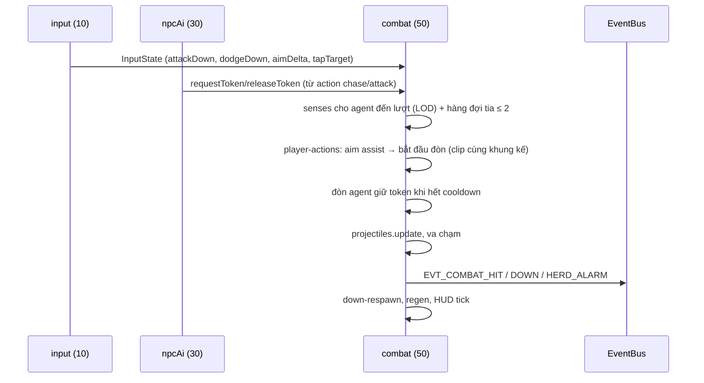
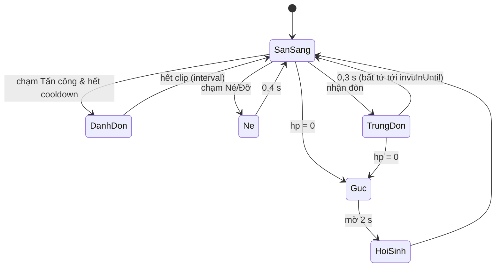

# DDD-06: Chiến đấu và săn bắt (module tuỳ chọn)

| Mục | Nội dung |
|---|---|
| Mã tài liệu | DDD-06 |
| Phiên bản | 1.0 |
| Ngày | 23/11/2026 |
| Tài liệu cha | DDD-00 `DDD-00-TONG-QUAN.md` |
| TSD nguồn | TSD-06 v1.1 (SCH-CBT-01…04, ALG-CBT-01…10, TST-CBT-01…09) |
| SRS nguồn | SRS-06 v1.1 (FR-CBT-01…28, NFR-CBT-01…03) |
| Gói | Runtime `engine/runtime/src/combat/**` (entry riêng → chunk `combat-<hash>.js`, nạp bằng `Engine.enableOptional('combat')`); HUD `combat/ui/`; panel `web/app/src/features/combat/` (SCR-CBT-02), nhóm trường "Chiến đấu" trong SCR-CHR-01 |
| Pha | Khi game cần, sớm nhất E6; editor W3 |
| Trạng thái | Đã duyệt (Huy, 23/11/2026) |

> Module **mặc định tắt** (QĐ-13). Số còn mở: ngân sách `budgets.combat.attackers/projectiles` tier Vừa **3/20** là giá trị khởi tạo của CFG-CBT-01, chốt khi có game đầu tiên bật chiến đấu (OI-CBT-05). Mã không viết cứng hai số này.

---

## 1. Giới thiệu
Thiết kế chi tiết module chiến đấu/săn bắt: đóng gói có điều kiện, khối chỉ số SoA nối vào `AgentStore` (DDD-05), giác quan, token tấn công, công thức sát thương biên dịch bằng `@gamestudio/expr`, aim assist, đạn, săn bắt (dấu vết, bảng rơi, bẫy/lưới), gục/hồi sinh, mức bạo lực, phản hồi, HUD và bảng cân bằng trên Web Studio. Mọi số cân bằng nằm trong dữ liệu (QT-CBT-04); chạy tất định ở chế độ test (FR-CBT-27); `combat` ≤ 1 ms/khung trên A56.

Nguyên tắc: game tắt cả hai cờ thì không có tệp, asset, UI hay chi phí CPU nào của module (QT-CBT-06); graph `hung_du` trở về như `tho_o` (DDD-05 mục 4.1).

---

## 2. Bố trí mã nguồn

| Mã | Tệp | Trách nhiệm |
|---|---|---|
| MOD-CBT-01 | `combat/index.ts` | Entry chunk: `export default function install(engine: Engine): CombatSystem`; đăng ký hệ thống, graph `combat`, hành động, HUD |
| MOD-CBT-02 | `combat/system.ts` | `CombatSystem` (order 50): tick giác quan, token, đòn đánh, đạn, gục/hồi sinh, tái xuất hiện |
| MOD-CBT-03 | `combat/stats.ts` | `CombatStore` SoA (DTO-CBT-05) song song `AgentStore`, slot người chơi = chỉ số `N` |
| MOD-CBT-04 | `combat/senses.ts`, `combat/ray-queue.ts` | Nhìn/nghe/đánh hơi (PSC-CBT-02); hàng đợi tia ≤ 2/khung |
| MOD-CBT-05 | `combat/tokens.ts` | `AttackTokenPool` (PSC-CBT-03), điểm vây |
| MOD-CBT-06 | `combat/formula.ts` | Biên dịch `features.combat.formula` (PSC-CBT-04) |
| MOD-CBT-07 | `combat/damage.ts` | Áp sát thương, giật lùi, bất tử, lọc mục tiêu hợp lệ |
| MOD-CBT-08 | `combat/player-actions.ts`, `combat/aim-assist.ts` | Nút Tấn công, Né/Đỡ, aim assist, ngắm tầm xa (PSC-CBT-05) |
| MOD-CBT-09 | `combat/projectiles.ts` | Pool đạn, bay tuyến tính + trọng lực, va chạm BVH/viên nang (PSC-CBT-10) |
| MOD-CBT-10 | `combat/herd-flee.ts` | Sự kiện nhóm, đàn bỏ chạy (PSC-CBT-06) |
| MOD-CBT-11 | `combat/hunting.ts`, `combat/tracks.ts`, `combat/loot.ts`, `combat/traps.ts` | Dấu vết decal, bảng rơi, bẫy/lưới (PSC-CBT-07) |
| MOD-CBT-12 | `combat/down-respawn.ts` | Gục/hồi sinh người chơi và agent (PSC-CBT-08) |
| MOD-CBT-13 | `combat/violence.ts`, `combat/feedback.ts` | Mức bạo lực (PSC-CBT-09), hạt trúng đòn, âm 3D, rung, số sát thương nổi |
| MOD-CBT-14 | `combat/actions/{alert, chase, attack, flee-combat, down, trapped}.ts` | `ActionImpl` cho các trạng thái graph `combat` (IF-CHR-01) |
| MOD-CBT-15 | `combat/graph/combat.graph.json` | Graph `combat` (DTO-CBT-06) `extends` graph gốc của thực thể |
| MOD-CBT-16 | `combat/ui/combat-hud.ts`, `combat/ui/combat-hud.css` | SCR-CBT-01 (DOM, trong safe area) |
| MOD-CBT-17 | `engine/shared/schema/combat/{features.combat.schema.json, combat-block.schema.json, weapon.schema.json}`, `engine/shared/schema/combat/cross-check.ts` | SCH-CBT-01…03 + kiểm chéo id (ERR-CBT-01) |
| MOD-CBT-18 | `engine/shared/combat-csv/{columns.ts, parse.ts, emit.ts}` | CSV cân bằng SCH-CBT-04, dùng chung web và CLI |
| MOD-CBT-19 | `web/app/src/features/combat/balance-table.tsx`, `features/combat/use-balance-rows.ts`, `features/combat/csv-dialog.tsx`, `features/npc/combat-fields.tsx` | SCR-CBT-02 và nhóm trường "Chiến đấu" của SCR-CHR-01 |
| MOD-CBT-20 | `engine/build/packager/src/optional-chunks.ts` (phần combat) | Chép/kiểm ngược chunk và asset tag `combat` (PSC-CBT-01) |

Cây thư mục runtime:
```
engine/runtime/src/combat/
  index.ts  system.ts  stats.ts  senses.ts  ray-queue.ts  tokens.ts  formula.ts  damage.ts
  player-actions.ts  aim-assist.ts  projectiles.ts  herd-flee.ts
  hunting.ts  tracks.ts  loot.ts  traps.ts  down-respawn.ts  violence.ts  feedback.ts  config.ts
  actions/  graph/combat.graph.json  ui/
```
`engine/runtime/vite.config.ts` khai báo `build.lib.entry = { index: 'src/index.ts', combat: 'src/combat/index.ts', 'dialogue-ai': 'src/dialogue-ai/index.ts' }`. Mã ngoài `combat/` không được `import` tĩnh từ `combat/**` (luật ESLint `no-restricted-imports`); chỉ `Engine.enableOptional('combat')` dùng `import()`.

---

## 3. Thiết kế lớp và giao diện

```ts
// combat/index.ts
export default function install(engine: Engine): CombatSystem;   // gọi bởi Engine.enableOptional('combat')

// combat/system.ts
export class CombatSystem implements System {
  readonly id = 'combat'; readonly order = ORDER.combat;          // 50
  init(ctx: EngineContext): Promise<void>;                        // nạp weapons, compile formula, cấp phát CombatStore, đăng ký ActionImpl
  update(dt: number, t: number): void;                            // SEQ-CBT-01
  onZoneLoaded(z: LoadedZone): void;                              // gắn khối combat cho agent mới, đăng ký vùng respawn/bẫy
  onZoneUnloaded(z: LoadedZone): void;
  onRuntimeData(diff: RuntimeDataDiff): void;                     // áp nóng chỉ số/vũ khí/công thức (SEQ-CBT-03)
  onTierChanged(tier: Tier): void;                                // co/giãn pool đạn, token
  dispose(): void;
  // API cho hành động graph và người chơi
  requestToken(a: AgentRef): boolean; releaseToken(a: AgentRef): void;
  applyHit(src: CombatantRef, dst: CombatantRef, weapon: WeaponIdx, dir: ReadonlyVec3): HitResult;
}
export type CombatantRef = number;               // 0..N-1 agent; N = người chơi
export const enum HitResult { Ignored = 0, Hit = 1, Blocked = 2, Killed = 3 }

// combat/formula.ts
export interface DamageFormula { eval(atk: number, def: number, weapon: number): number }   // đã làm tròn, ≥ 0
export function compileFormula(src: string): Result<DamageFormula, ExprError>;              // ERR-CBT-02

// combat/tokens.ts
export class AttackTokenPool {
  constructor(max: number);                      // budgets[tier].combat.attackers
  request(a: AgentRef, distToPlayer: number): boolean;
  release(a: AgentRef): void; holders(): ReadonlyArray<AgentRef>;
  ringSlot(a: AgentRef, out: Vec3): void;         // điểm vây 3–5 m
  resize(max: number): void;
}

// combat/senses.ts
export interface SenseResult { seen: boolean; heard: boolean; smelled: boolean }
export function sense(a: AgentRef, ctx: SenseCtx, out: SenseResult): void;   // không cấp phát

// combat/projectiles.ts
export class ProjectilePool {
  constructor(max: number);                      // budgets[tier].combat.projectiles
  spawn(owner: CombatantRef, weapon: WeaponIdx, from: ReadonlyVec3, dir: ReadonlyVec3): number;   // -1 khi hết chỗ và không bỏ được
  update(dt: number): void;
}

// combat/ui/combat-hud.ts
export class CombatHud {
  constructor(ui: UiService, layout: SafeAreaInsets);
  setPlayerHp(hp: number, max: number): void; setTarget(ref: CombatantRef | -1, hp: number, max: number): void;
  setLock(ref: CombatantRef | -1): void; onAttack(cb: () => void): void; onDodge(cb: () => void): void;
  tick(t: number): void;                         // ẩn sau 5 s không giao tranh
}
```

Sự kiện qua `EventBus` (DDD-04): `EVT_COMBAT_HIT (a = dst, b = dmg)`, `EVT_COMBAT_DOWN (a = ref, b = killer)`, `EVT_COMBAT_RESPAWN (a = ref)`, `EVT_HERD_ALARM (a = herdId, b = source)`, `EVT_LOOT (a = itemIdx, b = n)`, `EVT_TRAPPED (a = agentRef, b = trapIdx)`. Script game nghe qua `onEvent('combat.down', …)` (API scripting DDD-04).

Giao diện editor (`EditorBridge`, DDD-08): `combat.applyBalance(rows: BalanceRow[])` áp nóng; `combat.simulateHit(attackerId, weaponId, targetId) → {dmg, hits}` cho ô "đòn cần để hạ" trên SCR-CBT-02.

---

## 4. Dữ liệu

| Mã | Cấu trúc | Đặc tả |
|---|---|---|
| DTO-CBT-01 | `game.json.features` phần chiến đấu (SCH-CBT-01) | `combat: {enabled: bool=false, style: 'melee'\|'ranged'\|'mixed'='melee', targets: EntityId[], formula: string='max(1, atk + weapon - def)', dropOnDeath: 'keep'\|'drop_all'\|'drop_random'='keep', showDamageNumbers: bool=false}`; `hunting: {enabled: bool=false, species: SpeciesId[]}`; `violence: {level: 'minimal'\|'standard'='minimal', hitColor?: hex}`. Kiểm chéo sau Ajv: mỗi id trong `targets`/`species` có trong `entities/` (ERR-CBT-01, kèm JSON Pointer) |
| DTO-CBT-02 | Khối `combat` của npc/animal/player (SCH-CBT-02) | `{hp: int 1..10000, atk: 0..1000, def: 0..1000, range: 0.3..60 m, attackInterval: 0.1..10 s, moveSpeedCombat: 0..15 m/s, regenPerS: 0..100, fleeHpRatio: 0..1, senses: {sightM: 0..120, sightDeg: 10..360, hearM: 0..80, smellM: 0..120}, alertness: 'nhay'\|'vua'\|'cham'='vua', weapon?: WeaponId, lootTable: [{item, p: 0..1, n: [a,b] a≤b}], despawnS: 0..60=5, respawnS: 0..3600=300, tracks?: {decal: AssetRef, sound?: AudioRef, trackLifeS: 5..600=60}, loseTrackS: 1..60=8, safeDistance: 5..200=40, safeS: 1..60=6}`; `invulnerable` nằm ở gốc thực thể (DTO-CHR-02) |
| DTO-CBT-03 | `entities/weapons/<id>.json` (SCH-CBT-03) | `{id, name, kind: 'melee'\|'ranged'\|'trap'\|'net', damage: 0..1000, range: m, interval: s, projectile?: {speed: m/s, max: int, gravity?: bool=true, model?: AssetRef}, model: AssetRef, sounds: {swing?: AudioRef, hit?: AudioRef}, trap?: {radiusM: 0.3..5, holdS: 1..120}}`; `projectile` bắt buộc khi `kind='ranged'`; asset `model`/`sounds` tự mang tag `combat` khi nhập (DDD-03) |
| DTO-CBT-04 | CSV cân bằng (SCH-CBT-04) | Dòng đầu cố định `kind,id,hp,atk,def,range,attackInterval,moveSpeedCombat,regenPerS,fleeHpRatio,damage,interval`; `kind ∈ {npc, animal, player, weapon}`; ô không áp dụng để trống (ví dụ `damage` của npc); UTF-8, dấu phẩy, số dấu chấm; `BalanceRow = {kind, id, values: Partial<Record<Column, number>>}` |
| DTO-CBT-05 | Bố trí `CombatStore` | Dung lượng `N+1` (N của `AgentStore`, slot N = người chơi); `hp Float32Array`, `hpMax`, `atk`, `def`, `range`, `attackInterval`, `moveSpeed`, `regen`, `fleeRatio`, `cooldownUntil`, `invulnUntil`, `sightM`, `sightCos` (cos nửa góc), `hearM`, `smellM`, `alertK` (1,5/1,0/0,6), `weapon Int16Array` (−1 tay không), `loot Int16Array` (chỉ số bảng rơi), `token Uint8Array`, `aware Uint8Array` (0 không, 1 nghi, 2 thấy), `lastSeenT Float32Array`, `herd Int16Array`, `enabled Uint8Array`; bảng phụ `weapons: WeaponRec[]`, `lootTables: LootRec[][]` |
| DTO-CBT-06 | `combat.graph.json` | DTO-CHR-04 với `extends: '$base'` (thay bằng graph gốc khi nạp); trạng thái `BinhThuong` = `$base.initial`, thêm `CanhGiac`(`alert`), `TruyDuoi`(`chase`), `TanCong`(`attack`), `BoChay`(`flee-combat`), `Guc`(`down`), `BiBat`(`trapped`); chuyển như STM-CBT-01 |
| DTO-CBT-07 | `budgets.json` phần chiến đấu | `budgets[tier].combat: {attackers: int, projectiles: int, particles: int /*phần của particles chung*/, rays: int=2, cpuMs: 1}`; giá trị khởi tạo ở CFG-CBT-01 |
| DTO-CBT-08 | Lưu trạng thái | `save.combat: {playerHp, inventoryLost?: ItemId[], respawnQueue: [{spawnRuleId, atGameS}]}` (DDD-04 lưu game) |

Ví dụ công thức (SRS-06 FR-CBT-07): `atk` 6, kiếm `weapon` 10, sói `def` 4 → `max(1, 6+10−4)` = 12; sói `hp` 30 → 3 đòn; kiếm 15 → 17 → 2 đòn.

---

## 5. API / giao thức

| Mã | Giao thức | Đặc tả |
|---|---|---|
| EP-CBT-01 | Packager: chunk tuỳ chọn | `manifest.chunks.combat = {path:'engine/combat-<hash>.js', bytes, sha256}` chỉ khi `features.combat.enabled \|\| features.hunting.enabled`; bootstrap gọi `engine.enableOptional('combat')` sau `init` khi có khoá này (DDD-04 DTO-RTM-01) |
| EP-CBT-02 | PATCH dữ liệu game | Qua EP-WEB-14 (DDD-08): op chạm `/game.json/features/combat\|hunting\|violence` → `impact.major=true` → brief vN+1 `ChoXacNhan` (DDD-01 PSC-INT-08); op chạm khối `combat`/`weapons` → `impact.runtimeOnly=true` → áp nóng |
| EP-CBT-03 | CSV nhập/xuất | Web: đọc/ghi tệp trên trình duyệt, nhập thành một PATCH nhiều op (toàn phần hoặc không); CLI: `gs combat export <game> [--out f.csv]`, `gs combat import <game> f.csv [--dry-run] [--json]` (thoát 4 khi ERR-CBT-03) |

---

## 6. Luồng xử lý

### SEQ-CBT-01 Một khung chiến đấu


### SEQ-CBT-02 Bật chiến đấu sau khi game đã có
Chat/editor → PATCH `features.combat.enabled=true` (EP-CBT-02) → `impact.major` → brief vN+1 `ChoXacNhan` → người dùng xác nhận → job build → packager PSC-CBT-01 chép chunk + asset tag `combat` → preview nạp chunk.

### SEQ-CBT-03 Áp nóng bảng cân bằng
SCR-CBT-02 sửa ô → kiểm giới hạn ô (schema) → debounce 300 ms → PATCH (EP-WEB-14) → SSE `data.version` → `EditorBridge.applyRuntimePatch` → `CombatSystem.onRuntimeData`: ghi lại các cột `CombatStore` của id bị đổi, compile lại `formula` nếu đổi (lỗi → giữ công thức cũ, báo ERR-CBT-02). Không tải lại zone.

---

## 7. Máy trạng thái

### STM-CBT-01 Chiến đấu của agent (SRS-06 mục 2.2)

| Từ | Đến | Điều kiện (`when` trong DTO-CBT-06) | Ưu tiên |
|---|---|---|---|
| `BinhThuong` | `CanhGiac` | `aware >= 1` | 10 |
| `CanhGiac` | `BinhThuong` | `t - lastSeenT > loseTrackS` | 5 |
| `CanhGiac` | `TruyDuoi` | `personality == hung_du \|\| wasHit` | 20 |
| `CanhGiac` | `BoChay` | `personality == nhut_nhat` | 20 |
| `TruyDuoi` | `TanCong` | `dist(player) <= range && hasToken` | 30 |
| `TanCong` | `TruyDuoi` | `dist(player) > range + 0.5` (trễ 0,5 m chống rung) | 25 |
| `TanCong` | `BoChay` | `hp < fleeHpRatio * hpMax` | 40 |
| `TruyDuoi` | `BinhThuong` | `t - lastSeenT > loseTrackS` | 5 |
| `BoChay` | `BinhThuong` | `dist(player) > safeDistance` liên tục `safeS` | 5 |
| `*` | `BiBat` | sự kiện bẫy/lưới | 90 |
| `TanCong`, `BoChay`, `TruyDuoi`, `CanhGiac`, `BiBat` | `Guc` | `hp <= 0` | 100 |

Rời `TanCong` → `releaseToken`. `Guc` là trạng thái cuối: action `down` gọi PSC-CBT-08. Khi `combat.enabled=false` nhưng `hunting.enabled=true`, `TruyDuoi/TanCong` chỉ có ở loài săn có `personality=hung_du`.

### STM-CBT-02 Người chơi


`Ne`: không nhận sát thương nếu đòn tới trong 0,25 s đầu (né) hoặc giảm 50 % khi giữ (đỡ, chỉ `melee`); hai số ở CFG-CBT-03.

---

## 8. Thuật toán chi tiết

### PSC-CBT-01 Đóng gói có điều kiện (ALG-CBT-01)
```
on = game.features.combat.enabled || game.features.hunting.enabled
if on:
  copy engine/dist/combat-<hash>.js → build/engine/; manifest.chunks.combat = fileRef
  assets += assets where 'combat' in tags and referenced by entities/weapons|combat blocks|fx combat
else:
  không chép; manifest.chunks.combat = undefined
# kiểm ngược sau khi ghi danh sách tệp
files = list(build/**)
if !on and (any f matches /combat-[0-9a-f]+\.js$/ or any asset.tags includes 'combat'):
  fail ERR-CBT-04 {files: offending}
report.bundleJsBytes = sum(js files không phải chunk tuỳ chọn)
```

### PSC-CBT-02 Giác quan (ALG-CBT-02)
```
sense(a):                                     # chỉ khi scheduler cho agent tick (DDD-05 PSC-CHR-05)
  d = dist(player, a); k = alertK[a] * playerStealthK   # ngồi 0.5, đi chậm 0.7, khác 1
  seen = d <= sightM[a]*k and dot(fwd[a], dirTo(player)) >= sightCos[a]
         and rayQueue.result(a) != BLOCKED    # tia tới đầu người chơi; mới xếp hàng → dùng kết quả cũ
  if d <= sightM[a]*k and inCone: rayQueue.enqueue(a)   # tối đa budgets.combat.rays tia/khung, FIFO
  speedK = {dung:0, di:1, chay:2.5}[player.moveState]
  heard = d <= hearM[a] * speedK * k
  smelled = kind[a]==animal and wind? and d <= smellM[a]*k*(1 + 0.5*cos(angle(wind.dir, dir(player→a))))
           or kind[a]==animal and !wind and d <= smellM[a]*k
  aware[a] = seen||heard||smelled ? 2 : (aware[a]==2 ? 1 : aware[a]); if aware==2: lastSeenT[a]=t
```
Ví dụ: hươu `nhay` (1,5) `sightM` 20 → 30 m; người chơi ngồi → 15 m (TC-CBT-02, 03).

### PSC-CBT-03 Token tấn công (ALG-CBT-03)
```
request(a, d): if token[a] return true
  if holders.size < max: add a; return true
  far = holder có d lớn nhất; if d < far.d - 1.0: release(far) (far quay về TruyDuoi); add a; return true
  return false
ringSlot(a): idx = hash(seed[a]) mod 8; góc = idx*45° + jitter(seed[a], ±10°); r = 3 + 2*rand01(seed[a])
             → điểm = player.pos + r*(cos, sin); nearestValid trên navmesh
release(a): token[a]=0; remove a
resize(max): khi giảm, trả token các agent xa nhất
```
Trễ 1 m khi giành token tránh đổi qua lại liên tục.

### PSC-CBT-04 Công thức sát thương (ALG-CBT-04)
```
compileFormula(src) = expr.compile(src, {idents:{atk:'number',def:'number',weapon:'number'},
                                         fns:{max:{args:2},min:{args:2},round:{args:1}}})
  lỗi → ERR-CBT-02 {pos}
applyHit(src, dst, w, dir):
  if !enabled[dst] or isInvulnerable(dst) or !isValidTarget(dst) or t < invulnUntil[dst]: return Ignored
  if dst==player and playerState==Ne and inDodgeWindow: return Blocked
  dmg = max(0, round(formula.eval(atk[src], def[dst], w>=0 ? weapons[w].damage : 0)))
  if dst==player and playerState==Ne(đỡ): dmg = round(dmg*blockK)
  hp[dst] -= dmg; invulnUntil[dst] = t + 0.5; knockback(dst, dir, 0.3 m qua nav/capsule); playClip(dst,'hit')
  emit EVT_COMBAT_HIT(dst, dmg); if hp[dst] <= 0: hp[dst]=0; emit EVT_COMBAT_DOWN(dst, src); return Killed
  return Hit
isValidTarget(dst) = dst==player or id(dst) in features.combat.targets (combat) or species(dst) in features.hunting.species (săn)
```

### PSC-CBT-05 Aim assist (ALG-CBT-05)
```
pick(player, weapon):
  best=-1; bestScore=∞
  for c in spatialGrid.query(player.pos, range+1):          # không cấp phát
    if !valid(c) (PSC-CBT-04 lọc) or alive==0: continue
    ang = angle(player.fwd, dir(c)); if ang > 30°: continue
    score = (ang/30°)*0.6 + (d/(range+1))*0.4
    if score < bestScore: best=c; bestScore=score
  return best
tầm xa: giữ nút → aimDelta xoay hướng ngắm (độ nhạy CFG-CBT-03); thả → spawn đạn;
         chạm màn hình trên mục tiêu → raycast từ điểm chạm → nếu valid: lock = c (hiện chỉ báo)
input đọc ở pointerdown, đòn bắt đầu ở khung kế (NFR-CBT-03)
```

### PSC-CBT-06 Đàn bỏ chạy (ALG-CBT-06)
```
on EVT_COMBAT_HIT(dst) or aware[dst] 0→2 với herd[dst] >= 0:
  emit EVT_HERD_ALARM(herd, dst)
on EVT_HERD_ALARM(h): away = normalize(mean(pos[m]) - player.pos)
  for m in members(h): dir = rotate(away, jitter(seed[m], ±25°)); setState(m, BoChay, target = pos[m] + dir*safeDistance)
```

### PSC-CBT-07 Săn bắt (ALG-CBT-07)
```
tracks: mỗi agent có tracks, khi quãng đi tích luỹ ≥ 1.5 m: decalRing.push(pos, yaw, expire=t+trackLifeS)  # vòng 64
        decalRing.update: ẩn decal hết hạn; âm `tracks.sound` 3D theo khoảng cách
loot(dst): r = rngAgent(dst); for e in lootTable[dst] (theo thứ tự): if r.next01() < e.p: give(e.item, r.int(e.n[0], e.n[1]))
traps: vùng tròn trap.radiusM đặt bởi người chơi; agent thuộc species đi vào → setState(BiBat), giữ trap.holdS;
       net: đạn kind net trúng → BiBat; tương tác "Thả/Bắt" do interaction (DDD-04) xử lý
```

### PSC-CBT-08 Gục và hồi sinh (ALG-CBT-08)
```
player down: input.lock(); hud.fade(2s); after 2s:
  p = nearest region type 'respawn' (theo zone đang nạp; không có → spawn của manifest)
  teleport(p); hp=hpMax; dropOnDeath: keep → không đổi; drop_all → inventory.clear(); drop_random → bỏ 1 món theo rng
  emit EVT_COMBAT_RESPAWN(player); input.unlock()
agent down: playClip('down'); releaseToken; loot nếu săn; fade material trong despawnS; rồi AgentStore.free(a)
  spawnQueue.push({rule: spawnRuleOf(a), at: gameS + respawnS})   # DDD-05 PSC-CHR-14 tiêu thụ hàng đợi
  violence minimal: không xác, không hạt máu (PSC-CBT-09)
```

### PSC-CBT-09 Mức bạo lực (ALG-CBT-09)
`minimal`: hạt trúng đòn trắng/bụi, không decal máu, xác mờ ngay khi `down` xong; `standard`: hạt màu `violence.hitColor` (mặc định theo loài), xác giữ `despawnS`. `/new-game` (DDD-01 PSC-INT-11) ghi `violence.level` tối đa bằng mức suy ra; nâng mức sau đó đi qua `impact.major` (QT-CBT-03).

### PSC-CBT-10 Ngân sách đạn và hạt (ALG-CBT-10)
```
spawn(...): if free slot: dùng
  else: v = active đạn xa camera nhất; if dist(v) > dist(new): recycle v else return -1
particles combat: cùng luật với pool hạt chung, hạn mức budgets.combat.particles
```

Phản hồi (FR-CBT-24): `feedback.onHit` → hạt (PSC-CBT-09), `audio.play3D(weapon.sounds.hit)`, `navigator.vibrate?.(40)` khi `settings.vibration`, số nổi từ pool sprite text 16 khi `showDamageNumbers`.

---

## 9. Xử lý lỗi

| Mã | Nơi | Xử lý |
|---|---|---|
| ERR-CBT-01 | `cross-check.ts` (web khi lưu, `gs validate`) | Không lưu; trả JSON Pointer tới phần tử sai; thoát 4 |
| ERR-CBT-02 | `compileFormula` (web khi lưu, `onRuntimeData`) | Không lưu, chỉ vị trí ký tự; runtime giữ công thức cũ |
| ERR-CBT-03 | `combat-csv/parse.ts` | Không áp dụng dòng nào; danh sách `{line, column, message}` |
| ERR-CBT-04 | Packager PSC-CBT-01 | Build Fail, liệt kê tệp vi phạm |
| (nội bộ) `COMBAT_CHUNK_LOAD` | `Engine.enableOptional` | Thử lại 1 lần; lỗi → chơi tiếp không chiến đấu, báo HUD "Không tải được chiến đấu", log |

---

## 10. Cấu hình

| Mã | Khoá | Mặc định | Nơi |
|---|---|---|---|
| CFG-CBT-01 | `budgets[tier].combat` | Thấp 2/10, **Vừa 3/20 (OI-CBT-05)**, Cao 4/30; `rays` 2; `cpuMs` 1 | `budgets.json` (DDD-00 CFG-GEN-02) |
| CFG-CBT-02 | Hằng số chiến đấu | giật lùi 0,3 m; bất tử 0,5 s; mờ khi gục 2 s; vòng vây 3–5 m; nón aim 60°; trọng số 0,6/0,4; decal 1,5 m, pool 64 | `combat/config.ts` (có thể ghi đè trong `game.json.features.combat.tuning`) |
| CFG-CBT-03 | Né/Đỡ, ngắm | cửa sổ né 0,25 s; `blockK` 0,5; độ nhạy ngắm 0,25°/px | `combat/config.ts` |
| CFG-CBT-04 | Hệ số cảnh giác | `nhay` 1,5, `vua` 1,0, `cham` 0,6; ngồi 0,5, đi chậm 0,7; nghe đứng/đi/chạy 0/1/2,5 | `combat/config.ts` (từ SRS, không chỉnh theo game) |
| CFG-CBT-05 | HUD | ẩn sau 5 s; nút Tấn công 88 px, Né 64 px | `combat/ui/combat-hud.css` |

---

## 11. Thiết kế kiểm thử

| Mã | Ca | Dữ liệu / bước | Kỳ vọng | TSD |
|---|---|---|---|---|
| TC-CBT-01 | Tắt thì không có gì | Game mẫu tắt cả hai cờ; build; so với engine build không entry combat | Không `combat-*.js`, không asset tag `combat`; `bundleJsBytes` bằng nhau | TST-CBT-01 |
| TC-CBT-02 | Hươu nhạy | Seed cố định; hươu `nhay` `sightM` 20; bot chạy thẳng tới | Phát hiện ở 30 m ± 0,5; cả đàn `BoChay` | TST-CBT-02 |
| TC-CBT-03 | Ngồi, đi chậm | Như trên, bot ngồi/đi chậm | 15 m / 21 m ± 0,5 | TST-CBT-03 |
| TC-CBT-04 | 6 sói | A56 tier Vừa, 6 sói `hung_du` | ≤ `attackers` giữ token mọi khung; sói khác ở 3–5 m; fps đạt; `combat` ≤ 1 ms | TST-CBT-04 |
| TC-CBT-05 | Đổi vũ khí không sửa code | `atk` 6, kiếm 10 → 15, sói `def` 4 `hp` 30; áp nóng | 12 → 17; 3 → 2 đòn | TST-CBT-05 |
| TC-CBT-06 | `minimal` | Hạ sói ở `minimal` | Không hạt màu máu, không xác sau `down` | TST-CBT-06 |
| TC-CBT-07 | Bất tử | NPC sư trụ trì `invulnerable` đứng trong nón | Aim assist bỏ qua; `applyHit` trả `Ignored` | TST-CBT-07 |
| TC-CBT-08 | Tất định | Hai lần chạy seed cố định, `stepFixed` 1/30 s, kịch bản bot 60 s | Chuỗi sự kiện `EVT_COMBAT_*` trùng từng phần tử | TST-CBT-08 |
| TC-CBT-09 | CSV sai | CSV thiếu cột `def`; CSV có dòng 7 `hp=-1` | Không áp gì; lỗi `Dòng 1…`/`Dòng 7: hp ngoài giới hạn` | TST-CBT-09 |
| TC-CBT-10 | Công thức | `max(1, atk + weapon - def)`, `atk*2+foo`, `round(atk/def` | OK; ERR-CBT-02 `unknown_ident` pos 6; `syntax` | ALG-CBT-04 |
| TC-CBT-11 | Kiểm chéo đích | `targets: ['soi','rong']` không có `rong` | ERR-CBT-01 tại `/features/combat/targets/1` | SCH-CBT-01 |
| TC-CBT-12 | Bảng rơi | Seed cố định, 1000 lần hạ sói `p` 0,6 | Tỷ lệ 0,6 ± 0,03; hai lần chạy cùng kết quả | ALG-CBT-07 |
| TC-CBT-13 | Hồi sinh | Người chơi `hp` 0, 2 vùng `respawn` | Mờ 2 s, dịch tới vùng gần nhất, `hp` đầy, `dropOnDeath` đúng | ALG-CBT-08 |
| TC-CBT-14 | Ngân sách đạn | Bắn liên tục vượt `projectiles` | Không vượt pool; đạn xa camera bị thu hồi trước | ALG-CBT-10 |
| TC-CBT-15 | Độ trễ | Chế độ dev đo `pointerdown` → khung bắt đầu clip | ≤ 100 ms trên A56 | NFR-CBT-03 |
| TC-CBT-16 | Bật sau | PATCH `features.combat.enabled=true` | Brief vN+1 `ChoXacNhan`; build sau xác nhận có chunk | FR-CBT-04 |

---

## 12. Open item

| Mã | Câu hỏi | Đề xuất |
|---|---|---|
| OID-CBT-01 | Ngân sách `attackers/projectiles` tier Vừa | 3/20 trong CFG-CBT-01; đo bằng TC-CBT-04 khi có game bật chiến đấu; Huy chốt (OI-CBT-05) |
| OID-CBT-02 | Mặc định công thức: SRS-06 v1.0 mục 2.1 ghi `max(1, atk - def)`, khác FR-CBT-07 | **Đã đóng 23/11/2026:** Huy chốt `max(1, atk + weapon - def)`; SRS-06 v1.1 đã sửa mục 2.1 |
| OID-CBT-03 | Cửa sổ né 0,25 s và `blockK` 0,5 | Giá trị DDD đề xuất; chỉnh theo thử chơi E6 |

---

## 13. Truy vết

| FR / NFR | Thành phần TSD | Thành phần DDD |
|---|---|---|
| FR-CBT-01, 02 | SCH-CBT-01; TSD-01 SCH-INT-05 | DTO-CBT-01, MOD-CBT-17, TC-CBT-11; DDD-01 DTO-INT-13 |
| FR-CBT-03 | ALG-CBT-01, TST-CBT-01 | MOD-CBT-01, MOD-CBT-20, EP-CBT-01, PSC-CBT-01, TC-CBT-01 |
| FR-CBT-04 | Mục 5 | EP-CBT-02, SEQ-CBT-02, TC-CBT-16 |
| FR-CBT-05, 06 | SCH-CBT-02, SCH-CBT-03 | DTO-CBT-02, DTO-CBT-03, DTO-CBT-05, MOD-CBT-03 |
| FR-CBT-07 | ALG-CBT-04, `combat/formula.ts` | MOD-CBT-06, PSC-CBT-04, TC-CBT-05, TC-CBT-10, OID-CBT-02 |
| FR-CBT-08 | SCH-CBT-04, mục 5 | DTO-CBT-04, MOD-CBT-18, EP-CBT-03, TC-CBT-09 |
| FR-CBT-09, 10 | ALG-CBT-05 | MOD-CBT-08, PSC-CBT-05, STM-CBT-02, CFG-CBT-03 |
| FR-CBT-11 | ALG-CBT-04 | MOD-CBT-07, PSC-CBT-04, CFG-CBT-02 |
| FR-CBT-12 | Mục 2 (`combat.graph.json`) | MOD-CBT-14, MOD-CBT-15, DTO-CBT-06, STM-CBT-01 |
| FR-CBT-13 | ALG-CBT-02 | MOD-CBT-04, PSC-CBT-02, CFG-CBT-04 |
| FR-CBT-14 | ALG-CBT-03 | MOD-CBT-05, PSC-CBT-03, TC-CBT-04 |
| FR-CBT-15 | ALG-CBT-06 | MOD-CBT-10, PSC-CBT-06, TC-CBT-02 |
| FR-CBT-16…19 | ALG-CBT-07, ALG-CBT-02 | MOD-CBT-11, PSC-CBT-07, PSC-CBT-02, TC-CBT-03, TC-CBT-12 |
| FR-CBT-20, 21 | ALG-CBT-08 | MOD-CBT-12, PSC-CBT-08, DTO-CBT-08, TC-CBT-13 |
| FR-CBT-22 | ALG-CBT-04 | PSC-CBT-04 (`isValidTarget`), PSC-CBT-05, TC-CBT-07 |
| FR-CBT-23 | ALG-CBT-09 | MOD-CBT-13, PSC-CBT-09, TC-CBT-06 |
| FR-CBT-24, 25 | Mục 4 (phản hồi, HUD) | MOD-CBT-13, MOD-CBT-16, mục 8 (phản hồi), CFG-CBT-05 |
| FR-CBT-26 | ALG-CBT-10 | MOD-CBT-09, PSC-CBT-10, DTO-CBT-07, CFG-CBT-01, TC-CBT-14 |
| FR-CBT-27 | TST-CBT-08; TSD-04 mục 2.3 | TC-CBT-08; DDD-04 MOD-RTM-02 (`stepFixed`) |
| FR-CBT-28 | Mục 5 | MOD-CBT-19, SEQ-CBT-03 |
| NFR-CBT-01…03 | Mục 6 | CFG-CBT-01, PSC-CBT-02, PSC-CBT-03, PSC-CBT-01, TC-CBT-04, TC-CBT-01, TC-CBT-15 |
| — | TST-CBT-02…07, TST-CBT-09 | TC-CBT-02…07, TC-CBT-09 |
| — | OIT-CBT-01 | OID-CBT-01 |

---

## 14. Lịch sử thay đổi

| Phiên bản | Ngày | Người | Nội dung |
|---|---|---|---|
| 0.1 | 22/11/2026 | Claude | Bản đầu từ TSD-06 v1.1 |
| 0.2 | 23/11/2026 | Claude | Theo SRS-06 v1.1: đóng OID-CBT-02 (công thức mặc định `max(1, atk + weapon - def)`) |
| 1.0 | 23/11/2026 | Huy | Duyệt bộ DDD; thay đổi sau đây theo change request |
