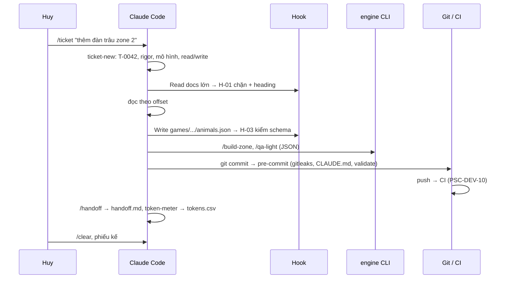

# DDD-09: Studio AI, quy trình, tiết kiệm token và bảo mật

| Mục | Nội dung |
|---|---|
| Mã tài liệu | DDD-09 |
| Phiên bản | 1.1 |
| Ngày | 26/11/2026 |
| Tài liệu cha | DDD-00 `DDD-00-TONG-QUAN.md` |
| TSD nguồn | TSD-09 v1.3 (IF-DEV-01…05, SCH-DEV-01…09, ALG-DEV-01…12, TST-DEV-01…09) |
| SRS nguồn | SRS-09 v1.2 (FR-DEV-01…27, NFR-DEV-01…03; CR-01 làm tiếp/nhập game) |
| Gói | `.claude/**`, `.githooks/`, `tools/{versions.json, schema/, scripts/}`, `engine/cli/src/commands/doctor.ts`, `.github/workflows/ci.yml`, `gitleaks.toml`, `project.yaml`, `CLAUDE.md`, `UPSTREAM.md`, `LICENSES.md`, `docs/{handoff.md, tickets/, gates/, ADR/, metrics/}` |
| Pha | E0 (đa số), E1 (CI), W1 (rigor `standard` cho web) |
| Trạng thái | Đã duyệt (Huy, 23/11/2026); **v1.1 theo CR-02 (Unity) và ADR-037**, chờ Huy xem lại |

> Ràng buộc xuyên suốt (QT-DEV-06): khoá Claude API, Gemini, ElevenLabs không bao giờ xuất hiện trong mã client, bản build, log, tài liệu, bộ nhớ dự án hay `docs/handoff.md`; mọi công cụ chỉ báo "có / không có".

---

## 1. Giới thiệu
Thiết kế chi tiết bộ công cụ làm việc với Claude Code: tệp cấu hình `.claude/`, 5 hook (3 chặn, 2 cảnh báo) và thư viện mẫu, lệnh, mẫu phiếu/cổng/ADR, script đo token, `engine doctor`, quét bí mật ba lớp, git hook và CI. Không có màn hình.

---

## 2. Bố trí mã nguồn

| Mã | Tệp | Trách nhiệm |
|---|---|---|
| MOD-DEV-01 | `.claude/settings.json`, `.claude/settings.debug.json` | Khai báo hook, quyền mặc định (không `Bash(*)`, `deny` các đường dẫn bí mật); bản debug thêm MCP Unity/Blender (FR-DEV-17, CR-02) |
| MOD-DEV-02 | `.claude/agents/{director, engine-dev, tech-artist, world-builder, gameplay-ui, asset-designer, qa, docs}.md` | 8 agent (IF-DEV-01) |
| MOD-DEV-03 | `.claude/skills/{threejs-image-generator, threejs-audio-generator}/`, `.claude/skills/engine-unity-*/SKILL.md`, `.claude/skills/engine-*/SKILL.md` | 2 skill bộ gốc giữ lại (sinh ảnh, âm thanh); 6 skill gắn Three.js thay bằng `engine-unity-*` (dựng player batchmode, gameplay C#, đồ hoạ URP, hồ sơ hiệu năng, QA; CR-02, FR-DEV-02); bỏ `threejs-3d-generator`; + 10–15 skill `engine-*` (vd. `engine-intake`, `engine-build`, `engine-asset`, `engine-world`, `engine-npc`, `engine-qa`, `engine-publish`, `engine-perf`, `engine-dialogue`, `engine-combat`) |
| MOD-DEV-04 | `.claude/commands/{start, new-game, ticket, build-zone, qa-light, qa-full, perf-snapshot, visual-diff, gate-check, asset-recipe, adr, publish-poc, handoff, resume-game, import-game}.md` | 15 lệnh (IF-DEV-04; `/resume-game`, `/import-game` thêm ở v0.2) |
| MOD-DEV-05 | `.claude/rules/{engine-runtime, engine-build, games-data, web}.md` | Rule theo đường dẫn (frontmatter `paths:`) |
| MOD-DEV-06 | `.claude/hooks/{h01-large-md, h02-binary-log, h03-schema, h04-secrets, h05-perf}.mjs` | 5 hook (PSC-DEV-03…05) |
| MOD-DEV-07 | `.claude/hooks/lib/{io.mjs, patterns.json, patterns.mjs, timeout.mjs, log.mjs}` | Đọc sự kiện stdin, mẫu đường dẫn/lệnh, giới hạn 900 ms, log lỗi hook |
| MOD-DEV-08 | `.claude/templates/{ticket, gate-report, adr, style-bible, zone-spec, building-spec}.md` | Mẫu tài liệu |
| MOD-DEV-09 | `tools/schema/{project.schema.json, ticket.schema.json, gate.schema.json, versions.schema.json}` | Schema SCH-DEV-01…03, 05 |
| MOD-DEV-10 | `tools/scripts/token-meter.mjs`, `tools/scripts/token-meter/{parse.mjs, window.mjs, csv.mjs}`, `tools/scripts/token-meter/fixtures/*.jsonl` | Đo token (PSC-DEV-02) |
| MOD-DEV-11 | `tools/scripts/{probe-keys.mjs, secret-scan.mjs, gate-conditions.mjs, rigor.mjs, ticket-new.mjs, handoff.mjs, licenses.mjs, upstream-check.mjs}` | Script hỗ trợ lệnh |
| MOD-DEV-12 | `engine/cli/src/commands/doctor.ts`, `engine/cli/src/doctor/{checks.ts, blender-probe.py, env-roles.ts}` | `engine doctor` (IF-DEV-03, PSC-DEV-06) |
| MOD-DEV-13 | `.githooks/pre-commit`, `.githooks/pre-commit.mjs` | Git hook (IF-DEV-05) |
| MOD-DEV-14 | `.github/workflows/{ci.yml, nightly-dispatch.yml}`, `gitleaks.toml`, `.gitignore` | CI, luật quét bí mật (PSC-DEV-10) |
| MOD-DEV-15 | `project.yaml`, `CLAUDE.md`, `UPSTREAM.md`, `LICENSES.md`, `LICENSE` | Cấu hình và tài liệu gốc repo |
| MOD-DEV-16 | `docs/{handoff.md, tickets/T-nnnn.md, gates/<cổng>.md, gates/<cổng>.conditions.json, ADR/ADR-nnn-<slug>.md, metrics/tokens.csv}` | Tài liệu quy trình |
| MOD-DEV-17 | `tools/scripts/resume-game.mjs`, `tools/scripts/import-game.mjs`, `tools/scripts/game-handoff.mjs`, `games/<id>/handoff.md` | Thân lệnh `/resume-game`, `/import-game`; tạo/cập nhật ghi chú gọn theo game (CR-01) |

---

## 3. Thiết kế lớp và giao diện

### 3.1 Hook (IF-DEV-02)

`.claude/settings.json` (trích):
```json
{
  "hooks": {
    "PreToolUse": [
      { "matcher": "Read",  "hooks": [{ "type": "command", "command": "node .claude/hooks/h01-large-md.mjs", "timeout": 2 },
                                      { "type": "command", "command": "node .claude/hooks/h02-binary-log.mjs", "timeout": 2 },
                                      { "type": "command", "command": "node .claude/hooks/h04-secrets.mjs", "timeout": 2 }] },
      { "matcher": "Grep|Bash", "hooks": [{ "type": "command", "command": "node .claude/hooks/h04-secrets.mjs", "timeout": 2 }] }
    ],
    "PostToolUse": [
      { "matcher": "Write|Edit", "hooks": [{ "type": "command", "command": "node .claude/hooks/h03-schema.mjs", "timeout": 2 },
                                           { "type": "command", "command": "node .claude/hooks/h05-perf.mjs", "timeout": 2 }] }
    ]
  },
  "permissions": { "deny": ["Read(**/.env*)", "Read(**/*.pem)", "Read(**/*.key)", "Read(**/secrets/**)"], "allow": ["Bash(pnpm engine:*)", "Bash(engine:*)", "Bash(git status)", "Bash(git diff:*)"] }
}
```

```js
// .claude/hooks/lib/io.mjs
export async function readEvent()      // → {tool_name, tool_input, cwd, hook_event_name}; JSON lỗi → exit 0 + log
export function block(code, msg)       // process.stderr.write(`${code}: ${msg}`); process.exit(2)
export function warn(msg)              // process.stdout.write(msg); process.exit(0)
export function guard(fn)              // try { await fn() } catch (e) { log(e); process.exit(0) }; setTimeout(() => exit(0), 900)
// .claude/hooks/lib/patterns.mjs
export function isSecretPath(p)        // glob theo patterns.json, chuẩn hoá '\' → '/', không phân biệt hoa thường trên Windows
export function dangerousBash(cmd)     // → {code:'ERR-DEV-03', rule} | null
```

### 3.2 `engine doctor` (IF-DEV-03)

```ts
export interface DoctorCheck { id: string; kind: 'version' | 'binary' | 'addon' | 'env' | 'path'; want?: string; have?: string;
  status: 'ok' | 'missing' | 'mismatch'; message: string }
export interface DoctorReport { ok: boolean; role: 'dev' | 'worker' | 'ci'; checks: DoctorCheck[] }
export async function runDoctor(o: { role?: Role; json: boolean }): Promise<{ report: DoctorReport; exitCode: 0 | 5 }>;
// env: chỉ `name in process.env && process.env[name]!.length > 0`; have = 'co' | 'khong'
```

### 3.3 Token-meter

```ts
// tools/scripts/token-meter/parse.mjs
export interface UsageRow { sessionId: string; messageId: string; ts: string; model: string; isSidechain: boolean;
  input: number; cacheWrite: number; cacheRead: number; output: number }
export function* parseSessionFile(path: string): Generator<UsageRow | { marker: 'start' | 'end'; ticket: string; ts: string }>;
export function sumTicket(rows: Iterable<…>, ticket: string): TicketTokens;   // khử trùng theo messageId
```
CLI: `node tools/scripts/token-meter.mjs --ticket T-0042 [--projects-dir <đường dẫn>] [--dry-run] [--json]`; thư mục mặc định `~/.claude/projects/<repo đã mã hoá>/`.

---

## 4. Dữ liệu

| Mã | Tệp | Đặc tả |
|---|---|---|
| DTO-DEV-01 | `project.yaml` (SCH-DEV-01) | `{rigor: 'minimal'\|'standard'\|'full'='minimal', overrides: [{path: glob, rigor}], budgetsDefault: 'vua', targetDevice: {name:'Galaxy A56', fps: 30}, tiers: ['thap','vua','cao'], gates: string[]}`; khởi tạo `overrides` cho `web/api/**`, `web/worker/**`, `web/ai-gateway/**`, `web/shared/src/permissions.ts`, `web/api/src/plugins/auth*` = `standard` |
| DTO-DEV-02 | Phiếu `docs/tickets/T-nnnn.md` (SCH-DEV-02) | Frontmatter YAML `{id: 'T-nnnn', title, phase, gate?, rigor, model: {name, effort}, read: glob[], write: glob[], done: string[], evidence: string[], status: 'mo'\|'dang_lam'\|'xong'\|'huy', tokens?: {input, cacheWrite, cacheRead, output, total, sessions}}`; thân: Mục tiêu, Phạm vi, Danh sách bắt buộc theo rigor, Ghi chú, Sửa ngoài danh sách (lý do) |
| DTO-DEV-03 | `tools/versions.json` (SCH-DEV-03) | `{[tool]: {version, match: 'exact'\|'minor', check: string[] /*argv*/, parse: regex, sha256?}}` với `node, pnpm, python, uv, blender, addons.sapling, addons.ant_landscape, ktx, gltfTransform, ffmpeg, gitleaks, playwright, chromium, claudeCode` + vai trò `dev`: `unity` (Editor 6000.3.29f1 + Web Build Support) và các gói Unity ghim bản theo POC-U1 (`urp`, `gltfast`, `meshoptDecompress`, `ktxUnity`, `aiNavigation`, `inputSystem`), kiểm bằng `Packages/packages-lock.json`; bỏ `three` (CR-02) |
| DTO-DEV-04 | `docs/metrics/tokens.csv` (SCH-DEV-04) | Dòng đầu `ticket,date,phase,agent,model,effort,sessions,input,cache_write,cache_read,output,total,wall_min,result`; ngày `YYYY-MM-DD`; số nguyên |
| DTO-DEV-05 | Báo cáo cổng (SCH-DEV-05) | Frontmatter `{gate, date, autoChecks: [{id, desc, result: 'dat'\|'chua', evidence}], manualChecks: [{id, desc}], a56: {fpsAvg, fpsP5, frameMsP95, memMB, loadS}, images: string[2..4], risks: string[], proposal, huyConfirm: {by, at} \| null, status: 'chua_qua'\|'da_qua'}`; `<cổng>.conditions.json`: `[{id, desc, kind: 'auto'\|'manual', check?: 'budget'\|'qa_full'\|'provenance'\|'security'\|'a56'}]` |
| DTO-DEV-06 | `UPSTREAM.md`, `LICENSES.md` (SCH-DEV-06) | `UPSTREAM.md`: bảng `Nguồn \| Commit \| Ngày fork`; bảng thay đổi `file \| kind (them/sua/xoa) \| reason \| ticket`; mục quy trình. `LICENSES.md`: 4 bảng (dữ liệu, thư viện sinh tự động giữa `<!-- licenses:start -->`/`end`, dịch vụ, asset CC0 theo nhóm) |
| DTO-DEV-07 | ADR (SCH-DEV-07) | Frontmatter `{id: 'ADR-nnn', title, date, status: 'de_xuat'\|'chot'\|'thay_the', supersedes?: 'ADR-nnn'}`; mục: Bối cảnh, Quyết định, Hệ quả, Phương án đã loại; `docs/ADR/README.md` là chỉ mục |
| DTO-DEV-08 | `docs/handoff.md` (SCH-DEV-08) | ≤ 150 dòng; mục cố định `## Ràng buộc`, `## Việc đã xong` (5 phiếu gần nhất), `## Asset chờ duyệt`, `## Bước tiếp`, `## Cảnh báo mở` |
| DTO-DEV-09 | `hooks/lib/patterns.json` | `{secretPaths: glob[], secretAllow: ['**/.env.example'], binaryExt: string[], imageExt: string[], imageMaxBytes: 1048576, logMaxLines: 2000, mdMaxBytes: 40960, bash: [{id, regex, code}], perfPaths: glob[], schemaPaths: glob[]}` |
| DTO-DEV-10 | `games/<id>/handoff.md` (SCH-DEV-09) | ≤ 60 dòng; frontmatter `{gameId, updatedAt, ticket}`; mục cố định `## Đã xong theo zone` (dòng `- z1: build Vừa, QA nhẹ Pass, xuất bản #2`), `## Quyết định riêng của game`, `## Việc dở`; không chứa bí mật, đường dẫn tuyệt đối, email (QT-DEV-06; hook H-04 quét) |

---

## 5. API / giao thức

| Mã | Giao thức | Đặc tả |
|---|---|---|
| EP-DEV-01 | Lệnh `/ticket <mô tả>` | Gọi `node tools/scripts/ticket-new.mjs --title … --write <glob>…`; sinh `T-nnnn` kế tiếp, tính rigor (PSC-DEV-01), điền mô hình khuyến nghị theo bảng `CLAUDE.md`; in đường dẫn phiếu; chèn dấu mốc `[[ticket:T-nnnn start]]` |
| EP-DEV-02 | Lệnh `/handoff` | `node tools/scripts/handoff.mjs --ticket T-nnnn`: PSC-DEV-08; chạy token-meter; chèn `[[ticket:T-nnnn end]]`; nhắc `/clear` |
| EP-DEV-03 | Lệnh `/gate-check <cổng>` | `node tools/scripts/gate-conditions.mjs --gate <cổng> --json` → dựng `docs/gates/<cổng>.md` (PSC-DEV-07) |
| EP-DEV-04 | Lệnh còn lại | `/start` (đặt `core.hooksPath`, chạy `engine doctor`, đọc `handoff.md`), `/new-game` (EP-INT-01), `/build-zone` (`engine build --zone`), `/qa-light`, `/qa-full`, `/perf-snapshot`, `/visual-diff`, `/asset-recipe`, `/adr` (sinh ADR từ mẫu, số kế), `/publish-poc` (`engine publish --target poc`); mọi lệnh đọc đầu ra `--json` |
| EP-DEV-05 | `engine doctor [--role dev\|worker\|ci] [--json]` | DTO trong mục 3.2; thoát 0/5 |
| EP-DEV-06 | Git pre-commit | `gitleaks protect --staged --redact --config gitleaks.toml`; `wc -l CLAUDE.md < 150`; `engine validate --staged --json`; lỗi → thoát 1 |
| EP-DEV-07 | Lệnh `/resume-game <id> [yêu cầu]` | `node tools/scripts/resume-game.mjs --game <id> [--request "<txt>"]` → in ≤ 15 dòng (PSC-DEV-11); có yêu cầu → gọi luồng `/ticket` (EP-DEV-01) |
| EP-DEV-08 | Lệnh `/import-game <thư mục\|gói.zip>` | `node tools/scripts/import-game.mjs <src>` bọc `engine import --json` (DDD-04 EP-CLI-03); xác nhận brief qua `engine brief confirm --game <id>` sau khi Huy đồng ý (PSC-DEV-12) |

---

## 6. Luồng xử lý

### SEQ-DEV-01 Một phiếu từ đầu đến cuối


### SEQ-DEV-02 Lấy bản mới upstream (PSC-DEV-09)
`git fetch upstream` → `git checkout vendor/upstream && git reset --hard <commit mới>` (chỉ nhánh vendor) → `git checkout main && git merge vendor/upstream` → giải xung đột theo bảng `UPSTREAM.md` → cập nhật commit gốc + bảng trong cùng commit → CI (`upstream-check.mjs` so `LICENSE`) → `/qa-light`.

---

## 7. Máy trạng thái

### STM-DEV-01 Phiếu
`mo` → (`/ticket` bắt đầu làm) `dang_lam` → (`done[]` đạt, có `evidence`, `/handoff`) `xong`; `mo`/`dang_lam` → `huy` (Huy quyết). Sửa tệp ngoài `write[]` không đổi trạng thái nhưng bắt buộc ghi mục "Sửa ngoài danh sách" (QT-DEV-02); `/handoff` cảnh báo khi `git diff --name-only` có tệp ngoài `write[]` mà mục này trống.

### STM-DEV-02 Cổng
`chua_kiem` → (`/gate-check`) `chua_qua` → (Huy điền `huyConfirm`) `da_qua`. CI chặn trạng thái `da_qua` có `huyConfirm: null`.

---

## 8. Thuật toán chi tiết

### PSC-DEV-01 Mức rigor của phiếu (ALG-DEV-01)
```
rigorOf(writeGlobs, project):
  order = {minimal:0, standard:1, full:2}; r = project.rigor
  for w in writeGlobs: for o in project.overrides:
     if picomatch(o.path)(w) or globsOverlap(w, o.path): r = max(r, o.rigor)
  return r
checklist(r, writeGlobs): base (SRS-09 mục 6.2)
  + r>=standard: ['unit test', 'review bởi agent khác', 'ADR nếu đổi kiến trúc']
  + any w ⊂ web/** or auth*: ['rà soát bảo mật ngắn (10 câu, DDD-08 mục 5 cột Quyền + OWASP)']
```
`globsOverlap`: so tiền tố tĩnh của hai glob (phần trước ký tự đại diện đầu tiên); trùng tiền tố → coi là chồng.

### PSC-DEV-02 Đo token mỗi phiếu (ALG-DEV-02)
```
files = glob(projectsDir/*.jsonl) ∪ subagent files liên kết (sessionId cha)
seen = Set(); sum = 0…; inWindow = false
for f in files sorted by mtime:
  for line in f:
    o = JSON.parse(line) (lỗi → bỏ qua, đếm 'bad_lines')
    if o.type=='user' and text contains `[[ticket:${T} start]]`: inWindow=true; sessions.add(o.sessionId)
    if o.type=='user' and contains `[[ticket:${T} end]]`: inWindow=false
    if o.type=='user' and contains T (sau /clear): inWindow=true; sessions.add
    if inWindow and o.type=='assistant' and o.message?.usage:
       id = o.message.id; if seen.has(id): continue; seen.add(id)
       u = o.message.usage
       sum.input += u.input_tokens; sum.cacheWrite += u.cache_creation_input_tokens ?? 0
       sum.cacheRead += u.cache_read_input_tokens ?? 0; sum.output += u.output_tokens
total = input + cacheWrite + cacheRead + output; costEq = input + cacheWrite*1.25 + cacheRead*0.1 + output
trường lạ / thiếu usage → cảnh báo 'format_changed' kèm phiên bản Claude Code (OID-DEV-01)
ghi frontmatter phiếu; nối tokens.csv (nếu phiếu đã có dòng → thay)
```

### PSC-DEV-03 H-01 tệp `.md` lớn (ALG-DEV-03)
```
ev = readEvent(); if ev.tool_name != 'Read': exit 0
p = ev.tool_input.file_path; if !p.endsWith('.md'): exit 0
if ev.tool_input.offset != null or ev.tool_input.limit != null: exit 0
st = stat(p); if st.size <= 40960: exit 0
heads = stream lines, regex /^#{1,4} /, lấy ≤ 60 {line, text}
block('ERR-DEV-01', `File lớn (${kb} KB). Đọc theo mục: ` + heads.map(h => `L${h.line} ${h.text}`).join('; '))
```

### PSC-DEV-04 H-02 nhị phân/log, H-04 bí mật và lệnh phá huỷ (ALG-DEV-04)
```
H-02 (Read): ext ∈ binaryExt → block ERR-DEV-02
  ext ∈ imageExt and size > 1 MB → block
  (ext=='.log' or p matches build/**/logs/**) and countLinesUpTo(p, 2001) > 2000 → block
H-04:
  Read/Grep: path(s) = tool_input.file_path | tool_input.path; isSecretPath and !secretAllow → block ERR-DEV-03
  Bash: cmd = tool_input.command
    for r in patterns.bash: if r.regex.test(cmd) → block ERR-DEV-03 (rule id)
    mẫu: /\brm\s+-[a-z]*r[a-z]*f?\s+(\/|~|\*)(\s|$)/, /git\s+push\s+.*(--force|-f)\b.*\b(main|master)\b/,
         /git\s+reset\s+--hard\s+origin/, /\b(cat|type|Get-Content|more|less|head|tail)\b.*(\.env|\.pem|\.key|secrets\/)/,
         /\b(printenv|env|set)\b.*(API_KEY|_TOKEN|SECRET)/, /echo\s+\$\{?\w*(API_KEY|SECRET)/
```

### PSC-DEV-05 H-03 schema, H-05 nhắc đo (ALG-DEV-05)
```
H-03 (PostToolUse Write|Edit): p khớp games/**/data/**/*.json
  v = require('engine/schema/dist/validators.cjs'); kind = kindByPath(p) (DDD-00)
  ok = v[kind](JSON.parse(read(p))); !ok → warn(top 10 `${instancePath} ${message}`)
H-05: p khớp perfPaths (engine/unity/Assets/GameStudio/{Render,World,Characters}/**, **/*.shadergraph, **/*.hlsl, **/materials/**, **/budgets.json) (CR-02) → warn('Nhắc: chạy /perf-snapshot (QT-RTM-02)')
```

### PSC-DEV-06 `engine doctor` (ALG-DEV-06)
```
for (tool, spec) in versions.json:
  r = execFile(spec.check[0], spec.check[1..], {timeout: 10 s}) ; lỗi ENOENT → missing
  have = match(spec.parse, r.stdout); ok = spec.match=='exact' ? have==spec.version : sameMinor(have, spec.version)
blender: blender -b --factory-startup --python blender-probe.py → JSON {version, addons:[{name, version, path}]} → sha256 gói add-on
ffmpeg -hide_banner -encoders | grep " aac "  (ADR-037); ktx --version && ktx create --help
unity (role dev): đọc engine/unity/ProjectSettings/ProjectVersion.txt và Unity Hub `--headless editors -i` → có bản đúng m_EditorVersion và module WebGL; gói Unity so với packages-lock.json
env theo role: dev → [GEMINI_API_KEY, ELEVENLABS_API_KEY] (+ ANTHROPIC_API_KEY tuỳ chọn); worker → [GS_GATEWAY_TOKEN_WORKER, DATABASE_URL]; ci → []
  check: name in env && env[name].length > 0 → have 'co'/'khong' (không in giá trị, không băm, không độ dài)
message: ERR-DEV-04 "<thành phần>: cần <want>, đang có <have>"; ERR-DEV-05 "Thiếu biến môi trường <TÊN> (không hiển thị giá trị)."
exit 5 khi có missing/mismatch bắt buộc
```

### PSC-DEV-07 `/gate-check` (ALG-DEV-07)
```
conds = read docs/gates/<g>.conditions.json
for c in conds where kind=='auto':
  budget: report ngân sách mới nhất tier vua không có 'Fail'
  qa_full: `engine qa --level=day-du --json` Pass (hoặc report < 24 giờ)
  provenance: `engine asset check --provenance --json` ok
  security: (W4) báo cáo ZAP mới nhất không có mức cao
  a56: lấy perf_samples (EP-WEB-32) hoặc docs/perf/a56-<ngày>.json
images = 2..4 ảnh có SSIM thấp nhất so baseline trong report QA
write gate report (DTO-DEV-05) status='chua_qua', huyConfirm=null
```

### PSC-DEV-08 Ghi chú gọn (ALG-DEV-08)
```
handoff(T):
  doc = parse(handoff.md) theo 5 mục
  doc.daXong = [T + kết quả] ∪ doc.daXong, giữ 5; xoá mục cảnh báo đã đóng (tham chiếu phiếu xong)
  doc.assetChoDuyet = `engine asset list --status ChoDuyet --json` (chỉ id + tên)
  render; if lines > 150: cắt mục cũ nhất của daXong rồi cảnh báo
  secretScan(doc) (gitleaks --no-git trên tệp) → có phát hiện → dừng
  token-meter --ticket T; in "Chạy /clear trước phiếu sau"
CLAUDE.md: kiểm < 150 dòng ở pre-commit và CI; bảng chọn mô hình: Opus high/xhigh (kiến trúc, thuật toán mới, generator họ mới, cổng); Sonnet medium (tham số, script lặp, sửa nhỏ, test); Haiku (đổi tên, tài liệu, cơ học)
```

### PSC-DEV-09 Lấy bản mới upstream (ALG-DEV-09)
Như SEQ-DEV-02. `upstream-check.mjs` (CI): `git diff --quiet vendor/upstream -- LICENSE` và kiểm `UPSTREAM.md` có commit gốc trùng `git rev-parse vendor/upstream`; khác → CI fail.

### PSC-DEV-10 CI (ALG-DEV-10)
```yaml
# .github/workflows/ci.yml (rút gọn)
on: [push, pull_request]
jobs:
  ci:
    runs-on: ubuntu-24.04
    steps:
      - uses: actions/checkout@v4   # fetch-depth: 0 cho gitleaks lịch sử nhánh
      - uses: pnpm/action-setup@v4
      - uses: actions/setup-node@v4  # node theo tools/versions.json
      - uses: astral-sh/setup-uv@v5
      - run: pnpm install --frozen-lockfile && uv sync --frozen
      - run: pnpm engine validate --all --json
      - run: pnpm lint && pnpm depcruise && uv run ruff check
      - run: pnpm test --project unit && uv run pytest -m "not heavy"
      - run: pnpm smoke            # Playwright: games/_template/fixtures, 10 s, 0 lỗi console
      - run: gitleaks detect --redact --config gitleaks.toml
      - run: node tools/scripts/structure-check.mjs   # ≤ 8 agent, 8+10..15 skill, 15 lệnh, CLAUDE.md < 150, cổng da_qua có huyConfirm
      - run: node tools/scripts/upstream-check.mjs
      - run: pnpm audit --prod && uv run pip-audit
```
`nightly-dispatch.yml` (cron 19:00 UTC = 02:00 giờ VN) gọi API Web Studio tạo job `qa --level=day-du` và golden nặng trên worker bằng token dịch vụ CI (chỉ quyền tạo job game mẫu).

### PSC-DEV-11 `/resume-game` (ALG-DEV-11)
```text
resumeGame(id, request?):
  st = exec('engine status --game <id> --json')        # DDD-04 PSC-CLI-04; không đọc games/<id>/data/**
  notes = read('games/<id>/handoff.md') ?? ''           # DTO-DEV-10, ≤ 60 dòng
  out = summarizeVi(st)                                 # ≤ 6 dòng (DDD-00 PSC-GEN-05)
  out += pendingLines(st.flags)                         # đề xuất/asset chờ duyệt, job lỗi, zone cần build, thay đổi chưa xuất bản
  draft = ticketDraft({title: st.next[0].label, read: dataFilesOf(st.next[0].zone|objectId), model: pickModel(st.next[0]) /*PSC-DEV-08*/})
  print(trim(out + draft, 15 dòng))
  if request:
     scope = classifyScope(request)                     # thêm zone/loài/NPC/nhiệm vụ/cờ features → 'mo_rong'
     t = ticketNew(request)                             # EP-DEV-01
     if scope == 'mo_rong': t.steps.push('Sinh ChangeProposal kèm briefUpdate (DDD-01 PSC-INT-14), chờ Huy duyệt; không sửa brief trực tiếp')
```

### PSC-DEV-12 `/import-game` (ALG-DEV-12)
```text
importGame(src):
  r = exec('engine import <src> --json')                # DTO-CLI-06
  printTable(r.counts, r.assets, r.problems)
  if r.result == 'chan': print(lý do); stop
  if !r.hasBrief: show brief nháp (fieldSources suy_tu_du_lieu/thieu); chờ Huy điền/chấp nhận → exec('engine brief confirm --game <id>')
  if r.result == 'canNangCap': ticketNew('Nâng cấp game <id> lên engine hiện tại', model='sonnet', effort='medium')   # chạy `engine upgrade`
  write games/<id>/handoff.md từ mẫu DTO-DEV-10 (Đã xong: rỗng; Việc dở: xác nhận brief, duyệt asset thiếu provenance, nâng cấp nếu có)
```

---

## 9. Xử lý lỗi

| Mã | Nơi | Xử lý |
|---|---|---|
| ERR-DEV-01 | PSC-DEV-03 | Hook thoát 2, stderr có danh sách heading |
| ERR-DEV-02 | PSC-DEV-04 (H-02) | Hook thoát 2, gợi ý dùng báo cáo JSON/grep/tail |
| ERR-DEV-03 | PSC-DEV-04 (H-04) | Hook thoát 2, ghi id luật khớp |
| ERR-DEV-04 | PSC-DEV-06 | `doctor` thoát 5; worker không nhận job |
| ERR-DEV-05 | PSC-DEV-06 | `doctor` thoát 5 với tên biến, không giá trị |
| (nội bộ) lỗi hook | `guard()` | Thoát 0 (không chặn nhầm), ghi `.claude/hooks/hook-errors.log` (không ghi `tool_input` đầy đủ, chỉ tên công cụ + đuôi tệp) |
| (nội bộ) `format_changed` | PSC-DEV-02 | Cảnh báo, vẫn ghi phần đọc được, đánh dấu cột `result=partial` |

---

## 10. Cấu hình

| Mã | Khoá | Mặc định | Nơi |
|---|---|---|---|
| CFG-DEV-01 | Ngưỡng hook | `.md` 40 KB; ảnh 1 MB; log 2.000 dòng; ≤ 60 heading; giới hạn 900 ms | `hooks/lib/patterns.json` |
| CFG-DEV-02 | Rigor | `minimal` + `overrides` web/auth `standard` | `project.yaml` (DDD-00 CFG-GEN-05) |
| CFG-DEV-03 | Phiên bản công cụ | Theo E0 | `tools/versions.json` (DDD-00 CFG-GEN-01) |
| CFG-DEV-04 | Luật gitleaks | Mặc định + luật tiền tố Anthropic (`sk-ant-`), Google API (`AIza`), ElevenLabs, khoá ký JWT dự án; `allowlist` cho fixtures canary trong `tools/**/fixtures` | `gitleaks.toml` |
| CFG-DEV-05 | `.gitignore` | `.env*` (trừ `.env.example`), `*.key`, `*.pem`, `secrets/`, `build/`, `**/cache/`, `data.bak-*/`, DEM/OSM tải về, `node_modules/`, `.venv/`, `.claude/settings.local.json` | Gốc repo |
| CFG-DEV-06 | Mô hình theo việc | Bảng trong `CLAUDE.md` (PSC-DEV-08) và `model` của agent | `CLAUDE.md`, `.claude/agents/*.md` |

---

## 11. Thiết kế kiểm thử

| Mã | Ca | Dữ liệu / bước | Kỳ vọng | TSD |
|---|---|---|---|---|
| TC-DEV-01 | Hook | JSON sự kiện mẫu: `.md` 60 KB không offset; `.env`; `.env.example`; `.glb`; ảnh 2 MB; log 3.000 dòng; `git push --force origin main`; `git push origin feature`; JSON dữ liệu sai | Chặn/cho/cảnh báo đúng từng ca; ca `.md` có heading | TST-DEV-01 |
| TC-DEV-02 | Thời gian hook | 100 lần mỗi hook trên máy dev chuẩn | P95 ≤ 1 s, trung bình ≤ 200 ms | TST-DEV-02 |
| TC-DEV-03 | `doctor` | Máy thiếu Blender; add-on lệch; thiếu `GEMINI_API_KEY`; env có giá trị canary | ERR-DEV-04/05 đúng; đầu ra không chứa chuỗi canary | TST-DEV-03 |
| TC-DEV-04 | Quét bí mật 4 lớp | Khoá canary trong tệp stage, commit nhánh, thư mục xuất bản, bundle `web/app` | Cả 4 bị phát hiện; commit huỷ; CI fail; `engine publish` dừng | TST-DEV-04 |
| TC-DEV-05 | Cấu trúc | `structure-check.mjs` trên repo | ≤ 8 agent; 8 + 10–15 skill; 15 lệnh; `CLAUDE.md` < 150; `LICENSE` trùng vendor | TST-DEV-05 |
| TC-DEV-06 | `/ticket` | Yêu cầu mẫu ghi vào `web/api/src/routes/x.ts` | Phiếu `rigor: standard`, có mô hình khuyến nghị, `read[]`, `write[]`, mục bảo mật | TST-DEV-06 |
| TC-DEV-07 | `/gate-check` | Cổng mẫu với báo cáo giả | Báo cáo DTO-DEV-05, số đo A56, 2–4 ảnh, `chua_qua` | TST-DEV-07 |
| TC-DEV-08 | Token-meter | Fixture JSONL có trùng `message.id`, `/clear`, subagent | Tổng khớp tính tay; dòng CSV đúng cột | TST-DEV-08 |
| TC-DEV-09 | Hook lỗi nội bộ | Sự kiện JSON hỏng, tệp không tồn tại | Thoát 0, có dòng trong `hook-errors.log` | IF-DEV-02 |
| TC-DEV-10 | Upstream | Sửa `LICENSE` trên nhánh làm việc | CI fail ở `upstream-check` | ALG-DEV-09 |
| TC-DEV-11 | `/resume-game`, `/import-game` | Game mẫu `CanBuild`; yêu cầu "thêm zone chợ"; thư mục không brief | ≤ 15 dòng, có phiếu "Build lại zone z2", nhật ký công cụ không có Read `games/<id>/data/**`; phiếu có bước `briefUpdate`; `/import-game` hiện brief nháp, không có lệnh build | TST-DEV-09 |

---

## 12. Open item

| Mã | Câu hỏi | Đề xuất |
|---|---|---|
| OID-DEV-01 | Định dạng tệp phiên Claude Code có thể đổi | Cố định `claudeCode` trong `versions.json`; fixture test token-meter cập nhật khi nâng (OIT-DEV-01) |
| OID-DEV-02 | Số nền token Thiền viện online | Lấy từ lịch sử phiếu nếu có, không thì đo 10 phiếu đầu E0–E1 (OIT-DEV-02, OI-DEV-04) |
| OID-DEV-03 | Tách agent `web-dev` ở W2 | Khi Huy đồng ý: thêm `web-dev`, chuyển `docs` thành skill để giữ ≤ 8 (OI-DEV-01) |

---

## 13. Truy vết

| FR / NFR | Thành phần TSD | Thành phần DDD |
|---|---|---|
| FR-DEV-01 | IF-DEV-01, TST-DEV-05 | MOD-DEV-02, TC-DEV-05, OID-DEV-03 |
| FR-DEV-02, 03 | Mục 2.1, IF-DEV-04, TST-DEV-05 | MOD-DEV-03, MOD-DEV-04, EP-DEV-01…04, TC-DEV-05 |
| FR-DEV-04 | Mục 2.1 (`rules/`) | MOD-DEV-05 |
| FR-DEV-05, 06 | SCH-DEV-01, ALG-DEV-01 | DTO-DEV-01, PSC-DEV-01, CFG-DEV-02 |
| FR-DEV-07 | SCH-DEV-02, TST-DEV-06 | DTO-DEV-02, EP-DEV-01, STM-DEV-01, TC-DEV-06 |
| FR-DEV-08 | ALG-DEV-08, IF-DEV-01 | PSC-DEV-08, CFG-DEV-06, MOD-DEV-02 |
| FR-DEV-09, 10 | SCH-DEV-05, ALG-DEV-07, TST-DEV-07 | DTO-DEV-05, EP-DEV-03, PSC-DEV-07, STM-DEV-02, TC-DEV-07 |
| FR-DEV-11 | SCH-DEV-07 | DTO-DEV-07, MOD-DEV-16 |
| FR-DEV-12, 13 | SCH-DEV-06, ALG-DEV-09 | DTO-DEV-06, PSC-DEV-09, SEQ-DEV-02, TC-DEV-10 |
| FR-DEV-14 | ALG-DEV-08, IF-DEV-05, ALG-DEV-10 | PSC-DEV-08, EP-DEV-06, MOD-DEV-13, PSC-DEV-10 |
| FR-DEV-15, 16 | SCH-DEV-08, ALG-DEV-08 | DTO-DEV-08, EP-DEV-02, PSC-DEV-08, SEQ-DEV-01 |
| FR-DEV-17 | Mục 6 | MOD-DEV-01 (`settings.debug.json`) |
| FR-DEV-18 | IF-DEV-02, ALG-DEV-03, ALG-DEV-04, ALG-DEV-05, TST-DEV-01 | MOD-DEV-06, MOD-DEV-07, DTO-DEV-09, PSC-DEV-03…05, CFG-DEV-01, TC-DEV-01, TC-DEV-09 |
| FR-DEV-19 | ALG-DEV-02, SCH-DEV-04, TST-DEV-08 | MOD-DEV-10, DTO-DEV-04, PSC-DEV-02, TC-DEV-08 |
| FR-DEV-20 | SCH-DEV-03, IF-DEV-03, ALG-DEV-06, TST-DEV-03 | DTO-DEV-03, MOD-DEV-12, EP-DEV-05, PSC-DEV-06, CFG-DEV-03, TC-DEV-03 |
| FR-DEV-21 | ALG-DEV-07 | PSC-DEV-07 (chọn ảnh SSIM) |
| FR-DEV-22, 23 | Mục 6, IF-DEV-05, TST-DEV-04 | MOD-DEV-11 (`probe-keys`), MOD-DEV-13, MOD-DEV-14, CFG-DEV-04, CFG-DEV-05, TC-DEV-04 |
| FR-DEV-24 | SCH-DEV-06 | DTO-DEV-06, MOD-DEV-11 (`licenses.mjs`) |
| FR-DEV-25 | ALG-DEV-10 | MOD-DEV-14, PSC-DEV-10 |
| FR-DEV-26 | ALG-DEV-11, SCH-DEV-09, TST-DEV-09 | MOD-DEV-17, DTO-DEV-10, EP-DEV-07, PSC-DEV-11, TC-DEV-11 |
| FR-DEV-27 | ALG-DEV-12, TST-DEV-09 | MOD-DEV-17, EP-DEV-08, PSC-DEV-12, TC-DEV-11 |
| NFR-DEV-01 | ALG-DEV-02, mục 7 | PSC-DEV-02, OID-DEV-02 |
| NFR-DEV-02, 03 | Mục 7, ALG-DEV-05, TST-DEV-02 | MOD-DEV-07 (`guard` 900 ms), PSC-DEV-05, TC-DEV-02 |
| — | OIT-DEV-01, OIT-DEV-02 | OID-DEV-01, OID-DEV-02 |

---

## 14. Lịch sử thay đổi

| Phiên bản | Ngày | Người | Nội dung |
|---|---|---|---|
| 0.1 | 22/11/2026 | Claude | Bản đầu từ TSD-09 v1.1 |
| 0.2 | 23/11/2026 | Claude | CR-01 theo TSD-09 v1.2 / SRS-09 v1.1: MOD-DEV-04 15 lệnh, MOD-DEV-17, DTO-DEV-10, EP-DEV-07, 08, PSC-DEV-11, 12 (ALG-DEV-11, 12), TC-DEV-05 sửa 15 lệnh, TC-DEV-11 |
| 1.0 | 23/11/2026 | Huy | Duyệt bộ DDD; thay đổi sau đây theo change request |
| 1.1 | 26/11/2026 | Claude | CR-02 (ADR-036), POC-U1, ADR-037: MOD-DEV-01 (MCP Unity), MOD-DEV-03 (skill `engine-unity-*`), DTO-DEV-03 (bỏ `three`, thêm `unity` và gói Unity), H-05 đường dẫn Unity, PSC-DEV-06 (kiểm `aac`, Unity Editor) |
