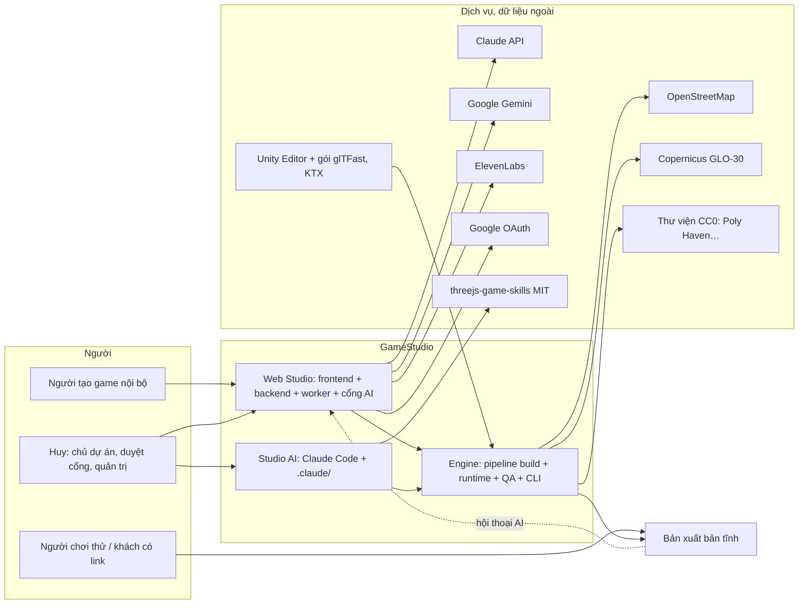
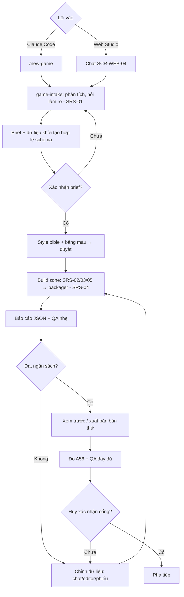
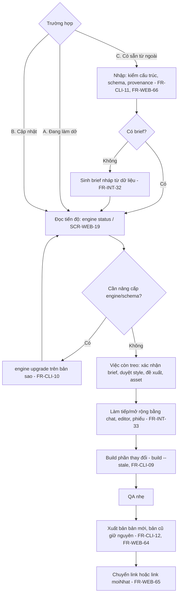

# SRS tổng quan: Engine web game 3D dùng lại được (GameStudio)

| Mục | Nội dung |
|---|---|
| Mã tài liệu | SRS-00 |
| Phiên bản | 1.5 |
| Ngày | 26/11/2026 |
| Chủ sở hữu / người duyệt | Huy (đã duyệt 22/11/2026) |
| Người soạn | Claude |
| BRD nguồn | BRD-00 `BRD-TONG-QUAN.md` v1.1; BRD-01…09; BRD-10 (CR-01); `GAME-ENGINE-WEB3D-BRIEF.md` bản 6 |
| Quyết định áp dụng | QĐ-01…15; đặc biệt QĐ-13 (chiến đấu/săn bắt tuỳ chọn), QĐ-14 (hội thoại tĩnh + AI khi chạy qua cổng giữ khoá), QĐ-15 (Web Studio riêng), CH-23 (chỉ người dùng nội bộ được mời) |
| Trạng thái | Đã duyệt (Huy, 22/11/2026); v1.2 bổ sung luồng làm tiếp và cập nhật game theo CR-01, Huy duyệt 23/11/2026; **v1.3 đổi runtime sang Unity theo CR-02** (Huy duyệt phân tích 25/11/2026), chờ Huy xem lại; v1.4 ngân sách tải theo POC-U1, Huy chốt 26/11/2026 |

> SRS giữ tinh thần gọn của BRD (`rigor: minimal`, QT-DEV-01): đặc tả đủ để Claude Code viết phiếu và kiểm thử, không thay TSD/ADR. Con số ghi **(đề xuất)** đã được Huy chấp nhận làm giá trị nền khi duyệt bản 1.0 (22/11/2026); nhãn được giữ để đánh dấu các số sẽ đo lại và chốt cuối ở cổng tương ứng (ví dụ ngân sách sau baseline A56 ở G-E0).

### Danh mục SRS

| Mã | Tài liệu | BRD nguồn | Nhóm mã | Số FR |
|---|---|---|---|---|
| SRS-00 | SRS tổng quan (tài liệu này) | BRD-00 | `GEN` | — |
| SRS-00-PL-A | [Ma trận truy vết BRD → SRS](SRS-00-PL-A-MA-TRAN-TRUY-VET.md) (sinh tự động) | BRD-00…09 | — | — |
| SRS-01 | [Tạo game từ mô tả](SRS-01-TAO-GAME-TU-MO-TA.md) (v1.1) | BRD-01 | `INT` | 34 |
| SRS-02 | [Thế giới, địa hình và môi trường](SRS-02-THE-GIOI-DIA-HINH-MOI-TRUONG.md) | BRD-02 | `WLD` | 40 |
| SRS-03 | [Asset 3D, vật liệu và âm thanh](SRS-03-ASSET-VAT-LIEU-AM-THANH.md) (v1.1) | BRD-03 | `AST` | 40 |
| SRS-04 | [Runtime, hiệu năng và QA](SRS-04-RUNTIME-HIEU-NANG-QA.md) (v1.4) | BRD-04 | `RTM`, `QA`, `CLI` | 45 |
| SRS-05 | [Nhân vật người chơi, NPC và động vật](SRS-05-NHAN-VAT-NPC-DONG-VAT.md) (v1.1) | BRD-05 | `CHR` | 44 |
| SRS-06 | [Chiến đấu và săn bắt (tuỳ chọn)](SRS-06-CHIEN-DAU-SAN-BAT.md) | BRD-06 | `CBT` | 28 |
| SRS-07 | [Hội thoại NPC (tĩnh và AI)](SRS-07-HOI-THOAI-NPC.md) | BRD-07 | `DLG` | 31 |
| SRS-08 | [Web Studio](SRS-08-WEB-STUDIO.md) (v1.3) | BRD-08 | `WEB` | 69 |
| SRS-09 | [Studio AI, quy trình, tiết kiệm token và bảo mật](SRS-09-STUDIO-AI-QUY-TRINH-BAO-MAT.md) (v1.3) | BRD-09 | `DEV` | 27 |
| | **Tổng** | | | **358** |

---

## 1. Giới thiệu

### 1.1 Mục đích
SRS tổng quan mô tả hệ thống GameStudio ở mức toàn cục: ranh giới, kiến trúc logic, vai trò, luồng đầu-cuối, mô hình dữ liệu chung, giao diện và tích hợp, yêu cầu phi chức năng chung, quy tắc xuyên module, quy ước mã và truy vết. Chi tiết từng chức năng nằm ở SRS-01…09.

### 1.2 Phạm vi hệ thống
Trong phạm vi và ngoài phạm vi theo BRD-00 mục 4. Tóm tắt các khối phần mềm được đặc tả:

| Khối | Mô tả | SRS |
|---|---|---|
| Pipeline build offline | Python + Blender headless + TypeScript: tiếp nhận mô tả, thế giới, địa hình, nước, thực vật, bố trí, asset, vật liệu, bake, đóng gói | 01, 02, 03, 04 |
| Engine runtime web | Unity player Web chung (C#, QĐ-16, CR-02) nạp dữ liệu game; dùng chung cho khung xem trước, editor và bản xuất bản | 04, 05, 06, 07 |
| QA tự động | Smoke, góc chuẩn, visual regression, đo hiệu năng, bot playtest | 04 |
| CLI | `engine new-game / build / qa / publish / doctor / migrate / asset` | 04, 03 |
| Web Studio | Frontend, backend API, CSDL, kho đối tượng, hàng đợi job, worker, cổng AI | 08 (+ màn hình ở 01, 02, 03, 05, 06, 07) |
| Studio AI cho Claude Code | `.claude/`, quy trình phiếu, cổng, hook, bảo mật máy dev | 09 |

### 1.3 Đối tượng đọc
Huy (duyệt), phiên chat điều phối (giao việc), các agent Claude Code (thực thi theo phiếu, viết test từ AC), người soạn TSD/ADR, TEST.

### 1.4 Quy ước

**Mã định danh** (mã duy nhất, không tái sử dụng; yêu cầu bỏ thì giữ mã, ghi "Không áp dụng" và lý do):

| Loại | Mẫu | Ví dụ | Ghi chú |
|---|---|---|---|
| Yêu cầu nghiệp vụ (từ BRD) | `BR-<số>`, `BR-<số>.<n>` | BR-94, BR-94.3 | Giữ nguyên mã BRD; **trong SRS, "BR" luôn là mã BRD**, không dùng cho quy tắc |
| Yêu cầu chức năng | `FR-<NHÓM>-nn` | FR-WEB-24 | Cột "Nguồn" ghi BR được đáp ứng |
| Quy tắc nghiệp vụ SRS | `QT-<NHÓM>-nn` | QT-INT-05 | Khác định dạng `QT-<số BRD>-nn` của BRD (ví dụ QT-01-05); mỗi QT SRS ghi QT BRD gốc |
| Phi chức năng | `NFR-<NHÓM>-nn` | NFR-WEB-02 | Có chỉ tiêu đo và cách kiểm |
| Use case | `UC-<NHÓM>-nn` | UC-INT-06 | |
| Màn hình | `SCR-<NHÓM>-nn` | SCR-WEB-05 | Danh mục đầy đủ ở mục 7 |
| API / giao diện lập trình | `API-<NHÓM>-nn` | API-WEB-24, API-DLG-02 | |
| Mã lỗi | `ERR-<NHÓM>-nn` | ERR-WEB-07 | Thông báo người dùng + phản ứng hệ thống |
| Open item | `OI-<NHÓM>-nn` | OI-WEB-01 | Ghi mã CH gốc của BRD |
| Giả định riêng SRS | `GĐ-<NHÓM>-nn` | GĐ-WEB-01 | Bổ sung GD của BRD |

**Ưu tiên** giữ theo BRD: **M** bắt buộc, **S** nên có, **C** có thì tốt.
**Pha**: E0…E8 (nhánh engine), W1…W4 (nhánh Web Studio), "Khi game cần" (module tuỳ chọn), "Sau E6/E7".
**Trạng thái số liệu**: không ghi gì = đã chốt; "(đề xuất)" = giá trị nền Huy đã chấp nhận ở bản 1.0 (22/11/2026), sẽ đo lại và chốt cuối ở cổng ghi trong Open item tương ứng.
**Tên trạng thái** trong dữ liệu viết không dấu dạng `PascalCase` (ví dụ `ChoXacNhan`), giá trị liệt kê dạng `snake_case` (ví dụ `nhut_nhat`).

### 1.5 Tài liệu liên quan
BRD-00…09 (`docs/BRD/`), brief bản 6, ADR-001…015 (viết ở E0, SRS-09 FR-DEV-11), TSD (chọn stack, `docs/TSD/`), TEST (sinh test từ mục "Tiêu chí chấp nhận" của từng SRS).

---

## 2. Mô tả tổng thể

### 2.1 Bối cảnh sản phẩm

### 2.2 Kiến trúc logic và module

| Tầng | Module | Chức năng | SRS |
|---|---|---|---|
| Build | `game-intake` | Mô tả → brief + dữ liệu khởi tạo; đề xuất thay đổi | 01 |
| Build | `world`, `terrain`, `water`, `vegetation`, `placement`, `lighting` | Thế giới, địa hình hai nguồn, nước, thực vật, bố trí, bake | 02 |
| Build | `asset-import`, `asset-forge`, `kit-builder`, `materials` | Asset CC0/generator, vật liệu, HDRI, âm thanh, provenance | 03 |
| Runtime | `navmesh` (trong `npc-ai`) | Lưới điều hướng theo zone, dựng lúc nạp zone bằng Unity AI Navigation (CR-02; trước là bước build) | 05 |
| Build | `packager` | Gộp, atlas, nén, manifest theo zone/tier cho Unity player, cache theo hash | 04 |
| Runtime (Unity player, C#) | `core`, `camera-player`, `fx`, `interaction`, `ui-audio` | Vòng lặp, stream, tier, điều khiển, hiệu ứng, tương tác, UI, âm thanh | 04, 02, 05 |
| Runtime | `characters`, `npc-ai` (GD-11) | Khung xương, animation, LOD; hành vi, tìm đường, đàn, lịch trình | 05 |
| Runtime tuỳ chọn | `combat` (QĐ-13) | Chiến đấu, săn bắt; chỉ đóng gói khi bật | 06 |
| Runtime tuỳ chọn | `dialogue-ai` (QĐ-14) | Client hội thoại AI; gọi cổng AI | 07 |
| QA | `qa` | Smoke, góc chuẩn, visual regression, perf, bot | 04 |
| Công cụ | `cli`, `engine doctor` | Dòng lệnh dùng chung cho Claude Code và worker | 04, 09 |
| Web | `web/app`, `web/api`, `web/worker`, cổng AI | Web Studio | 08 |
| Phát triển | `.claude/`, `project.yaml`, CI | Quy trình và kiểm soát | 09 |

### 2.3 Nguyên tắc kiến trúc ràng buộc mọi SRS
1. **Một nguồn sự thật**: bộ JSON dữ liệu game theo schema chung (SRS-04 FR-RTM-01); chat, editor, CLI, Claude Code cùng đọc/ghi (QT-GEN-01).
2. **Engine runtime là Unity player có phiên bản** (một bản chung cho mọi game, theo `engineVersion`; CR-02), dùng chung cho xem trước, editor và bản xuất bản (SRS-04 FR-RTM-03, SRS-08 FR-WEB-16).
3. **Việc nặng chạy trên worker** qua cùng CLI với Claude Code (SRS-08 FR-WEB-41).
4. **Logic `game-intake` viết một lần** cho hai lối vào (SRS-01 FR-INT-29).
5. **Khoá API chỉ ở server/biến môi trường** (QT-GEN-04).
6. **Tất định** với seed ở build, runtime, QA (QT-GEN-02).
7. **Tính năng tuỳ chọn mặc định tắt** và không gây chi phí khi tắt (QT-GEN-07).

---

## 3. Người dùng và vai trò

| Vai trò | Ai | Kênh | Quyền chính | SRS |
|---|---|---|---|---|
| Quản trị Web Studio | Huy (ban đầu) | Web | Mời/khoá, hạn mức, chi phí, cấu hình | 08 |
| Người tạo game | Người dùng nội bộ được mời | Web, (Huy: cả Claude Code) | Tạo/sửa game, build, QA, xuất bản game của mình | 01, 02, 03, 05, 06, 07, 08 |
| Người xem | Người được chia sẻ | Web | Xem, chơi thử | 08 |
| Khách có link | Người nhận link | Trình duyệt | Chơi bản xuất bản | 04, 08 |
| Người chơi | Mọi người mở game | Điện thoại, máy tính | Chơi | 04, 05, 06, 07 |
| Người duyệt cổng | Huy | Chat điều phối, Web | Xác nhận cổng G-E*, G-W* | 09 |
| Agent Claude Code | `director`, `engine-dev`, `tech-artist`, `world-builder`, `asset-designer`, `gameplay-ui`, `qa`, `docs` | Repo | Thực thi phiếu | 09 |

Ma trận quyền theo game: SRS-08 mục 3.

---

## 4. Luồng đầu-cuối và phạm vi theo pha

### 4.1 Luồng tạo game (hai lối vào, cùng lõi)

### 4.2 Luồng chỉnh sửa trên Web Studio
Chat → `ChangeProposal` (SRS-01) → người dùng duyệt → `PATCH` dữ liệu có `baseVersion` (SRS-08 API-WEB-24) → phiên bản mới → áp nóng nếu chỉ runtime, gắn "cần build" nếu không (SRS-04 mục 6.2) → job build → xem trước.

### 4.3 Phạm vi theo pha (gốc duy nhất cho cột "Pha" trong các SRS)

| Pha | Cổng | Nội dung SRS cần đáp ứng | Điều kiện qua cổng (bổ sung kiểm được) |
|---|---|---|---|
| E0 | G-E0 | SRS-09 (toàn bộ FR-DEV trừ 06, 25); SRS-04 FR-RTM-12, 13, FR-QA-07 (baseline A56) | ADR-001…015; `doctor` đạt; baseline A56 ghi trong `budgets.json` |
| E1 | G-E1 | SRS-01 (Claude Code); SRS-02 FR-WLD-01…16, 39; SRS-04 FR-RTM-01…06, 23, FR-QA-01…04, 06, 10, FR-CLI-01, 03, 05…08, 11, 12; SRS-09 FR-DEV-25…27 | AC-01-01…07, AC-02-01, 02, AC-04-06, AC-CR01-01, 02, 06, 12 |
| E2 | G-E2 | SRS-01 FR-INT-20…22; SRS-03 vật liệu (FR-AST-14…19, 26…29, 39, 40); SRS-04 tier, stream, điều khiển, CLI-02, 04, 09; SRS-05 FR-CHR-01…09 ; POC-U1 đo player Unity trên A56 trước khi chốt ngân sách tải (CR-02) | Đi lại được một zone trên A56 trong ngân sách |
| E3 | G-E3 | SRS-02 nước, thực vật, hiệu ứng (FR-WLD-17…24, 33…35, 40); SRS-04 FR-QA-05, 09, FR-CLI-10 | Baseline visual regression; AC-02-04 |
| E4 | G-E4 | SRS-02 bố trí (FR-WLD-25…27); SRS-03 asset 3D (FR-AST-01…13, 31…33, 35); SRS-05 khung xương, mô hình, animation (FR-CHR-10, 24, 25, 30, 36, 39, 41) | AC-03-01…06, AC-05-02 |
| E5 | G-E5 | SRS-02 ánh sáng (FR-WLD-28…32) | AC-02-05; Huy xác nhận bước nhảy chất lượng |
| E6 | G-E6 | SRS-04 FR-RTM-18…22, FR-QA-08; SRS-05 hành vi (còn lại); SRS-07 (tĩnh + AI); SRS-03 âm thanh, credit runtime; SRS-06 nếu game mẫu bật | AC-05-*, AC-07-*, AC-04-07; (AC-06-* khi bật) |
| E7 | G-E7 | Tối ưu theo tier; SRS-05 FR-CHR-22 | BO-04, BO-05 trên A56 |
| E8 | G-E8 | Game thứ hai trên Web Studio | BO-01, 02, 03, 09 |
| W1 | G-W1 | SRS-08 FR-WEB-01…05, 08…11, 42, 43, 46, 47, 49; SRS-01 qua web; SRS-09 FR-DEV-06 | AC-08-01, 05; quét frontend không có khoá |
| W2 | G-W2 | SRS-08 FR-WEB-06, 07, 14, 16, 18…20, 31…33, 40, 41, 44, 45, 48, 50…54, 58, 60…63, 68; SRS-01 FR-INT-34; SRS-07 FR-DLG-25 | Mô tả → xem trước một zone trên web và điện thoại; AC-08-07, 08 |
| W3 | G-W3 | SRS-08 FR-WEB-12, 13, 15, 17, 21…28, 30; SRS-01 FR-INT-23…26, 33; SRS-03 FR-AST-34; SRS-05 FR-CHR-42…44; SRS-06 FR-CBT-28; SRS-07 FR-DLG-29…31; SRS-02 FR-WLD-37 | AC-08-02…04; BO-09 phần thời gian |
| W4 | G-W4 | SRS-08 FR-WEB-29, 34…39, 55…57, 59, 64…67, 69; SRS-01 FR-INT-32 (web); SRS-02 FR-WLD-36, 38; SRS-03 FR-AST-30, 36…38 | AC-08-06; rà soát bảo mật NFR-WEB-09; BO-09 |

### 4.4 Luồng làm tiếp và cập nhật game (v1.2, CR-01)

Ba trường hợp dùng chung một cơ chế: đọc tiến độ → làm việc còn thiếu → build phần thay đổi → QA → xuất bản bản mới. Không có luồng build riêng cho game cũ; mọi việc đi qua cùng brief, `ChangeProposal`, đồ thị build và xuất bản của mục 4.1, 4.2.

| Trường hợp | Ví dụ | Claude Code | Web Studio |
|---|---|---|---|
| A. Đang làm dở | Phiên tạo game bỏ giữa chừng; brief đã xác nhận nhưng mới build 1/3 zone; job lỗi chưa xử lý | `/resume-game <id>` (SRS-09 FR-DEV-26) | Thư viện → "Làm tiếp" (SRS-08 UC-WEB-10) |
| B. Đã có, cần cập nhật | Game đã xuất bản, muốn thêm zone, NPC, nhiệm vụ, sửa cảnh, bật tính năng tuỳ chọn | `/resume-game <id> <yêu cầu>` | Chat/editor rồi xuất bản bản mới (SRS-08 UC-WEB-11) |
| C. Có sẵn từ ngoài | Thư mục game làm bằng Claude Code, gói zip, game làm tay chưa có brief | `/import-game` (SRS-09 FR-DEV-27) | "Nhập game" (SRS-08 UC-WEB-12) |

**Giai đoạn tiến độ** (`stage`, giá trị suy ra mỗi lần đọc, không lưu; SRS-08 QT-WEB-11). Xét từ trên xuống, lấy dòng đầu tiên có điều kiện đúng:

| Giai đoạn | Điều kiện | Việc tiếp theo |
|---|---|---|
| `TaoMoi` | Có `IntakeSession` ở `Nhap` và game chưa có `BriefVersion` nào | Trả lời câu hỏi làm rõ đang chờ (FR-INT-31) |
| `ChoXacNhanBrief` | Brief mới nhất ở `ChoXacNhan` | Xác nhận brief |
| `ChoDuyetStyle` | Style bible chưa `DaDuyet` | Duyệt style bible |
| `ChuaBuild` | Có zone chưa từng build thành công ở tier Vừa | Build zone đầu tiên chưa build |
| `CanBuild` | Zone đã build có bước cũ (hash đầu vào khác cache) | Build phần thay đổi |
| `ChuaQA` | Bản build hiện tại chưa có báo cáo QA nhẹ | Chạy QA nhẹ |
| `SanSangXuatBan` | QA đã chạy, chưa có bản xuất bản ứng với phiên bản dữ liệu hiện tại | Xuất bản (bản số mới nếu đã có bản cũ) |
| `DaXuatBan` | Bản xuất bản mới nhất ứng với phiên bản dữ liệu hiện tại | Không có; chỉnh tiếp khi muốn |

Sau khi xuất bản, mỗi thay đổi dữ liệu đưa game về `CanBuild` (khi có bước build bị ảnh hưởng) hoặc `ChuaQA` (thay đổi chỉ runtime, SRS-04 mục 6.2).

**Cờ** đi kèm, độc lập với giai đoạn:

| Cờ | Ý nghĩa | Tác động |
|---|---|---|
| `deXuatChoDuyet` | Số đề xuất `ChoDuyet` còn đúng `baseVersion` | Nhắc duyệt; không chặn |
| `assetChoDuyet` | Số asset game dùng đang `ChoDuyet` | Asset đó không vào build (SRS-03) |
| `jobLoi` | Job lỗi gần nhất chưa thử lại | Nhắc thử lại; không chặn |
| `canNangCap` | `schemaVersion` hoặc `engineVersion` cũ hơn bản hiện hành | Chặn build khi ngoài dải `engineVersion` (FR-RTM-03) |
| `thieuProvenance` | Số asset thiếu provenance | Chặn xuất bản (QT-GEN-05) |
| `thayDoiChuaXuatBan` | Số `GameVersion` sau bản xuất bản mới nhất | Hiện MSG-WEB-06; không chặn |
| `dangKhoaBoi` | Người đang giữ khoá sửa (chỉ Web Studio) | Người khác chỉ xem |

Định dạng báo cáo tiến độ: SRS-04 mục 6.6. Quy tắc: QT-GEN-11, QT-GEN-12.

---

## 5. Mô hình dữ liệu chung

### 5.1 Dữ liệu nguồn của một game

| File / thư mục | Nội dung | SRS chủ quản |
|---|---|---|
| `game-brief.md`, `brief.json` | Brief một trang và bản máy đọc | 01 |
| `style-bible.md`, ảnh tham chiếu | Phong cách đã duyệt | 01 |
| `data/game.json` | id, phiên bản schema/engine, seed, ngôn ngữ, camera, cờ tính năng (`combat`, `hunting`, `dialogueMode`, `violence`), trạng thái game (`state`: cờ, bộ đếm, nhiệm vụ) | 01, 04, 06, 07 |
| `data/world.json` | Toạ độ, nguồn địa hình, vùng chơi, zone, nước, thực vật, bố trí, đối tượng đặt tay, vùng, mốc thời điểm, khí quyển, hậu kỳ, âm môi trường, luật xuất hiện | 02, 03, 05 |
| `data/palette.json` | 8–16 màu có vai trò | 01 |
| `data/budgets.json` | Ngân sách theo tier | 04 |
| `data/entities/player.json`, `npc/*.json`, `npc/templates/*.json`, `animals/*.json`, `interactions/*.json`, `weapons/*.json` | Nhân vật, NPC, loài, điểm tương tác, vũ khí | 05, 04, 06 |
| `data/dialogue/*.json` | Cây thoại, câu dự phòng | 07 |
| `assets/recipes/*.json`, asset nhập, `*.provenance.json` | Công thức và nguồn gốc asset | 03 |
| `qa/views.json`, `routes.json`, `bot/*.json`, `dialogue/*.json`, `baseline/**` | Dữ liệu QA | 04, 07 |
| `scripts/` (tuỳ chọn) | Script gameplay chỉ dùng API công khai | 04 |

Cấu trúc thư mục đầy đủ: SRS-04 mục 6.1. Mọi file có JSON Schema trong `engine/schema/` và `schemaVersion` (SRS-04 FR-RTM-01, 02).

### 5.2 Sản phẩm build
glTF (Meshopt/Draco), KTX2 + fallback, âm thanh AAC/M4A (ADR-037), `manifest.json`, báo cáo JSON chung (SRS-04 mục 6.4), `publish.json` (SRS-04 FR-CLI-06).

### 5.3 Dữ liệu Web Studio
`User`, `Invitation`, `Game`, `GameMember`, `GameVersion`, `BriefVersion`, `IntakeSession`, `ChatMessage`, `ChangeProposal`, `Job`, `JobReport`, `Asset`, `AssetUsage`, `Publication`, `ShareLink`, `Quota`, `UsageRecord`, `EditLock`, `AuditLog`, `Announcement`, `ImportCheck` (v1.2) (SRS-08 mục 9).

### 5.4 Vòng đời đối tượng chính

| Đối tượng | Trạng thái | SRS |
|---|---|---|
| Brief | `Nhap → ChoXacNhan → DaXacNhan(vN)`; `Huy` | 01 mục 6.3 |
| Đề xuất thay đổi | `ChoDuyet → DaDuyet / DuyetMotPhan / DaBo / HetHan` | 01 mục 6.4 |
| Asset | `Nhap → ChoDuyet → DaDuyet / BiTuChoi`; `NgungDung` | 03 mục 2.2 |
| Game | `DangLam / LuuTru / DaXoa (30 ngày)` | 08 FR-WEB-09 |
| Job | `Cho → DangChay → Xong / Loi / DaHuy` | 08 mục 9 |
| Link chơi thử | Hiệu lực → Hết hạn / Thu hồi; chế độ `coDinh`/`moiNhat` (v1.2) | 08 FR-WEB-36, 65 |
| Tiến độ game (v1.2, suy ra) | `TaoMoi → ChoXacNhanBrief → ChoDuyetStyle → ChuaBuild → CanBuild → ChuaQA → SanSangXuatBan → DaXuatBan` | 00 mục 4.4 |

---

## 6. Giao diện ngoài và tích hợp

### 6.1 Dịch vụ và dữ liệu bên thứ ba

| Bên ngoài | Dùng cho | Gọi từ | Khoá/giấy phép | SRS |
|---|---|---|---|---|
| Claude API | Sinh/sửa game, hội thoại NPC, viết nháp kịch bản | Cổng AI (backend); Claude Code dùng mô hình của phiên | Khoá ở server | 01, 07, 08 |
| Google Gemini | Ảnh tham chiếu, texture, decal, UI | Cổng AI; skill `threejs-image-generator` | Khoá ở server / biến môi trường | 01, 03 |
| ElevenLabs | Âm thanh, giọng NPC | Cổng AI; skill `threejs-audio-generator` | Như trên | 03, 07 |
| Google OAuth | Đăng nhập Web Studio | Backend | Client secret ở server | 08 |
| OpenStreetMap | Vector đường, nước, ruộng, công trình | Worker (`world.fetch`) | ODbL, ghi công | 02 |
| Copernicus GLO-30 | DEM | Worker | Thông báo Copernicus | 02 |
| Poly Haven và kho CC0 trong danh sách trắng | Mô hình, vật liệu scan, HDRI | Worker (`asset-import`) | CC0, lưu bằng chứng | 03 |
| `threejs-game-skills` | Điểm xuất phát `.claude/` (giữ skill sinh ảnh, âm thanh sau CR-02) | Repo | MIT, `UPSTREAM.md` | 09 |
| Unity | Runtime game, xem trước (QĐ-16) | Unity Editor trên máy dev build player; player Web chạy trong trình duyệt | License Unity Personal (Huy chốt 25/11/2026) | 04, 08 |

### 6.2 Danh mục giao diện lập trình

| Nhóm | Mã | Mô tả | SRS |
|---|---|---|---|
| Thư viện `game-intake` | API-INT-01…06 | analyze, generate, generateStyle, propose, impact, reverseBrief (v1.2) | 01 |
| CLI asset | API-AST-01…04 | import, forge, turntable, check | 03 |
| CLI engine | `engine …` (FR-CLI-01), mã thoát SRS-04 mục 7.2 | build (kể cả `--stale`), qa, publish, doctor, migrate, status, import, upgrade (v1.2) | 04 |
| REST Web Studio | API-WEB-01…86 | Đăng nhập, intake, game, chat, dữ liệu, khoá, job, asset, phiên bản, chia sẻ, xuất bản, số đo, quản trị | 08 mục 8 |
| Hội thoại NPC | API-DLG-01…03 | Token phiên, lời thoại, giọng | 07 mục 7.2 |
| Số đo thiết bị | API-WEB-60 | Gửi số đo A56 | 04 mục 7.3, 08 |

Quy ước REST: JSON UTF-8; lỗi dạng `{error: {code, message}}` với `code` là mã ERR; ghi dữ liệu có `baseVersion` (409 khi lệch); tiến độ job qua SSE.

---

## 7. Danh mục màn hình

| Mã | Tên | Kênh | SRS | Pha |
|---|---|---|---|---|
| SCR-WEB-01 | Đăng nhập | Web | 08 | W1 |
| SCR-WEB-02 | Thư viện game | Web | 08 | W1 |
| SCR-WEB-03 | Tài khoản của tôi | Web | 08 | W2 |
| SCR-WEB-04 | Tạo game mới | Web | 08, 01 | W1 |
| SCR-WEB-05 | Không gian làm việc game | Web | 08 | W1–W3 |
| SCR-WEB-06 | Editor cảnh | Web | 08 | W3 |
| SCR-WEB-07 | Job và báo cáo | Web | 08, 04 | W2 |
| SCR-WEB-08 | Phiên bản | Web | 08 | W2 |
| SCR-WEB-09 | Chia sẻ và xuất bản | Web | 08 | W4 |
| SCR-WEB-10…13 | Quản trị: người dùng, hạn mức, chi phí, hệ thống | Web | 08 | W1–W2 |
| SCR-WEB-14 | Trang link chơi thử | Web/điện thoại | 08 | W4 |
| SCR-WEB-15…18 | Quản trị: tổng quan, nhật ký kiểm toán, kiểm duyệt, thông báo hệ thống (v1.1) | Web | 08 | W2–W4 |
| SCR-WEB-19 | Tiến độ game (v1.2) | Web | 08 | W2 |
| SCR-INT-01 | Thẻ đề xuất thay đổi | Web | 01 | W3 |
| SCR-INT-02 | Duyệt style bible | Web | 01 | W1 |
| SCR-WLD-01 | Editor môi trường | Web | 02 | W4 |
| SCR-WLD-02 | Bản đồ vùng | Web | 02 | W3 |
| SCR-AST-01 | Duyệt asset | Web | 03 | W3 |
| SCR-AST-02 | Kho asset | Web | 03 | W4 |
| SCR-CHR-01 | Editor NPC | Web | 05 | W3 |
| SCR-CHR-02 | Editor động vật | Web | 05 | W3 |
| SCR-CHR-03 | Sơ đồ hành vi | Web | 05 | W3 |
| SCR-CBT-02 | Bảng cân bằng | Web | 06 | W3 |
| SCR-DLG-01 | Editor hội thoại | Web | 07 | W3 |
| SCR-RTM-01 | Màn hình tải | Game | 04 | E2 |
| SCR-RTM-02 | HUD | Game | 04 | E2–E6 |
| SCR-RTM-03 | Menu tạm dừng | Game | 04 | E6 |
| SCR-RTM-04 | Cài đặt | Game | 04 | E6 |
| SCR-RTM-05 | Credit | Game | 04, 03 | E6 |
| SCR-RTM-06 | Lớp phủ dev | Game (dev) | 04 | E2 |
| SCR-CBT-01 | HUD chiến đấu | Game | 06 | Khi bật |
| SCR-DLG-02 | Khung hội thoại | Game | 07 | E6 |

Wireframe chi tiết ở `docs/UIUX/` (UIUX-00…04).

---

## 8. Yêu cầu phi chức năng chung

| Mã | Nhóm | Yêu cầu | Cách kiểm | Chi tiết |
|---|---|---|---|---|
| NFR-GEN-01 | Hiệu năng game | Fps ≥ 30 ổn định (P5 ≥ 25) tier Vừa trên Galaxy A56 (đề xuất, CH-01); ngân sách tier Vừa ≤ 120 draw call, ≤ 32 vật liệu, ~450k tri tĩnh / 650k tổng | Đo A56 mỗi cổng | SRS-04 mục 6.3 |
| NFR-GEN-02 | Tải game | Lần đầu ≤ 20 s, đã cache Unity player ≤ 10 s tới khi điều khiển được trên 4G; Unity player ≤ 10 MB Brotli; ≤ 50 MB mỗi zone tier Vừa (CH-03; POC-U1, Huy chốt 26/11/2026) | Đo | NFR-RTM-01 |
| NFR-GEN-03 | Web Studio | Trang ≤ 3 s; thao tác editor ≤ 100 ms; cập nhật nóng ≤ 2 s; API P95 ≤ 500 ms (đề xuất) | Đo | NFR-WEB-01, 02 |
| NFR-GEN-04 | Năng suất | Mô tả → bản chơi được ≤ 30 phút cho game nhỏ, không tính bake (BO-09) | AC-08-02 | NFR-WEB-08 |
| NFR-GEN-05 | Build | Zone 1 km² không bake ≤ 15 phút; bake một mốc ≤ 2 giờ CPU; build lại khi không đổi ≤ 30 s (đề xuất) | Báo cáo build | NFR-WLD-01, 02, NFR-CLI-01 |
| NFR-GEN-06 | Tất định | Cùng dữ liệu + seed + phiên bản công cụ → cùng hash đầu ra build; cùng kết quả bot | So hash | QT-GEN-02 |
| NFR-GEN-07 | Bảo mật | HTTPS, phiên có hạn, chống CSRF/XSS/SSRF, cách ly dữ liệu, không khoá ở client, rà soát OWASP Top 10 trước G-W4 | Rà soát, quét | SRS-08 FR-WEB-46, NFR-WEB-09 |
| NFR-GEN-08 | Chi phí AI | Mọi lần gọi dịch vụ trả phí ghi chi phí; hạn mức theo người/ngày và theo game cho hội thoại | Báo cáo chi phí | SRS-08 FR-WEB-06, 42; SRS-07 FR-DLG-22 |
| NFR-GEN-09 | Tin cậy | Sẵn sàng giờ làm việc ≥ 99%/tháng; RPO 24 giờ (CSDL), RTO 4 giờ (đề xuất) | Giám sát, diễn tập | NFR-WEB-05, 06 |
| NFR-GEN-10 | Tương thích | Chrome Android (A56), Chrome/Edge desktop; WebGL2 qua nền Web của Unity (GD-01, GD-02) | Ma trận thiết bị | NFR-RTM-03 |
| NFR-GEN-11 | Bảo trì | Module ≤ ~300 dòng mỗi file, interface rõ, README ngắn, có test (RB-07); `CLAUDE.md` < 150 dòng | Review, CI | SRS-09 |
| NFR-GEN-12 | Token | Token trung bình mỗi phiếu giảm ≥ 50% so với Thiền viện online (đề xuất, BO-02) | `tokens.csv` | NFR-DEV-01 |
| NFR-GEN-13 | Ngôn ngữ | Giao diện Web Studio và game tiếng Việt mặc định; game theo ngôn ngữ mô tả (GD-06) | Kiểm thủ công | FR-RTM-22 |
| NFR-GEN-14 | Tuân thủ | 100% asset trong bản build có provenance hợp lệ; credit đủ OSM, Copernicus, CC0, MIT, dịch vụ AI | `engine asset check` | SRS-03 FR-AST-29, 30 |

---

## 9. Quy tắc xuyên module

| Mã | Quy tắc | Điều kiện, cách xử lý | Áp dụng ở |
|---|---|---|---|
| QT-GEN-01 | Một nguồn sự thật | Mọi thay đổi game là thay đổi JSON dữ liệu hợp lệ schema; không có định dạng riêng cho web hay editor | 01, 04, 08 |
| QT-GEN-02 | Tất định | Mọi bước ngẫu nhiên dùng RNG có seed suy ra từ seed game + id; seed ghi trong báo cáo | 02, 03, 04, 05, 06 |
| QT-GEN-03 | Bám mô tả | Không đổi thể loại, phong cách, thời đại, góc nhìn, không thêm loài/NPC/tính năng ngoài mô tả; ý thêm chỉ là gợi ý | 01, 03, 05, 06, 07 (QĐ-11) |
| QT-GEN-04 | Khoá chỉ ở server | Không có khoá API trong mã client, bản build, log, tài liệu, bộ nhớ dự án | 07, 08, 09 |
| QT-GEN-05 | Provenance bắt buộc | Asset không provenance = chưa có license, không vào build/xuất bản | 02, 03, 08 |
| QT-GEN-06 | Ngân sách tier Vừa là cổng | Fail ngân sách tier Vừa thì không qua cổng; xuất bản bản thử vẫn được với nhãn "chưa đạt" | 04, 08 |
| QT-GEN-07 | Tuỳ chọn mặc định tắt | Chiến đấu, săn bắt, hội thoại AI tắt mặc định; tắt thì không đóng gói, không chi phí | 01, 06, 07 |
| QT-GEN-08 | Người duyệt | AI không tự áp dụng thay đổi; brief, style bible, asset, đề xuất, cổng đều cần người có quyền xác nhận; publish không phải duyệt | 01, 03, 04, 08, 09 |
| QT-GEN-09 | Mọi thay đổi có phiên bản | Brief có `BriefVersion`, dữ liệu có `GameVersion`, asset có `version` bất biến sau duyệt | 01, 03, 08 |
| QT-GEN-10 | Không AI sinh 3D | Không dùng Meshy, Tripo hay tương tự (QĐ-08); thứ tự nguồn CC0 → generator → chỉnh CC0 (QĐ-12) | 03, 05 |
| QT-GEN-11 | Làm tiếp không làm lại việc đã xong (v1.2) | Khi làm tiếp, cập nhật, nhập hoặc nâng cấp: bước build có hash đầu vào không đổi dùng lại cache; câu trả lời làm rõ, brief đã xác nhận, style đã duyệt, asset đã duyệt được giữ, trừ khi thay đổi lớn (QT-INT-05) buộc xác nhận lại | 01, 03, 04, 08, 09 |
| QT-GEN-12 | Cập nhật không phá bản đã có (v1.2) | Xuất bản luôn tạo bản mới, bản cũ và link `coDinh` giữ nguyên; nâng cấp làm trên bản sao, lỗi thì giữ bản cũ | 04, 08 |

---

## 10. Mã lỗi

Quy ước: mỗi mã có điều kiện, thông báo cho người dùng (ngắn, không lộ chi tiết kỹ thuật), phản ứng hệ thống. Người chơi không bao giờ thấy mã lỗi; Web Studio hiện thông báo, log ghi mã.

| Nhóm | Phạm vi | SRS |
|---|---|---|
| ERR-INT-01…08 | Tiếp nhận mô tả, brief, đề xuất | 01 |
| ERR-WLD-01…07 | Dữ liệu bản đồ, vùng, ngân sách zone, bake, môi trường build | 02 |
| ERR-AST-01…08 | Nguồn, license, provenance, ngân sách asset, dịch vụ AI, retarget | 03 |
| ERR-RTM-01…05, ERR-QA-01…02, ERR-CLI-01 | Runtime, QA, CLI (mã thoát SRS-04 mục 7.2) | 04 |
| ERR-CHR-01…06 | Họ, mô hình, graph hành vi, ngân sách nhân vật | 05 |
| ERR-CBT-01…04 | Cấu hình chiến đấu, công thức, gói build | 06 |
| ERR-DLG-01…08 | Token phiên, tần suất, hạn mức, lọc, dịch vụ AI, kịch bản | 07 |
| ERR-WEB-01…12 | Đăng nhập, quyền, hạn mức, khoá sửa, xung đột phiên bản, schema, link, xuất bản, worker, tải tệp | 08 |
| ERR-DEV-01…05 | Hook, `engine doctor` | 09 |

---

## 11. Ràng buộc và giả định

Ràng buộc RB-01…09 và giả định GD-01…17 của BRD-00 áp dụng nguyên văn. SRS bổ sung:

| Mã | Giả định | Ảnh hưởng nếu sai |
|---|---|---|
| GĐ-GEN-01 | JSON Schema draft 2020-12 là chuẩn schema dữ liệu game | Đổi bộ kiểm ở SRS-04, editor |
| GĐ-GEN-02 | Phiên bản engine phát hành dạng bản build Unity player có số phiên bản trong monorepo (CR-02; trước là gói npm) | Đổi cách khai báo `engineVersion` |
| GĐ-GEN-03 | Hội thoại AI chỉ khả dụng khi bản xuất bản được phục vụ cùng hệ thống có cổng AI (Web Studio hoặc máy chủ poc có backend) | Bản tĩnh thuần chạy hội thoại ở chế độ dự phòng |
| GĐ-GEN-04 | Múi giờ hệ thống Asia/Ho_Chi_Minh cho hạn mức ngày, log, lịch sao lưu | Lệch mốc tính hạn mức |

---

## 12. Open item tổng hợp

Huy đã duyệt bộ SRS ngày 22/11/2026, gồm các đề xuất mặc định dưới đây (và trong OI của từng SRS); chúng là giá trị nền của bản 1.0. Open item chỉ còn mở theo nghĩa đo lại hoặc xem lại ở cổng ghi chú.

Câu hỏi mở của BRD-00 và nơi SRS xử lý (mỗi SRS có thêm OI riêng):

| CH BRD-00 | Nội dung | Đề xuất đang dùng trong SRS | OI SRS |
|---|---|---|---|
| CH-01 | Fps mục tiêu A56 | ≥ 30 ổn định tier Vừa | OI-RTM-01 |
| CH-02 | Ý nghĩa 450k/650k tri | 450k tĩnh, 650k tổng mỗi khung, tier Vừa | OI-RTM-01 |
| CH-03 | Thời gian tải, dung lượng zone | ≤ 20 s lần đầu / ≤ 10 s đã cache 4G, ≤ 50 MB | OI-RTM-01 |
| CH-04 | Số liệu nền token/build | Lấy lịch sử hoặc đo E0–E1 | OI-DEV-04 |
| CH-05 | Ngưỡng dùng lại BO-01 | ≥ 80% thay đổi là dữ liệu/asset | OI-GEN-01 |
| CH-06 | Hạn mức chi phí sinh ảnh/âm thanh | Hỏi xác nhận khi lô vượt ngưỡng | OI-AST-04 |
| CH-07 | Máy GPU để bake | Bake CPU theo zone | OI-WLD-01 |
| CH-08 | Mốc thời gian pha | Không cố định ngày | OI-GEN-02 |
| CH-09 | Trình duyệt ngoài Chrome Android | Không | NFR-GEN-10 |
| CH-10 | Máy chủ poc | Dùng lại | OI-WEB-06 |
| CH-11 | Multiplayer, lưu tiến trình server | Không | GD-05 |
| CH-12 | Mô tả thử pipeline E1–E5 | Claude soạn, Huy duyệt | OI-GEN-03 |
| CH-13 | Lấp đầy thư mục `docs/` | Viết khi pha cần | QT-DEV-01 |
| CH-14 | Góc nhìn mặc định | Ngôi ba | QT-INT-06 |
| CH-15 | Số nhân vật tối đa tier Vừa | 4 cận cảnh, 20 NPC, 30 thú, đàn 200 | NFR-CHR-01 |
| CH-18 | Loài cho game mẫu | Chó, trâu, gà, chim sẻ, cá chép để thử E4 | OI-CHR-05 |
| CH-19 | Cưỡi/điều khiển động vật | Không ở bản đầu | OI-CHR-06 |
| CH-21 | Dịch vụ AI hội thoại, hạn mức ngày | Claude API mô hình nhỏ | OI-DLG-04 |
| CH-22 | Game mẫu bật chiến đấu/hội thoại AI | Theo mô tả E6–E7 | OI-CBT-04 |
| CH-24 | Phương thức đăng nhập | Google + danh sách mời | OI-WEB-05 |
| CH-25 | Nơi chạy backend/worker | Một máy chủ Linux | OI-WEB-06 |
| CH-26 | Link chơi thử không tài khoản | Có, có hạn, thu hồi được | OI-WEB-07 |
| CH-27 | Ai chịu chi phí AI, hạn mức người | Huy chịu; 5 USD/ngày/người (đề xuất) | OI-WEB-08 |
| CH-28 | Nhánh W song song | Song song từ sau G-E1 | OI-WEB-09 |
| CH-29 | Sửa địa hình trực tiếp | Chỉ tham số và vẽ vùng | OI-WLD-03 |
| CH-30 | Nhiều người sửa đồng thời | Không; khoá sửa | FR-WEB-24 |

Open item mới của SRS tổng quan:

| Mã | Câu hỏi | Đề xuất |
|---|---|---|
| OI-GEN-01 | Cách đo "≥ 80% thay đổi là dữ liệu/asset" cho BO-01 | Đếm dòng thay đổi theo đường dẫn (`games/**` so với `engine/**`) trong các commit của E8 |
| OI-GEN-02 | Có cần mốc ngày cho từng pha không | Không; pha kết thúc khi qua cổng |
| OI-GEN-03 | Mô tả thử pipeline E1–E5 | Claude soạn một mô tả nhỏ khác Thiền viện online, Huy duyệt trước G-E1 |
| OI-GEN-04 | SRS có cần xuất bản DOCX/HTML ngoài Markdown | Không; giữ Markdown như BRD |
| OI-GEN-05 | Unity player có đạt NFR-GEN-02 (≤ 10 s tới điều khiển được trên 4G) không (CR-02) | Đo ở POC-U1 trên A56; nếu vượt, đề xuất số mới (vd. ≤ 15 s lần đầu, ≤ 10 s khi đã cache) cho Huy duyệt. Đóng 26/11/2026: POC-U1 đo lần đầu 17,5 s, đã cache 8,3 s; Huy chốt lần đầu ≤ 20 s, đã cache ≤ 10 s |

---

## 13. Truy vết tổng

Ma trận đầy đủ từng BR → FR ở [Phụ lục A](SRS-00-PL-A-MA-TRAN-TRUY-VET.md), sinh tự động từ cột "Nguồn" của bảng FR.

| Chỉ số | Giá trị |
|---|---|
| BR tổng quan (BR-01…126) được phủ | 126 / 126 |
| BR chi tiết trong BRD-01…10 được phủ | 319 / 319 |
| Yêu cầu chức năng | 358 (351 truy vết trực tiếp tới BR, trong đó 21 FR của CR-01 v1.2 truy vết tới BR-119…126 của BRD-10; 7 truy vết tới quy tắc/câu hỏi của BRD: FR-INT-27, FR-AST-13, FR-AST-40, FR-QA-09, FR-CBT-27, FR-DLG-26, FR-WEB-50) |
| Kịch bản chấp nhận BRD (AC-01-01…AC-09-06) | Mỗi AC ánh xạ tới FR/NFR ở mục "Tiêu chí chấp nhận" của SRS tương ứng |

| Mục tiêu BRD | Yêu cầu SRS chính |
|---|---|
| BO-01 Dùng lại | FR-RTM-01…05, FR-AST-08, FR-CHR-25, FR-AST-36…38 |
| BO-02 Token | FR-DEV-14…19, 21, FR-QA-10 |
| BO-03 Build | FR-CLI-02, FR-WLD-30, FR-WEB-41 |
| BO-04 Hiệu năng A56 | FR-RTM-07…14, FR-QA-07, FR-CHR-36, 37, FR-CBT-26 |
| BO-05 Chất lượng | FR-INT-20…22, FR-WLD-28…35, FR-AST-14…19, 31…35 |
| BO-06 Bám mô tả | FR-INT-03…06, 11…15, QT-GEN-03 |
| BO-07 License, bảo mật | FR-AST-26…30, FR-WLD-39, FR-DLG-14…17, FR-WEB-42, 46, 47, FR-DEV-22…24 |
| BO-08 Thế giới sống động | SRS-05, SRS-06, SRS-07 |
| BO-09 Web Studio | SRS-08, FR-INT-23…26 |

Kiểm lại truy vết: chạy `tools/srs-trace.py` (đi kèm thư mục SRS) sau mỗi lần sửa SRS hoặc BRD; kết quả phải là 0 BR chưa phủ, 0 mã định nghĩa trùng, 0 tham chiếu tới mã chưa định nghĩa.

---

## 14. Thuật ngữ bổ sung

Thuật ngữ chung ở BRD-00 mục 16. Bổ sung:

| Thuật ngữ | Nghĩa |
|---|---|
| Brief | `game-brief.md` một trang, kèm `brief.json`; phải được xác nhận trước khi build |
| Đề xuất thay đổi (`ChangeProposal`) | Danh sách thao tác trên dữ liệu do AI sinh từ yêu cầu bằng lời, chờ người duyệt |
| Phiên bản dữ liệu (`GameVersion`) | Mốc bất biến của bộ JSON dữ liệu game |
| Khoá sửa | Cơ chế một người sửa một game tại một thời điểm |
| Chỉ runtime | Thay đổi áp nóng được, không làm đổi hash bước build nào |
| Đồ thị build | Các bước build và phụ thuộc, dùng để build tăng dần và phân tích ảnh hưởng (SRS-04 mục 6.2) |
| Heightfield bundle | Định dạng trung gian của địa hình: độ cao, mask, vector, bề mặt, provenance |
| Graph hành vi | Máy trạng thái khai báo bằng dữ liệu cho NPC và động vật |
| Họ khung xương | Nhóm loài dùng chung khung xương, bộ clip, hành vi |
| Token phiên chơi | Token ngắn hạn để bản xuất bản gọi cổng AI hội thoại |
| Câu dự phòng | Câu kịch bản tĩnh NPC dùng khi AI không khả dụng |
| Recipe | File JSON tham số + seed của một biến thể asset |
| Baseline | Bộ ảnh gốc để so visual regression |
| Nhãn "chưa đạt" | Đánh dấu bản xuất bản có báo cáo ngân sách Fail |
| Tiến độ game | Giai đoạn và cờ suy ra từ dữ liệu, brief, cache build, job, bản xuất bản; cho biết việc nên làm tiếp (mục 4.4) |
| Bước cũ | Bước build có hash đầu vào khác kết quả cache gần nhất, cần build lại |
| Làm tiếp | Mở lại game đang dở hoặc đã có để làm việc còn thiếu hoặc mở rộng, không tạo game mới |

---

## 15. Lịch sử thay đổi

| Phiên bản | Ngày | Người | Nội dung |
|---|---|---|---|
| 0.1 | 22/11/2026 | Claude | Bản đầu: SRS tổng quan, SRS-01…09, Phụ lục A ma trận truy vết; soạn từ BRD-00 v0.5 và BRD-01…09 v0.1 |
| 1.0 | 22/11/2026 | Claude | Huy duyệt toàn bộ SRS-00…09 và Phụ lục A, gồm các giá trị "(đề xuất)" và đề xuất mặc định của Open item (mục 1.4, 12); đổi trạng thái sang Đã duyệt |
| 1.1 | 23/11/2026 | Claude | Theo SRS-08 v1.1 (change request quản trị Huy duyệt 23/11/2026): thêm SCR-WEB-15…18 vào danh mục màn hình, FR-WEB-51…59 vào bảng pha, `Announcement` vào danh sách thực thể |
| 1.2 | 23/11/2026 | Claude | CR-01 (Huy yêu cầu 23/11/2026: bổ sung luồng xây dựng cho game đang làm dở hoặc đã có để làm tiếp hoặc cập nhật): thêm mục 4.4 (ba trường hợp, giai đoạn tiến độ, cờ), QT-GEN-11, 12, thuật ngữ; cập nhật danh mục SRS (SRS-01 v1.1, SRS-04 v1.1, SRS-08 v1.2, SRS-09 v1.1; tổng FR 358, sửa tổng cũ 328 chưa cộng FR-WEB-51…59), bảng pha 4.3, mục 5.3, 5.4, 6.2, 7; Huy duyệt 23/11/2026 (giá trị "(đề xuất)" mới được chấp nhận làm giá trị nền). Sau khi BRD-10 (BR-119…126) được viết cho CR-01: cột "Nguồn" của 21 FR mới trỏ tới BR-119.1…126.3, phủ 126/126 BR tổng quan và 319/319 BR chi tiết |
| 1.3 | 25/11/2026 | Claude | CR-02 (Huy yêu cầu 25/11/2026: chỉ dùng Unity thay Three.js; Huy duyệt phân tích, chọn "player chung + dữ liệu", ADR-036): mục 1.2 (engine runtime), sơ đồ 2.1 thêm Unity, bảng 2.2 (navmesh dựng lúc nạp, runtime C#), nguyên tắc 2.3 mục 2, bảng pha 4.3 (POC-U1 ở E2), 6.1 thêm Unity, NFR-GEN-02, 10, GĐ-GEN-02, OI-GEN-05 |
| 1.4 | 26/11/2026 | Claude | POC-U1 (docs/POC/POC-U1.md): NFR-GEN-02 (lần đầu ≤ 20 s, đã cache ≤ 10 s, Unity player ≤ 10 MB Brotli), CH-03, đóng OI-GEN-05; danh mục SRS-04 v1.3; Huy chốt 26/11/2026 |
| 1.5 | 26/11/2026 | Claude | CR-02 phần còn lại sau POC-U1: định dạng âm thanh AAC (ADR-037) ở mục định dạng; danh mục SRS-03 v1.1, SRS-04 v1.4, SRS-05 v1.1, SRS-09 v1.3 |
