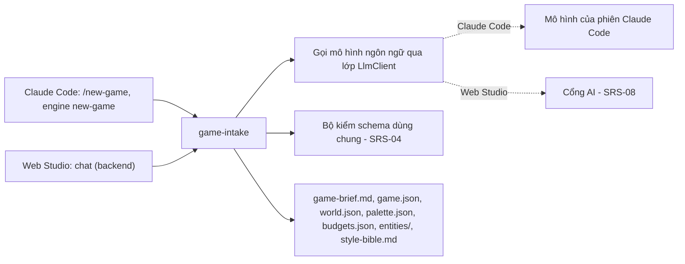
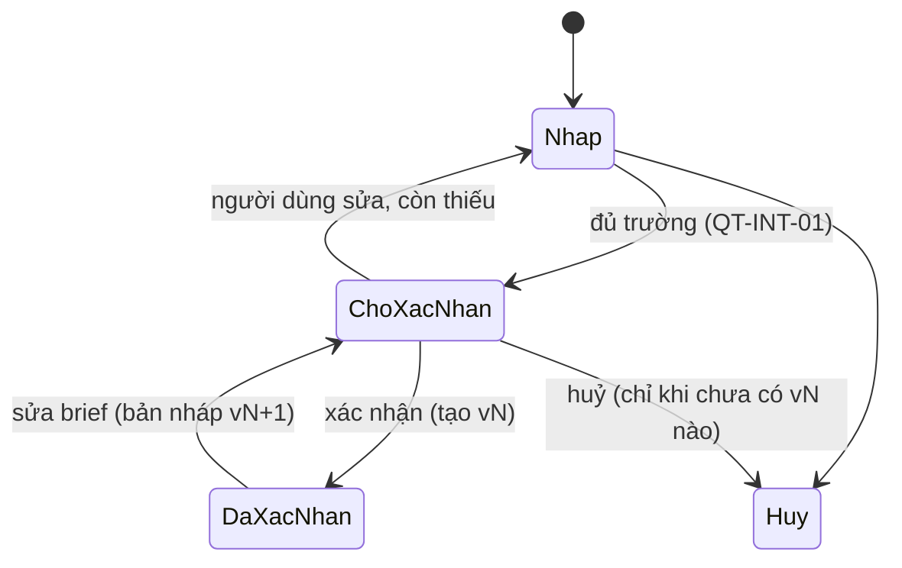

# SRS-01: Tạo game từ mô tả

| Mục | Nội dung |
|---|---|
| Mã tài liệu | SRS-01 |
| Phiên bản | 1.1 |
| Ngày | 23/11/2026 |
| Tài liệu cha | SRS-00 `SRS-00-TONG-QUAN.md` |
| BRD nguồn | BRD-01 v0.1; BRD-00 v0.5 (BR-01…05, BR-73, BR-75, BR-93, BR-94); BRD-10 (BR-119…122, v1.1) |
| Module | `game-intake` (thư viện dùng chung), skill `engine-intake`, lệnh `/new-game`, `engine new-game`; màn hình chat của Web Studio (SRS-08) |
| Nhóm mã | `INT` |
| Pha | E1 (Claude Code), W1 (chat Web Studio), W3 (sửa game bằng lời) |
| Trạng thái | Đã duyệt (Huy, 22/11/2026); v1.1 bổ sung luồng làm tiếp và cập nhật game theo CR-01, Huy duyệt 23/11/2026 |

Quy ước mã, mức ưu tiên và cách ghi "(đề xuất)" theo SRS-00 mục 1.4.

---

## 1. Giới thiệu

### 1.1 Mục đích
Đặc tả chức năng biến mô tả bằng lời của người dùng thành `game-brief.md` và bộ dữ liệu khởi tạo hợp lệ schema, cho người dùng xác nhận trước khi build, và sửa game bằng lời sau khi đã tạo.

### 1.2 Phạm vi
| Trong phạm vi | Ngoài phạm vi |
|---|---|
| Tiếp nhận mô tả và ảnh tham chiếu; hỏi làm rõ; sinh brief, dữ liệu khởi tạo, style bible, bảng màu; vòng đời brief; đề xuất thay đổi (diff) từ yêu cầu bằng lời; phân tích ảnh hưởng | Build cảnh (SRS-02, SRS-03, SRS-04); bố cục giao diện chat, phiên bản dữ liệu game (SRS-08); schema chi tiết của từng file dữ liệu ngoài `game.json` và `game-brief.md` (các SRS module tương ứng) |

### 1.3 Tài liệu liên quan
BRD-01; SRS-00 mục 5 (mô hình dữ liệu chung); SRS-04 mục 6.2 (đồ thị bước build, dùng cho phân tích ảnh hưởng); SRS-08 (màn hình SCR-WEB-04, SCR-WEB-05, API-WEB); SRS-09 (provenance của lần gọi AI).

---

## 2. Mô tả chung

### 2.1 Vị trí trong hệ thống
`game-intake` là **một thư viện TypeScript duy nhất** (NFR-01-03), có hai lối vào:

`LlmClient` là interface; Claude Code và backend mỗi bên cung cấp một bản cài đặt. Logic phân tích, mẫu brief, quy tắc và kiểm schema không được viết hai lần.

### 2.2 Tác nhân
| Tác nhân | Vai trò trong SRS này |
|---|---|
| Người tạo game | Nhập mô tả, trả lời làm rõ, xác nhận brief, duyệt style bible, gửi và duyệt yêu cầu sửa |
| Chủ game / người có quyền Sửa | Xác nhận brief, duyệt đề xuất thay đổi (ma trận quyền SRS-08 mục 3) |
| `game-intake` | Phân tích, sinh, kiểm hợp lệ, đề xuất thay đổi |
| Huy (người duyệt cổng) | Duyệt style bible ở G-E2 |

### 2.3 Giả định và phụ thuộc
| Mã | Nội dung |
|---|---|
| GĐ-INT-01 | Schema dữ liệu game (SRS-04 FR-RTM-01) có trước khi viết `game-intake` (G-E1) |
| GĐ-INT-02 | Sinh ảnh tham chiếu style bible dùng Gemini qua cổng AI hoặc skill `threejs-image-generator` (QĐ-09) |
| GĐ-INT-03 | Ngôn ngữ brief theo ngôn ngữ mô tả; mặc định tiếng Việt (GD-06) |

---

## 3. Use case

| Mã | Tên | Tác nhân chính | Ưu tiên | Pha |
|---|---|---|---|---|
| UC-INT-01 | Tạo game mới từ mô tả | Người tạo game | M | E1, W1 |
| UC-INT-02 | Trả lời câu hỏi làm rõ | Người tạo game | M | E1, W1 |
| UC-INT-03 | Xác nhận brief | Chủ game / người có quyền Sửa | M | E1, W1 |
| UC-INT-04 | Sửa brief sau khi đã xác nhận | Chủ game / người có quyền Sửa | M | E1, W1 |
| UC-INT-05 | Sinh và duyệt style bible, bảng màu | Người tạo game, Huy | M | E2, W1 |
| UC-INT-06 | Sửa game bằng lời | Người có quyền Sửa | M | W3 (Claude Code: E1) |
| UC-INT-07 | Làm tiếp hoặc mở rộng game đang có (v1.1, CR-01) | Người có quyền Sửa | M | E1 (Claude Code), W1–W4 |

### 3.1 UC-INT-01 Tạo game mới từ mô tả
| Mục | Nội dung |
|---|---|
| Tiền điều kiện | Người dùng đã đăng nhập (Web) và còn hạn mức AI; hoặc đang ở repo engine (Claude Code) |
| Kích hoạt | Gõ `/new-game` hoặc chạy `engine new-game`; hoặc bấm "Tạo game mới" trên SCR-WEB-04 |
| Hậu điều kiện thành công | Có `IntakeSession` trạng thái `ChoXacNhan`, brief và dữ liệu khởi tạo hợp lệ schema |

Luồng chính:
1. Người dùng nhập mô tả (FR-INT-01), tuỳ chọn đính kèm ảnh (FR-INT-02).
2. Hệ thống kiểm hạn mức (FR-INT-30), tạo `IntakeSession` trạng thái `Nhap`, lưu nguyên văn mô tả (FR-INT-16).
3. Hệ thống phân tích, ra `IntakeAnalysis` gồm các trường brief kèm trạng thái `tu_mo_ta` / `gia_dinh` / `thieu` / `mau_thuan` (FR-INT-03).
4. Nếu có trường `thieu` hoặc `mau_thuan`: chuyển UC-INT-02.
5. Hệ thống sinh brief (FR-INT-08), dữ liệu khởi tạo (FR-INT-09), kiểm schema (FR-INT-10).
6. Hệ thống hiển thị brief một trang, mục "Asset rủi ro cao", cờ tính năng tuỳ chọn, ước lượng ngân sách; chuyển trạng thái `ChoXacNhan`.

Luồng thay thế / ngoại lệ:
| Mã | Điều kiện | Xử lý |
|---|---|---|
| 1a | Mô tả rỗng hoặc vượt độ dài | ERR-INT-01 |
| 2a | Hết hạn mức AI | ERR-INT-03, không gọi mô hình |
| 3a | Gọi mô hình lỗi hoặc quá thời gian | ERR-INT-04; phiên giữ `Nhap`, cho thử lại không mất mô tả |
| 5a | Schema sai sau 3 lần tự sửa | ERR-INT-05; phiên giữ `Nhap`, ghi chi tiết lỗi cho Claude Code/quản trị |
| 6a | Người dùng huỷ | Trạng thái `Huy`, không tạo game trong thư viện |

### 3.2 UC-INT-02 Trả lời câu hỏi làm rõ
1. Hệ thống sinh tối đa 5 câu hỏi cho vòng hiện tại (FR-INT-04). Mỗi câu có: trường liên quan, câu hỏi, 2–4 lựa chọn, một lựa chọn mặc định.
2. Người dùng chọn hoặc gõ câu trả lời; hoặc bấm "Dùng mặc định cho tất cả" (FR-INT-05).
3. Hệ thống phân tích lại với câu trả lời. Còn thiếu và chưa tới vòng 2 thì lặp; tới vòng 2 thì dùng mặc định cho phần còn thiếu và đánh dấu giả định.
4. Câu hỏi về mâu thuẫn (FR-INT-06) không có nút mặc định và không được bỏ qua.

### 3.3 UC-INT-03 Xác nhận brief
1. Người có quyền bấm "Xác nhận" (Web) hoặc trả lời "xác nhận" (Claude Code).
2. Hệ thống kiểm QT-INT-01 (đủ trường bắt buộc), không còn mâu thuẫn mở.
3. Hệ thống tạo `BriefVersion` số tăng dần, ghi người xác nhận, thời điểm, hash nội dung (FR-INT-18); chuyển `DaXacNhan`.
4. Mở khoá build cho game (FR-INT-17).

### 3.4 UC-INT-04 Sửa brief sau khi đã xác nhận
1. Người dùng sửa brief bằng lời hoặc sửa trực tiếp trường.
2. Hệ thống tạo bản nháp vN+1, trạng thái `ChoXacNhan`; build mới bị chặn cho tới khi xác nhận lại; bản build cũ vẫn xem được.
3. Hệ thống phân tích ảnh hưởng (FR-INT-19): liệt kê bước build và zone cần làm lại, ước lượng thời gian; đánh dấu thay đổi lớn nếu thuộc QT-INT-05.
4. Người dùng xác nhận vN+1 như UC-INT-03.

### 3.5 UC-INT-05 Sinh và duyệt style bible, bảng màu
1. Sau khi brief v1 được xác nhận, hệ thống sinh `style-bible.md` và 3–6 ảnh tham chiếu (FR-INT-20), `palette.json` (FR-INT-21).
2. Người dùng xem trên SCR-INT-02 (Web) hoặc file (Claude Code); bấm Duyệt hoặc yêu cầu sửa.
3. Khi Duyệt: khoá style bible phiên bản sN; mở khoá sinh asset hàng loạt (FR-INT-22).

### 3.6 UC-INT-06 Sửa game bằng lời
1. Người dùng gõ yêu cầu trong chat của game (ví dụ "thêm 5 con gà ở sân").
2. Hệ thống kiểm quyền Sửa và khoá chỉnh sửa (SRS-08 FR-WEB-24), kiểm hạn mức.
3. Hệ thống sinh `ChangeProposal` (FR-INT-23) dựa trên phiên bản dữ liệu hiện tại `baseVersion`.
4. Hệ thống hiển thị thẻ đề xuất: tóm tắt, danh sách thao tác theo đối tượng, ảnh hưởng build, cờ thay đổi lớn (FR-INT-24, FR-INT-26).
5. Người dùng bấm Duyệt, Duyệt một phần (chọn thao tác) hoặc Bỏ (FR-INT-25).
6. Khi duyệt: hệ thống kiểm `baseVersion` còn là phiên bản mới nhất, áp thao tác, kiểm schema, tạo mốc phiên bản (SRS-08 FR-WEB-31); thay đổi runtime được cập nhật nóng, thay đổi cần build gắn nhãn "cần build".

Ngoại lệ: dữ liệu đã đổi sau khi sinh đề xuất → ERR-INT-07, đề nghị sinh lại đề xuất; yêu cầu chỉ là câu hỏi ("zone 2 có bao nhiêu NPC?") → trả lời từ dữ liệu, không tạo đề xuất (SRS-08 FR-WEB-13).

### 3.7 UC-INT-07 Làm tiếp hoặc mở rộng game đang có (v1.1, CR-01)
Áp dụng cho ba trường hợp của SRS-00 mục 4.4: game đang làm dở, game đã có (đã build hoặc đã xuất bản) cần cập nhật, game nhập từ ngoài.

1. Người dùng mở lại game (Web Studio: nút "Làm tiếp" ở thư viện; Claude Code: `/resume-game <id>`).
2. Hệ thống đọc tiến độ game (SRS-04 FR-CLI-08) và tóm tắt bằng lời: đang ở giai đoạn nào, việc đã xong, việc còn treo, việc nên làm tiếp (FR-INT-34).
3. Nếu còn phiên tạo game bỏ dở: mở lại đúng câu hỏi làm rõ đang chờ, giữ các câu đã trả lời (FR-INT-31).
4. Nếu game nhập chưa có brief: sinh brief nháp từ dữ liệu, người dùng xác nhận trước khi build (FR-INT-32).
5. Người dùng nêu việc muốn làm tiếp ("thêm zone chợ quê", "cho thêm đàn vịt"); hệ thống sinh `ChangeProposal` như UC-INT-06; yêu cầu mở rộng phạm vi kèm mục "Cập nhật brief" (FR-INT-33).
6. Sau Duyệt: phiên bản mới; chỉ bước build có hash đổi được build lại (QT-GEN-11).

Ngoại lệ: dữ liệu nhập không đủ để suy brief → ERR-INT-09; mở rộng là thay đổi lớn (QT-INT-05) → brief chuyển `ChoXacNhan` theo FR-INT-26.

---

## 4. Yêu cầu chức năng

Cột "Nguồn" ghi mã BRD được đáp ứng. Ưu tiên M/S/C theo BRD.

### 4.1 Tiếp nhận mô tả

| Mã | Yêu cầu | Nguồn | Ưu tiên | Pha |
|---|---|---|---|---|
| FR-INT-01 | Hệ thống nhận mô tả văn bản tự do tiếng Việt hoặc tiếng Anh, dài từ 10 đến 20.000 ký tự (đề xuất), giữ nguyên định dạng xuống dòng | BR-01, BR-01.1 | M | E1, W1 |
| FR-INT-02 | Hệ thống nhận tối đa 5 ảnh tham chiếu (JPG, PNG, WebP; ≤ 10 MB mỗi ảnh, đề xuất). Ảnh chỉ dùng để suy ra phong cách, bảng màu, tỷ lệ; brief ghi rõ "ảnh chỉ là tham chiếu" | BR-01.2 | S | E1, W1 |
| FR-INT-03 | Hệ thống trích xuất đủ các trường của brief (mục 6.1) thành `IntakeAnalysis`; mỗi trường có trạng thái `tu_mo_ta`, `gia_dinh`, `thieu` hoặc `mau_thuan` và đoạn trích mô tả làm căn cứ | BR-01.3 | M | E1, W1 |
| FR-INT-04 | Khi có trường bắt buộc ở trạng thái `thieu`, hệ thống sinh tối đa 5 câu hỏi làm rõ mỗi vòng, tối đa 2 vòng (đề xuất, CH-01-03); mỗi câu có 2–4 lựa chọn và một lựa chọn mặc định | BR-01.4 | M | E1, W1 |
| FR-INT-05 | Người dùng bỏ qua làm rõ được; hệ thống dùng lựa chọn mặc định và ghi từng giá trị vào mục "Giả định" của brief | BR-01.5 | S | E1, W1 |
| FR-INT-06 | Khi hai chi tiết trong mô tả mâu thuẫn (phong cách, thời đại, góc nhìn, thể loại), hệ thống hỏi lại bằng câu hỏi bắt buộc, không có mặc định, không tự chọn | BR-03.3 | M | E1, W1 |
| FR-INT-07 | Khi mô tả có địa danh thật, hệ thống đề xuất nguồn địa hình `real` hoặc `mixed` kèm bbox gợi ý (tâm và kích thước, mặc định 2×2 km) để người dùng xác nhận; địa danh hư cấu thì đề xuất `procedural` | BR-01.6 | M | E1, W1 |

### 4.2 Sinh brief và dữ liệu khởi tạo

| Mã | Yêu cầu | Nguồn | Ưu tiên | Pha |
|---|---|---|---|---|
| FR-INT-08 | Hệ thống sinh `game-brief.md` theo mẫu cố định mục 6.1, ≤ 400 từ phần chính; phần dài hơn chuyển vào `game-brief-phu-luc.md` | BR-01, BR-01.7 | M | E1, W1 |
| FR-INT-09 | Hệ thống sinh `game.json`, `world.json`, `palette.json` (bản nháp), `budgets.json` (sao chép mặc định A56 theo tier, SRS-04 mục 6.3), `entities/player.json`, và một file khung cho mỗi NPC/loài được nhắc trong mô tả | BR-01, BR-01.8, BR-06 | M | E1, W1 |
| FR-INT-10 | Hệ thống kiểm mọi file sinh ra bằng bộ kiểm schema dùng chung; nếu sai thì tự sửa tối đa 3 lần (đề xuất), sau đó báo ERR-INT-05 kèm đường dẫn trường sai | BR-01.9 | M | E1, W1 |
| FR-INT-11 | Brief có mục "Asset rủi ro cao" khi mô tả có nhân vật cận cảnh, tượng, động vật, vật thể hữu cơ chi tiết; mỗi dòng ghi asset, mức (Cao/Vừa), hướng xử lý theo thứ tự CC0 → generator chuyên biệt → thêm vòng duyệt | BR-04, BR-04.1, BR-73 | M | E1, W1 |
| FR-INT-12 | Danh sách loài động vật và kiểu NPC trong brief và `entities/` lấy đúng theo mô tả; không thêm loài hay NPC không được nhắc (chỉ được ghi ở mục "Gợi ý") | BR-73, BR-73.1 | M | E1, W1 |
| FR-INT-13 | Hệ thống ghi cờ tính năng tuỳ chọn vào `game.json`: `combat`, `hunting`, `dialogueMode` (mục 6.2) và hiển thị thành bảng "Tính năng tuỳ chọn" trong brief; giá trị mặc định là tắt / `static` | BR-75, BR-75.1, BR-75.2 | M | E1, W1 |
| FR-INT-14 | Hệ thống ước lượng sơ bộ số zone, diện tích vùng chơi, số NPC/động vật, mức tải hình học so với ngân sách tier Vừa; cảnh báo khi ước lượng vượt 80% ngân sách | BR-01.10 | S | E1, W1 |

### 4.3 Bám đúng mô tả

| Mã | Yêu cầu | Nguồn | Ưu tiên | Pha |
|---|---|---|---|---|
| FR-INT-15 | Hệ thống không đổi thể loại, bối cảnh, thời đại, phong cách mỹ thuật, giọng điệu so với mô tả; mọi ý tưởng thêm chỉ ghi ở mục "Gợi ý (chưa áp dụng)", mỗi gợi ý có nút/lệnh "Áp dụng" riêng | BR-03, BR-03.1, BR-03.2 | M | E1, W1 |
| FR-INT-16 | Hệ thống lưu nguyên văn mô tả gốc, ảnh đính kèm và các câu trả lời làm rõ cùng phiên; brief liên kết tới bản gốc; không sửa được bản gốc | BR-03.4 | M | E1, W1 |

### 4.4 Vòng đời brief

| Mã | Yêu cầu | Nguồn | Ưu tiên | Pha |
|---|---|---|---|---|
| FR-INT-17 | Hệ thống quản lý trạng thái brief theo mục 6.3; mọi yêu cầu build (CLI, Web, worker) kiểm brief của game ở trạng thái `DaXacNhan`, nếu không thì từ chối với ERR-INT-06 | BR-02, BR-02.1 | M | E1, W1 |
| FR-INT-18 | Xác nhận tạo `BriefVersion` có số (v1, v2…), người xác nhận, thời điểm, hash SHA-256 của brief và dữ liệu khởi tạo | BR-02.2 | M | E1, W1 |
| FR-INT-19 | Sửa brief đã xác nhận tạo bản vN+1 ở `ChoXacNhan`; hệ thống liệt kê bước build và zone bị ảnh hưởng theo đồ thị phụ thuộc (SRS-04 mục 6.2) và ước lượng thời gian build lại | BR-02.3 | M | E1, W1 |

### 4.5 Style bible và bảng màu

| Mã | Yêu cầu | Nguồn | Ưu tiên | Pha |
|---|---|---|---|---|
| FR-INT-20 | Hệ thống sinh `style-bible.md` (hình khối, chất liệu chủ đạo, ánh sáng, mức chi tiết, điều không làm) và 3–6 ảnh tham chiếu bằng Gemini; ảnh có provenance | BR-05, BR-05.1 | M | E2, W1 |
| FR-INT-21 | Hệ thống sinh `palette.json` gồm 8–16 màu, mỗi màu có vai trò `nen`, `nhan`, `ui`, `anh_sang` hoặc `vat_lieu` | BR-05.2 | M | E2, W1 |
| FR-INT-22 | Sinh asset hàng loạt (SRS-03) bị chặn khi style bible chưa ở trạng thái `DaDuyet`; sau khi duyệt, thay đổi style bible là thay đổi lớn, cần xác nhận lại và hệ thống liệt kê asset phải làm lại | BR-05.3 | M | E2, W1 |

### 4.6 Sửa game bằng lời

| Mã | Yêu cầu | Nguồn | Ưu tiên | Pha |
|---|---|---|---|---|
| FR-INT-23 | Hệ thống chuyển yêu cầu bằng lời thành `ChangeProposal` gồm danh sách thao tác `them`/`sua`/`xoa` trên đối tượng dữ liệu (mục 6.4), dựa trên một `baseVersion` | BR-94, BR-94.1 | M | W3 |
| FR-INT-24 | Đề xuất hiển thị theo đối tượng bằng ngôn ngữ thường (ví dụ "Thêm đàn gà: 5 con, vùng Sân trước"), không phải diff JSON thô; kèm ảnh hưởng: `runtime` (áp nóng) hoặc danh sách bước build, ước lượng thời gian | BR-94.2 | M | W3 |
| FR-INT-25 | Không thao tác nào được áp dụng trước khi người dùng bấm Duyệt; người dùng chọn được từng thao tác (duyệt một phần); thao tác phụ thuộc nhau được chọn/bỏ cùng nhau | BR-94.3 | M | W3 |
| FR-INT-26 | Đề xuất làm đổi thể loại, phong cách, góc nhìn, thời đại hoặc bật/tắt tính năng tuỳ chọn được gắn nhãn "Thay đổi lớn" và chuyển brief sang `ChoXacNhan` khi duyệt | BR-94.4 | M | W3 |

### 4.7 Yêu cầu chung

| Mã | Yêu cầu | Nguồn | Ưu tiên | Pha |
|---|---|---|---|---|
| FR-INT-27 | Mỗi lần gọi mô hình ghi provenance: dịch vụ, mô hình, ngày giờ, prompt rút gọn (≤ 500 ký tự), phiên bản `game-intake`, số token, chi phí | QT-01-06 | M | E1, W1 |
| FR-INT-28 | Phần dữ liệu có cấu trúc (seed, id, tham số mặc định) sinh tất định từ mô tả, câu trả lời làm rõ và seed; chỉ phần văn bản do mô hình viết được phép khác nhau | QT-01-07, BR-09 | M | E1 |
| FR-INT-29 | `game-intake` là một gói duy nhất dùng chung cho Claude Code và backend Web Studio, gọi mô hình qua interface `LlmClient` | BR-93, BR-93.2 | M | E1, W1 |
| FR-INT-30 | Trước mỗi lần gọi mô hình trên Web Studio, hệ thống kiểm hạn mức AI của người dùng (SRS-08 FR-WEB-06); sau khi gọi ghi số token và chi phí vào bản ghi sử dụng | BR-92 | M | W1 |

### 4.8 Làm tiếp và cập nhật game (v1.1, CR-01)

| Mã | Yêu cầu | Nguồn | Ưu tiên | Pha |
|---|---|---|---|---|
| FR-INT-31 | Phiên tạo game (`IntakeSession`) ở `Nhap` hoặc `ChoXacNhan` được lưu sau mỗi lượt (mô tả, ảnh, câu trả lời, câu hỏi đang chờ, seed); người dùng mở lại phiên và tiếp tục đúng chỗ dừng, không gọi lại mô hình cho phần đã có; phiên không hoạt động 30 ngày chuyển `Huy` (QT-INT-10) | BR-120.1, BR-120.2, BR-01, BR-02 | M | E1, W1 |
| FR-INT-32 | Với game có dữ liệu nhưng thiếu `game-brief.md` (nhập từ ngoài, làm tay trước khi có engine), `reverseBrief` (API-INT-06) sinh brief nháp theo mẫu mục 6.1 từ `game.json`, `world.json`, `entities/**`; mỗi trường ghi nguồn `suy_tu_du_lieu` hoặc `thieu`; brief ở `ChoXacNhan`, build bị chặn đến khi xác nhận (FR-INT-17, QT-INT-09) | BR-122.2, BR-02, BR-112 | S | E1, W4 |
| FR-INT-33 | Yêu cầu mở rộng game đang có do người dùng nêu (thêm zone, loài, NPC, nhiệm vụ, tính năng tuỳ chọn) được ghi vào brief thành bản vN+1 qua mục "Cập nhật brief" trên thẻ đề xuất; Duyệt đề xuất đồng thời xác nhận vN+1 khi không phải thay đổi lớn; thay đổi lớn theo FR-INT-26; QT-GEN-03 tiếp tục kiểm theo brief mới | BR-121.1, BR-121.2, BR-121.3, BR-02.3, BR-94 | M | E1, W3 |
| FR-INT-34 | Khi mở lại game, hệ thống tóm tắt tiến độ bằng lời từ báo cáo tiến độ (SRS-04 mục 6.6): giai đoạn, việc đã xong, việc còn treo (đề xuất chờ duyệt, asset chờ duyệt, job lỗi, zone cần build, thay đổi chưa xuất bản) và một việc nên làm tiếp; không đọc lại toàn bộ dữ liệu game để tóm tắt | BR-119.3, BR-93 | M | E1, W2 |

---

## 5. Quy tắc nghiệp vụ

| Mã | Quy tắc | Điều kiện, cách xử lý | Kết quả, ghi chú |
|---|---|---|---|
| QT-INT-01 | Đủ trường mới được trình xác nhận | KHI tất cả trường "Bắt buộc = Có" ở mục 6.1 có trạng thái khác `thieu` và không còn `mau_thuan` THÌ cho chuyển `ChoXacNhan` | Ngược lại giữ `Nhap` và hỏi làm rõ. Nguồn QT-01-01 |
| QT-INT-02 | Độ dài brief | Phần chính ≤ 400 từ; đếm theo khoảng trắng | Vượt thì chuyển mục "Gợi ý", "Giả định" chi tiết sang phụ lục. Nguồn QT-01-02 |
| QT-INT-03 | Không mâu thuẫn với mô tả gốc | Mỗi trường có căn cứ trích từ mô tả hoặc ghi ở "Giả định" | Kiểm bằng bộ test brief (AC-01-01, 06). Nguồn QT-01-03 |
| QT-INT-04 | Tính năng tuỳ chọn mặc định tắt | KHI mô tả nhắc rõ (ví dụ "săn", "đánh", "chiến đấu") THÌ bật cờ tương ứng; KHI chỉ gợi ý mơ hồ THÌ hỏi làm rõ | Hội thoại mặc định `static`. Nguồn QT-01-04, QĐ-13, QĐ-14 |
| QT-INT-05 | Định nghĩa thay đổi lớn | Đổi một trong: thể loại, phong cách mỹ thuật, góc nhìn, thời đại, bật/tắt `combat`/`hunting`/`dialogueMode ≠ static`, style bible đã duyệt | Luôn cần xác nhận lại brief. Nguồn QT-01-05 |
| QT-INT-06 | Mặc định góc nhìn | KHI mô tả không nêu góc nhìn THÌ hỏi, mặc định ngôi thứ ba | Nguồn CH-14 (BRD-00), AC-01-02 |
| QT-INT-07 | Săn bắt không kéo theo chiến đấu | KHI mô tả có săn bắt nhưng không nói chiến đấu với người/NPC THÌ bật `hunting`, hỏi lại `combat` | Nguồn AC-01-03 |
| QT-INT-08 | Đề xuất hết hạn | KHI `baseVersion` của đề xuất khác phiên bản mới nhất lúc duyệt THÌ từ chối áp dụng (ERR-INT-07) | Tránh ghi đè thay đổi của editor (RR-20) |
| QT-INT-09 | Brief suy ngược phải xác nhận (v1.1) | KHI brief được sinh từ dữ liệu có sẵn (FR-INT-32) THÌ luôn ở `ChoXacNhan`; trường `thieu` bắt buộc phải điền hoặc chấp nhận mặc định trước khi xác nhận | Không có ngoại lệ "build thử trước". Nguồn CR-01 |
| QT-INT-10 | Giữ phiên tạo game bỏ dở (v1.1) | KHI `IntakeSession` không có lượt mới trong 30 ngày THÌ chuyển `Huy`; trước 3 ngày gửi thông báo trong web | Giá trị 30 ngày (đề xuất). Nguồn CR-01 |

---

## 6. Dữ liệu

### 6.1 Mẫu `game-brief.md`

| Trường | Khoá dữ liệu | Bắt buộc | Ghi chú |
|---|---|---|---|
| Tên game (tạm) | `title` | Có | |
| Mô tả gốc | `sourceRef` | Có | Liên kết tới bản lưu nguyên văn |
| Thể loại | `genre` | Có | |
| Góc nhìn | `camera` | Có | `first_person` / `third_person` |
| Bối cảnh: địa điểm, thời đại, mùa, thời điểm | `setting.place`, `setting.era`, `setting.season`, `setting.timeOfDay[]` | Có | `setting.realPlace` true/false |
| Phong cách mỹ thuật | `artStyle.summary`, `artStyle.refs[]` | Có | Một câu + tham chiếu |
| Vòng chơi tối thiểu | `coreLoop[]` | Có | 3–5 bước |
| Nhân vật người chơi | `player` | Có | |
| NPC và động vật | `npcs[]`, `animals[]` | Nếu có | Loài, số lượng ước lượng |
| Tính năng tuỳ chọn | `features` | Có | Bảng bật/tắt (mục 6.2) |
| Quy mô | `scale.zones`, `scale.areaKm2` | Có | |
| Asset rủi ro cao | `highRiskAssets[]` | Nếu có | asset, mức, hướng xử lý |
| Giả định | `assumptions[]` | Nếu có | trường, giá trị, lý do |
| Gợi ý (chưa áp dụng) | `suggestions[]` | Không | |

Brief được lưu song song dạng Markdown (đọc) và `brief.json` (máy đọc, cùng khoá như cột 2).

### 6.2 Phần `game.json` do SRS này sinh

| Khoá | Kiểu | Mặc định | Ghi chú |
|---|---|---|---|
| `id` | string (slug) | từ `title` | Duy nhất trong thư viện |
| `schemaVersion` | string | phiên bản schema hiện hành | SRS-04 FR-RTM-02 |
| `engineVersion` | string (semver) | phiên bản engine hiện hành | SRS-04 FR-RTM-03 |
| `seed` | integer | sinh ngẫu nhiên một lần, lưu lại | |
| `language` | `vi` / `en` | theo mô tả | |
| `camera.mode` | `first_person` / `third_person` | `third_person` | |
| `orientation` | `landscape` / `portrait` | `landscape` | CH-04-01 |
| `features.combat.enabled` | boolean | false | Chi tiết SRS-06 |
| `features.hunting.enabled` | boolean | false | Chi tiết SRS-06 |
| `features.dialogueMode` | `static` / `ai` / `hybrid` | `static` | Chi tiết SRS-07 |
| `briefVersion` | integer | 1 | Phiên bản brief đã xác nhận đang dùng |
| `styleBibleVersion` | integer / null | null | |

### 6.3 Trạng thái brief

Khi có bản nháp vN+1 đang `ChoXacNhan`, vN vẫn là bản hiệu lực cho xem trước nhưng không được chạy build mới (FR-INT-17).

### 6.4 `ChangeProposal`

| Trường | Kiểu | Ghi chú |
|---|---|---|
| `id` | uuid | |
| `gameId`, `baseVersion` | string, integer | Phiên bản dữ liệu lúc sinh |
| `request` | string | Nguyên văn yêu cầu |
| `summary` | string | ≤ 200 ký tự |
| `ops[]` | danh sách | `{opId, kind: them/sua/xoa, target: đường dẫn file + id đối tượng, label, patch (JSON Patch RFC 6902), dependsOn[]}` |
| `impact` | object | `{runtimeOnly: bool, buildSteps[], zones[], estimateMinutes}` |
| `major` | boolean | Theo QT-INT-05 |
| `status` | `ChoDuyet` / `DaDuyet` / `DuyetMotPhan` / `DaBo` / `HetHan` | |
| `decidedBy`, `decidedAt`, `appliedOps[]` | | |
| `briefUpdate` | object, tuỳ chọn (v1.1) | `{fromVersion, changes[{field, old, new}]}`: phần cập nhật brief khi đề xuất mở rộng phạm vi (FR-INT-33) |

### 6.5 `IntakeSession` (v1.1)

| Trường | Kiểu | Ghi chú |
|---|---|---|
| `id`, `ownerId`, `gameId?` | uuid | `gameId` có khi phiên sinh brief cho game đã có (FR-INT-32) |
| `kind` | `moi` / `suy_nguoc` | Tạo mới hay suy brief từ dữ liệu |
| `turns[]` | danh sách | Mô tả, ảnh, câu hỏi, câu trả lời theo thứ tự |
| `pendingQuestions[]` | danh sách | Câu hỏi đang chờ khi người dùng rời đi |
| `analysis` | `IntakeAnalysis` | Kết quả phân tích mới nhất (không gọi lại mô hình khi mở lại) |
| `seed`, `status`, `lastActivityAt` | | `status` theo mục 6.3; `Huy` sau 30 ngày (QT-INT-10) |

---

## 7. Giao diện

### 7.1 Màn hình
| Mã | Tên | Mô tả ngắn | Chi tiết |
|---|---|---|---|
| SCR-WEB-04 | Tạo game mới | Khung chat mô tả, khu câu hỏi làm rõ (thẻ lựa chọn), xem brief một trang, nút Xác nhận / Sửa / Huỷ | SRS-08 mục 7 |
| SCR-INT-01 | Thẻ đề xuất thay đổi | Trong chat của không gian làm việc: tóm tắt, danh sách thao tác có ô chọn, ảnh hưởng, nhãn "Thay đổi lớn", nút Duyệt / Duyệt phần đã chọn / Bỏ | Mục 7.2 |
| SCR-INT-02 | Duyệt style bible | Văn bản style bible, lưới 3–6 ảnh tham chiếu, ô màu `palette.json` có vai trò, nút Duyệt / Yêu cầu sửa | Mục 7.3 |

### 7.2 SCR-INT-01 Thẻ đề xuất thay đổi
| Phần tử | Kiểu | Quy tắc |
|---|---|---|
| Tóm tắt | Văn bản | `summary` |
| Danh sách thao tác | Ô chọn + nhãn | Mặc định chọn tất cả; bỏ chọn thao tác có `dependsOn` thì bỏ cả thao tác phụ thuộc |
| Ảnh hưởng | Nhãn | "Áp ngay" hoặc "Cần build: <bước> zone <id>, khoảng N phút" |
| Nhãn "Thay đổi lớn" | Huy hiệu đỏ | Khi `major = true`, kèm câu "Brief sẽ cần xác nhận lại" |
| Nút Duyệt / Duyệt phần đã chọn / Bỏ | Nút | Ẩn với người chỉ có quyền Xem; vô hiệu khi đề xuất `HetHan` |

### 7.3 SCR-INT-02 Duyệt style bible
| Phần tử | Quy tắc |
|---|---|
| Nút Duyệt | Chỉ chủ game hoặc người có quyền Sửa; ghi người duyệt, thời điểm, phiên bản sN |
| Yêu cầu sửa | Ô văn bản bắt buộc; sinh lại tạo sN+1 |

### 7.4 Giao diện lập trình
| Mã | Giao diện | Đầu vào | Đầu ra |
|---|---|---|---|
| API-INT-01 | `analyze(input)` | mô tả, ảnh, câu trả lời làm rõ, seed | `IntakeAnalysis` + câu hỏi làm rõ |
| API-INT-02 | `generate(analysis)` | `IntakeAnalysis` đã đủ | Gói file brief + dữ liệu khởi tạo, báo cáo kiểm schema |
| API-INT-03 | `generateStyle(brief)` | brief đã xác nhận | `style-bible.md`, ảnh tham chiếu, `palette.json` |
| API-INT-04 | `propose(gameData, baseVersion, request)` | dữ liệu game, yêu cầu | `ChangeProposal` |
| API-INT-05 | `impact(diffPaths)` | danh sách đường dẫn dữ liệu đổi | Bước build, zone, ước lượng (dùng SRS-04 mục 6.2) |
| API-INT-06 | `reverseBrief(gameData)` (v1.1) | dữ liệu game đã có | Brief nháp, danh sách trường `suy_tu_du_lieu`/`thieu`, câu hỏi làm rõ |
| CLI | `engine new-game [--from <file>] [--seed <n>]` | mô tả từ file hoặc nhập tay | Thư mục `games/<id>/` + mã thoát (SRS-04 mục 7.2) |

Endpoint web tương ứng: API-WEB-10…14 (SRS-08 mục 8).

---

## 8. Mã lỗi

| Mã | Điều kiện | Thông báo cho người dùng | Phản ứng hệ thống |
|---|---|---|---|
| ERR-INT-01 | Mô tả rỗng, < 10 hoặc > 20.000 ký tự | "Mô tả cần từ 10 đến 20.000 ký tự." | Không gọi mô hình |
| ERR-INT-02 | Ảnh sai định dạng hoặc quá 10 MB, quá 5 ảnh | "Ảnh <tên> không dùng được: <lý do>." | Bỏ ảnh đó, giữ phần còn lại |
| ERR-INT-03 | Hết hạn mức AI | "Bạn đã dùng hết hạn mức AI hôm nay. Liên hệ quản trị để nâng hạn mức." | Không gọi mô hình; ghi sự kiện cho quản trị |
| ERR-INT-04 | Mô hình lỗi hoặc quá 120 s | "Chưa tạo được brief, vui lòng thử lại." | Giữ phiên `Nhap`; thử lại tự động 1 lần sau 5 s |
| ERR-INT-05 | Dữ liệu sinh ra sai schema sau 3 lần tự sửa | "Dữ liệu khởi tạo chưa hợp lệ, đã báo kỹ thuật." | Ghi đường dẫn trường sai vào log |
| ERR-INT-06 | Yêu cầu build khi brief chưa `DaXacNhan` | "Hãy xác nhận brief trước khi build." | Từ chối job; mã thoát CLI 3 |
| ERR-INT-07 | Duyệt đề xuất khi dữ liệu đã đổi | "Game đã thay đổi sau khi đề xuất được tạo. Tạo lại đề xuất?" | Đề xuất chuyển `HetHan` |
| ERR-INT-08 | Xác nhận khi còn mâu thuẫn mở | "Còn câu hỏi cần trả lời trước khi xác nhận." | Giữ trạng thái |
| ERR-INT-09 | Suy brief khi thiếu `game.json` hoặc `world.json` (v1.1) | "Không đủ dữ liệu để tạo brief: thiếu <file>." | Không gọi mô hình; mời tạo game mới từ mô tả |

---

## 9. Yêu cầu phi chức năng

| Mã | Yêu cầu | Cách kiểm |
|---|---|---|
| NFR-INT-01 | Sinh brief lần đầu ≤ 2 phút tại P90, không tính thời gian người dùng trả lời (đề xuất, NFR-01-01) | Đo 10 mô tả mẫu |
| NFR-INT-02 | Chi phí token mỗi lần sinh brief được ghi và hiển thị cho quản trị (NFR-01-02) | Kiểm bản ghi sử dụng |
| NFR-INT-03 | Một gói `game-intake` dùng cho hai lối vào (NFR-01-03) | Review mã: không có bản sao logic ở `web/` |
| NFR-INT-04 | Sinh đề xuất thay đổi ≤ 20 s tại P90 (đề xuất) | Đo 20 yêu cầu mẫu |

---

## 10. Tiêu chí chấp nhận

| AC BRD | Yêu cầu SRS kiểm | Cách kiểm |
|---|---|---|
| AC-01-01 | FR-INT-03, 08, 12, 13, 15 | Test brief tự động: so trường với kỳ vọng (phong cách "low-poly ấm áp", đúng 3 loài, `combat=false`) |
| AC-01-02 | FR-INT-04, QT-INT-06 | Mô tả không nêu góc nhìn → có câu hỏi, mặc định ngôi ba |
| AC-01-03 | FR-INT-13, QT-INT-07 | "săn hươu trong rừng" → `hunting=true`, câu hỏi về `combat` |
| AC-01-04 | FR-INT-17, ERR-INT-06 | Gọi build khi `ChoXacNhan` → từ chối |
| AC-01-05 | FR-INT-19 | Đổi thời điểm sau khi build zone 1 → v2, ảnh hưởng liệt kê `lighting` zone 1 |
| AC-01-06 | FR-INT-06 | Mô tả "hiện thực" + "hoạt hình" → câu hỏi bắt buộc |
| AC-01-07 | FR-INT-11 | Tượng Phật chi tiết → mục "Asset rủi ro cao" mức Cao, hướng CC0 trước |
| AC-08-03 (BRD-08) | FR-INT-23…25 | "thêm 5 con gà ở sân" → thẻ đề xuất; chỉ áp sau Duyệt; có mốc phiên bản |
| AC-CR01-01 (v1.1) | FR-INT-31 | Trả lời 2/4 câu hỏi làm rõ, đóng trình duyệt, mở lại → thấy đúng 2 câu còn lại, không có lượt gọi mô hình mới |
| AC-CR01-02 (v1.1) | FR-INT-32, QT-INT-09 | Nhập thư mục game không có brief → brief nháp `ChoXacNhan`, gọi build → ERR-INT-06 |
| AC-CR01-03 (v1.1) | FR-INT-33 | Game đã xuất bản, yêu cầu "thêm zone chợ quê" → thẻ đề xuất có mục "Cập nhật brief"; sau Duyệt brief lên vN+1, chỉ zone mới cần build |

---

## 11. Open item

| Mã | Câu hỏi | Đề xuất | Nguồn |
|---|---|---|---|
| OI-INT-01 | Giới hạn độ dài mô tả 20.000 ký tự và 5 ảnh có hợp lý? | Giữ, xem lại sau W1 | Mới |
| OI-INT-02 | Số vòng hỏi làm rõ tối đa | 2 vòng | CH-01-03 |
| OI-INT-03 | Mô tả bằng giọng nói | Không ở bản đầu | CH-01-01 |
| OI-INT-04 | Chọn từ mẫu game có sẵn | Có ở W4 | CH-01-02 |

---

## 12. Truy vết

| BR | Yêu cầu SRS |
|---|---|
| BR-01 (BR-01.1…10) | FR-INT-01…05, 07…10, 14 |
| BR-02 (BR-02.1…3) | FR-INT-17…19 |
| BR-03 (BR-03.1…4) | FR-INT-06, 15, 16 |
| BR-04 (BR-04.1) | FR-INT-11 |
| BR-05 (BR-05.1…3) | FR-INT-20…22 |
| BR-73 (BR-73.1) | FR-INT-11, 12 |
| BR-75 (BR-75.1, 75.2) | FR-INT-13 |
| BR-93 (BR-93.2) | FR-INT-29 |
| BR-94 (BR-94.1…4) | FR-INT-23…26, 33 |
| BR-119…122 (BRD-10, CR-01; v1.1) | FR-INT-31…34; UC-INT-07; QT-INT-09, 10; API-INT-06; ERR-INT-09 |

## 13. Lịch sử thay đổi

| Phiên bản | Ngày | Người | Nội dung |
|---|---|---|---|
| 0.1 | 22/11/2026 | Claude | Bản đầu từ BRD-01 v0.1 |
| 1.0 | 22/11/2026 | Claude | Huy duyệt; chấp nhận các giá trị "(đề xuất)" và đề xuất của Open item làm giá trị nền; đổi trạng thái sang Đã duyệt |
| 1.1 | 23/11/2026 | Claude | CR-01 (Huy yêu cầu 23/11/2026: luồng xây dựng cho game đang làm dở hoặc đã có): thêm UC-INT-07, FR-INT-31…34, QT-INT-09, 10, `ChangeProposal.briefUpdate`, mục 6.5 `IntakeSession`, API-INT-06, ERR-INT-09, AC-CR01-01…03; Huy duyệt 23/11/2026 (giá trị "(đề xuất)" mới được chấp nhận làm giá trị nền) |
