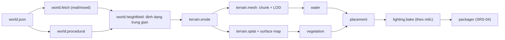

# SRS-02: Thế giới, địa hình và môi trường

| Mục | Nội dung |
|---|---|
| Mã tài liệu | SRS-02 |
| Phiên bản | 1.0 |
| Ngày | 22/11/2026 |
| Tài liệu cha | SRS-00 `SRS-00-TONG-QUAN.md` |
| BRD nguồn | BRD-02 v0.1; BRD-00 v0.5 (BR-10…14, BR-24, BR-45, BR-69, BR-104) |
| Module | Build: `world`, `terrain`, `water`, `vegetation`, `placement`, `lighting`; Runtime: `fx`, phần ánh sáng của `core`; skill `engine-world`, `engine-lighting-bake`, `engine-blender` |
| Nhóm mã | `WLD` |
| Pha | E1 (thế giới, địa hình), E3 (nước, thực vật, hiệu ứng), E4 (bố trí), E5 (ánh sáng), W4 (chỉnh trên web) |
| Trạng thái | Đã duyệt (Huy, 22/11/2026) |

---

## 1. Giới thiệu

### 1.1 Mục đích
Đặc tả cách engine dựng không gian chơi (địa hình, nước, thực vật, bố trí, ánh sáng, bầu trời, hiệu ứng) chỉ từ dữ liệu và tham số, tất định theo seed, trong ngân sách A56.

### 1.2 Phạm vi
| Trong phạm vi | Ngoài phạm vi |
|---|---|
| Hệ toạ độ, vùng chơi, zone; nạp địa hình thật (OSM, Copernicus GLO-30) và thủ tục, trộn; xói mòn; mesh địa hình, splat map; nước; thực vật; bố trí theo luật; bake ánh sáng, mốc thời điểm; bầu trời, sương, thời tiết, hậu kỳ; form chỉnh tham số và vẽ vùng trên Web Studio; ghi công dữ liệu | Công trình, đồ vật, vật liệu (SRS-03); nhân vật, động vật (SRS-05); stream zone và chọn tier lúc chạy (SRS-04); cọ nắn địa hình trên web (OI-WLD-03) |

### 1.3 Tài liệu liên quan
BRD-02; SRS-03 (vật liệu, mô hình cây CC0); SRS-04 (đồ thị build, packager, ngân sách, báo cáo JSON); SRS-05 (lưới điều hướng dùng mask và loại bề mặt); SRS-08 (khung xem trước, job).

---

## 2. Mô tả chung

### 2.1 Pipeline build thế giới

Mỗi bước là một bước build trong đồ thị phụ thuộc của SRS-04 mục 6.2; đầu vào được băm (hash) để build tăng dần.

### 2.2 Định dạng trung gian (heightfield bundle)

| File | Định dạng | Nội dung |
|---|---|---|
| `height.r32` + `height.meta.json` | float32 thô, hàng trước cột | Độ cao (m), kích thước lưới, bước lưới (m), gốc toạ độ cục bộ |
| `mask-<loai>.png` | PNG 8 bit xám | `road`, `water`, `field`, `forest`, `building`, `custom-<id>`; 0 = không, 255 = có |
| `vectors.geojson` | GeoJSON, toạ độ cục bộ (m) | Đường, sông, bờ hồ, ranh ruộng; thuộc tính OSM gốc rút gọn |
| `surface.png` | PNG chỉ số | Loại bề mặt (mục 6.4) dùng cho âm bước chân, động vật, điều hướng |
| `provenance.json` | JSON | Nguồn, bbox, ngày tải, license, seed, tham số |

Hai bộ nạp (thật, thủ tục) đều xuất đúng bộ này (BR-11 tiêu chí chấp nhận).

### 2.3 Tác nhân
| Tác nhân | Vai trò |
|---|---|
| Người tạo game | Khai báo vùng, chọn nguồn địa hình, chỉnh tham số, vẽ vùng, duyệt ảnh góc chuẩn |
| Worker build | Chạy Python + Blender headless (SRS-08 FR-WEB-45) |
| Agent `world-builder`, `tech-artist` | Viết generator, vận hành bake (SRS-09) |
| `qa` | Chụp góc chuẩn, đo ngân sách (SRS-04) |

---

## 3. Use case

| Mã | Tên | Tác nhân | Ưu tiên | Pha |
|---|---|---|---|---|
| UC-WLD-01 | Khai báo vùng và nguồn địa hình | Người tạo game | M | E1 |
| UC-WLD-02 | Build thế giới một zone | Người tạo game, worker | M | E1–E5 |
| UC-WLD-03 | Chỉnh tham số môi trường trên Web Studio | Người tạo game | S | W4 |
| UC-WLD-04 | Vẽ vùng trên bản đồ nhìn từ trên | Người tạo game | S | W3–W4 |
| UC-WLD-05 | Chuyển mốc thời điểm trong game | Người chơi (runtime) | S | E5 |

### 3.1 UC-WLD-01 Khai báo vùng và nguồn địa hình
1. `game-intake` sinh `world.json` khởi tạo (SRS-01 FR-INT-07, FR-INT-09).
2. Người dùng xác nhận hoặc sửa: nguồn (`real`/`procedural`/`mixed`), bbox (nếu thật), tham số thủ tục, seed, vùng chơi, danh sách zone.
3. Hệ thống kiểm schema, kiểm diện tích vùng chơi ≤ giới hạn (QT-WLD-07), kiểm zone phủ hết vùng chơi và không chồng nhau.

### 3.2 UC-WLD-02 Build thế giới một zone
1. Người dùng chạy `engine build --zone <id>` hoặc bấm Build trên Web.
2. Hệ thống kiểm brief đã xác nhận (SRS-01 FR-INT-17), tính hash đầu vào từng bước, bỏ qua bước có hash không đổi (FR-WLD-30).
3. Worker chạy các bước mục 2.1 còn lại; mỗi bước ghi báo cáo JSON (SRS-04 FR-QA-01).
4. `packager` đóng gói zone theo tier, kiểm ngân sách; kết quả Pass/Warn/Fail.
5. QA mức nhẹ chụp góc chuẩn của zone.

Ngoại lệ: tải OSM/DEM lỗi → ERR-WLD-01, dùng cache nếu có; thiếu license → ERR-WLD-02, dừng build; bake quá thời gian tối đa → ERR-WLD-06.

### 3.3 UC-WLD-03 Chỉnh tham số môi trường
1. Người dùng mở SCR-WLD-01, sửa giá trị trong form (có mặc định, giới hạn).
2. Hệ thống phân loại ảnh hưởng: `runtime` (áp nóng, ví dụ sương, màu hậu kỳ, mốc thời điểm đã bake) hoặc `build` (liệt kê bước, ước lượng thời gian).
3. Khi lưu: tạo mốc phiên bản; thay đổi `build` gắn nhãn "cần build"; người dùng bấm Build để tạo job.

### 3.4 UC-WLD-04 Vẽ vùng
1. Người dùng mở SCR-WLD-02, chọn loại vùng (vùng chơi, zone, rừng, cỏ, nước, spawn, cấm bố trí), vẽ đa giác.
2. Hệ thống kiểm đa giác hợp lệ (không tự cắt, ≥ 3 đỉnh, nằm trong vùng thế giới), ghi vào `world.json` hoặc file lớp tương ứng.

### 3.5 UC-WLD-05 Chuyển mốc thời điểm
1. Sự kiện game hoặc lịch ngày đêm yêu cầu đổi mốc.
2. Runtime nạp lightmap của mốc đích (đã tải nền trước), nội suy ánh sáng động, màu trời, sương trong thời gian chuyển (mặc định 3 s).

---

## 4. Yêu cầu chức năng

### 4.1 Hệ toạ độ, vùng chơi, zone

| Mã | Yêu cầu | Nguồn | Ưu tiên | Pha |
|---|---|---|---|---|
| FR-WLD-01 | Hệ thống dùng một hệ toạ độ: đơn vị mét, trục Y lên, tay phải; toạ độ địa lý (WGS84) quy đổi về gốc cục bộ bằng phép chiếu UTM của vùng, gốc là tâm bbox | BR-24, BR-24.1 | M | E1 |
| FR-WLD-02 | Vùng chơi khai báo bằng đa giác trong `world.json`; runtime chặn người chơi, NPC, động vật ra ngoài (SRS-05 QT-CHR-05) | BR-24.2 | M | E1 |
| FR-WLD-03 | Thế giới chia zone; mỗi zone có id, đa giác, tâm, danh sách zone kề, ngân sách riêng (ghi đè `budgets.json`), tier hỗ trợ | BR-24.3 | M | E1 |
| FR-WLD-04 | Kích thước zone mặc định lấy từ `budgets.json` theo tier (đề xuất tier Vừa: 500 × 500 m); `game-intake` chia zone theo lưới mặc định khi người dùng chưa vẽ | BR-24.4 | M | E1 |

### 4.2 Địa hình từ dữ liệu thật

| Mã | Yêu cầu | Nguồn | Ưu tiên | Pha |
|---|---|---|---|---|
| FR-WLD-05 | Bộ nạp thật nhận bbox (WGS84) hoặc tên địa danh (tra toạ độ, người dùng xác nhận bbox); tải DEM Copernicus GLO-30 và dữ liệu OSM các lớp: đường, sông, suối, hồ, ao, ruộng, rừng, công trình | BR-10, BR-10.1 | M | E1 |
| FR-WLD-06 | Dữ liệu tải được lưu cache theo khoá (nguồn, bbox, ngày phiên bản dữ liệu) kèm ngày tải, URL, license; không tải lại khi khoá không đổi; `--refresh` buộc tải lại | BR-10.2 | M | E1 |
| FR-WLD-07 | Tham số `heightScale` (0,5–3,0, mặc định 1,0) và `smoothing` (0–5 lần lọc, mặc định 1) cho dữ liệu thật | BR-10.3 | S | E1 |
| FR-WLD-08 | Vector OSM chuyển thành mask và đường cong theo mục 2.2; đường có bề rộng theo loại đường (bảng tra trong cấu hình) | BR-10.4 | M | E1 |

### 4.3 Địa hình thủ tục và trộn

| Mã | Yêu cầu | Nguồn | Ưu tiên | Pha |
|---|---|---|---|---|
| FR-WLD-09 | Bộ nạp thủ tục sinh heightfield từ: `preset` (`dong_bang`, `doi`, `nui`, `ven_bien`, `thung_lung`), `maxHeight` (m), `roughness` (0–1), `seed`; xuất cùng định dạng mục 2.2 | BR-11, BR-11.1 | M | E1 |
| FR-WLD-10 | Người dùng khai báo yếu tố chính bằng đường/đa giác (sông, đường, hồ, đồi) trong `world.json`; generator khắc sông/đường, nâng đồi theo khai báo | BR-11.2 | S | E1 |
| FR-WLD-11 | Chế độ `mixed`: nền DEM thật cộng chi tiết noise; mặt nạ trộn (`blendMask`) quyết định tỷ lệ mỗi ô (0 = thật, 1 = thủ tục) | BR-11.3 | M | E1 |
| FR-WLD-12 | Xói mòn thuỷ lực và nhiệt có tham số (`iterations`, `strength`, vùng áp dụng bằng mask); tất định theo seed | BR-11.4 | M | E1 |
| FR-WLD-13 | Generator A.N.T. Landscape trong Blender dùng được như một `preset` thủ tục (QĐ-06); phiên bản add-on cố định (SRS-09 FR-DEV-20) | BR-11.5 | S | E1 |

### 4.4 Mesh địa hình và bề mặt

| Mã | Yêu cầu | Nguồn | Ưu tiên | Pha |
|---|---|---|---|---|
| FR-WLD-14 | Địa hình chia chunk (mặc định 64 × 64 m), 4 mức LOD theo khoảng cách; mép giữa các LOD được khâu (skirt hoặc stitch) để không nứt | BR-10.5 | M | E1 |
| FR-WLD-15 | Splat map tự sinh từ độ dốc, độ cao, mask OSM theo bảng luật trong `world.json`; số lớp vật liệu tối đa theo tier (đề xuất Thấp 4, Vừa 4, Cao 8, Tối đa 8) | BR-10.6 | M | E1 |
| FR-WLD-16 | Hệ thống xuất `surface.png` loại bề mặt (mục 6.4) và đưa vào manifest để runtime tra cứu theo toạ độ | BR-10.7 | M | E1 |

### 4.5 Nước

| Mã | Yêu cầu | Nguồn | Ưu tiên | Pha |
|---|---|---|---|---|
| FR-WLD-17 | Vùng nước (sông, hồ, ao, ruộng ngập, biển) lấy từ mask OSM hoặc khai báo đa giác; mỗi vùng có `level` (m), `depth` (m), `flow` (hướng, tốc độ) | BR-12, BR-12.1, BR-12.3 | M | E3 |
| FR-WLD-18 | Shader nước theo tier: Thấp (màu + normal động), Vừa (thêm phản chiếu bầu trời, bọt bờ), Cao/Tối đa (thêm phản chiếu cảnh, khúc xạ, gợn sóng) | BR-12.2 | M | E3 |
| FR-WLD-19 | `depth` được dùng cho va chạm người chơi (> 1,2 m là nước sâu, đề xuất), bơi khi bật, vùng sống của cá (SRS-05) | BR-12.3 | M | E3 |
| FR-WLD-20 | Đối tượng trên mặt nước (thuyền, bèo, sen) đặt bằng luật bố trí với ràng buộc `onWater: true` | BR-12.4 | S | E4 |

### 4.6 Thực vật

| Mã | Yêu cầu | Nguồn | Ưu tiên | Pha |
|---|---|---|---|---|
| FR-WLD-21 | Thư viện loài cây là công thức tham số (Sapling Tree Gen + code bổ sung): hình tán, chiều cao, mùa, màu lá, mật độ lá, seed; mỗi loài là một file `assets/recipes/tree-*.json` (SRS-03) | BR-12, BR-12.5 | M | E3 |
| FR-WLD-22 | Lớp thực vật rải rừng, cây rải rác, bụi, cỏ theo mask và luật (mật độ/ha, khoảng cách tối thiểu, độ dốc tối đa); render bằng instancing | BR-12.6 | M | E3 |
| FR-WLD-23 | Cây xa hơn `impostorDistance` (mặc định theo tier) chuyển sang impostor; cỏ chỉ hiện trong bán kính theo tier (đề xuất Thấp 20 m, Vừa 35 m, Cao 60 m) | BR-12.7 | M | E3 |
| FR-WLD-24 | Gió lay cây, cỏ bằng shader đỉnh; tắt ở tier Thấp; cường độ theo `weather.wind` | BR-12.8 | S | E3 |

### 4.7 Bố trí đối tượng

| Mã | Yêu cầu | Nguồn | Ưu tiên | Pha |
|---|---|---|---|---|
| FR-WLD-25 | Luật bố trí khai báo trong `world.json` → `placementRules[]`: asset hoặc tập asset, mask, mật độ, khoảng cách tối thiểu, tránh đường/nước (khoảng đệm m), độ dốc cho phép, bám mặt đất, căn theo pháp tuyến (tuỳ chọn), xoay và co giãn ngẫu nhiên trong khoảng | BR-69, BR-69.1 | M | E4 |
| FR-WLD-26 | Đối tượng đặt tay (`placedObjects[]`, từ editor) và đối tượng đặt theo luật cùng tồn tại; luật bố trí bỏ qua ô nằm trong bán kính chiếm chỗ của đối tượng đặt tay | BR-69.2 | M | E4 |
| FR-WLD-27 | Kết quả bố trí tất định theo seed của luật và seed thế giới | BR-69.3 | M | E4 |

### 4.8 Ánh sáng và thời điểm

| Mã | Yêu cầu | Nguồn | Ưu tiên | Pha |
|---|---|---|---|---|
| FR-WLD-28 | Bake lightmap và AO cho hình học tĩnh theo zone bằng Blender headless (Cycles CPU); kích thước lightmap theo tier; đối tượng cần UV2 (SRS-03 FR-AST-04) | BR-13, BR-13.1 | M | E5 |
| FR-WLD-29 | Mốc thời điểm khai báo trong `world.json` → `timeOfDay[]`: tên, góc mặt trời (độ cao, phương vị), màu và cường độ ánh sáng, HDRI, `baked` (true/false) | BR-13.2 | M | E5 |
| FR-WLD-30 | Bake chỉ chạy lại cho zone và mốc có hash đầu vào thay đổi; báo cáo ghi thời gian bake từng zone, từng mốc | BR-13.5, BR-40 | M | E5 |
| FR-WLD-31 | Chuyển mốc trong game theo UC-WLD-05; chu kỳ ngày đêm liên tục là tuỳ chọn (`dayNightCycle.enabled`), nội suy giữa hai mốc đã bake gần nhất | BR-13.3 | S | E5 |
| FR-WLD-32 | Nguồn sáng động (đèn lồng, đuốc) khai báo bằng dữ liệu; số đèn động đồng thời tối đa theo tier (đề xuất Thấp 0, Vừa 2, Cao 4, Tối đa 8); vượt thì tắt đèn xa nhất | BR-13.4 | S | E5 |

### 4.9 Bầu trời, khí quyển, hiệu ứng

| Mã | Yêu cầu | Nguồn | Ưu tiên | Pha |
|---|---|---|---|---|
| FR-WLD-33 | Bầu trời dùng HDRI CC0 (SRS-03) hoặc mô hình bầu trời thủ tục; mỗi mốc thời điểm chỉ định một bầu trời | BR-14, BR-14.1 | M | E3 |
| FR-WLD-34 | Hiệu ứng khí quyển bật theo dữ liệu: sương theo khoảng cách và độ cao, mây, mưa, gió, sương mù sáng sớm; mỗi hiệu ứng có cờ bật theo tier | BR-14.2 | S | E3 |
| FR-WLD-35 | Hậu kỳ: tone mapping, bloom, chỉnh màu theo style bible; tier Thấp chỉ tone mapping | BR-14.3 | M | E3 |

### 4.10 Chỉnh trên Web Studio

| Mã | Yêu cầu | Nguồn | Ưu tiên | Pha |
|---|---|---|---|---|
| FR-WLD-36 | SCR-WLD-01 có form cho địa hình, nước, thực vật, bầu trời, thời điểm, bảng màu; mỗi trường có mặc định, giới hạn min–max, đơn vị | BR-104, BR-104.1 | S | W4 |
| FR-WLD-37 | SCR-WLD-02 cho vẽ đa giác các loại vùng trên bản đồ nhìn từ trên (UC-WLD-04) | BR-104.2, BR-101.4 | S | W3 |
| FR-WLD-38 | Mỗi trường trong form khai báo loại ảnh hưởng (`runtime`/`build:<bước>`); thay đổi `build` tạo nhãn "cần build" và ước lượng thời gian, thay đổi `runtime` áp nóng ≤ 2 s | BR-104.3 | S | W4 |

### 4.11 License dữ liệu

| Mã | Yêu cầu | Nguồn | Ưu tiên | Pha |
|---|---|---|---|---|
| FR-WLD-39 | Provenance của heightfield ghi nguồn OSM (ODbL, "© OpenStreetMap contributors") và Copernicus (thông báo bắt buộc của Copernicus DEM); màn hình credit lấy từ đây (SRS-03 FR-AST-30) | BR-45, BR-45.1 | M | E1 |
| FR-WLD-40 | HDRI và vật liệu CC0 dùng trong môi trường ghi nguồn dù license không bắt buộc | BR-45.2 | M | E3 |

---

## 5. Quy tắc nghiệp vụ

| Mã | Quy tắc | Điều kiện, cách xử lý | Kết quả, ghi chú |
|---|---|---|---|
| QT-WLD-01 | Mọi bước sinh có seed | Seed bước = hash(seed thế giới, id bước, id zone, seed riêng nếu có) | Seed ghi trong báo cáo build. Nguồn QT-02-01 |
| QT-WLD-02 | Không hằng số riêng của cảnh | Generator chỉ đọc tham số; giá trị riêng của game nằm trong `games/<id>/data/` | Kiểm bằng rule đường dẫn và review. Nguồn QT-02-02 |
| QT-WLD-03 | Zone phải đạt ngân sách tier Vừa | KHI packager báo Fail ở tier Vừa THÌ build zone kết thúc Fail | Không qua cổng (SRS-04 QT-RTM-01). Nguồn QT-02-03 |
| QT-WLD-04 | Không dùng dữ liệu thiếu license | KHI provenance của dữ liệu tải về thiếu license hoặc URL THÌ dừng bước `world.fetch` | ERR-WLD-02. Nguồn QT-02-04 |
| QT-WLD-05 | Đặt tay thắng đặt theo luật | Như FR-WLD-26 | Nguồn QT-02-05 |
| QT-WLD-06 | Build tăng dần | Đổi đầu vào của bước B chỉ chạy lại B và các bước phía sau B trong đồ thị | Nguồn QT-02-06 |
| QT-WLD-07 | Diện tích vùng chơi tối đa | Vùng chơi ≤ 4 km² (đề xuất, OI-WLD-02) | Vượt thì cảnh báo, chặn lưu trên web |
| QT-WLD-08 | Nước sâu | `depth` > 1,2 m (đề xuất) là nước sâu: người chơi bị chặn hoặc bơi (SRS-05 FR-CHR-08) | |

Ví dụ tính seed bước (QT-WLD-01): seed thế giới 42, bước `vegetation`, zone `z1`, seed riêng lớp cỏ 7 → seed = 32 bit đầu của SHA-256("42|vegetation|z1|7"). Hai lần build cùng đầu vào cho cùng seed và cùng hash đầu ra (AC-02-02).

---

## 6. Dữ liệu

### 6.1 `world.json` (khoá chính)

| Khoá | Kiểu | Bắt buộc | Ghi chú |
|---|---|---|---|
| `source` | `real` / `procedural` / `mixed` | Có | |
| `seed` | integer | Có | |
| `origin` | `{lat, lon, utmZone}` | Khi `real`/`mixed` | Gốc toạ độ cục bộ |
| `bbox` | `[minLon, minLat, maxLon, maxLat]` | Khi `real`/`mixed` | |
| `procedural` | `{preset, maxHeight, roughness, features[]}` | Khi `procedural`/`mixed` | |
| `blendMask` | đường dẫn ảnh | Khi `mixed` | |
| `erosion` | `{hydraulic:{iterations,strength}, thermal:{...}, mask}` | Không | |
| `playArea` | đa giác `[[x,z],…]` | Có | m |
| `zones[]` | `{id, polygon, neighbors[], budgetOverride, tiers[]}` | Có | |
| `water[]` | `{id, polygon/maskRef, level, depth, flow, kind}` | Không | |
| `vegetation[]` | `{id, species[], mask, densityPerHa, minSpacing, maxSlope, impostorDistance, seed}` | Không | |
| `placementRules[]` | mục 4.7 | Không | |
| `placedObjects[]` | `{id, assetId, position, rotation, scale}` | Không | Từ editor |
| `regions[]` | `{id, kind, polygon}` | Không | `spawn`, `no_place`, `custom` |
| `timeOfDay[]` | mục 4.8 | Có (≥ 1) | |
| `dayNightCycle` | `{enabled, minutesPerDay}` | Không | |
| `atmosphere` | `{fog, clouds, rain, wind, morningMist}` theo tier | Không | |
| `postFx` | `{toneMapping, bloom, colorGrade}` | Có | |

### 6.2 Bước build của SRS này

| Bước | Đầu vào băm | Đầu ra |
|---|---|---|
| `world.fetch` | `source`, `bbox`, phiên bản bộ nạp | DEM, OSM thô (cache) |
| `world.heightfield` | đầu ra fetch, `procedural`, `blendMask`, seed | heightfield bundle (mục 2.2) |
| `terrain.erode` | heightfield, `erosion`, seed | heightfield đã xói mòn |
| `terrain.mesh` | heightfield đã xói mòn, cấu hình chunk/LOD | mesh chunk glTF |
| `terrain.splat` | heightfield, luật splat, vật liệu | splat map, `surface.png` |
| `water` | `water[]`, heightfield | mesh nước, mask |
| `vegetation` | `vegetation[]`, công thức cây, mask | danh sách instance, impostor |
| `placement` | `placementRules[]`, `placedObjects[]`, mask | danh sách instance |
| `lighting.bake` | hình học tĩnh của zone, `timeOfDay[]` có `baked` | lightmap, AO theo mốc |

### 6.3 Mốc thời điểm mẫu

| Tên | Độ cao mặt trời | Phương vị | `baked` |
|---|---|---|---|
| `sang` | 15° | 100° | true |
| `trua` | 70° | 180° | true |
| `hoang_hon` | 5° | 260° | true |
| `dem` | −20° (trăng 40°) | 200° | false (ánh sáng động + đèn) |

### 6.4 Loại bề mặt

| Chỉ số | Mã | Dùng cho |
|---|---|---|
| 0 | `dat` | Âm bước chân, điều hướng |
| 1 | `co` | |
| 2 | `da` | |
| 3 | `cat` | |
| 4 | `bun` | Tốc độ đi giảm (tuỳ game) |
| 5 | `go` | Gán từ vật liệu công trình |
| 6 | `nuoc_nong` | Âm nước; động vật lội |
| 7 | `nuoc_sau` | Chặn hoặc bơi |

---

## 7. Giao diện

### 7.1 Màn hình
| Mã | Tên | Nội dung | Pha |
|---|---|---|---|
| SCR-WLD-01 | Editor môi trường | Tab Địa hình, Nước, Thực vật, Bầu trời & thời điểm, Hậu kỳ, Bảng màu; mỗi trường có nhãn ảnh hưởng "Áp ngay" / "Cần build" | W4 |
| SCR-WLD-02 | Bản đồ vùng | Bản đồ nhìn từ trên (render heightfield + mask), công cụ vẽ/sửa/xoá đa giác, danh sách vùng theo loại | W3 |

### 7.2 SCR-WLD-01 trường chính
| Trường | Kiểu | Giới hạn | Ảnh hưởng |
|---|---|---|---|
| Nguồn địa hình | chọn | `real`/`procedural`/`mixed` | `build:world.heightfield` |
| `maxHeight` | số (m) | 0–2.000 | `build:world.heightfield` |
| `roughness` | thanh trượt | 0–1 | `build:world.heightfield` |
| Xói mòn (số vòng) | số | 0–500 | `build:terrain.erode` |
| Mật độ rừng | số (cây/ha) | 0–1.500 | `build:vegetation` |
| Bán kính cỏ | số (m) | theo tier | `runtime` |
| Mốc thời điểm đang xem | chọn | các mốc khai báo | `runtime` |
| Thêm mốc thời điểm | nút | ≤ 6 mốc (đề xuất) | `build:lighting.bake` |
| Sương, bloom, màu | thanh trượt | | `runtime` |

### 7.3 Giao diện build
Các bước của SRS này chạy qua `engine build --zone <id> [--step <bước>] [--tier]` và job API (SRS-04 mục 7.2, SRS-08 API-WEB-30).

---

## 8. Mã lỗi

| Mã | Điều kiện | Thông báo | Phản ứng |
|---|---|---|---|
| ERR-WLD-01 | Tải OSM/DEM lỗi hoặc quá 5 phút | "Không tải được dữ liệu bản đồ. Đang dùng bản lưu gần nhất (nếu có)." | Dùng cache; không có cache thì dừng bước |
| ERR-WLD-02 | Dữ liệu thiếu license | "Dữ liệu <nguồn> thiếu thông tin giấy phép, không dùng được." | Dừng build |
| ERR-WLD-03 | bbox vượt giới hạn diện tích | "Vùng chọn quá lớn (tối đa 4 km²)." | Không lưu |
| ERR-WLD-04 | Đa giác không hợp lệ | "Vùng vẽ bị tự cắt hoặc nằm ngoài thế giới." | Không lưu |
| ERR-WLD-05 | Zone vượt ngân sách tier Vừa | "Zone <id> vượt ngân sách: <chỉ số>." | Build Fail, báo cáo chỉ rõ lớp gây vượt |
| ERR-WLD-06 | Bake quá thời gian tối đa (mặc định 4 giờ) | "Bake zone <id> quá thời gian." | Huỷ job, giữ lightmap cũ |
| ERR-WLD-07 | Blender/add-on lệch phiên bản | "Môi trường build chưa đúng phiên bản." | Từ chối job; `engine doctor` chỉ rõ |

---

## 9. Yêu cầu phi chức năng

| Mã | Yêu cầu | Cách kiểm |
|---|---|---|
| NFR-WLD-01 | Build một zone 1 km² từ đầu (không bake) ≤ 15 phút trên worker không GPU (đề xuất, NFR-02-01) | Đo ở E1 |
| NFR-WLD-02 | Bake một zone một mốc ≤ 2 giờ trên CPU (đề xuất, NFR-02-02) | Đo ở E5 |
| NFR-WLD-03 | Dung lượng tải một zone tier Vừa ≤ 50 MB (đề xuất, CH-03) | Báo cáo packager |
| NFR-WLD-04 | Build lại khi chỉ đổi mật độ cỏ ≤ 20% thời gian build đầy đủ (đề xuất) | AC-02-03 |
| NFR-WLD-05 | Zone có 10.000 cây đạt ngân sách draw call tier Vừa | AC-02-04 |

---

## 10. Tiêu chí chấp nhận

| AC BRD | Yêu cầu SRS | Cách kiểm |
|---|---|---|
| AC-02-01 | FR-WLD-05, 08, 14, QT-WLD-03 | bbox 2×2 km thật → đường, sông khớp OSM (lệch ≤ 1 bước lưới); báo cáo Pass tier Vừa |
| AC-02-02 | FR-WLD-09, 12, QT-WLD-01 | "đồi thấp", seed 42, build hai lần → hash đầu ra bằng nhau |
| AC-02-03 | FR-WLD-30, QT-WLD-06, NFR-WLD-04 | Đổi mật độ cỏ → chỉ `vegetation` và `packager` chạy lại |
| AC-02-04 | FR-WLD-22, 23, NFR-WLD-05 | 10.000 cây trên A56 tier Vừa → đạt ngân sách, cây xa là impostor |
| AC-02-05 | FR-WLD-29, 31 | Chuyển sáng → hoàng hôn: không giật > 50 ms, không lỗi lightmap |
| AC-02-06 | FR-WLD-39 | Màn credit có OSM và Copernicus |

---

## 11. Open item

| Mã | Câu hỏi | Đề xuất | Nguồn |
|---|---|---|---|
| OI-WLD-01 | Mục tiêu thời gian build và bake | Chốt sau đo E1, E5 | CH-02-01 |
| OI-WLD-02 | Diện tích vùng chơi tối đa | 4 km² | CH-02-02 |
| OI-WLD-03 | Cọ nắn địa hình trên web | Không ở bản đầu | CH-29 |
| OI-WLD-04 | Chu kỳ ngày đêm liên tục | Tuỳ chọn S | CH-02-03 |
| OI-WLD-05 | Thời tiết thay đổi khi chơi | Tuỳ chọn theo mô tả | CH-02-04 |
| OI-WLD-06 | Kích thước zone mặc định 500 × 500 m tier Vừa | Chốt sau đo E2 | Mới |

---

## 12. Truy vết

| BR | Yêu cầu SRS |
|---|---|
| BR-10 (BR-10.1…7) | FR-WLD-05…08, 14…16 |
| BR-11 (BR-11.1…5) | FR-WLD-09…13 |
| BR-12 (BR-12.1…8) | FR-WLD-17…24 |
| BR-13 (BR-13.1…5) | FR-WLD-28…32 |
| BR-14 (BR-14.1…3) | FR-WLD-33…35 |
| BR-24 (BR-24.1…4) | FR-WLD-01…04 |
| BR-45 (BR-45.1…2) | FR-WLD-39, 40 |
| BR-69 (BR-69.1…3) | FR-WLD-25…27 |
| BR-104 (BR-104.1…3) | FR-WLD-36…38 |

## 13. Lịch sử thay đổi

| Phiên bản | Ngày | Người | Nội dung |
|---|---|---|---|
| 0.1 | 22/11/2026 | Claude | Bản đầu từ BRD-02 v0.1 |
| 1.0 | 22/11/2026 | Claude | Huy duyệt; chấp nhận các giá trị "(đề xuất)" và đề xuất của Open item làm giá trị nền; đổi trạng thái sang Đã duyệt |
