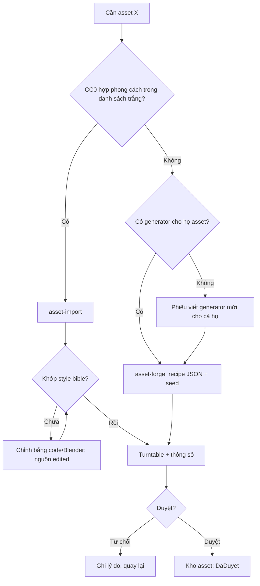
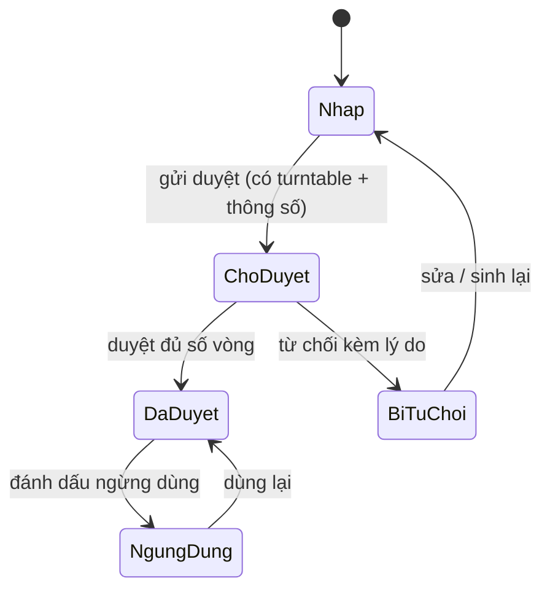

# SRS-03: Asset 3D, vật liệu và âm thanh

| Mục | Nội dung |
|---|---|
| Mã tài liệu | SRS-03 |
| Phiên bản | 1.1 |
| Ngày | 26/11/2026 |
| Tài liệu cha | SRS-00 `SRS-00-TONG-QUAN.md` |
| BRD nguồn | BRD-03 v0.1; BRD-00 v0.5 (BR-15…21, BR-62 phần nguồn, BR-67, BR-96, BR-109, BR-113) |
| Module | `asset-import`, `asset-forge`, `kit-builder`, `materials`, phần âm thanh của `ui-audio`; skill `engine-cc0`, `engine-texture-proc`, `engine-asset-forge`, `engine-materials`, `threejs-image-generator`, `threejs-audio-generator`; lệnh `/asset-recipe` |
| Nhóm mã | `AST` |
| Pha | E2 (vật liệu), E4 (asset 3D), E6 (âm thanh), W3 (duyệt trên web), W4 (kho asset, credit) |
| Trạng thái | Đã duyệt (Huy, 22/11/2026); v1.1 âm thanh AAC theo ADR-037 (POC-U1, CR-02), chờ Huy xem lại |

---

## 1. Giới thiệu

### 1.1 Mục đích
Đặc tả cách engine có asset 3D, vật liệu, HDRI và âm thanh hợp phong cách, hợp pháp, trong ngân sách A56, không dùng AI sinh 3D (QĐ-08), và có provenance cho mọi file.

### 1.2 Phạm vi
| Trong phạm vi | Ngoài phạm vi |
|---|---|
| Nhập mô hình CC0; generator theo họ asset; lắp công trình từ kit; vật liệu ba nguồn; HDRI; âm thanh; provenance; cổng duyệt asset; kho asset dùng chung; màn hình credit | Meshy, Tripo, dịch vụ AI 3D; chỉnh mô hình chi tiết trên web; khung xương và animation (SRS-05); cây và thực vật ở mức rải (SRS-02, công thức cây vẫn theo SRS này) |

### 1.3 Tài liệu liên quan
BRD-03; SRS-01 (style bible, bảng màu, asset rủi ro cao); SRS-04 (ngân sách, packager, báo cáo); SRS-05 (retarget khung xương); SRS-08 (màn hình, job, kho lưu trữ, cổng AI); SRS-09 (provenance, khoá API).

---

## 2. Mô tả chung

### 2.1 Thứ tự chọn nguồn asset 3D (QĐ-12)



### 2.2 Vòng đời asset



Chỉ asset `DaDuyet` được đặt vào cảnh (trừ thư mục `prototypes/**`).

### 2.3 Tác nhân
| Tác nhân | Vai trò |
|---|---|
| Người tạo game (chủ game, người có quyền Sửa) | Gửi duyệt, duyệt/từ chối asset của game (OI-AST-03) |
| Huy | Duyệt danh sách trắng nguồn CC0, duyệt asset rủi ro cao ở cổng |
| Agent `asset-designer`, `tech-artist` | Viết generator, chỉnh vật liệu |
| Worker | Chạy nhập, sinh, turntable, nén |
| Cổng AI | Gọi Gemini, ElevenLabs (SRS-08) |

---

## 3. Use case

| Mã | Tên | Tác nhân | Ưu tiên | Pha |
|---|---|---|---|---|
| UC-AST-01 | Nhập mô hình CC0 | Người tạo game / agent | M | E4 |
| UC-AST-02 | Sinh biến thể từ generator | Người tạo game / agent | M | E4 |
| UC-AST-03 | Tạo vật liệu | Agent / người tạo game | M | E2 |
| UC-AST-04 | Sinh âm thanh | Agent / người tạo game | S | E6 |
| UC-AST-05 | Duyệt asset | Chủ game / người có quyền Sửa | M | E4, W3 |
| UC-AST-06 | Tìm và dùng lại asset trong kho | Người tạo game | S | W4 |

### 3.1 UC-AST-01 Nhập mô hình CC0
1. Người dùng nhập URL trang mô hình (thuộc danh sách trắng) hoặc tải file kèm URL nguồn.
2. Hệ thống tải, kiểm license (FR-AST-02); lưu bằng chứng: URL, ảnh chụp trang license, ngày tải, tác giả.
3. Hệ thống chuẩn hoá (FR-AST-03), giảm lưới và sinh LOD, UV2 (FR-AST-04), đồng bộ vật liệu theo bảng màu (FR-AST-05); với nhân vật/động vật gọi retarget (FR-AST-06).
4. Hệ thống sinh turntable và thông số (FR-AST-31, 32), tạo asset trạng thái `Nhap`, provenance nguồn `cc0`.

Ngoại lệ: nguồn ngoài danh sách trắng → ERR-AST-01; license không phải CC0 và không có ngoại lệ được duyệt → ERR-AST-02 (AC-03-02); không retarget được → ERR-AST-06.

### 3.2 UC-AST-02 Sinh biến thể từ generator
1. Người dùng (hoặc `/asset-recipe`) tạo/sửa file `assets/recipes/<id>.json`: họ asset, phiên bản generator, tham số, seed.
2. Hệ thống kiểm tham số theo schema của generator (giới hạn min–max).
3. Worker chạy generator; sinh mesh, UV, LOD, collider, provenance (FR-AST-10).
4. Hệ thống sinh turntable, thông số; asset `Nhap`, hoặc `DaDuyet` ngay nếu thuộc biến thể nhỏ được duyệt theo lưới (FR-AST-35).

### 3.3 UC-AST-05 Duyệt asset
1. Người duyệt mở SCR-AST-01, xem lưới turntable 4 góc, ảnh trong cảnh, thông số so với ngân sách.
2. Bấm Duyệt hoặc Từ chối (lý do bắt buộc).
3. Asset rủi ro cao: lần duyệt đầu chuyển `ChoDuyet` vòng 2; cần lần duyệt thứ hai (có thể cùng người, ở phiên bản asset sau chỉnh sửa hoặc xác nhận lại) mới `DaDuyet` (FR-AST-33).
4. Hệ thống ghi lịch sử duyệt (người, thời điểm, vòng, quyết định, lý do).

---

## 4. Yêu cầu chức năng

### 4.1 Nhập mô hình CC0

| Mã | Yêu cầu | Nguồn | Ưu tiên | Pha |
|---|---|---|---|---|
| FR-AST-01 | Danh sách trắng nguồn CC0 lưu trong cấu hình hệ thống (`cc0-sources.json`; trên web do quản trị sửa): tên, miền, loại nội dung, ngày Huy duyệt | BR-16.1 | M | E2 |
| FR-AST-02 | `asset-import` chỉ nhận license CC0, hoặc license khác có trong danh sách ngoại lệ được Huy duyệt rõ; lưu bằng chứng license (URL, ảnh chụp trang, ngày tải, tác giả). Mỗi asset ghi đường nguồn đã dùng (`cc0`/`generator`/`edited`/`ai`) | BR-15, BR-16, BR-16.2 | M | E4 |
| FR-AST-03 | Chuẩn hoá: đơn vị mét, trục Y lên, pivot giữa đáy, scale theo kích thước thật khai báo, tên theo quy ước `<loai>-<ten>-<bien-the>` | BR-16.3 | M | E4 |
| FR-AST-04 | Giảm lưới và sinh LOD theo ngân sách tri của từng tier (mặc định 3 mức: 100%, 40%, 15% tri của LOD0, LOD0 không vượt trần tri loại asset trong `budgets.json`); vật tĩnh có UV2 không chồng lấn cho lightmap | BR-16.4 | M | E4 |
| FR-AST-05 | Đồng bộ vật liệu với `palette.json` và style bible: thay màu nền về màu gần nhất có vai trò `vat_lieu`, chỉnh độ nhám, gộp vật liệu trùng; số vật liệu mỗi asset ≤ 4 (đề xuất) | BR-16.5 | M | E4 |
| FR-AST-06 | Mô hình nhân vật/động vật được retarget về khung xương dùng chung của họ (SRS-05 FR-CHR-30) trước khi gửi duyệt | BR-16.6, BR-62, BR-62.1 | M | E4 |

### 4.2 Sinh asset bằng code

| Mã | Yêu cầu | Nguồn | Ưu tiên | Pha |
|---|---|---|---|---|
| FR-AST-07 | Thư viện primitive tham số tối thiểu: cột, dầm, mái, tường, cửa, bậc, hàng rào, đá tảng, thùng, chum, bàn, ghế; mỗi primitive có schema tham số | BR-17.1 | M | E4 |
| FR-AST-08 | Generator theo **họ asset**; mỗi biến thể là một recipe `assets/recipes/<id>.json` (mục 6.2); tạo biến thể mới không cần viết code | BR-17, BR-17.2 | M | E4 |
| FR-AST-09 | Mesh hữu cơ bằng SDF, metaball hoặc script sculpt Blender cho vật thể độ chi tiết vừa (đá, gốc cây, tượng đơn giản) | BR-17.3 | S | E4 |
| FR-AST-10 | Generator tự sinh UV, UV2 (vật tĩnh), LOD, collider đơn giản (hộp, viên nang hoặc lồi), provenance | BR-17.4 | M | E4 |
| FR-AST-11 | `kit-builder` lắp công trình từ bộ kit module theo spec tham số: số gian, số tầng, kiểu mái, vật liệu, cửa; spec lưu như recipe | BR-17.5 | M | E4 |
| FR-AST-12 | Với asset rủi ro cao, hệ thống sinh 3 ảnh tham chiếu Gemini (chính diện, bên, sau) theo style bible để generator bám tỷ lệ; ảnh lưu kèm provenance | BR-17.6 | S | E4 |
| FR-AST-13 | Khi viết generator cho họ mới: một phiếu riêng, mô hình khuyến nghị Opus (SRS-09 FR-DEV-07); không viết code dựng một asset đơn lẻ | QT-03-04 | M | E4 |

### 4.3 Vật liệu và texture

| Mã | Yêu cầu | Nguồn | Ưu tiên | Pha |
|---|---|---|---|---|
| FR-AST-14 | Vật liệu có một trong ba nguồn: `procedural` (`engine-texture-proc`), `cc0_scan`, `ai_texture` (Gemini) | BR-18, BR-18.1 | M | E2 |
| FR-AST-15 | Vật liệu theo bộ map PBR: baseColor, normal, roughness, metallic, AO; height khi khai báo | BR-18.2 | M | E2 |
| FR-AST-16 | Độ phân giải texture theo tier: 2048² (Thấp, Vừa), 4096² (Cao, Tối đa); nén KTX2 (UASTC cho map đánh dấu `sharp`, ETC1S cho phần còn lại); kèm bản PNG/JPG fallback | BR-18.3 | M | E2 |
| FR-AST-17 | Texture Gemini dùng cho vải, da, hoa văn, chạm khắc (normal/height), decal, UI; texture dùng làm vật liệu lặp phải qua bước kiểm tileable (chênh lệch mép ≤ ngưỡng) | BR-18.4 | M | E2 |
| FR-AST-18 | HDRI CC0 cho bầu trời, chuẩn hoá độ phân giải theo tier (đề xuất Thấp/Vừa 2K, Cao/Tối đa 4K) | BR-18.5 | M | E2 |
| FR-AST-19 | Số vật liệu mỗi zone ≤ ngân sách (32 tier Vừa); `packager` gộp vật liệu trùng và tạo atlas khi vượt | BR-18.6 | M | E2 |

### 4.4 Âm thanh

| Mã | Yêu cầu | Nguồn | Ưu tiên | Pha |
|---|---|---|---|---|
| FR-AST-20 | Âm môi trường gán theo vùng và mốc thời điểm (gió, nước, côn trùng, chim, chợ…) trong `world.json` → `ambience[]` | BR-19.1 | S | E6 |
| FR-AST-21 | Hiệu ứng: bước chân theo loại bề mặt (SRS-02 mục 6.4), tương tác, UI | BR-19.2 | S | E6 |
| FR-AST-22 | Tiếng động vật theo loài và hành vi (SRS-05 FR-CHR-28) | BR-67, BR-67.1 | S | E6 |
| FR-AST-23 | Nguồn âm thanh: ElevenLabs (QĐ-09) hoặc CC0; cùng quy tắc provenance | BR-19, BR-19.3 | M | E6 |
| FR-AST-24 | Âm thanh nén AAC/M4A, một định dạng (ADR-037; POC-U1: Unity Web không phát Ogg/Opus), chuẩn hoá âm lượng −16 LUFS (đề xuất), âm nền cắt lặp không có tiếng click ở mép | BR-19.4 | M | E6 |
| FR-AST-25 | Nhạc nền theo mô tả; nguồn CC0 hoặc dịch vụ được phép (OI-AST-02) | BR-19.5 | C | E6 |

### 4.5 Provenance và credit

| Mã | Yêu cầu | Nguồn | Ưu tiên | Pha |
|---|---|---|---|---|
| FR-AST-26 | Mỗi file asset (mesh, texture, âm thanh, HDRI, ảnh tham chiếu) có sidecar `<file>.provenance.json` (mục 6.3) | BR-21, BR-21.1 | M | E2 |
| FR-AST-27 | Trường provenance theo loại nguồn: `generator` (generator, phiên bản, commit, recipe, tham số, seed); `cc0` (URL, tác giả, license, ngày tải, bằng chứng); `ai` (dịch vụ, mô hình, prompt, ngày, chi phí) | BR-21.2 | M | E2 |
| FR-AST-28 | Asset chỉnh từ asset khác ghi `derivedFrom[]` (chuỗi nguồn) | BR-21.3 | M | E4 |
| FR-AST-29 | `packager` kiểm mọi asset trong cảnh: thiếu provenance, license không hợp lệ hoặc trạng thái khác `DaDuyet` → build Fail, liệt kê asset | BR-21.4 | M | E2 |
| FR-AST-30 | Màn hình credit tự sinh từ provenance khi xuất bản: nhóm theo loại (dữ liệu bản đồ, mô hình CC0, vật liệu/HDRI, âm thanh, dịch vụ AI, mã nguồn MIT) | BR-113, BR-113.1 | M | W4 (E6 cho runtime) |

### 4.6 Cổng duyệt asset

| Mã | Yêu cầu | Nguồn | Ưu tiên | Pha |
|---|---|---|---|---|
| FR-AST-31 | Mỗi asset mới hoặc biến thể lớn có turntable 4 góc (0°, 90°, 180°, 270°) dưới ánh sáng chuẩn (HDRI studio cố định) cộng một ảnh trong cảnh | BR-20, BR-20.1 | M | E4 |
| FR-AST-32 | Kèm thông số: tri theo từng LOD, số vật liệu, kích thước texture, dung lượng nén; so với ngân sách, đánh dấu Pass/Warn/Fail | BR-20.2 | M | E4 |
| FR-AST-33 | Asset có cờ `highRisk` (từ brief, SRS-01 FR-INT-11) cần 2 vòng duyệt | BR-20.3 | M | E4 |
| FR-AST-34 | SCR-AST-01 trên Web Studio: lưới asset chờ duyệt, Duyệt / Từ chối kèm lý do, lịch sử duyệt | BR-96, BR-96.1 | M | W3 |
| FR-AST-35 | Biến thể nhỏ của generator đã duyệt (chỉ đổi seed hoặc tham số trong khoảng `safeRanges` của recipe đã duyệt) được duyệt theo lưới ảnh một lần cho cả lô | BR-20.4 | S | E4 |

### 4.7 Kho asset dùng chung

| Mã | Yêu cầu | Nguồn | Ưu tiên | Pha |
|---|---|---|---|---|
| FR-AST-36 | Asset `DaDuyet` vào kho chung; tìm theo loại, tag phong cách, nguồn, license, mức ngân sách (tri LOD0) | BR-109, BR-109.1 | S | W4 |
| FR-AST-37 | Game dùng lại asset bằng tham chiếu `assetId@version`, không nhân bản file | BR-109.2 | S | W4 |
| FR-AST-38 | Asset đang được ≥ 1 game khác dùng thì không xoá được, chỉ đánh dấu `NgungDung`; asset `NgungDung` không xuất hiện trong kết quả tìm mặc định | BR-109.3 | S | W4 |

### 4.8 Chi phí dịch vụ AI

| Mã | Yêu cầu | Nguồn | Ưu tiên | Pha |
|---|---|---|---|---|
| FR-AST-39 | Mỗi lần gọi Gemini/ElevenLabs ghi chi phí vào bản ghi sử dụng; lô sinh có chi phí ước lượng vượt ngưỡng `batchConfirmThreshold` (do Huy đặt, CH-06) phải được người dùng xác nhận trước khi chạy | QT-03-06, BR-92 | M | E2 |
| FR-AST-40 | Dịch vụ AI lỗi tạm thời: thử lại job cũ (không gửi job mới) tối đa 3 lần cách nhau 30 s; hết credit: chuyển sang texture/âm thanh thủ tục và gắn cờ `fallback` | QT-03-07 | M | E2 |

---

## 5. Quy tắc nghiệp vụ

| Mã | Quy tắc | Điều kiện, cách xử lý | Kết quả, ghi chú |
|---|---|---|---|
| QT-AST-01 | Không AI sinh 3D | Không có kết nối, skill hay bước nào gọi Meshy, Tripo hay dịch vụ tương tự | Kiểm khi review `.claude/` và cấu hình cổng AI. Nguồn QT-03-01 |
| QT-AST-02 | Thứ tự nguồn | CC0 → generator → chỉnh CC0 (mục 2.1) | Nguồn QT-03-02 |
| QT-AST-03 | Không provenance = chưa có license | Như FR-AST-29 | Nguồn QT-03-03 |
| QT-AST-04 | Generator cho cả họ | Như FR-AST-13 | Nguồn QT-03-04 |
| QT-AST-05 | Khớp style bible | Asset lệch style bible đã duyệt không được duyệt; lý do từ chối chọn "Lệch phong cách" | Nguồn QT-03-05 |
| QT-AST-06 | Hạ độ phân giải tự động | KHI texture nguồn > trần của tier THÌ packager hạ về trần khi đóng gói tier đó | AC-03-05 |
| QT-AST-07 | Ngưỡng xác nhận chi phí | KHI chi phí ước lượng lô > `batchConfirmThreshold` THÌ hỏi xác nhận | Ví dụ: ngưỡng 2 USD, lô 30 texture × 0,04 USD = 1,2 USD → không hỏi; 60 texture = 2,4 USD → hỏi |

---

## 6. Dữ liệu

### 6.1 Asset (bản ghi kho)

| Trường | Kiểu | Ghi chú |
|---|---|---|
| `id`, `version` | string, integer | `assetId@version` bất biến sau `DaDuyet` |
| `kind` | `mesh` / `material` / `texture` / `hdri` / `audio` / `character` / `animal` | |
| `source` | `cc0` / `generator` / `edited` / `ai` | |
| `status` | mục 2.2 | |
| `highRisk` | boolean | |
| `tags` | string[] | phong cách, chất liệu |
| `lods[]` | `{level, tris, file}` | |
| `materials[]` | assetId | |
| `stats` | `{tris, materials, maxTexture, bytes}` | |
| `budgetCheck` | Pass / Warn / Fail | |
| `provenanceRef` | đường dẫn | |
| `reviews[]` | `{round, by, at, decision, reason}` | |
| `usedBy[]` | gameId | |

### 6.2 Recipe `assets/recipes/<id>.json`

```json
{
  "id": "nha-mot-gian-01",
  "family": "nha-mot-gian",
  "generator": "kit-builder",
  "generatorVersion": "1.2.0",
  "params": { "bays": 1, "floors": 1, "roof": "ngoi-am-duong", "wallMaterial": "tuong-dat" },
  "safeRanges": { "bays": [1, 3] },
  "seed": 1207,
  "styleTags": ["lang-que-bac-bo", "low-poly-am"]
}
```

### 6.3 Provenance `<file>.provenance.json`

| Trường | `generator` | `cc0` | `ai` |
|---|---|---|---|
| `type` | Có | Có | Có |
| `createdAt` | Có | Có | Có |
| `generator`, `generatorVersion`, `commit`, `recipe`, `params`, `seed` | Có | | |
| `url`, `author`, `license`, `downloadedAt`, `evidence` | | Có | |
| `service`, `model`, `prompt`, `cost` | | | Có |
| `derivedFrom[]` | Khi chỉnh | Khi chỉnh | Khi chỉnh |
| `credit` | Tuỳ chọn | Có | Có |

### 6.4 Âm thanh
`{id, category: nen/hieu_ung/dong_vat/nhac/giong_noi, loop, loudnessLufs, durationS, provenanceRef}`.

---

## 7. Giao diện

### 7.1 Màn hình
| Mã | Tên | Nội dung | Pha |
|---|---|---|---|
| SCR-AST-01 | Duyệt asset | Bộ lọc (chờ duyệt / rủi ro cao / bị từ chối), lưới thẻ asset: 4 ảnh turntable, ảnh trong cảnh, thông số có màu Pass/Warn/Fail, vòng duyệt; nút Duyệt, Từ chối (ô lý do bắt buộc với danh sách lý do: Lệch phong cách, Vượt ngân sách, Lỗi hình, Khác), Duyệt cả lưới (FR-AST-35) | W3 |
| SCR-AST-02 | Kho asset | Ô tìm kiếm, bộ lọc loại/phong cách/nguồn/license/ngân sách, thẻ asset có ảnh và số game dùng; kéo thả vào editor cảnh (SRS-08 FR-WEB-23) | W4 |
| SCR-RTM-05 | Credit (trong game) | Định nghĩa ở SRS-04; nội dung từ FR-AST-30 | E6 |

### 7.2 Quyền trên SCR-AST-01
Chủ game và người có quyền Sửa duyệt asset của game đó (đề xuất, OI-AST-03). Asset trong kho chung dùng cho nhiều game: lần duyệt đầu thuộc game tạo ra nó; game khác dùng lại không cần duyệt lại.

### 7.3 Giao diện lập trình
| Mã | Giao diện | Mô tả |
|---|---|---|
| API-AST-01 | `engine asset import --url <url> [--kind]` | UC-AST-01 |
| API-AST-02 | `engine asset forge --recipe <file>` | UC-AST-02 |
| API-AST-03 | `engine asset turntable --id <assetId>` | Sinh lại turntable, thông số |
| API-AST-04 | `engine asset check` | Quét provenance, license, trạng thái của mọi asset trong game |

Endpoint web: API-WEB-40…44 (SRS-08 mục 8).

---

## 8. Mã lỗi

| Mã | Điều kiện | Thông báo | Phản ứng |
|---|---|---|---|
| ERR-AST-01 | Nguồn ngoài danh sách trắng | "Nguồn <miền> chưa được duyệt làm nguồn CC0." | Không tải |
| ERR-AST-02 | License không hợp lệ | "Mô hình dùng giấy phép <license>, không được phép." | Không nhập; ghi lý do |
| ERR-AST-03 | Asset thiếu provenance khi build | "Asset <id> thiếu nguồn gốc." | Build Fail |
| ERR-AST-04 | Asset vượt trần ngân sách sau khi giảm lưới | "Asset <id> vẫn vượt ngân sách: <chỉ số>." | Trạng thái `Nhap`, không gửi duyệt được |
| ERR-AST-05 | Hết credit dịch vụ AI | "Dịch vụ <tên> tạm hết hạn mức, đã dùng phương án thủ tục." | FR-AST-40 |
| ERR-AST-06 | Retarget thất bại | "Không gắn được khung xương họ <họ> cho mô hình." | Giữ `Nhap` |
| ERR-AST-07 | Xoá asset đang được dùng | "Asset đang được <n> game dùng, chỉ có thể ngừng dùng." | Từ chối xoá |
| ERR-AST-08 | Từ chối không có lý do | "Hãy chọn hoặc nhập lý do từ chối." | Không lưu |

---

## 9. Yêu cầu phi chức năng

| Mã | Yêu cầu | Cách kiểm |
|---|---|---|
| NFR-AST-01 | Sinh một biến thể từ generator có sẵn ≤ 1 phút (đề xuất, NFR-03-01) | Đo 20 biến thể |
| NFR-AST-02 | Turntable và thông số sinh tự động; Claude không cần xem ảnh trừ khi qua cổng (NFR-03-02) | Kiểm quy trình phiếu |
| NFR-AST-03 | Generator tất định theo seed (NFR-03-03) | Sinh hai lần, so hash glTF |
| NFR-AST-04 | Tìm kiếm kho asset trả kết quả ≤ 1 s với 5.000 asset (đề xuất) | Kiểm tải |

---

## 10. Tiêu chí chấp nhận

| AC BRD | Yêu cầu SRS | Cách kiểm |
|---|---|---|
| AC-03-01 | FR-AST-02…04, 26 | Nhập chum CC0 → scale/pivot đúng, 3 LOD, provenance có URL và license |
| AC-03-02 | FR-AST-02, ERR-AST-02 | Mô hình CC-BY-NC → từ chối, báo lý do |
| AC-03-03 | FR-AST-08, 10 | 10 seed của "nhà một gian" → 10 biến thể, không sửa code, mỗi cái có provenance |
| AC-03-04 | FR-AST-29 | Bỏ provenance của một asset → build Fail chỉ rõ asset |
| AC-03-05 | FR-AST-16, QT-AST-06 | Vật liệu 4096² đóng gói tier Vừa → 2048² KTX2 |
| AC-03-06 | FR-AST-31…33 | Tượng rủi ro cao → cần 2 vòng duyệt, có turntable và thông số |
| AC-03-07 | FR-AST-30 | Credit liệt kê CC0, OSM, MIT, dịch vụ AI |

---

## 11. Open item

| Mã | Câu hỏi | Đề xuất | Nguồn |
|---|---|---|---|
| OI-AST-01 | Danh sách trắng nguồn CC0 | Poly Haven + 2–3 kho khác Huy duyệt ở E2 | CH-03-01 |
| OI-AST-02 | Nguồn nhạc nền | CC0 trước, dịch vụ nếu được phép | CH-03-02 |
| OI-AST-03 | Ai duyệt asset trên web | Chủ game và người có quyền Sửa | CH-03-03 |
| OI-AST-04 | Ngưỡng `batchConfirmThreshold` | Huy đặt; đề xuất 2 USD mỗi lô | CH-06 |
| OI-AST-05 | Chuẩn âm lượng −16 LUFS | Giữ, kiểm trên điện thoại ở E6 | Mới |

---

## 12. Truy vết

| BR | Yêu cầu SRS |
|---|---|
| BR-15, BR-16 (BR-16.1…6) | FR-AST-01…06 |
| BR-17 (BR-17.1…6) | FR-AST-07…12 |
| BR-18 (BR-18.1…6) | FR-AST-14…19 |
| BR-19 (BR-19.1…5) | FR-AST-20, 21, 23…25 |
| BR-20 (BR-20.1…4) | FR-AST-31…33, 35 |
| BR-21 (BR-21.1…4) | FR-AST-26…29 |
| BR-62 (BR-62.1, phần nguồn) | FR-AST-06 |
| BR-67 (BR-67.1) | FR-AST-22 |
| BR-96 (BR-96.1) | FR-AST-34 |
| BR-109 (BR-109.1…3) | FR-AST-36…38 |
| BR-113 (BR-113.1) | FR-AST-30 |

## 13. Lịch sử thay đổi

| Phiên bản | Ngày | Người | Nội dung |
|---|---|---|---|
| 0.1 | 22/11/2026 | Claude | Bản đầu từ BRD-03 v0.1 |
| 1.0 | 22/11/2026 | Claude | Huy duyệt; chấp nhận các giá trị "(đề xuất)" và đề xuất của Open item làm giá trị nền; đổi trạng thái sang Đã duyệt |
| 1.1 | 26/11/2026 | Claude | ADR-037 (POC-U1, CR-02): FR-AST-24 âm thanh chỉ AAC/M4A, bỏ Opus/WebM |
