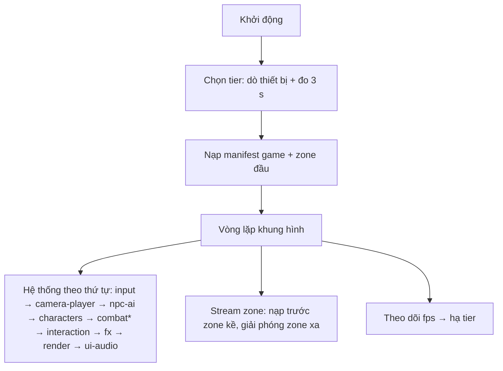

# SRS-04: Runtime, hiệu năng và QA

| Mục | Nội dung |
|---|---|
| Mã tài liệu | SRS-04 |
| Phiên bản | 1.5 |
| Ngày | 28/11/2026 |
| Tài liệu cha | SRS-00 `SRS-00-TONG-QUAN.md` |
| BRD nguồn | BRD-04 v0.1; BRD-00 v0.5 (BR-06…09, BR-22…31, BR-40, BR-111 phần bản build); BRD-10 (BR-119, 122…125, v1.1) |
| Module | Runtime: `core`, `camera-player` (phần chung), `ui-audio`, `interaction` (phần chung); Build: `packager`; `qa`; `cli` |
| Nhóm mã | `RTM` (runtime, dữ liệu, ngân sách), `QA` (kiểm thử tự động), `CLI` (dòng lệnh, đóng gói, xuất bản) |
| Pha | E0 (baseline), E1 (core, schema, QA khung, CLI), E2 (tier, zone, điều khiển), E3 (visual regression), E6 (bot playtest, vòng chơi) |
| Trạng thái | Đã duyệt (Huy, 22/11/2026); v1.1 bổ sung luồng làm tiếp và cập nhật game theo CR-01, Huy duyệt 23/11/2026; **v1.2 runtime Unity theo CR-02** (Huy duyệt phân tích 25/11/2026), chờ Huy xem lại; v1.3 ngân sách tải theo POC-U1, Huy chốt 26/11/2026; v1.4 mục 6.3, 6.5 và QT-RTM-02 theo POC-U1, chờ Huy xem lại; v1.5 chốt `coreTextureMax` 1024 (CR-04, Huy chốt 28/11/2026) |

---

## 1. Giới thiệu

### 1.1 Mục đích
Đặc tả phần lõi dùng chung của mọi game: dữ liệu và schema, vòng lặp runtime, nạp và stream zone, tier, ngân sách, điều khiển chung, UI, hệ tương tác và sự kiện, đóng gói, QA tự động và CLI. Đây là "hợp đồng" mà các SRS khác dựa vào.

### 1.2 Phạm vi
| Trong phạm vi | Ngoài phạm vi |
|---|---|
| Schema dữ liệu game, phiên bản schema, phiên bản engine; RNG có seed; tier; stream zone; loader; `budgets.json`; điều khiển chung; HUD, menu, cài đặt, credit; điểm tương tác, sự kiện, biến game; lưu cục bộ; báo cáo JSON; QA nhẹ/đầy đủ; visual regression; đo A56; bot playtest; CLI; đồ thị build; bản xuất bản tĩnh | Điều khiển và hành vi nhân vật chi tiết (SRS-05); chiến đấu (SRS-06); hội thoại (SRS-07); job và giao diện Web Studio (SRS-08) |

### 1.3 Tài liệu liên quan
BRD-04; SRS-02, 03, 05, 06, 07 (bước build và module runtime); SRS-08 (job, xem trước, xuất bản trên web); SRS-09 (rule đường dẫn, `/qa-light`, `/qa-full`, `/gate-check`).

---

## 2. Mô tả chung

### 2.1 Kiến trúc runtime


`*` chỉ khi game bật (SRS-06). Mỗi hệ thống là một module có interface `init / update(dt) / dispose`, không cấp phát trong `update` (FR-RTM-23).

### 2.2 Tầng dữ liệu
| Tầng | Ví dụ | Ai đọc |
|---|---|---|
| Dữ liệu nguồn game | `game.json`, `world.json`, `palette.json`, `budgets.json`, `entities/**`, `dialogue/**`, `assets/recipes/**` | Pipeline build, editor, runtime (phần runtime) |
| Sản phẩm build | glTF/KTX2/âm thanh, `manifest.json`, báo cáo JSON | Runtime, QA, Web Studio |
| Trạng thái người chơi | Bản lưu cục bộ | Runtime |

### 2.3 Tác nhân
| Tác nhân | Vai trò |
|---|---|
| Người chơi | Chơi trên điện thoại hoặc máy tính |
| Người tạo game | Build, chạy QA, xem báo cáo, xuất bản |
| Huy | Đo trên A56 thật, xác nhận cổng, xác nhận cập nhật baseline |
| Agent `engine-dev`, `qa` | Viết runtime, chạy QA |
| Worker | Chạy build và QA đầy đủ |

---

## 3. Use case

| Mã | Tên | Tác nhân | Ưu tiên | Pha |
|---|---|---|---|---|
| UC-RTM-01 | Khởi động và vào game | Người chơi | M | E2 |
| UC-RTM-02 | Di chuyển giữa các zone | Người chơi | M | E2 |
| UC-RTM-03 | Tương tác với điểm tương tác | Người chơi | M | E6 |
| UC-QA-01 | Chạy QA mức nhẹ | Người tạo game / agent | M | E1 |
| UC-QA-02 | Chạy QA đầy đủ trước cổng | Người tạo game / agent | M | E1–E3 |
| UC-QA-03 | Đo hiệu năng trên A56 thật | Huy | M | E0 |
| UC-CLI-01 | Build zone | Người tạo game / agent | M | E1 |
| UC-CLI-02 | Xuất bản bản thử | Chủ game / agent | M | E1 (poc), W4 (web) |
| UC-CLI-03 | Làm tiếp hoặc cập nhật game bằng CLI (v1.1, CR-01) | Người tạo game / agent | M | E1–E2 |
| UC-CLI-04 | Nâng cấp game lên engine/schema mới (v1.1, CR-01) | Người tạo game / agent | S | E3 |

### 3.1 UC-RTM-01 Khởi động và vào game
1. Trình duyệt mở `index.html` của bản xuất bản.
2. Unity player kiểm WebGL2 và định dạng nén hỗ trợ; dò thiết bị (renderer GPU, `deviceMemory`, kích thước màn hình) để chọn tier đề xuất (FR-RTM-07).
3. Runtime hiển thị SCR-RTM-01 (màn hình tải có thanh tiến độ), nạp `manifest.json`, kiểm `schemaVersion` và `engineVersion` (FR-RTM-02, 03).
4. Nạp zone xuất phát của tier đã chọn; khi đủ để điều khiển thì vào game; đo fps 3 s đầu, điều chỉnh tier nếu cần.
5. Nạp nền các zone kề (FR-RTM-09).

Ngoại lệ: không có WebGL2 → ERR-RTM-01; định dạng nén không hỗ trợ → fallback (FR-RTM-11, AC-04-05); manifest sai schema → ERR-RTM-03 kèm đường dẫn trường sai (AC-04-06).

### 3.2 UC-QA-01 Chạy QA mức nhẹ
1. Chạy `engine qa --level=nhe --zone <id>` (hoặc `/qa-light`, hoặc job trên web).
2. QA khởi chạy trình duyệt headless (Playwright), mở bản build, chạy smoke test (không lỗi console, khung hình đầu render), chụp 3–5 góc chuẩn đầu tiên của zone, đo nhanh 20 s, kiểm ngân sách.
3. Ghi báo cáo JSON (FR-QA-01); kết quả Pass/Warn/Fail; thời gian ≤ 5 phút (NFR-QA-01).

### 3.3 UC-QA-03 Đo hiệu năng trên A56 thật
1. Huy mở link xuất bản có tham số `?perf=1&route=<id>` trên A56 (hoặc quét QR, SRS-08 FR-WEB-19).
2. Runtime chạy đường đi chuẩn của zone (khai báo dữ liệu), thu fps (trung bình, P5, P1), thời gian khung hình, bộ nhớ heap WASM của player, số draw call, tri, nhiệt (nếu API có).
3. Runtime gửi số đo về endpoint thu thập của Web Studio (OI-QA-03) hoặc hiển thị JSON để sao chép khi không có mạng.
4. Báo cáo cổng đính kèm số đo A56.

### 3.4 UC-CLI-03 Làm tiếp hoặc cập nhật game bằng CLI (v1.1, CR-01)
1. Chạy `engine status --game <id>` (FR-CLI-08): nhận giai đoạn, cờ, danh sách bước cũ theo zone và việc nên làm tiếp (mục 6.6).
2. Nếu game đến từ ngoài: chạy trước `engine import <thư mục|gói.zip>` (FR-CLI-11); thiếu brief thì xác nhận brief nháp (SRS-01 FR-INT-32).
3. Sửa dữ liệu (tay, phiếu Claude Code hoặc Web Studio), rồi `engine build --stale --dry-run` để xem bước và ước lượng, sau đó `engine build --stale` (FR-CLI-09).
4. `engine qa --level=nhe`; nếu game đã xuất bản: `engine publish` tạo bản số mới, bản cũ giữ nguyên (FR-CLI-12).

Ngoại lệ: brief đang `ChoXacNhan` → mã thoát 3 (ERR-INT-06); thư mục không phải game → ERR-CLI-03.

### 3.5 UC-CLI-04 Nâng cấp game lên engine/schema mới (v1.1, CR-01)
1. `engine status` báo cờ `canNangCap` (schema hoặc engine cũ hơn bản hiện hành).
2. `engine upgrade [--to <phiên bản engine>]` (FR-CLI-10) sao dữ liệu sang thư mục tạm, chạy `migrate`, nâng `engineVersion`, build lại bước bị ảnh hưởng, chạy QA nhẹ và so ảnh với baseline.
3. Pass, hoặc người dùng chấp nhận khác biệt ảnh: thay dữ liệu chính bằng bản đã nâng và tạo mốc phiên bản. Fail: giữ nguyên bản cũ (ERR-CLI-02).

---

## 4. Yêu cầu chức năng

### 4.1 Dữ liệu, schema, tất định (RTM)

| Mã | Yêu cầu | Nguồn | Ưu tiên | Pha |
|---|---|---|---|---|
| FR-RTM-01 | Mỗi loại file dữ liệu game có JSON Schema (draft 2020-12) trong `engine/schema/`; một bộ kiểm dùng chung cho CLI, runtime, `game-intake`, editor web; runtime từ chối nạp dữ liệu sai schema và báo đường dẫn trường sai | BR-06, BR-06.1 | M | E1 |
| FR-RTM-02 | Schema có `schemaVersion` (semver); mỗi lần tăng major có bộ chuyển đổi `migrate(vN → vN+1)`; CLI `engine migrate` chuyển dữ liệu cũ, giữ bản sao lưu | BR-06.2 | M | E1 |
| FR-RTM-03 | Engine runtime là Unity player Web chung (C#, QĐ-16, CR-02), build theo phiên bản semver và đặt ở thư mục phiên bản trong kho xuất bản; `game.json.engineVersion` khai báo dải phiên bản dùng; build từ chối khi không khớp | BR-07, BR-07.1 | M | E1 |
| FR-RTM-04 | Logic riêng của game khai báo bằng dữ liệu trong `games/<id>/` (biểu thức `expr`, đồ thị hành vi, sự kiện); không nạp mã C# theo từng game; tính năng cần mã mới được thêm thành module của Unity player qua phiếu (CR-02; trước là `games/<id>/scripts/` TS) | BR-07.2 | M | E1 |
| FR-RTM-05 | Công cụ build và runtime không chứa hằng số riêng của một cảnh; giá trị riêng nằm trong dữ liệu game; rule `games/**/data/**` và review kiểm | BR-08 | M | E1 |
| FR-RTM-06 | RNG có seed (thuật toán cố định, ví dụ PCG32) cho build và runtime; mỗi hệ thống lấy luồng RNG con theo seed + id; chế độ test `?test=1&seed=<n>` cố định bước thời gian 1/30 s | BR-09, BR-09.1 | M | E1 |

### 4.2 Tier, nạp, stream (RTM)

| Mã | Yêu cầu | Nguồn | Ưu tiên | Pha |
|---|---|---|---|---|
| FR-RTM-07 | Tier `thap`, `vua`, `cao`, `toi_da`; khi khởi động chọn tier từ bảng dò thiết bị rồi xác nhận bằng đo 3 s; người chơi đổi tier trong Cài đặt, lựa chọn được nhớ cục bộ | BR-22, BR-22.1 | M | E2 |
| FR-RTM-08 | Khi fps trung bình trượt 5 s thấp hơn mục tiêu tier quá 15% (đề xuất), hạ một tier và báo nhẹ trên HUD; không tự nâng tier trong phiên | BR-22.2 | S | E2 |
| FR-RTM-09 | SCR-RTM-01 có tiến độ theo byte; zone xuất phát nạp trước; zone kề nạp nền khi người chơi cách ranh giới ≤ `prefetchDistance` (mặc định 100 m) | BR-24, BR-24.5 | M | E2 |
| FR-RTM-10 | Zone cách người chơi quá `unloadDistance` (mặc định 2 zone) được giải phóng (geometry, texture, âm thanh) để bộ nhớ ≤ ngân sách tier | BR-24.6 | M | E2 |
| FR-RTM-11 | Loader KTX2 (Basis transcoder), Meshopt và Draco; thiết bị không hỗ trợ định dạng nén GPU thì dùng texture fallback trong manifest, không màn hình đen | BR-24.7 | M | E2 |

### 4.3 Ngân sách (RTM)

| Mã | Yêu cầu | Nguồn | Ưu tiên | Pha |
|---|---|---|---|---|
| FR-RTM-12 | `budgets.json` khai báo theo tier các chỉ số ở mục 6.3; zone có thể ghi đè trong `world.json` | BR-23, BR-23.1 | M | E0 |
| FR-RTM-13 | Giá trị mặc định tier Vừa theo số kiểm chứng trên A56 (mục 6.3); cập nhật sau đo baseline E0 | BR-23.2 | M | E0 |
| FR-RTM-14 | Mỗi build và QA so số đo với ngân sách: Pass (≤ 90% ngân sách), Warn (> 90% và ≤ 100%), Fail (> 100%); với fps: Pass ≥ mục tiêu, Warn trong 10% dưới mục tiêu, Fail thấp hơn nữa | BR-23.3 | M | E1 |

Ví dụ FR-RTM-14: ngân sách draw call tier Vừa 120. Đo 100 → Pass; 112 → Warn (93%); 125 → Fail. Fps mục tiêu 30: đo 31 → Pass; 28 → Warn; 26 → Fail.

### 4.4 Điều khiển, UI, tương tác (RTM)

| Mã | Yêu cầu | Nguồn | Ưu tiên | Pha |
|---|---|---|---|---|
| FR-RTM-15 | Điều khiển cảm ứng: joystick ảo nửa trái, vuốt nửa phải xoay camera, chạm để tương tác; mọi nút nằm trong safe area (`env(safe-area-inset-*)`); vùng chạm ≥ 48 × 48 px CSS | BR-25, BR-25.1 | M | E2 |
| FR-RTM-16 | Desktop: WASD/mũi tên, chuột xoay camera (pointer lock), E tương tác, Shift chạy, Esc menu; tay cầm là tuỳ chọn (OI-RTM-02) | BR-25.2 | S | E2 |
| FR-RTM-17 | Chế độ dev (`?dev=1`, chỉ trong bản không phải xuất bản hoặc khi có quyền): flycam, orbit, lớp phủ fps/draw call/tri/bộ nhớ, chọn tier, tua giờ | BR-25.3 | M | E2 |
| FR-RTM-18 | UI trong game: HUD (SCR-RTM-02), menu tạm dừng (SCR-RTM-03), cài đặt âm lượng, tier, độ nhạy, rung (SCR-RTM-04), credit (SCR-RTM-05) | BR-26, BR-26.1 | M | E6 |
| FR-RTM-19 | Điểm tương tác khai báo trong `entities/interactions/*.json`: vị trí hoặc gắn vào entity, bán kính, điều kiện (biểu thức trên biến game), hành động: `show_info`, `start_dialogue`, `pick_item`, `change_zone`, `fire_event` | BR-26.2 | M | E6 |
| FR-RTM-20 | Biến game (`flags`, `counters`, `quests` với trạng thái `chua_nhan`/`dang_lam`/`xong`) và sự kiện khai báo trong `game.json` → `state`; điều kiện viết bằng biểu thức an toàn (không `eval`), ví dụ `quest.trau.state == 'dang_lam' && counter.lua >= 3` | BR-26.3 | M | E6 |
| FR-RTM-21 | Lưu tiến trình chơi cục bộ (IndexedDB, khoá theo game và phiên bản xuất bản): vị trí, biến game, giờ trong game; không lưu trên server | BR-26.4 | S | E6 |
| FR-RTM-22 | Giao diện theo `game.json.language` (mặc định tiếng Việt); cỡ chữ thân ≥ 16 px CSS trên màn hình 6,5 inch; tương phản ≥ 4,5:1 | BR-26.5 | M | E6 |
| FR-RTM-23 | Mọi hệ thống runtime không cấp phát đối tượng mới trong `update`; dùng pool và vector tạm tái sử dụng; QA profiler kiểm không có GC > 5 ms trong 2 phút (SRS-05 AC-05-08) | QT-04-07, BR-74 | M | E1 |

### 4.5 QA tự động (QA)

| Mã | Yêu cầu | Nguồn | Ưu tiên | Pha |
|---|---|---|---|---|
| FR-QA-01 | Mọi bước build và QA ghi báo cáo JSON theo schema chung (mục 6.4): bước, zone, tier, hash đầu vào, thời gian, số đo, ngân sách, kết quả, cảnh báo, đường dẫn ảnh | BR-27, BR-27.1 | M | E1 |
| FR-QA-02 | QA mức nhẹ (mặc định): smoke test, 3–5 góc chuẩn, đo nhanh 20 s tier Vừa giả lập, kiểm ngân sách | BR-28, BR-28.1 | M | E1 |
| FR-QA-03 | QA mức đầy đủ (trước cổng): mọi góc chuẩn, visual regression, đo hiệu năng tier Thấp/Vừa/Cao giả lập, bot playtest (khi có), kiểm provenance | BR-28.2 | M | E1 |
| FR-QA-04 | Góc chụp chuẩn khai báo theo zone trong `qa/views.json`: id, vị trí, hướng, FOV, mốc thời điểm; ảnh chụp từ game đang chạy ở chế độ test seed cố định | BR-29, BR-29.1 | M | E1 |
| FR-QA-05 | Visual regression so ảnh với baseline bằng chỉ số khác biệt (SSIM và tỷ lệ pixel khác > ngưỡng); báo điểm từng góc, chọn 2–4 ảnh khác nhất kèm ảnh diff | BR-29.2 | M | E3 |
| FR-QA-06 | Canvas inspector đọc thống kê render (draw call, tri, chương trình shader, texture) và đo pixel trên desktop và giả lập mobile (viewport 412 × 915, DPR 2,6) | BR-29.3 | M | E1 |
| FR-QA-07 | Quy trình đo A56 theo UC-QA-03; số đo gắn với phiên bản xuất bản và vào báo cáo cổng | BR-30, BR-30.1 | M | E0 |
| FR-QA-08 | Bot playtest: chạy theo kịch bản (`qa/bot/*.json`: chuỗi mục tiêu) và đi ngẫu nhiên có seed; báo kẹt (vị trí đổi < 0,5 m trong 5 s khi có lệnh đi), rơi khỏi vùng chơi, xuyên vật thể, lỗi console | BR-31, BR-31.1 | S | E6 |
| FR-QA-09 | Baseline visual regression chỉ cập nhật bằng lệnh `engine qa --accept-baseline <views>` hoặc nút trên web, ghi người xác nhận và lý do | QT-04-05 | M | E3 |
| FR-QA-10 | Báo cáo QA có phần `summary` ngắn (≤ 20 dòng) để Claude đọc số trước; ảnh chỉ được liệt kê, không nhúng | QT-04-04, BR-29 | M | E1 |

### 4.6 CLI, đóng gói, xuất bản (CLI)

| Mã | Yêu cầu | Nguồn | Ưu tiên | Pha |
|---|---|---|---|---|
| FR-CLI-01 | Lệnh: `engine new-game`, `engine build --zone <id> [--tier <t>] [--step <bước>] [--force]`, `engine qa --level=nhe\|day-du [--zone]`, `engine publish [--target poc\|web]`, `engine doctor`, `engine migrate`, `engine asset …` (SRS-03); v1.1 thêm `engine status`, `engine import`, `engine upgrade`, `engine build --stale` (FR-CLI-08…11) | BR-40, BR-40.1 | M | E1 |
| FR-CLI-02 | Build tăng dần: mỗi bước tính hash đầu vào (dữ liệu liên quan + phiên bản công cụ + hash đầu ra bước trước); trùng hash thì dùng kết quả cache; `--force` bỏ qua cache | BR-40.2 | M | E2 |
| FR-CLI-03 | Lệnh trả mã thoát theo mục 7.2 và ghi báo cáo JSON vào `build/reports/`; Web Studio worker và Claude Code dùng cùng lệnh | BR-40.3 | M | E1 |
| FR-CLI-04 | `packager` đóng gói theo zone và tier: gộp mesh tĩnh cùng vật liệu, atlas, nén, sinh `manifest.json` (mục 6.5) | BR-24, BR-40 | M | E2 |
| FR-CLI-05 | Bản xuất bản là thư mục tĩnh (HTML, JS, asset) chạy trên hosting tĩnh, không phụ thuộc Web Studio (trừ cổng AI khi hội thoại AI bật) | BR-111, BR-111.1 | M | E1 |
| FR-CLI-06 | Mỗi bản xuất bản có `publish.json`: số phiên bản, ngày, phiên bản engine, hash dữ liệu, tier có trong gói, kết quả QA gần nhất | BR-111.2 | M | E1 |
| FR-CLI-07 | Xuất bản không đặt trạng thái "đã duyệt"; cổng chỉ qua bằng xác nhận của Huy (SRS-09 FR-DEV-10) | QT-04-06, BR-35 | M | E1 |

### 4.7 Làm tiếp, cập nhật, nâng cấp game (CLI, v1.1, CR-01)

| Mã | Yêu cầu | Nguồn | Ưu tiên | Pha |
|---|---|---|---|---|
| FR-CLI-08 | `engine status --game <id> [--json]` đọc dữ liệu, trạng thái brief và style bible, cache build, báo cáo QA, `publish.json`, phiên tạo game dở và trả báo cáo tiến độ (mục 6.6): giai đoạn theo SRS-00 mục 4.4, cờ, bước cũ theo zone/tier, việc nên làm tiếp; chỉ đọc, không sửa gì; Web Studio dùng cùng logic (SRS-08 API-WEB-83) | BR-119.4, BR-40, BR-40.3 | M | E1 |
| FR-CLI-09 | `engine build --stale [--zone <id>] [--dry-run]` build mọi bước có hash đầu vào khác cache hoặc chưa từng build, theo thứ tự đồ thị mục 6.2; `--dry-run` chỉ liệt kê bước, zone, ước lượng thời gian; bước có hash không đổi không chạy lại (QT-GEN-11) | BR-123.1, BR-123.3, BR-40.2 | M | E2 |
| FR-CLI-10 | `engine upgrade [--to <phiên bản>]` nâng game lên `schemaVersion`/`engineVersion` mới: làm trên bản sao, chạy `migrate` (FR-RTM-02), build lại bước bị ảnh hưởng, QA nhẹ và visual diff so baseline (FR-QA-05); chỉ thay dữ liệu chính khi Pass hoặc người dùng chấp nhận khác biệt; ghi báo cáo `kind: upgrade` | BR-124.2, BR-124.3, BR-06.2, BR-07.1 | S | E3 |
| FR-CLI-11 | `engine import <thư mục\|gói.zip> [--into <id>]` nhận game có sẵn: kiểm cấu trúc mục 6.1, schema, provenance, `engineVersion`; trả báo cáo kiểm (`ok` / `canNangCap` / `chan` kèm lý do); `--into` cập nhật game đã có cùng `gameId` thay vì tạo game mới; thiếu brief thì sinh brief nháp (SRS-01 FR-INT-32) | BR-122.1, BR-112, BR-112.1 | S | E1 |
| FR-CLI-12 | `engine publish` trên game đã có bản xuất bản tạo thư mục `publish/<n+1>/`, không ghi đè bản cũ; `publish.json` thêm `previousVersion`, `dataVersion` và `changes[]` (tóm tắt thay đổi so với bản trước theo đối tượng) | BR-125.1, BR-125.2, BR-111, BR-111.2 | M | E1 |

---

## 5. Quy tắc nghiệp vụ

| Mã | Quy tắc | Điều kiện, cách xử lý | Kết quả, ghi chú |
|---|---|---|---|
| QT-RTM-01 | Không qua cổng khi Fail tier Vừa | KHI báo cáo ngân sách mới nhất của bất kỳ zone nào có Fail ở tier Vừa THÌ `/gate-check` báo "Chưa đạt" | Nguồn QT-04-01 |
| QT-RTM-02 | Đổi đồ hoạ kèm báo cáo hiệu năng | KHI phiếu sửa mã render của Unity player (`engine/unity/Assets/GameStudio/{Render,World,Characters}/**`, CR-02), shader, vật liệu, `budgets.json` THÌ phải đính kèm báo cáo `perf` | Hook nhắc (SRS-09). Nguồn QT-04-02 |
| QT-RTM-03 | Thay đổi hiển thị kèm ảnh | KHI thay đổi nhìn thấy được với người chơi THÌ có ảnh chụp từ game đang chạy | Nguồn QT-04-03 |
| QT-RTM-04 | Ưu tiên đọc số | Claude đọc `summary` trước; xem ảnh khi chỉ số báo khác biệt hoặc khi qua cổng, tối đa 4 ảnh | Nguồn QT-04-04 |
| QT-RTM-05 | Cập nhật baseline có chủ ý | Như FR-QA-09 | Nguồn QT-04-05 |
| QT-RTM-06 | Xuất bản không phải duyệt | Như FR-CLI-07 | Nguồn QT-04-06 |
| QT-RTM-07 | Không cấp phát trong vòng lặp nóng | Như FR-RTM-23 | Nguồn QT-04-07 |
| QT-RTM-08 | Nâng cấp không phá bản đang có (v1.1) | KHI `engine upgrade` lỗi ở bất kỳ bước nào hoặc QA Fail mà người dùng không chấp nhận THÌ dữ liệu chính, cache và bản xuất bản giữ nguyên | Nguồn CR-01 |

---

## 6. Dữ liệu

### 6.1 Cấu trúc thư mục game
```
games/<id>/
  data/ game.json world.json palette.json budgets.json
        entities/ player.json npc/*.json animals/*.json interactions/*.json weapons/*.json
        dialogue/*.json
  assets/ recipes/*.json  imported/**  (mỗi file kèm *.provenance.json)
  (không còn scripts/ từ CR-02: logic qua dữ liệu, FR-RTM-04)
  qa/ views.json  routes.json  bot/*.json  baseline/**
  game-brief.md  style-bible.md
build/<id>/ <zone>/<tier>/**  manifest.json  reports/*.json  publish/<version>/**
```

### 6.2 Đồ thị bước build và ánh xạ ảnh hưởng

| Bước | Phụ thuộc | Đường dẫn dữ liệu làm thay đổi hash | SRS |
|---|---|---|---|
| `world.fetch` | — | `world.source`, `world.bbox` | 02 |
| `world.heightfield` | `world.fetch` | `world.procedural`, `world.blendMask`, `world.seed` | 02 |
| `terrain.erode` | `world.heightfield` | `world.erosion` | 02 |
| `terrain.mesh` | `terrain.erode` | cấu hình chunk/LOD | 02 |
| `terrain.splat` | `terrain.erode`, `materials` | luật splat, `palette.json` | 02 |
| `materials` | — | vật liệu, `palette.json`, style bible | 03 |
| `assets` | `materials` | `assets/recipes/**`, asset nhập | 03 |
| `water` | `terrain.mesh` | `world.water` | 02 |
| `vegetation` | `terrain.splat`, `assets` | `world.vegetation` | 02 |
| `placement` | `terrain.mesh`, `water`, `vegetation`, `assets` | `world.placementRules`, `world.placedObjects` | 02 |
| `navmesh` | `terrain.mesh`, `water`, `placement` | thông số tác nhân điều hướng; từ CR-02 bước này chỉ gom hình nguồn và thông số, NavMesh dựng lúc nạp zone trong Unity player | 05 |
| `lighting.bake` | `placement` | `world.timeOfDay[baked=true]` | 02 |
| `audio` | — | âm thanh, `ambience` | 03 |
| `dialogue.check` | — | `dialogue/**` | 07 |
| `packager` | tất cả bước trên của zone | `budgets.json`, tier | 04 |
| `qa` | `packager` | `qa/**` | 04 |

Thay đổi **chỉ runtime** (không làm đổi hash bước nào, áp nóng trong xem trước): `entities/npc/**` (trừ ngoại hình mới), `entities/animals/**` (trừ loài mới), `entities/interactions/**`, `dialogue/**` (sau `dialogue.check` nhanh), `world.atmosphere`, `world.postFx`, mốc thời điểm đã bake đang xem, `game.json.state`. Bảng này là nguồn cho phân tích ảnh hưởng của SRS-01 FR-INT-19, FR-INT-24 và SRS-08 FR-WEB-17.

### 6.3 `budgets.json` (mặc định đề xuất)

| Chỉ số | Thấp | Vừa | Cao | Tối đa | Nguồn |
|---|---|---|---|---|---|
| `fpsTarget` | 30 | 30 | 45 | 60 | CH-01 (đề xuất) |
| `drawCalls` | 90 | 120 | 180 | 250 | BRD-00 BO-04 (Vừa) |
| `materials` | 24 | 32 | 48 | 64 | BO-04 (Vừa) |
| `trisStatic` | 300k | 450k | 700k | 1M | CH-02 (đề xuất) |
| `trisTotal` | 450k | 650k | 1M | 1,5M | CH-02 (đề xuất) |
| `maxTexture` | 2048 | 2048 | 4096 | 4096 | BR-22 |
| `memoryMB` | 350 | 500 | 800 | 1.200 | Đề xuất |
| `zoneDownloadMB` | 35 | 50 | 80 | 120 | CH-03 (đề xuất) |
| `coreZoneMB` (lõi zone xuất phát) | 8 | 8 | 8 | 8 | POC-U1, Huy chốt 26/11/2026 |
| `playerMB` (Unity player, Brotli, dùng chung mọi tier) | 10 | 10 | 10 | 10 | POC-U1 (đo 9,18 MB), Huy chốt 26/11/2026 |
| `coreTextureMax` (texture trong phần lõi, ETC1S) | 1024 | 1024 | 1024 | 1024 | POC-U1: KTX2 2048 UASTC mất 8,0 s chuyển mã lần đầu trên A56; lõi 1024 ETC1S đo A56 689,8 ms (T-0020), Huy chốt 28/11/2026 (CR-04) |
| `skinnedCharacters` | 10 | 20 người + 30 thú | 35 + 50 | 50 + 80 | CH-15 (đề xuất) |
| `closeUpCharacters` | 2 | 4 | 6 | 8 | CH-15 |
| `flockInstances` | 100 | 200 | 400 | 600 | CH-15 |
| `particles` | 500 | 2.000 | 5.000 | 10.000 | Đề xuất |
| `dynamicLights` | 0 | 2 | 4 | 8 | SRS-02 FR-WLD-32 |
| `behaviorCpuMs` | 3 | 4 | 5 | 6 | NFR-05-02 |
| `combat.attackers`, `combat.projectiles` | 2, 10 | 3, 20 | 4, 40 | 6, 60 | SRS-06 (đề xuất) |

Tất cả số ngoài cột Vừa của draw call, vật liệu, texture là đề xuất, chốt sau đo baseline E0 (OI-RTM-01).

CR-02, POC-U1 (26/11/2026): baseline E0 đo bằng scaffold Three.js không còn đại diện cho runtime. Cảnh nặng S1 trên Unity player đạt ~57 fps trung bình, p1 ≥ 45 fps với 57 draw call và ~0,96 triệu tri mỗi khung (gồm pass bóng), heap WASM ≤ 117 MB. Các số `trisStatic`, `trisTotal`, `drawCalls`, `memoryMB` giữ nguyên tới khi đo cảnh game thật ở G-E2 bằng Unity player; `memoryMB` tính cả heap WASM.

### 6.4 Báo cáo JSON chung

```json
{
  "schema": "report/1",
  "kind": "build|qa|perf|gate|upgrade|import",
  "step": "vegetation",
  "gameId": "lang-que",
  "zone": "z1",
  "tier": "vua",
  "inputHash": "sha256:…",
  "cached": false,
  "startedAt": "2026-11-22T10:00:00Z",
  "durationS": 182.4,
  "seed": 3117254481,
  "metrics": { "drawCalls": 104, "materials": 27, "trisStatic": 401233, "trisTotal": 598120, "zoneDownloadMB": 41.2 },
  "budget": { "drawCalls": 120, "materials": 32, "trisStatic": 450000, "trisTotal": 650000, "zoneDownloadMB": 50 },
  "result": "pass|warn|fail",
  "checks": [ { "id": "drawCalls", "result": "warn", "value": 104, "limit": 120 } ],
  "warnings": [],
  "artifacts": [ "qa/z1/view-03.png" ],
  "summary": "z1 tier vua: Pass 4/5, Warn drawCalls 87%"
}
```

### 6.5 `manifest.json` (rút gọn)
`{gameId, publishVersion, engineVersion, schemaVersion, dataHash, tiers[], startZone, zones[{id, bounds, neighbors[], files{tier:[…]}, bytes{tier}}], modules{combat?, dialogueAi?}, fallbacks{}, runtimeData{entities, dialogue, interactions, state}, credits}`. `engineVersion` chọn Unity player dùng chung `/engine/<semver>/` (CR-02); `modules` bật module có sẵn trong player thay cho chunk JS.

### 6.6 Báo cáo tiến độ game (v1.1, CR-01)
Đầu ra của `engine status --json` và API-WEB-83. Giai đoạn và cờ định nghĩa ở SRS-00 mục 4.4; báo cáo luôn tính lại từ dữ liệu, không lưu (SRS-08 QT-WEB-11).

```json
{
  "schema": "status/1",
  "gameId": "lang-que",
  "dataVersion": 57,
  "stage": "CanBuild",
  "brief": { "status": "DaXacNhan", "version": 3 },
  "style": "DaDuyet",
  "zones": [
    { "id": "z1", "built": true, "staleSteps": [], "qa": "pass" },
    { "id": "z2", "built": true, "staleSteps": ["placement", "lighting.bake", "packager", "qa"], "estimateMinutes": 14, "qa": "cu" }
  ],
  "flags": { "deXuatChoDuyet": 1, "assetChoDuyet": 0, "jobLoi": 0, "canNangCap": false, "thieuProvenance": 0, "thayDoiChuaXuatBan": 4 },
  "lastPublication": { "version": 2, "dataVersion": 53, "chuaDat": false },
  "pendingIntake": null,
  "next": { "action": "build", "args": "--stale --zone z2", "label": "Build lại zone z2 (khoảng 14 phút)" }
}
```

---

## 7. Giao diện

### 7.1 Màn hình trong game
| Mã | Tên | Nội dung chính |
|---|---|---|
| SCR-RTM-01 | Màn hình tải | Tên game, thanh tiến độ (%), mẹo ngắn, nút "Chơi" khi sẵn sàng (cần một chạm để bật âm thanh trên mobile) |
| SCR-RTM-02 | HUD | Joystick, vùng xoay camera, nút hành động ngữ cảnh, nút menu; mục tiêu nhiệm vụ hiện tại (khi có); thanh máu (SRS-06, khi bật) |
| SCR-RTM-03 | Menu tạm dừng | Tiếp tục, Cài đặt, Credit, Thoát về màn đầu |
| SCR-RTM-04 | Cài đặt | Âm lượng tổng/nhạc/hiệu ứng, tier (Tự động/Thấp/Vừa/Cao/Tối đa), độ nhạy camera, rung, giọng nói NPC (khi có) |
| SCR-RTM-05 | Credit | Danh sách ghi công từ provenance (SRS-03 FR-AST-30) |
| SCR-RTM-06 | Lớp phủ dev | fps, thời gian khung, draw call, tri, bộ nhớ, tier, zone, giờ trong game |

### 7.2 CLI: mã thoát
| Mã thoát | Ý nghĩa |
|---|---|
| 0 | Thành công, kết quả Pass |
| 1 | Thành công, có Warn |
| 2 | Kết quả Fail theo ngân sách hoặc QA |
| 3 | Bị chặn bởi quy tắc (brief chưa xác nhận, style bible chưa duyệt, asset chưa duyệt) |
| 4 | Lỗi dữ liệu (schema, thiếu file, thiếu provenance) |
| 5 | Lỗi môi trường (`doctor` không đạt, thiếu Blender) |
| 6 | Lỗi dịch vụ ngoài (tải dữ liệu, dịch vụ AI) |
| 10 | Lỗi không xác định |

### 7.3 Endpoint thu thập số đo
`POST /api/perf-samples` (API-WEB-60, SRS-08): `{publishId, device, tier, route, fps{avg,p5,p1}, frameMs, memoryMB, drawCalls, tris, thermal?}`; xác thực bằng token trong link đo.

---

## 8. Mã lỗi

| Mã | Điều kiện | Thông báo | Phản ứng |
|---|---|---|---|
| ERR-RTM-01 | Trình duyệt không có WebGL2 | "Thiết bị hoặc trình duyệt chưa hỗ trợ đồ hoạ 3D cần thiết. Hãy dùng Chrome bản mới." | Dừng, không tải asset |
| ERR-RTM-02 | Không tải được file zone sau 3 lần thử | "Mất kết nối khi tải vùng chơi. Đang thử lại…" | Thử lại lùi dần 2/4/8 s; giữ người chơi ở zone hiện tại |
| ERR-RTM-03 | Dữ liệu sai schema | Bản dev: đường dẫn trường sai; bản xuất bản: "Dữ liệu game bị lỗi." | Không vào game |
| ERR-RTM-04 | `engineVersion` không khớp | "Bản game cần engine <dải>, hiện có <bản>." | Build từ chối |
| ERR-RTM-05 | Bộ nhớ vượt ngân sách | (chỉ log) | Giải phóng zone xa sớm hơn, hạ tier |
| ERR-QA-01 | QA quá thời gian tối đa | "QA quá thời gian, xem báo cáo từng phần." | Ghi báo cáo `fail` có `timeout` |
| ERR-QA-02 | Thiếu baseline cho góc | "Chưa có ảnh gốc cho <góc>." | Kết quả `warn`, đề nghị tạo baseline |
| ERR-CLI-01 | Lệnh sai tham số | Hướng dẫn dùng lệnh | Mã thoát 4 |
| ERR-CLI-02 | Nâng cấp thất bại: `migrate` lỗi hoặc QA Fail không được chấp nhận (v1.1) | "Nâng cấp chưa thành công ở bước <bước>; game giữ nguyên bản cũ." | Xoá bản tạm; mã thoát 4 (lỗi dữ liệu) hoặc 2 (QA Fail) |
| ERR-CLI-03 | Nguồn nhập không phải thư mục game: thiếu `data/game.json` hoặc `gameId` không khớp khi `--into` (v1.1) | "<đường dẫn> không phải game GameStudio hợp lệ: <lý do>." | Không ghi gì; mã thoát 4 |

---

## 9. Yêu cầu phi chức năng

| Mã | Yêu cầu | Cách kiểm |
|---|---|---|
| NFR-RTM-01 | Thời gian từ mở link tới điều khiển được trên 4G 9 Mbps tier Vừa: lần đầu (chưa cache Unity player) ≤ 20 s; đã cache player ≤ 10 s (POC-U1, Huy chốt 26/11/2026; NFR-04-01) | Đo A56, mạng 4G giả lập 9 Mbps |
| NFR-RTM-02 | Fps ≥ 30 ổn định (P5 ≥ 25) tier Vừa trên A56 (đề xuất, NFR-04-02) | UC-QA-03 |
| NFR-RTM-03 | Trình duyệt: Chrome Android bản ổn định mới nhất và trước đó; Chrome/Edge desktop; nền Web của Unity (WebGL2) (NFR-04-03) | Ma trận thiết bị |
| NFR-QA-01 | QA nhẹ ≤ 5 phút, đầy đủ ≤ 30 phút mỗi zone (đề xuất, NFR-04-04) | Báo cáo `durationS` |
| NFR-QA-02 | QA tất định: cùng seed, cùng bản build → cùng kết quả bot và ảnh (sai khác pixel ≤ ngưỡng nhiễu) | AC-04-07 |
| NFR-CLI-01 | Build lại khi không đổi gì (tất cả cache) ≤ 30 s mỗi zone | Đo |
| NFR-CLI-02 | `engine status` ≤ 5 s cho game 4 zone, không gọi mô hình hay dịch vụ ngoài (đề xuất, v1.1) | Đo |

---

## 10. Tiêu chí chấp nhận

| AC BRD | Yêu cầu SRS | Cách kiểm |
|---|---|---|
| AC-04-01 | FR-QA-02, NFR-QA-01 | Zone đạt ngân sách → QA nhẹ ≤ 5 phút, Pass |
| AC-04-02 | FR-RTM-14, FR-QA-01 | Thêm 50 vật liệu → Fail `materials`, chỉ rõ nguồn |
| AC-04-03 | FR-QA-05 | Đổi màu nước → khác ở góc có nước, chọn ≤ 4 ảnh |
| AC-04-04 | FR-QA-07, NFR-RTM-02 | A56 chạy đường đi chuẩn → fps đạt mục tiêu |
| AC-04-05 | FR-RTM-11 | Tắt hỗ trợ định dạng nén (giả lập) → dùng fallback |
| AC-04-06 | FR-RTM-01, ERR-RTM-03 | File sai schema → lỗi có đường dẫn trường |
| AC-04-07 | FR-QA-08, NFR-QA-02 | Bot ngẫu nhiên 10 phút seed cố định ×2 → cùng kết quả, không kẹt |
| AC-CR01-04 (v1.1) | FR-CLI-08, 09 | Đổi một giếng nước ở z2 → `engine status` báo `CanBuild`, `staleSteps` của z2 là `placement`, `lighting.bake`, `packager`, `qa`; z1 không có bước cũ; `build --stale` chỉ chạy các bước đó |
| AC-CR01-05 (v1.1) | FR-CLI-10, QT-RTM-08 | Nâng cấp với migrate giả lập lỗi → ERR-CLI-02, dữ liệu và bản xuất bản không đổi (so hash) |
| AC-CR01-06 (v1.1) | FR-CLI-12 | Xuất bản lần hai → có `publish/2/`, `publish/1/` giữ nguyên hash, `publish.json` có `previousVersion: 1` và `changes[]` |

---

## 11. Open item

| Mã | Câu hỏi | Đề xuất | Nguồn |
|---|---|---|---|
| OI-RTM-01 | Chốt số `budgets.json` mọi tier | Sau đo baseline E0 | CH-01, CH-02, CH-03, CH-15 |
| OI-RTM-02 | Tay cầm | Không ở bản đầu | CH-04-02 |
| OI-RTM-03 | Chơi ngang/dọc | Theo `game.json.orientation`, mặc định ngang | CH-04-01 |
| OI-QA-01 | Ngưỡng SSIM/tỷ lệ pixel cho visual regression | SSIM < 0,98 hoặc > 0,5% pixel khác là "khác" (đề xuất) | Mới |
| OI-QA-02 | Có CI chạy smoke + kiểm schema khi push | Có | CH-09-03 |
| OI-QA-03 | Cách thu số đo A56 | Tự gửi về Web Studio khi link có tham số đo | CH-04-03 |

---

## 12. Truy vết

| BR | Yêu cầu SRS |
|---|---|
| BR-06 (BR-06.1…2) | FR-RTM-01, 02 |
| BR-07 (BR-07.1…2) | FR-RTM-03, 04 |
| BR-08 | FR-RTM-05 |
| BR-09 (BR-09.1) | FR-RTM-06 |
| BR-22 (BR-22.1…2) | FR-RTM-07, 08 |
| BR-23 (BR-23.1…3) | FR-RTM-12…14 |
| BR-24 (BR-24.5…7) | FR-RTM-09…11, FR-CLI-04 |
| BR-25 (BR-25.1…3) | FR-RTM-15…17 |
| BR-26 (BR-26.1…5) | FR-RTM-18…22 |
| BR-27 (BR-27.1) | FR-QA-01 |
| BR-28 (BR-28.1…2) | FR-QA-02, 03 |
| BR-29 (BR-29.1…3) | FR-QA-04…06, 10 |
| BR-30 (BR-30.1) | FR-QA-07 |
| BR-31 (BR-31.1) | FR-QA-08 |
| BR-40 (BR-40.1…3) | FR-CLI-01…04 |
| BR-111 (BR-111.1…2) | FR-CLI-05…07, 12 |
| BR-119, 122…125 (BRD-10, CR-01; v1.1) | FR-CLI-08…12; UC-CLI-03, 04; QT-RTM-08; mục 6.6; ERR-CLI-02, 03; NFR-CLI-02 |

## 13. Lịch sử thay đổi

| Phiên bản | Ngày | Người | Nội dung |
|---|---|---|---|
| 0.1 | 22/11/2026 | Claude | Bản đầu từ BRD-04 v0.1 |
| 1.0 | 22/11/2026 | Claude | Huy duyệt; chấp nhận các giá trị "(đề xuất)" và đề xuất của Open item làm giá trị nền; đổi trạng thái sang Đã duyệt |
| 1.1 | 23/11/2026 | Claude | CR-01 (Huy yêu cầu 23/11/2026: luồng xây dựng cho game đang làm dở hoặc đã có): thêm UC-CLI-03, 04, FR-CLI-08…12 (`status`, `build --stale`, `upgrade`, `import`, xuất bản bản mới), QT-RTM-08, mục 6.6 báo cáo tiến độ, ERR-CLI-02, 03, NFR-CLI-02, AC-CR01-04…06; Huy duyệt 23/11/2026 (giá trị "(đề xuất)" mới được chấp nhận làm giá trị nền) |
| 1.2 | 25/11/2026 | Claude | CR-02 (runtime Unity, QĐ-16, ADR-036; Huy duyệt phân tích 25/11/2026): FR-RTM-03 (Unity player thay gói npm), FR-RTM-04 (logic qua dữ liệu, bỏ script TS riêng game), luồng khởi động bước 2, đo heap WASM, bước `navmesh` (NavMesh dựng lúc nạp), cây thư mục game, NFR-RTM-01, 03 |
| 1.3 | 26/11/2026 | Claude | POC-U1 (docs/POC/POC-U1.md): NFR-RTM-01 đổi thành lần đầu ≤ 20 s, đã cache Unity player ≤ 10 s trên 4G 9 Mbps tier Vừa; Huy chốt 26/11/2026 |
| 1.4 | 26/11/2026 | Claude | CR-02 sau POC-U1: mục 6.3 thêm `coreZoneMB`, `playerMB` (Huy chốt), `coreTextureMax` (đề xuất) và ghi chú số đo Unity; mục 6.5 thêm `modules`; QT-RTM-02 đường dẫn mã render Unity |
| 1.5 | 28/11/2026 | Claude | CR-04: mục 6.3 `coreTextureMax` 1024 từ đề xuất thành chốt sau đo A56 của T-0020 (tải + chuyển mã 8 KTX2 lõi 689,8 ms, POC 8,0 s); Huy chốt 28/11/2026 ("Chốt 1024") |
