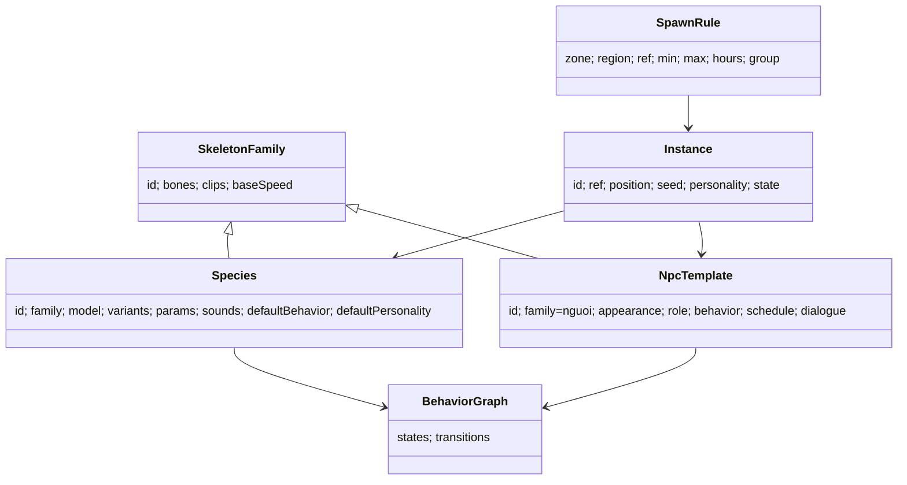

# SRS-05: Nhân vật người chơi, NPC và động vật

| Mục | Nội dung |
|---|---|
| Mã tài liệu | SRS-05 |
| Phiên bản | 1.0 |
| Ngày | 22/11/2026 |
| Tài liệu cha | SRS-00 `SRS-00-TONG-QUAN.md` |
| BRD nguồn | BRD-05 v0.1; BRD-00 v0.5 mục 7.10.1–7.10.4 (BR-47…74, BR-102, BR-103) |
| Module | `characters` (khung xương, animation, LOD, retarget), `npc-ai` (máy trạng thái, tìm đường, đàn, LOD hành vi, lịch trình), `camera-player`; bước build `navmesh` |
| Nhóm mã | `CHR` |
| Pha | E2 (người chơi), E4 (khung xương, mô hình, animation), E6 (hành vi, tìm đường), W3 (editor) |
| Trạng thái | Đã duyệt (Huy, 22/11/2026) |

Chiến đấu ở SRS-06, hội thoại ở SRS-07.

---

## 1. Giới thiệu

### 1.1 Mục đích
Đặc tả nhân vật người chơi, NPC người và động vật: khai báo bằng dữ liệu, khung xương và animation dùng chung theo họ, hành vi theo máy trạng thái, tìm đường, ngân sách và LOD, editor trên Web Studio.

### 1.2 Phạm vi
| Trong phạm vi | Ngoài phạm vi |
|---|---|
| Điều khiển, camera, va chạm của người chơi; NPC người; 6 họ khung xương (người, thú bốn chân nhỏ, thú bốn chân lớn, gia cầm, chim bay, cá); hành vi; tìm đường; lịch trình; đàn; luật xuất hiện; LOD; editor NPC và động vật | Trạng thái chiến đấu (SRS-06); cây thoại và AI hội thoại (SRS-07); nguồn và nhập mô hình (SRS-03); biểu cảm khuôn mặt, nhu cầu, sinh sản (OI-CHR-01…03) |

---

## 2. Mô tả chung

### 2.1 Mô hình khái niệm



### 2.2 Họ khung xương và bộ animation tối thiểu

| Họ (`family`) | Loài/kiểu ví dụ | Animation tối thiểu | Di chuyển |
|---|---|---|---|
| `nguoi` | Người chơi, nông dân, sư, trẻ em | `idle`, `walk`, `run`, `turn`, `bend`, `sit`, `wave`, `talk`, `work` | Mặt đất, navmesh |
| `thu4_nho` | Chó, mèo, lợn, dê | `idle`, `walk`, `run`, `lie`, `sit`, `sniff`, `eat` | Navmesh |
| `thu4_lon` | Trâu, bò, ngựa | `idle`, `walk_slow`, `graze`, `lie`, `tail`, (`plough`) | Navmesh |
| `gia_cam` | Gà, vịt, ngan | `idle`, `walk`, `peck`, `flap`, `run`, (`swim`) | Navmesh, nước nông (vịt) |
| `chim` | Sẻ, cò, quạ, én | `fly`, `glide`, `land`, `perch`, `takeoff` | Không gian 3D, boids |
| `ca` | Cá chép, rô, cá vàng | `swim`, `flick`, `surface` | Thể tích nước |

Animation tạo bằng: clip CC0 retarget về khung xương họ (ưu tiên), hoặc animation thủ tục viết bằng code (RR-12).

### 2.3 Vòng cập nhật hành vi
Mỗi khung hình: `npc-ai` chọn cá thể đến lượt cập nhật theo LOD hành vi (FR-CHR-37), đánh giá chuyển trạng thái, cập nhật mục tiêu di chuyển; `characters` cập nhật vị trí, xoay, chọn và blend clip, IK chân (tier ≥ Vừa). Toàn bộ dùng pool, không cấp phát (FR-CHR-40).

---

## 3. Use case

| Mã | Tên | Tác nhân | Ưu tiên | Pha |
|---|---|---|---|---|
| UC-CHR-01 | Điều khiển nhân vật người chơi | Người chơi | M | E2 |
| UC-CHR-02 | Thêm loài động vật mới bằng dữ liệu | Người tạo game | M | E4 |
| UC-CHR-03 | Tạo NPC trên Web Studio | Người tạo game | M | W3 |
| UC-CHR-04 | Thêm đàn động vật trên Web Studio | Người tạo game | M | W3 |
| UC-CHR-05 | NPC chạy theo lịch trình | Runtime | S | E6 |

### 3.1 UC-CHR-02 Thêm loài động vật mới bằng dữ liệu
1. Người dùng tạo `entities/animals/<loai>.json` chọn `family` có sẵn, kích thước, màu/bộ lông, tốc độ, âm thanh, tính cách mặc định; chỉ định mô hình (asset `DaDuyet` từ SRS-03 hoặc biến thể màu của mô hình cùng họ).
2. Hệ thống kiểm schema, kiểm `family` tồn tại (QT-CHR-01), kiểm mô hình đã retarget về khung xương họ.
3. Loài xuất hiện khi có luật xuất hiện (FR-CHR-35) hoặc đặt tay; không cần viết code (AC-05-02).

### 3.2 UC-CHR-03 Tạo NPC trên Web Studio
1. Người dùng mở SCR-CHR-01, bấm "Thêm NPC".
2. Nhập tên, vai trò; chọn ngoại hình (mô hình + biến thể trang phục, màu); chọn mẫu hành vi (`idle_work`, `patrol`, `wander`, `villager_day`…) hoặc mở SCR-CHR-03 sửa máy trạng thái; vẽ đường tuần tra trên khung xem trước; khai báo lịch trình; gắn hội thoại (SRS-07); chỉ số chiến đấu (SRS-06, khi bật).
3. Hệ thống kiểm schema, áp nóng vào khung xem trước (FR-CHR-44), lưu mốc phiên bản.

### 3.3 UC-CHR-04 Thêm đàn động vật
1. Người dùng mở SCR-CHR-02, chọn loài, vẽ vùng trên bản đồ hoặc chọn vùng có sẵn, nhập số lượng min–max, tính cách, giờ hoạt động.
2. Hệ thống tạo luật xuất hiện, kiểm ngân sách nhân vật của tier Vừa (cảnh báo khi vượt), áp nóng.

---

## 4. Yêu cầu chức năng

### 4.1 Nhân vật người chơi

| Mã | Yêu cầu | Nguồn | Ưu tiên | Pha |
|---|---|---|---|---|
| FR-CHR-01 | `entities/player.json` khai báo: mô hình/ngoại hình, chiều cao (m), tốc độ đi (mặc định 1,4 m/s), chạy (4,0 m/s), bán kính va chạm (0,3 m), góc nhìn, khả năng tuỳ chọn `jump`, `sit`, `swim`, `climb` | BR-47, BR-47.1 | M | E2 |
| FR-CHR-02 | Ngôi ba: camera sau vai, khoảng cách 3,5 m (đề xuất), xoay bằng vuốt; ngôi một: camera tại mắt, lắc nhẹ khi đi (tắt trong Cài đặt). Chọn bằng `game.json.camera.mode` | BR-48, BR-48.1 | M | E2 |
| FR-CHR-03 | Camera ngôi ba kéo gần khi có vật cản giữa camera và nhân vật (sphere cast bán kính 0,2 m) và không xuyên địa hình | BR-48 | M | E2 |
| FR-CHR-04 | Cảm ứng: joystick ảo trái, vuốt phải xoay camera; nút hành động ngữ cảnh (Tương tác, Nói chuyện, Nhặt) chỉ hiện khi có điểm tương tác trong bán kính | BR-49, BR-49.1 | M | E2 |
| FR-CHR-05 | Chạy khi đẩy joystick > 90% bán kính hoặc bấm nút chạy (`player.runInput` = `joystick` / `button`) | BR-49.2 | M | E2 |
| FR-CHR-06 | Hành động tuỳ chọn nhảy, ngồi, leo chỉ có nút và logic khi bật trong `player.json` | BR-49 | M | E2 |
| FR-CHR-07 | Đi được trên dốc ≤ `maxSlope` (mặc định 40°); bậc cao ≤ `stepHeight` (0,35 m) tự bước lên; dốc lớn hơn thì trượt dừng | BR-50, BR-50.1 | M | E2 |
| FR-CHR-08 | Gặp nước sâu (SRS-02 QT-WLD-08): chặn ở mép nếu `swim=false`; chuyển trạng thái bơi nếu `swim=true` | BR-50.2 | M | E2 |
| FR-CHR-09 | Va chạm với công trình, cây lớn (có collider), NPC, động vật lớn; không ra khỏi vùng chơi | BR-50 | M | E2 |
| FR-CHR-10 | Animation chuyển trạng thái có blend (0,2 s mặc định); tốc độ phát clip theo tốc độ di chuyển để chân không trượt; IK chân hai xương theo mặt dốc ở tier ≥ Vừa | BR-51, BR-51.1 | M | E4 |
| FR-CHR-11 | Âm bước chân chọn theo loại bề mặt tại vị trí chân (SRS-02 FR-WLD-16) hoặc vật liệu sàn | BR-52, BR-52.1 | S | E6 |
| FR-CHR-12 | Tuỳ biến ngoại hình người chơi (trang phục, màu) khi mô tả yêu cầu: danh sách lựa chọn trong `player.json.customization` | BR-53, BR-53.1 | C | Sau E7 |

### 4.2 NPC người

| Mã | Yêu cầu | Nguồn | Ưu tiên | Pha |
|---|---|---|---|---|
| FR-CHR-13 | `entities/npc/<id>.json` khai báo: tên, vai trò, ngoại hình (mô hình + biến thể trang phục, màu), hành vi (tham chiếu graph hoặc graph nội tuyến), lịch trình, hội thoại (SRS-07), tính cách, `interactable`, `invulnerable` (SRS-06) | BR-54, BR-54.1 | M | E6 |
| FR-CHR-14 | NPC đám đông: `entities/npc/templates/<id>.json` + seed sinh biến thể ngoại hình (trang phục, màu, chiều cao ±5%) | BR-54.2 | M | E6 |
| FR-CHR-15 | Thư viện hành vi cơ bản: `idle` (đứng/ngồi/làm việc tại chỗ), `patrol` (theo đường), `wander` (trong vùng), `goto` (tới điểm), `follow` (theo người chơi), `react` (quay mặt, chào, tránh đường) | BR-55, BR-55.1 | M | E6 |
| FR-CHR-16 | Máy trạng thái khai báo trong dữ liệu (mục 6.2): trạng thái, chuyển, điều kiện (khoảng cách người chơi, giờ trong game, sự kiện, biến game, ngẫu nhiên có seed), hành động | BR-55.2 | M | E6 |
| FR-CHR-17 | NPC xoay đầu về phía người chơi trong bán kính 4 m, giới hạn ±70° | BR-55.3 | S | E6 |
| FR-CHR-18 | Bước build `navmesh` sinh lưới điều hướng theo zone từ địa hình, nước, vật cản (thông số tác nhân: bán kính, chiều cao, dốc tối đa theo họ); runtime tìm đường A* trên navmesh | BR-56, BR-56.1 | M | E6 |
| FR-CHR-19 | Tránh va chạm cục bộ giữa NPC, động vật, người chơi (RVO hoặc lực đẩy đơn giản) | BR-56.2 | M | E6 |
| FR-CHR-20 | NPC không tiến được quá 5 s khi có mục tiêu thì dịch về điểm navmesh hợp lệ gần nhất và ghi log `stuck` (dùng cho bot playtest) | BR-56.3 | M | E6 |
| FR-CHR-21 | Lịch trình: danh sách `{from, to, behavior, target}` theo giờ trong game (SRS-02 thời điểm); chuyển hoạt động khi sang khung giờ | BR-58, BR-58.1 | S | E6 |
| FR-CHR-22 | Đám đông ở xa dùng LOD thấp, animation instancing (bake clip vào texture) hoặc impostor | BR-59, BR-59.1 | S | E7 |
| FR-CHR-23 | Giọng nói NPC theo SRS-07 FR-DLG-27, FR-DLG-28 | BR-60, BR-60.1 | C | Sau E6 |

### 4.3 Động vật

| Mã | Yêu cầu | Nguồn | Ưu tiên | Pha |
|---|---|---|---|---|
| FR-CHR-24 | `entities/animals/<loai>.json` khai báo: `family`, kích thước, tỷ lệ, bộ lông/màu, tốc độ, âm thanh, tập tính mặc định (graph), tính cách mặc định | BR-61, BR-61.1 | M | E4 |
| FR-CHR-25 | Thêm loài trong họ có sẵn chỉ bằng dữ liệu + mô hình đã retarget; ít nhất 2 loài mỗi họ được kiểm ở G-E4 | BR-61.2 | M | E4 |
| FR-CHR-26 | Thú nuôi có hành vi `wander`, `graze`/`eat`, `rest`, `herd` (theo đàn, có con đầu đàn), `flee`, `follow` | BR-63, BR-63.1 | M | E6 |
| FR-CHR-27 | Tính cách (mục 6.3): `than_thien` (lại gần, đi theo), `nhut_nhat` (bỏ chạy khi người chơi trong `fleeRadius`), `tho_o` (tránh đường, tiếp tục việc), `hung_du` (chỉ có hiệu lực khi bật chiến đấu, SRS-06) | BR-63.2 | M | E6 |
| FR-CHR-28 | Tiếng kêu theo loài và hành vi, âm 3D theo khoảng cách; số nguồn âm động vật đồng thời ≤ 8 (đề xuất), ưu tiên nguồn gần | BR-67, BR-67.1 | S | E6 |
| FR-CHR-29 | Chó/mèo "nhận chủ": khi `adoptable=true` và người chơi tương tác N lần, chuyển sang `follow` người chơi | BR-63.3 | C | E6 |
| FR-CHR-30 | Mô hình động vật theo thứ tự nguồn của SRS-03; `characters` cung cấp retarget về khung xương họ (ánh xạ tên xương, chuẩn hoá tư thế nghỉ); duyệt turntable + clip animation chính | BR-62, BR-62.1 | M | E4 |
| FR-CHR-31 | Gia cầm theo nhóm: kiếm ăn, mổ, tán loạn và vỗ cánh khi người chơi chạy tới trong bán kính, tụ lại sau 3–6 s; về chuồng theo giờ nếu khai báo | BR-64, BR-64.1 | S | E6 |
| FR-CHR-32 | Chim: đàn bay theo boids (tách, căn, gắn kết); điểm đậu khai báo hoặc tự tìm trên ngọn cây/mái/dây có tag `perch`; cất cánh khi người chơi tới gần; ngoài `particleDistance` chuyển thành hạt có animation | BR-65, BR-65.1 | S | E6 |
| FR-CHR-33 | Cá: bơi theo đàn trong vùng nước có `depth` ≥ `minDepth` của loài; không ra khỏi mask nước (ràng buộc vị trí mỗi bước); né khi người chơi ở mép nước; hiện qua mặt nước ở tier ≥ Vừa | BR-66, BR-66.1 | S | E6 |
| FR-CHR-34 | Điểm tương tác với động vật (vuốt ve, cho ăn, dắt, thả) dùng hệ tương tác SRS-04 FR-RTM-19 với hành động bổ sung `animal_action` | BR-68, BR-68.1 | C | Sau E6 |

### 4.4 Yêu cầu chung

| Mã | Yêu cầu | Nguồn | Ưu tiên | Pha |
|---|---|---|---|---|
| FR-CHR-35 | Luật xuất hiện (`world.json` → `spawns[]`): zone, vùng, loài hoặc mẫu NPC, min–max, giờ hoạt động, nhóm/đàn (kích thước, con đầu đàn), seed; bám mặt đất qua `placement` | BR-69, BR-69.4 | M | E6 |
| FR-CHR-36 | Ngân sách nhân vật theo tier (SRS-04 mục 6.3): cận cảnh chi tiết, skinning đồng thời, cá thể trong đàn, tri mỗi LOD; build và QA báo Pass/Warn/Fail | BR-70, BR-70.1 | M | E4 |
| FR-CHR-37 | LOD hình 3 mức + impostor/hạt; LOD hành vi: gần (< 30 m) mỗi khung, vừa (30–80 m) 5–10 Hz, xa (> 80 m) 1–2 Hz, ngoài tầm nhìn tạm dừng và nhảy cóc vị trí theo thời gian đã trôi khi quay lại (ngưỡng đề xuất) | BR-71, BR-71.1 | M | E6 |
| FR-CHR-38 | Mọi lựa chọn ngẫu nhiên của hành vi dùng luồng RNG riêng của cá thể (seed = hash(seed game, id cá thể)) | BR-72, BR-72.1 | M | E6 |
| FR-CHR-39 | Kiểu dáng mọi nhân vật và động vật theo style bible đã duyệt; mô hình lệch phong cách không qua duyệt (SRS-03 QT-AST-05) | BR-73, BR-73.2 | M | E4 |
| FR-CHR-40 | Không cấp phát trong vòng lặp hành vi và animation (SRS-04 FR-RTM-23) | BR-74, BR-74.1 | M | E6 |
| FR-CHR-41 | Thư viện 6 họ khung xương mục 2.2, mỗi họ có khung xương, bộ clip tối thiểu, tốc độ chuẩn và graph hành vi mặc định | BR-61 | M | E4 |

### 4.5 Editor trên Web Studio

| Mã | Yêu cầu | Nguồn | Ưu tiên | Pha |
|---|---|---|---|---|
| FR-CHR-42 | SCR-CHR-01: tạo/sửa NPC bằng form (ngoại hình chọn + chỉnh màu, vai trò, mẫu hành vi), vẽ đường tuần tra bằng cách chạm điểm trên khung xem trước, bảng lịch trình theo giờ; nút mở SCR-CHR-03 sửa máy trạng thái dạng sơ đồ | BR-102, BR-102.1 | M | W3 |
| FR-CHR-43 | SCR-CHR-02: thêm đàn động vật: chọn loài, vẽ/chọn vùng, số lượng min–max, tính cách, giờ; hiển thị mức dùng ngân sách nhân vật | BR-103, BR-103.1 | M | W3 |
| FR-CHR-44 | Thay đổi NPC/động vật (trừ mô hình mới) áp nóng vào khung xem trước ≤ 2 s; có nút "Đặt lại seed" và "Tua giờ" để xem hành vi | BR-102.2 | M | W3 |

---

## 5. Quy tắc nghiệp vụ

| Mã | Quy tắc | Điều kiện, cách xử lý | Kết quả, ghi chú |
|---|---|---|---|
| QT-CHR-01 | Mỗi loài thuộc đúng một họ | KHI `family` không có trong thư viện THÌ từ chối (ERR-CHR-01); họ mới cần phiếu riêng (khung xương + animation + hành vi) | Nguồn QT-05-01 |
| QT-CHR-02 | Không tự thêm loài/NPC | Chỉ loài và NPC có trong mô tả hoặc do người dùng thêm | Nguồn QT-05-02 |
| QT-CHR-03 | Giảm tải khi vượt ngân sách | KHI số cá thể hiển thị vượt ngân sách tier THÌ ẩn/giảm LOD cá thể xa nhất trước; không giảm cá thể cận cảnh, NPC có `essential=true` | Nguồn QT-05-03 |
| QT-CHR-04 | Không hại động vật khi tắt chiến đấu/săn | KHI `combat.enabled=false` và `hunting.enabled=false` THÌ không trạng thái nào gây sát thương; tính cách `hung_du` hoạt động như `tho_o` | Nguồn QT-05-04 |
| QT-CHR-05 | Không ra ngoài vùng | NPC/động vật không ra ngoài vùng chơi và vùng được gán (`homeRegion`); đích tìm đường ngoài vùng bị kẹp về biên | Nguồn QT-05-05 |
| QT-CHR-06 | Giờ trong game | Hành vi theo giờ dùng đồng hồ game, không dùng giờ thật | Nguồn QT-05-06 |

---

## 6. Dữ liệu

### 6.1 Loài động vật (ví dụ)
```json
{
  "id": "trau",
  "family": "thu4_lon",
  "model": "asset:trau-cc0@2",
  "scale": 1.0,
  "colorVariants": ["#3b3533", "#4a423e"],
  "speed": { "walk": 1.0, "run": 3.0 },
  "sounds": { "idle": "audio:trau-rong@1" },
  "behavior": "graph:thu-nuoi-lon",
  "personality": "tho_o",
  "fleeRadius": 6,
  "homeRegion": null
}
```

### 6.2 Máy trạng thái hành vi (graph)
| Trường | Ghi chú |
|---|---|
| `id`, `extends` | Kế thừa graph khác (ví dụ `combat` thêm trạng thái ở SRS-06) |
| `states[]` | `{id, action, params}`; `action` thuộc thư viện FR-CHR-15, FR-CHR-26 |
| `transitions[]` | `{from, to, when, priority, cooldownS}`; `when` là biểu thức an toàn: `dist(player) < 5`, `hour >= 18`, `event('chuong')`, `flag('x')`, `rand() < 0.2` |
| `initial` | Trạng thái đầu |

### 6.3 Tham số tính cách mặc định
| Tính cách | `approachRadius` | `fleeRadius` | `followChance` | Ghi chú |
|---|---|---|---|---|
| `than_thien` | 5 m | — | 0,3 | |
| `nhut_nhat` | — | 6 m (gà 4 m) | 0 | Đi chậm/ngồi giảm bán kính khi bật săn (SRS-06) |
| `tho_o` | — | 1,5 m (chỉ tránh) | 0 | |
| `hung_du` | — | — | 0 | Chỉ khi bật chiến đấu |

### 6.4 Luật xuất hiện
`{id, zone, region, ref: "animal:ga" | "npc:template:dan-lang", min, max, hours: [[6,18]], group: {size: [6,12], leader: true}, seed}`.

---

## 7. Giao diện

| Mã | Tên | Nội dung | Pha |
|---|---|---|---|
| SCR-CHR-01 | Editor NPC | Danh sách NPC (lọc theo zone, vai trò); form: Tên, Vai trò, Ngoại hình (chọn mô hình + ô màu trang phục), Hành vi (chọn mẫu), Đường tuần tra (nút "Vẽ trên cảnh"), Lịch trình (bảng giờ → hoạt động → vị trí), Hội thoại (liên kết SCR-DLG-01), Chiến đấu (khi bật, SRS-06), `essential`; nút Lưu, Xem thử | W3 |
| SCR-CHR-02 | Editor động vật | Danh sách loài và đàn; form đàn: loài, vùng (vẽ/chọn), số lượng min–max, tính cách, giờ; thanh ngân sách nhân vật tier Vừa | W3 |
| SCR-CHR-03 | Sơ đồ hành vi | Nút trạng thái kéo thả, mũi tên chuyển kèm điều kiện; trình dựng điều kiện dạng form (không gõ biểu thức tự do ở chế độ thường); kiểm graph: trạng thái không tới được, không có lối ra | W3 |

---

## 8. Mã lỗi

| Mã | Điều kiện | Thông báo | Phản ứng |
|---|---|---|---|
| ERR-CHR-01 | `family` không tồn tại | "Họ <họ> chưa có trong thư viện." | Không lưu |
| ERR-CHR-02 | Mô hình chưa retarget hoặc chưa duyệt | "Mô hình chưa sẵn sàng cho họ <họ>." | Không lưu |
| ERR-CHR-03 | Graph có trạng thái không tới được / không lối ra | "Hành vi có trạng thái <id> không dùng được." | Cảnh báo, vẫn lưu được |
| ERR-CHR-04 | Biểu thức điều kiện sai cú pháp | "Điều kiện ở chuyển <from→to> không hợp lệ." | Không lưu |
| ERR-CHR-05 | Vượt ngân sách nhân vật | "Số nhân vật vượt ngân sách tier Vừa (<n>/<giới hạn>)." | Cảnh báo; build báo Warn/Fail |
| ERR-CHR-06 | Vùng đàn nằm ngoài navmesh / ngoài nước (cá) | "Vùng không có chỗ đi được cho loài này." | Không lưu |

---

## 9. Yêu cầu phi chức năng

| Mã | Yêu cầu | Cách kiểm |
|---|---|---|
| NFR-CHR-01 | Ngân sách tier Vừa (đề xuất, CH-15): ≤ 4 nhân vật cận cảnh chi tiết, ≤ 20 NPC người và ≤ 30 động vật có skinning, đàn chim/cá instancing tới 200 | AC-05-06, 08 |
| NFR-CHR-02 | CPU hành vi + animation ≤ 4 ms mỗi khung trên A56 (đề xuất, NFR-05-02) | Profiler |
| NFR-CHR-03 | Không GC giật (> 5 ms) trong 2 phút ở số nhân vật tối đa | AC-05-08 |
| NFR-CHR-04 | Bot playtest: 0 lần NPC kẹt > 5 s trong 10 phút (đề xuất) | FR-QA-08 |

---

## 10. Tiêu chí chấp nhận

| AC BRD | Yêu cầu SRS | Cách kiểm |
|---|---|---|
| AC-05-01 | FR-CHR-02, 07, 08 | Ngôi ba trên A56: dốc 30°, bậc thấp, dừng ở mép ao sâu (bơi tắt) |
| AC-05-02 | FR-CHR-24, 25 | Thêm "chó vàng" bằng JSON + màu → xuất hiện, không viết code |
| AC-05-03 | FR-CHR-19, 26, 27 | 8 trâu `tho_o` → gặm cỏ tiếp, tránh người chơi, không xuyên nhau |
| AC-05-04 | FR-CHR-27, 31 | 12 gà `nhut_nhat` → tán loạn, vỗ cánh, tụ lại sau 3–6 s |
| AC-05-05 | FR-CHR-18, 21 | NPC 6h ra đồng, 18h về → tua giờ, đúng giờ, không kẹt |
| AC-05-06 | FR-CHR-32, 36 | 60 chim → cất cánh theo đàn, tier Vừa đạt fps |
| AC-05-07 | FR-CHR-33, 38 | Ao cá 10 phút seed cố định → không cá nào ra ngoài mask |
| AC-05-08 | FR-CHR-36, 37, 40 | Tối đa nhân vật, profiler 2 phút → không GC giật, CPU trong ngân sách |

---

## 11. Open item

| Mã | Câu hỏi | Đề xuất | Nguồn |
|---|---|---|---|
| OI-CHR-01 | Biểu cảm khuôn mặt, khẩu hình | Không; chỉ cử chỉ tay, đầu | CH-05-01 |
| OI-CHR-02 | Hệ nhu cầu (đói, mệt) | Không ở bản đầu | CH-05-02 |
| OI-CHR-03 | Động vật sinh sản, lớn lên | Không | CH-05-03 |
| OI-CHR-04 | Họ động vật bổ sung | Theo mô tả, mỗi họ một phiếu | CH-05-04 |
| OI-CHR-05 | Loài thử pipeline ở E4 | Chó, trâu, gà, chim sẻ, cá chép | CH-18 |
| OI-CHR-06 | Cưỡi/dắt động vật, phương tiện | Không ở bản đầu | CH-19 |
| OI-CHR-07 | Ngưỡng LOD hành vi 30 m / 80 m | Chốt sau đo E6 | Mới |

---

## 12. Truy vết

| BR | Yêu cầu SRS |
|---|---|
| BR-47 (BR-47.1) | FR-CHR-01 |
| BR-48 (BR-48.1) | FR-CHR-02, 03 |
| BR-49 (BR-49.1…2) | FR-CHR-04…06 |
| BR-50 (BR-50.1…2) | FR-CHR-07…09 |
| BR-51 (BR-51.1) | FR-CHR-10 |
| BR-52 (BR-52.1) | FR-CHR-11 |
| BR-53 (BR-53.1) | FR-CHR-12 |
| BR-54 (BR-54.1…2) | FR-CHR-13, 14 |
| BR-55 (BR-55.1…3) | FR-CHR-15…17 |
| BR-56 (BR-56.1…3) | FR-CHR-18…20 |
| BR-58 (BR-58.1) | FR-CHR-21 |
| BR-59 (BR-59.1) | FR-CHR-22 |
| BR-60 (BR-60.1) | FR-CHR-23 |
| BR-61 (BR-61.1…2) | FR-CHR-24, 25, 41 |
| BR-62 (BR-62.1) | FR-CHR-30 |
| BR-63 (BR-63.1…3) | FR-CHR-26, 27, 29 |
| BR-64 (BR-64.1) | FR-CHR-31 |
| BR-65 (BR-65.1) | FR-CHR-32 |
| BR-66 (BR-66.1) | FR-CHR-33 |
| BR-67 (BR-67.1) | FR-CHR-28 |
| BR-68 (BR-68.1) | FR-CHR-34 |
| BR-69 (BR-69.4) | FR-CHR-35 |
| BR-70 (BR-70.1) | FR-CHR-36 |
| BR-71 (BR-71.1) | FR-CHR-37 |
| BR-72 (BR-72.1) | FR-CHR-38 |
| BR-73 (BR-73.2) | FR-CHR-39 |
| BR-74 (BR-74.1) | FR-CHR-40 |
| BR-102 (BR-102.1…2) | FR-CHR-42, 44 |
| BR-103 (BR-103.1) | FR-CHR-43 |

## 13. Lịch sử thay đổi

| Phiên bản | Ngày | Người | Nội dung |
|---|---|---|---|
| 0.1 | 22/11/2026 | Claude | Bản đầu từ BRD-05 v0.1 |
| 1.0 | 22/11/2026 | Claude | Huy duyệt; chấp nhận các giá trị "(đề xuất)" và đề xuất của Open item làm giá trị nền; đổi trạng thái sang Đã duyệt |
