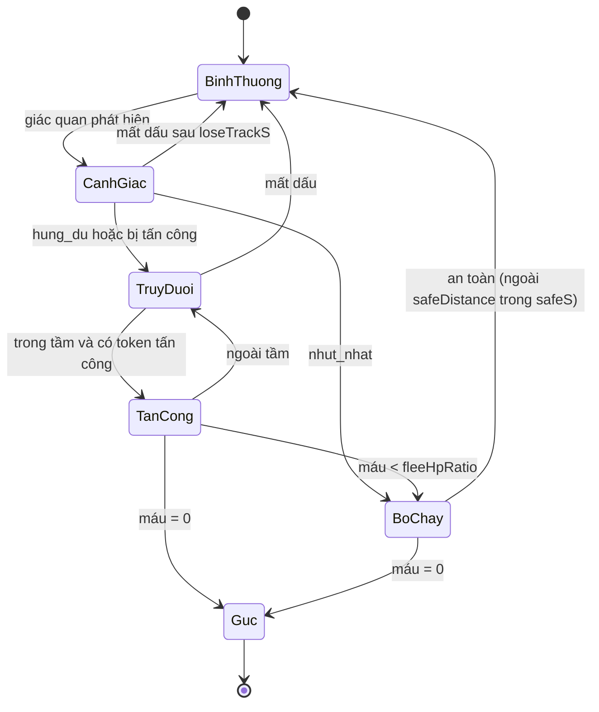

# SRS-06: Chiến đấu và săn bắt (tuỳ chọn)

| Mục | Nội dung |
|---|---|
| Mã tài liệu | SRS-06 |
| Phiên bản | 1.1 |
| Ngày | 22/11/2026 |
| Tài liệu cha | SRS-00 `SRS-00-TONG-QUAN.md` |
| BRD nguồn | BRD-06 v0.1; BRD-00 v0.5 mục 7.10.5 (BR-75…83, BR-102 phần chỉ số chiến đấu) |
| Quyết định | QĐ-13: chiến đấu và săn bắt do người dùng chọn trong mô tả; module tuỳ chọn, mặc định tắt |
| Module | `combat` (tuỳ chọn), mở rộng `npc-ai`, `characters`, `ui-audio` |
| Nhóm mã | `CBT` |
| Pha | Khi game cần, sớm nhất E6; editor W3 |
| Trạng thái | Đã duyệt (Huy, 22/11/2026) |

---

## 1. Giới thiệu

### 1.1 Mục đích
Đặc tả module chiến đấu và săn bắt tuỳ chọn: chỉ có mặt khi mô tả game yêu cầu, toàn bộ cân bằng bằng dữ liệu, chạy được trên cảm ứng trong ngân sách A56, và game không bật thì không chịu chi phí nào.

### 1.2 Phạm vi
| Trong phạm vi | Ngoài phạm vi |
|---|---|
| Cờ bật/tắt; đóng gói có điều kiện; chỉ số, vũ khí, công cụ săn; hành động của người chơi; AI chiến đấu và giác quan; săn bắt, dấu vết, chiến lợi phẩm; gục và hồi sinh; mức thể hiện bạo lực; phản hồi; ngân sách; trường chiến đấu trong editor NPC | Nhiều người chơi, PvP; hệ cấp độ/kỹ năng/trang bị nâng cấp (OI-CBT-02); ragdoll đầy đủ (OI-CBT-01); cưỡi thú (OI-CBT-03) |

---

## 2. Mô tả chung

### 2.1 Cấu hình trong `game.json`

| Khoá | Kiểu | Mặc định | Ý nghĩa |
|---|---|---|---|
| `features.combat.enabled` | boolean | false | Có chiến đấu |
| `features.combat.style` | `melee` / `ranged` / `mixed` | `melee` | Kiểu chiến đấu |
| `features.combat.targets` | string[] | [] | Loài/mẫu NPC có thể bị tấn công |
| `features.hunting.enabled` | boolean | false | Có săn bắt |
| `features.hunting.species` | string[] | [] | Loài săn được |
| `features.violence.level` | `minimal` / `standard` | `minimal` | Không máu / có hiệu ứng |
| `features.combat.formula` | string | `max(1, atk + weapon - def)` | Công thức sát thương (mục 4.2, FR-CBT-07) |

`/new-game` (SRS-01 FR-INT-13) đặt các cờ theo mô tả; người dùng xác nhận qua brief.

### 2.2 Máy trạng thái chiến đấu (mở rộng graph SRS-05)



`BinhThuong` là graph hành vi gốc của SRS-05. Graph `combat` khai báo `extends` graph gốc.

---

## 3. Use case

| Mã | Tên | Tác nhân | Ưu tiên | Pha |
|---|---|---|---|---|
| UC-CBT-01 | Bật chiến đấu/săn bắt cho game | Người tạo game | M | E1 (cờ), E6 |
| UC-CBT-02 | Giao tranh | Người chơi | M | E6 |
| UC-CBT-03 | Săn một con thú | Người chơi | S | E6 |
| UC-CBT-04 | Cân bằng chỉ số | Người tạo game | M | E6, W3 |

### 3.1 UC-CBT-01 Bật chiến đấu/săn bắt
1. Mô tả nhắc chiến đấu/săn → `/new-game` bật cờ, hỏi lại phần chưa rõ (SRS-01 QT-INT-07); hoặc người dùng bật sau qua chat/editor.
2. Bật sau khi game đã có là thay đổi lớn: brief chuyển `ChoXacNhan` (SRS-01 QT-INT-05).
3. Sau khi xác nhận, build đóng gói module `combat` và asset liên quan.

### 3.2 UC-CBT-02 Giao tranh
1. NPC/động vật `hung_du` phát hiện người chơi (FR-CBT-13) → `CanhGiac` → `TruyDuoi`.
2. Kẻ địch xin token tấn công (FR-CBT-14); có token và trong tầm → `TanCong`.
3. Người chơi bấm Tấn công (aim assist chọn mục tiêu), Né/Đỡ; trúng đòn tính sát thương theo công thức (FR-CBT-07).
4. Mục tiêu máu 0 → `Guc` → biến mất sau `despawnS`, tái xuất hiện theo luật (FR-CBT-21). Người chơi máu 0 → hồi sinh (FR-CBT-20).

### 3.3 UC-CBT-03 Săn một con thú
1. Người chơi thấy dấu vết (FR-CBT-16), tiếp cận; ngồi/đi chậm giảm bán kính bị phát hiện (FR-CBT-17).
2. Thú phát hiện → bỏ chạy cùng đàn (FR-CBT-15); hoặc bị hạ → rơi vật phẩm theo bảng rơi (FR-CBT-18).

---

## 4. Yêu cầu chức năng

### 4.1 Bật/tắt và đóng gói

| Mã | Yêu cầu | Nguồn | Ưu tiên | Pha |
|---|---|---|---|---|
| FR-CBT-01 | Brief hiển thị bảng "Tính năng tuỳ chọn" ghi rõ chiến đấu/săn bắt bật hay tắt, kiểu, đối tượng, mức thể hiện; người dùng xác nhận cùng brief | BR-75, BR-75.2 | M | E1 |
| FR-CBT-02 | Schema `game.json.features` như mục 2.1; `targets` và `species` chỉ nhận id loài/mẫu có trong `entities/` | BR-75 | M | E1 |
| FR-CBT-03 | Module `combat` là entry riêng (dynamic import) chỉ được `packager` đưa vào gói khi `combat.enabled` hoặc `hunting.enabled`; game tắt không có mã, asset, UI chiến đấu trong bản build (kiểm bằng danh sách file gói) | BR-76, BR-76.1 | M | E6 |
| FR-CBT-04 | Bật chiến đấu/săn sau khi game đã có là thay đổi lớn theo SRS-01 QT-INT-05 | BR-76.2 | M | E6 |

### 4.2 Chỉ số và vật phẩm

| Mã | Yêu cầu | Nguồn | Ưu tiên | Pha |
|---|---|---|---|---|
| FR-CBT-05 | Mỗi thực thể tham gia có khối `combat`: `hp`, `atk`, `def`, `range` (m), `attackInterval` (s), `moveSpeedCombat`, `regenPerS`, `fleeHpRatio` | BR-77, BR-77.1 | M | E6 |
| FR-CBT-06 | Vũ khí/công cụ là entity `entities/weapons/<id>.json`: loại (`melee`, `ranged`, `trap`, `net`), sát thương, tầm, tốc độ, đạn (số, tốc độ bay), mô hình, âm thanh | BR-77.2 | M | E6 |
| FR-CBT-07 | Công thức sát thương khai báo trong `features.combat.formula`, chỉ dùng biến `atk`, `def`, `weapon`, hằng số, hàm `max`, `min`, `round`; mặc định `max(1, atk + weapon - def)` | BR-77.3 | M | E6 |
| FR-CBT-08 | Xuất/nhập bảng cân bằng (CSV, JSON) gồm mọi thực thể và vũ khí để chỉnh hàng loạt | BR-77.4 | S | E6 |

Ví dụ FR-CBT-07: người chơi `atk` 6, kiếm `weapon` 10, sói `def` 4 → sát thương = max(1, 6 + 10 − 4) = 12. Sói `hp` 30 cần 3 đòn. Đổi kiếm lên 15 → 17 mỗi đòn, cần 2 đòn (AC-06-05).

### 4.3 Hành động người chơi

| Mã | Yêu cầu | Nguồn | Ưu tiên | Pha |
|---|---|---|---|---|
| FR-CBT-09 | Nút Tấn công và Né/Đỡ trên HUD cảm ứng (trong safe area); aim assist chọn mục tiêu hợp lệ gần nhất trong nón 60° trước mặt, tầm ≤ `range` + 1 m | BR-78, BR-78.1 | M | E6 |
| FR-CBT-10 | Tầm xa: ngắm bằng vuốt khi giữ nút bắn, hoặc chạm vào mục tiêu để khoá | BR-78.2 | S | E6 |
| FR-CBT-11 | Trúng đòn: giật lùi 0,3 m, clip `hit`; bất tử 0,5 s sau khi trúng (đề xuất) | BR-78.3 | M | E6 |

### 4.4 AI chiến đấu

| Mã | Yêu cầu | Nguồn | Ưu tiên | Pha |
|---|---|---|---|---|
| FR-CBT-12 | Graph `combat` thêm trạng thái `CanhGiac`, `TruyDuoi`, `TanCong`, `BoChay`, `Guc` vào graph hành vi của SRS-05 theo mục 2.2 | BR-79, BR-79.1 | M | E6 |
| FR-CBT-13 | Giác quan: nhìn (góc, khoảng cách, bị che bởi vật cản), nghe (bán kính tỷ lệ tốc độ người chơi: đứng 0, đi 1×, chạy 2,5×), đánh hơi (động vật, bán kính, tăng theo chiều gió nếu `weather.wind` có) | BR-79.2 | M | E6 |
| FR-CBT-14 | Token tấn công: tối đa `budgets.combat.attackers` kẻ địch tấn công người chơi cùng lúc; kẻ khác vây quanh ở khoảng cách 3–5 m | BR-79.3 | M | E6 |
| FR-CBT-15 | Đàn bỏ chạy cùng nhau khi một con bị tấn công hoặc phát hiện người chơi | BR-79.4 | S | E6 |

### 4.5 Săn bắt

| Mã | Yêu cầu | Nguồn | Ưu tiên | Pha |
|---|---|---|---|---|
| FR-CBT-16 | Dấu vết (dấu chân decal, tiếng động) sinh theo dữ liệu loài `tracks`, tồn tại `trackLifeS` | BR-80, BR-80.1 | S | E6 |
| FR-CBT-17 | Mức cảnh giác loài `nhay` / `vua` / `cham` nhân bán kính phát hiện 1,5 / 1,0 / 0,6; người chơi ngồi nhân 0,5, đi chậm nhân 0,7 | BR-80.2 | S | E6 |
| FR-CBT-18 | Hạ được thú thì rơi vật phẩm theo `lootTable` (vật phẩm, xác suất, số lượng) dùng RNG có seed | BR-80.3 | S | E6 |
| FR-CBT-19 | Bẫy, lưới (bắt sống) khi mô tả yêu cầu: vũ khí loại `trap`/`net`, thú bị bắt chuyển trạng thái `BiBat` | BR-80.4 | C | E6 |

Ví dụ FR-CBT-17: hươu `nhay`, bán kính phát hiện gốc 20 m → 30 m. Người chơi ngồi tiếp cận → 15 m (AC-06-02, AC-06-03).

### 4.6 Kết quả và hồi sinh

| Mã | Yêu cầu | Nguồn | Ưu tiên | Pha |
|---|---|---|---|---|
| FR-CBT-20 | Người chơi gục: màn mờ 2 s, hồi sinh tại điểm hồi sinh gần nhất (`regions` loại `respawn`), giữ hoặc mất vật phẩm theo `features.combat.dropOnDeath` | BR-81, BR-81.1 | M | E6 |
| FR-CBT-21 | NPC/động vật gục: clip `down`, biến mất mềm sau `despawnS` (mặc định 5 s), tái xuất hiện theo luật xuất hiện sau `respawnS`; không dùng ragdoll | BR-81.2 | M | E6 |
| FR-CBT-22 | NPC/động vật có `invulnerable=true` không nhận sát thương, không bị aim assist chọn | BR-81.3 | M | E6 |
| FR-CBT-23 | `violence.level = minimal`: không hạt máu, không xác; gục là ngã rồi mờ dần; `standard`: hiệu ứng trúng đòn có màu theo dữ liệu | BR-81.4 | M | E6 |

### 4.7 Phản hồi và ngân sách

| Mã | Yêu cầu | Nguồn | Ưu tiên | Pha |
|---|---|---|---|---|
| FR-CBT-24 | Phản hồi trúng đòn: hạt hiệu ứng, âm thanh, rung (`navigator.vibrate`, 40 ms, khi người chơi bật), số sát thương nổi (tuỳ chọn `showDamageNumbers`) | BR-82, BR-82.1 | S | E6 |
| FR-CBT-25 | HUD máu người chơi; thanh máu mục tiêu khi đang giao tranh; nằm trong safe area (SCR-CBT-01) | BR-82.2 | M | E6 |
| FR-CBT-26 | Ngân sách theo tier trong `budgets.json`: `combat.attackers`, `combat.projectiles`, hạt hiệu ứng chiến đấu; vượt thì từ chối sinh đạn/hạt mới theo thứ tự xa trước | BR-83, BR-83.1 | M | E6 |
| FR-CBT-27 | Kết quả giao tranh tất định với seed và chế độ test bước thời gian cố định (SRS-04 FR-RTM-06) | QT-06-05 | M | E6 |
| FR-CBT-28 | Editor NPC (SCR-CHR-01) và SCR-CBT-02 hiển thị khối chỉ số chiến đấu, `invulnerable`, bảng rơi khi game bật chiến đấu/săn | BR-102 | M | W3 |

---

## 5. Quy tắc nghiệp vụ

| Mã | Quy tắc | Điều kiện, cách xử lý | Kết quả, ghi chú |
|---|---|---|---|
| QT-CBT-01 | Mặc định tắt | Chỉ bật khi mô tả yêu cầu hoặc người dùng bật và xác nhận brief | Nguồn QT-06-01 |
| QT-CBT-02 | Chỉ mục tiêu khai báo | KHI id không thuộc `combat.targets` (chiến đấu) hoặc `hunting.species` (săn) THÌ không nhận sát thương, không bị aim assist chọn | Nguồn QT-06-02 |
| QT-CBT-03 | Không tăng bạo lực quá mô tả | `violence.level` không được đặt cao hơn mức `/new-game` suy ra từ mô tả nếu không có xác nhận của người dùng (thay đổi lớn) | Nguồn QT-06-03 |
| QT-CBT-04 | Không số cân bằng trong code | Mọi chỉ số, công thức, bảng rơi trong dữ liệu | Nguồn QT-06-04 |
| QT-CBT-05 | Tất định | Như FR-CBT-27 | Nguồn QT-06-05 |
| QT-CBT-06 | Tắt chiến đấu thì không hại | Xem SRS-05 QT-CHR-04 | |

---

## 6. Dữ liệu

### 6.1 Khối `combat` của thực thể (ví dụ sói)
```json
"combat": { "hp": 30, "atk": 5, "def": 4, "range": 1.5, "attackInterval": 1.2,
            "moveSpeedCombat": 5.0, "regenPerS": 0, "fleeHpRatio": 0.2,
            "senses": { "sightM": 25, "sightDeg": 120, "hearM": 10, "smellM": 15 },
            "alertness": "vua", "lootTable": [{"item": "da-soi", "p": 0.6, "n": [1,1]}],
            "despawnS": 5, "respawnS": 300 }
```

### 6.2 Vũ khí
`{id, kind: melee|ranged|trap|net, damage, range, interval, projectile: {speed, max}, model, sounds: {swing, hit}}`.

---

## 7. Giao diện

| Mã | Tên | Nội dung | Pha |
|---|---|---|---|
| SCR-CBT-01 | HUD chiến đấu | Thanh máu người chơi (góc trên trái), thanh máu mục tiêu (trên mục tiêu hoặc giữa trên), nút Tấn công (lớn, góc phải dưới), Né/Đỡ, chỉ báo mục tiêu đang khoá; ẩn khi không giao tranh quá 5 s | E6 |
| SCR-CBT-02 | Bảng cân bằng (Web Studio) | Bảng các thực thể và vũ khí với cột chỉ số, sửa trực tiếp, kiểm giới hạn; nút Xuất CSV, Nhập CSV; áp nóng vào xem trước | W3 |

---

## 8. Mã lỗi

| Mã | Điều kiện | Thông báo | Phản ứng |
|---|---|---|---|
| ERR-CBT-01 | `targets`/`species` chứa id không tồn tại | "Đối tượng <id> không có trong game." | Không lưu |
| ERR-CBT-02 | Công thức sát thương sai cú pháp hoặc dùng biến không cho phép | "Công thức sát thương không hợp lệ." | Không lưu |
| ERR-CBT-03 | Nhập CSV sai cột | "Dòng <n>: <lỗi>." | Không áp dụng phần nào |
| ERR-CBT-04 | Gói build chứa module `combat` khi cờ tắt | (lỗi build) | Build Fail |

---

## 9. Yêu cầu phi chức năng

| Mã | Yêu cầu | Cách kiểm |
|---|---|---|
| NFR-CBT-01 | Giao tranh đông nhất theo ngân sách vẫn đạt fps mục tiêu tier Vừa trên A56 | AC-06-04 |
| NFR-CBT-02 | Game không bật chiến đấu: kích thước gói JS không tăng so với bản engine không có `combat` | AC-06-01 |
| NFR-CBT-03 | Độ trễ từ chạm nút Tấn công tới bắt đầu clip ≤ 100 ms | Đo bằng chế độ dev |

---

## 10. Tiêu chí chấp nhận

| AC BRD | Yêu cầu SRS | Cách kiểm |
|---|---|---|
| AC-06-01 | FR-CBT-03, NFR-CBT-02 | Game không bật → danh sách file gói không có `combat` |
| AC-06-02 | FR-CBT-13, 15, 17 | Hươu `nhay`, người chơi chạy tới → phát hiện ở bán kính lớn, đàn bỏ chạy |
| AC-06-03 | FR-CBT-17 | Ngồi, đi chậm → bán kính phát hiện giảm theo dữ liệu |
| AC-06-04 | FR-CBT-14, 26, NFR-CBT-01 | 6 sói trên A56 → tối đa N con tấn công, fps đạt |
| AC-06-05 | FR-CBT-06, 07 | Kiếm 10 → 15 → hiệu lực ngay, không sửa code |
| AC-06-06 | FR-CBT-23 | `minimal` → không hiệu ứng máu |
| AC-06-07 | FR-CBT-22 | NPC sư trụ trì `invulnerable` → không nhận sát thương |

---

## 11. Open item

| Mã | Câu hỏi | Đề xuất | Nguồn |
|---|---|---|---|
| OI-CBT-01 | Ragdoll khi gục | Không | CH-06-01 |
| OI-CBT-02 | Hệ cấp độ, kỹ năng, nâng cấp | Không ở bản đầu | CH-06-02 |
| OI-CBT-03 | Cưỡi thú chiến đấu | Không | CH-06-03 |
| OI-CBT-04 | Game mẫu có bật chiến đấu/săn | Theo mô tả game mẫu ở E6–E7 | CH-22 |
| OI-CBT-05 | Ngân sách `combat.attackers`/`projectiles` | Vừa 3/20 (đề xuất), chốt khi có game cần | Mới |

---

## 12. Truy vết

| BR | Yêu cầu SRS |
|---|---|
| BR-75 (BR-75.2) | FR-CBT-01, 02 |
| BR-76 (BR-76.1…2) | FR-CBT-03, 04 |
| BR-77 (BR-77.1…4) | FR-CBT-05…08 |
| BR-78 (BR-78.1…3) | FR-CBT-09…11 |
| BR-79 (BR-79.1…4) | FR-CBT-12…15 |
| BR-80 (BR-80.1…4) | FR-CBT-16…19 |
| BR-81 (BR-81.1…4) | FR-CBT-20…23 |
| BR-82 (BR-82.1…2) | FR-CBT-24, 25 |
| BR-83 (BR-83.1) | FR-CBT-26 |
| BR-102 (phần chiến đấu) | FR-CBT-28 |

## 13. Lịch sử thay đổi

| Phiên bản | Ngày | Người | Nội dung |
|---|---|---|---|
| 0.1 | 22/11/2026 | Claude | Bản đầu từ BRD-06 v0.1 |
| 1.0 | 22/11/2026 | Claude | Huy duyệt; chấp nhận các giá trị "(đề xuất)" và đề xuất của Open item làm giá trị nền; đổi trạng thái sang Đã duyệt |
| 1.1 | 23/11/2026 | Claude | Theo yêu cầu của Huy: sửa mặc định `features.combat.formula` ở mục 2.1 từ `max(1, atk - def)` thành `max(1, atk + weapon - def)` cho thống nhất với FR-CBT-07, ví dụ mục 4.2 và AC-06-05 (phát hiện khi viết DDD-06, OID-CBT-02). Không đổi mã yêu cầu, không ảnh hưởng truy vết |
