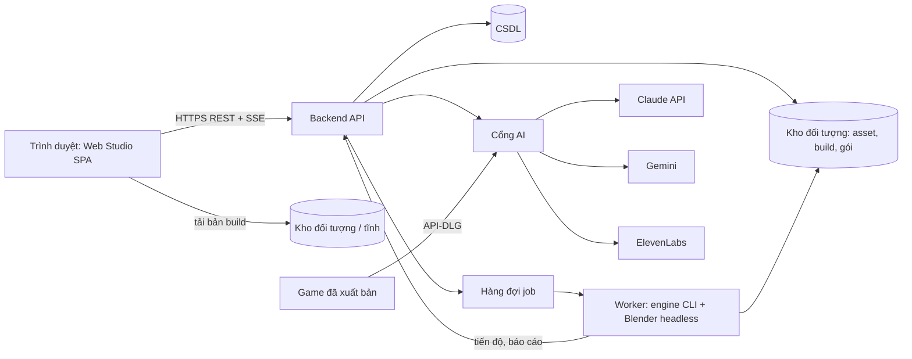
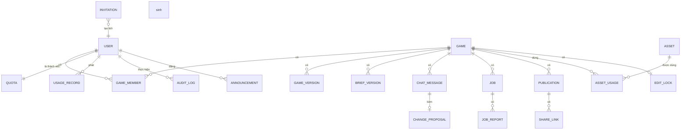

# SRS-08: Web Studio

| Mục | Nội dung |
|---|---|
| Mã tài liệu | SRS-08 |
| Phiên bản | 1.2 |
| Ngày | 23/11/2026 |
| Tài liệu cha | SRS-00 `SRS-00-TONG-QUAN.md` |
| BRD nguồn | BRD-08 v0.1; BRD-10 (v1.2); BRD-00 v0.5 mục 4.1b, 7.11 (BR-90…118) |
| Quyết định | QĐ-15: GameStudio có giao diện web riêng; CH-23 đã chốt: chỉ nhóm nội bộ được mời; QĐ-07 dùng nội bộ |
| Thành phần | Frontend Web Studio (`web/app`), backend API (`web/api`), CSDL, kho đối tượng (asset, bản build), hàng đợi job, worker build, cổng AI |
| Nhóm mã | `WEB` |
| Pha | W1…W4 (song song engine, bắt đầu sau G-E1) |
| Trạng thái | Đã duyệt (Huy, 22/11/2026); v1.1 bổ sung phần quản trị theo change request Huy duyệt 23/11/2026 (nguồn UIUX-04 FRP-ADM-01…11); v1.2 bổ sung luồng làm tiếp và cập nhật game theo CR-01, Huy duyệt 23/11/2026 |

Nội dung nghiệp vụ của từng loại chỉnh sửa nằm ở SRS-01 (chat, brief, đề xuất), SRS-02 (môi trường), SRS-03 (asset), SRS-05 (NPC, động vật), SRS-06 (chiến đấu), SRS-07 (hội thoại). SRS này đặc tả **tài khoản, phân quyền, không gian làm việc, xem trước, editor chung, phiên bản, chia sẻ, xuất bản, backend, job, cổng AI và vận hành**.

---

## 1. Giới thiệu

### 1.1 Mục đích
Cho người trong nhóm tạo, chỉnh, chơi thử, chia sẻ game trên trình duyệt mà không cần Claude Code, dòng lệnh hay biết cấu trúc file (BO-09).

### 1.2 Phạm vi
| Trong phạm vi | Ngoài phạm vi |
|---|---|
| Đăng nhập theo lời mời, vai trò, quyền theo game, hạn mức; thư viện game; chat; xem trước 3D; editor chung (chọn, gizmo, kéo thả, hoàn tác, khoá sửa); phiên bản; xuất/nhập gói; chia sẻ, link chơi thử, xuất bản; hàng đợi job, worker; cổng AI; sao lưu; bảo mật; trang quản trị | Đăng ký tự do, công chúng (QĐ-07); cộng tác thời gian thực nhiều người (CH-30); editor mô hình 3D chi tiết; tài khoản người chơi trong game, multiplayer (GD-05); thông báo email (OI-WEB-04) |

### 1.3 Giả định kỹ thuật
| Mã | Nội dung |
|---|---|
| GĐ-WEB-01 | Backend và worker chạy trên một máy chủ Linux có Blender headless, nâng cấp từ máy chủ poc (GD-16, CH-25) |
| GĐ-WEB-02 | Stack cụ thể (Node/TypeScript hoặc Python cho API, PostgreSQL, kho đối tượng tương thích S3 hoặc thư mục cục bộ, hàng đợi) chốt ở TSD/ADR (GD-17); SRS chỉ ràng buộc hành vi |
| GĐ-WEB-03 | Đăng nhập Google kèm danh sách mời (CH-24, đề xuất) |
| GĐ-WEB-04 | Quy mô ≤ 20 người dùng, ≤ 5 job build đồng thời (GD-15, NFR-08-03) |

---

## 2. Kiến trúc và tác nhân

### 2.1 Kiến trúc logic



Khung xem trước nhúng `@gamestudio/engine` (cùng bản với bản xuất bản, SRS-04 FR-RTM-03), nạp bản build mới nhất từ kho đối tượng và dữ liệu runtime từ API.

### 2.2 Tác nhân
| Vai trò hệ thống | Mô tả |
|---|---|
| Quản trị | Mời/khoá người dùng, đặt hạn mức, xem chi phí và job toàn hệ thống, cấu hình nguồn CC0 và dịch vụ AI; xem nhật ký kiểm toán, kiểm duyệt bản xuất bản và link, chuyển quyền chủ game, đăng thông báo hệ thống (v1.1) |
| Người tạo game | Tạo game, sửa game của mình hoặc được chia sẻ quyền Sửa, chạy build/QA, xuất bản game của mình |
| Người xem | Xem, chơi thử game được chia sẻ |
| Khách có link | Chơi bản xuất bản qua link (không đăng nhập, khi link cho phép) |
| Worker | Tác nhân hệ thống chạy job |

---

## 3. Phân quyền

### 3.1 Vai trò hệ thống
| Quyền | Quản trị | Người tạo game | Người xem |
|---|---|---|---|
| Tạo game mới | Có | Có | Không |
| Trang quản trị | Có | Không | Không |
| Xem game được chia sẻ | Có (mọi game, chỉ đọc nếu không phải thành viên) | Có | Có |
| Tổng quan quản trị, nhật ký kiểm toán, thông báo hệ thống (v1.1) | Có | Không | Không |
| Huỷ/thử lại job của mọi game (v1.1) | Có | Không | Không |
| Kiểm duyệt: thu hồi link, gỡ bản xuất bản, chuyển chủ game của mọi game (v1.1) | Có (bắt buộc lý do) | Không | Không |

### 3.2 Quyền theo game
| Hành động | Chủ game | Được sửa | Chỉ xem | Khách có link |
|---|---|---|---|---|
| Xem, chơi thử bản xem trước | Có | Có | Có | Không |
| Chơi bản xuất bản | Có | Có | Có | Có (theo link) |
| Sửa bằng chat/editor, duyệt đề xuất | Có | Có | Không | Không |
| Xác nhận brief, duyệt style bible, duyệt asset | Có | Có | Không | Không |
| Build, QA, cập nhật baseline | Có | Có | Không | Không |
| Xuất bản, tạo/thu hồi link | Có | Không (OI-WEB-01) | Không | Không |
| Chia sẻ quyền, nhân bản, lưu trữ, xoá, xuất gói | Có | Không (nhân bản: Có) | Không | Không |
| Xem tiến độ, Làm tiếp (v1.2) | Có | Có | Xem tiến độ | Không |
| Build phần thay đổi, nâng cấp engine/schema, nhập gói đè lên game (v1.2) | Có | Có | Không | Không |
| Chuyển link sang bản xuất bản mới (v1.2) | Có | Không | Không | Không |

Mọi kiểm quyền thực hiện ở backend cho từng yêu cầu (FR-WEB-05); giao diện chỉ ẩn nút.

Ngoại lệ của Quản trị (v1.1): không cần là thành viên game, Quản trị được huỷ/thử lại job (FR-WEB-52), thu hồi link và gỡ bản xuất bản khi kiểm duyệt (FR-WEB-55), chuyển chủ game (FR-WEB-59); mọi thao tác này bắt buộc lý do, báo chủ game và ghi kiểm toán. Quản trị không sửa dữ liệu game không phải của mình.

---

## 4. Use case

| Mã | Tên | Tác nhân | Ưu tiên | Pha |
|---|---|---|---|---|
| UC-WEB-01 | Mời người dùng | Quản trị | M | W1 |
| UC-WEB-02 | Đăng nhập | Người dùng | M | W1 |
| UC-WEB-03 | Tạo game và có bản xem trước đầu tiên | Người tạo game | M | W1–W2 |
| UC-WEB-04 | Chỉnh game trong không gian làm việc | Người có quyền Sửa | M | W3 |
| UC-WEB-05 | Build và xem kết quả | Người có quyền Sửa | M | W2 |
| UC-WEB-06 | Xem lịch sử và khôi phục phiên bản | Người có quyền Sửa | M | W2 |
| UC-WEB-07 | Chia sẻ và xuất bản link chơi thử | Chủ game | M | W4 |
| UC-WEB-08 | Đặt hạn mức, xem chi phí | Quản trị | M | W2 |
| UC-WEB-09 | Kiểm duyệt bản xuất bản và link chơi thử (v1.1) | Quản trị | S | W4 |
| UC-WEB-10 | Làm tiếp game đang làm dở (v1.2) | Người có quyền Sửa | M | W2 |
| UC-WEB-11 | Cập nhật game đã xuất bản (v1.2) | Chủ game, người có quyền Sửa | M | W4 |
| UC-WEB-12 | Nhập game có sẵn để làm tiếp (v1.2) | Người tạo game | S | W4 |

### 4.1 UC-WEB-02 Đăng nhập
1. Người dùng mở Web Studio, bấm "Đăng nhập bằng Google" (SCR-WEB-01).
2. Backend nhận email đã xác minh từ Google; kiểm email có trong danh sách mời và tài khoản không bị khoá.
3. Lần đầu: tạo `User` với vai trò ghi trong lời mời, đánh dấu lời mời đã dùng.
4. Tạo phiên (cookie `HttpOnly`, `Secure`, `SameSite=Lax`), hạn 7 ngày, gia hạn trượt khi dùng; chuyển tới SCR-WEB-02.

Ngoại lệ: email chưa mời → ERR-WEB-01 (AC-08-01); tài khoản bị khoá → ERR-WEB-02.

### 4.2 UC-WEB-03 Tạo game và có bản xem trước đầu tiên
1. Ở SCR-WEB-02 bấm "Tạo game mới" → SCR-WEB-04; thực hiện SRS-01 UC-INT-01…03.
2. Sau khi xác nhận brief: game xuất hiện trong thư viện; hệ thống đề nghị "Build zone đầu tiên" (job `build` + `qa nhẹ`, bỏ bake ở lần đầu).
3. Người dùng theo dõi tiến độ trong chat và thanh trên (FR-WEB-14); khi job xong, khung xem trước nạp bản build.
4. Mục tiêu: ≤ 30 phút từ mô tả tới bản chơi được, không tính bake (AC-08-02, BO-09).

### 4.3 UC-WEB-04 Chỉnh game trong không gian làm việc
1. Người dùng mở game (SCR-WEB-05). Hệ thống xin khoá sửa (FR-WEB-24): được thì vào chế độ sửa; người khác đang giữ thì vào chế độ xem, hiện "đang được sửa bởi X" (AC-08-04).
2. Chỉnh bằng chat (SRS-01 UC-INT-06) hoặc editor (cảnh, NPC, động vật, hội thoại, môi trường).
3. Mỗi thao tác cập nhật dữ liệu trong phiên (hoàn tác được); lưu tự động gộp thao tác thành mốc phiên bản (FR-WEB-27).
4. Thay đổi runtime áp nóng; thay đổi cần build gắn nhãn "cần build" (FR-WEB-17); người dùng bấm Build khi muốn.
5. Rời trang hoặc không thao tác 15 phút thì nhả khoá.

### 4.4 UC-WEB-07 Chia sẻ và xuất bản
1. Chủ game mở SCR-WEB-09, chọn phiên bản dữ liệu có bản build đầy đủ, bấm Xuất bản.
2. Hệ thống kiểm provenance (FR-WEB-39), chạy QA mức nhẹ (FR-WEB-37). Fail ngân sách: cảnh báo, chủ game vẫn xuất bản được với nhãn "chưa đạt".
3. Hệ thống sao chép gói tĩnh tới vị trí xuất bản cố định, tạo `Publication` (số phiên bản, hash).
4. Chủ game tạo link chơi thử: hạn dùng, yêu cầu đăng nhập hay không; nhận URL và mã QR. Thu hồi bất kỳ lúc nào.

### 4.5 UC-WEB-09 Kiểm duyệt bản xuất bản và link chơi thử (v1.1)
1. Quản trị mở SCR-WEB-17 tab "Xuất bản & link", lọc link không cần đăng nhập còn hạn.
2. Mở bản xuất bản để xem; khi nội dung không phù hợp: bấm Thu hồi link hoặc Gỡ bản xuất bản, nhập lý do (≥ 10 ký tự), xác nhận bằng cách gõ lại 4 ký tự cuối link hoặc tên game.
3. Hệ thống thu hồi link / gỡ bản xuất bản (URL cố định và mọi link trả 410), gửi thông báo MSG-WEB-05 cho chủ game, ghi kiểm toán `link_revoke_admin` / `publication_takedown`.

### 4.6 UC-WEB-10 Làm tiếp game đang làm dở (v1.2)
1. Người dùng mở SCR-WEB-02, lọc "Đang dở", bấm "Làm tiếp" trên thẻ game (FR-WEB-60).
2. Hệ thống lấy khoá sửa (FR-WEB-24), mở SCR-WEB-05 với bảng Tiến độ SCR-WEB-19 (FR-WEB-61): giai đoạn hiện tại, việc còn treo, một nút "Việc tiếp theo".
3. Chat hiện tóm tắt tiến độ (SRS-01 FR-INT-34); đề xuất chờ duyệt còn hiệu lực được giữ, đề xuất cũ chuyển `HetHan` (FR-WEB-62). Phiên tạo game dở thì mở SCR-WEB-04 đúng câu hỏi đang chờ.
4. Người dùng bấm "Việc tiếp theo" (ví dụ "Build phần thay đổi", FR-WEB-63) hoặc tiếp tục chỉnh như UC-WEB-04.

Ngoại lệ: người khác đang giữ khoá → mở chế độ xem, bảng Tiến độ vẫn hiện (ERR-WEB-06); job lỗi → nút Thử lại trên bảng Tiến độ.

### 4.7 UC-WEB-11 Cập nhật game đã xuất bản (v1.2)
1. Người có quyền Sửa chỉnh game (chat, editor, brief); SCR-WEB-05 và thư viện hiện MSG-WEB-06 "có thay đổi chưa xuất bản".
2. Build phần thay đổi (FR-WEB-63), QA nhẹ.
3. Chủ game bấm Xuất bản: hệ thống tạo `Publication` số mới kèm tóm tắt thay đổi so với bản trước (FR-WEB-64); bản cũ giữ nguyên.
4. Chủ game chọn chuyển link sang bản mới, hoặc để link `moiNhat` tự trỏ bản mới (FR-WEB-65).

Ngoại lệ: game dùng engine/schema cũ → cờ "Cần nâng cấp", nâng cấp trước (FR-WEB-68); bản mới Fail ngân sách → nhãn "chưa đạt" như FR-WEB-37, link `codinh` vẫn trỏ bản cũ.

### 4.8 UC-WEB-12 Nhập game có sẵn để làm tiếp (v1.2)
1. Người dùng tải lên gói zip (xuất từ Web Studio hoặc thư mục `games/<id>/` làm bằng Claude Code) ở SCR-WEB-02 → "Nhập game".
2. Hệ thống kiểm gói (API-WEB-84, FR-WEB-66) và hiện báo cáo: hợp lệ, cần nâng cấp, asset thiếu provenance, có brief hay không, `gameId` trùng game đã có.
3. Người dùng chọn: tạo game mới, hoặc cập nhật game đã có cùng `gameId` mà mình có quyền Sửa (FR-WEB-69, xem khác biệt trước khi áp).
4. Hệ thống tạo `GameVersion` nguồn `import`; thiếu brief thì sinh brief nháp chờ xác nhận (FR-WEB-67); mở SCR-WEB-19.

Ngoại lệ: gói không phải game hoặc không migrate được → ERR-WEB-14.

---

## 5. Yêu cầu chức năng

### 5.1 Tài khoản, phân quyền, hạn mức

| Mã | Yêu cầu | Nguồn | Ưu tiên | Pha |
|---|---|---|---|---|
| FR-WEB-01 | Quản trị thêm email vào danh sách mời kèm vai trò (Quản trị / Người tạo game / Người xem) và hạn mức khởi tạo; xoá lời mời chưa dùng | BR-90, BR-90.1 | M | W1 |
| FR-WEB-02 | Đăng nhập Google; chỉ email đã xác minh và có trong danh sách mời được tạo phiên (QT-WEB-01) | BR-90, QT-08-01 | M | W1 |
| FR-WEB-03 | Quản trị khoá/mở khoá tài khoản; khoá thì huỷ mọi phiên đang mở trong ≤ 1 phút và chặn API ngay; không khoá/hạ vai trò chính mình hoặc quản trị cuối cùng (QT-WEB-09, v1.1) | BR-90.2 | M | W1 |
| FR-WEB-04 | Vai trò hệ thống và quyền theo game theo mục 3 | BR-91 | M | W1 |
| FR-WEB-05 | Backend kiểm quyền trên mọi endpoint theo (người dùng, game, hành động); trả 403 khi thiếu quyền; có bộ test ma trận quyền tự động | BR-91.1 | M | W1 |
| FR-WEB-06 | Hạn mức mỗi người: chi phí AI/ngày (USD), số job build đồng thời, dung lượng lưu trữ (GB), số game; kiểm trước mỗi lần gọi AI, tạo job, tải lên, tạo game | BR-92, BR-92.1 | M | W2 |
| FR-WEB-07 | Dùng ≥ 80% hạn mức: cảnh báo trên giao diện; 100%: chặn hành động tương ứng, thông báo rõ, ghi sự kiện cho quản trị; quản trị nâng hạn mức có hiệu lực ngay | BR-92.2 | M | W2 |

### 5.2 Thư viện game

| Mã | Yêu cầu | Nguồn | Ưu tiên | Pha |
|---|---|---|---|---|
| FR-WEB-08 | SCR-WEB-02 liệt kê game người dùng sở hữu hoặc được chia sẻ: ảnh đại diện (ảnh góc chuẩn đầu tiên), tên, trạng thái, vai trò của tôi, lần sửa cuối; thao tác tạo mới, nhân bản (sao dữ liệu, tham chiếu asset dùng chung), đổi tên, lưu trữ, xoá | BR-107 | M | W1 |
| FR-WEB-09 | Trạng thái game: `DangLam`, `LuuTru`, `DaXoa` (thùng rác 30 ngày, khôi phục được; hết hạn thì xoá vĩnh viễn dữ liệu riêng của game, giữ asset dùng chung theo QT-WEB-06) | BR-107.1 | M | W1 |

### 5.3 Chat

| Mã | Yêu cầu | Nguồn | Ưu tiên | Pha |
|---|---|---|---|---|
| FR-WEB-10 | Mỗi game có một luồng chat lưu lịch sử (tin nhắn, thẻ đề xuất, thẻ job), cuộn vô hạn, tìm trong lịch sử | BR-93, BR-93.1 | M | W1 |
| FR-WEB-11 | Chat gọi `game-intake` dùng chung (SRS-01 FR-INT-29) qua cổng AI | BR-93.2 | M | W1 |
| FR-WEB-12 | Đề xuất thay đổi hiển thị bằng thẻ SCR-INT-01 với Duyệt / Duyệt một phần / Bỏ | BR-94, BR-94.5 | M | W3 |
| FR-WEB-13 | Câu hỏi về game ("zone 2 có bao nhiêu NPC?") được trả lời từ dữ liệu phiên bản hiện tại, không tạo đề xuất | BR-94.6 | S | W3 |
| FR-WEB-14 | Thẻ job trong chat và chỉ báo trên thanh trên hiển thị trạng thái từng bước (chờ, đang chạy %, xong, lỗi), thời gian còn lại ước lượng, liên kết báo cáo | BR-95, BR-95.1 | M | W2 |
| FR-WEB-15 | Thông báo "có asset chờ duyệt" trong chat mở SCR-AST-01 (SRS-03 FR-AST-34) | BR-96 | M | W3 |

### 5.4 Xem trước 3D

| Mã | Yêu cầu | Nguồn | Ưu tiên | Pha |
|---|---|---|---|---|
| FR-WEB-16 | Khung xem trước dùng đúng phiên bản engine runtime của bản xuất bản; nạp bản build mới nhất của game | BR-97, BR-97.1 | M | W2 |
| FR-WEB-17 | Thay đổi dữ liệu thuộc nhóm "chỉ runtime" (SRS-04 mục 6.2) áp nóng không tải lại trang; thay đổi cần build gắn nhãn "cần build" trên đối tượng và trên nút Build kèm số thay đổi chờ | BR-98, BR-98.1, BR-98.2 | M | W3 |
| FR-WEB-18 | Chế độ xem: bay tự do, người chơi, góc chuẩn QA (chọn từ danh sách); chọn zone; tua giờ trong game | BR-97.2 | M | W2 |
| FR-WEB-19 | Mã QR và link mở bản xem trước trên điện thoại (token xem trước hạn 24 giờ); link có tham số đo thì gửi số đo về API-WEB-60 (SRS-04 UC-QA-03) | BR-100, BR-100.1 | S | W2 |
| FR-WEB-20 | Giả lập tier và khung điện thoại (412 × 915, safe area); lớp phủ fps, draw call, tri, bộ nhớ so ngân sách tier đang giả lập, tô đỏ khi vượt | BR-99, BR-99.1 | S | W2 |

### 5.5 Editor chung

| Mã | Yêu cầu | Nguồn | Ưu tiên | Pha |
|---|---|---|---|---|
| FR-WEB-21 | Chọn đối tượng bằng nhấp/chạm trong khung xem trước hoặc cây đối tượng; đối tượng chọn được tô viền và mở bảng thuộc tính | BR-101, BR-101.1 | M | W3 |
| FR-WEB-22 | Gizmo di chuyển, xoay, co giãn; bám mặt đất (mặc định bật); bám lưới tuỳ chọn (0,5 / 1 / 5 m) | BR-101.2 | M | W3 |
| FR-WEB-23 | Kéo thả asset `DaDuyet` từ thư viện asset (SCR-AST-02) vào cảnh, tạo `placedObjects` (SRS-02 FR-WLD-26) | BR-101.3 | M | W3 |
| FR-WEB-24 | Khoá sửa: một người sửa một game tại một thời điểm; khoá có nhịp giữ 60 s, hết hạn sau 15 phút không thao tác; chủ game cướp khoá được (người đang giữ bị chuyển sang chế độ xem, thay đổi chưa lưu được lưu thành mốc) | BR-105.3, CH-30 | M | W3 |
| FR-WEB-25 | Vẽ vùng đa giác trên bản đồ nhìn từ trên (SCR-WLD-02, SRS-02 FR-WLD-37) | BR-101.4 | M | W3 |
| FR-WEB-26 | Hoàn tác/làm lại ≥ 50 bước trong phiên sửa | BR-105, BR-105.1 | M | W3 |
| FR-WEB-27 | Lưu tự động sau 2 s không thao tác; thao tác liên tiếp trong 60 s gộp thành một mốc phiên bản (FR-WEB-31) | BR-105.2 | M | W3 |
| FR-WEB-28 | Kiểm schema khi lưu (bộ kiểm dùng chung SRS-04 FR-RTM-01); dữ liệu sai không lưu được và chỉ ra trường; cảnh báo khi ước lượng vượt ngân sách tier Vừa | BR-105 | M | W3 |
| FR-WEB-29 | Chế độ JSON thô cho người dùng nâng cao: trình soạn có kiểm schema trực tiếp, đồng bộ hai chiều với editor | BR-106, BR-106.1 | C | W4 |
| FR-WEB-30 | Không gian làm việc có các editor chuyên biệt: cảnh (FR-WEB-21…23), môi trường (SCR-WLD-01), NPC (SCR-CHR-01), động vật (SCR-CHR-02), hội thoại (SCR-DLG-01), bảng cân bằng (SCR-CBT-02, khi bật); mọi editor chỉ đọc/ghi JSON dữ liệu (QT-WEB-04) | BR-101, BR-102, BR-103, BR-104 | M | W3 |

### 5.6 Phiên bản và gói game

| Mã | Yêu cầu | Nguồn | Ưu tiên | Pha |
|---|---|---|---|---|
| FR-WEB-31 | Mỗi thay đổi dữ liệu game tạo một `GameVersion` bất biến: số tăng dần, tác giả, thời điểm, nguồn (`chat`/`editor`/`json`/`restore`/`import`/`upgrade` (v1.2)), tóm tắt, hash dữ liệu, mốc phiên bản trước | BR-108, BR-108.1, QT-08-02 | M | W2 |
| FR-WEB-32 | SCR-WEB-08: dòng thời gian phiên bản, xem khác biệt giữa hai phiên bản theo đối tượng; Khôi phục tạo phiên bản mới có nội dung của phiên bản cũ, không xoá lịch sử | BR-108.2 | M | W2 |
| FR-WEB-33 | Đặt tên/gắn sao cho phiên bản quan trọng | BR-108.3 | S | W2 |
| FR-WEB-34 | Xuất gói game (zip: `games/<id>/` theo SRS-04 mục 6.1, asset kèm provenance, `manifest-goi.json`); nhập gói thành game mới; gói xuất build bằng CLI cho cùng hash dữ liệu | BR-112, BR-112.1 | S | W4 |

### 5.7 Chia sẻ và xuất bản

| Mã | Yêu cầu | Nguồn | Ưu tiên | Pha |
|---|---|---|---|---|
| FR-WEB-35 | Chủ game chia sẻ game cho người dùng trong hệ thống với quyền Sửa hoặc Xem; đổi, thu hồi quyền có hiệu lực ngay | BR-110, BR-110.1 | M | W4 |
| FR-WEB-36 | Link chơi thử: chọn bản xuất bản, hạn dùng (1, 7, 30 ngày, không hạn), yêu cầu đăng nhập hay không (CH-26), thu hồi; link hết hạn/thu hồi trả trang SCR-WEB-14 "Link không còn hiệu lực" | BR-110.2 | M | W4 |
| FR-WEB-37 | Xuất bản chạy QA mức nhẹ; kết quả Fail ngân sách hiện cảnh báo, chủ game vẫn xuất bản được với nhãn "chưa đạt" hiện trên SCR-WEB-09 và trong `publish.json` | BR-111, BR-111.3 | M | W4 |
| FR-WEB-38 | Chỉ chủ game xuất bản và quản lý link (đề xuất, OI-WEB-01); ngoại lệ: Quản trị thu hồi link, gỡ bản xuất bản khi kiểm duyệt (FR-WEB-55, v1.1) | BR-111 | M | W4 |
| FR-WEB-39 | Credit tự sinh từ provenance (SRS-03 FR-AST-30); thiếu provenance thì không xuất bản được, liệt kê asset thiếu | BR-113, BR-113.2 | M | W4 |

### 5.8 Backend, job, cổng AI, vận hành

| Mã | Yêu cầu | Nguồn | Ưu tiên | Pha |
|---|---|---|---|---|
| FR-WEB-40 | Hàng đợi job loại `build`, `qa`, `bake`, `asset`, `publish`, `export`, `import`, `upgrade` (v1.2); ưu tiên job ước lượng ngắn trước (bake xếp cuối); giới hạn job đồng thời mỗi người theo hạn mức; huỷ job đang chờ hoặc đang chạy; thử lại job lỗi do môi trường (tối đa 2 lần) | BR-114, BR-114.1 | M | W2 |
| FR-WEB-41 | Job gọi `engine` CLI (SRS-04 FR-CLI-01) trên worker; dùng chung cache theo hash giữa các job cùng game; job lặp lại cùng đầu vào hoàn tất từ cache | BR-114 | M | W2 |
| FR-WEB-42 | Cổng AI dùng chung cho sinh/sửa game, ảnh, âm thanh, hội thoại NPC: giữ khoá ở server, giới hạn tần suất, ghi bản ghi sử dụng (người dùng, game, loại việc, dịch vụ, mô hình, token, chi phí) | BR-115, BR-115.1 | M | W1 |
| FR-WEB-43 | Quản trị cấu hình dịch vụ AI (mô hình mặc định theo loại việc, đơn giá), danh sách trắng nguồn CC0 (SRS-03 FR-AST-01); khoá API chỉ đặt bằng biến môi trường/kho bí mật của server, giao diện chỉ hiện "đã cấu hình / chưa" | BR-115, BR-43 | M | W1 |
| FR-WEB-44 | Sao lưu CSDL hằng ngày (giữ 30 bản), kho đối tượng hằng tuần (giữ 8 bản), lưu ở vị trí khác máy chủ chính; diễn tập khôi phục mỗi pha W, ghi biên bản | BR-116, BR-116.1 | M | W2 |
| FR-WEB-45 | Worker chạy Blender và add-on đúng phiên bản cố định; chạy `engine doctor` khi khởi động, không đạt thì không nhận job | BR-114.2, BR-46 | M | W2 |
| FR-WEB-46 | Bảo mật web: chỉ HTTPS (HSTS); phiên có hạn; chống CSRF (token hoặc SameSite + kiểm Origin), XSS (CSP, mã hoá đầu ra; dữ liệu do AI sinh hiển thị dạng văn bản), SSRF (tải URL CC0 qua danh sách trắng miền, chặn IP nội bộ); cách ly dữ liệu theo quyền | BR-117, BR-117.1 | M | W1 |
| FR-WEB-47 | Không chạy mã do người dùng hoặc AI sinh trên server ngoài sandbox; script gameplay và generator mới chỉ vào hệ thống qua quy trình phiếu với Claude Code (SRS-09); Web Studio chỉ sửa dữ liệu JSON | BR-117.2 | M | W1 |
| FR-WEB-48 | Trang quản trị: số người dùng, job (chờ, chạy, lỗi), thời gian job trung bình theo loại, chi phí AI theo ngày/người/game/loại việc, dung lượng lưu trữ, thời gian phản hồi API P95; dữ liệu vận hành (job toàn hệ thống, worker, sao lưu) qua API-WEB-76 (v1.1) | BR-118, BR-118.1 | S | W2 |
| FR-WEB-49 | Nhật ký kiểm toán: đăng nhập, mời/khoá, đổi quyền, đổi hạn mức, xuất bản, tạo/thu hồi link, xoá game, cướp khoá, thao tác quản trị v1.1 (huỷ job, thu hồi link, gỡ bản xuất bản, chuyển chủ, thông báo hệ thống); giữ 1 năm; xem được trên SCR-WEB-16 (FR-WEB-53) | BR-117, QT-08-02 | M | W1 |
| FR-WEB-50 | Thông báo trong web (biểu tượng chuông): job xong/lỗi, được chia sẻ game, asset chờ duyệt, sắp hết hạn mức | CH-08-04 | S | W2 |

### 5.9 Quản trị mở rộng (v1.1)

| Mã | Yêu cầu | Nguồn | Ưu tiên | Pha |
|---|---|---|---|---|
| FR-WEB-51 | SCR-WEB-15 Tổng quan quản trị: người dùng hoạt động 7 ngày, job chờ/chạy/lỗi 24 giờ, chi phí AI hôm nay và 7 ngày, dung lượng, API P95; danh sách cảnh báo cần xử lý: worker không đạt `doctor` hoặc mất nhịp, job lỗi môi trường 24 giờ, người dùng ≥ 80% hạn mức, sao lưu quá hạn (CSDL > 26 giờ, đối tượng > 8 ngày), dung lượng > 80%, link không cần đăng nhập còn hạn > 30 ngày; tự làm mới 60 s | BR-118, BR-118.1 | S | W2 |
| FR-WEB-52 | Quản trị huỷ hoặc thử lại job của mọi game trên SCR-WEB-13; ghi kiểm toán; người tạo job nhận thông báo | BR-114, BR-114.1 | S | W2 |
| FR-WEB-53 | SCR-WEB-16 Nhật ký kiểm toán: lọc theo thời gian, người thực hiện, hành động, loại đối tượng, đối tượng; xem giá trị trước/sau; xuất CSV ≤ 10.000 dòng; chỉ đọc | BR-117 | S | W2 |
| FR-WEB-54 | Danh sách mọi game cho Quản trị (tên, chủ, trạng thái, dung lượng, lần sửa cuối, số bản xuất bản, số link còn hạn); mở game ở chế độ chỉ đọc | BR-91, BR-118 | S | W2 |
| FR-WEB-55 | Quản trị thu hồi link chơi thử và gỡ bản xuất bản của mọi game (URL cố định và mọi link trả 410, ERR-WEB-09); bắt buộc lý do ≥ 10 ký tự; chủ game nhận MSG-WEB-05; ghi kiểm toán (UC-WEB-09) | BR-110, BR-111 | S | W4 |
| FR-WEB-56 | Thống kê hội thoại AI theo game/NPC/ngày: số lượt, % chặn đầu vào, % đầu ra dùng dự phòng, chi phí; không hiện nội dung lời thoại trừ khi game bật gỡ lỗi (SRS-07 FR-DLG-17) | BR-88, BR-118 | C | W4 |
| FR-WEB-57 | Danh sách asset toàn kho cho Quản trị: lọc thiếu provenance, license, `NgungDung`, số game dùng, game sở hữu; Ngừng dùng qua API-WEB-44 | BR-109, BR-113 | S | W4 |
| FR-WEB-58 | Thông báo hệ thống: Quản trị soạn nội dung văn bản thuần ≤ 200 ký tự, mức Thông tin/Cảnh báo, thời gian hiện từ–đến; hiện thành băng đầu mọi trang Studio, đóng được, hiện lại khi nội dung đổi | BR-118 | S | W2 |
| FR-WEB-59 | Quản trị chuyển quyền chủ game sang người dùng `HoatDong` có vai Người tạo game hoặc Quản trị; chủ cũ thành `sua` hoặc bị gỡ (tuỳ chọn); hai bên nhận thông báo; ghi kiểm toán | BR-91, BR-110 | S | W4 |

### 5.10 Làm tiếp và cập nhật game (v1.2, CR-01)

| Mã | Yêu cầu | Nguồn | Ưu tiên | Pha |
|---|---|---|---|---|
| FR-WEB-60 | SCR-WEB-02 hiện trên mỗi thẻ game giai đoạn tiến độ (SRS-00 mục 4.4) và số việc còn treo; nút "Làm tiếp" mở game tại việc tiếp theo; bộ lọc "Đang dở" gồm game chưa ở `DaXuatBan` hoặc có thay đổi chưa xuất bản, sắp theo lần sửa cuối | BR-119.2, BR-119.5, BR-107 | M | W2 |
| FR-WEB-61 | SCR-WEB-19 bảng Tiến độ trong SCR-WEB-05: các giai đoạn với dấu xong/đang/chưa, nút chính "Việc tiếp theo" theo `next` của báo cáo tiến độ (SRS-04 mục 6.6), danh sách việc còn treo có lối tắt: đề xuất chờ duyệt, asset chờ duyệt, job lỗi (Thử lại), zone cần build, thay đổi chưa xuất bản, cần nâng cấp; tự mở lần đầu trong phiên khi game chưa ở `DaXuatBan`; cập nhật khi job xong hoặc dữ liệu đổi | BR-119.1, BR-120.4, BR-101, BR-114 | M | W2 |
| FR-WEB-62 | Mở lại game giữ ngữ cảnh: lịch sử chat, đề xuất `ChoDuyet` còn đúng `baseVersion` (đề xuất cũ chuyển `HetHan` kèm nút "Tạo lại đề xuất"), phiên tạo game dở (SRS-01 FR-INT-31), tóm tắt tiến độ đầu chat (SRS-01 FR-INT-34) | BR-120.3, BR-94, BR-93 | M | W2 |
| FR-WEB-63 | Nút "Build phần thay đổi" tạo job `build` với `stale=true` cho mọi zone có bước cũ (SRS-04 FR-CLI-09); trước khi chạy hiện danh sách bước, zone, ước lượng thời gian (chạy `dryRun`); không có bước cũ thì nút bị mờ với chú thích "Đã build đủ" | BR-123.1, BR-123.2, BR-114, BR-40.2 | M | W2 |
| FR-WEB-64 | Xuất bản game đã có bản xuất bản tạo `Publication` số mới (SRS-04 FR-CLI-12), không thay bản cũ; SCR-WEB-09 hiện tóm tắt thay đổi so với bản trước (các `GameVersion` giữa hai bản, đối tượng đổi) trước khi xác nhận; QA nhẹ và nhãn "chưa đạt" như FR-WEB-37 | BR-125.1, BR-125.2, BR-125.4, BR-111, BR-108 | M | W4 |
| FR-WEB-65 | Mỗi link chơi thử có chế độ `coDinh` (gắn một `Publication`) hoặc `moiNhat` (luôn mở bản xuất bản mới nhất chưa bị gỡ và không "chưa đạt"); mặc định `coDinh`; chủ game chuyển một hoặc mọi link sang bản mới bằng một thao tác, ghi kiểm toán | BR-125.3, BR-110.2 | S | W4 |
| FR-WEB-66 | Nhập game có sẵn: nhận gói xuất (FR-WEB-34) hoặc zip của thư mục `games/<id>/` theo SRS-04 mục 6.1 (không cần `manifest-goi.json`); bước kiểm (API-WEB-84) dùng logic `engine import` (SRS-04 FR-CLI-11), trả báo cáo trước khi ghi; asset thiếu provenance vào ở `ChoDuyet`, không vào build; game mới ở `DangLam`, `GameVersion` nguồn `import` | BR-122.1, BR-122.4, BR-112, BR-113 | S | W4 |
| FR-WEB-67 | Game nhập chưa có brief: hệ thống sinh brief nháp từ dữ liệu (SRS-01 FR-INT-32) ở `ChoXacNhan`; bảng Tiến độ đặt "Xác nhận brief" là việc tiếp theo; build bị chặn đến khi xác nhận | BR-122.2, BR-02, BR-112 | S | W4 |
| FR-WEB-68 | Game có `schemaVersion` hoặc `engineVersion` cũ hơn bản hiện hành của Studio được gắn cờ "Cần nâng cấp"; nút Nâng cấp tạo job `upgrade` (SRS-04 FR-CLI-10); kết quả hiện ảnh so sánh trước/sau và báo cáo QA; chỉ tạo `GameVersion` nguồn `upgrade` khi người dùng chấp nhận; bản xuất bản cũ không đổi | BR-124.1, BR-124.2, BR-06.2, BR-07.1 | S | W2 |
| FR-WEB-69 | Nhập gói vào game đã có (cập nhật từ bản làm bằng Claude Code): yêu cầu `gameId` khớp, quyền Sửa và giữ khoá; hiện khác biệt theo đối tượng so với phiên bản hiện tại trước khi áp; áp dụng tạo `GameVersion` mới nguồn `import`, không xoá lịch sử | BR-122.3, BR-112, BR-108 | S | W4 |

---

## 6. Quy tắc nghiệp vụ

| Mã | Quy tắc | Điều kiện, cách xử lý | Kết quả, ghi chú |
|---|---|---|---|
| QT-WEB-01 | Chỉ người được mời | KHI email không có trong danh sách mời THÌ không tạo phiên | Nguồn QT-08-01 |
| QT-WEB-02 | Mọi thay đổi là một mốc | KHI dữ liệu game đổi bằng bất kỳ đường nào THÌ có `GameVersion` có tác giả | Nguồn QT-08-02 |
| QT-WEB-03 | AI không tự áp dụng | Thay đổi từ AI chỉ áp dụng sau khi người có quyền Sửa duyệt | Nguồn QT-08-03 |
| QT-WEB-04 | JSON là nguồn sự thật | Editor không giữ trạng thái riêng ngoài phiên hoàn tác; mọi lưu là JSON Patch lên dữ liệu | Nguồn QT-08-04 |
| QT-WEB-05 | Khoá chỉ ở backend | Không có khoá API trong mã frontend, bản build, log, phản hồi API | Nguồn QT-08-05 |
| QT-WEB-06 | Xoá game không xoá asset dùng chung | KHI xoá vĩnh viễn game THÌ xoá dữ liệu game, bản build, link; asset có `usedBy` khác thì giữ | Nguồn QT-08-06 |
| QT-WEB-07 | Ghi dữ liệu có kiểm phiên bản | KHI PATCH dữ liệu có `baseVersion` khác phiên bản mới nhất THÌ trả 409 (ERR-WEB-07) | Tránh mất thay đổi (RR-20) |
| QT-WEB-09 | Bảo vệ quản trị (v1.1) | KHI khoá hoặc hạ vai trò chính mình, hoặc quản trị `HoatDong` cuối cùng THÌ từ chối 409 (ERR-WEB-13) | Tránh khoá chết hệ thống |
| QT-WEB-10 | Bản xuất bản bất biến (v1.2) | KHI cập nhật game đã xuất bản THÌ luôn tạo `Publication` mới; link `coDinh` không đổi đích cho tới khi chủ game chuyển; bản cũ chỉ mất khi bị gỡ | Người đang chơi thử không bị đổi bản giữa chừng. Nguồn CR-01 |
| QT-WEB-11 | Tiến độ là giá trị suy ra (v1.2) | Giai đoạn và cờ tiến độ được tính từ dữ liệu, brief, cache build, job, bản xuất bản mỗi lần đọc; không lưu thành trường riêng | Tránh lệch giữa tiến độ và thực tế. Nguồn CR-01 |
| QT-WEB-08 | Tính hạn mức chi phí | Chi phí = token vào × đơn giá vào + token ra × đơn giá ra (+ đơn giá ảnh/âm thanh); cộng dồn theo ngày giờ máy chủ (múi giờ Asia/Ho_Chi_Minh) | Ví dụ: hạn mức 5 USD/ngày, đã dùng 4,1 USD (82%) → cảnh báo; lượt tiếp ước lượng 1,0 USD → vẫn cho chạy (kiểm trước khi gọi dựa trên mức đã dùng < 100%), sau đó 5,1 USD → chặn lượt sau |

---

## 7. Màn hình

### 7.1 Danh mục
| Mã | Tên | Nội dung chính | Pha |
|---|---|---|---|
| SCR-WEB-01 | Đăng nhập | Logo, nút "Đăng nhập bằng Google", thông báo lỗi lời mời | W1 |
| SCR-WEB-02 | Thư viện game | Lưới/thẻ game, bộ lọc (của tôi, được chia sẻ, lưu trữ, thùng rác), nút Tạo game mới | W1 |
| SCR-WEB-03 | Tài khoản của tôi | Thông tin, vai trò, mức dùng hạn mức (thanh %), lịch sử chi phí 30 ngày | W2 |
| SCR-WEB-04 | Tạo game mới | Chat mô tả, đính kèm ảnh, thẻ câu hỏi làm rõ, xem brief một trang, Xác nhận / Sửa / Huỷ (SRS-01) | W1 |
| SCR-WEB-05 | Không gian làm việc game | Bố cục ba vùng: chat (trái, 360 px, thu gọn được), xem trước 3D (giữa), bảng thuộc tính/editor (phải, 400 px); thanh trên: tên game, phiên bản, trạng thái khoá sửa, Build, QA, Xuất bản, Chia sẻ, Phiên bản, thông báo | W1–W3 |
| SCR-WEB-06 | Editor cảnh | Chế độ của SCR-WEB-05: cây đối tượng, gizmo, thư viện asset kéo thả, vẽ vùng, bám mặt đất/lưới | W3 |
| SCR-WEB-07 | Job và báo cáo | Danh sách job của game, chi tiết từng bước, báo cáo ngân sách theo zone/tier (bảng màu Pass/Warn/Fail), ảnh QA, so sánh baseline (trượt hai ảnh), nút Chấp nhận baseline | W2 |
| SCR-WEB-08 | Phiên bản | Dòng thời gian, lọc theo nguồn/tác giả, xem khác biệt theo đối tượng, Khôi phục, đặt tên | W2 |
| SCR-WEB-09 | Chia sẻ và xuất bản | Thành viên và quyền, danh sách bản xuất bản (nhãn "chưa đạt"), link chơi thử (hạn, đăng nhập, QR, sao chép, thu hồi) | W4 |
| SCR-WEB-10 | Quản trị: người dùng | Danh sách người dùng, lời mời, khoá/mở khoá, đổi vai trò | W1 |
| SCR-WEB-11 | Quản trị: hạn mức | Bảng hạn mức theo người dùng, mặc định hệ thống, hạn mức chi phí hội thoại theo game | W2 |
| SCR-WEB-12 | Quản trị: chi phí và sử dụng | Biểu đồ chi phí theo ngày; bảng theo người, game, loại việc (sinh game, sửa, ảnh, âm thanh, hội thoại NPC), sự kiện vượt hạn mức | W2 |
| SCR-WEB-13 | Quản trị: hệ thống | Job toàn hệ thống, worker (trạng thái `doctor`), dung lượng, sao lưu gần nhất, cấu hình dịch vụ AI, nguồn CC0 | W2 |
| SCR-WEB-14 | Trang link chơi thử | Kiểm link → mở bản xuất bản toàn màn hình; link không hợp lệ: thông báo "Link không còn hiệu lực" | W4 |
| SCR-WEB-15 | Quản trị: tổng quan (v1.1) | Thẻ chỉ số, danh sách cảnh báo cần xử lý, lối tắt (FR-WEB-51) | W2 |
| SCR-WEB-16 | Quản trị: nhật ký kiểm toán (v1.1) | Bảng sự kiện, bộ lọc, trước/sau, xuất CSV (FR-WEB-53) | W2 |
| SCR-WEB-17 | Quản trị: kiểm duyệt (v1.1) | Tab Game, Xuất bản & link, Asset, Hội thoại AI (FR-WEB-54…57, 59) | W2–W4 |
| SCR-WEB-18 | Quản trị: thông báo hệ thống (v1.1) | Soạn, lên lịch, danh sách thông báo (FR-WEB-58) | W2 |
| SCR-WEB-19 | Tiến độ game (v1.2) | Bảng trong SCR-WEB-05: giai đoạn, "Việc tiếp theo", việc còn treo có lối tắt, cờ cần nâng cấp (FR-WEB-61) | W2 |

Màn hình chuyên biệt của module: SCR-INT-01, SCR-INT-02 (SRS-01); SCR-WLD-01, SCR-WLD-02 (SRS-02); SCR-AST-01, SCR-AST-02 (SRS-03); SCR-CHR-01…03 (SRS-05); SCR-CBT-02 (SRS-06); SCR-DLG-01 (SRS-07).

### 7.2 SCR-WEB-05 Không gian làm việc: thành phần và quy tắc
| Thành phần | Quy tắc hiển thị / hành vi |
|---|---|
| Trạng thái khoá | "Bạn đang sửa" / "Đang được sửa bởi <tên> – chỉ xem" / nút "Lấy quyền sửa" (chủ game) |
| Nút Build | Vô hiệu khi brief chưa xác nhận (tooltip ERR-INT-06) hoặc không có quyền; hiện số thay đổi "cần build"; mở menu chọn zone, tier, bỏ/không bỏ bake |
| Nút QA | Menu: Nhẹ / Đầy đủ |
| Nút Xuất bản | Chỉ chủ game |
| Khung xem trước | Thanh công cụ: chế độ (bay / người chơi / góc chuẩn), zone, giờ, tier giả lập, khung điện thoại, lớp phủ chỉ số, QR |
| Bảng phải | Thuộc tính đối tượng đang chọn hoặc editor đang mở; lỗi schema hiện ngay dưới trường |
| Chat | Tin nhắn, thẻ đề xuất, thẻ job; ô nhập vô hiệu khi hết hạn mức (kèm thông báo) |

Trạng thái rỗng: game chưa có bản build → khung xem trước hiện nút "Build zone đầu tiên".

### 7.3 Thông báo chính
| Mã | Nội dung |
|---|---|
| MSG-WEB-01 | "Bạn đã dùng <x>% hạn mức AI hôm nay." |
| MSG-WEB-02 | "Có <n> thay đổi cần build." |
| MSG-WEB-03 | "Bản xuất bản chưa đạt ngân sách hiệu năng. Vẫn xuất bản bản thử?" |
| MSG-WEB-04 | "<Tên> đã lấy quyền sửa. Thay đổi của bạn đã được lưu." |
| MSG-WEB-05 | "Quản trị đã thu hồi link …<4 ký tự> / gỡ bản xuất bản #<n> của game <tên>. Lý do: <lý do>." (v1.1) |
| MSG-WEB-06 | "Game có <n> thay đổi chưa xuất bản so với bản #<m>." (v1.2) |

---

## 8. API

Định dạng JSON, xác thực bằng cookie phiên (trình duyệt) hoặc token dịch vụ (worker). Mọi endpoint ghi `requestId`; lỗi trả `{error: {code: "ERR-…", message}}`.

| Mã | Phương thức, đường dẫn | Mô tả | Quyền |
|---|---|---|---|
| API-WEB-01 | `GET /api/auth/google/start`, `GET /api/auth/google/callback` | Đăng nhập | Công khai |
| API-WEB-02 | `POST /api/auth/logout` | Đăng xuất | Đã đăng nhập |
| API-WEB-03 | `GET /api/me` | Người dùng, vai trò, hạn mức còn lại | Đã đăng nhập |
| API-WEB-10 | `POST /api/intake` | Tạo phiên tiếp nhận từ mô tả (+ ảnh multipart) → `IntakeAnalysis`, câu hỏi | Người tạo game |
| API-WEB-11 | `POST /api/intake/{id}/answers` | Gửi câu trả lời / dùng mặc định | Chủ phiên |
| API-WEB-12 | `POST /api/intake/{id}/confirm` | Xác nhận brief → tạo game | Chủ phiên |
| API-WEB-13 | `PUT /api/games/{id}/brief`, `POST /api/games/{id}/brief/confirm` | Sửa, xác nhận lại brief | Sửa |
| API-WEB-14 | `POST /api/games/{id}/style/approve` | Duyệt style bible | Sửa |
| API-WEB-15 | `GET /api/games`; `PATCH /api/games/{id}`; `POST /api/games/{id}/duplicate`; `DELETE /api/games/{id}` | Thư viện, đổi tên/lưu trữ, nhân bản, xoá (thùng rác) | Theo mục 3 |
| API-WEB-20 | `POST /api/games/{id}/chat` | Gửi tin; trả câu trả lời hoặc `ChangeProposal` | Sửa (câu hỏi: Xem) |
| API-WEB-21 | `GET /api/games/{id}/chat?before=` | Lịch sử chat | Xem |
| API-WEB-22 | `POST /api/proposals/{id}/decision` | `{decision: approve/partial/reject, opIds[]}` | Sửa |
| API-WEB-23 | `GET /api/games/{id}/data?version=` | Dữ liệu game theo phiên bản | Xem |
| API-WEB-24 | `PATCH /api/games/{id}/data` | `{baseVersion, patch[], source, summary}` → phiên bản mới | Sửa + giữ khoá |
| API-WEB-25 | `POST /api/games/{id}/lock` (giữ/nhịp), `DELETE /api/games/{id}/lock`, `POST /api/games/{id}/lock/takeover` | Khoá sửa | Sửa / Chủ game |
| API-WEB-30 | `POST /api/games/{id}/jobs` | `{type, zone?, tier?, steps?, force?, stale?, dryRun?}` → job (`stale`, `dryRun` v1.2, FR-WEB-63) | Sửa |
| API-WEB-31 | `GET /api/jobs/{id}`; `GET /api/jobs/{id}/events` (SSE) | Trạng thái, tiến độ | Xem |
| API-WEB-32 | `POST /api/jobs/{id}/cancel` | Huỷ | Sửa |
| API-WEB-33 | `GET /api/jobs/{id}/reports` | Báo cáo JSON (SRS-04 mục 6.4) | Xem |
| API-WEB-34 | `POST /api/games/{id}/baseline/accept` | Chấp nhận baseline | Sửa |
| API-WEB-40 | `GET /api/assets?q=&kind=&tag=&source=&license=` | Tìm kho asset | Đã đăng nhập |
| API-WEB-41 | `POST /api/assets/import` | Nhập CC0 (URL) → job `asset` | Sửa (game đích) |
| API-WEB-42 | `POST /api/assets/forge` | Sinh từ recipe → job `asset` | Sửa |
| API-WEB-43 | `POST /api/assets/{id}/review` | `{decision, reason}` | Sửa (game sở hữu) |
| API-WEB-44 | `POST /api/assets/{id}/deprecate` | Ngừng dùng | Quản trị / chủ game sở hữu |
| API-WEB-45 | `GET /api/games/{id}/versions`; `GET …/versions/{a}/diff/{b}`; `POST …/versions/{n}/restore`; `PATCH …/versions/{n}` (đặt tên) | Phiên bản | Xem / Sửa |
| API-WEB-46 | `POST /api/games/{id}/export`; `POST /api/games/import` | Gói game | Chủ game / Người tạo game |
| API-WEB-50 | `PUT /api/games/{id}/members` | Chia sẻ quyền | Chủ game |
| API-WEB-51 | `POST /api/games/{id}/publish` | Xuất bản (job) | Chủ game |
| API-WEB-52 | `POST /api/publications/{id}/links`; `DELETE /api/links/{id}` | Link chơi thử | Chủ game |
| API-WEB-53 | `GET /p/{linkToken}` | Trang chơi (SCR-WEB-14) | Theo link |
| API-WEB-60 | `POST /api/perf-samples` | Số đo từ thiết bị (SRS-04 mục 7.3) | Token đo |
| API-WEB-70 | `GET/POST/DELETE /api/admin/invites` | Lời mời | Quản trị |
| API-WEB-71 | `PATCH /api/admin/users/{id}` | Khoá, vai trò | Quản trị |
| API-WEB-72 | `GET/PUT /api/admin/quotas` | Hạn mức | Quản trị |
| API-WEB-73 | `GET /api/admin/usage?from=&to=&groupBy=` | Chi phí, sử dụng | Quản trị |
| API-WEB-74 | `GET/PUT /api/admin/config` | Dịch vụ AI, nguồn CC0 | Quản trị |
| API-WEB-75 | `GET /api/admin/overview` | Tổng quan và cảnh báo (FR-WEB-51) | Quản trị |
| API-WEB-76 | `GET /api/admin/system`; `GET /api/admin/jobs?status=&type=&before=` | Dữ liệu vận hành, job toàn hệ thống (FR-WEB-48) | Quản trị |
| API-WEB-77 | `POST /api/admin/jobs/{id}/cancel`, `POST /api/admin/jobs/{id}/retry` | Huỷ/thử lại job (FR-WEB-52) | Quản trị |
| API-WEB-78 | `GET /api/admin/audit?from=&to=&user=&action=&object=&before=&format=csv` | Nhật ký kiểm toán (FR-WEB-53) | Quản trị |
| API-WEB-79 | `GET /api/admin/games?q=&owner=&status=&before=`; `POST /api/admin/games/{id}/transfer` | Danh sách game, chuyển chủ (FR-WEB-54, 59) | Quản trị |
| API-WEB-80 | `GET /api/admin/links?…`; `DELETE /api/admin/links/{id}`; `POST /api/admin/publications/{id}/takedown` | Kiểm duyệt link, bản xuất bản (FR-WEB-55) | Quản trị |
| API-WEB-81 | `GET /api/admin/dialogue-stats?from=&to=&game=` | Thống kê hội thoại AI (FR-WEB-56) | Quản trị |
| API-WEB-82 | `GET/POST/PATCH/DELETE /api/admin/announcements`; `GET /api/announcements` | Thông báo hệ thống (FR-WEB-58) | Quản trị / Đã đăng nhập |
| API-WEB-83 | `GET /api/games/{id}/status` | Báo cáo tiến độ (SRS-04 mục 6.6) (FR-WEB-60, 61; v1.2) | Xem |
| API-WEB-84 | `POST /api/games/import/validate` (zip) → `{importToken, report}`; `POST /api/games/import` `{importToken}`; `POST /api/games/{id}/import` `{importToken, baseVersion}` | Kiểm và nhập gói thành game mới hoặc vào game đã có (FR-WEB-66, 67, 69; v1.2) | Người tạo game / Sửa + giữ khoá |
| API-WEB-85 | `POST /api/games/{id}/upgrade` → job; `POST /api/games/{id}/upgrade/{jobId}/accept` | Nâng cấp engine/schema (FR-WEB-68; v1.2) | Sửa + giữ khoá |
| API-WEB-86 | `PATCH /api/links/{id}` `{mode: coDinh/moiNhat, publicationId?}`; `POST /api/games/{id}/links/retarget` `{publicationId}` | Chuyển link sang bản xuất bản mới (FR-WEB-65; v1.2) | Chủ game |
| API-DLG-01…03 | Xem SRS-07 mục 7.2 | Hội thoại NPC | Token phiên chơi |

Ví dụ API-WEB-24:
```json
// Yêu cầu
{ "baseVersion": 41, "source": "editor", "summary": "Dời giếng nước sang trái 3 m",
  "patch": [ { "op": "replace", "path": "/world/placedObjects/12/position", "value": [10.5, 0, -4.2] } ] }
// Phản hồi 200
{ "version": 42, "impact": { "runtimeOnly": false, "buildSteps": ["placement", "lighting.bake", "packager"], "zones": ["z1"] } }
// Phản hồi 409
{ "error": { "code": "ERR-WEB-07", "message": "Dữ liệu đã thay đổi, hãy tải lại." }, "latestVersion": 43 }
```

---

## 9. Dữ liệu



| Thực thể | Trường chính |
|---|---|
| `User` | id, email, tên, vai trò, trạng thái (`HoatDong`/`BiKhoa`), tạo lúc, đăng nhập cuối |
| `Invitation` | email, vai trò, hạn mức khởi tạo, người mời, trạng thái (`ChuaDung`/`DaDung`/`DaHuy`) |
| `Game` | id, tên, chủ, trạng thái (`DangLam`/`LuuTru`/`DaXoa`), xoá lúc, phiên bản hiện tại, ảnh đại diện |
| `GameMember` | gameId, userId, quyền (`chu`/`sua`/`xem`) |
| `GameVersion` | gameId, số, tác giả, thời điểm, nguồn, tóm tắt, hash, tên, tham chiếu dữ liệu (lưu đầy đủ hoặc patch + ảnh chụp định kỳ) |
| `BriefVersion`, `IntakeSession`, `ChangeProposal` | SRS-01 mục 6 |
| `Job` | id, gameId, loại, tham số, trạng thái (`Cho`/`DangChay`/`Xong`/`Loi`/`DaHuy`), tiến độ, người tạo, worker, bắt đầu/kết thúc, số lần thử |
| `JobReport` | jobId, nội dung báo cáo JSON |
| `Publication` | gameId, số, phiên bản dữ liệu, `publish.json`, nhãn `chuaDat`, URL cố định, gỡ lúc, người gỡ, lý do gỡ (v1.1), bản trước, tóm tắt thay đổi (v1.2) |
| `ShareLink` | publicationId, chế độ (`coDinh`/`moiNhat`, v1.2), token (ngẫu nhiên ≥ 128 bit), hạn, cần đăng nhập, thu hồi lúc, người thu hồi, lý do thu hồi (v1.1) |
| `ImportCheck` (v1.2) | importToken, người tải, tệp tạm, báo cáo kiểm, `gameId` trong gói, hết hạn (24 giờ) |
| `Asset`, `AssetUsage` | SRS-03 mục 6.1 |
| `Quota` | userId, chi phí AI/ngày, job đồng thời, GB, số game |
| `UsageRecord` | thời điểm, userId, gameId, loại việc, dịch vụ, mô hình, token vào/ra, chi phí, cache |
| `EditLock` | gameId, userId, nhịp cuối |
| `AuditLog` | thời điểm, userId, hành động, đối tượng, giá trị cũ/mới, IP |
| `Announcement` | id, nội dung ≤ 200 ký tự, mức (`ThongTin`/`CanhBao`), hiện từ, hiện đến, người đăng, tạo lúc (v1.1) |

Trạng thái job: `Cho → DangChay → Xong | Loi | DaHuy`; `Loi` do môi trường → `Cho` (thử lại ≤ 2).

---

## 10. Mã lỗi

| Mã | Điều kiện | Thông báo | HTTP |
|---|---|---|---|
| ERR-WEB-01 | Email chưa được mời | "Tài khoản chưa được mời vào GameStudio. Hãy liên hệ quản trị." | 403 |
| ERR-WEB-02 | Tài khoản bị khoá | "Tài khoản đang bị khoá." | 403 |
| ERR-WEB-03 | Phiên hết hạn | "Phiên đăng nhập đã hết hạn." | 401 |
| ERR-WEB-04 | Thiếu quyền | "Bạn không có quyền thực hiện thao tác này." | 403 |
| ERR-WEB-05 | Vượt hạn mức | "Đã hết hạn mức <loại>. Liên hệ quản trị để nâng." | 429 |
| ERR-WEB-06 | Không giữ khoá sửa | "Game đang được <tên> sửa." | 423 |
| ERR-WEB-07 | `baseVersion` cũ | "Dữ liệu đã thay đổi, hãy tải lại." | 409 |
| ERR-WEB-08 | Dữ liệu sai schema | "Dữ liệu chưa hợp lệ: <trường>." | 422 |
| ERR-WEB-09 | Link hết hạn/thu hồi | "Link không còn hiệu lực." | 410 |
| ERR-WEB-10 | Xuất bản khi thiếu provenance | "Còn <n> asset thiếu nguồn gốc." | 422 |
| ERR-WEB-11 | Worker không sẵn sàng (`doctor` lỗi) | "Máy build đang bảo trì, job sẽ chạy khi sẵn sàng." | 202 (xếp hàng) |
| ERR-WEB-12 | Tệp tải lên sai loại/quá lớn | "Tệp không hợp lệ." | 413/415 |
| ERR-WEB-13 | Khoá/hạ vai trò chính mình hoặc quản trị cuối cùng (v1.1) | "Không thể khoá hoặc hạ vai trò quản trị cuối cùng hay chính bạn." | 409 |
| ERR-WEB-14 | Gói nhập không hợp lệ: không phải cấu trúc game, schema không migrate được, `gameId` không khớp khi nhập vào game đã có, `importToken` hết hạn (v1.2) | "Không nhập được gói: <lý do>." | 422 |
| ERR-WEB-15 | Nâng cấp engine/schema thất bại (v1.2) | "Nâng cấp chưa thành công ở bước <bước>; game giữ nguyên bản cũ." | 200 (job `Loi`, SRS-04 ERR-CLI-02) |

---

## 11. Yêu cầu phi chức năng

| Mã | Yêu cầu | Cách kiểm |
|---|---|---|
| NFR-WEB-01 | Trang Web Studio tải ≤ 3 s trên máy văn phòng (cache lạnh, mạng 50 Mbps) (đề xuất, NFR-08-01) | Lighthouse/đo |
| NFR-WEB-02 | Phản hồi thao tác editor ≤ 100 ms; cập nhật nóng ≤ 2 s; API P95 ≤ 500 ms trừ endpoint gọi AI (đề xuất, NFR-08-02) | Đo |
| NFR-WEB-03 | ≥ 20 người dùng, 5 job build đồng thời (đề xuất, NFR-08-03) | Kiểm tải |
| NFR-WEB-04 | Giao diện tiếng Việt; editor tối ưu ≥ 1366 px; xem trước và trang chơi dùng được trên điện thoại (NFR-08-04) | Kiểm thủ công |
| NFR-WEB-05 | Sẵn sàng giờ làm việc (8:00–20:00, thứ 2–7, giờ Việt Nam) ≥ 99% theo tháng; ngoài giờ không cam kết (đề xuất, NFR-08-05) | Giám sát |
| NFR-WEB-06 | RPO ≤ 24 giờ (CSDL), ≤ 7 ngày (kho đối tượng); RTO ≤ 4 giờ (đề xuất) | Diễn tập FR-WEB-44 |
| NFR-WEB-07 | Xem trước mở zone đã build ≤ 10 s (đề xuất, BR-97) | Đo |
| NFR-WEB-08 | Từ mô tả tới bản chơi được ≤ 30 phút cho game nhỏ, không tính bake (BO-09) | AC-08-02 |
| NFR-WEB-09 | Rà soát bảo mật (OWASP Top 10, quét phụ thuộc, quét bí mật) trước G-W4, không còn lỗi mức cao | Biên bản rà soát |

---

## 12. Tiêu chí chấp nhận

| AC BRD | Yêu cầu SRS | Cách kiểm |
|---|---|---|
| AC-08-01 | FR-WEB-02, ERR-WEB-01 | Email chưa mời → từ chối, có hướng dẫn |
| AC-08-02 | UC-WEB-03, NFR-WEB-08 | Người mới mô tả game nhỏ → bản xem trước một zone ≤ 30 phút |
| AC-08-03 | FR-WEB-12, FR-WEB-31 | "thêm 5 con gà ở sân" → thẻ đề xuất; gà chỉ xuất hiện sau Duyệt; có mốc phiên bản |
| AC-08-04 | FR-WEB-24 | A đang sửa, B mở → B thấy "đang được sửa bởi A", chỉ xem |
| AC-08-05 | FR-WEB-05 | Người Xem gọi API-WEB-24 → 403 |
| AC-08-06 | FR-WEB-36 | Link hạn 7 ngày mở sau 8 ngày → SCR-WEB-14 "không còn hiệu lực" |
| AC-08-07 | FR-WEB-06, 07 | Vượt hạn mức AI → chặn, thông báo, quản trị thấy sự kiện |
| AC-08-08 | FR-WEB-32 | Khôi phục mốc cũ → tạo mốc mới, lịch sử giữ nguyên |
| AC-CR01-07 (v1.2) | FR-WEB-60, 61 | Game build xong z1, chưa build z2 → thẻ thư viện ở lọc "Đang dở"; bấm Làm tiếp → SCR-WEB-19 với việc tiếp theo "Build zone z2" |
| AC-CR01-08 (v1.2) | FR-WEB-62 | Đề xuất chờ duyệt, người khác sửa dữ liệu, mở lại game → đề xuất `HetHan`, có nút Tạo lại đề xuất |
| AC-CR01-09 (v1.2) | FR-WEB-64, 65, QT-WEB-10 | Xuất bản bản 2 → link `coDinh` vẫn mở bản 1, link `moiNhat` mở bản 2; chuyển link → mở bản 2 |
| AC-CR01-10 (v1.2) | FR-WEB-66, 67 | Nhập zip thư mục game làm bằng Claude Code, không có brief → game mới, brief nháp `ChoXacNhan`, Build bị chặn |
| AC-CR01-11 (v1.2) | FR-WEB-69 | Nhập gói vào game đã có với `gameId` khác → ERR-WEB-14; `gameId` khớp → xem khác biệt, áp dụng tạo `GameVersion` nguồn `import` |

---

## 13. Open item

| Mã | Câu hỏi | Đề xuất | Nguồn |
|---|---|---|---|
| OI-WEB-01 | Người có quyền Sửa có được xuất bản? | Không; chỉ chủ game | CH-08-01 |
| OI-WEB-02 | Bình luận/ghim góp ý trên cảnh | Có ở W4, mức S | CH-08-02 |
| OI-WEB-03 | Thời hạn thùng rác | 30 ngày | CH-08-03 |
| OI-WEB-04 | Thông báo email | Chỉ trong web ở bản đầu | CH-08-04 |
| OI-WEB-05 | Phương thức đăng nhập | Google + danh sách mời | CH-24 |
| OI-WEB-06 | Nơi chạy backend/worker, ngân sách hạ tầng | Một máy chủ Linux | CH-25 |
| OI-WEB-07 | Link chơi thử không cần tài khoản | Có, có hạn, thu hồi được | CH-26 |
| OI-WEB-08 | Ai chịu chi phí AI, hạn mức mỗi người | Huy chịu; mặc định 5 USD/ngày/người (đề xuất) | CH-27 |
| OI-WEB-09 | Nhánh W song song engine | Song song từ sau G-E1 | CH-28 |
| OI-WEB-10 | Link chơi thử mặc định `coDinh` hay `moiNhat` khi có bản mới (v1.2) | `coDinh`; chủ game chuyển chủ động (đề xuất) | CR-01 |
| OI-WEB-11 | Giới hạn số bản xuất bản giữ lại mỗi game (v1.2) | Không giới hạn; nhắc chủ game gỡ bớt khi > 10 bản (đề xuất) | CR-01 |

---

## 14. Truy vết

| BR | Yêu cầu SRS |
|---|---|
| BR-90 (BR-90.1…2) | FR-WEB-01…03; QT-WEB-09 |
| BR-91 (BR-91.1) | FR-WEB-04, 05, 54, 59 |
| BR-92 (BR-92.1…2) | FR-WEB-06, 07 |
| BR-93 (BR-93.1…2) | FR-WEB-10, 11; SRS-01 FR-INT-29 |
| BR-94 (BR-94.5…6) | FR-WEB-12, 13; SRS-01 FR-INT-23…26 |
| BR-95 (BR-95.1) | FR-WEB-14 |
| BR-96 | FR-WEB-15; SRS-03 FR-AST-34 |
| BR-97 (BR-97.1…2) | FR-WEB-16, 18 |
| BR-98 (BR-98.1…2) | FR-WEB-17 |
| BR-99 (BR-99.1) | FR-WEB-20 |
| BR-100 (BR-100.1) | FR-WEB-19 |
| BR-101 (BR-101.1…4) | FR-WEB-21…23, 25, 30 |
| BR-102, BR-103, BR-104 | FR-WEB-30; SRS-05, SRS-07, SRS-02 |
| BR-105 (BR-105.1…3) | FR-WEB-24, 26…28 |
| BR-106 (BR-106.1) | FR-WEB-29 |
| BR-107 (BR-107.1) | FR-WEB-08, 09 |
| BR-108 (BR-108.1…3) | FR-WEB-31…33 |
| BR-109 | SRS-03 FR-AST-36…38; FR-WEB-57 |
| BR-110 (BR-110.1…2) | FR-WEB-35, 36, 55, 59 |
| BR-111 (BR-111.3) | FR-WEB-37, 38, 55 |
| BR-112 (BR-112.1) | FR-WEB-34 |
| BR-113 (BR-113.2) | FR-WEB-39, 57 |
| BR-114 (BR-114.1…2) | FR-WEB-40, 41, 45, 52 |
| BR-115 (BR-115.1) | FR-WEB-42, 43 |
| BR-116 (BR-116.1) | FR-WEB-44 |
| BR-117 (BR-117.1…2) | FR-WEB-46, 47, 49, 53 |
| BR-118 (BR-118.1) | FR-WEB-48, 51, 54, 56, 58 |
| BR-88 (phần báo cáo) | SRS-07 FR-DLG-25; FR-WEB-56 |
| BR-119…125 (BRD-10, CR-01; v1.2) | FR-WEB-60…69; UC-WEB-10…12; QT-WEB-10, 11; SCR-WEB-19; API-WEB-83…86; ERR-WEB-14, 15; MSG-WEB-06 |

## 15. Lịch sử thay đổi

| Phiên bản | Ngày | Người | Nội dung |
|---|---|---|---|
| 0.1 | 22/11/2026 | Claude | Bản đầu từ BRD-08 v0.1 |
| 1.0 | 22/11/2026 | Claude | Huy duyệt; chấp nhận các giá trị "(đề xuất)" và đề xuất của Open item làm giá trị nền; đổi trạng thái sang Đã duyệt |
| 1.1 | 23/11/2026 | Claude | Change request Huy duyệt 23/11/2026 (UIUX-04 FRP-ADM-01…11): thêm UC-WEB-09, FR-WEB-51…59, QT-WEB-09, SCR-WEB-15…18, MSG-WEB-05, API-WEB-75…82, ERR-WEB-13, thực thể `Announcement`; mở rộng quyền Quản trị (mục 3), FR-WEB-03, 38, 48, 49 |
| 1.2 | 23/11/2026 | Claude | CR-01 (Huy yêu cầu 23/11/2026: luồng xây dựng cho game đang làm dở hoặc đã có): thêm UC-WEB-10…12, FR-WEB-60…69 (mục 5.10), QT-WEB-10, 11, SCR-WEB-19, MSG-WEB-06, API-WEB-83…86, ERR-WEB-14, 15, `ImportCheck`, chế độ link `coDinh`/`moiNhat`; mở rộng mục 3.2, FR-WEB-31, 40, API-WEB-30; AC-CR01-07…11, OI-WEB-10, 11; Huy duyệt 23/11/2026 (giá trị "(đề xuất)" mới được chấp nhận làm giá trị nền) |
