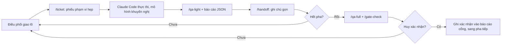

# SRS-09: Studio AI, quy trình, tiết kiệm token và bảo mật

| Mục | Nội dung |
|---|---|
| Mã tài liệu | SRS-09 |
| Phiên bản | 1.1 |
| Ngày | 23/11/2026 |
| Tài liệu cha | SRS-00 `SRS-00-TONG-QUAN.md` |
| BRD nguồn | BRD-09 v0.1; BRD-00 v0.5 mục 7.7–7.9 (BR-32…46); BRD-10 (BR-126, v1.1) |
| Phạm vi áp dụng | Quy trình **phát triển** engine và Web Studio bằng Claude Code (QĐ-02), không phải trải nghiệm người dùng Web Studio |
| Thành phần | `.claude/` (agent, skill, lệnh, rule, hook, template), `project.yaml`, `CLAUDE.md`, `UPSTREAM.md`, `LICENSES.md`, `docs/ADR/`, `engine doctor`, CI |
| Nhóm mã | `DEV` |
| Pha | E0 (thiết lập), áp dụng suốt dự án |
| Trạng thái | Đã duyệt (Huy, 22/11/2026); v1.1 bổ sung luồng làm tiếp và cập nhật game theo CR-01, Huy duyệt 23/11/2026 |

---

## 1. Giới thiệu

### 1.1 Mục đích
Đặc tả cấu hình và quy trình để mọi phiên Claude Code làm cùng một cách: gọn, theo phiếu và cổng, ít token, không lộ bí mật, giữ quan hệ sạch với bộ gốc `threejs-game-skills` (MIT).

### 1.2 Phạm vi
| Trong phạm vi | Ngoài phạm vi |
|---|---|
| Agent, skill, lệnh, rule đường dẫn, hook, template; `project.yaml` và mức rigor; phiếu, báo cáo cổng, ADR; `UPSTREAM.md`, LICENSE; tiết kiệm token; bí mật và khoá API ở máy dev; `engine doctor`; CI | Harness khác Claude Code (QĐ-02); cổng AI của Web Studio (SRS-08); phân quyền người dùng web (SRS-08) |

---

## 2. Mô tả chung

### 2.1 Cấu trúc repo (monorepo, đề xuất CH-09-02)
```
/engine/        runtime/ build/ schema/ cli/ qa/
/web/           app/ api/ worker/
/games/<id>/    (SRS-04 mục 6.1)
/prototypes/    thử nghiệm, rule nới lỏng
/docs/          BRD/ SRS/ TSD/ ADR/ DDD/ UIUX/ POC/ TEST/
/.claude/       agents/ skills/ commands/ rules/ hooks/ templates/
project.yaml  CLAUDE.md  UPSTREAM.md  LICENSE  LICENSES.md  .gitignore
```

### 2.2 Quy trình phiếu và cổng



### 2.3 Tác nhân
| Tác nhân | Vai trò |
|---|---|
| Huy | Chốt QĐ, xác nhận cổng |
| Phiên chat điều phối | Giao lô việc, đánh giá kết quả |
| Agent Claude Code | Thực thi phiếu theo vai (mục 4.1) |
| Hook | Kiểm tự động khi agent đọc/ghi/chạy lệnh |

---

## 3. Use case

| Mã | Tên | Tác nhân | Ưu tiên | Pha |
|---|---|---|---|---|
| UC-DEV-01 | Tạo và thực thi một phiếu | Điều phối, agent | M | E0 |
| UC-DEV-02 | Kiểm và xác nhận cổng | Agent `director`, Huy | M | E0 |
| UC-DEV-03 | Lấy bản mới của upstream | Agent `engine-dev` | S | Khi cần |
| UC-DEV-04 | Thiết lập máy/worker mới | Huy, agent | M | E0 |

### 3.1 UC-DEV-01 Tạo và thực thi phiếu
1. `/ticket <mục tiêu>` sinh phiếu theo mẫu (FR-DEV-07) vào `docs/tickets/T-<số>.md`.
2. Phiên Claude Code mới (`/clear`), đọc ghi chú dự án và phiếu, chỉ đọc file trong danh sách.
3. Thực thi; hook kiểm khi đọc/ghi (FR-DEV-18).
4. Chạy `/qa-light`; đính kèm báo cáo JSON và ảnh (nếu đổi hình) vào phiếu.
5. `/handoff` cập nhật ghi chú dự án, ghi token đã dùng (FR-DEV-19); cập nhật `UPSTREAM.md` nếu sửa file của bộ gốc (QT-DEV-04).

### 3.2 UC-DEV-02 Kiểm và xác nhận cổng
1. `/qa-full` cho mọi zone; Huy đo A56 (SRS-04 UC-QA-03).
2. `/gate-check G-Ex` tự kiểm điều kiện đo được của cổng, sinh báo cáo cổng theo mẫu (FR-DEV-09) với 2–4 ảnh, liệt kê điều kiện cần Huy xác nhận.
3. Huy trả lời "xác nhận" hoặc yêu cầu sửa; xác nhận được ghi vào báo cáo cổng (người, thời điểm). Chỉ khi đó cổng mới qua.

---

## 4. Yêu cầu chức năng

### 4.1 Thành phần `.claude/`

| Mã | Yêu cầu | Nguồn | Ưu tiên | Pha |
|---|---|---|---|---|
| FR-DEV-01 | Tối đa 8 agent: `director` (Opus), `engine-dev`, `tech-artist`, `world-builder`, `gameplay-ui` (Sonnet), `asset-designer` (Opus khi viết generator mới, Sonnet khi chỉnh tham số), `qa` (Sonnet/Haiku), `docs` (Haiku); mỗi agent có mô tả một đoạn và danh sách thư mục phụ trách | BR-32, BR-32.1 | M | E0 |
| FR-DEV-02 | Skill: giữ 8 skill bộ gốc (`threejs-game-director`, `threejs-gameplay-systems`, `threejs-aaa-graphics-builder`, `threejs-game-ui-designer`, `threejs-debug-profiler`, `threejs-qa-release`, `threejs-image-generator`, `threejs-audio-generator`), bỏ `threejs-3d-generator` (QĐ-08); thêm 10–15 skill engine (`engine-intake`, `engine-world`, `engine-asset-forge`, `engine-cc0`, `engine-texture-proc`, `engine-materials`, `engine-lighting-bake`, `engine-packager`, `engine-blender`, …) | BR-32 | M | E0 |
| FR-DEV-03 | Lệnh: `/start`, `/new-game`, `/ticket`, `/build-zone`, `/qa-light`, `/qa-full`, `/perf-snapshot`, `/visual-diff`, `/gate-check`, `/asset-recipe`, `/adr`, `/publish-poc`, `/handoff`; v1.1 thêm `/resume-game`, `/import-game` (FR-DEV-26, 27) | BR-32 | M | E0 |
| FR-DEV-04 | Rule theo đường dẫn: `engine/runtime/**` (không cấp phát trong vòng lặp nóng, chỉ API công khai), `engine/build/**` (tất định, seed, báo cáo JSON), `games/**/data/**` (không giá trị cứng ngoài dữ liệu, hợp lệ schema), `web/**` (không khoá API phía client, kiểm quyền ở backend), `prototypes/**` (nới lỏng) | BR-32 | M | E0 |

### 4.2 Mức rigor, phiếu, cổng, ADR, upstream

| Mã | Yêu cầu | Nguồn | Ưu tiên | Pha |
|---|---|---|---|---|
| FR-DEV-05 | `project.yaml` có `rigor: minimal\|standard\|full` mặc định và `overrides` theo hệ thống (đường dẫn); mặc định `minimal` đến G-E6 | BR-33, BR-33.1 | M | E0 |
| FR-DEV-06 | `web/api/**`, `web/worker/**`, cổng AI, mã xác thực và phân quyền đặt `standard` ngay từ W1: phiếu bắt buộc có test tự động và rà soát bảo mật ngắn | BR-33.2 | M | W1 |
| FR-DEV-07 | Mẫu phiếu: mục tiêu, phạm vi, file/module được đọc, file được sửa, tiêu chí xong, "Mô hình khuyến nghị" (mô hình + effort), bằng chứng cần nộp, token đã dùng (điền khi xong) | BR-34, BR-34.1 | M | E0 |
| FR-DEV-08 | Hướng dẫn chọn mô hình trong `CLAUDE.md` và mẫu phiếu: Opus (high/xhigh) cho kiến trúc, thuật toán mới, generator họ mới, cổng; Sonnet (medium) cho chỉnh tham số, script lặp, sửa nhỏ, test; Haiku cho đổi tên, tài liệu, việc cơ học | BR-34.2 | M | E0 |
| FR-DEV-09 | Mẫu báo cáo cổng: cổng, ngày, điều kiện và kết quả đạt/chưa từng điều kiện, số đo A56, 2–4 ảnh, rủi ro mở, đề xuất, ô "Huy xác nhận" (người, thời điểm) | BR-35, BR-35.1 | M | E0 |
| FR-DEV-10 | `/gate-check` tự kiểm điều kiện đo được (báo cáo ngân sách không Fail tier Vừa, QA đầy đủ Pass, provenance đủ…) và liệt kê điều kiện cần Huy xác nhận; cổng chỉ ghi "Đã qua" khi có xác nhận của Huy; xuất bản không phải duyệt | BR-35.2, QT-09-03 | M | E0 |
| FR-DEV-11 | ADR theo mẫu ngắn (bối cảnh, quyết định, hệ quả, phương án đã loại) trong `docs/ADR/`; ADR-001…015 tương ứng QĐ-01…15 viết ở E0 | BR-36, BR-36.1 | M | E0 |
| FR-DEV-12 | `UPSTREAM.md`: phiên bản/commit gốc đã fork, danh sách thay đổi theo file (thêm/sửa/xoá, lý do, phiếu), cách lấy bản mới | BR-37, BR-37.1 | M | E0 |
| FR-DEV-13 | Giữ nguyên `LICENSE` MIT và thông báo bản quyền của bộ gốc; ghi công tác giả trong `UPSTREAM.md` và credit | BR-37.2, BR-44, BR-44.1 | M | E0 |

### 4.3 Tiết kiệm token

| Mã | Yêu cầu | Nguồn | Ưu tiên | Pha |
|---|---|---|---|---|
| FR-DEV-14 | `CLAUDE.md` < 150 dòng: luật, cấu trúc thư mục, lệnh CLI, hướng dẫn chọn mô hình, chỉ dẫn tới ADR; CI báo lỗi khi vượt | BR-39, BR-39.1 | M | E0 |
| FR-DEV-15 | Ghi chú dự án gọn `docs/handoff.md` (ràng buộc, việc đã xong, asset đang chờ, bước tiếp; ≤ 150 dòng) cập nhật bằng `/handoff` cuối mỗi phiếu | BR-41, BR-41.1 | M | E0 |
| FR-DEV-16 | `/clear` giữa các phiếu; phiếu sau đọc ghi chú dự án thay vì lịch sử | BR-41.2 | M | E0 |
| FR-DEV-17 | MCP xem cảnh (Three.js, Blender) chỉ bật khi gỡ lỗi, không nằm trong cấu hình mặc định | BR-42, BR-42.1 | S | E0 |
| FR-DEV-18 | Hook theo bảng mục 6.3: chặn đọc nguyên `.md` > 40 KB (trả heading), chặn đọc nhị phân/log dài (gợi ý báo cáo JSON, `grep`, `tail`), cảnh báo khi ghi JSON dữ liệu sai schema, chặn đọc `.env`/bí mật và lệnh phá huỷ, nhắc `/perf-snapshot` khi sửa thư mục đồ hoạ | BR-38 | M | E0 |
| FR-DEV-19 | Đo token mỗi phiếu (từ thống kê phiên) và ghi vào phiếu + bảng `docs/metrics/tokens.csv` để tính BO-02 | BR-38.2 | M | E0 |
| FR-DEV-21 | Claude chỉ xem 2–4 ảnh khác biệt nhất khi qua cổng; ngoài ra đọc số liệu (SRS-04 QT-RTM-04) | BR-38.3 | M | E0 |

### 4.4 Bảo mật và tuân thủ

| Mã | Yêu cầu | Nguồn | Ưu tiên | Pha |
|---|---|---|---|---|
| FR-DEV-20 | Cố định phiên bản Node, Python, Blender, Sapling, A.N.T., công cụ nén trong `tools/versions.json`; `engine doctor` kiểm từng thành phần, báo đủ/thiếu/lệch, kiểm khoá API có mặt mà không in giá trị | BR-46, BR-46.1 | M | E0 |
| FR-DEV-22 | Khoá Gemini, ElevenLabs, Claude API đặt trong biến môi trường (máy dev) hoặc kho bí mật (server); script probe chỉ in "có / không có" | BR-43, BR-43.2 | M | E0 |
| FR-DEV-23 | `.gitignore` chặn `.env*`, khoá, cache dữ liệu lớn; quét bí mật trước commit (hook git) và trong CI | BR-43.3 | M | E0 |
| FR-DEV-24 | `LICENSES.md` liệt kê nguồn dữ liệu (OSM ODbL, Copernicus), thư viện (tên, license), dịch vụ (Gemini, ElevenLabs, Claude API), asset CC0 theo nhóm | BR-45, BR-45.3 | M | E0 |
| FR-DEV-25 | CI khi push: kiểm schema dữ liệu, lint, unit test, smoke test runtime, quét bí mật, kiểm số dòng `CLAUDE.md`; QA đầy đủ chạy trên worker (OI-DEV-03) | BR-28, CH-09-03 | S | E1 |

### 4.5 Làm tiếp và cập nhật game bằng Claude Code (v1.1, CR-01)

| Mã | Yêu cầu | Nguồn | Ưu tiên | Pha |
|---|---|---|---|---|
| FR-DEV-26 | Lệnh `/resume-game <id> [yêu cầu]`: chạy `engine status --json` (SRS-04 FR-CLI-08), đọc ghi chú handoff gần nhất của game, tóm tắt tiến độ trong ≤ 15 dòng và đề xuất phiếu tiếp theo (mục tiêu, file cần đọc, mô hình khuyến nghị); có `[yêu cầu]` thì sinh phiếu cho yêu cầu đó, phần mở rộng phạm vi cập nhật brief theo SRS-01 FR-INT-33; không đọc toàn bộ dữ liệu game | BR-126.1, BR-126.3, BR-32, BR-38 | M | E1 |
| FR-DEV-27 | Lệnh `/import-game <thư mục\|gói.zip>`: chạy `engine import` (SRS-04 FR-CLI-11), trình báo cáo kiểm; thiếu brief thì trình brief nháp để Huy xác nhận; cần nâng cấp thì đề xuất phiếu `engine upgrade` | BR-126.2, BR-32, BR-112 | S | E1 |

---

## 5. Quy tắc nghiệp vụ

| Mã | Quy tắc | Điều kiện, cách xử lý | Kết quả, ghi chú |
|---|---|---|---|
| QT-DEV-01 | Không tài liệu thiết kế dài trước prototype | Khi `rigor: minimal`, chỉ viết tài liệu khi pha cần (CH-13) | Nguồn QT-09-01 |
| QT-DEV-02 | Phiếu phạm vi hẹp | Phiếu có danh sách file được đọc và được sửa; sửa ngoài danh sách phải ghi lý do | Nguồn QT-09-02 |
| QT-DEV-03 | Cổng chỉ qua khi Huy xác nhận | Như FR-DEV-10 | Nguồn QT-09-03 |
| QT-DEV-04 | Ghi `UPSTREAM.md` cùng phiếu | KHI phiếu sửa file có nguồn từ bộ gốc THÌ cập nhật `UPSTREAM.md` trong cùng commit | Nguồn QT-09-04 |
| QT-DEV-05 | Không đọc file lớn/nhị phân | Như FR-DEV-18 | Nguồn QT-09-05 |
| QT-DEV-06 | Bí mật không ra ngoài | Không in khoá ra log, không ghi vào tài liệu, bộ nhớ dự án, ghi chú handoff | Nguồn QT-09-06 |

---

## 6. Dữ liệu và cấu hình

### 6.1 `project.yaml`
```yaml
rigor: minimal
overrides:
  - path: web/api/**
    rigor: standard
  - path: web/worker/**
    rigor: standard
budgetsDefault: games/_template/data/budgets.json
targetDevice: galaxy-a56
tiers: [thap, vua, cao, toi_da]
gates: [G-E0, G-E1, G-E2, G-E3, G-E4, G-E5, G-E6, G-E7, G-E8, G-W1, G-W2, G-W3, G-W4]
```

### 6.2 Mức rigor
| Mức | Bắt buộc |
|---|---|
| `minimal` | Báo cáo JSON, `/qa-light`, ảnh khi đổi hình |
| `standard` | Thêm: unit test cho logic mới, review mã bởi agent khác, ghi ADR khi đổi kiến trúc |
| `full` | Thêm: QA đầy đủ mỗi phiếu, kiểm thử bảo mật/tải khi liên quan |

### 6.3 Hook
| Hook | Sự kiện | Loại | Hành vi / thông báo |
|---|---|---|---|
| H-01 | Đọc `.md` > 40 KB không chỉ định đoạn | Chặn | ERR-DEV-01, trả danh sách heading |
| H-02 | Đọc `.glb`, `.ktx2`, `.png/.jpg` > 1 MB, `.log` > 2.000 dòng | Chặn | ERR-DEV-02, gợi ý báo cáo JSON, `grep`, `tail` |
| H-03 | Ghi `games/**/data/**/*.json` | Cảnh báo | Chạy kiểm schema, báo trường sai |
| H-04 | Đọc `.env*`, `*.key`, thư mục bí mật; lệnh `rm -rf /`, `git push --force` lên nhánh chính | Chặn | ERR-DEV-03 |
| H-05 | Sửa `engine/runtime/render/**`, shader, vật liệu, `budgets.json` | Cảnh báo | Nhắc `/perf-snapshot` (SRS-04 QT-RTM-02) |

---

## 7. Giao diện
Không có màn hình. Giao diện là lệnh Claude Code (FR-DEV-03), CLI `engine doctor`, template trong `.claude/templates/` (phiếu, ADR, style bible, spec zone, spec công trình, báo cáo cổng).

---

## 8. Mã lỗi (thông báo của hook và doctor)

| Mã | Điều kiện | Thông báo |
|---|---|---|
| ERR-DEV-01 | H-01 | "File lớn (<n> KB). Đọc theo mục: <danh sách heading>." |
| ERR-DEV-02 | H-02 | "File nhị phân/log dài. Dùng báo cáo JSON hoặc grep/tail." |
| ERR-DEV-03 | H-04 | "Không được đọc file bí mật hoặc chạy lệnh phá huỷ." |
| ERR-DEV-04 | `doctor` lệch phiên bản | "<thành phần>: cần <bản>, đang có <bản>." |
| ERR-DEV-05 | `doctor` thiếu khoá | "Thiếu biến môi trường <TÊN> (không hiển thị giá trị)." |

---

## 9. Yêu cầu phi chức năng

| Mã | Yêu cầu | Cách kiểm |
|---|---|---|
| NFR-DEV-01 | Token trung bình mỗi phiếu giảm ≥ 50% so với Thiền viện online (đề xuất, BO-02) | `tokens.csv` ở G-E8 |
| NFR-DEV-02 | Hook chạy ≤ 1 s mỗi lần gọi | Đo |
| NFR-DEV-03 | Số hook "chặn" ≤ 3 | Đếm cấu hình (RR-06) |

---

## 10. Tiêu chí chấp nhận

| AC BRD | Yêu cầu SRS | Cách kiểm |
|---|---|---|
| AC-09-01 | FR-DEV-01, 02 | Đếm: ≤ 8 agent; 8 skill gốc + 10–15 skill engine |
| AC-09-02 | FR-DEV-18 (H-01) | Đọc nguyên `.md` 60 KB → chặn, trả heading |
| AC-09-03 | FR-DEV-18 (H-04) | Đọc `.env` → chặn |
| AC-09-04 | FR-DEV-07 | `/ticket` → có "Mô hình khuyến nghị" và danh sách file |
| AC-09-05 | FR-DEV-09, 10 | `/gate-check` cuối pha → báo cáo theo mẫu, có số đo A56 |
| AC-09-06 | FR-DEV-20, 22 | Máy mới chạy `engine doctor` → báo đủ/thiếu, không in khoá |
| AC-CR01-12 (v1.1) | FR-DEV-26 | `/resume-game lang-que` trên game dở → tóm tắt ≤ 15 dòng có giai đoạn và việc tiếp theo, đề xuất phiếu; log hook không có lượt đọc file dữ liệu game ngoài báo cáo tiến độ |

---

## 11. Open item

| Mã | Câu hỏi | Đề xuất | Nguồn |
|---|---|---|---|
| OI-DEV-01 | Tách agent `web-dev` | Có khi bắt đầu W2, giao `docs` cho Haiku qua skill | CH-09-01 |
| OI-DEV-02 | Monorepo hay tách repo | Monorepo đến E8 | CH-09-02 |
| OI-DEV-03 | CI | Có: smoke + kiểm schema; QA đầy đủ trên worker | CH-09-03 |
| OI-DEV-04 | Số liệu nền token và thời gian build của Thiền viện online | Lấy từ lịch sử phiếu; nếu không có đo ở E0–E1 | CH-04 |

---

## 12. Truy vết

| BR | Yêu cầu SRS |
|---|---|
| BR-32 (BR-32.1) | FR-DEV-01…04 |
| BR-33 (BR-33.1…2) | FR-DEV-05, 06 |
| BR-34 (BR-34.1…2) | FR-DEV-07, 08 |
| BR-35 (BR-35.1…2) | FR-DEV-09, 10 |
| BR-36 (BR-36.1) | FR-DEV-11 |
| BR-37 (BR-37.1…2) | FR-DEV-12, 13 |
| BR-38 (BR-38.2…3) | FR-DEV-18, 19, 21 |
| BR-39 (BR-39.1) | FR-DEV-14 |
| BR-41 (BR-41.1…2) | FR-DEV-15, 16 |
| BR-42 (BR-42.1) | FR-DEV-17 |
| BR-43 (BR-43.2…3) | FR-DEV-22, 23 |
| BR-44 (BR-44.1) | FR-DEV-13 |
| BR-45 (BR-45.3) | FR-DEV-24 |
| BR-46 (BR-46.1) | FR-DEV-20 |
| BR-126 (BRD-10, CR-01; v1.1) | FR-DEV-26, 27 |

## 13. Lịch sử thay đổi

| Phiên bản | Ngày | Người | Nội dung |
|---|---|---|---|
| 0.1 | 22/11/2026 | Claude | Bản đầu từ BRD-09 v0.1 |
| 1.0 | 22/11/2026 | Claude | Huy duyệt; chấp nhận các giá trị "(đề xuất)" và đề xuất của Open item làm giá trị nền; đổi trạng thái sang Đã duyệt |
| 1.1 | 23/11/2026 | Claude | CR-01 (Huy yêu cầu 23/11/2026: luồng xây dựng cho game đang làm dở hoặc đã có): thêm mục 4.5 FR-DEV-26 `/resume-game`, FR-DEV-27 `/import-game`, mở rộng FR-DEV-03, AC-CR01-12; Huy duyệt 23/11/2026 (giá trị "(đề xuất)" mới được chấp nhận làm giá trị nền) |
