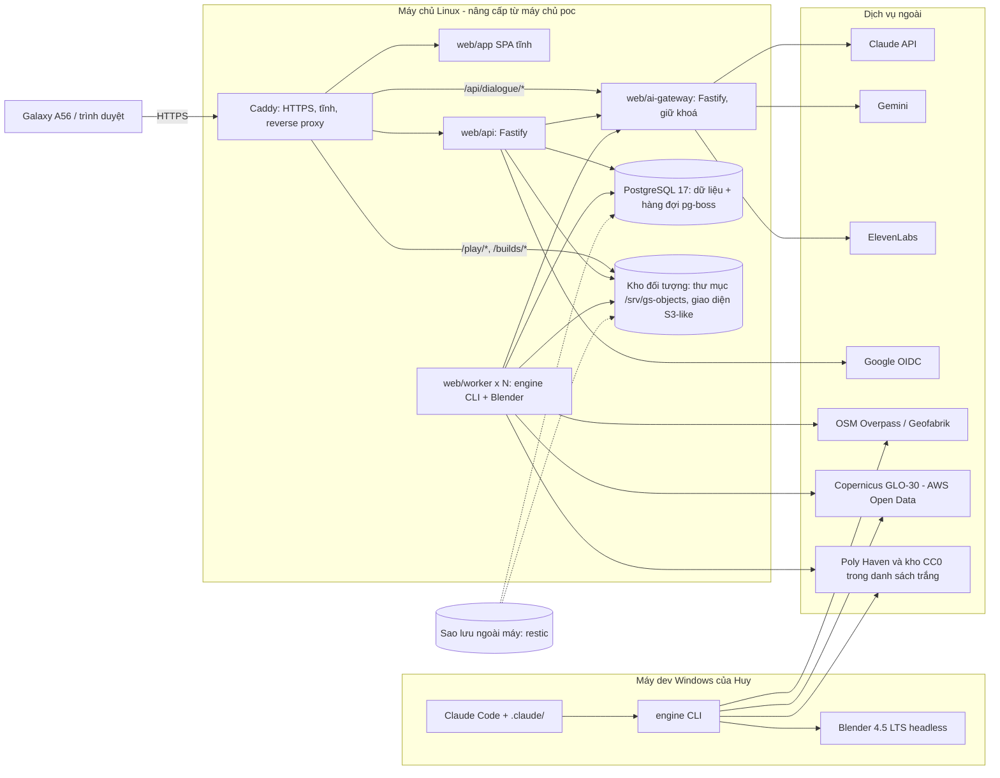
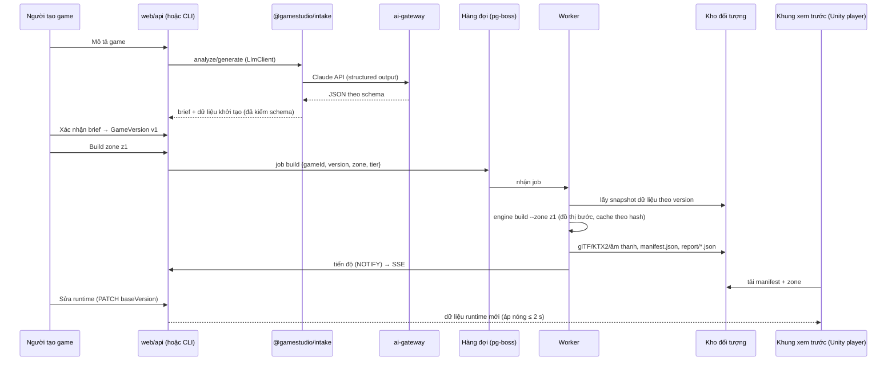
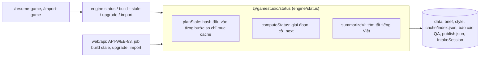
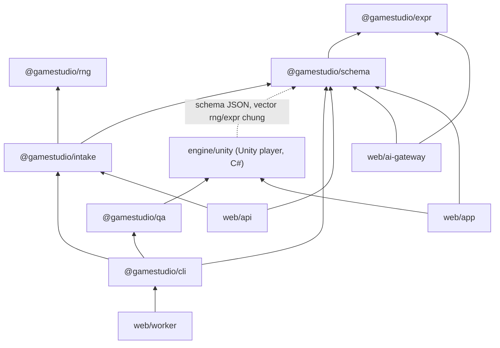

# TSD tổng quan: Engine web game 3D dùng lại được (GameStudio)

| Mục | Nội dung |
|---|---|
| Mã tài liệu | TSD-00 |
| Phiên bản | 1.4 |
| Ngày | 22/11/2026 |
| Chủ sở hữu / người duyệt | Huy |
| Người soạn | Claude |
| Nguồn | SRS-00 v0.1 và SRS-01…09 v0.1 (328 FR); BRD-00 v0.5, BRD-01…09 v0.1; `GAME-ENGINE-WEB3D-BRIEF.md` bản 6 |
| Quyết định áp dụng | QĐ-01…15; CH-23 (chỉ người dùng nội bộ được mời). Ba quyết định đã chốt chi phối TSD: chiến đấu/săn bắt là module tuỳ chọn mặc định tắt (QĐ-13); hội thoại NPC tĩnh, AI khi chạy là tuỳ chọn và chỉ đi qua cổng AI phía server (QĐ-14); Web Studio riêng, chỉ người được mời (QĐ-15) |
| Trạng thái | Đã duyệt (Huy, 22/11/2026; bản 1.2 gồm CR-01 duyệt 23/11/2026); **v1.3 runtime Unity theo CR-02** (Huy duyệt phân tích 25/11/2026), chờ Huy xem lại; v1.4 ngân sách tải theo POC-U1, Huy chốt 26/11/2026 |

> TSD giữ tinh thần gọn của BRD/SRS (`rigor: minimal`): đủ để Claude Code viết phiếu, chọn file, viết test và để Huy chốt ADR. Lựa chọn công nghệ là **quyết định kỹ thuật (TD)**; TD-01…18 đã được Huy chốt ngày 22/11/2026 và ghi thành ADR-016…033 trong `docs/ADR/`. TD mới về sau phải được Huy chốt và ghi ADR trước khi dùng làm căn cứ phiếu. Con số còn ghi ở SRS giữ nguyên nhãn đó ở đây; TSD không tự chốt số.

### Danh mục TSD

| Mã | Tài liệu | SRS nguồn | Nhóm mã | Module / gói chính |
|---|---|---|---|---|
| TSD-00 | TSD tổng quan (tài liệu này) | SRS-00 | `GEN` | Kiến trúc, stack, triển khai, bảo mật, ngân sách, kiểm thử chung |
| TSD-00-PL-A | [Ma trận truy vết SRS → TSD](TSD-00-PL-A-MA-TRAN-TRUY-VET.md) (sinh tự động) | SRS-01…09 | — | — |
| TSD-01 | [Tạo game từ mô tả](TSD-01-TAO-GAME-TU-MO-TA.md) | SRS-01 | `INT` | `@gamestudio/intake` |
| TSD-02 | [Thế giới, địa hình và môi trường](TSD-02-THE-GIOI-DIA-HINH-MOI-TRUONG.md) | SRS-02 | `WLD` | `engine/build/world`, `terrain`, `water`, `vegetation`, `placement`, `lighting`; runtime `fx` |
| TSD-03 | [Asset 3D, vật liệu và âm thanh](TSD-03-ASSET-VAT-LIEU-AM-THANH.md) | SRS-03 | `AST` | `asset-import`, `asset-forge`, `kit-builder`, `materials`, `audio` |
| TSD-04 | [Runtime, hiệu năng và QA](TSD-04-RUNTIME-HIEU-NANG-QA.md) | SRS-04 | `RTM`, `QA`, `CLI` | Unity player `engine/unity`, `schema`, `packager`, `qa`, `cli` |
| TSD-05 | [Nhân vật, NPC và động vật](TSD-05-NHAN-VAT-NPC-DONG-VAT.md) | SRS-05 | `CHR` | `characters`, `npc-ai`, `navmesh` |
| TSD-06 | [Chiến đấu và săn bắt (tuỳ chọn)](TSD-06-CHIEN-DAU-SAN-BAT.md) | SRS-06 | `CBT` | module `Combat` trong Unity player (bật bằng dữ liệu) |
| TSD-07 | [Hội thoại NPC](TSD-07-HOI-THOAI-NPC.md) | SRS-07 | `DLG` | `interaction/dialogue`, `dialogue-ai` (chunk riêng), dịch vụ hội thoại trong cổng AI |
| TSD-08 | [Web Studio](TSD-08-WEB-STUDIO.md) | SRS-08 | `WEB` | `web/app`, `web/api`, `web/worker`, `web/ai-gateway` |
| TSD-09 | [Studio AI, quy trình, bảo mật dev](TSD-09-STUDIO-AI-QUY-TRINH-BAO-MAT.md) | SRS-09 | `DEV` | `.claude/`, `project.yaml`, `engine doctor`, CI |

---

## 1. Giới thiệu

### 1.1 Mục đích
TSD mô tả **cách xây** hệ thống mà SRS đã đặc tả **phải làm gì**: kiến trúc kỹ thuật, lựa chọn công nghệ, cấu trúc gói/thư mục, schema dữ liệu, hợp đồng giao diện, thuật toán, ngân sách hiệu năng trên Galaxy A56, bảo mật, triển khai và kiểm thử. TSD-00 chứa phần dùng chung; TSD-01…09 đi sâu từng module và truy vết tới từng FR.

### 1.2 Đối tượng đọc
Huy (duyệt, chốt TD thành ADR), phiên chat điều phối (cắt phiếu theo pha), agent Claude Code (`engine-dev`, `tech-artist`, `world-builder`, `asset-designer`, `gameplay-ui`, `qa`, `docs`, `web-dev` khi tách), người soạn TEST.

### 1.3 Quy ước mã của TSD

TSD **không định nghĩa lại** mã của SRS (FR, NFR, QT, UC, SCR, API, ERR); chỉ tham chiếu. Mã mới của TSD:

| Loại | Mẫu | Ví dụ | Ghi chú |
|---|---|---|---|
| Quyết định kỹ thuật | `TD-nn` | TD-07 | Chỉ ở TSD-00; Huy chốt → ADR-016+ (cột "ADR"; TD-01…18 đã chốt 22/11/2026) |
| Thuật toán | `ALG-<NHÓM>-nn` | ALG-WLD-03 | Mô tả bước, độ phức tạp, tham số, tính tất định |
| Schema / cấu trúc dữ liệu | `SCH-<NHÓM>-nn` | SCH-WEB-04 | JSON Schema, bảng CSDL, định dạng file |
| Giao diện lập trình nội bộ | `IF-<NHÓM>-nn` | IF-RTM-02 | Interface TypeScript/Python, giao thức giữa tiến trình. API ra ngoài vẫn dùng mã `API-` của SRS |
| Kiểm thử kỹ thuật | `TST-<NHÓM>-nn` | TST-CHR-05 | Unit/integration/e2e/perf; TEST sinh test case chi tiết từ đây và từ AC của SRS |
| Open item kỹ thuật | `OIT-<NHÓM>-nn` | OIT-RTM-02 | Câu hỏi kỹ thuật cần đo hoặc Huy chốt |

Nhóm `GEN` dùng cho mã chung trong TSD-00. Trạng thái số liệu: không ghi = đã chốt ở SRS (Huy duyệt SRS ngày 22/11/2026, các số trước đây ghi "(đề xuất)" đã chốt); **(TSD đề xuất)** = số do TSD đưa ra để thiết kế, đã duyệt cùng TSD, hiệu chỉnh theo số đo thực qua phiếu; số SRS còn để mở theo open item thì ghi mã OI.

### 1.4 Tài liệu liên quan
SRS-00…09 (`docs/SRS/`), BRD-00…09 (`docs/BRD/`), brief bản 6, ADR-001…015 (viết ở E0, SRS-09 FR-DEV-11), ADR-016…033 (`docs/ADR/`, từ TD-01…18 đã chốt), `docs/UIUX/` (wireframe W1/W3), `docs/TEST/`.

---

## 2. Kiến trúc tổng thể

### 2.1 Sơ đồ triển khai (To-Be)



Nguyên tắc: **một máy chủ Linux** (GĐ-WEB-01, OI-WEB-06), các dịch vụ chạy bằng Docker Compose; tách tiến trình theo ranh giới tin cậy chứ không theo quy mô: khoá dịch vụ AI chỉ nằm trong `ai-gateway`; worker chạy Blender và mã build trong container riêng không có khoá AI, không có quyền ghi CSDL ngoài bảng job.

### 2.2 Ba tầng và các gói

| Tầng | Gói / thư mục | Ngôn ngữ | Chạy ở | TSD |
|---|---|---|---|---|
| Dữ liệu dùng chung | `engine/schema` (`@gamestudio/schema`), `engine/shared/expr` (`@gamestudio/expr`), `engine/shared/rng` (`@gamestudio/rng`) | TS (+ bản Python cho rng) | Mọi nơi | 04, 05, 06, 07 |
| Tiếp nhận | `engine/intake` (`@gamestudio/intake`) | TS | CLI (máy dev), `web/api` | 01 |
| Build offline | `engine/build/*` (bước build), `engine/build/py/*` (Python), `engine/build/blender/*` (script Blender) | TS điều phối; Python 3.12; Blender Python | Máy dev, worker | 02, 03, 04, 05 |
| Runtime | `engine/unity` (Unity player chung, CR-02), module tuỳ chọn `Combat` bật bằng dữ liệu | C# + HLSL/Shader Graph (URP) | Trình duyệt (nền Web của Unity) | 04, 05, 06, 07, 02 (fx) |
| QA | `engine/qa` (`@gamestudio/qa`) | TS (Playwright) | Máy dev, worker, CI | 04 |
| CLI | `engine/cli` (`@gamestudio/cli`, lệnh `engine`) | TS | Máy dev, worker | 04 |
| Web | `web/app`, `web/api`, `web/worker`, `web/ai-gateway`, `web/shared` | TS (React ở app) | Máy chủ, trình duyệt | 08, 07 |
| Studio AI | `.claude/`, `project.yaml`, `tools/versions.json` | Markdown, JSON, script hook | Máy dev | 09 |

### 2.3 Luồng dữ liệu đầu-cuối



### 2.4 Nguyên tắc kỹ thuật bắt buộc (cụ thể hoá SRS-00 mục 2.3)

| # | Nguyên tắc SRS | Cách hiện thực |
|---|---|---|
| 1 | Một nguồn sự thật (QT-GEN-01) | Bộ JSON `games/<id>/data/**` + JSON Schema 2020-12; trên web lưu snapshot JSON theo `GameVersion` (TSD-08 SCH-WEB-03); mọi ghi là JSON Patch RFC 6902 qua một hàm `applyPatch` dùng chung (`@gamestudio/schema/patch`) |
| 2 | Engine là Unity player có phiên bản (CR-02) | Một bản Unity Web build cho mỗi semver, đặt ở `/engine/<semver>/` (loader, `.wasm`, `.data`, `.framework.js` nén Brotli); bản xuất bản và khung xem trước nạp đúng bản ghi trong `manifest.engineVersion` (TSD-04 IF-RTM-01). Game là gói dữ liệu, không build Unity theo từng game |
| 3 | Việc nặng trên worker, cùng CLI | Worker chỉ gọi `engine …` qua tiến trình con; không có đường build thứ hai (TSD-08 ALG-WEB-03) |
| 4 | `game-intake` viết một lần | Gói `@gamestudio/intake` không phụ thuộc Node API đặc thù server; `LlmClient` tiêm từ ngoài (TSD-01 IF-INT-01) |
| 5 | Khoá chỉ ở server | Khoá chỉ là biến môi trường của container `ai-gateway`; CI quét bí mật trên mã nguồn và trên thư mục bản build (TSD-09 TST-DEV-04) |
| 6 | Tất định | PCG32 + suy seed SHA-256 (ALG-GEN-01), bước thời gian cố định ở chế độ test, sắp xếp ổn định mọi danh sách trước khi băm, `numpy` một luồng ở bước Python |
| 7 | Tuỳ chọn mặc định tắt, không chi phí khi tắt | `combat` và `dialogue-ai` là entry `import()` động; `packager` chỉ chép chunk khi cờ bật; test kiểm danh sách file gói (TSD-06 TST-CBT-01) |

### 2.5 Luồng làm tiếp và cập nhật game (CR-01, SRS-00 mục 4.4)

Ba trường hợp (đang làm dở, cập nhật game đã có, nhập game có sẵn) dùng **một** cơ chế: tính báo cáo tiến độ → làm việc còn thiếu → build phần cũ → QA nhẹ → xuất bản bản số mới. Không có đường build riêng cho game cũ.



- Gói mới `@gamestudio/status` (TS, thuần, không I/O trực tiếp): nhận `StatusSources` (bộ đọc trừu tượng) nên CLI đọc từ thư mục `games/<id>/`, `web/api` đọc từ CSDL + kho đối tượng (ALG-GEN-05). Bộ điều phối build trong `engine/cli` dùng chính `planStale` để quyết định bước chạy, nên "cần build" trên báo cáo luôn khớp với việc build sẽ làm.
- Báo cáo tiến độ `status/1` (SCH-GEN-07) không lưu (QT-WEB-11); làm tiếp không làm lại việc đã xong vì cache theo hash (QT-GEN-11); cập nhật không phá bản cũ vì xuất bản luôn tạo bản mới và nâng cấp chạy trên bản sao (QT-GEN-12).
- Chi tiết: TSD-01 mục 5.2 (phiên tạo game dở, brief suy ngược, cập nhật brief), TSD-04 mục 5.3 (CLI), TSD-08 mục 5.1 (web), TSD-09 ALG-DEV-11, 12 (lệnh Claude Code).

---

## 3. Quyết định kỹ thuật (Huy đã chốt 22/11/2026)

| Mã | Chủ đề | Quyết định | Lý do chính | Phương án đã loại | ADR |
|---|---|---|---|---|---|
| TD-01 | Monorepo và công cụ | Monorepo (OI-DEV-02); **pnpm workspaces** cho TS, **uv** cho Python; không dùng Turborepo/Nx ở bản đầu, chạy song song bằng `pnpm -r` | Ít bề mặt; một lockfile; Claude Code dễ đọc | Nx/Turborepo (thêm cấu hình), nhiều repo (khó đồng bộ schema) | ADR-016 |
| TD-02 | Phiên bản nền | Node **24 LTS**, TypeScript 5.x (strict), Python **3.12**, **Blender 4.5 LTS** + Sapling Tree Gen + A.N.T. Landscape (extension cố định bản), Three.js bản cố định tại E0; tất cả ghi trong `tools/versions.json` **CR-02 (ADR-036):** bỏ Three.js; thêm Unity 6 LTS (Editor chỉ trên máy dev) và gói glTFast, Meshopt decompress, KTX for Unity cố định bản trong `tools/versions.json`. | LTS đủ dài cho dự án; Blender 4.5 LTS hỗ trợ tới 2027 | Blender bản thường (đổi API nhanh) | ADR-017, ADR-036 |
| TD-03 | Runtime đồ hoạ | **Three.js WebGLRenderer (WebGL2)**; không dùng WebGPU ở bản đầu; GLSL riêng cho địa hình, nước, cỏ, impostor qua `onBeforeCompile` / `ShaderMaterial` **CR-02 (ADR-036):** thay toàn bộ: Unity 6 LTS, URP, nền Web (WebGL2); shader riêng bằng Shader Graph/HLSL; không WebGPU ở bản đầu. | GD-01; A56 chạy ổn WebGL2; scaffold gốc dùng WebGL | WebGPURenderer (chưa đủ ổn định trên Chrome Android cho toàn bộ tính năng) | ADR-018, ADR-036 |
| TD-04 | Kiến trúc runtime | "Hệ thống" có `init/update(dt)/dispose` theo thứ tự cố định (SRS-04 mục 2.1) + kho thành phần dạng mảng kiểu (SoA, `Float32Array`) cho NPC/động vật/đạn; không dùng thư viện ECS ngoài **CR-02 (ADR-036):** giữ ý tưởng hệ thống thứ tự cố định + dữ liệu động dạng mảng struct/`NativeArray` trong một `MonoBehaviour` điều phối, viết bằng C#; không dùng DOTS/ECS. | Không cấp phát trong vòng lặp nóng (FR-RTM-23); ít phụ thuộc | bitecs/miniplex (thêm khái niệm, lợi ích nhỏ ở quy mô ≤ 300 thực thể động) | ADR-019, ADR-036 |
| TD-05 | Va chạm, điều hướng | **three-mesh-bvh** (MIT) cho truy vấn tia/khối với hình tĩnh; bộ điều khiển nhân vật viên nang tự viết; **recast-navigation-js** (MIT, WASM) để dựng navmesh ở build và truy vấn/đám đông (DetourCrowd) ở runtime **CR-02 (ADR-036):** thay toàn bộ: Unity Physics (PhysX tích hợp; `MeshCollider` tĩnh, `CharacterController`/`CapsuleCast`), Unity AI Navigation dựng NavMesh lúc nạp zone, `NavMeshAgent` thay DetourCrowd. | Navmesh chuẩn ngành, RVO sẵn có; tránh engine vật lý nặng | Rapier/Ammo (nặng, không cần vật lý đầy đủ), A* lưới tự viết (kém với địa hình dốc) | ADR-020, ADR-036 |
| TD-06 | Dữ liệu và schema | JSON Schema **draft 2020-12**; **Ajv** (MIT) biên dịch sẵn (standalone) cho runtime; kiểu TS sinh từ schema (`json-schema-to-typescript`); Python nhận dữ liệu đã kiểm từ bộ điều phối, không kiểm lại | Một bộ kiểm cho CLI, runtime, intake, editor (FR-RTM-01) | Zod làm nguồn (khó dùng từ Python, khó xuất JSON Schema chuẩn) | ADR-021 |
| TD-07 | Biểu thức an toàn | Gói `@gamestudio/expr`: lexer + Pratt parser → AST → hàm đóng (closure); không `eval`/`Function`; một ngữ pháp cho điều kiện tương tác, graph hành vi, cây thoại, công thức sát thương | FR-RTM-20, FR-CHR-16, FR-DLG-02, FR-CBT-07 dùng chung | jsep + tự đánh giá (phụ thuộc ngoài, khó giới hạn hàm) | ADR-022 |
| TD-08 | Điều phối build | Bộ chạy bước TS trong `engine/cli`: mỗi bước khai báo `step.json` (phụ thuộc, bộ chọn đầu vào, `runner: node \| python \| blender`); giao thức tiến trình con JSON vào/ra (TSD-04 IF-CLI-02); cache nội dung theo SHA-256 | Build tăng dần (FR-CLI-02), một CLI cho dev và worker | Make/Bazel (khó đọc, Windows), Python làm điều phối (tách xa runtime TS) | ADR-023 |
| TD-09 | Nén asset | **glTF-Transform** (MIT) cho dedup, gộp, instancing (`EXT_mesh_gpu_instancing`), Meshopt (`EXT_meshopt_compression`), Draco tuỳ chọn; **KTX-Software** (`ktx create`, Apache-2.0) cho KTX2 UASTC/ETC1S; **ffmpeg** (bản LGPL) + libopus cho âm thanh **CR-02 (ADR-036):** giữ định dạng glTF + Meshopt + KTX2; runtime giải mã bằng glTFast + Meshopt decompress + KTX for Unity; âm thanh AAC làm dự phòng nếu Opus không đều trên nền Web (POC-U1). | Chuẩn mở, chạy CLI được trên Windows/Linux | gltfpack đơn thuần (ít kiểm soát vật liệu), Basis CLI riêng | ADR-024, ADR-036 |
| TD-10 | Địa hình | Python: `numpy`, `rasterio` (GeoTIFF COG), `pyproj` (UTM), `shapely`, `numba` (xói mòn, chế độ một luồng, tất định); DEM từ **Copernicus GLO-30 trên AWS Open Data** (COG công khai); OSM qua **Overpass API** có cache, dự phòng trích từ **Geofabrik** (`osmium`) | Đủ cho bbox ≤ 4 km²; COG đọc theo cửa sổ | GDAL toàn phần trong TS; dịch vụ tile thương mại | ADR-025 |
| TD-11 | Bake ánh sáng | **Blender Cycles CPU** bake lightmap + AO vào UV2, khử nhiễu OpenImageDenoise, mã hoá **RGBM 8 bit** rồi nén KTX2 UASTC **CR-02 (ADR-036):** giữ bake Blender; hiển thị lightmap RGBM bằng shader URP riêng ở UV2, không dùng lightmapper Unity. | Không có GPU (CH-07); RGBM chạy mọi thiết bị | Lightmapper WebGL tự viết (chất lượng thấp), HDR KTX2 (hỗ trợ thiết bị không đều) | ADR-026, ADR-036 |
| TD-12 | Frontend Web Studio | **React 19 + Vite + TypeScript**, TanStack Query (dữ liệu máy chủ), Zustand (trạng thái editor + hoàn tác), **Tailwind CSS + Radix UI**, **@xyflow/react** (sơ đồ hành vi, cây thoại), Monaco (JSON thô W4); khung xem trước nhúng trực tiếp `@gamestudio/engine` (không dùng react-three-fiber) **CR-02 (ADR-036):** khung xem trước nhúng Unity player (`createUnityInstance`); `EditorBridge` gọi `SendMessage` và nhận sự kiện qua `.jslib`; gizmo, chọn, vẽ địa hình làm trong player. | Xem trước phải là đúng engine xuất bản (FR-WEB-16) | Vue/Svelte (Claude Code quen React hơn trong scaffold), R3F (tạo lớp engine thứ hai) | ADR-027, ADR-036 |
| TD-13 | Backend | **Fastify** (Node 24, TS) cho `web/api` và `web/ai-gateway`; **PostgreSQL 17** + **Drizzle ORM** (migration SQL có phiên bản); hàng đợi **pg-boss** (không cần Redis); tiến độ qua `LISTEN/NOTIFY` → SSE | Dùng lại gói TS của engine (intake, schema, expr, impact); một CSDL cho ≤ 20 người, ≤ 5 job | Python API (phải viết lại intake), Redis + BullMQ (thêm dịch vụ) | ADR-028 |
| TD-14 | Kho đối tượng | Giao diện `ObjectStore` (get/put/list/presign); cài đặt **thư mục cục bộ** `/srv/gs-objects` do Caddy phục vụ tĩnh; có thể đổi sang S3/MinIO bằng cấu hình | Một máy chủ; ít dịch vụ; GĐ-WEB-02 cho phép | MinIO ngay từ W1 (thêm vận hành) | ADR-029 |
| TD-15 | Xác thực | Google OIDC (`openid-client`), phiên **opaque** lưu trong PostgreSQL (cookie `HttpOnly; Secure; SameSite=Lax`), không JWT cho người dùng web; JWT HS256 chỉ cho token phiên chơi hội thoại và token đo | Khoá tài khoản huỷ phiên ≤ 1 phút (FR-WEB-03) | JWT phiên người dùng (khó thu hồi) | ADR-030 |
| TD-16 | Dịch vụ AI | SDK chính thức `@anthropic-ai/sdk`; mặc định `claude-opus-5-5` cho tiếp nhận/đề xuất thay đổi/viết nháp kịch bản, `claude-haiku-5-5` cho hội thoại NPC (mô hình nhỏ, OI-DLG-04); đầu ra JSON bằng **structured outputs** (`output_config.format`); `@google/genai` cho Gemini; ElevenLabs qua REST; mô hình theo loại việc cấu hình được trên SCR-WEB-13 | Mô hình mạnh nhất cho phần cần suy luận, mô hình nhỏ cho phần đông lượt | Gọi trực tiếp từ client (vi phạm QT-GEN-04) | ADR-031 |
| TD-17 | Triển khai | **Docker Compose** trên Ubuntu Server 24.04 LTS; **Caddy** (HTTPS tự động, HSTS); sao lưu **restic** ra vị trí ngoài máy; giám sát bằng endpoint `/healthz` + Uptime Kuma | Một máy chủ, ít vận hành | Kubernetes (quá tải cho quy mô) | ADR-032 |
| TD-18 | QA | **Playwright** + Chromium; SSIM bằng `ssim.js`, khác pixel bằng `pixelmatch`; thống kê render từ `renderer.info` + `EXT_disjoint_timer_query_webgl2` khi có **CR-02 (ADR-036):** giữ Playwright; thống kê render lấy từ player (`ProfilerRecorder`, `FrameTimingManager`) qua `.jslib`; test C# bằng Unity Test Framework chạy batchmode trên máy dev. | Theo bộ gốc threejs-game-skills | Puppeteer (bộ gốc đã dùng Playwright) | ADR-033, ADR-036 |

---

## 4. Cấu trúc repo và gói

### 4.1 Cây thư mục

```
/engine/
  schema/            @gamestudio/schema   JSON Schema, kiểu sinh, bộ kiểm, patch, migrate
  shared/rng/        @gamestudio/rng      PCG32, suy seed (TS) + engine/build/py/gsrng.py (Python, cùng vector chuẩn)
  shared/expr/       @gamestudio/expr     biểu thức an toàn
  intake/            @gamestudio/intake   SRS-01
  unity/             Unity player (C#, CR-02): Assets/GameStudio/{Core, Render, CameraPlayer, Fx, Interaction, UiAudio,
                                         Characters, NpcAi, Combat, Dialogue, Editor, Shared/Rng, Shared/Expr}, Tests/
  build/
    steps/<bước>/    step.json + mã bước (index.ts | main.py | blender.py)
    py/              gói Python dùng chung (gsrng, heightfield, io)
    blender/         script headless dùng chung (khởi tạo cảnh, xuất glTF)
    packager/        SRS-04 FR-CLI-04
  qa/                @gamestudio/qa
  cli/               @gamestudio/cli      lệnh `engine`
  status/            @gamestudio/status   tiến độ game, planStale, summarizeVi (CR-01, mục 2.5)
/web/
  app/               SPA React
  api/               Fastify API
  ai-gateway/        Fastify, giữ khoá
  worker/            vòng nhận job, gọi `engine`
  shared/            kiểu DTO, mã lỗi, ma trận quyền
  deploy/            compose.yaml, Caddyfile, Dockerfile.*
/games/_template/    dữ liệu mẫu cho `engine new-game`
/games/<id>/         SRS-04 mục 6.1
/prototypes/
/docs/               BRD SRS TSD ADR DDD UIUX POC TEST tickets metrics
/.claude/            agents skills commands rules hooks templates
/tools/              versions.json, scripts (probe, secret-scan)
project.yaml  CLAUDE.md  UPSTREAM.md  LICENSE  LICENSES.md  pnpm-workspace.yaml  pyproject.toml
```

### 4.2 Quan hệ phụ thuộc giữa gói (không được tạo vòng)



Luật lint (`eslint-plugin-boundaries` hoặc `dependency-cruiser` trong CI): `engine/unity/**` không phụ thuộc gói TS (chỉ đọc schema JSON và vector kiểm chung); game không có mã riêng (FR-RTM-04, CR-02); `web/app/**` không import `web/api/**`, `web/ai-gateway/**`.

### 4.3 Quy ước mã nguồn
- File ≤ ~300 dòng (NFR-GEN-11); mỗi gói có `README.md` ≤ 60 dòng, `src/index.ts` chỉ xuất API công khai.
- ESM, `"type": "module"`; TS `strict`, `noUncheckedIndexedAccess`.
- Kiểm thử: **Vitest** cho TS, **pytest** cho Python, Playwright cho e2e/QA.
- Định dạng: Prettier + ESLint (TS), Ruff (Python). Tên file dữ liệu `kebab-case`; trạng thái `PascalCase` không dấu; giá trị liệt kê `snake_case` (SRS-00 mục 1.4).
- Log: JSON một dòng (`pino` ở Node, `structlog` ở Python), trường bắt buộc `ts, level, svc, requestId|jobId, msg`; không bao giờ ghi khoá hay nội dung hội thoại (trừ chế độ gỡ lỗi FR-DLG-17).

---

## 5. Dữ liệu chung

### 5.1 Schema dữ liệu game

| Mã | File | Schema | TSD chi tiết |
|---|---|---|---|
| SCH-GEN-01 | `data/game.json` | `engine/schema/game.schema.json` | TSD-01 mục 4, TSD-06, TSD-07 |
| SCH-GEN-02 | `data/world.json` | `world.schema.json` (tách `$defs` theo phần: terrain, water, vegetation, placement, timeOfDay, atmosphere, spawns, ambience) | TSD-02, TSD-05 |
| SCH-GEN-03 | `data/palette.json`, `data/budgets.json` | `palette.schema.json`, `budgets.schema.json` | TSD-01, TSD-04 |
| SCH-GEN-04 | `data/entities/**`, `data/dialogue/**` | `player`, `npc`, `npc-template`, `animal`, `interaction`, `weapon`, `behavior-graph`, `dialogue` | TSD-05, 06, 07 |
| SCH-GEN-05 | `assets/recipes/*.json`, `*.provenance.json` | `recipe.schema.json`, `provenance.schema.json` | TSD-03 |
| SCH-GEN-06 | `build/**/manifest.json`, `reports/*.json`, `publish.json` | `manifest`, `report` (`report/1`), `publish` | TSD-04 |
| SCH-GEN-07 | Báo cáo tiến độ `status/1` (CR-01) | `engine/schema/status.schema.json`; khớp SRS-04 mục 6.6: `{schema, gameId, dataVersion, stage, brief{status, version}, style, zones[{id, built, staleSteps[], estimateMinutes?, qa: pass\|fail\|cu\|chua}], flags{…7 cờ SRS-00 mục 4.4}, lastPublication?, pendingIntake?, next{action, args, label}}`; `stage` là enum 8 giá trị theo thứ tự SRS-00 mục 4.4 | TSD-04, TSD-08, TSD-09 |

Mọi schema có `$id` dạng `https://gamestudio.local/schema/<tên>/<major>.json` và mỗi file dữ liệu có `schemaVersion`. Tăng major → viết `migrate/<tên>/<n>-to-<n+1>.ts` (FR-RTM-02).

### 5.2 Định danh và tham chiếu
- Id đối tượng trong dữ liệu: `kebab-case`, duy nhất trong phạm vi loại (`npc:ong-lao`, `animal:trau`).
- Tham chiếu asset: `asset:<assetId>@<version>` (FR-AST-37). Tham chiếu âm thanh `audio:<id>@<version>`. Tham chiếu graph `graph:<id>`.
- Id máy (CSDL): UUIDv7 (sắp theo thời gian).

### 5.3 Băm và chuẩn hoá
- **JSON chuẩn tắc** (RFC 8785 JCS) trước khi băm; `dataHash` của một phiên bản = SHA-256 của JCS bộ `data/**` sắp theo đường dẫn.
- Hash bước build: ALG-GEN-02.

---

## 6. Thuật toán dùng chung

| Mã | Thuật toán | Mô tả |
|---|---|---|
| ALG-GEN-01 | RNG và suy seed | PCG32 (XSH-RR, state 64 bit, inc lẻ). `deriveSeed(parts…) = uint32(SHA-256(parts.join('\|'))[0..3], big-endian)` như ví dụ SRS-02 QT-WLD-01. Mỗi hệ thống tạo luồng con `rng.fork(id)`; không dùng `Math.random()` (lint chặn trong `engine/**`). Bản Python `gsrng.py` cho cùng dãy; bộ 1.000 giá trị chuẩn kiểm chéo trong CI (TST-GEN-02) |
| ALG-GEN-02 | Hash đầu vào bước build | `inputHash = SHA-256(JCS({step, stepVersion, toolVersions[], dataSlices: {path: valueHash}, upstream: {step: outputHash}, zone, tier, seed}))`. `dataSlices` lấy theo bộ chọn JSON Pointer khai báo trong `step.json`; `outputHash` = SHA-256 của danh sách `(đường dẫn tương đối, SHA-256 nội dung)` đã sắp. Trùng `inputHash` trong cache → dùng lại đầu ra (FR-CLI-02) |
| ALG-GEN-03 | Kết quả theo ngân sách | `ratio = value / limit`: ≤ 0,9 Pass; ≤ 1,0 Warn; > 1,0 Fail. Fps: ≥ mục tiêu Pass; ≥ 0,9 × mục tiêu Warn; còn lại Fail (FR-RTM-14). Kết quả tổng = xấu nhất các `checks` |
| ALG-GEN-04 | Phân tích ảnh hưởng | Từ danh sách JSON Pointer đổi, tra bảng `impactMap` (sinh từ `step.json` của mọi bước, nguồn là SRS-04 mục 6.2) → tập bước trực tiếp → bao đóng xuôi theo đồ thị → `{runtimeOnly, buildSteps[], zones[], estimateMinutes}`; ước lượng phút = trung vị `durationS` 5 lần chạy gần nhất mỗi bước/zone (mặc định bảng hằng khi chưa có lịch sử). Dùng ở TSD-01, TSD-02, TSD-08 |
| ALG-GEN-05 | Tính tiến độ | `planStale(data, stepsIndex, cacheIndex)`: với mỗi bước × zone × tier Vừa (và tier khác đã từng build), `inputHash` = SHA-256(JCS({phần dữ liệu theo `dataPointers`, hash asset theo registry, `outputHash` của bước phụ thuộc lấy từ cache, `step.version`, params})); bước "cũ" khi khác `inputHash` của lần chạy thành công gần nhất trong `cache/index.json` hoặc bước phụ thuộc cũ (bao đóng xuôi như ALG-GEN-04). `computeStatus` xét giai đoạn từ trên xuống theo bảng SRS-00 mục 4.4, đếm cờ, chọn `next` theo giai đoạn (ưu tiên zone cũ có ước lượng ngắn nhất), ước lượng phút = Σ trung vị `durationS` của bước trong `meta.json` (không có thì bảng mặc định). Không gọi mô hình hay dịch vụ ngoài, không băm tệp asset lớn (dùng hash đã có trong registry) → ≤ 5 s cho game 4 zone (NFR-CLI-02) |

---

## 7. Ngân sách hiệu năng (Galaxy A56, tier Vừa)

### 7.1 Thiết bị tham chiếu
Samsung Galaxy A56: Exynos 1580, GPU Xclipse 540, RAM 8 GB, màn 6,7 inch 1080 × 2340; Chrome Android ổn định. Viewport CSS giả lập 412 × 915, DPR 2,6 (FR-QA-06). Độ phân giải render tier Vừa: DPR hiệu dụng tối đa 1,5 (TSD đề xuất, OIT-GEN-01) để giữ ngân sách fill-rate.

### 7.2 Ngân sách khung hình (mục tiêu 30 fps, CH-01 → 33,3 ms)

| Hạng mục | Luồng | Ngân sách | Nguồn |
|---|---|---|---|
| Input + camera-player + va chạm | Chính | ≤ 1,5 ms | TSD đề xuất |
| `npc-ai` + `characters` (hành vi, animation, skinning CPU-side) | Chính | ≤ 4 ms | NFR-CHR-02 |
| `combat` (khi bật) | Chính | ≤ 1 ms | TSD đề xuất |
| `interaction` + `ui-audio` | Chính | ≤ 1 ms | TSD đề xuất |
| `fx` (cập nhật hạt, gió, trời) | Chính | ≤ 1 ms | TSD đề xuất |
| Culling + LOD + gửi lệnh render | Chính | ≤ 8 ms | TSD đề xuất |
| Dự trữ GC/trình duyệt | Chính | ≥ 5 ms | TSD đề xuất |
| GPU (tổng) | GPU | ≤ 28 ms | TSD đề xuất |
| Giải nén KTX2/Meshopt, parse glTF (glTFast, CR-02) | Chính, chia lát bất đồng bộ (nền Web của Unity mặc định một luồng; đa luồng chỉ thử ở POC-U1) | không chặn khung hình; ≤ 50 ms mỗi lát trên luồng chính khi tải lên GPU | AC-02-05 |

### 7.3 Ngân sách tài nguyên
Giá trị theo SRS-04 mục 6.3 (draw call 120, vật liệu 32, texture 2048 đã chốt; còn lại, OI-RTM-01). Phân bổ bộ nhớ tier Vừa 500 MB: texture GPU ≤ 250 MB, hình học ≤ 150 MB, âm thanh giải mã ≤ 30 MB, heap WASM của player ≤ 70 MB (TSD đề xuất).

### 7.4 Ngân sách tải
- Unity player (loader + `.wasm` + `.data` + framework, nén Brotli): ≤ 10 MB Brotli (POC-U1 đo 9,18 MB, Huy chốt 26/11/2026); số cũ "JS khởi động ≤ 1,2 MB gzip" của Three.js không còn áp dụng. Player được cache trình duyệt theo semver nên chỉ tốn ở lần đầu mỗi phiên bản. Module tuỳ chọn (`Combat`) luôn nằm trong player, chi phí khi tắt chỉ là dung lượng tải (QT-GEN-07 hiểu theo nghĩa không tốn CPU/GPU) (CR-02).
- Zone tier Vừa ≤ 50 MB (CH-03); tới điều khiển được ≤ 20 s lần đầu, ≤ 10 s khi đã cache player trên 4G 9 Mbps: zone xuất phát cần ≤ 8 MB "lõi điều khiển được" (địa hình LOD thấp + vật cận cảnh + texture fallback thấp), phần còn lại stream nền (TSD-04 ALG-RTM-02).

### 7.5 Ngân sách hạ tầng web
API P95 ≤ 500 ms trừ endpoint gọi AI; thao tác editor ≤ 100 ms; áp nóng ≤ 2 s; ≤ 20 người dùng, ≤ 5 job đồng thời (NFR-WEB-01…03). Cấu hình máy chủ tối thiểu (TSD đề xuất, OIT-GEN-02): 16 lõi CPU, 64 GB RAM, 1 TB NVMe, không cần GPU.

---

## 8. Bảo mật

### 8.1 Mô hình đe doạ (rút gọn)

| Tài sản | Mối đe doạ | Biện pháp | TSD |
|---|---|---|---|
| Khoá Claude/Gemini/ElevenLabs | Lộ qua client, log, repo, worker | Chỉ trong env của `ai-gateway`; probe in có/không; quét bí mật (gitleaks) trong pre-commit và CI, quét thư mục bản build trước xuất bản | 07, 08, 09 |
| Chi phí AI | Lạm dụng qua link chơi thử, vòng lặp lỗi | Token phiên chơi 15 phút, giới hạn tần suất theo phiên + IP, hạn mức ngày theo người/game, `maxOutputTokens`, cache | 07, 08 |
| Dữ liệu game nội bộ | Truy cập ngoài nhóm | Chỉ người được mời; kiểm quyền mỗi request ở backend; link chơi thử ngẫu nhiên ≥ 128 bit, có hạn, thu hồi | 08 |
| Máy chủ | Chạy mã do AI/người dùng sinh; SSRF khi nhập CC0 | Web chỉ sửa JSON (FR-WEB-47); worker không chạy script tuỳ ý; tải URL qua danh sách trắng miền, chặn IP nội bộ, giới hạn kích thước | 03, 08 |
| Nội dung AI | Prompt injection, XSS | Lọc vào/ra; hiển thị văn bản AI bằng text node, CSP chặn inline script; `action` AI chỉ thuộc danh sách trắng, game kiểm lại | 07, 08 |
| Máy dev | Agent đọc `.env`, lệnh phá huỷ | Hook H-04 chặn | 09 |

### 8.2 Kiểm soát chung
- TLS do Caddy; HSTS 1 năm; chỉ cổng 443/80 mở ra ngoài; SSH bằng khoá.
- CSP mặc định: `default-src 'self'; script-src 'self' 'wasm-unsafe-eval'; img-src 'self' data: blob:; connect-src 'self'; frame-ancestors 'none'` (trang chơi cho phép `worker-src blob:`).
- Phụ thuộc: `pnpm audit` và `pip-audit` trong CI; Renovate/Dependabot tắt tự gộp.
- Rà soát OWASP Top 10 trước G-W4 (NFR-WEB-09).

---

## 9. Triển khai và vận hành

### 9.1 Môi trường

| Môi trường | Ở đâu | Dùng cho |
|---|---|---|
| `dev` | Máy Windows của Huy (Claude Code) | Phát triển engine, build cục bộ, xuất bản `--target poc` |
| `ci` | GitHub Actions (hoặc tương đương) | Lint, unit, kiểm schema, smoke, quét bí mật (FR-DEV-25) |
| `studio` | Máy chủ Linux | Web Studio, worker, cổng AI, trang chơi, máy chủ poc |

Không có môi trường staging riêng ở bản đầu (TSD đề xuất, OIT-GEN-03); thay bằng compose profile `studio-test` chạy cùng máy với CSDL riêng khi cần thử migration.

### 9.2 Dịch vụ Docker Compose

| Dịch vụ | Ảnh | Tài nguyên (TSD đề xuất) | Ghi chú |
|---|---|---|---|
| `caddy` | caddy:2 | 0,5 CPU | TLS, tĩnh `/srv/gs-objects/public`, proxy |
| `api` | `gs-node` (Node 24) | 2 CPU, 2 GB | `web/api` |
| `ai-gateway` | `gs-node` | 1 CPU, 1 GB | Biến môi trường khoá; không mount kho đối tượng |
| `worker` × 3 | `gs-worker` (Node 24 + Python 3.12 + Blender 4.5 + ktx + ffmpeg) | 4 CPU, 12 GB mỗi bản | `engine doctor` khi khởi động (FR-WEB-45) |
| `postgres` | postgres:17 | 2 CPU, 4 GB | WAL archive cho sao lưu |
| `backup` | restic | theo lịch | CSDL hằng ngày giữ 30, kho đối tượng hằng tuần giữ 8 (FR-WEB-44) |

### 9.3 Phát hành
- Engine: tag `engine-vX.Y.Z` → build ESM vào kho `/engine/<semver>/` (bất biến). Bản xuất bản tham chiếu đường dẫn đó.
- Web: tag `web-vX.Y.Z` → build ảnh → `docker compose up -d` (chạy migration Drizzle trước `api`). Quay lui = đổi tag ảnh; migration chỉ thêm cột/bảng trong một bản phát hành (mở rộng → chuyển → thu hẹp).

---

## 10. Chiến lược kiểm thử

| Mức | Công cụ | Phạm vi | Khi chạy |
|---|---|---|---|
| Unit | Vitest, pytest | Thuật toán (ALG-*), bộ kiểm schema, expr, rng, quyền | Mỗi push (CI) |
| Golden / tất định | Vitest + pytest | Cùng seed → cùng hash đầu ra (bước build, generator, bot) | Mỗi push cho bước nhẹ; nightly trên worker cho bước nặng |
| Hợp đồng | Vitest + schema | DTO API web, `report/1`, `manifest`, giao thức bước build | Mỗi push |
| Tích hợp | Vitest + Testcontainers (PostgreSQL) | API + CSDL + hàng đợi; ma trận quyền (FR-WEB-05) | Mỗi push nhánh `web/**` |
| E2E web | Playwright | Luồng UC-WEB-02…07 | Trước cổng W |
| QA game | `@gamestudio/qa` | Smoke, góc chuẩn, visual regression, perf giả lập, bot | `/qa-light` mỗi phiếu đổi hình; `/qa-full` trước cổng |
| Thiết bị thật | A56 + `?perf=1` | Fps, bộ nhớ, tải | Mỗi cổng G-E* có hiệu năng |
| Bảo mật | gitleaks, `pnpm audit`, OWASP ZAP baseline | Bí mật, phụ thuộc, web | CI; ZAP trước G-W4 |

| Mã | Kiểm thử chung |
|---|---|
| TST-GEN-01 | Mọi file `games/_template/data/**` và `games/*/data/**` hợp lệ schema |
| TST-GEN-02 | PCG32 TS và Python cho cùng 1.000 giá trị với 5 seed chuẩn; `deriveSeed("42","vegetation","z1","7")` khớp giá trị ghi trong test |
| TST-GEN-03 | `inputHash` không đổi khi thứ tự khoá JSON đổi; đổi khi phiên bản công cụ đổi |
| TST-GEN-04 | Đồ thị gói không có vòng; `engine/runtime` không import `node:*` |

---

## 11. Ánh xạ pha và cổng sang hạng mục kỹ thuật

| Pha | Hạng mục kỹ thuật chính (theo TSD) |
|---|---|
| E0 | ADR-016…033 đã có (TD-01…18 chốt 22/11/2026); scaffold monorepo; `tools/versions.json`; `engine doctor`; `.claude/`; baseline A56 bằng scaffold gốc (TSD-09, TSD-04 FR-QA-07) |
| E1 | `@gamestudio/schema`, `rng`, `expr` (phần điều kiện), `intake` với `HandoffLlmClient`; bộ chạy bước + cache; `world.fetch/heightfield`, `terrain.erode/mesh/splat`; QA khung; CLI cơ bản; CI |
| E2 | `materials`, `packager` (tier, zone, manifest), runtime `core` stream + tier + loader, `camera-player`, người chơi |
| E3 | `water`, `vegetation` (instancing, impostor), `fx`, visual regression |
| E4 | `asset-import`, `asset-forge`, `kit-builder`, `placement`, khung xương 6 họ, retarget |
| E5 | `lighting.bake` Cycles CPU, mốc thời điểm, chuyển mốc |
| E6 | `interaction`, `ui-audio`, `npc-ai` + `navmesh`, cây thoại, `dialogue-ai` + dịch vụ hội thoại trong `ai-gateway`, bot playtest; `combat` nếu game mẫu bật |
| E7–E8 | Tối ưu theo tier, animation instancing, game thứ hai |
| W1 | Compose + Caddy, OIDC + mời, quyền, chat + intake qua `ai-gateway`, ghi sử dụng |
| W2 | Hàng đợi + worker, xem trước, phiên bản, hạn mức, sao lưu, trang quản trị |
| W3 | Editor (cảnh, NPC, động vật, hội thoại, bảng cân bằng), khoá sửa, đề xuất thay đổi |
| W4 | Kho asset, xuất/nhập gói, chia sẻ, xuất bản, link chơi thử, JSON thô, rà soát bảo mật |

---

## 12. Open item kỹ thuật chung

| Mã | Câu hỏi | Đề xuất | Liên quan |
|---|---|---|---|
| OIT-GEN-01 | Giới hạn DPR render tier Vừa | 1,5; đo lại ở E0 baseline | NFR-GEN-01, OI-RTM-01 |
| OIT-GEN-02 | Cấu hình máy chủ (CPU/RAM) cho 5 job + bake | 16 lõi, 64 GB; Huy xác nhận ngân sách hạ tầng | OI-WEB-06, CH-25 |
| OIT-GEN-03 | Có cần môi trường staging riêng | Không; dùng profile `studio-test` | NFR-GEN-09 |
| OIT-GEN-04 | Nơi chạy CI (GitHub Actions hay máy chủ) | GitHub Actions cho phần nhẹ; QA đầy đủ trên worker | OI-DEV-03 |
| OIT-GEN-05 | Chốt TD-01…18 | **Đã đóng 22/11/2026**: Huy chốt cả 18 TD theo đề xuất, ghi ADR-016…033 | Mục 3 |
| OIT-GEN-06 | Dịch vụ CC0 ngoài Poly Haven | Huy duyệt danh sách ở E2 | OI-AST-01 |

---

## 13. Truy vết

Mỗi TSD-01…09 có mục "Truy vết" ánh xạ FR/NFR của SRS tương ứng sang thành phần TSD. Ma trận đầy đủ: [Phụ lục A](TSD-00-PL-A-MA-TRAN-TRUY-VET.md), sinh bằng `tools/tsd-trace.py` (chạy từ gốc repo: `python docs/TSD/tools/tsd-trace.py`); mã thoát 0 khi mọi FR và NFR của SRS đều có thành phần TSD, không có mã TSD trùng và không tham chiếu FR/NFR chưa định nghĩa.

NFR chung (SRS-00) sang TSD:

| NFR | Thành phần TSD |
|---|---|
| NFR-GEN-01 | Mục 7.2, 7.3; TSD-04 ALG-RTM-03, TST-RTM-06 |
| NFR-GEN-02 | Mục 7.4; TSD-04 ALG-RTM-02 |
| NFR-GEN-03 | Mục 7.5; TSD-08 mục 7 |
| NFR-GEN-04 | TSD-08 ALG-WEB-03, TST-WEB-08 |
| NFR-GEN-05 | ALG-GEN-02; TSD-02 mục 6; TSD-04 IF-CLI-02 |
| NFR-GEN-06 | ALG-GEN-01, ALG-GEN-02; TST-GEN-02, 03 |
| NFR-GEN-07 | Mục 8; TSD-08 mục 6 |
| NFR-GEN-08 | TSD-08 ALG-WEB-05; TSD-07 ALG-DLG-04 |
| NFR-GEN-09 | Mục 9.2; TSD-08 mục 8 |
| NFR-GEN-10 | TD-03; TSD-04 ALG-RTM-01 |
| NFR-GEN-11 | Mục 4.3; TSD-09 |
| NFR-GEN-12 | TSD-09 ALG-DEV-02 |
| NFR-GEN-13 | TSD-04 mục 3.2; TSD-08 mục 3 |
| NFR-GEN-14 | TSD-03 ALG-AST-07; TSD-04 ALG-CLI-02 |

---

## 14. Thuật ngữ bổ sung

| Thuật ngữ | Nghĩa |
|---|---|
| Bước build (step) | Một nút trong đồ thị build, có `step.json`, đầu vào băm được, đầu ra trong `build/<id>/cache/<inputHash>/` |
| JCS | JSON Canonicalization Scheme (RFC 8785), chuẩn tắc hoá JSON trước khi băm |
| SoA | Structure of Arrays: lưu thành phần thực thể bằng mảng kiểu song song để không cấp phát |
| Chunk tuỳ chọn | Mã runtime tách file, chỉ tải bằng `import()` khi cờ tính năng bật |
| RGBM | Mã hoá màu HDR vào 8 bit RGBA (M là hệ số nhân), dùng cho lightmap |
| HandoffLlmClient | Cài đặt `LlmClient` cho Claude Code: ghi yêu cầu ra file để chính phiên Claude Code trả lời (TSD-01) |

---

## 15. Lịch sử thay đổi

| Phiên bản | Ngày | Người | Nội dung |
|---|---|---|---|
| 0.1 | 22/11/2026 | Claude | Bản đầu: TSD tổng quan, TSD-01…09, Phụ lục A, `tools/tsd-trace.py`; soạn từ SRS-00…09 v0.1 |
| 0.2 | 22/11/2026 | Claude | Huy chốt TD-01…18 theo đề xuất; ghi ADR-016…033 vào `docs/ADR/`; đóng OIT-GEN-05 |
| 1.0 | 22/11/2026 | Huy | Duyệt toàn bộ tài liệu |
| 1.1 | 22/11/2026 | Claude | Chốt các số "(đề xuất)" có nguồn từ SRS sau khi Huy duyệt SRS |
| 1.2 | 23/11/2026 | Claude | CR-01 (Huy yêu cầu 23/11/2026, SRS-00 v1.2): thêm mục 2.5 luồng làm tiếp/cập nhật game, gói `@gamestudio/status`, SCH-GEN-07, ALG-GEN-05 |
| 1.2 | 23/11/2026 | Huy | Duyệt phần bổ sung CR-01 |
| 1.3 | 25/11/2026 | Claude | CR-02 (Huy yêu cầu 25/11/2026: chỉ dùng Unity thay Three.js; Huy duyệt phân tích, chọn "player chung + dữ liệu", ADR-036): danh mục TSD-04, 06; bảng tầng (runtime C#), sơ đồ xem trước, nguyên tắc 2; TD-02, 03, 04, 05, 09, 11, 12, 18 ghi phần thay bởi ADR-036; cây thư mục `engine/unity`; đồ thị gói; luật lint; ngân sách 7.2, 7.3, 7.4 |
| 1.4 | 26/11/2026 | Claude | POC-U1 (docs/POC/POC-U1.md): §7.4 Unity player ≤ 10 MB Brotli, tới điều khiển được ≤ 20 s lần đầu, ≤ 10 s khi đã cache player; Huy chốt 26/11/2026 |
