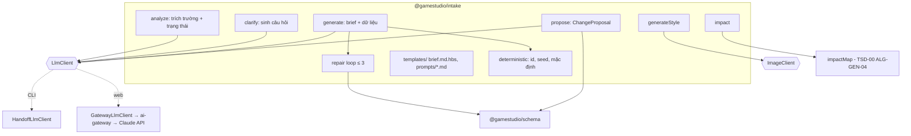

# TSD-01: Tạo game từ mô tả

| Mục | Nội dung |
|---|---|
| Mã tài liệu | TSD-01 |
| Phiên bản | 1.2 (đã duyệt) |
| Ngày | 22/11/2026 |
| Tài liệu cha | TSD-00 `TSD-00-TONG-QUAN.md` |
| SRS nguồn | SRS-01 v0.1 (FR-INT-01…30, NFR-INT-01…04) |
| Gói | `@gamestudio/intake` (`engine/intake`), lệnh `engine new-game`, skill `engine-intake`, endpoint API-WEB-10…14, 20, 22 (TSD-08) |
| Pha | E1 (Claude Code), W1 (web), W3 (sửa bằng lời) |
| Trạng thái | Đã duyệt (Huy, 22/11/2026; bản 1.2 gồm CR-01 duyệt 23/11/2026) |

---

## 1. Giới thiệu

### 1.1 Mục đích
Thiết kế kỹ thuật cho thư viện biến mô tả thành brief + dữ liệu khởi tạo hợp lệ schema, vòng đời brief, style bible và đề xuất thay đổi; một mã nguồn dùng cho cả Claude Code và Web Studio (FR-INT-29).

### 1.2 Phạm vi
Trong: cấu trúc gói, interface `LlmClient` và hai cài đặt, pipeline phân tích → hỏi làm rõ → sinh → kiểm → tự sửa, sinh tất định, mẫu brief, sinh `ChangeProposal`, phân tích ảnh hưởng, provenance lần gọi. Ngoài: giao diện chat (TSD-08), các schema dữ liệu chi tiết của thế giới/nhân vật (TSD-02, 05).

---

## 2. Kiến trúc thành phần



| Thư mục | Nội dung |
|---|---|
| `engine/intake/src/analyze/` | Dựng prompt phân tích, ánh xạ kết quả vào `IntakeAnalysis`, quy tắc QT-INT-01, 04, 06, 07 |
| `src/clarify/` | Chọn câu hỏi (≤ 5/vòng, ≤ 2 vòng), mặc định |
| `src/generate/` | Sinh `brief.json` (mô hình) → render `game-brief.md` (template) → sinh `game.json`, `world.json`, `palette.json`, `budgets.json`, `entities/**` (tất định + phần mô hình) |
| `src/style/` | Style bible + ảnh + palette |
| `src/propose/` | Sinh và kiểm `ChangeProposal`, trả lời câu hỏi dữ liệu |
| `src/impact/` | Bao gói ALG-GEN-04 |
| `src/llm/` | `LlmClient`, `HandoffLlmClient`, `GatewayLlmClient`, `FakeLlmClient` (test) |
| `src/schemas/` | JSON Schema của các đầu ra mô hình (`analysis`, `brief`, `proposal`) dùng cho structured outputs |
| `prompts/` | Prompt dạng Markdown có phiên bản; hash prompt ghi vào provenance |

---

## 3. Giao diện lập trình

### 3.1 Interface chính

| Mã | Interface | Mô tả |
|---|---|---|
| IF-INT-01 | `interface LlmClient { complete<T>(req: LlmRequest<T>): Promise<LlmResult<T>> }` | `LlmRequest = {task: 'analyze'\|'clarify'\|'brief'\|'repair'\|'propose'\|'answer'\|'style'\|'dialogue_draft', system: string, messages: Msg[], outputSchema: JSONSchema, maxOutputTokens, images?: Blob[]}`; `LlmResult = {data: T, usage: {inputTokens, outputTokens, costUsd}, model, service, latencyMs}` |
| IF-INT-02 | `HandoffLlmClient` (Claude Code) | Ghi `games/<id>/.intake/<sessionId>/req-<n>.json` (task, prompt, schema) và dừng với mã thoát 3 kèm chỉ dẫn; skill `engine-intake` cho phiên Claude Code đọc yêu cầu, viết `res-<n>.json` đúng schema, rồi chạy `engine new-game --resume <sessionId>`. Không cần khoá API ở máy dev cho bước này; chi phí = token phiên Claude Code (ghi vào phiếu, FR-DEV-19) |
| IF-INT-03 | `GatewayLlmClient` (web) | `POST http://ai-gateway/internal/llm` với token dịch vụ; cổng chọn mô hình theo `task` (TSD-08 SCH-WEB-09), dùng structured outputs, ghi `UsageRecord`, trả `LlmResult` |
| IF-INT-04 | `ImageClient.generate({prompt, aspect, n, styleRefs[]})` | Web: qua cổng (Gemini); CLI: skill `threejs-image-generator` ghi ảnh + provenance, `HandoffImageClient` chờ file |
| IF-INT-05 | `QuotaGuard.check(userId, estimateUsd)` | Chỉ web: gọi trước mỗi lần `complete` (FR-INT-30); CLI dùng bản no-op |
| IF-INT-06 | `reverseBrief(gameData, ctx)` (CR-01, API-INT-06) | Vào: `GameData` đã kiểm schema. Ra: `{brief (SCH-INT-04, `status=ChoXacNhan`), fieldSources: Record<FieldKey, 'suy_tu_du_lieu'\|'thieu'>, questions: ClarifyQuestion[]}`. Thiếu `game.json` hoặc `world.json` → ERR-INT-09 trước mọi lời gọi mô hình |

### 3.2 Hàm công khai (khớp API-INT-01…05)

```ts
analyze(input: IntakeInput, deps: Deps): Promise<{analysis: IntakeAnalysis; questions: ClarifyQuestion[]}>
generate(analysis: IntakeAnalysis, deps: Deps): Promise<GeneratedBundle>          // files + schemaReport
generateStyle(brief: BriefJson, deps: Deps): Promise<StyleBundle>                 // style-bible.md, refs[], palette
propose(data: GameData, baseVersion: number, request: string, deps: Deps): Promise<ProposalOrAnswer>
impact(changedPointers: string[], ctx: ImpactContext): ImpactResult
```
`Deps = {llm: LlmClient, image?: ImageClient, quota?: QuotaGuard, clock, logger, seedSource}`; không đọc biến môi trường, không truy cập mạng trực tiếp.

### 3.3 CLI
`engine new-game [--from <file>] [--seed <n>] [--resume <sessionId>] [--answers <file>] [--confirm]`: mã thoát theo SRS-04 mục 7.2; 3 khi đang chờ trả lời làm rõ, chờ handoff, hoặc chờ xác nhận brief.

---

## 4. Dữ liệu

| Mã | Cấu trúc | Ghi chú |
|---|---|---|
| SCH-INT-01 | `IntakeInput {description: string(10..20000), images[≤5]: {name, mime∈{jpeg,png,webp}, bytes ≤ 10 MB}, answers: Record<questionId, choiceId \| text>, seed?: uint32, language?}` | Giới hạn (OI-INT-01; xem lại sau W1) |
| SCH-INT-02 | `IntakeAnalysis {fields: Record<FieldKey, {value, status: 'tu_mo_ta'\|'gia_dinh'\|'thieu'\|'mau_thuan', evidence: string[], conflictsWith?: string}>, round: 0..2, realPlace?: {name, center:{lat,lon}, sizeKm:[2,2]}}` | `FieldKey` theo bảng SRS-01 mục 6.1 |
| SCH-INT-03 | `ClarifyQuestion {id, field, text, choices[2..4]: {id, label, value}, defaultChoiceId?, mandatory: bool}` | `mandatory=true` cho mâu thuẫn: không có mặc định |
| SCH-INT-04 | `brief.json` | Khoá như SRS-01 mục 6.1; `$id …/brief/1.json`; `sourceRef = intake:<sessionId>` |
| SCH-INT-05 | `game.json` phần intake | SRS-01 mục 6.2; `features.combat/hunting/violence/dialogueMode` (TSD-06, TSD-07) |
| SCH-INT-06 | `ChangeProposal` | SRS-01 mục 6.4; `ops[].patch` là JSON Patch tương đối gốc `data/`, `target` = `{file, objectId}`; `dependsOn` là danh sách `opId` |
| SCH-INT-07 | Provenance lần gọi (`intake-calls.jsonl` ở CLI; `UsageRecord` + bảng `llm_calls` ở web) | `{at, service, model, task, promptHash, promptExcerpt ≤ 500, intakeVersion, inputTokens, outputTokens, costUsd}` (FR-INT-27) |
| SCH-INT-08 | `IntakeSession` v1.1 (CR-01) | SRS-01 mục 6.5: `{id, ownerId, gameId?, kind: moi\|suy_nguoc, turns[{at, kind: mo_ta\|anh\|cau_hoi\|tra_loi, payload}], pendingQuestions[], analysis (SCH-INT-02), seed, status, lastActivityAt}`; web: bảng `intake_sessions` (TSD-08 SCH-WEB-02), CLI: `games/<id>/.intake/<sessionId>.json` hoặc `.intake/pending/<sessionId>.json` khi chưa có game |
| SCH-INT-09 | `ChangeProposal.briefUpdate` (CR-01) | `{fromVersion, changes[{field, old, new}], major: bool}`; `major` tính bằng luật thay đổi lớn hiện có (QT-INT-05) |

Trên web, `IntakeSession`, `BriefVersion`, `ChangeProposal` là bảng CSDL (TSD-08 SCH-WEB-02); trên CLI là file trong `games/<id>/.intake/` và `games/<id>/brief/v<n>/`.

---

## 5. Thuật toán

| Mã | Thuật toán | Mô tả |
|---|---|---|
| ALG-INT-01 | Pipeline tiếp nhận | (1) Kiểm đầu vào (ERR-INT-01/02); (2) `quota.check`; (3) `analyze`: một lời gọi structured output trả `IntakeAnalysis`; (4) luật hậu kiểm bằng mã: buộc `mau_thuan` khi hai trường phong cách/thời đại/góc nhìn/thể loại có giá trị trái nhau theo bảng xung đột trong `rules/conflicts.json`; áp QT-INT-04/07 (từ khoá "săn", "đánh", "chiến đấu"…) để đặt cờ và sinh câu hỏi bắt buộc; (5) nếu còn `thieu`/`mau_thuan` → `clarify`; (6) đủ → `generate` |
| ALG-INT-02 | Chọn câu hỏi làm rõ | Ứng viên = trường bắt buộc có `thieu` + mọi `mau_thuan`; xếp theo thứ tự trường cố định (mâu thuẫn trước, rồi `genre`, `camera`, `setting`, `artStyle`, `coreLoop`…); lấy ≤ 5; mô hình chỉ viết câu chữ và lựa chọn; mặc định chọn bằng luật (ví dụ `camera` → `third_person`, QT-INT-06). Vòng 2 vẫn thiếu → điền mặc định, trạng thái `gia_dinh`, ghi `assumptions[]` (FR-INT-05) |
| ALG-INT-03 | Sinh tất định | Phần cấu trúc không qua mô hình: `id` = slug(title) + hậu tố khi trùng; `seed` = `--seed` hoặc `deriveSeed(sha256(description), answersHash)`; `world.seed`, seed zone/lớp = `deriveSeed(game.seed, …)`; `budgets.json` = sao chép `games/_template/data/budgets.json`; zone mặc định = lưới 500 × 500 m phủ vùng chơi; file khung NPC/loài từ danh sách tên trong `brief.npcs/animals`. Mô hình chỉ viết văn bản (brief, tên, mô tả) → đáp ứng FR-INT-28 |
| ALG-INT-04 | Vòng tự sửa schema | Kiểm bằng Ajv; lỗi → gửi lại mô hình `task='repair'` chỉ phần file lỗi + danh sách lỗi `instancePath` + schema con; tối đa 3 lần; vẫn lỗi → ERR-INT-05, lưu `schemaReport` vào log |
| ALG-INT-05 | Kiểm độ dài brief | Đếm từ phần chính theo khoảng trắng Unicode; > 400 → chuyển `suggestions[]`, `assumptions[]` chi tiết sang `game-brief-phu-luc.md` (QT-INT-02) |
| ALG-INT-06 | Ước lượng quy mô | `areaKm2` từ vùng chơi; số zone = ceil(diện tích / 0,25 km²); tải hình học ≈ Σ(loại đối tượng × tri trung bình bảng tra `rules/tri-estimates.json`) + mật độ thực vật mặc định; cảnh báo khi > 80% `trisStatic` tier Vừa (FR-INT-14) |
| ALG-INT-07 | Sinh `ChangeProposal` | (1) Phân loại yêu cầu: câu hỏi dữ liệu → trả lời từ `GameData` (mô hình nhận phần dữ liệu liên quan, không tạo đề xuất, FR-WEB-13); (2) chọn ngữ cảnh: chỉ các file/đối tượng liên quan theo từ khoá + chỉ mục tên → giữ prompt nhỏ; (3) mô hình trả `ops[]` theo schema; (4) kiểm: áp thử từng op lên bản sao, kiểm schema, kiểm id tham chiếu tồn tại; op lỗi bị loại và báo; (5) tính `dependsOn` bằng mã (op thêm đối tượng mà op khác tham chiếu id của nó); (6) `impact` (ALG-GEN-04); (7) `major` theo QT-INT-05 bằng mã (đường dẫn `features/**`, `camera/**`, khoá brief `genre/artStyle/era`) |
| ALG-INT-08 | Áp đề xuất | Khi duyệt: kiểm `baseVersion == latest` (sai → `HetHan`, ERR-INT-07, QT-INT-08); lấy bao đóng `dependsOn` của các op được chọn; áp tuần tự trong một giao dịch; kiểm schema toàn bộ; tạo `GameVersion` nguồn `chat`; `major` → brief vN+1 `ChoXacNhan` |
| ALG-INT-09 | Băm brief | `BriefVersion.hash = SHA-256(JCS({brief, initData}))` (FR-INT-18) |

### 5.1 Prompt và mô hình
- Web: `task` → mô hình theo cấu hình cổng; mặc định `claude-opus-5-5` (TD-16) cho `analyze`, `brief`, `repair`, `propose`, `style`; effort `medium` cho `analyze`/`propose`, `high` cho `brief` (TSD đề xuất). Không prefill; đầu ra JSON bằng `output_config.format` với schema mục 4.
- System prompt cố định đặt đầu và bật prompt caching; mô tả gốc và dữ liệu game đặt sau điểm cache.
- Luật bám mô tả (QT-GEN-03, FR-INT-15) viết trong system prompt và **kiểm lại bằng mã**: trường không có `evidence` mà không nằm trong `assumptions` → chuyển sang `suggestions` (QT-INT-03).

### 5.2 Làm tiếp và mở rộng game (CR-01)

| Mã | Thuật toán | Mô tả |
|---|---|---|
| ALG-INT-10 | Lưu và mở lại phiên tạo game | Sau mỗi lượt (mô tả, ảnh, câu trả lời, câu hỏi mới) ghi nguyên tử SCH-INT-08 (web: một giao dịch; CLI: ghi tệp tạm rồi đổi tên). Mở lại: trả `pendingQuestions` và `analysis` đã lưu, **không** gọi lại mô hình; chỉ gọi khi người dùng gửi lượt mới (FR-INT-31). Hết hạn (QT-INT-10): việc hằng ngày (web: cron pg-boss 02:15; CLI: kiểm khi chạy `engine status`) chuyển phiên `lastActivityAt` > 30 ngày sang `Huy`; ở mốc 27 ngày gửi thông báo trong web một lần |
| ALG-INT-11 | Suy brief từ dữ liệu | (1) Kiểm có `game.json`, `world.json` (ERR-INT-09); (2) điền tất định các trường cấu trúc từ dữ liệu: tên, thể loại, nguồn địa hình và bbox, danh sách zone, loài, NPC, nhiệm vụ, cờ `features`, tier mục tiêu → `suy_tu_du_lieu`; (3) một lời gọi structured output (`task='reverse_brief'`, mô hình như `brief`) chỉ cho các trường văn xuôi (giọng điệu, tóm tắt cốt truyện, phong cách) với bản tóm tắt dữ liệu ≤ 6 KB, mỗi trường phải dẫn nguồn đường dẫn dữ liệu, không có nguồn → `thieu`; (4) trường bắt buộc `thieu` → câu hỏi làm rõ (ALG-INT-02); (5) lưu `BriefVersion` `ChoXacNhan`, `IntakeSession.kind=suy_nguoc`; build bị chặn tới khi xác nhận (FR-INT-17, QT-INT-09) |
| ALG-INT-12 | Cập nhật brief theo yêu cầu mở rộng | Trong ALG-INT-07, khi đề xuất thêm zone/loài/NPC/nhiệm vụ hoặc bật cờ `features`, sinh thêm `briefUpdate` (SCH-INT-09) gồm đúng các trường brief bị đổi. Duyệt (ALG-INT-08) trong cùng giao dịch: `major=false` → tạo `BriefVersion` N+1 `DaXacNhan` (người duyệt là người xác nhận) rồi áp patch dữ liệu; `major=true` → brief N+1 `ChoXacNhan`, dữ liệu chưa áp, theo luồng FR-INT-26. Kiểm bám brief (QT-GEN-03) dùng brief mới nhất `DaXacNhan` (FR-INT-33) |
| ALG-INT-13 | Tóm tắt tiến độ | `summarizeVi(statusReport)` trong `@gamestudio/status` (TSD-00 ALG-GEN-05): dựng câu từ mẫu cố định theo `stage`, cờ khác 0 và `next` (≤ 6 dòng; ví dụ "Game đang ở bước Cần build: zone z2 có 4 bước cũ (khoảng 14 phút). Còn 1 đề xuất chờ duyệt. Việc nên làm: Build lại zone z2."). Không gọi mô hình, không đọc dữ liệu game ngoài báo cáo (FR-INT-34) |

---

## 6. Hiệu năng
- NFR-INT-01: sinh brief ≤ 2 phút P90: tối đa 3 lời gọi tuần tự (analyze, brief, ≤ 1 repair trung bình); timeout mỗi lời gọi 120 s (ERR-INT-04), thử lại 1 lần sau 5 s.
- NFR-INT-04: đề xuất ≤ 20 s P90: ngữ cảnh rút gọn ≤ 30k token; một lời gọi.
- Không chặn luồng API: lời gọi chạy trong handler async, tiến độ đẩy qua SSE của chat.

## 7. Bảo mật
- Mô tả và ảnh người dùng chỉ gửi qua cổng; ảnh lưu kho đối tượng `intake/<sessionId>/` quyền riêng game.
- Nội dung mô hình sinh luôn render dạng văn bản/Markdown đã làm sạch (DOMPurify, không HTML thô) trên web.
- `ops[].patch` chỉ được chạm `data/**` (kiểm tiền tố đường dẫn); không bao giờ tạo/sửa `scripts/**` (FR-WEB-47).

## 8. Lỗi
ERR-INT-01…08 ánh xạ: CLI → mã thoát 4 (01, 02, 05), 3 (03, 06, 07, 08), 6 (04); web → HTTP 422 (01, 02, 05, 08), 429 (03), 502 (04), 409 (06, 07) qua envelope `{error:{code,message}}`.

---

## 9. Kiểm thử

| Mã | Kiểm thử | Kiểu |
|---|---|---|
| TST-INT-01 | Bộ 10 mô tả mẫu + `FakeLlmClient` ghi sẵn đáp án → so `brief.json` với kỳ vọng (AC-01-01: "low-poly ấm áp", 3 loài, `combat=false`) | Unit/golden |
| TST-INT-02 | Mô tả không góc nhìn → có câu hỏi `camera`, mặc định `third_person` (AC-01-02) | Unit |
| TST-INT-03 | "săn hươu trong rừng" → `hunting.enabled=true`, câu hỏi `combat` (AC-01-03) | Unit |
| TST-INT-04 | Build khi brief `ChoXacNhan` → CLI mã thoát 3, web 409 ERR-INT-06 (AC-01-04) | Tích hợp |
| TST-INT-05 | Đổi `setting.timeOfDay` sau build z1 → v2 + `impact` chứa `lighting.bake` z1 (AC-01-05) | Unit |
| TST-INT-06 | "hiện thực" + "hoạt hình" → câu hỏi bắt buộc không mặc định (AC-01-06) | Unit |
| TST-INT-07 | Tượng Phật chi tiết → `highRiskAssets` mức Cao, hướng CC0 trước (AC-01-07) | Unit |
| TST-INT-08 | "thêm 5 con gà ở sân" → proposal có op `them` spawn gà; không thay đổi trước duyệt; duyệt → `GameVersion` mới (AC-08-03) | Tích hợp web |
| TST-INT-09 | Hai lần `generate` cùng mô tả + đáp án + seed → phần cấu trúc (id, seed, zone, budgets) giống hệt byte (FR-INT-28) | Golden |
| TST-INT-10 | Không có bản sao logic intake trong `web/**` (dependency-cruiser: chỉ import `@gamestudio/intake`) (NFR-INT-03) | CI |
| TST-INT-11 | Đo P90 thời gian sinh brief và đề xuất trên 10/20 mẫu thật (NFR-INT-01, 04) | Hiệu năng, W1/W3 |
| TST-INT-12 | Phiên dở: trả lời 1/3 câu hỏi, đóng, mở lại → đúng câu hỏi tiếp theo, số lời gọi mô hình không tăng; phiên 31 ngày → `Huy`, thông báo ở ngày 27 (AC-CR01-01) | Unit + tích hợp, W1 |
| TST-INT-13 | Suy brief: thư mục game mẫu không có brief → brief `ChoXacNhan`, mọi trường có nguồn hoặc `thieu`; thiếu `world.json` → ERR-INT-09, không gọi mô hình (AC-CR01-02) | Unit (mô hình giả), E1 |
| TST-INT-14 | Mở rộng: "thêm zone chợ" → đề xuất có `briefUpdate`; Duyệt → brief vN+1 `DaXacNhan` + dữ liệu đổi cùng giao dịch; thay đổi lớn → brief `ChoXacNhan`, dữ liệu chưa áp (AC-CR01-03) | Tích hợp, E1/W3 |
| TST-INT-15 | `summarizeVi` trên 8 báo cáo mẫu (mỗi giai đoạn một) → câu đúng giai đoạn, ≤ 6 dòng, không lời gọi mạng | Unit golden |

## 10. Open item kỹ thuật

| Mã | Câu hỏi | Đề xuất |
|---|---|---|
| OIT-INT-01 | Mô hình và effort cho `analyze` có thể hạ xuống `claude-sonnet-5-5` để giảm chi phí | Giữ Opus 5.5 đến khi có bộ đánh giá 10 mô tả; chỉ hạ khi chất lượng giữ nguyên (Huy quyết) |
| OIT-INT-02 | Trên CLI có cho dùng `GatewayLlmClient` (gọi cổng của Web Studio) thay handoff | Có, tuỳ chọn `--llm gateway`, khi máy dev có token dịch vụ |

---

## 11. Truy vết

| FR / NFR | Thành phần TSD |
|---|---|
| FR-INT-01, 02 | SCH-INT-01, ALG-INT-01 |
| FR-INT-03 | SCH-INT-02, ALG-INT-01 |
| FR-INT-04, 05 | SCH-INT-03, ALG-INT-02 |
| FR-INT-06 | ALG-INT-01 (bảng xung đột), SCH-INT-03 `mandatory` |
| FR-INT-07 | SCH-INT-02 `realPlace`, ALG-INT-01 |
| FR-INT-08 | `src/generate/`, ALG-INT-05, SCH-INT-04 |
| FR-INT-09 | ALG-INT-03 |
| FR-INT-10 | ALG-INT-04 |
| FR-INT-11, 12 | SCH-INT-04 `highRiskAssets`, `npcs`, `animals`; mục 5.1 |
| FR-INT-13 | SCH-INT-05, ALG-INT-01 (QT-INT-04, 07) |
| FR-INT-14 | ALG-INT-06 |
| FR-INT-15, 16 | Mục 5.1; SCH-INT-01 lưu nguyên văn (bảng `intake_sessions`, TSD-08 SCH-WEB-02) |
| FR-INT-17 | Kiểm `briefState` trong `engine build` (TSD-04 IF-CLI-01) và API-WEB-30 |
| FR-INT-18 | ALG-INT-09 |
| FR-INT-19 | IF `impact`, TSD-00 ALG-GEN-04 |
| FR-INT-20…22 | `src/style/`, IF-INT-04; khoá sinh asset hàng loạt theo `styleBibleVersion` (TSD-03 ALG-AST-08) |
| FR-INT-23…26 | ALG-INT-07, ALG-INT-08, SCH-INT-06 |
| FR-INT-27 | SCH-INT-07 |
| FR-INT-28 | ALG-INT-03, TST-INT-09 |
| FR-INT-29 | IF-INT-01…03, TST-INT-10 |
| FR-INT-30 | IF-INT-05 |
| NFR-INT-01…04 | Mục 6, TST-INT-10, TST-INT-11; chi phí hiển thị ở SCR-WEB-12 (TSD-08) |
| FR-INT-31 | ALG-INT-10, SCH-INT-08, TST-INT-12 |
| FR-INT-32 | IF-INT-06, ALG-INT-11, TST-INT-13 |
| FR-INT-33 | ALG-INT-12, SCH-INT-09, TST-INT-14 |
| FR-INT-34 | ALG-INT-13, TST-INT-15; TSD-00 ALG-GEN-05 |

## 12. Lịch sử thay đổi

| Phiên bản | Ngày | Người | Nội dung |
|---|---|---|---|
| 0.1 | 22/11/2026 | Claude | Bản đầu từ SRS-01 v0.1 |
| 1.0 | 22/11/2026 | Huy | Duyệt toàn bộ tài liệu |
| 1.1 | 22/11/2026 | Claude | Chốt các số "(đề xuất)" có nguồn từ SRS sau khi Huy duyệt SRS |
| 1.2 | 23/11/2026 | Claude | CR-01 (SRS-01 v1.1): IF-INT-06, SCH-INT-08, 09, mục 5.2 ALG-INT-10…13, TST-INT-12…15, truy vết FR-INT-31…34 |
| 1.2 | 23/11/2026 | Huy | Duyệt phần bổ sung CR-01 |
