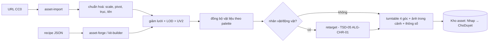

# TSD-03: Asset 3D, vật liệu và âm thanh

| Mục | Nội dung |
|---|---|
| Mã tài liệu | TSD-03 |
| Phiên bản | 1.2 |
| Ngày | 26/11/2026 |
| Tài liệu cha | TSD-00 `TSD-00-TONG-QUAN.md` |
| SRS nguồn | SRS-03 v0.1 (FR-AST-01…40, NFR-AST-01…04) |
| Gói | `engine/build/asset-import`, `engine/build/asset-forge` (primitive TS + script Blender), `engine/build/kit-builder`, `engine/build/materials` (`texture-proc`), `engine/build/audio`, lệnh `engine asset …` (API-AST-01…04); endpoint API-WEB-40…44 |
| Pha | E2 (vật liệu), E4 (asset 3D), E6 (âm thanh), W3–W4 (web) |
| Trạng thái | Đã duyệt (Huy, 22/11/2026); **v1.2 theo CR-02 (Unity) sau POC-U1**, chờ Huy xem lại |

---

## 1. Giới thiệu
Thiết kế pipeline có asset hợp phong cách, hợp pháp, trong ngân sách: nhập CC0 (QĐ-10, 12), sinh bằng code theo họ (QĐ-08, không AI 3D, QT-AST-01), vật liệu ba nguồn, HDRI, âm thanh, provenance bắt buộc và cổng duyệt turntable.

---

## 2. Kiến trúc thành phần

| Thành phần | Công nghệ | Ghi chú |
|---|---|---|
| Tải và kiểm license | Node (`undici`), API Poly Haven; trang khác: đọc metadata + chụp trang license bằng Playwright | Chỉ miền trong `cc0-sources.json` (FR-AST-01) |
| Chuẩn hoá, LOD | glTF-Transform + `meshoptimizer` (simplify), Blender cho định dạng FBX/OBJ/BLEND → glTF | Đầu vào chấp nhận: glTF/GLB, FBX, OBJ, BLEND |
| Generator primitive | TS thuần tạo `BufferGeometry` → glTF (chạy Node, không cần trình duyệt) | Tất định, nhanh |
| Mesh hữu cơ | Blender: SDF/metaball/remesh voxel + sculpt script | FR-AST-09 |
| Turntable | **Unity player cùng `engineVersion` ở chế độ `?turntable=`, chạy trong Playwright** (CR-02) với HDRI studio cố định, để ảnh duyệt giống hệt cách runtime hiển thị (không dùng Eevee); worker không cần Unity Editor | Ảnh 512² × 4 góc + ảnh trong cảnh 1280×720 |
| Texture thủ tục | Python/numpy (`engine/build/py/texproc`, CR-02) + `sharp` (noise, gạch, gỗ, vải) xuất PNG | `engine-texture-proc` |
| Âm thanh | ffmpeg (`loudnorm`, `aac`; ADR-037 bỏ `libopus`), `sox` tuỳ chọn | FR-AST-24 |

---

## 3. Giao diện

| Mã | Interface | Mô tả |
|---|---|---|
| IF-AST-01 | `Generator` (TS) | `{family: string, version: semver, paramsSchema: JSONSchema, build(params, rng): Promise<GeneratedAsset>}`; `GeneratedAsset = {meshes[], materials[], colliders[], lods[], meta}`; đăng ký trong `asset-forge/registry.ts`. Generator Blender cài cùng interface qua cầu nối `blender -b -P forge_entry.py -- --family x --params p.json --seed n` |
| IF-AST-02 | `engine asset import --url <url> [--kind] [--game <id>]` | API-AST-01: tải → kiểm → chuẩn hoá → LOD → vật liệu → (retarget) → turntable → tạo bản ghi `Nhap` |
| IF-AST-03 | `engine asset forge --recipe <file>` | API-AST-02 |
| IF-AST-04 | `engine asset turntable --id <assetId>`, `engine asset check` | API-AST-03, 04; `check` quét mọi tham chiếu `asset:` trong dữ liệu game: provenance hợp lệ schema, license trong danh sách, trạng thái `DaDuyet` |
| IF-AST-05 | `MaterialSource` | `procedural \| cc0_scan \| ai_texture`; mỗi nguồn xuất bộ map PBR chuẩn `{baseColor, normal, roughness, metallic, ao, height?}` + `material.json {id, maps, tiling, sharp: string[], paletteRole}` |
| IF-AST-06 | `AiMediaClient` | `generateImage`, `generateAudio` qua `ai-gateway` (web/worker) hoặc skill `threejs-image-generator`/`threejs-audio-generator` (máy dev); trả file + provenance `ai`; có `estimateCost(batch)` cho FR-AST-39 |

---

## 4. Dữ liệu

| Mã | Cấu trúc | Ghi chú |
|---|---|---|
| SCH-AST-01 | Bảng `assets` (web) / `assets/registry.json` (CLI) | Trường SRS-03 mục 6.1; khoá `(id, version)`; `files` lưu ở kho đối tượng `assets/<id>/<version>/…` bất biến sau `DaDuyet` (FR-AST-37) |
| SCH-AST-02 | `recipe.schema.json` | SRS-03 mục 6.2; `params` kiểm bằng `paramsSchema` của generator; `safeRanges` cho FR-AST-35 |
| SCH-AST-03 | `provenance.schema.json` | `oneOf` theo `type` (`generator`, `cc0`, `edited`, `ai`) như SRS-03 mục 6.3; `evidence` = đường dẫn ảnh chụp trang license + hash; `derivedFrom[]` = `assetId@version` |
| SCH-AST-04 | `cc0-sources.json` | `[{name, domain, contentKinds[], approvedBy, approvedAt, apiKind: 'polyhaven'\|'page'}]`; `license-exceptions.json` cho ngoại lệ Huy duyệt (FR-AST-02) |
| SCH-AST-05 | Âm thanh | SRS-03 mục 6.4 + `files {aac: 'x.m4a'}` (ADR-037), `loopPoints?` |
| SCH-AST-06 | Bảng `asset_reviews` | `{assetId, version, round, by, at, decision, reason, reasonCode: 'lech_phong_cach'\|'vuot_ngan_sach'\|'loi_hinh'\|'khac'}` |

---

## 5. Thuật toán

| Mã | Thuật toán | Mô tả |
|---|---|---|
| ALG-AST-01 | Kiểm license CC0 | Poly Haven: đọc API (license luôn CC0) + lưu JSON trả về làm bằng chứng; nguồn trang: trích trường license từ metadata trang (selector khai báo theo nguồn trong `cc0-sources.json`), chụp ảnh trang bằng Playwright; license ≠ `CC0-1.0` và không có trong ngoại lệ → ERR-AST-02. Miền ngoài danh sách → ERR-AST-01 trước khi tải (FR-AST-01, 02) |
| ALG-AST-02 | Chuẩn hoá | Chuyển về glTF; áp đơn vị (mét), trục Y lên; tính AABB → pivot giữa đáy; scale theo `realSize` khai báo (cạnh lớn nhất); đặt tên `<loai>-<ten>-<bien-the>` (FR-AST-03) |
| ALG-AST-03 | LOD và UV2 | LOD0 = min(nguồn, trần tri loại asset trong `budgets.json`) bằng `simplify` có khoá biên UV; LOD1 40%, LOD2 15% tri LOD0; vượt trần sau giảm → ERR-AST-04. UV2 cho vật tĩnh: `xatlas` (WASM) đóng gói không chồng lấn, padding 4 texel ở 1024 (FR-AST-04, 10) |
| ALG-AST-04 | Đồng bộ vật liệu | Với mỗi vật liệu: màu nền trung bình (Lab) → màu `palette` vai trò `vat_lieu` gần nhất theo ΔE2000; dịch hue/chroma texture baseColor về màu đó giữ độ sáng tương đối (hệ số pha 0,7, TSD đề xuất); roughness kẹp theo style bible; gộp vật liệu trùng (cùng map hash); > 4 vật liệu → gộp atlas (FR-AST-05) |
| ALG-AST-05 | Generator theo họ | Recipe → kiểm `paramsSchema` → `rng = PCG32(deriveSeed(recipe.seed, family, version))` → `build()`; generator không đọc gì ngoài `params` + `rng` (QT-WLD-02 tương tự); sinh collider: hộp AABB, viên nang cho dạng thuôn, convex hull (quickhull3d) ≤ 64 đỉnh cho dạng khác (FR-AST-07, 08, 10). `kit-builder`: spec `{bays, floors, roof, wallMaterial, doors}` → ghép module kit theo lưới gian (khẩu độ chuẩn trong kit), mái theo kiểu, merge mesh theo vật liệu (FR-AST-11). Generator họ mới: phiếu riêng, mô hình Opus (FR-AST-13, TSD-09) |
| ALG-AST-06 | Turntable và thông số | Trang nhúng Unity player (`?turntable=<asset>`, CR-02) nạp asset, HDRI studio cố định (`studio_small_09` CC0), camera FOV 35° khung theo AABB; 4 góc 0/90/180/270°; ảnh trong cảnh dùng góc chuẩn zone đầu có `placedObjects` asset đó hoặc cảnh mẫu; thông số: tri mỗi LOD, vật liệu, texture lớn nhất, MB sau nén → so ngân sách loại asset (ALG-GEN-03) → `budgetCheck` (FR-AST-31, 32) |
| ALG-AST-07 | Credit | Packager gom provenance của mọi asset dùng trong bản build + provenance dữ liệu bản đồ + `LICENSES.md` phần thư viện; nhóm: bản đồ, mô hình CC0, vật liệu/HDRI, âm thanh, dịch vụ AI, mã MIT (threejs-game-skills); khử trùng theo (tác giả, nguồn); ghi `manifest.credits` → SCR-RTM-05 (FR-AST-30, FR-WEB-39) |
| ALG-AST-08 | Chặn sinh hàng loạt | Lệnh/job `asset forge` với > 1 recipe hoặc sinh texture AI theo lô kiểm `game.styleBibleVersion != null` và trạng thái style bible `DaDuyet`; nếu không → mã thoát 3 / HTTP 409 (FR-INT-22) |
| ALG-AST-09 | Vật liệu ba nguồn | `procedural`: đồ thị noise/pattern có seed → PNG 2048/4096; `cc0_scan`: tải Poly Haven ở 4K, chuẩn hoá tên map, chuyển roughness/metallic về kênh glTF (ORM: R=AO, G=roughness, B=metallic); `ai_texture`: Gemini qua `AiMediaClient`, sau đó kiểm tileable: chênh lệch trung bình mép đối diện (dải 8 px, Lab) ≤ ΔE 3 (TSD đề xuất), không đạt → làm liền bằng offset + blend chéo rồi kiểm lại (FR-AST-14, 15, 17). Hạ độ phân giải theo tier ở packager (TSD-04 ALG-CLI-02) |
| ALG-AST-10 | HDRI | Tải `.hdr`/`.exr` Poly Haven 4K; tier Thấp/Vừa 2K, Cao/Tối đa 4K; ở build Python/numpy chiếu equirect → cubemap, tiền lọc GGX theo mip, lưu RGBM KTX2 + 9 hệ số SH để runtime không phải tính (FR-AST-18; CR-02 thay PMREM Three.js) |
| ALG-AST-11 | Âm thanh | Chuẩn hoá −16 LUFS bằng `loudnorm` hai lượt; vòng lặp: tìm điểm cắt gần không (zero crossing) + crossfade 50 ms để không click; xuất AAC/M4A 128 kbps (âm nền và giọng 96 kbps mono), một định dạng duy nhất (ADR-037, POC-U1: Unity Web không phát Ogg/Opus) (FR-AST-20…25). Gán âm nền theo `world.ambience[]` (vùng, mốc thời điểm); bước chân chọn theo `surface.png` |
| ALG-AST-12 | Ngưỡng chi phí lô | `estimate = Σ đơn giá dịch vụ × số mục`; `estimate > batchConfirmThreshold` (2 USD, OI-AST-04) → yêu cầu xác nhận (CLI: hỏi `y/N`; web: hộp thoại) (FR-AST-39, QT-AST-07) |
| ALG-AST-13 | Dịch vụ AI lỗi | Lỗi tạm (429/5xx, timeout): thử lại **cùng job** (giữ `requestId`/id job của dịch vụ) tối đa 3 lần cách 30 s; hết credit (402/quota): đổi sang texture/âm thanh thủ tục, gắn `fallback: true` trong provenance và báo ERR-AST-05 (FR-AST-40) |
| ALG-AST-14 | Duyệt | `ChoDuyet` → `DaDuyet` khi `highRisk=false` và 1 vòng duyệt, hoặc `highRisk=true` và 2 vòng (vòng 2 ở phiên bản sau chỉnh sửa hoặc xác nhận lại); từ chối bắt buộc `reasonCode` (ERR-AST-08); biến thể chỉ đổi seed/tham số trong `safeRanges` của recipe đã duyệt → duyệt theo lưới cả lô (FR-AST-31…35) |
| ALG-AST-15 | Kho chung | Tìm kiếm: PostgreSQL full-text (`tsvector` tiếng Việt không dấu + tag) + lọc chỉ mục B-tree trên `kind, source, license, lod0Tris`; `usedBy` = bảng `asset_usages`; xoá asset có usage ≠ game hiện tại → ERR-AST-07, chỉ `NgungDung`; kết quả mặc định ẩn `NgungDung` (FR-AST-36…38) |

---

## 6. Hiệu năng
- NFR-AST-01 biến thể ≤ 1 phút: generator TS chạy trong tiến trình Node đã ấm; Blender chỉ cho họ hữu cơ; turntable dùng chung một trình duyệt cho cả lô.
- NFR-AST-03: generator tất định; glTF xuất với thứ tự node/thuộc tính ổn định, không timestamp → hash bằng nhau.
- NFR-AST-04 tìm kho ≤ 1 s với 5.000 asset: chỉ mục GIN `tsvector`, trang 48 kết quả, ảnh thu nhỏ 256² WebP.

## 7. Bảo mật
- Tải URL: chỉ HTTPS, miền danh sách trắng, phân giải DNS rồi chặn IP riêng/loopback/link-local (SSRF, FR-WEB-46), giới hạn 500 MB, giải nén zip có kiểm zip-slip và tổng kích thước.
- Mở file nhập (FBX/BLEND) chỉ trong container worker, Blender `--factory-startup` và tắt auto-run Python script trong `.blend` (`--disable-autoexec`).
- Khoá Gemini/ElevenLabs chỉ ở `ai-gateway` (web) hoặc biến môi trường máy dev (FR-DEV-22).

## 8. Kiểm thử

| Mã | Kiểm thử |
|---|---|
| TST-AST-01 | Nhập chum CC0 mẫu → scale/pivot đúng, 3 LOD, provenance có URL + license (AC-03-01) |
| TST-AST-02 | Mô hình CC-BY-NC → ERR-AST-02 (AC-03-02) |
| TST-AST-03 | 10 seed "nhà một gian" → 10 biến thể, có provenance, không sửa code (AC-03-03) |
| TST-AST-04 | Xoá provenance → build Fail chỉ rõ asset (AC-03-04) |
| TST-AST-05 | Vật liệu 4096² đóng gói tier Vừa → KTX2 2048² (AC-03-05) |
| TST-AST-06 | Asset `highRisk` cần 2 vòng duyệt (AC-03-06) |
| TST-AST-07 | Credit đủ nhóm CC0, OSM, MIT, AI (AC-03-07) |
| TST-AST-08 | Sinh hai lần cùng recipe → cùng hash glTF (NFR-AST-03) |
| TST-AST-09 | Không có chuỗi `meshy`/`tripo` trong cấu hình cổng AI, `.claude/` (QT-AST-01, grep CI) |
| TST-AST-10 | SSRF: URL trỏ `127.0.0.1`/`169.254.x` → bị chặn |

## 9. Open item kỹ thuật

| Mã | Câu hỏi | Đề xuất |
|---|---|---|
| OIT-AST-01 | Đồng bộ màu theo palette có làm hỏng vật liệu scan | Chỉ áp cho mô hình CC0; vật liệu scan giữ nguyên, chỉ chỉnh tông qua LUT hậu kỳ; duyệt ở E4 |
| OIT-AST-02 | Ngưỡng tileable ΔE 3 | Đo trên 20 texture Gemini ở E2 |

## 10. Truy vết

| FR / NFR | Thành phần TSD |
|---|---|
| FR-AST-01, 02 | SCH-AST-04, ALG-AST-01 |
| FR-AST-03 | ALG-AST-02 |
| FR-AST-04 | ALG-AST-03 |
| FR-AST-05 | ALG-AST-04 |
| FR-AST-06 | TSD-05 ALG-CHR-01 |
| FR-AST-07…11 | IF-AST-01, ALG-AST-05, SCH-AST-02 |
| FR-AST-12 | IF-AST-06 (3 ảnh tham chiếu cho `highRisk`) |
| FR-AST-13 | ALG-AST-05 (quy trình phiếu, TSD-09) |
| FR-AST-14…17 | IF-AST-05, ALG-AST-09 |
| FR-AST-18 | ALG-AST-10 |
| FR-AST-19 | TSD-04 ALG-CLI-02 |
| FR-AST-20…25 | ALG-AST-11, SCH-AST-05 |
| FR-AST-26…28 | SCH-AST-03 |
| FR-AST-29 | TSD-04 ALG-CLI-02, IF-AST-04 |
| FR-AST-30 | ALG-AST-07 |
| FR-AST-31…35 | ALG-AST-06, ALG-AST-14, SCH-AST-06 |
| FR-AST-36…38 | ALG-AST-15, SCH-AST-01 |
| FR-AST-39 | ALG-AST-12 |
| FR-AST-40 | ALG-AST-13 |
| NFR-AST-01…04 | Mục 6, TST-AST-08 |

## 11. Lịch sử thay đổi

| Phiên bản | Ngày | Người | Nội dung |
|---|---|---|---|
| 0.1 | 22/11/2026 | Claude | Bản đầu từ SRS-03 v0.1 |
| 1.0 | 22/11/2026 | Huy | Duyệt toàn bộ tài liệu |
| 1.1 | 22/11/2026 | Claude | Chốt các số "(đề xuất)" có nguồn từ SRS sau khi Huy duyệt SRS |
| 1.2 | 26/11/2026 | Claude | CR-02 (ADR-036), POC-U1, ADR-037: turntable bằng Unity player (ALG-AST-06), texture thủ tục numpy, HDRI cubemap + SH bằng Python (ALG-AST-10), âm thanh chỉ AAC/M4A (SCH-AST-05, ALG-AST-11) |
