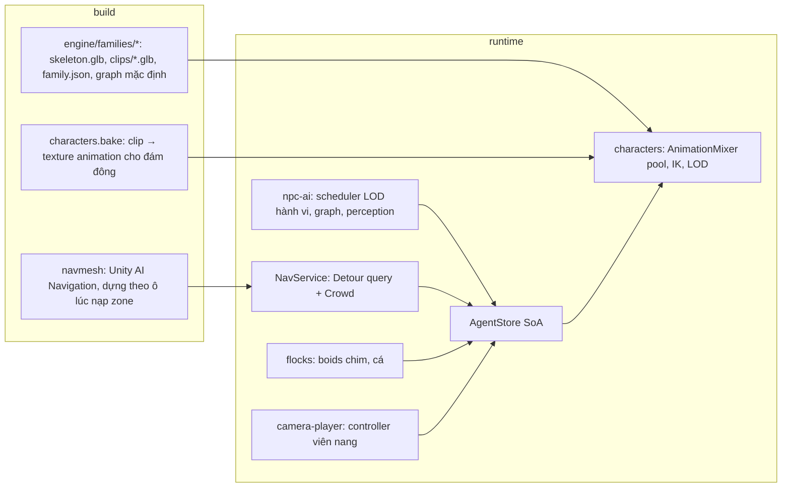

# TSD-05: Nhân vật người chơi, NPC và động vật

| Mục | Nội dung |
|---|---|
| Mã tài liệu | TSD-05 |
| Phiên bản | 1.2 |
| Ngày | 26/11/2026 |
| Tài liệu cha | TSD-00 `TSD-00-TONG-QUAN.md` |
| SRS nguồn | SRS-05 v0.1 (FR-CHR-01…44, NFR-CHR-01…04) |
| Gói | Runtime `characters/`, `npc-ai/`, `camera-player/`; bước build `navmesh`, `characters.bake` (animation texture); thư viện họ `engine/families/<family>/` |
| Pha | E2, E4, E6, E7; web W3 |
| Trạng thái | Đã duyệt (Huy, 22/11/2026); **v1.2 theo CR-02 (Unity) sau POC-U1**, chờ Huy xem lại |

---

## 1. Giới thiệu
Thiết kế kỹ thuật cho người chơi, NPC và động vật: khung xương dùng chung theo 6 họ, retarget, animation và LOD, hành vi khai báo bằng graph, tìm đường trên navmesh, đàn/boids, lịch trình và ngân sách CPU ≤ 4 ms trên A56.

---

## 2. Kiến trúc thành phần

| Thư mục | Nội dung |
|---|---|
| `runtime/src/npc-ai/store.ts` | `AgentStore`: `Float32Array` vị trí/vận tốc/hướng, `Uint16Array` trạng thái graph, `Uint8Array` LOD, chỉ số loài/mẫu, `Uint32Array` seed RNG; dung lượng cố định theo ngân sách tier |
| `npc-ai/graph/` | Nạp graph, biên dịch điều kiện bằng `@gamestudio/expr`, thư viện hành động |
| `npc-ai/actions/` | `idle`, `patrol`, `wander`, `goto`, `follow`, `react`, `graze/eat`, `rest`, `herd`, `flee` (mỗi file ≤ 300 dòng) |
| `npc-ai/schedule.ts`, `spawn.ts`, `flock-birds.ts`, `school-fish.ts`, `poultry.ts` | Lịch trình, luật xuất hiện, boids, cá, gia cầm |
| `characters/` | `SkeletonFamilyRegistry`, `MixerPool`, `FootIK`, `CharacterLOD`, `CrowdInstancing` |
| `camera-player/` | `PlayerController`, `ThirdPersonCamera`, `FirstPersonCamera` |

---

## 3. Giao diện

| Mã | Interface | Mô tả |
|---|---|---|
| IF-CHR-01 | `ActionImpl {id; enter(a: AgentRef, p: Params): void; update(a, dt): Status; exit(a): void}` | Hành động trong graph; không cấp phát; trạng thái riêng lưu trong vùng `scratch` của `AgentStore` (16 float/agent) |
| IF-CHR-02 | `NavService {findPath(from, to, agentType, out: PathBuffer): bool; nearestValid(p, agentType, out): bool; crowdAdd/Remove/SetTarget}` | Bọc Unity AI Navigation (`NavMesh.CalculatePath`, `SamplePosition`, `NavMeshAgent`; CR-02); `PathBuffer` cấp sẵn 64 điểm |
| IF-CHR-03 | `family.json` | `{id, bones[], boneMap (tên chuẩn → tên nguồn thường gặp), restPose, clips{name: file}, baseSpeed{walk,run}, agent {radius, height, maxSlope, maxClimb}, defaultGraph}` |
| IF-CHR-04 | Sự kiện runtime | `agent.stuck`, `agent.state`, `perception.player` qua `EventBus` (bot QA đọc `stuck`) |

---

## 4. Dữ liệu

| Mã | Cấu trúc | Ghi chú |
|---|---|---|
| SCH-CHR-01 | `player.schema.json` | SRS-05 FR-CHR-01: `model, heightM, speed{walk:1.4, run:4.0}, radiusM:0.3, abilities{jump,sit,swim,climb}, runInput, maxSlopeDeg:40, stepHeightM:0.35, customization?` |
| SCH-CHR-02 | `npc.schema.json`, `npc-template.schema.json` | FR-CHR-13, 14: `appearance{model, outfitVariant, colors{}}`, `behavior: 'graph:<id>' \| inline`, `schedule[]`, `dialogue` (TSD-07), `personality`, `interactable`, `invulnerable`, `essential`, `homeRegion`, `combat?` (TSD-06); template thêm `variation{outfits[], colors[], heightJitter:0.05}` |
| SCH-CHR-03 | `animal.schema.json` | SRS-05 mục 6.1 + `minDepth` (cá), `adoptable`, `perchTags` (chim) |
| SCH-CHR-04 | `behavior-graph.schema.json` | SRS-05 mục 6.2: `{id, extends?, initial, states[{id, action, params}], transitions[{from, to, when, priority, cooldownS}]}` |
| SCH-CHR-05 | `world.spawns[]` | SRS-05 mục 6.4 |
| SCH-CHR-06 | Navmesh nhị phân | `build/<id>/<zone>/nav/<agentType>.bin` (Detour tile cache serialize), `agentType ∈ {nguoi, thu4_nho, thu4_lon, gia_cam}` |

---

## 5. Thuật toán

| Mã | Thuật toán | Mô tả |
|---|---|---|
| ALG-CHR-01 | Retarget về họ | (1) Ánh xạ tên xương nguồn → tên chuẩn bằng `boneMap` (so khớp chuẩn hoá: bỏ tiền tố `mixamorig:`, `Bip01`, chữ thường, đồng nghĩa trái/phải `L/R/Left/Right`); thiếu xương bắt buộc → ERR-AST-06; (2) chuẩn hoá tư thế nghỉ: tính phép quay bù mỗi xương giữa rest nguồn và rest chuẩn; (3) bind lại mesh vào khung xương chuẩn (Blender: `armature` + `data transfer` trọng số khi khác cấu trúc); (4) clip CC0 của họ được retarget bằng cùng phép bù, tỷ lệ dịch gốc theo chiều cao hông. Chạy ở `asset-import` (FR-AST-06, FR-CHR-30) |
| ALG-CHR-02 | Bộ điều khiển người chơi | Viên nang (r 0,3 m, cao theo `heightM`); mỗi khung: vận tốc mong muốn từ input → bước di chuyển chia ≤ 0,25 m; quét viên nang bằng `CharacterController.Move` của Unity Physics với collider tĩnh, trượt dọc pháp tuyến (CR-02); độ cao đất từ heightfield; bậc ≤ 0,35 m tự bước lên; dốc > `maxSlope` (40°) → chặn/trượt dừng; vùng nước sâu (`surface` = `nuoc_sau`) → chặn ở mép hoặc chuyển trạng thái bơi khi `swim=true`; kẹp trong `playArea` (FR-CHR-01, 07…09) |
| ALG-CHR-03 | Camera | Ngôi ba: điểm neo vai, khoảng cách 3,5 m, sphere cast r 0,2 m từ neo tới vị trí mong muốn → kéo gần khi chạm, nội suy mượt 0,1 s; không thấp hơn đất + 0,3 m. Ngôi một: tại mắt, head-bob biên độ 2 cm (tắt trong Cài đặt) (FR-CHR-02, 03). Cảm ứng/nút ngữ cảnh theo TSD-04 mục 3.1 (FR-CHR-04…06) |
| ALG-CHR-04 | Animation | `AnimationMixer` pool theo cá thể gần; blend chéo 0,2 s; `timeScale` clip đi/chạy = tốc độ thực / `baseSpeed` (chống trượt chân); IK chân hai xương (giải tích, luật cosin) căn theo raycast xuống đất, chỉ tier ≥ Vừa và cá thể < 15 m (FR-CHR-10) |
| ALG-CHR-05 | Scheduler LOD hành vi | Mỗi khung chia agent theo khoảng cách camera: gần (< 30 m) cập nhật mỗi khung; vừa (30–80 m) theo nhóm xoay vòng tần số 5–10 Hz; xa (> 80 m) 1–2 Hz; ngoài tầm nhìn tạm dừng, lưu `lastT`, khi vào lại thì "nhảy cóc" (mô phỏng vị trí theo đường/lịch trình với `Δt` đã trôi, không chạy từng bước) (ngưỡng chờ đo ở E6, OI-CHR-07). LOD hình: 3 mức + impostor (người xa) hoặc hạt (chim xa). Ngân sách vượt → ẩn/giảm LOD cá thể xa nhất trước, trừ cận cảnh và `essential` (QT-CHR-03) (FR-CHR-36, 37) |
| ALG-CHR-06 | Graph hành vi | Đánh giá chuyển theo `priority` giảm dần mỗi lần agent đến lượt; `when` biên dịch một lần (TSD-04 ALG-RTM-04) với ngữ cảnh `dist(player)`, `hour`, `event(x)`, `flag(x)`, `rand()` (luồng RNG của agent); `cooldownS` theo đồng hồ game; `extends` = gộp state/transition của graph cha, con ghi đè theo id. Kiểm tĩnh khi nạp/lưu: trạng thái không tới được, không lối ra (ERR-CHR-03 cảnh báo), biểu thức sai (ERR-CHR-04) (FR-CHR-15, 16, 26) |
| ALG-CHR-07 | Tìm đường và tránh nhau | Bước `navmesh` gom nguồn (collider tĩnh, nước sâu) và thông số tác nhân; player dựng NavMesh mỗi zone × loại tác nhân bằng Unity AI Navigation (voxel 0,2 m, dốc theo họ) **theo ô 64 m, bất đồng bộ, giữ trong phiên** (CR-02; POC-U1 đo 1,8 s chặn luồng chính nếu dựng một lần cả zone); `findPath` (A* trên đa giác) + `NavMeshAgent` (tránh nhau) cho agent gần/vừa; agent xa chỉ đi theo polyline đã tính (FR-CHR-18, 19). Kẹt: dịch < 0,2 m trong 5 s khi có mục tiêu → `nearestValid` + phát `agent.stuck` (FR-CHR-20) |
| ALG-CHR-08 | Ràng buộc vùng | Đích tìm đường ngoài `playArea` hoặc `homeRegion` → kẹp về điểm gần nhất trên biên đa giác (chiếu lên cạnh gần nhất); kiểm mỗi lần đặt đích và mỗi 1 s ở trạng thái `wander` (QT-CHR-05, FR-WLD-02) |
| ALG-CHR-09 | Nhận thức + tính cách | Khoảng cách tới người chơi tính bình phương; tham số tính cách (SRS-05 mục 6.3) → chuyển `approach/flee/ignore`; `hung_du` khi `combat.enabled=false` hành xử như `tho_o` (QT-CHR-04) (FR-CHR-17, 27). Xoay đầu NPC trong 4 m, ±70° bằng điều chỉnh quaternion xương đầu sau mixer (FR-CHR-17) |
| ALG-CHR-10 | Đàn thú, gia cầm | Đàn có con đầu đàn đi `wander/goto`; thành viên `herd`: lực theo đầu đàn + tách + căn, chạy qua Crowd. Gia cầm: khi người chơi chạy trong bán kính `fleeRadius` → trạng thái tán loạn (vector ngược hướng + nhiễu có seed, clip `flap`), sau 3–6 s (RNG) tụ lại về tâm nhóm; về chuồng theo giờ (FR-CHR-26, 31) |
| ALG-CHR-11 | Chim (boids) | Boids 3D (tách, căn, gắn kết + lực hướng mục tiêu bay/đậu), lưới không gian băm 4 m cho láng giềng O(n·k); điểm đậu từ `perch` (tag asset) đặt chỗ; cất cánh khi người chơi < 8 m; ngoài `particleDistance` → render dạng điểm sprite animation 4 khung (FR-CHR-32) |
| ALG-CHR-12 | Cá | Boids 2,5D trong thể tích nước có `depth ≥ minDepth`; sau mỗi bước kiểm mask nước (texture mẫu lấy 1 m/px) → điểm ngoài mask bị phản xạ vận tốc và kẹp về vị trí trước; né khi người chơi ở mép < 3 m; hiện qua mặt nước tier ≥ Vừa (shader nước đọc độ sâu) (FR-CHR-33) |
| ALG-CHR-13 | Lịch trình | Danh sách `{from, to, behavior, target}` theo giờ game; tại đổi khung giờ → đặt hành động `goto` target rồi hành động khung; dùng đồng hồ game (QT-CHR-06) (FR-CHR-21) |
| ALG-CHR-14 | Luật xuất hiện | Khi zone nạp: với mỗi luật, số lượng = `rng.int(min, max)` (seed luật), vị trí Poisson trong vùng ∩ navmesh (hoặc mask nước với cá); ngoài `hours` thì ẩn/về điểm nghỉ; bám đất qua truy vấn độ cao; seed cá thể = `deriveSeed(game.seed, instanceId)` (FR-CHR-35, 38) |
| ALG-CHR-15 | Đám đông xa | Bước `characters.bake` nướng clip `walk/idle/work` thành texture vị trí xương (VAT, 30 fps, RGBA16F hoặc RGBA8 giải nén) → GPU instancing Unity (`Graphics.RenderMeshInstanced` + shader VAT) phát animation trên GPU với độ lệch pha theo instance; dùng cho NPC đám đông > 40 m (FR-CHR-22, pha E7) |
| ALG-CHR-16 | Âm động vật | Pool 8 nguồn `PannerNode`; mỗi 0,25 s chọn nguồn gần nhất có âm đang phát theo hành vi; nguồn bị thay mờ dần 0,2 s (FR-CHR-28). Bước chân: tra `surface.png` tại vị trí chân khi sự kiện `footstep` trong clip (FR-CHR-11) |

Tính năng mức C: tuỳ biến ngoại hình người chơi (FR-CHR-12) chỉ là tập lựa chọn `customization` áp màu/biến thể khi khởi tạo; giọng NPC (FR-CHR-23) theo TSD-07 ALG-DLG-08; "nhận chủ" (FR-CHR-29) là bộ đếm tương tác chuyển graph sang `follow`; tương tác với động vật (FR-CHR-34) thêm hành động `animal_action` vào hệ tương tác TSD-04 ALG-RTM-06.

---

## 6. Web Studio
- SCR-CHR-01 (FR-CHR-42): form sinh từ SCH-CHR-02; "Vẽ đường tuần tra" = chế độ chạm điểm trên khung xem trước, raycast địa hình → mảng điểm, kiểm từng điểm trên navmesh (`nearestValid`); bảng lịch trình.
- SCR-CHR-02 (FR-CHR-43): chọn loài, vẽ vùng (dùng chung công cụ SCR-WLD-02), số lượng; thanh ngân sách = Σ cá thể tối đa theo zone so `skinnedCharacters`/`flockInstances` tier Vừa (cảnh báo ERR-CHR-05); vùng không giao navmesh/mask nước → ERR-CHR-06.
- SCR-CHR-03: @xyflow/react; nút = state, cạnh = transition; trình dựng điều kiện dạng form sinh chuỗi biểu thức; kiểm graph ALG-CHR-06.
- Áp nóng ≤ 2 s (FR-CHR-44): PATCH dữ liệu → `RuntimeDataDiff` → `npc-ai.onRuntimeData` tái nạp graph/thông số agent liên quan, không tải lại zone; "Đặt lại seed", "Tua giờ" gọi API test của engine.

## 7. Hiệu năng

| Mục | Thiết kế | NFR |
|---|---|---|
| ≤ 4 cận cảnh, ≤ 20 NPC + 30 thú skinning, đàn 200 | `AgentStore` cấp phát theo ngân sách tier; skinning GPU; đàn instanced | NFR-CHR-01 |
| CPU hành vi + animation ≤ 4 ms/khung A56 | Scheduler LOD (ALG-CHR-05), mixer chỉ cho cá thể gần (≤ 12), VAT cho đám đông, Crowd chỉ agent gần/vừa | NFR-CHR-02 |
| Không GC > 5 ms trong 2 phút | Pool, SoA, không closure trong vòng nóng | NFR-CHR-03 |
| 0 lần NPC kẹt > 5 s trong 10 phút | ALG-CHR-07 phục hồi kẹt; bot gom sự kiện `agent.stuck` | NFR-CHR-04 |

## 8. Kiểm thử

| Mã | Kiểm thử |
|---|---|
| TST-CHR-01 | Ngôi ba trên A56: dốc 30°, bậc 0,3 m, dừng ở mép ao sâu khi `swim=false` (AC-05-01) |
| TST-CHR-02 | Thêm "chó vàng" bằng JSON + màu → xuất hiện, không đổi code (AC-05-02) |
| TST-CHR-03 | 8 trâu `tho_o` → gặm cỏ, tránh người chơi, không xuyên nhau (AC-05-03) |
| TST-CHR-04 | 12 gà `nhut_nhat` → tán loạn, tụ lại sau 3–6 s (AC-05-04) |
| TST-CHR-05 | NPC lịch 6h ra đồng, 18h về: tua giờ → đúng giờ, không kẹt (AC-05-05) |
| TST-CHR-06 | 60 chim cất cánh, tier Vừa đạt fps (AC-05-06) |
| TST-CHR-07 | Ao cá 10 phút seed cố định → 0 cá ngoài mask (AC-05-07) |
| TST-CHR-08 | Số nhân vật tối đa, profiler 2 phút → không GC giật, CPU trong ngân sách (AC-05-08) |
| TST-CHR-09 | Retarget: mô hình Mixamo/CC0 mẫu cho mỗi họ có mô hình → đủ xương, clip chạy đúng |
| TST-CHR-10 | Graph: trạng thái không tới được → cảnh báo; biểu thức sai → lỗi vị trí ký tự |

## 9. Open item kỹ thuật

| Mã | Câu hỏi | Đề xuất |
|---|---|---|
| OIT-CHR-01 | (CR-02, thay câu hỏi WASM recast) Thời gian dựng NavMesh theo ô trên A56 | POC-U1: 1,8 s cả zone; E2/E6 đo bản theo ô, mục tiêu không khung nào > 33 ms vì NavMesh; nếu chậm thì giảm ô kề dựng trước |
| OIT-CHR-02 | VAT 16-bit có được hỗ trợ đủ trên A56 | Kiểm `EXT_color_buffer_half_float`; dự phòng RGBA8 mã hoá hai kênh |

## 10. Truy vết

| FR / NFR | Thành phần TSD |
|---|---|
| FR-CHR-01 | SCH-CHR-01, ALG-CHR-02 |
| FR-CHR-02, 03 | ALG-CHR-03 |
| FR-CHR-04…06 | ALG-CHR-03; TSD-04 mục 3.1 |
| FR-CHR-07…09 | ALG-CHR-02 |
| FR-CHR-10 | ALG-CHR-04 |
| FR-CHR-11 | ALG-CHR-16 |
| FR-CHR-12 | Mục 5 (tính năng mức C) |
| FR-CHR-13, 14 | SCH-CHR-02 |
| FR-CHR-15, 16 | ALG-CHR-06, IF-CHR-01, SCH-CHR-04 |
| FR-CHR-17 | ALG-CHR-09 |
| FR-CHR-18…20 | ALG-CHR-07, IF-CHR-02, SCH-CHR-06 |
| FR-CHR-21 | ALG-CHR-13 |
| FR-CHR-22 | ALG-CHR-15 |
| FR-CHR-23 | Mục 5; TSD-07 ALG-DLG-08 |
| FR-CHR-24, 25 | SCH-CHR-03, IF-CHR-03, TST-CHR-02 |
| FR-CHR-26, 27 | ALG-CHR-06, ALG-CHR-09, ALG-CHR-10 |
| FR-CHR-28 | ALG-CHR-16 |
| FR-CHR-29 | Mục 5 (tính năng mức C) |
| FR-CHR-30 | ALG-CHR-01 |
| FR-CHR-31 | ALG-CHR-10 |
| FR-CHR-32 | ALG-CHR-11 |
| FR-CHR-33 | ALG-CHR-12 |
| FR-CHR-34 | Mục 5; TSD-04 ALG-RTM-06 |
| FR-CHR-35 | ALG-CHR-14, SCH-CHR-05 |
| FR-CHR-36, 37 | ALG-CHR-05 |
| FR-CHR-38 | ALG-CHR-14; TSD-00 ALG-GEN-01 |
| FR-CHR-39 | TSD-03 ALG-AST-14 (lý do "Lệch phong cách") |
| FR-CHR-40 | Mục 7; TSD-04 mục 2.3 |
| FR-CHR-41 | IF-CHR-03, mục 2 (`engine/families`) |
| FR-CHR-42…44 | Mục 6 |
| NFR-CHR-01…04 | Mục 7, TST-CHR-08 |

## 11. Lịch sử thay đổi

| Phiên bản | Ngày | Người | Nội dung |
|---|---|---|---|
| 0.1 | 22/11/2026 | Claude | Bản đầu từ SRS-05 v0.1 |
| 1.0 | 22/11/2026 | Huy | Duyệt toàn bộ tài liệu |
| 1.1 | 22/11/2026 | Claude | Chốt các số "(đề xuất)" có nguồn từ SRS sau khi Huy duyệt SRS |
| 1.2 | 26/11/2026 | Claude | CR-02 (ADR-036) sau POC-U1: sơ đồ, IF-CHR-02 (AI Navigation), ALG-CHR-02 (`CharacterController`), ALG-CHR-07 (NavMesh theo ô lúc nạp), ALG-CHR-15, OIT-CHR-01 |
