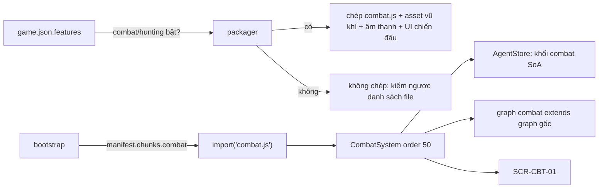

# TSD-06: Chiến đấu và săn bắt (module tuỳ chọn)

| Mục | Nội dung |
|---|---|
| Mã tài liệu | TSD-06 |
| Phiên bản | 1.1 (đã duyệt) |
| Ngày | 22/11/2026 |
| Tài liệu cha | TSD-00 `TSD-00-TONG-QUAN.md` |
| SRS nguồn | SRS-06 v0.1 (FR-CBT-01…28, NFR-CBT-01…03) |
| Quyết định | QĐ-13: chỉ có khi mô tả yêu cầu; **mặc định tắt**; tắt thì không mã, không asset, không UI, không chi phí |
| Gói | `engine/runtime/src/combat/` (chunk `combat.js`, nạp bằng `import()`), mở rộng graph `npc-ai`, HUD chiến đấu trong `ui/`; SCR-CBT-02 trong `web/app` |
| Pha | Khi game cần, sớm nhất E6; editor W3 |
| Trạng thái | Đã duyệt (Huy, 22/11/2026) |

---

## 1. Giới thiệu
Thiết kế module chiến đấu/săn bắt cắm vào runtime qua IF-RTM-02 chỉ khi `features.combat.enabled` hoặc `features.hunting.enabled`; mọi số cân bằng trong dữ liệu (QT-CBT-04); tất định ở chế độ test (FR-CBT-27).

---

## 2. Kiến trúc và đóng gói

| Thành phần | Trách nhiệm |
|---|---|
| `combat/system.ts` | `CombatSystem`: token tấn công, áp sát thương, gục/hồi sinh, tái xuất hiện |
| `combat/stats.ts` | Khối SoA `hp, atk, def, range, attackInterval, moveSpeedCombat, regenPerS, fleeHpRatio, cooldown, invulnUntil` |
| `combat/senses.ts` | Nhìn/nghe/đánh hơi (ALG-CBT-02) |
| `combat/player-actions.ts` | Nút Tấn công, Né/Đỡ, aim assist, ngắm tầm xa |
| `combat/projectiles.ts` | Pool đạn (giới hạn `combat.projectiles`) |
| `combat/hunting.ts` | Dấu vết, cảnh giác, bảng rơi, bẫy/lưới |
| `combat/formula.ts` | Biên dịch `features.combat.formula` bằng `@gamestudio/expr` với ngữ cảnh `{atk, def, weapon}` và hàm `max, min, round` |
| `combat/graph/combat.graph.json` | Graph `combat` (SRS-06 mục 2.2) `extends` graph gốc của thực thể |

---

## 3. Dữ liệu

| Mã | Cấu trúc | Ghi chú |
|---|---|---|
| SCH-CBT-01 | `game.json.features.combat`, `.hunting`, `.violence` | SRS-06 mục 2.1 + `dropOnDeath`, `showDamageNumbers`; schema kiểm `targets`/`species` là id tồn tại trong `entities/` (kiểm chéo sau Ajv, ERR-CBT-01) |
| SCH-CBT-02 | Khối `combat` trên npc/animal | SRS-06 mục 6.1: `hp, atk, def, range, attackInterval, moveSpeedCombat, regenPerS, fleeHpRatio, senses{sightM, sightDeg, hearM, smellM}, alertness: nhay\|vua\|cham, lootTable[{item, p, n:[a,b]}], despawnS, respawnS, tracks?` |
| SCH-CBT-03 | `weapon.schema.json` | SRS-06 mục 6.2: `kind: melee\|ranged\|trap\|net`, `damage, range, interval, projectile{speed, max}, model, sounds{swing, hit}` |
| SCH-CBT-04 | Bảng cân bằng CSV | Cột cố định: `kind,id,hp,atk,def,range,attackInterval,moveSpeedCombat,regenPerS,fleeHpRatio,damage,interval`; nhập toàn phần hoặc không gì (ERR-CBT-03 kèm số dòng) |

---

## 4. Thuật toán

| Mã | Thuật toán | Mô tả |
|---|---|---|
| ALG-CBT-01 | Đóng gói có điều kiện | Vite build engine với `combat/index.ts` là entry riêng → `combat-<hash>.js`; packager chép vào bản build và ghi `manifest.chunks.combat` chỉ khi cờ bật; asset có tag `combat` (vũ khí, âm thanh, hạt) chỉ được gom khi bật. Kiểm ngược: sau đóng gói, nếu cờ tắt mà danh sách file chứa `combat-*.js` hoặc asset tag `combat` → Fail ERR-CBT-04 (FR-CBT-03, NFR-CBT-02) |
| ALG-CBT-02 | Giác quan | Mỗi lần agent đến lượt (LOD hành vi TSD-05 ALG-CHR-05): nhìn = khoảng cách ≤ `sightM` × hệ số cảnh giác và góc ≤ `sightDeg/2` và tia không bị chặn (BVH, tối đa 2 tia/khung toàn hệ thống, xếp hàng); nghe = khoảng cách ≤ `hearM` × hệ số tốc độ người chơi (đứng 0, đi 1, chạy 2,5); đánh hơi = ≤ `smellM`, nhân (1 + 0,5·cos(góc giữa gió và hướng người chơi→thú)) khi có gió. Hệ số cảnh giác `nhay/vua/cham` = 1,5/1,0/0,6; người chơi ngồi ×0,5, đi chậm ×0,7 (FR-CBT-13, 17) |
| ALG-CBT-03 | Token tấn công | Hàng đợi ưu tiên theo khoảng cách; tối đa `budgets.combat.attackers` (Vừa 3, OI-CBT-05: chốt khi có game bật) agent giữ token; agent không có token chọn điểm vây trên vòng tròn 3–5 m (góc phân bổ đều, có seed) và chờ; token trả lại khi agent rời `TanCong` (FR-CBT-14) |
| ALG-CBT-04 | Sát thương | `dmg = formula(atk, def, weapon)` (mặc định `max(1, atk + weapon - def)`), làm tròn số nguyên; mục tiêu `invulnerable` hoặc không thuộc `targets`/`species` → bỏ qua (QT-CBT-02, FR-CBT-22); trúng: giật lùi 0,3 m theo hướng đòn, clip `hit`, bất tử 0,5 s (FR-CBT-07, 11) |
| ALG-CBT-05 | Aim assist | Ứng viên trong nón 60° trước mặt người chơi, tầm ≤ `range` + 1 m, hợp lệ theo ALG-CBT-04; chọn điểm = góc lệch chuẩn hoá × 0,6 + khoảng cách chuẩn hoá × 0,4, nhỏ nhất thắng; tầm xa: giữ nút → vuốt ngắm, hoặc chạm mục tiêu để khoá (raycast từ điểm chạm) (FR-CBT-09, 10) |
| ALG-CBT-06 | Đàn bỏ chạy | Khi thành viên bị tấn công/phát hiện người chơi → phát sự kiện nhóm; mọi thành viên chuyển `BoChay` với hướng = trung bình (xa người chơi) + nhiễu seed (FR-CBT-15) |
| ALG-CBT-07 | Săn bắt | Dấu vết: agent loài có `tracks` thả decal mỗi 1,5 m vào pool vòng (≤ 64 decal), sống `trackLifeS`; hạ thú → bảng rơi duyệt tuần tự `p` bằng RNG agent, số lượng `rng.int(a,b)`; bẫy/lưới: vùng kích hoạt → agent chuyển `BiBat` (FR-CBT-16…19) |
| ALG-CBT-08 | Gục và hồi sinh | Người chơi `hp=0` → khoá input, mờ màn 2 s, dịch tới `regions` loại `respawn` gần nhất, `hp` đầy, xử lý vật phẩm theo `dropOnDeath`. NPC/thú → clip `down`, mờ dần trong `despawnS` (5 s), trả agent về pool, hẹn tái sinh sau `respawnS` qua luật xuất hiện; không ragdoll (FR-CBT-20, 21) |
| ALG-CBT-09 | Mức bạo lực | `minimal`: không hạt máu, không xác, gục = ngã + mờ; `standard`: hạt trúng đòn màu theo dữ liệu (FR-CBT-23); `/new-game` không đặt cao hơn mức suy ra (QT-CBT-03) |
| ALG-CBT-10 | Ngân sách | Pool đạn = `combat.projectiles`, hạt chiến đấu = phần của `particles`; hết chỗ → từ chối sinh mới, ưu tiên bỏ cái xa camera nhất (FR-CBT-26) |

Phản hồi (FR-CBT-24): pool hạt trúng đòn, âm thanh 3D, `navigator.vibrate(40)` khi người chơi bật rung, số sát thương nổi dùng sprite text pool khi `showDamageNumbers`. HUD SCR-CBT-01 (FR-CBT-25): DOM, ẩn sau 5 s không giao tranh.

---

## 5. Web Studio
- SCR-CHR-01 hiện nhóm trường "Chiến đấu" và SCR-CBT-02 chỉ khi cờ bật (FR-CBT-28); bảng cân bằng là lưới chỉnh sửa (TanStack Table) sinh từ SCH-CBT-02/03, kiểm giới hạn từng ô, áp nóng vào xem trước; nhập/xuất CSV theo SCH-CBT-04 (FR-CBT-08).
- Bật chiến đấu/săn sau khi game có là thay đổi lớn (FR-CBT-04): PATCH chạm `features.combat|hunting` → brief vN+1 `ChoXacNhan` (TSD-01 ALG-INT-08); công thức sai cú pháp → ERR-CBT-02 kèm vị trí.

## 6. Hiệu năng

| Mục | Thiết kế | NFR |
|---|---|---|
| Giao tranh đông nhất đạt fps tier Vừa | Token giới hạn số agent hoạt động; giác quan theo LOD hành vi; ≤ 2 tia nhìn/khung; `combat` ≤ 1 ms/khung (TSD-00 mục 7.2) | NFR-CBT-01 |
| Gói JS không tăng khi tắt | ALG-CBT-01; test so kích thước gói | NFR-CBT-02 |
| Chạm Tấn công → clip ≤ 100 ms | Xử lý input ở `pointerdown` (không đợi `click`), bắt đầu clip ngay khung kế | NFR-CBT-03 |

## 7. Kiểm thử

| Mã | Kiểm thử |
|---|---|
| TST-CBT-01 | Game không bật → danh sách file gói không có `combat-*.js`, asset tag `combat`; kích thước JS bằng bản không có module (AC-06-01, NFR-CBT-02) |
| TST-CBT-02 | Hươu `nhay`, người chơi chạy tới → phát hiện ở bán kính 30 m, đàn bỏ chạy (AC-06-02) |
| TST-CBT-03 | Ngồi → bán kính 15 m; đi chậm → ×0,7 (AC-06-03) |
| TST-CBT-04 | 6 sói trên A56 → tối đa N tấn công cùng lúc, fps đạt (AC-06-04) |
| TST-CBT-05 | Kiếm 10 → 15: 12 → 17 sát thương, 3 → 2 đòn với sói `hp` 30, không sửa code (AC-06-05) |
| TST-CBT-06 | `minimal` → không hạt máu (AC-06-06) |
| TST-CBT-07 | NPC `invulnerable` → không nhận sát thương, aim assist bỏ qua (AC-06-07) |
| TST-CBT-08 | Hai lần chạy giao tranh seed cố định, bước 1/30 s → cùng chuỗi sự kiện (FR-CBT-27) |
| TST-CBT-09 | CSV sai cột → không áp dụng gì, lỗi có số dòng |

## 8. Open item kỹ thuật

| Mã | Câu hỏi | Đề xuất |
|---|---|---|
| OIT-CBT-01 | Ngân sách `combat.attackers/projectiles` | Vừa 3/20; SRS để mở tới khi có game bật chiến đấu (OI-CBT-05) |

## 9. Truy vết

| FR / NFR | Thành phần TSD |
|---|---|
| FR-CBT-01, 02 | SCH-CBT-01; TSD-01 SCH-INT-05 |
| FR-CBT-03 | ALG-CBT-01, TST-CBT-01 |
| FR-CBT-04 | Mục 5 |
| FR-CBT-05, 06 | SCH-CBT-02, SCH-CBT-03 |
| FR-CBT-07 | ALG-CBT-04, `combat/formula.ts` |
| FR-CBT-08 | SCH-CBT-04, mục 5 |
| FR-CBT-09, 10 | ALG-CBT-05 |
| FR-CBT-11 | ALG-CBT-04 |
| FR-CBT-12 | Mục 2 (`combat.graph.json`) |
| FR-CBT-13 | ALG-CBT-02 |
| FR-CBT-14 | ALG-CBT-03 |
| FR-CBT-15 | ALG-CBT-06 |
| FR-CBT-16…19 | ALG-CBT-07, ALG-CBT-02 |
| FR-CBT-20, 21 | ALG-CBT-08 |
| FR-CBT-22 | ALG-CBT-04 |
| FR-CBT-23 | ALG-CBT-09 |
| FR-CBT-24, 25 | Mục 4 (phản hồi, HUD) |
| FR-CBT-26 | ALG-CBT-10 |
| FR-CBT-27 | TST-CBT-08; TSD-04 mục 2.3 |
| FR-CBT-28 | Mục 5 |
| NFR-CBT-01…03 | Mục 6 |

## 10. Lịch sử thay đổi

| Phiên bản | Ngày | Người | Nội dung |
|---|---|---|---|
| 0.1 | 22/11/2026 | Claude | Bản đầu từ SRS-06 v0.1 |
| 1.0 | 22/11/2026 | Huy | Duyệt toàn bộ tài liệu |
| 1.1 | 22/11/2026 | Claude | Chốt các số "(đề xuất)" có nguồn từ SRS sau khi Huy duyệt SRS |
