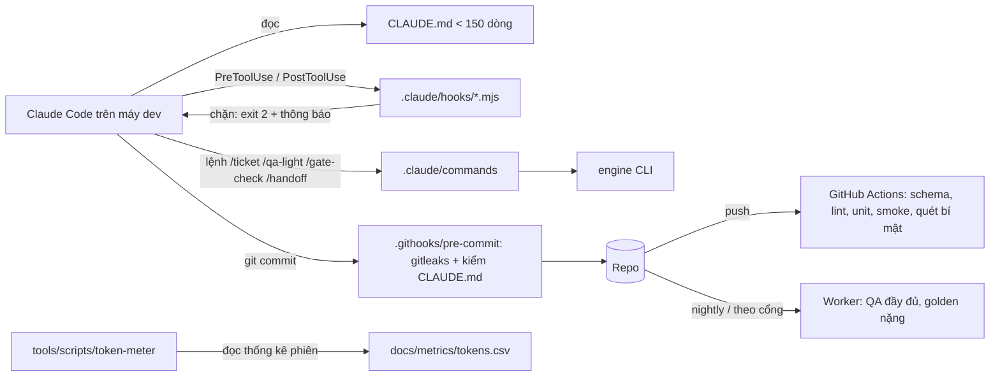

# TSD-09: Studio AI, quy trình, tiết kiệm token và bảo mật

| Mục | Nội dung |
|---|---|
| Mã tài liệu | TSD-09 |
| Phiên bản | 1.3 |
| Ngày | 26/11/2026 |
| Tài liệu cha | TSD-00 `TSD-00-TONG-QUAN.md` |
| SRS nguồn | SRS-09 v0.1 (FR-DEV-01…25, NFR-DEV-01…03) |
| Quyết định | Monorepo đến E8 (OI-DEV-02, TD-01); CI nhẹ trên GitHub Actions, QA đầy đủ trên worker (OI-DEV-03, OIT-GEN-04) |
| Thành phần | `.claude/` (agents, skills, commands, rules, hooks, templates), `.githooks/`, `tools/versions.json`, `tools/scripts/` (probe, token-meter, secret-scan), `engine doctor`, `.github/workflows/ci.yml`, `project.yaml`, `CLAUDE.md`, `UPSTREAM.md`, `LICENSES.md`, `docs/handoff.md`, `docs/metrics/tokens.csv` |
| Pha | E0 (đa số), E1 (CI), W1 (rigor `standard` cho web) |
| Trạng thái | Đã duyệt (Huy, 22/11/2026; bản 1.2 gồm CR-01 duyệt 23/11/2026); **v1.3 theo CR-02 và ADR-037**, chờ Huy xem lại |

---

## 1. Giới thiệu
Thiết kế kỹ thuật cho bộ công cụ làm việc với Claude Code: cấu trúc `.claude/`, hook tiết kiệm token và chặn rủi ro, mẫu phiếu/cổng/ADR, đo token, cố định phiên bản công cụ và `engine doctor`, quét bí mật, CI. Không có màn hình (SRS-09 mục 7).

Ràng buộc bảo mật xuyên suốt (QT-DEV-06): khoá Claude API, Gemini, ElevenLabs không bao giờ xuất hiện trong mã client, bản build, log, tài liệu, bộ nhớ dự án hay `docs/handoff.md`; mọi công cụ chỉ báo "có / không có".

---

## 2. Kiến trúc



### 2.1 Cấu trúc `.claude/`

```
.claude/
  settings.json            hook, quyền mặc định (không có MCP xem cảnh)
  settings.debug.json      bản mẫu bật MCP Unity/Blender khi gỡ lỗi (FR-DEV-17, CR-02)
  agents/<tên>.md          8 agent (mục 3, IF-DEV-01)
  skills/<tên>/SKILL.md    8 skill gốc + skill engine-*
  commands/<lệnh>.md       13 lệnh (FR-DEV-03)
  rules/<vùng>.md          rule theo đường dẫn (FR-DEV-04)
  hooks/                   h01-large-md.mjs h02-binary-log.mjs h03-schema.mjs h04-secrets.mjs h05-perf.mjs lib/
  templates/               ticket.md gate-report.md adr.md style-bible.md zone-spec.md building-spec.md
```

---

## 3. Giao diện

| Mã | Giao diện | Đặc tả |
|---|---|---|
| IF-DEV-01 | Agent | `agents/<tên>.md` có frontmatter `{name, description (một đoạn), model: opus\|sonnet\|haiku, tools?}` và thân: thư mục phụ trách, việc không làm. Danh sách: `director` (opus), `engine-dev` (sonnet), `tech-artist` (sonnet), `world-builder` (sonnet), `gameplay-ui` (sonnet), `asset-designer` (opus khi viết generator họ mới, sonnet khi chỉnh tham số: ghi trong mô tả, phiếu chọn mô hình), `qa` (sonnet; haiku cho chạy lại theo kịch bản), `docs` (haiku) = 8 (FR-DEV-01). `web-dev` tách khi bắt đầu W2 nếu Huy đồng ý (OI-DEV-01), khi đó gộp `docs` thành skill để giữ ≤ 8 |
| IF-DEV-02 | Hook | Khai báo trong `.claude/settings.json` mục `hooks`: `PreToolUse` cho `Read`, `Bash`, `Grep` (H-01, H-02, H-04); `PostToolUse` cho `Write`, `Edit` (H-03, H-05). Mỗi hook là script Node đọc JSON sự kiện từ stdin (`tool_name`, `tool_input`), không phụ thuộc gói ngoài trừ validator đã biên dịch. Chặn: mã thoát 2, thông báo ERR-DEV-* ở stderr (Claude Code trả lại cho agent). Cảnh báo: mã thoát 0, in thông báo cho agent. Lỗi nội bộ của hook: mã thoát 0 (không chặn nhầm) + ghi `.claude/hooks/hook-errors.log` |
| IF-DEV-03 | `engine doctor --json` | `{ok: bool, checks: [{id, kind: version\|binary\|addon\|env\|path, want?, have?, status: ok\|missing\|mismatch, message}]}`; mã thoát 0 khi đủ, 5 khi thiếu/lệch (TSD-04 TST-CLI-02). Kiểm biến môi trường chỉ bằng `name in process.env && value.length > 0`, không in, không băm, không ghi độ dài giá trị (FR-DEV-20, FR-DEV-22) |
| IF-DEV-04 | Lệnh Claude Code | `commands/<lệnh>.md` có frontmatter `{description, argument-hint?}`; thân gọi `engine …` hoặc script trong `tools/scripts/`, đọc kết quả JSON thay vì log. Lệnh: `/start`, `/new-game`, `/ticket`, `/build-zone`, `/qa-light`, `/qa-full`, `/perf-snapshot`, `/visual-diff`, `/gate-check`, `/asset-recipe`, `/adr`, `/publish-poc`, `/handoff`; v1.2 thêm `/resume-game`, `/import-game` (FR-DEV-03, 26, 27) |
| IF-DEV-05 | Git hook | `.githooks/pre-commit` (bật bằng `git config core.hooksPath .githooks`, `/start` tự đặt): `gitleaks protect --staged --redact`, kiểm `CLAUDE.md` < 150 dòng, kiểm JSON dữ liệu đã stage bằng `engine validate --staged`; lỗi → huỷ commit (FR-DEV-23) |

---

## 4. Dữ liệu và cấu hình

| Mã | Tệp | Cấu trúc |
|---|---|---|
| SCH-DEV-01 | `project.yaml` | Như SRS-09 mục 6.1; JSON Schema `tools/schema/project.schema.json`: `rigor ∈ {minimal, standard, full}`, `overrides[{path (glob), rigor}]`, `budgetsDefault`, `targetDevice`, `tiers[]`, `gates[]`. Khởi tạo: `minimal` mặc định; `web/api/**`, `web/worker/**`, `web/ai-gateway/**`, `web/shared/src/permissions.ts`, `web/api/src/plugins/auth*` ở `standard` (FR-DEV-05, 06) |
| SCH-DEV-02 | Phiếu `docs/tickets/T-nnnn.md` | Frontmatter `{id, title, phase, gate?, rigor (tính bởi ALG-DEV-01), model: {name: opus\|sonnet\|haiku, effort: low\|medium\|high\|xhigh}, read[] (glob), write[] (glob), done[] (tiêu chí), evidence[] (báo cáo JSON, ảnh), status, tokens?: {input, cacheWrite, cacheRead, output, total, sessions}}`; thân: mục tiêu, phạm vi, ghi chú, sửa ngoài danh sách (lý do) (FR-DEV-07, QT-DEV-02) |
| SCH-DEV-03 | `tools/versions.json` | `{node: "24.x.y", pnpm, python: "3.12.x", uv, blender: "4.5.x", addons: {sapling: {version, sha256}, ant_landscape: {version, sha256}}, ktx, gltfTransform, ffmpeg, gitleaks, playwright, chromium, unity /*vai trò dev, CR-02 thay three*/, unityPackages: {urp, gltfast, meshoptDecompress, ktxUnity, aiNavigation, inputSystem}}` (bản ghim theo POC-U1); mỗi mục có `check` (lệnh lấy phiên bản) và `match: exact\|minor` (FR-DEV-20) |
| SCH-DEV-04 | `docs/metrics/tokens.csv` | Cột `ticket, date, phase, agent, model, effort, sessions, input, cache_write, cache_read, output, total, wall_min, result` (UTF-8, phân tách dấu phẩy, một dòng mỗi phiếu) (FR-DEV-19) |
| SCH-DEV-05 | Báo cáo cổng `docs/gates/<cổng>.md` | Frontmatter `{gate, date, autoChecks[{id, desc, result: dat\|chua, evidence}], manualChecks[{id, desc}], a56: {fpsAvg, fpsP5, frameMsP95, memMB, loadS}, images[2..4], risks[], proposal, huyConfirm: {by, at} \| null, status: chua_qua\|da_qua}` (FR-DEV-09) |
| SCH-DEV-06 | `UPSTREAM.md`, `LICENSES.md` | `UPSTREAM.md`: nguồn (repo, commit, ngày fork), tác giả và license MIT, bảng thay đổi `{file, kind: them\|sua\|xoa, reason, ticket}`, quy trình lấy bản mới (ALG-DEV-09). `LICENSES.md`: bảng nguồn dữ liệu (OSM ODbL, Copernicus), thư viện (tên, phiên bản, license; sinh tự động bằng `pnpm licenses list --json` + `pip-licenses`), dịch vụ (Gemini, ElevenLabs, Claude API), asset CC0 theo nhóm (FR-DEV-12, 13, 24) |
| SCH-DEV-07 | ADR `docs/ADR/ADR-nnn-<slug>.md` | `{id, title, date, status: de_xuat\|chot\|thay_the, supersedes?}` + bối cảnh, quyết định, hệ quả, phương án đã loại; ADR-001…015 cho QĐ-01…15 ở E0; ADR-016…033 cho TD-01…18 (đã chốt 22/11/2026, TSD-00 mục 3) (FR-DEV-11) |
| SCH-DEV-08 | `docs/handoff.md` | ≤ 150 dòng, các mục cố định: ràng buộc, việc đã xong (5 phiếu gần nhất, chỉ tiêu đề + kết quả), asset đang chờ duyệt, bước tiếp, cảnh báo mở; không chứa bí mật (FR-DEV-15, QT-DEV-06) |
| SCH-DEV-09 | `games/<id>/handoff.md` (CR-01) | Ghi chú gọn theo game, ≤ 60 dòng: việc đã xong theo zone, quyết định riêng của game, việc dở; `/handoff` cập nhật khi phiếu chạm `games/<id>/**`; không chứa bí mật (QT-DEV-06) |

---

## 5. Thuật toán

| Mã | Tên | Mô tả |
|---|---|---|
| ALG-DEV-01 | Mức rigor của phiếu | Với mỗi glob trong `write[]` của phiếu, tìm `overrides` khớp (thư viện `picomatch`); mức của phiếu = mức cao nhất trong các khớp, mặc định `rigor`. `/ticket` điền mức và danh sách bắt buộc theo SRS-09 mục 6.2; `standard` thêm mục "unit test", "review bởi agent khác", "ADR nếu đổi kiến trúc"; phiếu chạm web/auth thêm "rà soát bảo mật ngắn" (danh sách 10 câu theo TSD-08 mục 6.1) (FR-DEV-05, 06) |
| ALG-DEV-02 | Đo token mỗi phiếu | Nguồn: tệp phiên JSONL của Claude Code trên máy dev (thư mục dự án trong `~/.claude/projects/`). `/ticket` ghi dấu mốc `[[ticket:T-nnnn start]]` vào tin nhắn đầu; `/handoff` ghi `[[ticket:T-nnnn end]]`. `tools/scripts/token-meter.mjs --ticket T-nnnn`: quét các phiên có dấu mốc (kể cả phiên sau `/clear` có nhắc mã phiếu), lấy các bản ghi trợ lý trong khoảng mốc, khử trùng theo `message.id`, cộng `usage.input_tokens`, `cache_creation_input_tokens`, `cache_read_input_tokens`, `output_tokens`, kể cả phiên subagent liên kết. `total = input + cache_write + cache_read + output`. Ghi vào frontmatter phiếu và nối dòng `tokens.csv`. Chỉ tiêu BO-02: trung bình `total` mỗi phiếu theo pha so với số nền Thiền viện online đo cùng định nghĩa (OI-DEV-04); báo cáo kèm chỉ số phụ "token quy đổi chi phí" (cache read × 0,1) để không lẫn hiệu ứng cache. Định dạng JSONL không phải giao diện công khai ổn định → script có bộ test mẫu và báo lỗi rõ khi gặp trường lạ (OIT-DEV-01) (FR-DEV-19, NFR-DEV-01) |
| ALG-DEV-03 | H-01 `.md` lớn | `Read` tệp `.md` có `stat.size > 40 KB` và không có `offset`/`limit` → chặn; thông báo ERR-DEV-01 kèm tối đa 60 heading (`^#{1,4} `) với số dòng để agent đọc đúng đoạn. `Grep` không bị chặn (FR-DEV-18) |
| ALG-DEV-04 | H-02 nhị phân/log, H-04 bí mật và lệnh phá huỷ | H-02: `Read` đuôi `.glb .gltf(bin) .ktx2 .bin .wasm`, ảnh `.png .jpg .jpeg .webp` > 1 MB, `.log` hoặc tệp `build/**/logs/**` > 2.000 dòng (đếm nhanh bằng đọc luồng dừng ở dòng 2.001) → chặn, ERR-DEV-02. H-04: đường dẫn khớp `**/.env*` (trừ `.env.example`), `**/*.key`, `**/*.pem`, `**/secrets/**`, `/etc/gamestudio/**` cho `Read`/`Grep`/`Bash`; `Bash` khớp mẫu `rm -rf /`, `rm -rf ~`, `rm -rf *` ở gốc repo, `git push --force`/`-f` tới `main`/`master`, `git reset --hard origin`, đọc bí mật qua `cat/type/Get-Content/printenv/env` với tên khoá đã biết → chặn, ERR-DEV-03. Mẫu đặt trong `hooks/lib/patterns.json` có test (TST-DEV-01) |
| ALG-DEV-05 | H-03 schema, H-05 nhắc đo | H-03 (`PostToolUse`, cảnh báo): tệp ghi khớp `games/**/data/**/*.json` → chạy validator Ajv standalone đã biên dịch (`engine/schema/dist/validators.cjs`, không biên dịch lúc chạy) → in tối đa 10 lỗi `{instancePath, message}`. H-05 (cảnh báo): ghi vào `engine/unity/Assets/GameStudio/{Render,World,Characters}/**`, `**/*.shadergraph`, `**/*.hlsl`, `**/materials/**`, `**/budgets.json` (CR-02) → nhắc `/perf-snapshot` (QT-RTM-02). Tổng số hook chặn = 3 (H-01, H-02, H-04) (NFR-DEV-03) |
| ALG-DEV-06 | `engine doctor` | Đọc SCH-DEV-03; với mỗi mục chạy lệnh `check` (thời gian chờ 10 s), so phiên bản theo `match`; Blender: chạy `blender -b --factory-startup --python-expr` in phiên bản Blender và add-on đã bật + `sha256` gói add-on; kiểm `ffmpeg` có bộ mã `aac` (ADR-037), `ktx` có `create`; vai trò `dev`: Unity Editor đúng bản `ProjectVersion.txt` có Web Build Support, gói Unity khớp `packages-lock.json` (CR-02); kiểm biến môi trường bắt buộc theo vai trò máy (`dev`: `ANTHROPIC_API_KEY` tuỳ chọn khi dùng chế độ chuyển giao (TSD-01), `GEMINI_API_KEY`, `ELEVENLABS_API_KEY`; `worker`: không cần khoá AI, cần `GS_GATEWAY_TOKEN`); in ERR-DEV-04/05. Worker chạy khi khởi động (TSD-08 mục 8.1) |
| ALG-DEV-07 | `/gate-check` | Đọc danh sách điều kiện của cổng từ `docs/gates/<cổng>.conditions.json` (sinh từ bảng cổng SRS-00); tự kiểm điều kiện đo được: báo cáo ngân sách mới nhất tier Vừa không `Fail`, `engine qa --level=day-du` `Pass`, provenance đủ (`engine asset check --provenance`), không còn lỗi mức cao trong rà soát bảo mật (W4), số đo A56 từ API-WEB-60 hoặc báo cáo đo tay; chọn 2–4 ảnh có SSIM thấp nhất so baseline (FR-DEV-21); dựng báo cáo SCH-DEV-05 với `status: chua_qua`. Chỉ Huy đổi sang `da_qua` bằng cách điền `huyConfirm`; CI kiểm không có cổng `da_qua` mà `huyConfirm` rỗng (FR-DEV-10, QT-DEV-03) |
| ALG-DEV-08 | Ghi chú gọn | `/handoff`: cập nhật SCH-DEV-08 (thay mục "việc đã xong" theo cửa sổ 5 phiếu, xoá mục đã đóng), chạy token-meter, kiểm ≤ 150 dòng; nhắc `/clear` trước phiếu sau, phiếu sau đọc `CLAUDE.md` + `docs/handoff.md` + phiếu, không đọc lịch sử (FR-DEV-15, 16). `CLAUDE.md` gồm: luật, cây thư mục, lệnh CLI, hướng dẫn chọn mô hình (FR-DEV-08: Opus high/xhigh cho kiến trúc, thuật toán mới, generator họ mới, cổng; Sonnet medium cho chỉnh tham số, script lặp, sửa nhỏ, test; Haiku cho đổi tên, tài liệu, việc cơ học), chỉ dẫn ADR; kiểm < 150 dòng ở pre-commit và CI (FR-DEV-14) |
| ALG-DEV-09 | Lấy bản mới upstream | Nhánh `vendor/upstream` chứa bản gốc nguyên vẹn tại commit đã fork. Lấy bản mới: cập nhật nhánh vendor tới commit mới → `git merge vendor/upstream` vào nhánh làm việc (hợp nhất ba chiều giữ thay đổi riêng) → giải xung đột theo bảng thay đổi `UPSTREAM.md` → cập nhật commit gốc và bảng trong cùng commit (QT-DEV-04) → chạy CI + `/qa-light` (UC-DEV-03, FR-DEV-12). `LICENSE` MIT và thông báo bản quyền gốc giữ nguyên; CI kiểm tệp `LICENSE` không đổi so với vendor (FR-DEV-13) |
| ALG-DEV-10 | CI | `.github/workflows/ci.yml` khi push/PR: (1) `pnpm install --frozen-lockfile`, `uv sync --frozen`; (2) `engine validate --all` (schema mọi `games/**/data`); (3) ESLint + `dependency-cruiser` (luật TSD-00 mục 4.2), `ruff`; (4) Vitest + pytest (bước nhẹ, golden nhẹ); (5) smoke runtime: Playwright mở game mẫu bản build nhỏ đã cam kết trong `games/_template/fixtures`, chạy 10 s không lỗi console; (6) `gitleaks detect --redact` toàn repo + lịch sử của nhánh; (7) kiểm `CLAUDE.md` < 150 dòng, số agent ≤ 8; (8) `pnpm audit --prod`, `pip-audit`. QA đầy đủ, golden nặng (Blender, bake) chạy nightly trên worker (FR-DEV-25, OI-DEV-03) |
| ALG-DEV-11 | `/resume-game <id> [yêu cầu]` (CR-01) | (1) `engine status --game <id> --json` (TSD-04 ALG-CLI-04); (2) đọc `games/<id>/handoff.md` (SCH-DEV-09), không đọc `data/**` (H-01/H-02 vẫn áp dụng); (3) in ≤ 15 dòng: `summarizeVi` (TSD-01 ALG-INT-13) + việc treo + bản nháp phiếu tiếp theo theo SCH-DEV-02 (mục tiêu từ `next`, `read[]` là tệp dữ liệu của zone/đối tượng liên quan, mô hình khuyến nghị theo ALG-DEV-08). (4) Có `[yêu cầu]`: tạo phiếu bằng `/ticket`; yêu cầu mở rộng phạm vi (zone, loài, NPC, nhiệm vụ, cờ tính năng) → phiếu có bước sinh `ChangeProposal` kèm `briefUpdate` (TSD-01 ALG-INT-12) để Huy duyệt, không sửa brief trực tiếp (FR-DEV-26) |
| ALG-DEV-12 | `/import-game <thư mục\|gói.zip>` (CR-01) | Chạy `engine import --json` (TSD-04 ALG-CLI-07), trình báo cáo `import/1` dạng bảng; `chan` → dừng, nêu lý do; thiếu brief → trình brief nháp (`suy_tu_du_lieu`/`thieu`) để Huy điền hoặc chấp nhận rồi `engine brief confirm`; `canNangCap` → đề xuất phiếu `engine upgrade` (mô hình Sonnet, effort medium); xong thì tạo `games/<id>/handoff.md` ban đầu (FR-DEV-27) |

---

## 6. Bảo mật và tuân thủ

- Khoá chỉ ở biến môi trường máy dev (Windows: biến môi trường người dùng) hoặc `/etc/gamestudio/ai.env` của máy chủ (TSD-08 mục 6.3); `tools/scripts/probe-keys.mjs` in đúng dạng `ANTHROPIC_API_KEY: có` / `không có` (FR-DEV-22).
- `.gitignore`: `.env*` (trừ `.env.example` không có giá trị), `*.key`, `*.pem`, `secrets/`, `build/`, `**/cache/`, `data.bak-*/`, tệp DEM/OSM tải về, `node_modules/`, `.venv/` (FR-DEV-23).
- Quét bí mật ba lớp: pre-commit (IF-DEV-05), CI (ALG-DEV-10), thư mục xuất bản trước khi chép ra (`engine publish`, TSD-04 ALG-CLI-03). Cấu hình `gitleaks.toml` thêm luật cho tiền tố khoá Anthropic, Google API, ElevenLabs, khoá ký JWT của dự án.
- H-04 chặn agent đọc tệp bí mật và lệnh phá huỷ; `settings.json` không cấp sẵn quyền `Bash(*)`.
- MCP xem cảnh (Unity, Blender; CR-02) không nằm trong `settings.json` mặc định; bật bằng cách chép `settings.debug.json` → `settings.local.json` (không commit) (FR-DEV-17).
- Ghi công: `UPSTREAM.md`, `LICENSES.md`, credit trong game (TSD-03 provenance) (FR-DEV-13, 24).

---

## 7. Hiệu năng

| Chỉ tiêu | Mục tiêu | Thiết kế |
|---|---|---|
| Thời gian hook | ≤ 1 s mỗi lần (NFR-DEV-02) | Node khởi động lạnh ~60 ms; hook không import gói lớn; H-03 dùng validator biên dịch sẵn; H-02 đếm dòng có điểm dừng; mỗi hook có giới hạn cứng 900 ms tự thoát 0 |
| Số hook chặn | ≤ 3 (NFR-DEV-03) | H-01, H-02, H-04; H-03, H-05 chỉ cảnh báo |
| Token mỗi phiếu | Giảm ≥ 50% so với Thiền viện online (NFR-DEV-01) | `CLAUDE.md` gọn, `/clear` + handoff, hook chặn đọc lớn, báo cáo JSON thay log, ảnh 2–4 tấm, phiếu phạm vi hẹp, mô hình nhỏ cho việc cơ học; đo bằng ALG-DEV-02 |

---

## 8. Kiểm thử

| Mã | Nội dung | Đạt khi |
|---|---|---|
| TST-DEV-01 | Hook: chạy từng script với JSON sự kiện mẫu: `.md` 60 KB không offset → chặn + có heading (AC-09-02); `.env` → chặn (AC-09-03); `.env.example` → cho; `.glb`, ảnh 2 MB, log 3.000 dòng → chặn; lệnh `git push --force origin main` → chặn; `git push origin feature` → cho; JSON dữ liệu sai → cảnh báo có `instancePath` | Đúng mọi ca (Vitest) |
| TST-DEV-02 | Thời gian hook: 100 lần mỗi hook trên máy dev chuẩn | P95 ≤ 1 s, trung bình ≤ 200 ms **(TSD đề xuất)** |
| TST-DEV-03 | `engine doctor`: máy thiếu Blender, lệch bản add-on, thiếu biến khoá | Báo ERR-DEV-04/05 đúng thành phần; đầu ra (kể cả `--json`, log) không chứa giá trị khoá giả "canary" đặt trong env (AC-09-06) |
| TST-DEV-04 | Quét bí mật: đặt khoá giả "canary" theo định dạng từng nhà cung cấp vào (a) tệp stage, (b) commit trên nhánh, (c) thư mục xuất bản, (d) bundle JS của `web/app` | gitleaks phát hiện cả 4; pre-commit huỷ commit; CI fail; `engine publish` dừng với mã lỗi; bản phát hành thật không có phát hiện nào |
| TST-DEV-05 | Cấu trúc: đếm agent ≤ 8, 8 skill gốc + 10–15 skill engine, 13 lệnh; `CLAUDE.md` < 150 dòng; `LICENSE` trùng vendor | Đạt (AC-09-01) |
| TST-DEV-06 | `/ticket` trên yêu cầu mẫu | Phiếu có "Mô hình khuyến nghị", `read[]`, `write[]`, rigor đúng theo ALG-DEV-01 (AC-09-04) |
| TST-DEV-07 | `/gate-check` trên cổng mẫu có dữ liệu giả | Báo cáo theo SCH-DEV-05, có số đo A56, 2–4 ảnh, `status: chua_qua` khi chưa có xác nhận (AC-09-05) |
| TST-DEV-08 | Token-meter trên tệp phiên JSONL mẫu (có trùng `message.id`, có `/clear`, có subagent) | Tổng khớp giá trị tính tay; dòng CSV đúng cột SCH-DEV-04 |
| TST-DEV-09 | `/resume-game` trên game mẫu `CanBuild`: đầu ra ≤ 15 dòng, có phiếu đề xuất "Build lại zone z2", không có thao tác đọc `games/<id>/data/**`; có yêu cầu "thêm zone chợ" → phiếu có bước tạo đề xuất kèm `briefUpdate`. `/import-game` trên thư mục không brief → hiện brief nháp, chưa build (AC-CR01-12) | Đúng mọi ca |

---

## 9. Open item kỹ thuật

| Mã | Câu hỏi | Đề xuất | Liên quan |
|---|---|---|---|
| OIT-DEV-01 | Đo token dựa vào định dạng tệp phiên Claude Code (có thể đổi theo phiên bản) | Cố định phiên bản Claude Code trong `versions.json`; token-meter có test mẫu, cập nhật khi đổi | FR-DEV-19 |
| OIT-DEV-02 | Số nền token Thiền viện online | Lấy từ lịch sử phiếu nếu có; không có thì đo 10 phiếu đầu E0–E1 theo cách làm cũ để lấy nền | OI-DEV-04, NFR-DEV-01 |

---

## 10. Truy vết

| Yêu cầu SRS | Thành phần TSD |
|---|---|
| FR-DEV-01 | IF-DEV-01, TST-DEV-05 |
| FR-DEV-02, 03 | Mục 2.1, IF-DEV-04, TST-DEV-05 |
| FR-DEV-04 | Mục 2.1 (`rules/`) |
| FR-DEV-05, 06 | SCH-DEV-01, ALG-DEV-01 |
| FR-DEV-07 | SCH-DEV-02, TST-DEV-06 |
| FR-DEV-08 | ALG-DEV-08, IF-DEV-01 |
| FR-DEV-09, 10 | SCH-DEV-05, ALG-DEV-07, TST-DEV-07 |
| FR-DEV-11 | SCH-DEV-07 |
| FR-DEV-12, 13 | SCH-DEV-06, ALG-DEV-09 |
| FR-DEV-14 | ALG-DEV-08, IF-DEV-05, ALG-DEV-10 |
| FR-DEV-15, 16 | SCH-DEV-08, ALG-DEV-08 |
| FR-DEV-17 | Mục 6 |
| FR-DEV-18 | IF-DEV-02, ALG-DEV-03, ALG-DEV-04, ALG-DEV-05, TST-DEV-01 |
| FR-DEV-19 | ALG-DEV-02, SCH-DEV-04, TST-DEV-08 |
| FR-DEV-20 | SCH-DEV-03, IF-DEV-03, ALG-DEV-06, TST-DEV-03 |
| FR-DEV-21 | ALG-DEV-07 |
| FR-DEV-22, 23 | Mục 6, IF-DEV-05, TST-DEV-04 |
| FR-DEV-24 | SCH-DEV-06 |
| FR-DEV-25 | ALG-DEV-10 |
| NFR-DEV-01 | ALG-DEV-02, mục 7 |
| NFR-DEV-02, 03 | Mục 7, ALG-DEV-05, TST-DEV-02 |
| FR-DEV-26 | ALG-DEV-11, SCH-DEV-09, TST-DEV-09 |
| FR-DEV-27 | ALG-DEV-12, TST-DEV-09 |

## 11. Lịch sử thay đổi

| Phiên bản | Ngày | Người | Nội dung |
|---|---|---|---|
| 0.1 | 22/11/2026 | Claude | Bản đầu từ SRS-09 v0.1 |
| 0.2 | 22/11/2026 | Claude | SCH-DEV-07: ghi nhận ADR-016…033 đã chốt |
| 1.0 | 22/11/2026 | Huy | Duyệt toàn bộ tài liệu |
| 1.1 | 22/11/2026 | Claude | Chốt các số "(đề xuất)" có nguồn từ SRS sau khi Huy duyệt SRS |
| 1.2 | 23/11/2026 | Claude | CR-01 (SRS-09 v1.1): lệnh `/resume-game`, `/import-game` (ALG-DEV-11, 12), SCH-DEV-09, TST-DEV-09, truy vết FR-DEV-26, 27 |
| 1.2 | 23/11/2026 | Huy | Duyệt phần bổ sung CR-01 |
| 1.3 | 26/11/2026 | Claude | CR-02 (ADR-036), POC-U1, ADR-037: cây `.claude` (MCP Unity), SCH-DEV-03 (bỏ `three`, thêm `unity` và gói Unity), ALG-DEV-06 (kiểm `aac`, Unity Editor), mục MCP |
