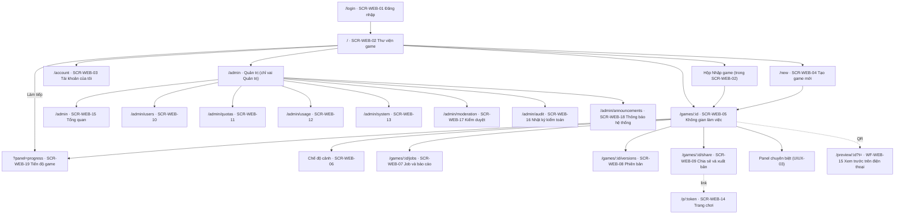

# UIUX tổng quan: Thiết kế giao diện Web Studio và trang quản trị

| Mục | Nội dung |
|---|---|
| Mã tài liệu | UIUX-00 |
| Phiên bản | 1.0 |
| Ngày | 23/11/2026 |
| Chủ sở hữu / người duyệt | Huy |
| Người soạn | Claude |
| Nguồn | SRS-08 v1.2 (thêm phần quản trị và luồng làm tiếp/cập nhật game CR-01, 23/11/2026), SRS-00 v1.2 mục 4.4, SRS-09 v1.1, SRS-01/02/03/05/06/07 (mục Giao diện) v1.0–1.1 (đã duyệt); TSD-08 v1.3 (đã duyệt); DDD-08 v1.0 (đã duyệt, nguồn chính cho endpoint, DTO, store editor); ADR-027 (React 19 + Vite, Tailwind + Radix UI, `@xyflow/react`, Monaco) |
| Quyết định áp dụng | QĐ-07 dùng nội bộ; QĐ-15 Web Studio riêng, chỉ người được mời (CH-23); QĐ-13 chiến đấu/săn tuỳ chọn; QĐ-14 hội thoại AI tuỳ chọn qua cổng AI |
| Trạng thái | Đã duyệt (Huy, 23/11/2026) |

> UIUX đi song song DDD-08 ở tầng giao diện: SRS nói **màn hình nào có gì**, DDD nói **API và store trả gì**, UIUX nói **người dùng thấy gì, bấm gì, theo thứ tự nào, ở trạng thái nào và đọc câu chữ nào**. Mục tiêu là một phiếu `web/app` mở đúng một wireframe UIUX, dựng màn hình bằng thành phần của hệ thống thiết kế mà không phải đoán bố cục hay câu chữ. UIUX không định nghĩa lại mã SRS/DDD và không tự đổi yêu cầu đã duyệt. Phần quản trị mà SRS v1.0 chưa có được UIUX v0.1 đề xuất (`SCR-ADM`, `FRP-ADM`); Huy duyệt 23/11/2026, nay là SCR-WEB-15…18 và FR-WEB-51…59 của SRS-08 v1.1.

### Danh mục UIUX

| Mã | Tài liệu | Nguồn chính | Nhóm mã | Phạm vi |
|---|---|---|---|---|
| UIUX-00 | UIUX tổng quan (tài liệu này) | SRS-08 mục 2–3, 7; SRS-00 mục 7 | `GEN` | Người dùng, nguyên tắc, kiến trúc thông tin, điều hướng, hệ mã, đề xuất bổ sung, open item |
| UIUX-00-PL-A | [Ma trận truy vết SRS → UIUX](UIUX-00-PL-A-MA-TRAN-TRUY-VET.md) (sinh tự động) | Mục "Truy vết" của UIUX-00…04 | — | — |
| UIUX-01 | [Hệ thống thiết kế](UIUX-01-HE-THONG-THIET-KE.md) | TSD-08 mục 3, ADR-027, NFR-WEB-04 | `GEN` | Token, kiểu chữ, lưới, điểm ngắt, thành phần dùng chung, quy tắc tương tác, khả năng tiếp cận, câu chữ |
| UIUX-02 | [Web người dùng](UIUX-02-WEB-NGUOI-DUNG.md) | SRS-08 SCR-WEB-01…09, 14, 19; DDD-08 | `WEB` | Luồng người dùng, wireframe đăng nhập, thư viện, tài khoản, tạo game bằng chat, không gian làm việc, xem trước 3D, job, phiên bản, chia sẻ, xuất bản, trang chơi; làm tiếp game đang dở, cập nhật game đã xuất bản, nhập game có sẵn, nâng cấp engine/schema (bảng Tiến độ) |
| UIUX-03 | [Editor chuyên biệt](UIUX-03-EDITOR-CHUYEN-BIET.md) | SRS-01/02/03/05/06/07 mục Giao diện; SRS-08 FR-WEB-21…30 | `INT`, `WLD`, `AST`, `CHR`, `CBT`, `DLG`, `WEB` | Panel trong không gian làm việc: editor cảnh, đề xuất, style bible, môi trường, bản đồ vùng, asset, NPC, động vật, sơ đồ hành vi, cân bằng, hội thoại, JSON thô |
| UIUX-04 | [Web quản trị](UIUX-04-WEB-QUAN-TRI.md) | SRS-08 SCR-WEB-10…13, FR-WEB-01, 03, 06, 07, 43, 44, 48, 49 | `ADM`, `WEB` | Người dùng, hạn mức, chi phí, hệ thống, tổng quan, kiểm duyệt, nhật ký kiểm toán, thông báo hệ thống (SCR-WEB-10…18) |
| Prototype | [`prototype/index.html`](prototype/index.html): 16 màn hình HTML tĩnh (8 người dùng, 8 quản trị) theo UIUX-01…04; bản trên claude.ai: https://claude.ai/artifact/UbvtaLd23A6M6RPqBFteLh | UIUX-01…04 | — | Minh hoạ trực quan, không thay thế wireframe và quy tắc trong tài liệu |

---

## 1. Giới thiệu

### 1.1 Mục đích
Đặc tả trải nghiệm và giao diện của Web Studio (người tạo game, người xem, khách có link) và trang quản trị, đủ để:
- dựng màn hình `web/app` (MOD-WEB-20…25 của DDD-08) bằng một bộ thành phần thống nhất;
- viết chuỗi `src/i18n/vi.json` từ bảng câu chữ;
- kiểm thử khả dụng và khả năng tiếp cận trước các cổng G-W1…G-W4.

### 1.2 Phạm vi

| Trong phạm vi | Ngoài phạm vi |
|---|---|
| Toàn bộ màn hình kênh Web của SRS-00 mục 7 (SCR-WEB-01…14, SCR-INT-01/02, SCR-WLD-01/02, SCR-AST-01/02, SCR-CHR-01…03, SCR-CBT-02, SCR-DLG-01); trang xem trước trên điện thoại; thông báo trong web; hệ thống thiết kế; đề xuất màn hình quản trị còn thiếu | Giao diện trong game (SCR-RTM-*, SCR-CBT-01, SCR-DLG-02: thuộc SRS-04/06/07 và runtime); giao diện Claude Code, lệnh, hook (SRS-09 mục 7: "Không có màn hình"); cộng tác thời gian thực (CH-30); bình luận/ghim trên cảnh (OI-WEB-02, để W4); email (OI-WEB-04) |

### 1.3 Đối tượng đọc
Huy (duyệt), phiên điều phối (cắt phiếu theo wireframe), agent `gameplay-ui` / `web-dev` (khi tách, OI-DEV-01), agent `qa` (kiểm thử khả dụng, mục 7 của từng tài liệu), người soạn `docs/TEST`.

### 1.4 Về SRS-09
SRS-09 đặc tả quy trình phát triển bằng Claude Code và nói rõ không có màn hình (SRS-09 mục 7). UIUX chỉ nhận từ SRS-09 các ràng buộc áp lên mã giao diện:

| Ràng buộc | Áp dụng trong UIUX |
|---|---|
| FR-DEV-04 rule `web/**`: không khoá API phía client, kiểm quyền ở backend | UXR-GEN-01 (giao diện chỉ ẩn/vô hiệu nút, không thay kiểm quyền); trang cấu hình AI chỉ hiện "Đã cấu hình / Chưa" (WF-WEB-13) |
| FR-DEV-06 `web/api/**`, xác thực, phân quyền ở mức `standard` | Màn hình liên quan quyền (WF-WEB-09, WF-WEB-10) có ca kiểm thử UT tương ứng |
| QT-DEV-06 bí mật không ra ngoài | Không có ô nhập khoá ở bất kỳ màn hình nào |
| FR-DEV-26 `/resume-game`, FR-DEV-27 `/import-game` (v1.1) là đường Claude Code của cùng luồng làm tiếp/nhập game | Bảng Tiến độ (UIUX-02 WF-WEB-19) dùng cùng báo cáo tiến độ và cùng nhãn việc tiếp theo với `engine status` (UXR-WEB-11); gói nhập từ thư mục làm bằng Claude Code đi qua hộp Nhập game (UIUX-02 UF-WEB-13) |

---

## 2. Người dùng và bối cảnh

| Vai | Ai | Thiết bị chính | Mục tiêu chính | Điều cần tránh |
|---|---|---|---|---|
| Người tạo game | Thành viên nhóm, không cần biết lập trình hay cấu trúc tệp (BO-09) | Máy văn phòng ≥ 1366 px; điện thoại để thử | Từ mô tả tới bản chơi được ≤ 30 phút (NFR-WEB-08); chỉnh bằng lời hoặc kéo thả; thấy ngay kết quả | Thuật ngữ kỹ thuật (JSON, patch, hash) ở chế độ thường; chờ không rõ lý do; mất thay đổi |
| Người được chia sẻ quyền Sửa | Như trên, cùng làm một game | Như trên | Biết ai đang sửa, sửa khi tới lượt | Ghi đè thay đổi của người khác |
| Người xem | Người trong nhóm góp ý | Máy tính hoặc điện thoại | Xem, chơi thử, đọc lịch sử | Thấy nút không bấm được mà không biết vì sao |
| Khách có link | Người ngoài nhóm được gửi link | Điện thoại (Galaxy A56 là chuẩn) | Mở và chơi ngay | Phải đăng nhập khi không cần; trang lỗi khó hiểu |
| Quản trị | Huy và người được giao | Máy văn phòng | Mời, khoá, đặt hạn mức, xem chi phí, theo dõi hệ thống, kiểm duyệt | Lộ khoá API; thao tác nhầm khó hoàn tác |

Bối cảnh sử dụng: nội bộ ≤ 20 người (GĐ-WEB-04), giờ làm việc 8:00–20:00 (NFR-WEB-05), tiếng Việt (NFR-WEB-04, NFR-GEN-13), mạng văn phòng 50 Mbps (NFR-WEB-01).

---

## 3. Nguyên tắc thiết kế

| Mã | Nguyên tắc | Hệ quả trên giao diện |
|---|---|---|
| UXR-GEN-20 | **Xem trước là trung tâm** | Khung xem trước 3D chiếm vùng lớn nhất của không gian làm việc; mọi thay đổi chỉ tới được đâu đều có phản hồi nhìn thấy: áp nóng ≤ 2 s hoặc nhãn "Cần build" + vật đặt tạm (DDD-08 `showProxy`) |
| UXR-GEN-21 | **AI đề xuất, người duyệt** (QT-WEB-03) | Thay đổi từ chat luôn hiện thành thẻ đề xuất có Duyệt / Duyệt phần đã chọn / Bỏ; không có nút "để AI tự làm" |
| UXR-GEN-22 | **Không bao giờ mất việc** (QT-WEB-02, QT-WEB-07) | Lưu tự động, chỉ báo lưu luôn hiện, mỗi lần lưu là một mốc phiên bản khôi phục được; xung đột 409 hợp nhất tự động trước, hỏi người dùng sau |
| UXR-GEN-23 | **Ngôn ngữ thường trước, kỹ thuật sau** | Chế độ thường nói "Thêm đàn gà: 5 con, vùng Sân trước" (FR-INT-24); JSON, JSON Pointer, hash chỉ ở chế độ JSON thô, chi tiết phiên bản và trang quản trị |
| UXR-GEN-24 | **Chờ có lý do và có thời gian** | Mọi việc > 1 s có tiến độ; job có từng bước, % và thời gian còn lại ước lượng (FR-WEB-14) |
| UXR-GEN-25 | **Quyền rõ ràng** | Vai trò của tôi hiện trên thẻ game và thanh trên; nút không có quyền thì ẩn, tạm không làm được thì vô hiệu kèm lý do (UXR-GEN-01) |
| UXR-GEN-26 | **Nhẹ cho máy văn phòng, đủ dùng trên điện thoại** | Editor tối ưu ≥ 1366 px; xem trước, chat, duyệt đề xuất, trang chơi dùng được ở 412 px (NFR-WEB-04) |

---

## 4. Kiến trúc thông tin

### 4.1 Sơ đồ trang

Tuyến (route) đặt trong `web/app/src/router.tsx` (MOD-WEB-20); tách chunk theo nhóm: thư viện, không gian làm việc, quản trị, trang chơi (TSD-08 mục 3.1).

### 4.2 Điều hướng toàn cục

| Vùng | Nội dung | Ghi chú |
|---|---|---|
| Thanh ứng dụng (CMP-GEN-04) | Logo "GameStudio" (về thư viện) · Thư viện · Quản trị (chỉ vai Quản trị) · ô tìm game · chuông thông báo (CMP-GEN-15) · ảnh đại diện (Tài khoản, Đăng xuất) | Ẩn trong không gian làm việc, thay bằng thanh trên của game (CMP-GEN-05) có nút quay về thư viện |
| Băng hệ thống | Băng cảnh báo hạn mức ≥ 80% (MSG-WEB-01); băng mất kết nối (UXR-GEN-07); băng thông báo hệ thống/bảo trì (FR-WEB-58) | Tối đa 1 băng hiện cùng lúc, ưu tiên: mất kết nối > bảo trì > hạn mức |
| Thanh bên quản trị (CMP-GEN-28) | Mục quản trị theo mục 4.1 | Chỉ trong `/admin/*` |

### 4.3 Ma trận hiển thị theo vai trò
Áp dụng SRS-08 mục 3 cho giao diện (backend vẫn kiểm theo FR-WEB-05):

| Thành phần giao diện | Quản trị | Người tạo game | Người xem | Khách có link |
|---|---|---|---|---|
| Nút "Tạo game mới", "Nhập game" | Hiện | Hiện | Ẩn | — |
| Mục "Quản trị" trên thanh ứng dụng | Hiện | Ẩn | Ẩn | — |
| Trong game, theo quyền game | Theo mục 3.2 SRS-08; game không phải thành viên: chỉ đọc, băng "Bạn đang xem với quyền quản trị" | Theo quyền game | Theo quyền game | Chỉ SCR-WEB-14 |

| Thành phần trong game | Chủ game | Được sửa | Chỉ xem |
|---|---|---|---|
| Ô nhập chat | Gửi được | Gửi được | Chỉ gửi câu hỏi (FR-WEB-13), nhãn "Bạn chỉ có thể hỏi" |
| Nút Duyệt trên thẻ đề xuất, gizmo, panel sửa | Hiện | Hiện | Ẩn; panel ở chế độ chỉ đọc |
| Build, QA, Chấp nhận baseline | Hiện | Hiện | Ẩn |
| Xuất bản, Link chơi thử | Hiện | Ẩn (OI-WEB-01) | Ẩn |
| Chia sẻ, Lưu trữ, Xoá, Xuất gói | Hiện | Ẩn (Nhân bản: Hiện) | Ẩn |
| Lấy quyền sửa | Hiện khi người khác giữ khoá | Ẩn | Ẩn |
| Lọc Đang dở, bảng Tiến độ (v0.3) | Hiện, có nút hành động | Hiện, có nút hành động | Hiện, chỉ đọc |
| Làm tiếp, Build phần thay đổi, Nâng cấp, Nhập gói vào game này (v0.3) | Hiện | Hiện | Ẩn |
| Chuyển link sang bản mới, chế độ link (v0.3) | Hiện | Ẩn | Ẩn |

---

## 5. Quy ước mã của UIUX

UIUX chỉ **tham chiếu** mã SRS (FR, NFR, QT, UC, SCR, API, ERR, MSG, OI), TSD và DDD (MOD, DTO, EP, PSC…). Mã mới của UIUX:

| Loại | Mẫu | Nội dung | Ví dụ |
|---|---|---|---|
| Wireframe | `WF-<NHÓM>-nn` | Bố cục một màn hình hoặc panel; số trùng số SCR khi có SCR tương ứng (WF-WEB-05 ↔ SCR-WEB-05) | WF-WEB-05 |
| Luồng người dùng | `UF-<NHÓM>-nn` | Chuỗi bước từ ý định tới kết quả, qua nhiều màn hình | UF-WEB-02 |
| Thành phần | `CMP-GEN-nn` | Thành phần giao diện dùng chung: biến thể, trạng thái, quy tắc | CMP-GEN-08 |
| Token | `TOK-GEN-nn` | Nhóm giá trị thiết kế (màu, chữ, khoảng cách…) | TOK-GEN-01 |
| Quy tắc tương tác | `UXR-<NHÓM>-nn` | Quy tắc hiển thị/hành vi áp cho nhiều màn hình | UXR-GEN-01 |
| Câu chữ | `TXT-<NHÓM>-nn` | Câu giao diện bổ sung ngoài MSG/ERR của SRS | TXT-WEB-03 |
| Kiểm thử khả dụng | `UT-<NHÓM>-nn` | Kịch bản thử với người dùng hoặc kiểm tiếp cận | UT-WEB-01 |
| Màn hình đề xuất | `SCR-ADM-nn` | Màn hình quản trị UIUX đề xuất khi SRS chưa có; giữ làm tham chiếu lịch sử sau khi vào SRS | SCR-WEB-16 |
| Yêu cầu đề xuất | `FRP-ADM-nn` | Yêu cầu **đề xuất bổ sung** cho SRS-08/DDD-08, cần change request | FRP-ADM-04 |
| Open item UIUX | `OIU-<NHÓM>-nn` | Câu hỏi cần Huy chốt hoặc đo | OIU-GEN-01 |

Nhóm: `GEN` (chung), `WEB` (web người dùng), `ADM` (quản trị), và nhóm panel theo SRS: `INT`, `WLD`, `AST`, `CHR`, `CBT`, `DLG`. Mã được **định nghĩa** ở ô đầu dòng bảng hoặc ở tiêu đề `###`/`####`; mọi chỗ khác là tham chiếu. Nhãn số liệu: không ghi = đã chốt ở SRS/TSD/DDD; **(UIUX đề xuất)** = giá trị UIUX đưa ra để dựng, chỉnh qua phiếu sau thử nghiệm.

Mỗi tài liệu UIUX-01…04 theo khung mục: 1 Giới thiệu · 2 Luồng người dùng (UF) · 3 Wireframe (WF) · 4 Quy tắc tương tác (UXR) · 5 Câu chữ (TXT) · 6 Trạng thái và lỗi · 7 Kiểm thử khả dụng (UT) · 8 Open item (OIU) · 9 Truy vết · 10 Lịch sử thay đổi. UIUX-01 thay mục 2–3 bằng token và thành phần. Mục không áp dụng ghi "Không có".

Cách đọc wireframe: khung chữ trong khối `text` là bố cục tương đối (không theo tỉ lệ); `[Nút]` là nút, `(•)` lựa chọn, `[ ]` ô chọn, `▾` menu thả, `⋯` menu thao tác, `░` vùng đang tải. Kích thước px ghi rõ khi SRS/UIUX chốt.

---

## 6. Đề xuất bổ sung cho phần quản trị (đã duyệt 23/11/2026)

SRS-08 đã có bốn màn hình quản trị (SCR-WEB-10…13) và các yêu cầu FR-WEB-01, 03, 06, 07, 43, 44, 48, 49. So với nhu cầu quản trị, kiểm duyệt, giám sát, UIUX thấy các chỗ còn thiếu sau. Chi tiết ở UIUX-04 mục 3.2; đây là bảng để Huy chốt một lần.

| STT | Mã | Đề xuất bổ sung | Loại thay đổi | Ưu tiên | Màn hình (SRS-08 v1.1) |
|---|---|---|---|---|---|
| 1 | FRP-ADM-01 | Trang tổng quan quản trị: chỉ số chính và danh sách cảnh báo cần xử lý | SRS-08 (mở rộng FR-WEB-48) + DDD-08 endpoint | S, W2 | SCR-WEB-15 |
| 2 | FRP-ADM-02 | Endpoint dữ liệu vận hành cho SCR-WEB-13 (job toàn hệ thống, worker, dung lượng, sao lưu, P95): DDD-08 chưa có | Chỉ DDD-08 (SRS đã có FR-WEB-48) | M, W2 | SCR-WEB-13 |
| 3 | FRP-ADM-03 | Quản trị huỷ / thử lại job của mọi game | SRS-08 mục 3 + DDD-08 | S, W2 | SCR-WEB-13 |
| 4 | FRP-ADM-04 | Xem, lọc, xuất nhật ký kiểm toán trên web | SRS-08 (mở rộng FR-WEB-49) + DDD-08 | S, W2 | SCR-WEB-16 |
| 5 | FRP-ADM-05 | Danh sách mọi game cho quản trị, mở chỉ đọc | SRS-08 + DDD-08 | S, W2 | SCR-WEB-17 |
| 6 | FRP-ADM-06 | Quản trị thu hồi link chơi thử và gỡ bản xuất bản của mọi game (kiểm duyệt) | **Đổi** SRS-08 mục 3.2 và FR-WEB-38 (hiện chỉ chủ game) | S, W4 | SCR-WEB-17 |
| 7 | FRP-ADM-07 | Tổng hợp kết quả lọc hội thoại AI theo game/NPC, không hiện nội dung trừ khi bật gỡ lỗi | SRS-08 + DDD-07/08 | C, W4 | SCR-WEB-17 |
| 8 | FRP-ADM-08 | Danh sách asset toàn kho cho quản trị, lọc thiếu provenance / ngừng dùng | SRS-08 + DDD-03/08 | S, W4 | SCR-WEB-17 |
| 9 | FRP-ADM-09 | Thông báo hệ thống / bảo trì do quản trị soạn, hiện trên mọi trang | SRS-08 (TSD-08 mục 8.4 đã nhắc, chưa có FR) + DDD-08 | S, W2 | SCR-WEB-18 |
| 10 | FRP-ADM-10 | Bảo vệ tài khoản quản trị: không tự khoá, không khoá/hạ quản trị cuối cùng | SRS-08 (QT mới) + DDD-08 | M, W1 | SCR-WEB-10 |
| 11 | FRP-ADM-11 | Chuyển quyền chủ game (người dùng nghỉ hoặc bị khoá) | SRS-08 + DDD-08 | S, W4 | SCR-WEB-17 |

Huy chọn "Duyệt tất cả" ngày 23/11/2026. Các mục trên đã vào SRS-08 v1.1 (FR-WEB-51…59, QT-WEB-09, SCR-WEB-15…18, UC-WEB-09, API-WEB-75…82), TSD-08 v1.2 (mục 8.5) và DDD-08 v0.2 (EP-WEB-44…51, PSC-WEB-16…18). Ánh xạ từng mã ở UIUX-04 mục 3.2.

---

## 7. Lệch giữa tài liệu nguồn phát hiện khi làm UIUX

| Mã | Chỗ lệch | Cách UIUX xử lý | Việc cần làm |
|---|---|---|---|
| OIU-GEN-01 | Bố cục SCR-WEB-05: SRS-08 mục 7.1 ghi "chat trái 360 px, xem trước giữa, bảng phải 400 px"; sơ đồ TSD-08 mục 3.2 vẽ cây đối tượng bên trái và chat ở dưới | Theo SRS (đã duyệt): cột trái 360 px có ba tab **Chat · Cây đối tượng · Asset**; bảng phải 400 px. Chat vẫn mặc định ở cột trái | Đã xử lý: TSD-08 v1.2 sửa sơ đồ (23/11/2026) |
| OIU-GEN-02 | SCR-WEB-13 cần dữ liệu job toàn hệ thống, worker, sao lưu, P95, nhưng DDD-08 mục 5 chỉ có EP-WEB-37 (cấu hình) cho phần hệ thống | Thiết kế màn hình theo FR-WEB-48; nguồn dữ liệu ghi FRP-ADM-02 | Đã xử lý: API-WEB-76, DDD-08 EP-WEB-45 |
| OIU-GEN-03 | Danh sách game của quản trị: SRS-08 mục 3.1 cho quản trị xem mọi game (chỉ đọc), nhưng PSC-WEB-02 lọc danh sách theo `game_members` nên quản trị không có chỗ tìm game không phải của mình | Thêm tab Game ở SCR-WEB-17 (FRP-ADM-05) | Đã xử lý: FR-WEB-54, EP-WEB-48 |

---

## 8. Open item chung

Huy duyệt bộ UIUX ngày 23/11/2026: đề xuất UIUX trong mọi bảng Open item (UIUX-00…04) được chấp nhận làm giá trị nền. Riêng OIU-WEB-04 cần thêm endpoint vào DDD-08 (đã duyệt v1.0) nên làm qua change request khi tới W2.

| Mã | Câu hỏi | Đề xuất UIUX |
|---|---|---|
| OIU-GEN-04 | Chủ đề màu mặc định | Tối cho toàn Studio (nền tối giúp nhìn khung 3D, giảm chói); có chuyển Sáng trong menu tài khoản, nhớ theo trình duyệt; trang chơi theo game |
| OIU-GEN-05 | Phông chữ | Be Vietnam Pro (giấy phép SIL OFL, thiết kế cho tiếng Việt) cho giao diện, JetBrains Mono (OFL) cho mã/JSON; tự host trong `web/app` để hợp CSP; ghi vào `LICENSES.md` (FR-DEV-24) |
| OIU-GEN-06 | Bộ biểu tượng | `lucide-react` (ISC), nét 1,5 px; ghi vào `LICENSES.md` |
| OIU-GEN-07 | Có làm bản mẫu bấm được (HTML) trước khi code W1 không | Có cho 3 màn hình rủi ro nhất: SCR-WEB-04, SCR-WEB-05, SCR-WEB-10; dùng để chạy UT-WEB-01…03 với 2–3 người trong nhóm |

---

## 9. Truy vết

| SRS | UIUX |
|---|---|
| SCR-WEB-01, SCR-WEB-02, SCR-WEB-03, SCR-WEB-04, SCR-WEB-05, SCR-WEB-06, SCR-WEB-07, SCR-WEB-08, SCR-WEB-09, SCR-WEB-14, SCR-WEB-19 | Mục 4.1; UIUX-02 |
| SCR-WEB-10, SCR-WEB-11, SCR-WEB-12, SCR-WEB-13, SCR-WEB-15, SCR-WEB-16, SCR-WEB-17, SCR-WEB-18 | Mục 4.1; UIUX-04 |
| FR-WEB-04 | Mục 4.3; UXR-GEN-25 |
| FR-WEB-05 | Mục 4.3; UXR-GEN-01 |
| FR-WEB-47 | UXR-GEN-21, UXR-GEN-23 (Web Studio chỉ sửa dữ liệu, không có chỗ nhập mã) |
| NFR-WEB-04 | Mục 2, UXR-GEN-26 |
| NFR-WEB-08 | Mục 2, UXR-GEN-24 |
| NFR-WEB-09 | Mục 1.4 (không ô nhập khoá; kiểm thử quyền) |
| FR-DEV-04, FR-DEV-06 | Mục 1.4 |
| QT-WEB-02, QT-WEB-03, QT-WEB-07 | UXR-GEN-21, UXR-GEN-22 |
| FR-WEB-48 | Mục 6 (FRP-ADM-01, FRP-ADM-02), OIU-GEN-02 |
| FR-WEB-49 | Mục 6 (FRP-ADM-04) |
| FR-WEB-38, FR-WEB-55 | Mục 6 (FRP-ADM-06) |
| FR-WEB-58 | Mục 4.2 (băng thông báo hệ thống) |
| FR-DEV-26, FR-DEV-27 | Mục 1.4 |
| FR-WEB-60, FR-WEB-63, FR-WEB-65, FR-WEB-68, FR-WEB-69 | Mục 4.1, 4.3 |

---

## 10. Thuật ngữ

| Thuật ngữ | Nghĩa trong UIUX |
|---|---|
| Không gian làm việc | SCR-WEB-05: màn hình chính khi mở một game |
| Panel | Editor chuyên biệt đăng ký vào không gian làm việc (`panel-registry.ts`, DDD-08 mục 3.4) |
| Chế độ mở rộng | Panel cần nhiều chỗ (bản đồ vùng, sơ đồ hành vi, cây thoại, bảng cân bằng, duyệt asset) chiếm vùng giữa thay khung xem trước (UXR-WEB-03) |
| Áp ngay / Cần build | Nhãn ảnh hưởng của một thay đổi: "chỉ runtime" áp nóng vào xem trước, hay cần chạy bước build (FR-WEB-17) |
| Mốc | Một `GameVersion` (FR-WEB-31); giao diện gọi "phiên bản #42" |
| Băng | Thanh thông báo ngang cố định ở đầu nội dung (khác toast tự tắt) |

---

## 11. Lịch sử thay đổi

| Phiên bản | Ngày | Người | Nội dung |
|---|---|---|---|
| 0.1 | 23/11/2026 | Claude | Bản đầu từ SRS-08/09 v1.0, TSD-08 v1.1, DDD-08 v0.1; đề xuất bổ sung FRP-ADM-01…11 cho phần quản trị |
| 0.2 | 23/11/2026 | Claude | Huy duyệt FRP-ADM-01…11: mục 6 ghi đã duyệt và mã SRS-08 v1.1; sơ đồ trang dùng SCR-WEB-15…18; đóng OIU-GEN-01…03 (TSD-08 v1.2, DDD-08 v0.2) |
| 0.3 | 23/11/2026 | Claude | Luồng xây dựng cho game đang làm dở hoặc đã có (Huy yêu cầu 23/11/2026, theo CR-01: SRS-08 v1.2, TSD-08 v1.3, DDD-08 v1.0): sơ đồ trang thêm SCR-WEB-19 và hộp Nhập game; ma trận vai trò thêm Làm tiếp, Tiến độ, nâng cấp, chuyển link; mục 1.4 thêm FR-DEV-26, 27. UIUX-01, 02, 03 lên 0.3; UIUX-04 không đổi |
| 1.0 | 23/11/2026 | Huy | Duyệt bộ UIUX (gồm đề xuất trong các mục Open item, luồng làm tiếp/cập nhật game và prototype trong `prototype/`); thay đổi sau đây theo change request |
