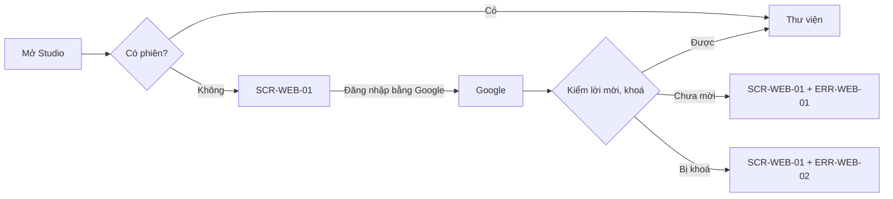
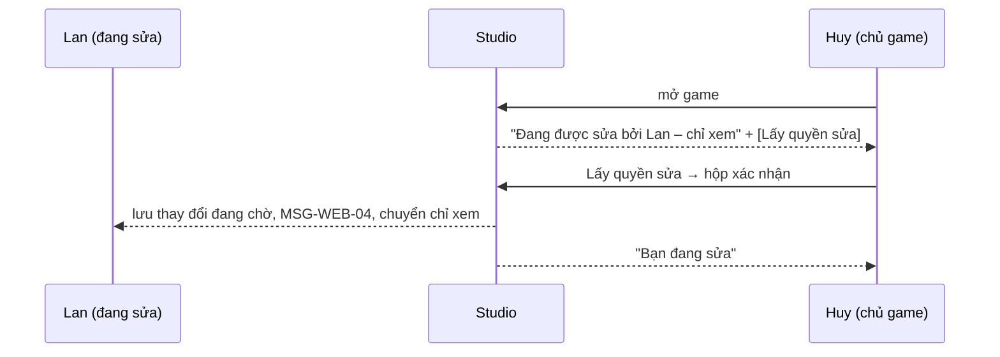
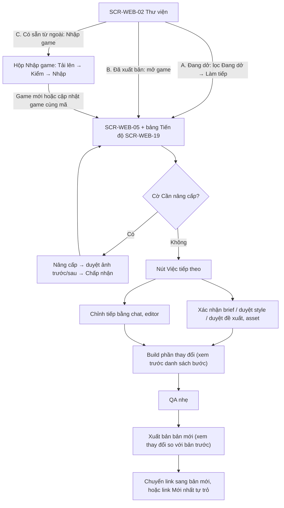

# UIUX-02: Web người dùng (Web Studio)

| Mục | Nội dung |
|---|---|
| Mã tài liệu | UIUX-02 |
| Phiên bản | 1.1 |
| Ngày | 26/11/2026 |
| Tài liệu cha | UIUX-00 `UIUX-00-TONG-QUAN.md` |
| SRS nguồn | SRS-08 v1.2 (UC-WEB-02…07, 10…12, FR-WEB-02…41, 46, 50, 60…69, SCR-WEB-01…09, 14, 19, MSG-WEB-01…06, ERR-WEB-01…15, QT-WEB-10, 11); SRS-01 v1.1 (UC-INT-01…04, 07, FR-INT-01…08, 13…19, 31…34); SRS-00 v1.2 mục 4.4 (giai đoạn và cờ tiến độ); SRS-04 v1.1 mục 6.6 (báo cáo tiến độ) |
| DDD nguồn | DDD-08 v1.1 (EP-WEB-01…32, 38, 52…56; DTO-WEB-03…09, 16…18; MOD-WEB-20…25, 37; SEQ-WEB-01…05, 07…09; PSC-WEB-13, 14, 19…23; STM-WEB-06, 07); DDD-04 v1.0 (DTO-CLI-06, DTO-CLI-07); DDD-00 v1.0 (DTO-GEN-08) |
| Mã nguồn | `web/app/src/features/{auth, library, account, intake, workspace, jobs, versions, share, notifications, play, progress, import, upgrade}/**`, `web/app/src/preview/**` |
| Pha | W1…W4 (theo pha của từng SCR) |
| Trạng thái | Đã duyệt (Huy, 23/11/2026); **v1.1 khung xem trước nhúng Unity player theo CR-02 và POC-U1**, chờ Huy xem lại |

---

## 1. Giới thiệu
Thiết kế các màn hình người tạo game, người xem và khách có link dùng: đăng nhập, thư viện, tài khoản, tạo game bằng chat, không gian làm việc với xem trước 3D, job và báo cáo, phiên bản, chia sẻ và xuất bản, trang chơi, xem trước trên điện thoại, thông báo. Từ v0.3 có thêm luồng xây dựng cho game đang làm dở hoặc đã có (mục 2.1, WF-WEB-19): làm tiếp, cập nhật game đã xuất bản, nhập game có sẵn, nâng cấp engine/schema. Panel chuyên biệt trong không gian làm việc ở UIUX-03. Thành phần `CMP-GEN-*` và quy tắc `UXR-GEN-*` ở UIUX-01.

---

## 2. Luồng người dùng

### UF-WEB-01 Đăng nhập (UC-WEB-02)



Lần đầu đăng nhập thành công: thư viện rỗng hiện lời chào và nút "Tạo game đầu tiên" (TXT-WEB-10). Có tham số `?next=` thì quay về đúng trang (ví dụ link chơi thử cần đăng nhập).

### UF-WEB-02 Từ mô tả tới bản xem trước đầu tiên (UC-WEB-03, UC-INT-01…03, AC-08-02)

| Bước | Màn hình | Người dùng làm | Hệ thống làm | Thời gian mục tiêu |
|---|---|---|---|---|
| 1 | SCR-WEB-02 | Bấm "Tạo game mới" | Kiểm hạn mức số game; mở SCR-WEB-04 | — |
| 2 | SCR-WEB-04 bước Mô tả | Gõ mô tả, đính ảnh (tuỳ chọn), bấm "Phân tích" | EP-WEB-04; hiện "Đang đọc mô tả…" | ≤ 1 phút |
| 3 | SCR-WEB-04 bước Làm rõ | Trả lời ≤ 5 câu/vòng, ≤ 2 vòng, hoặc "Dùng mặc định cho tất cả" (trừ câu mâu thuẫn) | EP-WEB-05 | 2–5 phút |
| 4 | SCR-WEB-04 bước Brief | Đọc brief một trang; Xác nhận / Sửa / Huỷ | EP-WEB-06 tạo game + job đường nhanh "Build zone đầu tiên" | 2–5 phút |
| 5 | SCR-WEB-05 | Thấy thẻ job trong chat và chỉ báo trên thanh trên; có thể đọc brief, trả lời style bible trong lúc chờ | Job build + QA nhẹ, bỏ bake | ≤ 15 phút (NFR-GEN-05) |
| 6 | SCR-WEB-05 | Khung xem trước nạp zone đầu tiên, camera người chơi; toast "Bản xem trước đã sẵn sàng" | SSE `job.done` → `EditorBridge.load`; lần đầu trong phiên nạp Unity player trước (CMP-GEN-33) | ≤ 10 s (NFR-WEB-07) khi player đã nạp trong phiên; lần đầu cộng thời gian nạp player ≤ 20 s (NFR-RTM-01, POC-U1) |

Tổng ≤ 30 phút (NFR-WEB-08). Trong bước 5 hệ thống gợi ý duyệt style bible (SCR-INT-02) bằng tin nhắn hệ thống trong chat; không bắt buộc để xem bản đầu.

### UF-WEB-03 Chỉnh bằng chat (UC-WEB-04 bước 2, UC-INT-06, AC-08-03)
1. Trong tab Chat gõ "thêm 5 con gà ở sân". 2. Bong bóng "Đang suy nghĩ…". 3. Thẻ đề xuất (WF-INT-01) hiện: "Thêm đàn gà: 5 con, vùng Sân trước · Áp ngay". 4. Bấm **Duyệt** → chỉ báo lưu "Đang lưu…" → "Đã lưu · #43"; gà xuất hiện trong xem trước ≤ 2 s (nếu chỉ runtime) hoặc hiện vật đặt tạm + "Cần build". 5. Câu hỏi ("zone 2 có bao nhiêu NPC?") chỉ trả lời bằng chữ, không tạo thẻ (FR-WEB-13).

### UF-WEB-04 Chỉnh bằng editor (UC-WEB-04 bước 2–4)
Chọn đối tượng (nhấp trong xem trước hoặc cây) → bảng thuộc tính mở → sửa trường hoặc kéo gizmo → áp cục bộ ngay → 2 s sau lưu tự động thành mốc (gộp trong 60 s) → áp nóng hoặc gắn "Cần build" → khi muốn bấm `Build (n)`. Kéo asset từ tab Asset vào khung xem trước để đặt (FR-WEB-23).

### UF-WEB-05 Build và xem kết quả (UC-WEB-05)
`Build (n) ▾` → menu: zone (mặc định zone đang xem), tier (Vừa), "Bỏ bake" (bật mặc định khi chưa có bake) → "Bắt đầu build" → thẻ job trong chat + chỉ báo → xong: toast "Build xong zone z1 · 6 phút 12 giây · Xem báo cáo"; xem trước tự nạp bản mới nếu người dùng không đang kéo gizmo (nếu đang kéo: nạp sau khi thả). Lỗi: thẻ job đỏ, câu lỗi, nút "Mở trường lỗi" hoặc "Thử lại".

### UF-WEB-06 Khoá sửa (FR-WEB-24, AC-08-04)



Người có quyền Sửa (không phải chủ) gặp khoá: chỉ thấy "Đang được sửa bởi Lan – chỉ xem" và tự động thử lấy khoá lại mỗi 60 s; khi được thì toast "Bạn đã có quyền sửa" (TXT-WEB-12).

### UF-WEB-07 Lịch sử và khôi phục (UC-WEB-06, AC-08-08)
Bấm `#42` trên thanh trên → SCR-WEB-08 → chọn mốc → xem khác biệt với hiện tại → "Khôi phục mốc này" → xác nhận → tạo mốc mới "Khôi phục #35" (lịch sử giữ nguyên).

### UF-WEB-08 Chia sẻ và xuất bản (UC-WEB-07)
Chia sẻ → SCR-WEB-09 tab Thành viên → thêm người (CMP-GEN-29), chọn Sửa/Xem. Tab Xuất bản → "Xuất bản phiên bản hiện tại" → hệ thống kiểm provenance (thiếu: liệt kê asset, chặn, ERR-WEB-10) → QA nhẹ → Fail ngân sách: MSG-WEB-03 → xác nhận → bản xuất bản #n (nhãn "Chưa đạt" nếu có). Tab Link → "Tạo link" → hạn, cần đăng nhập → link + QR hiện một lần.

### UF-WEB-09 Xem trước trên điện thoại (FR-WEB-19)
Nút QR trên thanh công cụ xem trước → thẻ QR (CMP-GEN-20) với link hạn 24 giờ, tuỳ chọn "Gửi số đo hiệu năng" → quét bằng điện thoại → WF-WEB-15 mở bản build mới nhất toàn màn hình → (link đo) sau 20 s đo gửi số đo về, Studio hiện toast "Đã nhận số đo từ thiết bị SM-A566" trong SCR-WEB-07.

### UF-WEB-10 Hết hạn mức (FR-WEB-07, AC-08-07)
≥ 80%: băng MSG-WEB-01. 100%: ô chat vô hiệu với câu ERR-WEB-05 "Đã hết hạn mức AI hôm nay. Liên hệ quản trị để nâng." + nút "Xem hạn mức"; build vẫn chạy được nếu hạn mức job còn. Quản trị nâng hạn mức → SSE `quota.warn`/làm mới `Me` → ô chat bật lại không cần tải trang.

### 2.1 Làm tiếp và cập nhật game (SRS-00 mục 4.4, CR-01)

Ba trường hợp đi chung một đường: mở game → đọc bảng Tiến độ (WF-WEB-19) → làm việc còn treo → build phần thay đổi → QA nhẹ → xuất bản bản mới. Web Studio không có màn hình "build game cũ" riêng; mọi chỉnh sửa vẫn qua chat, editor, đề xuất như UF-WEB-03, UF-WEB-04.



### UF-WEB-11 Làm tiếp game đang làm dở (UC-WEB-10, UC-INT-07, AC-CR01-07, AC-CR01-08)

| Bước | Màn hình | Người dùng làm | Hệ thống làm |
|---|---|---|---|
| 1 | SCR-WEB-02 | Bấm tab lọc **Đang dở** (mặc định khi có game đang dở và người dùng chưa chọn tab khác) | Thẻ game hiện huy hiệu giai đoạn và số việc còn treo từ `game_status_cache` (DTO-WEB-16 bản rút gọn); thẻ "Bản nháp" cho phiên tạo game dở (EP-WEB-56) |
| 2 | SCR-WEB-02 | Bấm **Làm tiếp** trên thẻ | Xin khoá sửa (EP-WEB-15); mở SCR-WEB-05, bảng phải mở sẵn tab **Tiến độ** (WF-WEB-19) |
| 3 | SCR-WEB-05 | Đọc tin đầu chat: tóm tắt tiến độ bằng lời (FR-INT-34) | `GET status` (EP-WEB-52); đề xuất còn đúng `baseVersion` giữ ở `ChoDuyet`, đề xuất cũ chuyển Hết hạn kèm "Tạo lại đề xuất" (WF-INT-01) |
| 4 | WF-WEB-19 | Bấm nút chính **Việc tiếp theo**, ví dụ "Build lại zone z2 (khoảng 14 phút)" | Nút làm đúng hành động `next` của báo cáo (SRS-04 mục 6.6): mở hộp Build phần thay đổi, mở thẻ đề xuất, mở WF-AST-01, chạy QA, mở SCR-WEB-09 |
| 5 | SCR-WEB-05 | Chỉnh tiếp hoặc chờ job | Bảng Tiến độ tự làm mới khi có `job.done`, `data.version`, `status.changed` (UXR-WEB-09) |

Phiên tạo game dở (chưa có brief): bấm thẻ "Bản nháp" → SCR-WEB-04 mở đúng câu hỏi làm rõ đang chờ, các câu đã trả lời giữ nguyên, không gọi lại AI (FR-INT-31, AC-CR01-01). Người khác giữ khoá: mở chế độ xem, bảng Tiến độ vẫn hiện nhưng không có nút hành động (ERR-WEB-06). Job lỗi: dòng "Job build z2 lỗi" trong việc còn treo có nút **Thử lại**.

### UF-WEB-12 Cập nhật game đã xuất bản (UC-WEB-11, FR-INT-33, AC-CR01-03, AC-CR01-09)

1. Mở game ở giai đoạn Đã xuất bản. Bảng Tiến độ không tự mở (UXR-WEB-09); chip giai đoạn trên thanh trên ghi "✓ Đã xuất bản #2".
2. Gõ yêu cầu mở rộng trong chat, ví dụ "thêm zone chợ quê". Thẻ đề xuất có mục **Cập nhật brief** (v3 → v4) liệt kê trường brief đổi (FR-INT-33). Duyệt đề xuất đồng thời xác nhận brief mới khi không phải thay đổi lớn.
3. Sau mốc mới, thanh trên hiện MSG-WEB-06 "Game có 1 thay đổi chưa xuất bản so với bản #2."; chip chuyển "⟳ Cần build lại"; thư viện đưa game vào lọc Đang dở.
4. Bấm **Build phần thay đổi** (WF-WEB-19 hoặc menu `Build ▾`): hộp liệt kê bước, zone, phút (chạy `dryRun`); chỉ zone mới và bước bị ảnh hưởng chạy (FR-WEB-63).
5. QA nhẹ → **Xuất bản**: SCR-WEB-09 tab Xuất bản hiện "Thay đổi so với bản #2" trước khi xác nhận; tạo bản #3, bản #2 giữ nguyên (FR-WEB-64, QT-WEB-10).
6. Hộp "Đã xuất bản bản #3" hỏi: **Chuyển 2 link cố định sang bản #3** hoặc **Để link như cũ**; link chế độ Mới nhất tự mở bản #3 (FR-WEB-65). Bản #3 chưa đạt: link Mới nhất vẫn mở bản #2 và hộp ghi rõ điều đó.

### UF-WEB-13 Nhập game có sẵn (UC-WEB-12, FR-INT-32, AC-CR01-02, AC-CR01-10, AC-CR01-11)

1. SCR-WEB-02 → **Nhập game** → hộp ba bước (WF-WEB-02, hộp Nhập game): Tải lên · Kiểm · Nhập.
2. Thả zip (gói xuất từ Studio hoặc thư mục `games/<id>/` làm bằng Claude Code, ≤ 2 GB, tải theo phần). Hệ thống kiểm trên bản tạm, chưa ghi gì (EP-WEB-53 `validate`, job nhẹ).
3. Bước Kiểm hiện báo cáo `import/1` (DTO-CLI-06) bằng lời: số zone, NPC, đàn động vật, asset; cần nâng cấp hay không; có brief hay không; asset thiếu provenance; `gameId` đã có trong Studio hay chưa. Gói bị chặn: hiện ERR-WEB-14 với lý do và danh sách vấn đề, không có nút Tiếp tục.
4. Chọn **Game mới**, hoặc **Cập nhật game "…"** khi `gameId` trùng game mình có quyền Sửa.
5. Game mới: tạo game, mở SCR-WEB-05 với bảng Tiến độ; thiếu brief thì việc tiếp theo là "Xác nhận brief" (brief nháp do Studio soạn, trường thiếu đánh dấu "Cần điền"), Build bị khoá tới khi xác nhận (QT-INT-09, TXT-WEB-09).
6. Cập nhật game đã có: cần giữ khoá; bước Nhập hiện khác biệt theo đối tượng so với phiên bản hiện tại (cùng dạng WF-WEB-08) → **Áp dụng** tạo mốc mới nguồn Nhập, lịch sử giữ nguyên (FR-WEB-69). Phiếu kiểm hết hạn sau 24 giờ (STM-WEB-07): bấm Nhập khi hết hạn → ERR-WEB-14 "token_het_han" kèm nút "Tải lại gói".

### UF-WEB-14 Nâng cấp engine/schema (FR-WEB-68, SEQ-WEB-09)

1. Game có cờ **Cần nâng cấp** (thẻ thư viện và việc còn treo trên WF-WEB-19). Khi build bị chặn vì ngoài dải engine, nút Build mờ với tooltip TXT-WEB-30.
2. Bấm **Nâng cấp** → hộp xác nhận ngắn (TXT-WEB-29) → job `upgrade` (thẻ job trong chat). Game vẫn sửa và chơi được bằng bản cũ trong lúc chạy.
3. Xong: hộp Duyệt nâng cấp (WF-WEB-19) hiện phiên bản cũ → mới, tệp đã chuyển, zone đã build lại, kết quả QA, ảnh trước/sau theo góc chuẩn (CMP-GEN-24).
4. **Chấp nhận nâng cấp** tạo mốc nguồn Nâng cấp; **Bỏ** giữ nguyên game. Bản xuất bản cũ không đổi. Dữ liệu đã đổi sau khi job bắt đầu → ERR-WEB-07, hộp mời "Chạy lại nâng cấp". Job lỗi → ERR-WEB-15 trên thẻ job và trong việc còn treo, game giữ bản cũ.

---

## 3. Wireframe

### WF-WEB-01 Đăng nhập (SCR-WEB-01, W1)

```text
┌──────────────────────────────────────────────┐
│                                              │
│              ◆ GameStudio                    │
│     Tạo game 3D trên trình duyệt bằng lời    │
│                                              │
│      [ G  Đăng nhập bằng Google ]            │
│                                              │
│  ┌ ⚠ Tài khoản chưa được mời vào GameStudio.┐│
│  │   Hãy liên hệ quản trị.                  ││
│  └──────────────────────────────────────────┘│
│   Chỉ dành cho thành viên được mời.          │
└──────────────────────────────────────────────┘
```

| Phần tử | Quy tắc | Nguồn |
|---|---|---|
| Nút Google | `lg`, toàn chiều rộng khung 360 px; bấm → EP-WEB-01 start; đang chuyển: `loading` | FR-WEB-02 |
| Hộp lỗi | Hiện khi `?err=ERR-WEB-01` (câu ERR-WEB-01) hoặc `ERR-WEB-02` (câu ERR-WEB-02 + "Nếu bạn nghĩ đây là nhầm lẫn, hãy liên hệ quản trị."); `?err=ERR-WEB-03` → "Phiên đăng nhập đã hết hạn. Hãy đăng nhập lại." | ERR-WEB-01, 02, 03 |
| Dòng chú thích | TXT-WEB-11 | QĐ-07 |

Điện thoại: khung giữa màn hình, chữ `text-md`.

### WF-WEB-02 Thư viện game (SCR-WEB-02, W1; Đang dở, Làm tiếp, Nhập game từ W2/W4)

```text
┌ AppHeader ───────────────────────────────────────────────────────────────────┐
├──────────────────────────────────────────────────────────────────────────────┤
│ Thư viện game                     12/20 game   [Nhập game] [+ Tạo game mới]  │
│ [Đang dở (3)] [Của tôi (8)] [Được chia sẻ (4)] [Lưu trữ (2)] [Thùng rác (1)] │
│ 🔎 Lọc theo tên…            Sắp xếp: Sửa gần nhất ▾      ▦ Lưới / ☰ Danh sách │
│ ┌────────────────┐ ┌────────────────┐ ┌────────────────┐ ┌────────────────┐  │
│ │[ảnh 16:9]      │ │[ảnh 16:9]      │ │[ảnh 16:9]      │ │✎ Bản nháp      │  │
│ │Làng chài       │ │Đình làng       │ │Làng quê        │ │"Làng ven biển…"│  │
│ │⟳ Cần build lại │ │✓ Đã xuất bản #2│ │▲ Cần nâng cấp  │ │Còn 2 câu hỏi   │  │
│ │· 2 việc        │ │· 4 thay đổi    │ │· 1 việc        │ │                │  │
│ │Chủ · 5 phút    │ │Sửa · hôm qua   │ │Chủ · 3 ngày    │ │Hết hạn 28 ngày │  │
│ │[Làm tiếp]    ⋯ │ │[Làm tiếp]    ⋯ │ │[Làm tiếp]    ⋯ │ │[Tiếp tục]    ⋯ │  │
│ └────────────────┘ └────────────────┘ └────────────────┘ └────────────────┘  │
└──────────────────────────────────────────────────────────────────────────────┘
```

| Phần tử | Quy tắc | Nguồn |
|---|---|---|
| Tab lọc | `?filter=dangdo|mine|shared|archived|trash` (EP-WEB-09); số đếm từng tab; nhớ tab cuối. **Đang dở** (v0.3) gồm game có giai đoạn khác Đã xuất bản hoặc có thay đổi chưa xuất bản, sắp theo lần sửa cuối, cộng thẻ Bản nháp; tab đứng đầu và là mặc định lần đầu khi có ít nhất 1 mục; không có mục nào thì ẩn tab | FR-WEB-08, FR-WEB-60 |
| "12/20 game" | Từ `Me.quota.games/maxGames`; ≥ 80% màu warn; đủ 20: nút Tạo game mới vô hiệu (UXR-GEN-11) | FR-WEB-06 |
| Ô lọc tên, sắp xếp | Lọc phía client trên trang đã tải; sắp xếp: Sửa gần nhất, Tên A–Z, Tạo gần nhất | UXR-GEN-13 |
| Thẻ game | CMP-GEN-06; lưới 4 cột ở 1366 px, 2 cột tablet, 1 cột điện thoại; chế độ danh sách dùng CMP-GEN-13 (cột: tên, giai đoạn, việc còn treo, vai trò, sửa lần cuối, người sửa) | FR-WEB-08 |
| Huy hiệu giai đoạn, việc còn treo | Thay huy hiệu "Đang làm" bằng huy hiệu giai đoạn (bảng 3.1 UIUX-01, nhóm Giai đoạn) và "· n việc" (tổng cờ đếm); cờ Cần nâng cấp thắng giai đoạn trên huy hiệu; "· n thay đổi" khi Đã xuất bản mà còn thay đổi chưa xuất bản. Đọc từ đệm, không gọi báo cáo đầy đủ cho từng thẻ | FR-WEB-60, QT-WEB-11, PSC-WEB-19 |
| Nút Làm tiếp | `secondary` `sm` ở chân thẻ, chỉ ở thẻ thuộc lọc Đang dở và khi có quyền Sửa; mở `/games/:id?panel=progress`; người chỉ xem: không có nút, bấm thẻ vẫn mở game với bảng Tiến độ chỉ đọc | FR-WEB-60, UC-WEB-10 |
| Thẻ Bản nháp | Phiên tạo game dở (`IntakeSession` Nhap/ChoXacNhan, EP-WEB-56): biểu tượng ✎, 40 ký tự đầu mô tả, "Còn n câu hỏi" hoặc "Chờ xác nhận brief", "Hết hạn sau n ngày" (30 ngày không hoạt động); nút **Tiếp tục** mở SCR-WEB-04 đúng chỗ dừng; menu `⋯`: Bỏ bản nháp (hộp xác nhận thường) | FR-INT-31, FR-WEB-62 |
| Menu `⋯` | Mở · Đổi tên (chủ) · Nhân bản (chủ, được sửa) · Lưu trữ / Đưa về Đang làm (chủ) · Xuất gói (chủ) · Chuyển vào thùng rác (chủ). Trong Thùng rác: Khôi phục · dòng "Xoá vĩnh viễn sau 27 ngày" | FR-WEB-08, FR-WEB-09, FR-WEB-34 |
| Chuyển vào thùng rác | Không hỏi; toast "Đã chuyển 'Làng chài' vào thùng rác · Hoàn tác" (UXR-GEN-02) | FR-WEB-09 |
| Nhân bản | Hộp nhỏ: tên mới mặc định "Bản sao của …" → tạo → mở game mới | FR-WEB-08 |
| Nhập game | Nút đổi tên từ "Nhập gói" (v0.3); mở hộp Nhập game bên dưới | FR-WEB-34, FR-WEB-66 |
| Rỗng | Của tôi: TXT-WEB-10 + nút Tạo game đầu tiên; Được chia sẻ: "Chưa có ai chia sẻ game với bạn."; Thùng rác: "Thùng rác trống. Game bị xoá được giữ 30 ngày." | CMP-GEN-14 |
| Người xem | Không có nút Tạo game mới, Nhập game | Mục 4.3 UIUX-00 |

#### Hộp Nhập game (trong SCR-WEB-02, W4)

```text
┌ Nhập game ───────────────────────── ① Tải lên ─ ② Kiểm ─ ③ Nhập ┐
│ ① [DropZone: Kéo tệp .zip vào đây hoặc chọn tệp                  ] │
│    Gói xuất từ Studio hoặc zip thư mục games/<id>/. Tối đa 2 GB.   │
│    lang-que.zip · 184 MB ████████████░░░░ 72%                     │
├─────────────────────────────────────────────────────────────────┤
│ ② Kết quả kiểm  ▲ Cần nâng cấp                                    │
│    3 zone · 14 NPC · 6 đàn động vật · 212 asset                   │
│    ▲ Làm bằng engine 1.2, schema 3. Studio dùng 1.4, schema 4.     │
│      Sau khi nhập, bấm Nâng cấp trên bảng Tiến độ.                 │
│    ⚠ Chưa có brief. Studio sẽ soạn brief nháp để bạn xác nhận.    │
│    ⚠ 5 asset thiếu nguồn gốc: vào kho ở Chờ duyệt, chưa vào build. [Xem]│
│    ⓘ Studio đã có game "Làng quê" cùng mã lang-que.                │
│    Nhập thành: (•) Game mới   ( ) Cập nhật game "Làng quê"         │
│                                          [Huỷ] [Tiếp tục]          │
├─────────────────────────────────────────────────────────────────┤
│ ③ (Cập nhật game đã có) Khác biệt so với #57                      │
│    ＋ Zone "Chợ quê" (z3)   ～ 8 NPC   － 2 đối tượng đặt tay  [Xem chi tiết]│
│                                       [Quay lại] [Áp dụng]         │
└─────────────────────────────────────────────────────────────────┘
```

| Phần tử | Quy tắc | Nguồn |
|---|---|---|
| ① Tải lên | CMP-GEN-30 chỉ nhận `.zip` ≤ 2 GB, tải theo phần (EP-WEB-25), huỷ được; xong tự gọi `validate` (EP-WEB-53), hiện "Đang kiểm gói…" (job nhẹ, thường < 1 phút) | FR-WEB-66 |
| ② Kết quả kiểm | Đọc `report` (DTO-WEB-17, DTO-CLI-06) thành câu thường; huy hiệu tổng: Hợp lệ (✓) · Cần nâng cấp (▲ warn) · Không nhập được (✕ danger); `problems[]` hiện dạng danh sách gập được "Chi tiết kỹ thuật" (mã, đường dẫn, câu) | FR-WEB-66, UXR-WEB-10 |
| Bị chặn | `result = chan` hoặc lỗi 422: hộp lỗi ERR-WEB-14 với lý do theo `params.reason` (TXT-WEB-31), không có Tiếp tục; nút "Chọn tệp khác" | ERR-WEB-14 |
| Thiếu brief | Dòng ⚠ TXT-WEB-32; sau khi nhập, việc tiếp theo là Xác nhận brief | FR-WEB-67, FR-INT-32 |
| Asset thiếu nguồn gốc | Dòng ⚠ có [Xem] mở danh sách tên asset; chúng vào kho ở Chờ duyệt, không vào build | FR-WEB-66 |
| Nhập thành | Chỉ hiện lựa chọn "Cập nhật game …" khi `gameIdExists` và mình có quyền Sửa game đó; không có quyền: dòng ⓘ ghi "Studio đã có game cùng mã mà bạn không có quyền sửa; gói sẽ nhập thành game mới với mã mới" | FR-WEB-69 |
| ③ Khác biệt | Chỉ khi cập nhật game đã có: cần giữ khoá game đích (không giữ được: ERR-WEB-06, mời mở game xem ai đang sửa); khác biệt theo đối tượng cùng dạng WF-WEB-08; **Áp dụng** tạo mốc nguồn Nhập; `baseVersion` cũ → ERR-WEB-07, hộp tự tính lại khác biệt | FR-WEB-69, ERR-WEB-07 |
| Xong | Game mới: toast "Đã nhập 'Làng quê'" và mở `/games/:id?panel=progress`; cập nhật: quay về game đích, chat ghi tin hệ thống "Nhập gói lang-que.zip → #58" | FR-WEB-66, FR-WEB-69 |
| Phiếu kiểm hết hạn | Hộp mở quá 24 giờ hoặc phiếu đã dùng: ERR-WEB-14 (TXT-WEB-31 `token_het_han`) + "Tải lại gói" về bước ① | STM-WEB-07 |

### WF-WEB-03 Tài khoản của tôi (SCR-WEB-03, W2)

```text
┌ AppHeader ───────────────────────────────────────────────────────────┐
│ Tài khoản của tôi                                                    │
│ ┌ Thông tin ───────────────┐ ┌ Hạn mức ───────────────────────────┐  │
│ │ (ảnh) Nguyễn Văn Lan     │ │ Chi phí AI hôm nay  4,10/5,00 USD ⚠│  │
│ │ lan@…  · Người tạo game  │ │ ███████████████░░░  82%  đặt lại 0:00│ │
│ │ Đăng nhập cuối 08:12     │ │ Job đồng thời       1/2            │  │
│ │ Chủ đề: (•)Tối ( )Sáng   │ │ Lưu trữ             6,4/20 GB      │  │
│ │ [Đăng xuất]              │ │ Số game             12/20          │  │
│ └──────────────────────────┘ └────────────────────────────────────┘  │
│ ┌ Chi phí AI 30 ngày ──────────────────────────────────────────────┐ │
│ │  [biểu đồ cột theo ngày, chồng theo loại việc]                   │ │
│ │  Bảng: Ngày · Sinh game · Sửa · Ảnh · Âm thanh · Hội thoại · Tổng │ │
│ └──────────────────────────────────────────────────────────────────┘ │
└──────────────────────────────────────────────────────────────────────┘
```

| Phần tử | Quy tắc | Nguồn |
|---|---|---|
| Hạn mức | Bốn CMP-GEN-10 từ `Me` (DTO-WEB-03) | FR-WEB-06, FR-WEB-07 |
| Biểu đồ 30 ngày | CMP-GEN-23, cột chồng theo loại việc, kèm bảng; nguồn: lịch sử `usage_records` của tôi (DDD-08 cần cho người dùng xem phần của mình: dùng EP-WEB-36 giới hạn `user=me`, ghi ở OIU-WEB-04) | SCR-WEB-03 |
| Câu hướng dẫn | "Cần thêm hạn mức? Hãy nhắn quản trị." | FR-WEB-07 |

### WF-WEB-04 Tạo game mới (SCR-WEB-04, W1)

Ba bước trên một trang, thanh bước ở đầu: **1 Mô tả · 2 Làm rõ · 3 Brief**. Bên trái là luồng chat (lịch sử phiên tiếp nhận), bên phải là nội dung bước hiện tại. Dưới 1024 px chỉ còn cột phải.

```text
┌ AppHeader ─────────────────────────────────────────────────────────────────────┐
│ Tạo game mới      ① Mô tả ── ② Làm rõ ── ③ Brief                     [Huỷ]     │
├──────────────────────────────┬─────────────────────────────────────────────────┤
│ Chat tiếp nhận               │ ① Mô tả game của bạn                            │
│                              │ ┌─────────────────────────────────────────────┐ │
│ (gợi ý mẫu:)                 │ │ Một làng chài ven sông miền Tây thế kỷ 19,  │ │
│ • "Làng chài ven sông…"      │ │ người chơi đi bộ góc nhìn thứ ba, có chợ    │ │
│ • "Rừng tràm có cò…"         │ │ nổi, 5 NPC, đàn vịt…                         │ │
│                              │ └──────────────────────────────── 214/20.000 ┘ │
│                              │ Ảnh tham chiếu (tuỳ chọn, ≤ 5 ảnh, ≤ 10 MB)     │
│                              │ [ DropZone ] [ảnh1 ✕] [ảnh2 ✕]                   │
│                              │ ⓘ Ảnh chỉ dùng để gợi phong cách, bảng màu.      │
│                              │                         [Phân tích mô tả →]     │
└──────────────────────────────┴─────────────────────────────────────────────────┘
```

Bước 2 Làm rõ:

```text
│ ② Vài câu hỏi để hiểu đúng ý bạn (vòng 1/2)                                    │
│ ┌ Góc nhìn người chơi?                         (trường: camera)            ┐  │
│ │ (•) Thứ ba sau lưng  ( ) Nhìn từ trên  ( ) Thứ nhất   [ Gõ câu khác… ]   │  │
│ │ Mặc định: Thứ ba sau lưng                                                │  │
│ └──────────────────────────────────────────────────────────────────────────┘  │
│ ┌ ▲ Mô tả có hai chi tiết khác nhau: "thế kỷ 19" và "xe máy". Chọn một:    ┐  │
│ │ ( ) Thế kỷ 19, bỏ xe máy  ( ) Hiện đại, giữ xe máy      (bắt buộc)       │  │
│ └──────────────────────────────────────────────────────────────────────────┘  │
│ [Dùng mặc định cho các câu còn lại]                  [Tiếp tục →]            │
```

Bước 3 Brief:

```text
│ ③ Brief game (bản v1 · AI)                                  [Tải .md]        │
│ ┌ Tóm tắt · Thể loại · Bối cảnh · Phong cách · Người chơi · Zone · NPC ·     ┐ │
│ │ Động vật · Tính năng tuỳ chọn (Chiến đấu: Tắt · Săn: Tắt · Hội thoại: Tĩnh)│ │
│ │ Giả định (3) ⓘ dùng mặc định · Asset rủi ro cao (2) · Gợi ý chưa áp dụng (2)│ │
│ │ Ước lượng: 2 zone, ~1,2 km², 5 NPC, 12 động vật · tải hình học 64% tier Vừa│ │
│ └────────────────────────────────────────────────────────────────────────────┘ │
│ [Sửa brief]  [Huỷ]                                  [Xác nhận và tạo game]     │
```

| Phần tử | Quy tắc | Nguồn |
|---|---|---|
| Ô mô tả | 10–20.000 ký tự, giữ xuống dòng; đếm ký tự; < 10 hoặc > 20.000: nút Phân tích vô hiệu + câu ERR-INT-01 | FR-INT-01 |
| Ảnh | CMP-GEN-30; ≤ 5 ảnh JPG/PNG/WebP ≤ 10 MB; tệp hỏng: lỗi ERR-INT-02 trên ảnh đó, các ảnh khác giữ | FR-INT-02 |
| Gợi ý mẫu | 3 câu mẫu ngắn; bấm điền vào ô (không gửi) | UXR-GEN-13 |
| Phân tích | EP-WEB-04; chờ: bong bóng "Đang đọc mô tả…" trong cột chat; > 120 s hoặc lỗi: ERR-INT-04 + Thử lại, giữ nội dung | FR-INT-03, ERR-INT-04 |
| Câu hỏi làm rõ | ≤ 5 câu mỗi vòng, ≤ 2 vòng; mỗi câu 2–4 lựa chọn + "Gõ câu khác"; hiện giá trị mặc định | FR-INT-04 |
| Dùng mặc định | Áp mặc định cho câu chưa trả lời; câu mâu thuẫn vẫn phải chọn | FR-INT-05, FR-INT-06 |
| Câu mâu thuẫn | Viền đỏ, huy hiệu "Bắt buộc", không có mặc định; còn câu mở → nút Xác nhận vô hiệu + ERR-INT-08 | FR-INT-06, ERR-INT-08 |
| Địa danh thật | Câu hỏi có bản đồ nhỏ tĩnh với khung bbox gợi ý 2×2 km và lựa chọn `real` / `mixed` / hư cấu | FR-INT-07 |
| Brief | Một trang ≤ 400 từ phần chính, các mục theo SRS-01 mục 6.1; mục "Giả định" liệt kê giá trị mặc định đã dùng; "Gợi ý (chưa áp dụng)" mỗi dòng có nút "Áp dụng" (đưa thành câu trong chat sau khi tạo game) | FR-INT-08, FR-INT-15 |
| Tính năng tuỳ chọn | Bảng ba dòng, giá trị mặc định Tắt / Tĩnh | FR-INT-13 |
| Ước lượng ngân sách | Thanh % so với tier Vừa; > 80% warn + câu "Game có thể nặng trên điện thoại, cân nhắc bớt…" | FR-INT-14 |
| Sửa brief | Chuyển brief sang chế độ sửa tại chỗ (văn bản có cấu trúc theo mục), lưu thành bản nháp mới | UC-INT-04 |
| Xác nhận | EP-WEB-06 → chuyển tới SCR-WEB-05 của game mới, job đường nhanh đã chạy | UC-INT-03, UC-WEB-03 |
| Huỷ | Hỏi "Bỏ bản nháp này?" (phiên tiếp nhận giữ 7 ngày, mở lại được từ thư viện mục "Bản nháp"; OIU-WEB-05) | UXR-GEN-02 |
| Hết hạn mức AI | Nút Phân tích/Tiếp tục vô hiệu + ERR-INT-03 | FR-INT-30 |

### WF-WEB-05 Không gian làm việc (SCR-WEB-05, W1–W3)

Bố cục theo SRS-08 mục 7.1 (OIU-GEN-01): cột trái 360 px (tab Chat · Cây · Asset, thu gọn được), khung xem trước ở giữa, bảng phải 400 px.

```text
┌ ← Làng chài ven sông [Chủ]  Đã lưu · #42  🔒 Bạn đang sửa   [Build (3) ▾] [QA ▾] [Xuất bản] [Chia sẻ]  ◐1  🔔2 ┐
├────────────────────────┬────────────────────────────────────────────────┬──────────────────────────┤
│ [Chat][Cây][Asset]  «  │ [Bay ▾][z1 ▾][☀ ──●── 16:00][Vừa ▾][📱][📊][QR][⛶]│ [Thuộc tính][Môi trường] │
│                        │ fps 58/30 · dc 96/120 · tri 410k/450k ·        │ [NPC][Động vật][Hội thoại]│
│ AI  Chào Lan, game đã  │ gpu 310/512 MB                                 │ [Cân bằng][{ } JSON]     │
│     sẵn sàng…          │                                                │ ──────────────────────── │
│ ┌ Build zone z1 ─────┐ │                                                │ Giếng nước  · Đặt tay    │
│ │ ✓ heightfield      │ │            ( khung xem trước 3D )              │ ▾ Vị trí                 │
│ │ ✓ placement        │ │                 [ giếng được chọn ]            │  X [10,5] Y [0] Z [-4,2] │
│ │ ◐ packager 45%     │ │                                                │  Bám mặt đất  [✓]        │
│ │ Còn khoảng 3 phút  │ │                                                │ ▾ Hình thức              │
│ │ [Huỷ] Xem báo cáo  │ │                                                │  Asset  [Giếng đá v2 ▾]  │
│ └────────────────────┘ │                                                │  ⟳ Cần build             │
│ Bạn: thêm 5 con gà…    │   [⤧ Di chuyển][⟲ Xoay][⤢ Co giãn] Lưới [0,5▾] │                          │
│ ┌ Đề xuất · AI ──────┐ │                                                │                          │
│ │ … (WF-INT-01)      │ │                                                │                          │
│ └────────────────────┘ │                                                │                          │
│ [ Nhắn cho AI…   ] [➤] │                                                │                          │
└────────────────────────┴────────────────────────────────────────────────┴──────────────────────────┘
```

| Thành phần | Quy tắc | Nguồn |
|---|---|---|
| Chip giai đoạn, MSG-WEB-06 (v0.3) | Sau tên game: chip giai đoạn (CMP-GEN-03 nhóm Giai đoạn), bấm mở tab Tiến độ; khi có thay đổi chưa xuất bản: dòng phụ dưới thanh trên cao 28 px ghi MSG-WEB-06 + liên kết "Xem thay đổi" (SCR-WEB-08 so với bản xuất bản mới nhất), chỉ hiện với chủ game và người được sửa | FR-WEB-61, MSG-WEB-06 |
| Thanh trên | CMP-GEN-05; `Build (n)` đếm `needsBuild` (MSG-WEB-02 trong tooltip); vô hiệu khi brief chưa xác nhận (tooltip ERR-INT-06) hoặc không có quyền; menu: zone, tier, "Bỏ bake", danh sách bước sẽ chạy và ước lượng phút | SRS-08 mục 7.2, FR-WEB-17 |
| Nút QA | Menu Nhẹ / Đầy đủ; mỗi mục ghi thời gian ước lượng | SRS-08 mục 7.2, FR-QA-02, FR-QA-03 |
| Xuất bản, Chia sẻ | Chỉ chủ game; mở SCR-WEB-09 đúng tab | FR-WEB-38 |
| Trạng thái khoá | CMP-GEN-16; vào game tự xin khoá (EP-WEB-15), nhịp 60 s; không thao tác 15 phút → nhả, hiện băng "Bạn đã rời quyền sửa do không thao tác. [Sửa tiếp]" (TXT-WEB-13) | FR-WEB-24, UC-WEB-04 |
| Cột trái | 360 px; nút `«` thu thành thanh 48 px chỉ có biểu tượng tab và chấm tin mới; ba tab Chat, Cây (CMP-GEN-21), Asset (WF-AST-02 dạng thu gọn) | SRS-08 mục 7.1, OIU-GEN-01 |
| Chat | CMP-GEN-07; cuộn vô hạn lên trên (EP-WEB-11 `before`); ô tìm trong lịch sử (biểu tượng 🔎 đầu tab, `q`); thẻ đề xuất (WF-INT-01), thẻ job (CMP-GEN-09), tin hệ thống (asset chờ duyệt → nút "Mở duyệt asset", FR-WEB-15) | FR-WEB-10, FR-WEB-12, FR-WEB-14, FR-WEB-15 |
| Khung xem trước | Canvas của Unity player qua `EditorBridge` (CR-02; player nạp một lần mỗi phiên trang, giữ khi đổi game hoặc có build mới); thanh công cụ CMP-GEN-18; lớp phủ CMP-GEN-19; viền chọn màu `--gs-select`; thanh gizmo nổi dưới đáy khi có đối tượng chọn (WF-WEB-06) | FR-WEB-16, FR-WEB-18, FR-WEB-20 |
| Bảng phải | 400 px; dải tab panel (đăng ký từ `panel-registry`, chỉ hiện panel có `when(doc)` đúng, ví dụ Cân bằng khi bật chiến đấu/săn); mặc định "Thuộc tính" (CMP-GEN-22); lỗi schema dưới trường | FR-WEB-30, FR-WEB-28 |
| Chỉ xem | Bảng phải chỉ đọc (ô nhập thành chữ), không gizmo, ô chat chỉ hỏi; băng mỏng đầu khung xem trước "Chỉ xem" | SRS-08 mục 3.2 |
| Hết hạn mức AI | Ô chat vô hiệu + câu ERR-WEB-05 | SRS-08 mục 7.2 |
| Bảng Tiến độ (v0.3) | Tab đầu của bảng phải, "Tiến độ" (WF-WEB-19); tự chọn khi mở game lần đầu trong phiên mà giai đoạn khác Đã xuất bản, hoặc khi URL có `?panel=progress` | FR-WEB-61, UXR-WEB-09 |
| Mở lại game (v0.3) | Tin đầu chat (loại hệ thống có nhãn AI) là tóm tắt tiến độ TXT-WEB-24, chỉ hiện khi lần mở trước cách ≥ 30 phút hoặc dữ liệu đã đổi bởi người khác; đề xuất cũ hiện trạng thái Hết hạn kèm "Tạo lại đề xuất" (WF-INT-01); phiên tạo game dở của game này hiện thẻ "Tiếp tục trả lời (còn n câu)" mở SCR-WEB-04 | FR-WEB-62, FR-INT-34, AC-CR01-08 |
| Menu `Build ▾` (v0.3) | Mục đầu "Build phần thay đổi" (hộp ở WF-WEB-19); các mục zone/tier cũ giữ nguyên bên dưới cho build chủ động | FR-WEB-63 |

Trạng thái riêng:

| Trạng thái | Hiển thị |
|---|---|
| Chưa có bản build | Khung xem trước: minh hoạ + "Game chưa có bản xem trước." + nút `primary` **Build zone đầu tiên** (vô hiệu khi brief chưa xác nhận) (SRS-08 mục 7.2) |
| Đang nạp trình chạy game (lần đầu trong phiên, CR-02) | CMP-GEN-33 pha 1 "Đang tải trình chạy game… 4,2/9,2 MB"; lần đầu chưa cache thêm TXT-WEB-35; > 20 s → TXT-WEB-36 + Thử lại |
| Đang nạp bản build | CMP-GEN-33 pha 2 "Đang nạp zone z1… 60%"; > 10 s ghi log chỉ số NFR-WEB-07 |
| Bản build cũ hơn dữ liệu | Chấm vàng trên nút Build + nhãn ở góc khung "Bản xem trước là #38, dữ liệu là #42" (TXT-WEB-14) |
| Trình duyệt không hỗ trợ (CR-02) | Kiểm WebGL2 trước khi tải player; không có → khung hiện TXT-WEB-37 + liên kết hướng dẫn trình duyệt, không tải player (ERR-RTM-01, NFR-GEN-10) |
| Lỗi nạp player | Khung: TXT-WEB-36 + Thử lại; lỗi lặp lại → gợi ý tải lại trang (xoá player hỏng khỏi bộ nhớ trang) |
| Xung đột 409 | Hợp nhất tự động (MOD-WEB-21 `merge.ts`); không hợp nhất được → CMP-GEN-27 |
| Game ở thùng rác / lưu trữ | Băng "Game đang lưu trữ – chỉ xem. [Đưa về Đang làm]" (chủ game) |

Điểm ngắt: xem UXR-WEB-04.

### WF-WEB-06 Editor cảnh (SCR-WEB-06, W3)
Chế độ cảnh không phải trang riêng: là trạng thái của WF-WEB-05 khi có đối tượng chọn hoặc tab Cây/Asset đang mở.

```text
            ┌──────────────── khung xem trước ────────────────┐
            │      ╳ giếng (viền cam) với gizmo 3 trục        │
            │                                                 │
            │ ┌ Thanh gizmo ─────────────────────────────────┐│
            │ │[⤧ W][⟲ E][⤢ R] │ Bám đất [✓] │ Lưới [Tắt|0,5|1|5 m] │ [⌫ Xoá] [⧉ Nhân đôi] [◎ Tới] ││
            │ └──────────────────────────────────────────────┘│
            └─────────────────────────────────────────────────┘
```

| Phần tử | Quy tắc | Nguồn |
|---|---|---|
| Chọn | Nhấp/chạm trong xem trước (`bridge.pick`) hoặc cây; `Esc` bỏ chọn; nhấp chỗ trống bỏ chọn; đối tượng không chọn được (địa hình, thực vật theo luật) → tooltip "Sửa trong Môi trường" | FR-WEB-21 |
| Gizmo | Di chuyển, xoay, co giãn (`W/E/R`); bám mặt đất mặc định bật; lưới tắt/0,5/1/5 m (`G` đổi vòng); giữ `Shift` khi kéo = tắt bám tạm thời; giá trị đang kéo hiện cạnh con trỏ ("x +3,0 m") | FR-WEB-22 |
| Kéo thả asset | Từ tab Asset kéo vào khung: bóng mờ asset bám mặt đất theo con trỏ, chỗ không đặt được (nước, ngoài zone) con trỏ cấm; thả → `placedObjects` mới, chọn luôn đối tượng; asset chưa `DaDuyet` không kéo được (huy hiệu "Chờ duyệt") | FR-WEB-23, FR-WLD-26 |
| Vật đặt chờ build | Hiện hộp giả (`showProxy`) mờ 50% + huy hiệu ⟳ trên cây | PSC-WEB-13 |
| Hoàn tác | `Ctrl+Z` / `Ctrl+Shift+Z` (và `Ctrl+Y`), ≥ 50 bước trong phiên; menu `⋯` thanh trên có "Lịch sử thao tác" liệt kê nhãn `OpGroup` | FR-WEB-26 |
| Vượt ngân sách | Sau lưu, `warnings` (DTO-WEB-07) → toast vàng "Zone z1 vượt ngân sách tri tier Vừa (472k/450k)" + liên kết báo cáo | FR-WEB-28 |
| Vẽ vùng | Nút "Vẽ vùng" mở WF-WLD-02 ở chế độ mở rộng | FR-WEB-25 |

### WF-WEB-07 Job và báo cáo (SCR-WEB-07, W2)

```text
┌ ← Làng chài · Job và báo cáo ─────────────────────────────────────────────────┐
│ Lọc: [Tất cả loại ▾] [Mọi trạng thái ▾]                                        │
├──────────────────────────────┬────────────────────────────────────────────────┤
│ ◐ Build z1 · Vừa   45%  Lan  │ Build z1 · tier Vừa · #42 · Lan · 14:02–14:08  │
│ ✓ QA nhẹ  z1       ✓   Huy   │ [Các bước] [Ngân sách] [Ảnh QA] [So baseline]  │
│ ✕ Bake z2          Lỗi  Lan  │ ── Ngân sách ─────────────────────────────────  │
│ ⊘ Asset "nón lá"   Đã huỷ    │ Zone │Tier │Draw call│Tri    │Vật liệu│Tải  │KQ │
│ …  [Tải thêm]                │ z1   │Vừa  │96/120 ✓ │472k/450k ⚠│28/32 ✓│41/50MB✓│Warn│
│                              │ ── Ảnh QA (5 góc) ──── [ảnh][ảnh][ảnh]…        │
│                              │ ── So baseline ── CMP-GEN-24  SSIM 0,982 ✓     │
│                              │ [Chấp nhận baseline…]                         │
│                              │ Số đo thiết bị: SM-A566 · fps p50 41 · p5 33  │
└──────────────────────────────┴────────────────────────────────────────────────┘
```

| Phần tử | Quy tắc | Nguồn |
|---|---|---|
| Danh sách job | CMP-GEN-13 dạng gọn; trạng thái CMP-GEN-03; cập nhật SSE; job đang chạy có nút Huỷ (hỏi khi job > 1 phút đã chạy) | FR-WEB-40, API-WEB-31, API-WEB-32 |
| Các bước | Danh sách bước với thời gian, ↺ "Dùng lại từ cache" khi `cacheHits`; bước lỗi: câu lỗi, mã thoát, nút "Mở trường lỗi" (khi báo cáo có `pointer`) | FR-WEB-14, FR-WEB-41 |
| Ngân sách | Bảng theo zone × tier từ `report.summary`; ô Pass/Warn/Fail (CMP-GEN-03); bấm ô Fail → liệt kê đối tượng nặng nhất | SCR-WEB-07, FR-QA-01 |
| Ảnh QA | Lưới ảnh góc chuẩn, bấm phóng to; ảnh qua `forward_auth` | FR-QA-04 |
| So baseline | CMP-GEN-24 cho 2–4 góc khác nhất (sắp theo SSIM thấp trước) | FR-QA-05 |
| Chấp nhận baseline | Hộp thoại: chọn góc (mặc định các góc khác), ô **Lý do** bắt buộc → EP-WEB-20 | FR-QA-09, API-WEB-34 |
| Số đo thiết bị | Mẫu từ `perf_samples` của bản build này (API-WEB-60) | FR-WEB-19 |
| Lỗi môi trường | `fail_env`: "Máy build gặp sự cố, đã thử lại 2 lần." + Thử lại | FR-WEB-40 |

### WF-WEB-08 Phiên bản (SCR-WEB-08, W2)

```text
┌ ← Làng chài · Phiên bản ──────────────────────────────────────────────────────┐
│ Lọc: [Mọi nguồn ▾] [Mọi tác giả ▾] [★ Chỉ mốc gắn sao]                          │
├──────────────────────────────────┬────────────────────────────────────────────┤
│ Hôm nay                          │ So sánh #35 → #42 (Hiện tại)               │
│ ● #42 Dời giếng sang trái 3 m    │ world.json · z1                            │
│   Lan · Editor · 14:05  Hiện tại │  ＋ Đàn gà "Gà sân trước" (5 con)          │
│ ○ #41 Thêm đàn gà 5 con          │  ～ Giếng nước: vị trí                     │
│   Huy · Chat · 13:50  [Xuất bản #3]│ entities/npc/ong-lao.json                │
│ ○ #35 ★ "Trước khi đổi chợ"      │  ～ Lịch trình: 16:00 → Chợ                │
│   Lan · Editor · 10:02           │ ─────────────────────────────────────────  │
│ Hôm qua …   [Tải thêm]           │ [Đặt tên/★]  [Khôi phục mốc #35]           │
└──────────────────────────────────┴────────────────────────────────────────────┘
```

| Phần tử | Quy tắc | Nguồn |
|---|---|---|
| Dòng thời gian | CMP-GEN-25; mặc định so mốc chọn với Hiện tại; `Ctrl`+bấm chọn mốc thứ hai | FR-WEB-31, FR-WEB-32 |
| Khác biệt | `ObjectDiff[]` (DTO-WEB-09) nhóm theo tệp → zone, ngôn ngữ thường ("Thêm", "Sửa: vị trí", "Xoá"); "Xem JSON" mở khác biệt thô (chế độ nâng cao) | FR-WEB-32 |
| Khôi phục | Hộp thoại thường: "Khôi phục mốc #35? Hệ thống tạo mốc mới với nội dung của #35, lịch sử giữ nguyên." Cần giữ khoá sửa | FR-WEB-32, AC-08-08 |
| Đặt tên, sao | Sửa tại chỗ, ≤ 60 ký tự | FR-WEB-33 |
| Người xem | Không có Khôi phục, Đặt tên | SRS-08 mục 3.2 |

### WF-WEB-09 Chia sẻ và xuất bản (SCR-WEB-09, W4)

Ba tab: **Thành viên · Xuất bản · Link chơi thử**.

```text
┌ ← Làng chài · Chia sẻ và xuất bản ─────────────────────────────────────────────┐
│ [Thành viên] [Xuất bản] [Link chơi thử]                                         │
│ ── Thành viên ─────────────────────────────────────────────────────────────── │
│ [ 🔎 Thêm người theo tên hoặc email… ] [Sửa ▾] [Thêm]                           │
│ Huy (bạn)  huy@…   Chủ game                                                     │
│ Lan        lan@…   [Sửa ▾]   [Gỡ]                                               │
│ Minh       minh@…  [Xem ▾]   [Gỡ]                                               │
│ ── Xuất bản ───────────────────────────────────────────────────────────────── │
│ [Xuất bản phiên bản hiện tại (#42)]                                            │
│ #3  dữ liệu #41  22/11 16:20  ▲ Chưa đạt   2 link   [Tạo link]                 │
│ #2  dữ liệu #30  20/11 09:10  ✓ Đạt        0 link   [Tạo link]                 │
│ ── Link chơi thử ─────────────────────────────────────────────────────────── │
│ …k3Fz  bản #3  Còn hạn đến 30/11  Không cần đăng nhập  mở lần cuối 10:02 [Thu hồi]│
└────────────────────────────────────────────────────────────────────────────────┘
```

Hộp "Tạo link":

```text
┌ Tạo link chơi thử · bản #3 ───────────────┐
│ Hạn dùng  ( )1 ngày (•)7 ngày ( )30 ngày ( )Không hạn │
│ [ ] Yêu cầu đăng nhập Studio              │
│                           [Huỷ] [Tạo link]│
└───────────────────────────────────────────┘
→ ┌ Link đã tạo ──────────────────────────────┐
  │ [QR]  https://…/p/9xK…k3Fz  [Sao chép]    │
  │ ⚠ Lưu link này ngay, sau khi đóng sẽ không │
  │   xem lại được. Còn hạn đến 30/11/2026.    │
  │                                  [Xong]    │
  └────────────────────────────────────────────┘
```

| Phần tử | Quy tắc | Nguồn |
|---|---|---|
| Thêm thành viên | CMP-GEN-29 + chọn Sửa/Xem; đổi quyền tại chỗ có hiệu lực ngay (toast); Gỡ: hỏi mức thường "Gỡ quyền của Lan? Lan sẽ không mở được game này nữa." | FR-WEB-35, API-WEB-50 |
| Xuất bản | Nút chỉ chủ game; chạy job `publish`: thẻ tiến độ trong tab; thiếu provenance → hộp lỗi ERR-WEB-10 liệt kê asset (tên, nguồn thiếu) + "Mở trong kho asset"; QA Fail ngân sách → MSG-WEB-03 với nút "Vẫn xuất bản bản thử" / "Huỷ" | FR-WEB-37, FR-WEB-38, FR-WEB-39, API-WEB-51 |
| Danh sách bản xuất bản | Số, phiên bản dữ liệu, ngày, nhãn **Chưa đạt** (CMP-GEN-03) khi `not_met`, số link; > 10 bản chưa gỡ: băng nhắc "Game có 12 bản xuất bản. Gỡ bớt bản cũ để gọn danh sách." (OI-WEB-11) | FR-WEB-37 |
| Xuất bản bản mới (v0.3) | Khi đã có bản trước: trước nút xác nhận hiện khối "Thay đổi so với bản #2": số mốc (#53 → #57), danh sách đối tượng đổi rút gọn (≤ 8 dòng, "Xem tất cả" mở SCR-WEB-08), tác giả; bản cũ giữ nguyên (TXT-WEB-33) | FR-WEB-64, QT-WEB-10 |
| Sau khi xuất bản bản mới (v0.3) | Hộp "Đã xuất bản bản #3": "Có 2 link cố định đang mở bản #2." · **Chuyển 2 link sang bản #3** · **Để như cũ**; bản #3 Chưa đạt: thêm câu "Link Mới nhất vẫn mở bản #2 vì bản #3 chưa đạt." | FR-WEB-65, AC-CR01-09 |
| Tạo link | Hạn 1/7/30 ngày/Không hạn (mặc định 7); "Yêu cầu đăng nhập" (mặc định tắt, CH-26); **Chế độ** (v0.3): (•) Cố định bản #3 · ( ) Luôn mở bản mới nhất (mặc định Cố định, OI-WEB-10); URL chỉ hiện một lần, có QR (CMP-GEN-20) | FR-WEB-36, FR-WEB-65, API-WEB-52 |
| Danh sách link | 4 ký tự cuối (`token_hint`), bản (link Mới nhất ghi "Mới nhất → #3"), chế độ, hạn (CMP-GEN-03), cần đăng nhập, lần mở cuối; menu `⋯` từng link: "Chuyển sang bản…", "Đổi sang Mới nhất/Cố định" (EP-WEB-55, ghi kiểm toán); nút đầu danh sách "Chuyển mọi link cố định sang bản #n" khi có link trỏ bản cũ; Thu hồi: hộp nguy hiểm "Thu hồi link …k3Fz? Người đang giữ link sẽ thấy 'Link không còn hiệu lực'." | FR-WEB-36 |
| Người không phải chủ | Trang chỉ có tab Thành viên ở chế độ xem | FR-WEB-38, OI-WEB-01 |

### WF-WEB-14 Trang chơi qua link (SCR-WEB-14, W4)

```text
Hợp lệ:                               Không hợp lệ (410):
┌──────────────────────┐              ┌──────────────────────────┐
│ (màn hình tải của    │              │        ⊘                 │
│  game, SCR-RTM-01)   │              │ Link không còn hiệu lực. │
│ ███████░░░  70%      │              │ Link đã hết hạn hoặc đã  │
│                      │              │ bị thu hồi. Hãy xin link │
│ → game toàn màn hình │              │ mới từ người đã gửi.     │
└──────────────────────┘              └──────────────────────────┘
```

| Phần tử | Quy tắc | Nguồn |
|---|---|---|
| Hợp lệ | Trang HTML của bản xuất bản, toàn màn hình, không có khung Studio; màn hình tải và credit là của game (SCR-RTM-01, SCR-RTM-05) | FR-WEB-36, API-WEB-53 |
| Không hợp lệ | Câu ERR-WEB-09 làm tiêu đề + câu phụ TXT-WEB-20; không lộ tên game; không nút đăng nhập | ERR-WEB-09, AC-08-06 |
| Cần đăng nhập | Chưa có phiên → SCR-WEB-01 với `next`; đăng nhập xong quay lại link | FR-WEB-36 |
| Điện thoại | Nền đen, xoay ngang gợi ý bằng biểu tượng nếu game khai báo ngang | NFR-WEB-04 |

### WF-WEB-15 Xem trước trên điện thoại (tuyến `/preview/:gameId?t=`, W2)
Không có mã SCR riêng trong SRS; là trang đích của mã QR FR-WEB-19 (PSC-WEB-14).

```text
┌ 412 × 915 ─────────────┐
│ Làng chài · bản #42 ⓘ   │ ← thanh mỏng tự ẩn sau 3 s
│                        │
│   (game toàn màn hình) │
│                        │
│ [Đang đo hiệu năng 12s]│ ← chỉ khi link đo
└────────────────────────┘
```

| Phần tử | Quy tắc |
|---|---|
| Thanh thông tin | Tên game, số bản build; chạm ⓘ: hạn link, tier tự chọn; không có nút sửa |
| Link đo | Huy hiệu đếm ngược 20 s, xong: "Đã gửi số đo. Cảm ơn!" (TXT-WEB-21) |
| Token hết hạn (24 giờ) | Trang "Link xem trước đã hết hạn. Quét lại mã QR trong Studio." (TXT-WEB-22) |

### WF-WEB-16 Thông báo trong web (FR-WEB-50, W2)

```text
┌ Thông báo ───────────────── [Đánh dấu đã đọc tất cả] ┐
│ ● ✓ Build z1 xong · Làng chài · 2 phút trước        │
│ ● ✕ Bake z2 lỗi · Làng chài · 10 phút trước         │
│ ● 👥 Huy chia sẻ "Đình làng" với bạn (Sửa) · 1 giờ  │
│   ○ 3 asset chờ duyệt · Rừng tràm · hôm qua         │
│   ⚠ Bạn đã dùng 82% hạn mức AI hôm nay · hôm qua    │
│                                    [Xem cũ hơn]      │
└──────────────────────────────────────────────────────┘
```

| Phần tử | Quy tắc | Nguồn |
|---|---|---|
| Loại | Job xong/lỗi, được chia sẻ game, asset chờ duyệt, sắp hết hạn mức, quản trị thu hồi link/gỡ bản xuất bản (MSG-WEB-05), được chuyển quyền chủ game; gộp theo nhóm 5 phút ("3 job đã xong") | FR-WEB-50, PSC-WEB-11 |
| Bấm | Mở đúng chỗ: job → SCR-WEB-07 chi tiết; chia sẻ → game; asset → WF-AST-01; hạn mức → SCR-WEB-03; đánh dấu đã đọc | FR-WEB-50 |
| Giữ | 90 ngày; không email (OI-WEB-04) | CFG-WEB-06 |

### WF-WEB-19 Tiến độ game (SCR-WEB-19, tab bảng phải của SCR-WEB-05, W2)

```text
┌ [Tiến độ][Thuộc tính][Môi trường][NPC]… ──────┐
│ Làng chài ven sông · dữ liệu #57    ⟳ Làm mới │
│ ✓ Mô tả và làm rõ                             │
│ ✓ Xác nhận brief            v3                │
│ ✓ Duyệt style bible         s2                │
│ ✓ Build mọi zone            z1 ✓  z2 ✓        │
│ ◐ Build phần thay đổi       z2: 4 bước cũ     │
│ ○ QA nhẹ                                      │
│ ○ Xuất bản                  đang có bản #2    │
│ ○ Đã xuất bản                                 │
│ ┌───────────────────────────────────────────┐ │
│ │ [▶ Build lại zone z2 (khoảng 14 phút)]     │ │
│ └───────────────────────────────────────────┘ │
│ Việc còn treo (3)                             │
│  ◇ 1 đề xuất chờ duyệt              [Mở]      │
│  ✕ Job QA z1 lỗi lúc 09:40          [Thử lại] │
│  ● 4 thay đổi chưa xuất bản so với #2 [Xem]   │
│ Cập nhật lúc 10:02                            │
└───────────────────────────────────────────────┘
```

| Phần tử | Quy tắc | Nguồn |
|---|---|---|
| Thanh giai đoạn | CMP-GEN-31 dạng dọc, 8 bước theo thứ tự giai đoạn SRS-00 mục 4.4; bước trước giai đoạn hiện tại ✓, bước hiện tại ◐ (nhấn màu accent), sau ○; dòng phụ bên phải lấy từ báo cáo (`brief.version`, zone đã build, `lastPublication`) | FR-WEB-61, DTO-GEN-08 |
| Nút Việc tiếp theo | Một nút `primary` duy nhất, nhãn = `next.label` của báo cáo; hành động theo `next.action` (bảng dưới); `next.action = none`: thay bằng câu TXT-WEB-25 | FR-WEB-61, UXR-WEB-11 |
| Việc còn treo | CMP-GEN-32; mỗi cờ khác 0 một dòng, có lối tắt; thứ tự: chặn trước (Cần nâng cấp, thiếu nguồn gốc), rồi lỗi, rồi nhắc | FR-WEB-61 |
| Làm mới | Tự làm mới khi SSE `job.done`, `data.version`, `status.changed`; nút ⟳ thủ công; trong lúc tải giữ nội dung cũ, mờ 50% | UXR-WEB-09, EP-WEB-52 |
| Chỉ xem, quản trị không phải thành viên | Hiện đủ thanh và danh sách, ẩn nút hành động; nút chính thành chữ "Việc tiếp theo: …" | SRS-08 mục 3.2 |
| Người khác giữ khoá | Như chỉ xem, thêm dòng "Đang được sửa bởi Lan" (CMP-GEN-16) | ERR-WEB-06 |

Hành động của nút chính và lối tắt việc còn treo:

| `next.action` / cờ | Nhãn ví dụ | Bấm thì |
|---|---|---|
| `answer` | Trả lời câu hỏi đang chờ (2) | Mở SCR-WEB-04 đúng câu hỏi (FR-INT-31) |
| `confirm_brief` | Xác nhận brief v4 | Mở thẻ brief trong chat; brief suy ngược có trường "Cần điền" thì cuộn tới trường đầu (QT-INT-09) |
| `approve_style` | Duyệt style bible | Mở WF-INT-02 |
| `build` | Build zone z2 / Build lại zone z2 (khoảng 14 phút) | Mở hộp Build phần thay đổi |
| `qa` | Chạy QA nhẹ (khoảng 2 phút) | Tạo job QA nhẹ, không hỏi lại |
| `publish` | Xuất bản bản #3 | Mở SCR-WEB-09 tab Xuất bản (chủ game); người được sửa: chữ "Chờ chủ game xuất bản" |
| `upgrade` / cờ `canNangCap` | Nâng cấp engine 1.2 → 1.4 | Hộp xác nhận TXT-WEB-29 → job `upgrade` |
| `deXuatChoDuyet` | 1 đề xuất chờ duyệt | Cuộn chat tới thẻ đề xuất, nháy viền 1 lần |
| `assetChoDuyet` | 3 asset chờ duyệt | Mở WF-AST-01 lọc asset của game |
| `jobLoi` | Job QA z1 lỗi lúc 09:40 | Thử lại (EP-WEB-16 với cùng tham số); "Xem lỗi" mở SCR-WEB-07 |
| `thieuProvenance` | 5 asset thiếu nguồn gốc (chặn xuất bản) | Mở WF-AST-02 lọc thiếu provenance |
| `thayDoiChuaXuatBan` | 4 thay đổi chưa xuất bản so với #2 | Mở SCR-WEB-08 so bản xuất bản với hiện tại |

#### Hộp Build phần thay đổi (FR-WEB-63, PSC-WEB-20)

```text
┌ Build phần thay đổi ────────────────────────┐
│ Sẽ chạy 4 bước ở 1 zone, khoảng 14 phút.    │
│  z2 · placement        dữ liệu đổi (#54–#57) │
│  z2 · lighting.bake    phụ thuộc placement   │
│  z2 · packager                               │
│  z2 · qa                                     │
│ z1 dùng lại từ lần build trước.              │
│                     [Huỷ] [Bắt đầu build]    │
└──────────────────────────────────────────────┘
```

Mở hộp là gọi `dryRun` (EP-WEB-16), hiện skeleton trong lúc chờ; danh sách nhóm theo zone, cột lý do từ `reason`; không có bước cũ: hộp không mở, nút mờ với tooltip TXT-WEB-26. **Bắt đầu build** tạo job `stale=true`, thẻ job vào chat, hộp đóng.

#### Hộp Duyệt nâng cấp (FR-WEB-68, DTO-WEB-18, STM-WEB-06)

```text
┌ Nâng cấp engine 1.2 → 1.4 · schema 3 → 4 ──────────────────┐
│ ✓ Xong · QA nhẹ Pass                                        │
│ Đã chuyển 12 tệp dữ liệu · Build lại z1, z2 (tier Vừa)      │
│ [ ImageCompare Trước | Sau ]  Góc [Cổng làng ▾]  lệch 1,8%  │
│ Bản xuất bản #2 không đổi. Ứng viên giữ 7 ngày.             │
│                          [Bỏ] [Chấp nhận nâng cấp]          │
└─────────────────────────────────────────────────────────────┘
```

Mở từ thẻ job `upgrade` xong hoặc dòng "Ứng viên nâng cấp chờ duyệt" trong việc còn treo. Ảnh trước/sau dùng CMP-GEN-24, chọn góc chuẩn; góc lệch > 5% đánh dấu ⚠ đầu danh sách góc. **Chấp nhận** cần giữ khoá (EP-WEB-54 accept); dữ liệu đã đổi sau khi chạy: ERR-WEB-07 + TXT-WEB-34 với nút "Chạy lại nâng cấp". **Bỏ** không hỏi lại, toast "Đã bỏ ứng viên nâng cấp". Job lỗi: thẻ job đỏ ERR-WEB-15, dòng việc còn treo "Nâng cấp lỗi ở bước … · Thử lại".

---

## 4. Quy tắc tương tác của web người dùng

| Mã | Quy tắc | Chi tiết |
|---|---|---|
| UXR-WEB-01 | Một nguồn sự thật | Mọi panel đọc/ghi `doc` qua store (QT-WEB-04); không có nút "Lưu" riêng từng panel; chỉ báo lưu chung (CMP-GEN-17); `Ctrl+S` = gửi ngay (`flush`) |
| UXR-WEB-02 | Ảnh hưởng của thay đổi | Sau mỗi lưu, `impact.runtimeOnly` → áp nóng, không thông báo thêm; ngược lại: huy hiệu "Cần build" trên đối tượng, cây và số trên nút Build; tooltip nút Build "Có {n} thay đổi cần build." (MSG-WEB-02) |
| UXR-WEB-03 | Chế độ mở rộng cho panel lớn | Panel đánh dấu `wide` (bản đồ vùng, sơ đồ hành vi, cây thoại, bảng cân bằng, duyệt asset, kho asset đầy đủ, JSON thô) chiếm vùng giữa thay khung xem trước; khung xem trước thu thành ô nhỏ 240 × 135 góc dưới phải (bấm để quay lại); nút "← Về xem trước" ở đầu panel; `Esc` cũng quay lại |
| UXR-WEB-04 | Điểm ngắt không gian làm việc | ≥ 1366 px: ba vùng đầy đủ. 1024–1365 px: cột trái mặc định thu 48 px, mở thì đè lên khung xem trước (không đẩy). < 1024 px: thanh tab dưới đáy **Xem trước · Chat · Thuộc tính**; tắt gizmo, kéo thả, panel `wide`; vẫn chat, duyệt đề xuất, build, QA, xem báo cáo (OIU-WEB-01) |
| UXR-WEB-05 | Phím tắt | Bảng mục 4.1; tắt khi focus đang ở ô nhập (trừ `Ctrl+Z/S`, `Esc`); `?` mở bảng phím tắt |
| UXR-WEB-06 | Cập nhật từ người khác | Khi ở chế độ xem, phiên bản mới của người khác (SSE `data.version`) áp ngay; tin nhỏ ở góc khung "Lan vừa sửa: Dời giếng nước" 3 s; không nhảy camera |
| UXR-WEB-07 | Giữ ngữ cảnh | Mở lại game: nhớ zone, chế độ camera, tab trái, panel phải, tier giả lập theo game (`localStorage`); mở từ thông báo thì ưu tiên ngữ cảnh thông báo |
| UXR-WEB-08 | Job không chặn | Trong khi job chạy người dùng vẫn sửa; thay đổi mới trong lúc build: khi xong toast ghi "Build theo #42; đã có 2 thay đổi sau đó" và nút Build vẫn đếm |
| UXR-WEB-09 | Tiến độ hiện đúng lúc, không chiếm chỗ (v0.3) | Tab Tiến độ tự chọn một lần mỗi phiên trình duyệt cho mỗi game khi giai đoạn khác Đã xuất bản; người dùng chuyển tab khác thì không tự quay lại trong phiên đó; sự kiện mới chỉ cập nhật số trên nhãn tab "Tiến độ (3)", không cướp focus khi đang sửa trường |
| UXR-WEB-10 | Xem trước khi ghi (v0.3) | Nhập game, nâng cấp, build phần thay đổi, xuất bản bản mới, chuyển link luôn hiện kết quả kiểm hoặc khác biệt trước nút xác nhận; không thao tác nào ghi đè dữ liệu mà không tạo mốc mới (QT-WEB-02), không thao tác nào đổi bản xuất bản cũ |
| UXR-WEB-11 | Một việc tiếp theo (v0.3) | Bảng Tiến độ chỉ có một nút `primary`; nhãn lấy nguyên `next.label` của báo cáo dùng chung với `engine status` (DTO-GEN-08), nên người dùng chuyển giữa Claude Code (`/resume-game`) và Web Studio thấy cùng một việc |

### 4.1 Phím tắt (UXR-WEB-05)

| Phím | Việc | Phạm vi |
|---|---|---|
| `W` / `E` / `R` | Gizmo di chuyển / xoay / co giãn | Có đối tượng chọn |
| `G` | Đổi bước lưới (Tắt → 0,5 → 1 → 5 m) | Editor cảnh |
| `F` | Đưa camera tới đối tượng chọn | Xem trước |
| `Delete` | Xoá đối tượng chọn (hoàn tác được) | Editor cảnh |
| `Ctrl+D` | Nhân đôi đối tượng chọn | Editor cảnh |
| `Esc` | Bỏ chọn / đóng panel mở rộng / đóng hộp thoại | Mọi nơi |
| `Ctrl+Z`, `Ctrl+Shift+Z`, `Ctrl+Y` | Hoàn tác / làm lại | Không gian làm việc |
| `Ctrl+S` | Lưu ngay | Không gian làm việc |
| `Ctrl+B` | Mở menu Build | Có quyền Sửa |
| `1` / `2` / `3` | Camera bay tự do / người chơi / góc chuẩn kế tiếp | Xem trước |
| `/` | Focus ô chat (trong game) hoặc ô tìm (thư viện) | — |
| `?` | Bảng phím tắt | Mọi nơi |

---

## 5. Câu chữ

Câu của SRS dùng nguyên văn: MSG-WEB-01…04, ERR-WEB-01…12. Câu bổ sung:

| Mã | Ngữ cảnh | Câu |
|---|---|---|
| TXT-WEB-01 | Chỉ báo lưu: có thay đổi | "Có thay đổi chưa lưu" |
| TXT-WEB-02 | Chỉ báo lưu: đang gửi | "Đang lưu…" |
| TXT-WEB-03 | Chỉ báo lưu: xong | "Đã lưu · #{version}" |
| TXT-WEB-04 | Chỉ báo lưu: lỗi | "Lưu lỗi – Thử lại" |
| TXT-WEB-05 | Thẻ job đang chạy | "Còn khoảng {phut} phút" |
| TXT-WEB-06 | Thẻ job xong | "Build xong zone {zone} · {thoiGian} · Xem báo cáo" |
| TXT-WEB-07 | Chưa có ước lượng | "Đang ước lượng thời gian" |
| TXT-WEB-08 | Dùng cache | "Dùng lại từ lần build trước" |
| TXT-WEB-09 | Brief chưa xác nhận (tooltip Build) | "Hãy xác nhận brief trước khi build." (ERR-INT-06) |
| TXT-WEB-10 | Thư viện rỗng | "Chào {ten}! Mô tả game bạn muốn, Studio sẽ dựng bản chơi thử đầu tiên trong khoảng 30 phút." · nút "Tạo game đầu tiên" |
| TXT-WEB-11 | Chú thích đăng nhập | "Chỉ dành cho thành viên được mời." |
| TXT-WEB-12 | Được khoá sửa | "Bạn đã có quyền sửa." |
| TXT-WEB-13 | Nhả khoá do không thao tác | "Bạn đã rời quyền sửa do không thao tác 15 phút." · nút "Sửa tiếp" |
| TXT-WEB-14 | Bản xem trước cũ | "Bản xem trước là #{buildVersion}, dữ liệu là #{version}" |
| TXT-WEB-15 | Ô chat chỉ xem | "Bạn chỉ có thể hỏi về game này." |
| TXT-WEB-16 | Gợi ý ô chat | "Nhắn cho AI: thêm, sửa, hỏi về game…" |
| TXT-WEB-17 | Lấy quyền sửa (hộp xác nhận) | "Lấy quyền sửa từ {ten}? Thay đổi của {ten} sẽ được lưu, {ten} chuyển sang chỉ xem." |
| TXT-WEB-18 | Huỷ job | "Huỷ job {loai}? Phần đã chạy sẽ không được giữ, trừ bước đã có trong cache." |
| TXT-WEB-19 | Link chỉ hiện một lần | "Lưu link này ngay, sau khi đóng sẽ không xem lại được." |
| TXT-WEB-20 | Câu phụ trang link hỏng | "Link đã hết hạn hoặc đã bị thu hồi. Hãy xin link mới từ người đã gửi." |
| TXT-WEB-21 | Gửi số đo xong | "Đã gửi số đo. Cảm ơn!" |
| TXT-WEB-22 | Token xem trước hết hạn | "Link xem trước đã hết hạn. Quét lại mã QR trong Studio." |
| TXT-WEB-23 | Người khác vừa sửa | "{ten} vừa sửa: {tomTat}" |
| TXT-WEB-24 | Tóm tắt tiến độ đầu chat khi mở lại game | "{tenGame} đang ở bước {giaiDoan}. Đã xong: {daXong}. Còn {n} việc: {danhSach}. Nên làm tiếp: {viecTiepTheo}." |
| TXT-WEB-25 | Bảng Tiến độ khi không còn việc | "Game đã xuất bản bản #{n} và không còn việc nào. Nhắn cho AI nếu muốn thêm gì." |
| TXT-WEB-26 | Tooltip nút Build phần thay đổi khi không có bước cũ | "Đã build đủ" |
| TXT-WEB-27 | Thẻ Bản nháp: hạn giữ | "Hết hạn sau {n} ngày" |
| TXT-WEB-28 | Thẻ tiếp tục phiên tạo game trong chat | "Tiếp tục trả lời (còn {n} câu)" |
| TXT-WEB-29 | Hộp xác nhận nâng cấp | "Nâng cấp lên engine {moi}? Studio chạy trên bản sao, game giữ nguyên tới khi bạn chấp nhận. Khoảng {phut} phút." |
| TXT-WEB-30 | Tooltip Build khi engine quá cũ | "Game dùng engine {cu}, cần nâng cấp trước khi build." |
| TXT-WEB-31 | Lý do ERR-WEB-14 theo `params.reason` | `cau_truc`: "Tệp không phải gói game (thiếu game.json)." · `schema`: "Dữ liệu dùng schema {n}, không chuyển được lên bản hiện tại." · `gameId_khong_khop`: "Gói là game '{maGoi}', không phải game đang chọn." · `token_het_han`: "Phiên kiểm gói đã hết hạn, hãy tải lại gói." |
| TXT-WEB-32 | Báo cáo nhập: thiếu brief | "Chưa có brief. Studio sẽ soạn brief nháp từ dữ liệu để bạn xác nhận trước khi build." |
| TXT-WEB-33 | Xuất bản bản mới | "Bản #{cu} giữ nguyên. Người đang giữ link cố định vẫn chơi bản #{cu} cho tới khi bạn chuyển link." |
| TXT-WEB-34 | Ứng viên nâng cấp đã cũ | "Game đã đổi sau khi chạy nâng cấp. Hãy chạy lại để nâng cấp bản mới nhất." |
| TXT-WEB-35 | Dòng phụ khi tải player lần đầu (v1.1) | "Lần đầu mở có thể mất khoảng 20 giây. Những lần sau nhanh hơn." |
| TXT-WEB-36 | Tải player chậm hoặc lỗi (v1.1) | "Trình chạy game tải lâu hơn bình thường. Kiểm tra mạng rồi bấm Thử lại." |
| TXT-WEB-37 | Trình duyệt không hỗ trợ (v1.1) | "Trình duyệt này không chạy được bản xem trước 3D (cần WebGL2). Hãy mở bằng Chrome hoặc Samsung Internet bản mới." |

---

## 6. Trạng thái và lỗi theo màn hình

| Mã lỗi | Màn hình | Hiển thị |
|---|---|---|
| ERR-WEB-01, ERR-WEB-02 | WF-WEB-01 | Hộp lỗi trên trang đăng nhập |
| ERR-WEB-05 | WF-WEB-02, 04, 05 | UXR-GEN-11 |
| ERR-WEB-06 | WF-WEB-05 | Chuyển chỉ xem, CMP-GEN-16 hiện người giữ |
| ERR-WEB-07 | WF-WEB-05, 08 | Hợp nhất tự động; CMP-GEN-27 khi đụng nhau |
| ERR-WEB-09 | WF-WEB-14 | Trang link không hợp lệ |
| ERR-WEB-10 | WF-WEB-09 | Hộp danh sách asset thiếu provenance |
| ERR-WEB-11 | WF-WEB-05, 07 | Huy hiệu "Chờ máy build" trên thẻ job + câu ERR-WEB-11 |
| ERR-WEB-12 | WF-WEB-02 (nhập gói), WF-WEB-04 (ảnh) | Dưới vùng thả tệp |
| MSG-WEB-01 | Mọi trang | Băng hạn mức |
| MSG-WEB-02 | WF-WEB-05 | Tooltip và chú thích nút Build |
| MSG-WEB-03 | WF-WEB-09 | Hộp xác nhận xuất bản chưa đạt |
| MSG-WEB-04 | WF-WEB-05 | Hộp thông báo khi bị lấy quyền sửa |
| MSG-WEB-06 | WF-WEB-05 | Dòng phụ dưới thanh trên, liên kết "Xem thay đổi" |
| ERR-WEB-14 | WF-WEB-02 (hộp Nhập game) | Hộp lỗi bước ②/③ với TXT-WEB-31, nút "Chọn tệp khác" hoặc "Tải lại gói" |
| ERR-WEB-15 | WF-WEB-19, WF-WEB-07 | Thẻ job `upgrade` đỏ, dòng việc còn treo "Nâng cấp lỗi ở bước …" + Thử lại |
| ERR-WEB-07 (nhập, nâng cấp) | WF-WEB-02 (hộp Nhập game), WF-WEB-19 | Tự tính lại khác biệt; ứng viên nâng cấp cũ: TXT-WEB-34 |

---

## 7. Kiểm thử khả dụng

| Mã | Kịch bản | Người thử | Đạt khi |
|---|---|---|---|
| UT-WEB-01 | Người mới (chưa dùng Studio) tạo game "làng chài nhỏ" từ mô tả tới chơi thử | 3 người trong nhóm | ≤ 30 phút không tính bake, không cần hỏi người hướng dẫn quá 1 lần (AC-08-02) |
| UT-WEB-02 | "Thêm 5 con gà ở sân" rồi duyệt một phần (bỏ 1 thao tác) | 3 người | Làm đúng ≤ 2 phút; người thử nói đúng gà xuất hiện sau Duyệt (AC-08-03) |
| UT-WEB-03 | Kéo asset "giếng đá" vào sân, dời 3 m, hoàn tác 2 bước | 3 người | ≤ 3 phút, không mất thao tác |
| UT-WEB-04 | A sửa, B mở cùng game, B là chủ lấy quyền sửa | 2 người | B hiểu đang chỉ xem; A thấy MSG-WEB-04 và thay đổi còn (AC-08-04) |
| UT-WEB-05 | Khôi phục mốc của hôm qua | 2 người | Làm đúng, người thử nói lịch sử không mất (AC-08-08) |
| UT-WEB-06 | Xuất bản khi QA Fail, tạo link 7 ngày, gửi cho điện thoại, thu hồi | 2 người | Đúng thứ tự, đọc hiểu nhãn "Chưa đạt" |
| UT-WEB-07 | Đo ở 1366 px và 412 px các tuyến chính (TC-WEB-11) | Tự động | Không cuộn ngang ở 1366 px; trang chơi, xem trước, chat dùng được ở 412 px |
| UT-WEB-08 | Hiệu năng cảm nhận: mở thư viện cache lạnh, thao tác gizmo, áp nóng | Tự động (Lighthouse, Performance API) | ≤ 3 s; ≤ 100 ms; ≤ 2 s (NFR-WEB-01, 02) |
| UT-WEB-09 | Tìm game đang build dở z2 trong thư viện và làm tiếp tới khi build xong (AC-CR01-07) | 3 người | Tìm và bấm Làm tiếp ≤ 1 phút; trước khi bấm, người thử nói đúng việc tiếp theo |
| UT-WEB-10 | Thêm zone vào game đã xuất bản, xuất bản bản mới, giữ link cũ cho nhóm A, chuyển link cho nhóm B (AC-CR01-09) | 2 người | Đúng thứ tự; người thử nói đúng link nào mở bản nào |
| UT-WEB-11 | Nhập zip thư mục game làm bằng Claude Code chưa có brief, xác nhận brief, build; rồi nhập bản sửa vào chính game đó (AC-CR01-10, AC-CR01-11) | 3 người | Hiểu báo cáo kiểm; không ai bấm Áp dụng khi chưa xem khác biệt |

---

## 8. Open item

| Mã | Câu hỏi | Đề xuất UIUX |
|---|---|---|
| OIU-WEB-01 | Trên điện thoại có cho sửa không | Chỉ chat, duyệt đề xuất, build/QA, xem báo cáo; không gizmo/panel (UXR-WEB-04) |
| OIU-WEB-02 | Ghim góp ý trên cảnh (OI-WEB-02, W4) | Để chỗ: nút "Ghim" trên thanh công cụ xem trước, thiết kế ở UIUX v0.2 khi tới W4 |
| OIU-WEB-03 | Thời gian còn lại khi chưa có lịch sử job | Hiện TXT-WEB-07 tới khi có ≥ 3 job cùng loại để ước lượng |
| OIU-WEB-04 | Biểu đồ chi phí 30 ngày ở SCR-WEB-03 lấy từ đâu | DDD-08 chỉ có EP-WEB-36 (quản trị). Đề xuất thêm `GET /api/me/usage?from=&to=` (chỉ dữ liệu của mình) vào DDD-08 v0.2; không đổi SRS |
| OIU-WEB-05 | Giữ bản nháp tạo game khi bấm Huỷ | Đã chốt theo SRS-01 v1.1 FR-INT-31: phiên dở giữ tới 30 ngày không hoạt động, hiện thẻ Bản nháp trong lọc Đang dở (WF-WEB-02); Huỷ trong SCR-WEB-04 chỉ đóng màn hình, "Bỏ bản nháp" mới xoá |
| OIU-WEB-06 | Đặt bảng Tiến độ ở đâu trong SCR-WEB-05 | Tab đầu của bảng phải 400 px (cùng chỗ các panel, không chiếm chat, mở bằng chip giai đoạn). Phương án khác: popover từ chip giai đoạn, gọn hơn nhưng không giữ mở khi làm việc |
| OIU-WEB-07 | Tab mặc định của thư viện | Đang dở khi có ít nhất một mục (người dùng quay lại chủ yếu để làm tiếp); nhớ tab cuối người dùng chọn |

---

## 9. Truy vết

| SRS | UIUX |
|---|---|
| UC-WEB-02, FR-WEB-02, ERR-WEB-01, ERR-WEB-02, ERR-WEB-03 | UF-WEB-01, WF-WEB-01 |
| SCR-WEB-01 | WF-WEB-01 |
| UC-WEB-03, NFR-WEB-08, NFR-WEB-07 | UF-WEB-02 |
| UC-INT-01, UC-INT-02, UC-INT-03, UC-INT-04 | UF-WEB-02, WF-WEB-04 |
| FR-INT-01, FR-INT-02, FR-INT-03, FR-INT-04, FR-INT-05, FR-INT-06, FR-INT-07, FR-INT-08, FR-INT-13, FR-INT-14, FR-INT-15, FR-INT-30 | WF-WEB-04 |
| ERR-INT-01, ERR-INT-02, ERR-INT-03, ERR-INT-04, ERR-INT-06, ERR-INT-08 | WF-WEB-04, WF-WEB-05, TXT-WEB-09 |
| SCR-WEB-02, FR-WEB-08, FR-WEB-09 | WF-WEB-02 |
| SCR-WEB-03, FR-WEB-06 | WF-WEB-03 |
| SCR-WEB-04 | WF-WEB-04 |
| UC-WEB-04, SCR-WEB-05 | UF-WEB-03, UF-WEB-04, WF-WEB-05 |
| FR-WEB-10, FR-WEB-11, FR-WEB-12, FR-WEB-13, FR-WEB-15 | UF-WEB-03, WF-WEB-05 |
| FR-WEB-14 | WF-WEB-05, WF-WEB-07, TXT-WEB-05, TXT-WEB-06, TXT-WEB-07 |
| FR-WEB-16, FR-WEB-18, FR-WEB-20, NFR-WEB-07 | WF-WEB-05 |
| FR-WEB-17, MSG-WEB-02 | UXR-WEB-02, WF-WEB-05 |
| FR-WEB-19 | UF-WEB-09, WF-WEB-15, WF-WEB-07 |
| SCR-WEB-06, FR-WEB-21, FR-WEB-22, FR-WEB-23, FR-WEB-25, FR-WEB-26 | WF-WEB-06, UXR-WEB-05 |
| FR-WEB-24, MSG-WEB-04, ERR-WEB-06 | UF-WEB-06, WF-WEB-05, TXT-WEB-12, TXT-WEB-13, TXT-WEB-17 |
| FR-WEB-27, ERR-WEB-07 | UXR-WEB-01, WF-WEB-05, TXT-WEB-01, TXT-WEB-02, TXT-WEB-03, TXT-WEB-04 |
| FR-WEB-28, ERR-WEB-08 | WF-WEB-06, WF-WEB-05 |
| FR-WEB-30 | WF-WEB-05, UXR-WEB-03 |
| UC-WEB-05, SCR-WEB-07, FR-WEB-40, FR-WEB-41, ERR-WEB-11 | UF-WEB-05, WF-WEB-07, UXR-WEB-08 |
| FR-QA-01, FR-QA-02, FR-QA-03, FR-QA-04, FR-QA-05, FR-QA-09 | WF-WEB-07, WF-WEB-05 |
| UC-WEB-06, SCR-WEB-08, FR-WEB-31, FR-WEB-32, FR-WEB-33 | UF-WEB-07, WF-WEB-08 |
| FR-WEB-34, ERR-WEB-12 | WF-WEB-02 |
| UC-WEB-07, SCR-WEB-09, FR-WEB-35, FR-WEB-36, FR-WEB-37, FR-WEB-38, FR-WEB-39, MSG-WEB-03, ERR-WEB-10 | UF-WEB-08, WF-WEB-09 |
| SCR-WEB-14, ERR-WEB-09 | WF-WEB-14, TXT-WEB-20 |
| FR-WEB-07, MSG-WEB-01, ERR-WEB-05 | UF-WEB-10 |
| FR-WEB-50, MSG-WEB-05 | WF-WEB-16 |
| FR-WEB-04 | WF-WEB-09, WF-WEB-05 (chế độ chỉ xem) |
| NFR-WEB-01, NFR-WEB-02, NFR-WEB-04 | UT-WEB-07, UT-WEB-08, UXR-WEB-04 |
| UC-WEB-10, FR-WEB-60, FR-WEB-62, AC-CR01-07, AC-CR01-08 | UF-WEB-11, WF-WEB-02, WF-WEB-05, UT-WEB-09 |
| UC-INT-07, FR-INT-31, FR-INT-34, AC-CR01-01 | UF-WEB-11, WF-WEB-02, WF-WEB-05, TXT-WEB-24, TXT-WEB-27, TXT-WEB-28 |
| SCR-WEB-19, FR-WEB-61, QT-WEB-11 | WF-WEB-19, UXR-WEB-09, UXR-WEB-11, TXT-WEB-25 |
| FR-WEB-63 | WF-WEB-19, WF-WEB-05, TXT-WEB-26 |
| UC-WEB-11, FR-WEB-64, FR-WEB-65, QT-WEB-10, AC-CR01-09, OI-WEB-10, OI-WEB-11 | UF-WEB-12, WF-WEB-09, TXT-WEB-33, UT-WEB-10 |
| FR-INT-33, AC-CR01-03 | UF-WEB-12 |
| MSG-WEB-06 | WF-WEB-05, UF-WEB-12 |
| UC-WEB-12, FR-WEB-66, FR-WEB-67, FR-WEB-69, ERR-WEB-14, AC-CR01-10, AC-CR01-11 | UF-WEB-13, WF-WEB-02, UXR-WEB-10, TXT-WEB-31, TXT-WEB-32, UT-WEB-11 |
| FR-INT-32, QT-INT-09, AC-CR01-02 | UF-WEB-13, WF-WEB-19 |
| FR-WEB-68, ERR-WEB-15 | UF-WEB-14, WF-WEB-19, TXT-WEB-29, TXT-WEB-30, TXT-WEB-34 |

---

## 10. Lịch sử thay đổi

| Phiên bản | Ngày | Người | Nội dung |
|---|---|---|---|
| 0.1 | 23/11/2026 | Claude | Bản đầu |
| 0.2 | 23/11/2026 | Claude | Theo SRS-08 v1.1: thông báo MSG-WEB-05 (quản trị thu hồi link/gỡ bản xuất bản) và chuyển chủ game trong WF-WEB-16 |
| 0.3 | 23/11/2026 | Claude | Luồng xây dựng cho game đang làm dở hoặc đã có (Huy yêu cầu 23/11/2026; theo SRS-08 v1.2, SRS-01 v1.1, TSD-08 v1.3, DDD-08 v1.0 phần CR-01): mục 2.1, UF-WEB-11…14, WF-WEB-19 (bảng Tiến độ, hộp Build phần thay đổi, hộp Duyệt nâng cấp), WF-WEB-02 thêm lọc Đang dở, Làm tiếp, thẻ Bản nháp, hộp Nhập game; WF-WEB-05 chip giai đoạn, MSG-WEB-06, mở lại game; WF-WEB-09 xuất bản bản mới, chế độ link; UXR-WEB-09…11, TXT-WEB-24…34, UT-WEB-09…11; chốt OIU-WEB-05, thêm OIU-WEB-06, 07 |
| 1.0 | 23/11/2026 | Huy | Duyệt bộ UIUX (gồm đề xuất trong các mục Open item, luồng làm tiếp/cập nhật game và prototype trong `prototype/`); thay đổi sau đây theo change request |
| 1.1 | 26/11/2026 | Claude | CR-02 (ADR-036), POC-U1: luồng tạo game bước 6 (nạp player lần đầu), khung xem trước nhúng Unity player, trạng thái nạp player / trình duyệt không hỗ trợ / lỗi nạp player (CMP-GEN-33), TXT-WEB-35…37 |
